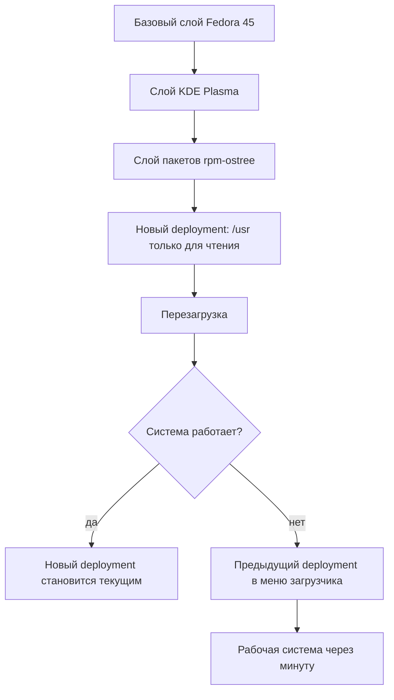
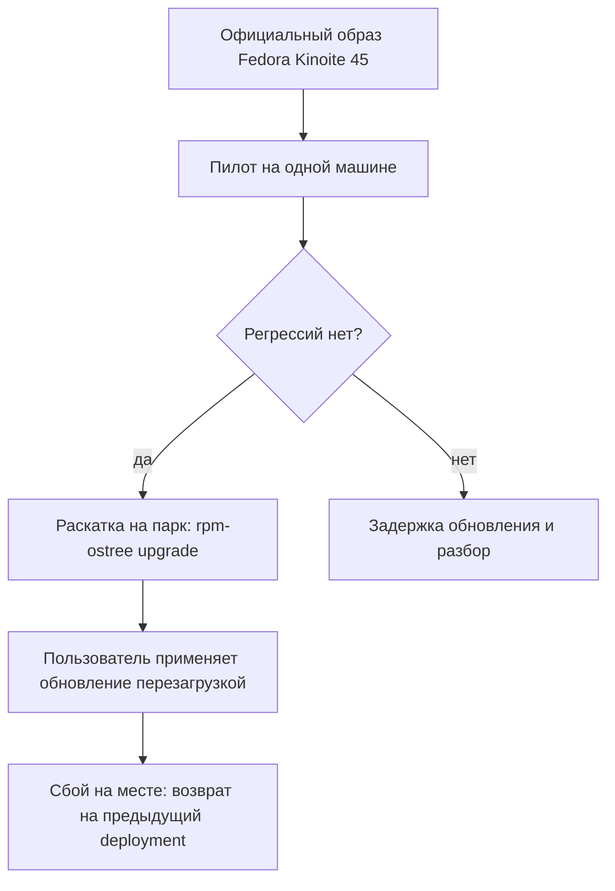
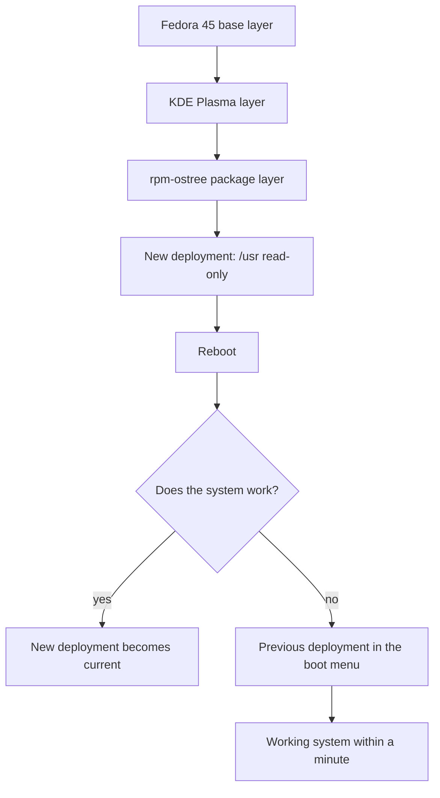
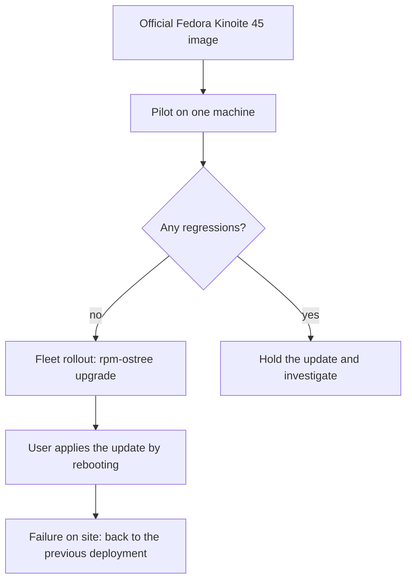
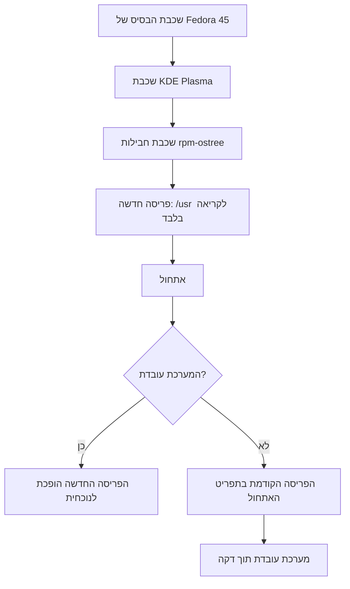
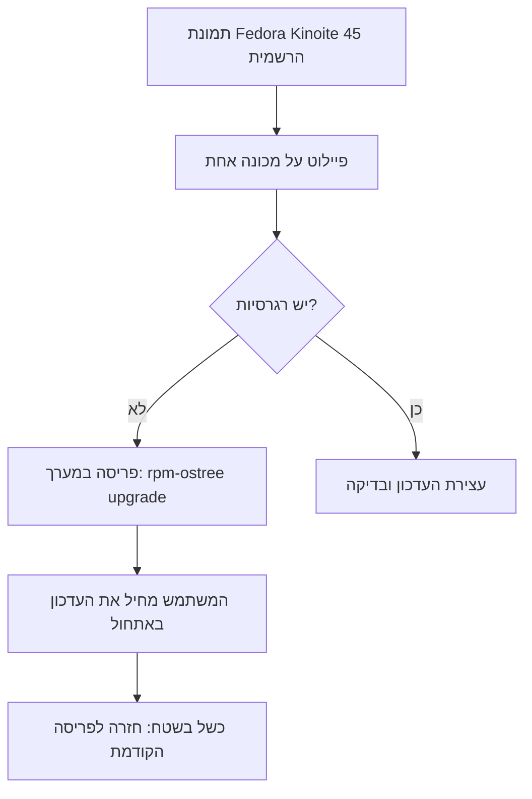

<!-- lang:ru -->

## Введение

Рабочий ноутбук я перевёл на Fedora Kinoite 45 — atomic-редакцию Fedora с KDE Plasma. Причина не в рабочем столе и не в Flatpak. Причина в модели обновления: система ставится не набором пакетов, которые правятся по одному на живой машине, а цельным образом, собранным из слоёв. У этой модели есть следствие, которое для меня важнее любых настроек: бекап-план перестаёт быть процедурой, которую надо не забыть выполнить. Он становится свойством системы.

## Как устроен atomic-релиз

Atomic-система собирается как образ. Снизу — базовый слой Fedora, на нём слой рабочего стола, выше — слой дополнительных пакетов, которые вы добавили сами. Слои собираются на сервере, подписываются и приезжают на машину целиком. Внутри образа `/usr` доступен только для чтения: на работающей системе никто не переписывает системные файлы по одному.

Каждое обновление — это новый deployment: полный набор слоёв, отдельная загрузочная запись и отдельный каталог в `/ostree/deploy`. Предыдущий deployment остаётся на диске, пока его не уберут или не закрепят. Выбор между ними делает загрузчик, а не пакетный менеджер.

Как выглядит путь от слоёв до работающей системы:



Изменяемые каталоги — `/etc` и `/var` — общие для всех deployments. Конфигурация, состояние сервисов и домашние каталоги при переключении остаются на месте. Поэтому возврат на предыдущую версию возвращает систему, а не стирает работу.

Главное отличие от привычной схемы — где происходят изменения. В обычном дистрибутиве обновление — это сотни операций над живой системой: каждый пакет ставится по отдельности, и между первой и последней операцией машина находится в неизвестном состоянии. В atomic-модели всё, что касается системы, происходит на сборочном сервере: там монтируется дерево, накатываются слои, получается один подписанный образ. На машину приезжает результат, а не процесс.

Побочный выигрыш — проверяемость. Подпись и идентификатор сборки позволяют ответить на вопрос, откуда взялась система, а неизменяемый `/usr` мешает тихо изменить бинарник или подложить библиотеку в системный путь. Это не замена антивирусу и не защита от root, но заметно сокращает незаметный дрейф.

## Право на ошибку

Дальше начинается то, ради чего это всё. Пользователь, у которого всегда есть предыдущая версия системы, ошибается спокойнее — и, что важнее, ошибается чаще и полезнее: пробует, откатывается, пробует иначе.

Сломался драйвер после обновления ядра — перезагрузка, предыдущая запись в меню загрузчика, работа продолжается. Не понравился новый Plasma или перестал запускаться виджет — то же самое. Поставили экспериментальный пакет слоем, получили конфликт — `rpm-ostree uninstall` возвращает прежний набор слоёв, а если проблема пришла с обновлением, `rpm-ostree rollback` переключает на предыдущий deployment.

Повседневные команды выглядят так:

```bash
rpm-ostree status                     # текущий и предыдущие deployments
sudo rpm-ostree upgrade               # скачать и подготовить новый
sudo rpm-ostree rollback              # вернуться на предыдущий
sudo rpm-ostree deploy 45.20261028.0  # конкретная версия
sudo rpm-ostree pin 0                 # закрепить рабочий deployment
```

Закрепление — недооценённая деталь. Перед рискованным экспериментом достаточно `pin`: рабочий deployment не будет вычищен сборщиком мусора, и вернуться к нему можно спустя недели.

Разница с обычным дистрибутивом видна на конкретных ситуациях:

| Ситуация | Обычный дистрибутив | Atomic-релиз |
| --- | --- | --- |
| Сбой после обновления | Диагностика, chroot, снапшот или переустановка | Выбор предыдущей записи в загрузчике |
| Прерванное обновление | Половинчатое состояние пакетов | Недоприменённого состояния нет |
| Эксперимент с пакетом | Откат по журналу транзакций | Удаление слоя или возврат deployment |
| Время на возврат | От часа до вечера | Один перезапуск |

Побочный эффект, который я не ожидал: я перестал откладывать обновления «на потом, когда будет время разбираться». Обновление теперь не событие с риском, а обычная операция с известной ценой отката. Обычно ведь как: свежая система — потенциальная проблема, и её отодвигают. Здесь потенциальная проблема ограничена одним перезапуском, и откладывать её незачем.

Отдельный выигрыш — разделение экспериментов и системы. Всё, что нужно попробовать «по-настоящему», живёт в контейнерах Toolbx или Distrobox, в Flatpak и в проектных окружениях, а не в базовой системе. Рабочий стол при этом остаётся чистым: эксперимент удалили — и от него не осталось хвостов в виде библиотек и зависимостей. А если эксперимент всё-таки задел систему, у вас по-прежнему есть предыдущий deployment.

Оговорка, без которой статья была бы нечестной: atomic-релиз защищает систему, а не данные. `/home` — обычная файловая система, и `rm -rf` в ней атомарность не остановит. Домашний каталог, git-репозитории и заметки надо бэкапить отдельно. Atomic снимает риск «сломалась ОС», но не риск «потерялись файлы».

## Что это даёт администратору

Для администратора парка машин выгода не в красоте идеи, а в сокращении классов инцидентов.

1. **Одна версия на всех.** Версия — одно число, а не «у всех по-разному, потому что кто-то обновился в марте». Ответ на вопрос «на какой вы версии?» даёт вывод `rpm-ostree status`, и он же прикладывается к заявке.
2. **Первая линия поддержки без root.** Инструкция «в меню загрузчика выберите предыдущую запись» работает у любого пользователя: без sudo, без удалённого доступа, без выезда. Это снимает самый дорогой класс обращений — «ноутбук не загружается после обновления».
3. **Нет половинчатого состояния.** Пакеты не устанавливаются по одному в живую систему: либо новый deployment целиком, либо старый. Класс инцидентов «обновление прервали на середине» исчезает по построению.
4. **Предсказуемое расследование.** Известны версия, набор слоёв и история deployments. Точка отсчёта «до обновления работало, после нет» получается одной командой, а не археологией по логам.
5. **Управляемый темп обновлений.** Новый образ можно скачать и не применять; можно проверить его на пилотной машине, а при необходимости вернуть конкретную сборку через `rpm-ostree deploy`, а не «последнюю, какая получится».
6. **Меньше дрейфа конфигурации.** `/usr` неизменяем, а изменения системы явные — слой пакета или правка в `/etc`. «Кто-то что-то доустановил полгода назад» видно в `rpm-ostree status`, а не обнаруживается при следующем крупном обновлении.

Как это выглядит при раскатке на парк:



У подхода есть цена, и её лучше знать заранее. Каждый добавленный слой приходится пересобирать на каждом обновлении базы, а конфликты слоёв — это реальная работа, а не редкий случай. Сторонние драйверы и модули DKMS нужно проверять на каждой версии. Flatpak обновляется отдельно и в образ не входит. Названия команд и флагов могут меняться от релиза к релизу — устойчива модель, а не синтаксис. Если нужны корпоративные настройки внутри `/usr`, появляется своя сборка образа и отдельный пайплайн; если нет — хватает официального образа плюс управляемых слоёв. И самое главное: решение о модели надо принять до того, как парк разъехался, а не после.
## Итог

Atomic-релиз не делает систему безотказной. Он делает отказ дешёвым. Предыдущая версия уже лежит на диске и грузится по выбору в меню — значит, любое обновление, любой эксперимент и любая ошибка в настройке стоят одного перезапуска. Пользователь получает право ошибаться без последствий, администратор — предсказуемый парк и первую линию поддержки, которой не нужны права root. Поэтому в моём списке бекап-планов atomic-релиз стоит первым, а не последним.

<!-- lang:en -->

## Introduction

I moved my work laptop to Fedora Kinoite 45 — the atomic edition of Fedora with KDE Plasma. The reason is neither the desktop nor Flatpak. The reason is the update model: the system is not installed as a set of packages patched one by one on a live machine, but as a complete image assembled from layers. That model has a consequence I value more than any setting: a backup plan stops being a procedure you must remember to perform. It becomes a property of the system.

## How an atomic release works

An atomic system is built as an image. At the bottom is the Fedora base layer, on top of it the desktop layer, and above that the layer of extra packages you added yourself. The layers are assembled on a server, signed, and delivered to the machine as a whole. Inside the image `/usr` is read-only: nothing rewrites system files one by one on a running system.

Every update is a new deployment: a full set of layers, its own boot entry and its own directory under `/ostree/deploy`. The previous deployment stays on disk until it is removed or pinned. The bootloader chooses between them, not the package manager.

This is the path from layers to a running system:



The mutable directories — `/etc` and `/var` — are shared by all deployments. Configuration, service state and home directories survive the switch. That is why going back to the previous version returns the system without erasing your work.

The main difference from the familiar scheme is where the changes happen. On a classic distribution an update is hundreds of operations on a live system: each package is installed separately, and between the first and the last one the machine is in an unknown state. In the atomic model everything about the system happens on the build server: a tree is mounted there, layers are applied, and one signed image comes out. The machine receives the result, not the process.

A side benefit is verifiability. The signature and the build ID answer the question of where the system came from, and a read-only `/usr` makes it hard to quietly replace a binary or drop a library into a system path. It is not a substitute for antivirus and not protection against root, but it noticeably reduces silent drift.

## Room for error

This is where the payoff starts. A user who always has a previous system version makes mistakes more calmly — and, more importantly, makes them more often and more usefully: tries, rolls back, tries differently.

A driver broke after a kernel update? Reboot, pick the previous entry in the boot menu, keep working. The new Plasma does not appeal to you, or a widget stopped launching? Same. You installed an experimental package as a layer and hit a conflict? `rpm-ostree uninstall` restores the previous set of layers, and if the problem came with an update, `rpm-ostree rollback` switches to the previous deployment.

The everyday commands look like this:

```bash
rpm-ostree status                     # current and previous deployments
sudo rpm-ostree upgrade               # download and stage a new one
sudo rpm-ostree rollback              # return to the previous one
sudo rpm-ostree deploy 45.20261028.0  # a specific version
sudo rpm-ostree pin 0                 # pin a known-good deployment
```

Pinning is an underrated detail. Before a risky experiment, one `pin` is enough: garbage collection will not reclaim the working deployment, and you can return to it weeks later.

The difference from a classic distribution shows up in concrete situations:

| Situation | Classic distribution | Atomic release |
| --- | --- | --- |
| Failure after an update | Diagnosis, chroot, snapshot or reinstall | Pick the previous boot entry |
| Interrupted update | Half-applied package state | There is no half-applied state |
| Package experiment | Rollback via the transaction log | Remove the layer or revert the deployment |
| Time to recover | An hour to an evening | One reboot |

A side effect I did not expect: I stopped postponing updates for “later, when there is time to deal with it”. An update is no longer an event with risk but a routine operation with a known rollback cost. The usual pattern is the opposite: a fresh system is a potential problem, so it gets pushed away. Here the potential problem is bounded by one reboot, so there is no reason to postpone it.

One caveat, without which the article would be dishonest: an atomic release protects the system, not your data. `/home` is an ordinary filesystem, and atomicity will not stop an `rm -rf` inside it. Your home directory, git repositories and notes need a separate backup. Atomicity removes the “OS broke” risk, not the “files are gone” risk.

## What an administrator gets

For someone running a fleet, the benefit is not the elegance of the idea but fewer incident classes.

1. **One version everywhere.** The version is a single number, not “everyone is on something different because someone updated in March”. The answer to “what version are you on?” is `rpm-ostree status`, and it goes straight into the ticket.
2. **First-line support without root.** “Pick the previous entry in the boot menu” works for any user: no sudo, no remote access, no site visit. That removes the most expensive class of tickets — “the laptop does not boot after an update”.
3. **No half-updated state.** Packages are not installed one by one into a live system: either the new deployment as a whole or the old one. The “update was interrupted halfway” class of incidents disappears by construction.
4. **Predictable investigation.** The version, the set of layers and the deployment history are known. The “it worked before the update and not after” baseline comes from one command instead of log archaeology.
5. **Controlled update pace.** A new image can be downloaded and not applied; it can be tested on a pilot machine, and a specific build can be brought back with `rpm-ostree deploy` rather than “whatever latest turns out to be”.
6. **Less configuration drift.** `/usr` is immutable, and system changes are explicit — a package layer or an edit in `/etc`. “Someone installed something six months ago” shows up in `rpm-ostree status` instead of surfacing during the next major upgrade.

This is what a fleet rollout looks like:



The approach has a cost, and it is better to know it in advance. Every added layer has to be rebuilt on every base update, and layer conflicts are real work rather than a rare case. Third-party drivers and DKMS modules need testing on every version. Flatpak updates separately and is not part of the image. Command names and flags may change from release to release — the model is what lasts, not the syntax. If you need corporate settings inside `/usr`, you get your own image build and a separate pipeline; if not, the official image plus managed layers is enough. And most importantly: decide on the model before the fleet has drifted apart, not after.

## Conclusion

An atomic release does not make a system failure-proof. It makes failure cheap. The previous version is already on disk and boots from a menu entry — so any update, any experiment and any configuration mistake costs one reboot. The user gets room to err without consequences, the administrator gets a predictable fleet and a first line of support that needs no root. That is why, in my list of backup plans, the atomic release sits first rather than last.

<!-- lang:he -->

## מבוא

העברתי את מחשב הנייד לעבודה ל-Fedora Kinoite 45 — המהדורה האטומית של פדורה עם KDE Plasma. הסיבה אינה שולחן העבודה ואינה Flatpak. הסיבה היא מודל העדכון: המערכת אינה מותקנת כאוסף חבילות שמתוקנות אחת-אחת על מכונה פעילה, אלא כתמונה שלמה שנבנית משכבות. למודל הזה יש תוצאה שחשובה לי יותר מכל הגדרה: תוכנית הגיבוי מפסיקה להיות נוהל שצריך לזכור לבצע. היא הופכת לתכונה של המערכת.

## איך בנוי שחרור אטומי

מערכת אטומית נבנית כמו תמונה. למטה שכבת הבסיס של פדורה, מעליה שכבת שולחן העבודה, ומעליהן שכבת החבילות הנוספות שהוספתם בעצמכם. השכבות נבנות בשרת, נחתמות ומועברות למכונה כשלם. בתוך התמונה הספרייה `/usr` היא לקריאה בלבד: שום דבר לא כותב מחדש קבצי מערכת אחד-אחד במערכת פעילה.

כל עדכון הוא פריסה חדשה (deployment): סט שלם של שכבות, רשומת אתחול נפרדת ותיקייה נפרדת תחת `/ostree/deploy`. הפריסה הקודמת נשארת בדיסק עד שמסירים אותה או מצמידים אותה. הבחירה ביניהן נעשית על ידי מנהל האתחול, לא על ידי מנהל החבילות.

כך נראה הנתיב משכבות למערכת פעילה:



התיקיות הניתנות לשינוי — `/etc` ו-`/var` — משותפות לכל הפריסות. תצורה, מצב שירותים ותיקיות בית נשארים במקומם בעת המעבר. לכן חזרה לגרסה הקודמת מחזירה את המערכת ואינה מוחקת את העבודה.

ההבדל המרכזי מהסכמה המוכרת הוא היכן מתרחשים השינויים. בהפצה רגילה עדכון הוא מאות פעולות על מערכת חיה: כל חבילה מותקנת בנפרד, ובין הפעולה הראשונה לאחרונה המכונה נמצאת במצב לא ידוע. במודל האטומי כל מה שקשור למערכת קורה בשרת הבנייה: שם מרכיבים עץ, מחילים שכבות ומקבלים תמונה חתומה אחת. המכונה מקבלת תוצאה, לא תהליך.

רווח צדדי — יכולת אימות. החתימה ומזהה הבנייה עונים על השאלה מאין הגיעה המערכת, ו-`/usr` שאינו ניתן לשינוי מקשה להחליף קובץ הרצה בשקט או להניח ספרייה בנתיב מערכת. זה לא תחליף לאנטי-וירוס ולא הגנה מפני root, אבל זה מצמצם בבירור סחיפה שקטה.

## הזכות לטעות

מכאן מתחיל מה שכל זה נועד בשבילו. משתמש שתמיד יש לו גרסה קודמת של המערכת טועה בשקט נפשי — וזה חשוב יותר: הוא טועה לעתים קרובות יותר ובדרך שימושית יותר. מנסה, חוזר אחורה, מנסה אחרת.

דרייבר נשבר אחרי עדכון ליבה? אתחול, בחירת הרשומה הקודמת בתפריט האתחול, ממשיכים לעבוד. ה-Plasma החדש לא מוצא חן בעיניכם או שווידג'ט הפסיק לעלות? אותו דבר. התקנתם חבילה ניסיונית כשכבה ונתקלתם בהתנגשות? `rpm-ostree uninstall` מחזיר את סט השכבות הקודם, ואם הבעיה הגיעה עם עדכון, `rpm-ostree rollback` מעביר לפריסה הקודמת.

הפקודות היומיומיות נראות כך:

```bash
rpm-ostree status                     # הפריסה הנוכחית והקודמות
sudo rpm-ostree upgrade               # הורדה והכנת פריסה חדשה
sudo rpm-ostree rollback              # חזרה לפריסה הקודמת
sudo rpm-ostree deploy 45.20261028.0  # גרסה מסוימת
sudo rpm-ostree pin 0                 # הצמדת פריסה עובדת
```

הצמדה היא פרט שאולי לא מעריכים מספיק. לפני ניסוי מסוכן מספיק `pin` אחד: איסוף האשפה לא יפנה את הפריסה העובדת, וניתן לחזור אליה גם אחרי שבועות.

ההבדל מהפצה רגילה נראה במצבים קונקרטיים:

| מצב | הפצה רגילה | שחרור אטומי |
| --- | --- | --- |
| כשל אחרי עדכון | אבחון, chroot, snapshot או התקנה מחדש | בחירת רשומת האתחול הקודמת |
| עדכון שנקטע | מצב חבילות חלקי | אין מצב חלקי כלל |
| ניסוי עם חבילה | חזרה לאחור לפי יומן הטרנזקציות | הסרת השכבה או חזרה לפריסה קודמת |
| זמן התאוששות | משעה ועד ערב | אתחול אחד |

תופעת לוואי שלא ציפיתי לה: הפסקתי לדחות עדכונים ל"אחר כך, כשיהיה זמן להתעסק בזה". עדכון אינו עוד אירוע עם סיכון אלא פעולה שגרתית עם מחיר חזרה ידוע. בדרך כלל זה הפוך: מערכת חדשה היא בעיה פוטנציאלית, ולכן דוחים אותה. כאן הבעיה הפוטנציאלית מוגבלת לאתחול אחד, ואין סיבה לדחות.

רווח נפרד — הפרדה בין ניסויים למערכת. כל מה שצריך לנסות "ברצינות" חי במכולות Toolbx או Distrobox, ב-Flatpak ובסביבות פרויקט, ולא במערכת הבסיס. שולחן העבודה נשאר נקי: מחקתם את הניסוי — ולא נשארו אחריו שאריות של ספריות ותלויות. ואם הניסוי בכל זאת נגע במערכת, עדיין יש לכם פריסה קודמת.

הסתייגות שבלעדיה המאמר לא יהיה ישר: שחרור אטומי מגן על המערכת, לא על הנתונים. `/home` היא מערכת קבצים רגילה, ואטומיות לא תעצור `rm -rf` בתוכה. תיקיית הבית, מאגרי git וההערות צריכים גיבוי נפרד. אטומיות מסירה את הסיכון "מערכת ההפעלה נשברה", אבל לא את הסיכון "הקבצים אבדו".

## מה מקבל מנהל המערכת

למי שמנהל מערך מחשבים התועלת אינה ביופי של הרעיון אלא בצמצום מחלקות התקלות.

1. **גרסה אחת לכולם.** הגרסה היא מספר אחד, לא "לכל אחד משהו אחר, כי מישהו עדכן במארס". התשובה לשאלה "באיזו גרסה אתה?" היא הפלט של `rpm-ostree status`, והוא מצורף לפנייה.
2. **קו תמיכה ראשון בלי root.** ההוראה "בחר את הרשומה הקודמת בתפריט האתחול" עובדת אצל כל משתמש: בלי sudo, בלי גישה מרחוק, בלי הגעה פיזית. זה מסיר את מחלקת הפניות היקרה ביותר — "המחשב לא עולה אחרי עדכון".
3. **אין מצב חצי-מעודכן.** חבילות אינן מותקנות אחת-אחת במערכת חיה: או פריסה חדשה שלמה או הישנה. מחלקת התקלות "העדכון נקטע באמצע" נעלמת מכוח הבנייה.
4. **חקירה צפויה מראש.** הגרסה, סט השכבות והיסטוריית הפריסות ידועים. נקודת ההתייחסות "לפני העדכון עבד, אחרי לא" מתקבלת בפקודה אחת ולא בארכיאולוגיה של לוגים.
5. **קצב עדכונים נשלט.** אפשר להוריד תמונה חדשה ולא להחיל אותה; אפשר לבדוק אותה על מכונת פיילוט, ובמידת הצורך להחזיר בנייה מסוימת באמצעות `rpm-ostree deploy` ולא "את האחרונה שיצאה".
6. **פחות סחיפת תצורה.** `/usr` אינו ניתן לשינוי, והשינויים במערכת מפורשים — שכבת חבילה או עריכה ב-`/etc`. "מישהו התקין משהו לפני חצי שנה" נראה ב-`rpm-ostree status` ולא מתגלה בשדרוג הגדול הבא.

כך נראית פריסה במערך:



לגישה יש מחיר, וכדאי להכיר אותו מראש. כל שכבה שהוספתם צריכה להיבנות מחדש בכל עדכון בסיס, והתנגשויות שכבות הן עבודה אמיתית ולא מקרה נדיר. דרייברים של צד שלישי ומודולי DKMS דורשים בדיקה בכל גרסה. Flatpak מתעדכן בנפרד ואינו חלק מהתמונה. שמות הפקודות והדגלים עשויים להשתנות בין מהדורות — המודל הוא שנשאר, לא התחביר. אם דרושים לכם הגדרות ארגוניות בתוך `/usr`, מופיעה בנייה עצמאית של תמונה וצינור נפרד; אם לא — די בתמונה הרשמית ובעוד שכבות מנוהלות. והעיקר: את ההחלטה על המודל צריך לקבל לפני שמערך המחשבים התפזר, ולא אחרי.

## סיכום

שחרור אטומי לא הופך מערכת לחסינה לתקלות. הוא הופך כשל לזול. הגרסה הקודמת כבר נמצאת בדיסק ועולה מבחירה בתפריט — כלומר כל עדכון, כל ניסוי וכל טעות בתצורה עולים אתחול אחד. המשתמש מקבל זכות לטעות בלי השלכות, ומנהל המערכת מקבל מערך צפוי וקו תמיכה ראשון שלא צריך הרשאות root. לכן ברשימת תוכניות הגיבוי שלי השחרור האטומי נמצא ראשון ולא אחרון.
