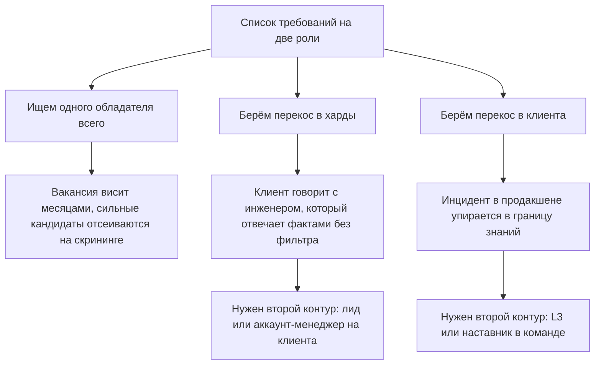
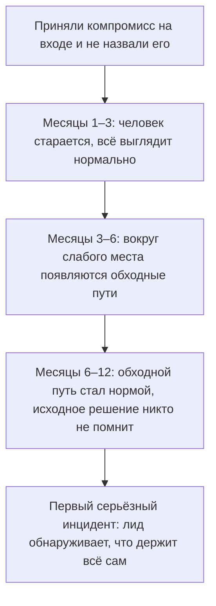
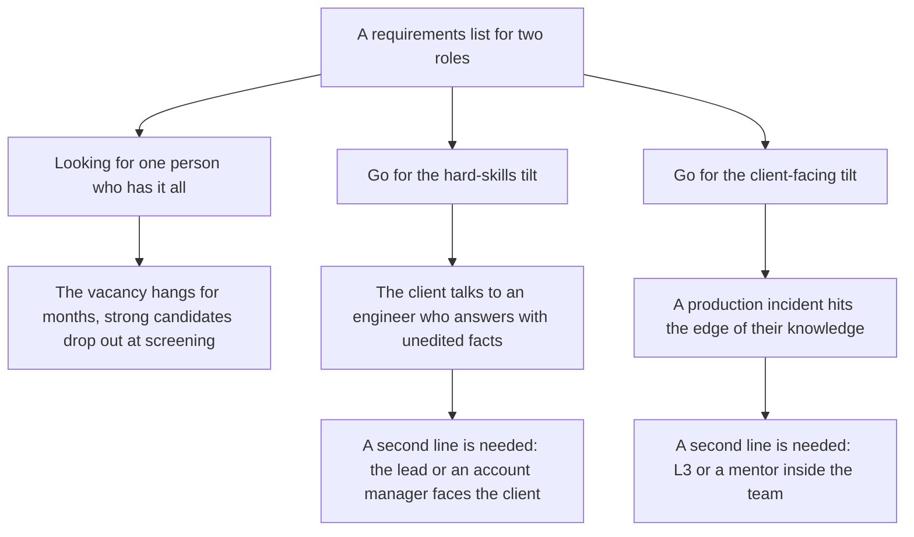
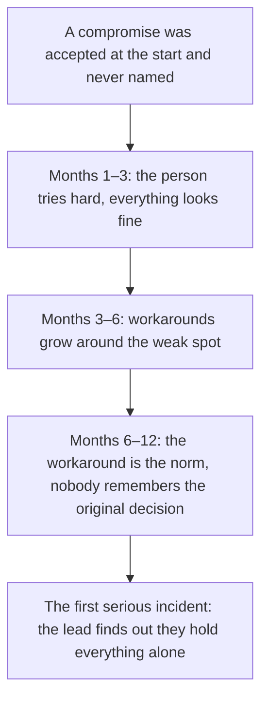
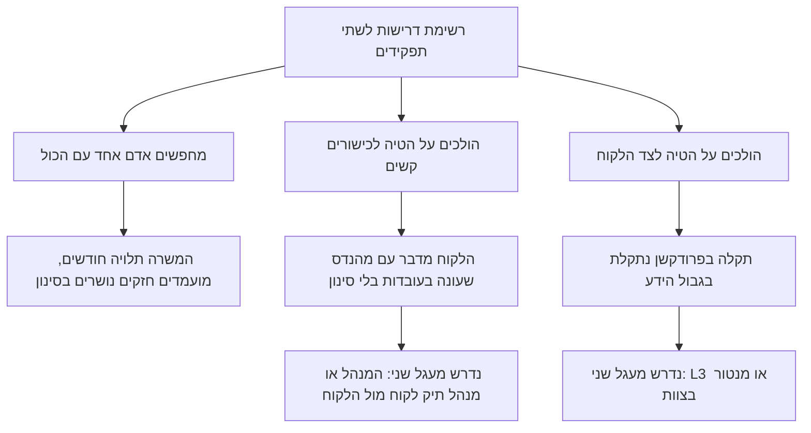
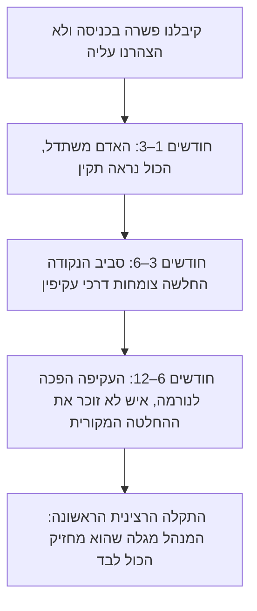

<!-- lang:ru -->

## Введение

Заявка на инженера поддержки инфраструктурного продукта выглядит безобидно, пока её не начинают писать. Продукт сложный: контейнеры, сеть, виртуализация, свои сборки, чужая инфраструктура у клиента. Клиенты прямые: не через аккаунт-менеджера, а в переписке и на звонке — со мной и с инженером. И вот в требованиях уже полтора десятка строк, каждая из которых по отдельности абсолютно разумна.

Мой тезис: проблема такой вакансии не в том, что требования завышены, а в том, что они из разных профессий. Один список описывает человека, который держит инфраструктурный продукт на уровне диагностики, — и человека, который держит отношения с раздражённым клиентом на уровне переговоров. Иногда это один человек. Но когда мы пишем вакансию так, будто это обязательно один и тот же человек, мы получаем не строгий отбор, а пустой рынок и вежливые отказы HR.

Дальше — откуда берётся длинный список, что в нём действительно проверяемо, какие компромиссы я считаю допустимыми, а какие — замедленной миной, и что со всем этим приходится делать HR.

## Откуда берётся длинный список

Требования почти никогда не выдумывают. Их складывают из четырёх источников, и каждый дописывает своё.

- **Инфраструктура.** Что команда реально чинит каждый день: сеть, контейнеры, KVM, очереди, systemd, свои скрипты. Здесь требования честные и проверяемые — но их много, потому что продукт действительно широкий.
- **Продукт вендора.** Знать нужно не «контейнеры вообще», а конкретный продукт: как он ведёт себя на пределе, при каких версиях ломается апгрейд, где заканчивается поддержка и начинается доработка, что уже записано в известных проблемах. Этого нет ни в одном общем курсе — знание живёт в базе знаний, в трекере и в головах двух старожилов.
- **Клиент.** Что нужно, чтобы говорить с ним напрямую: письменная речь, переговоры о сроках, устойчивость к давлению, умение сказать «нет» с альтернативой, а не с извинением.
- **Команда и процесс.** То, что болит у лида прямо сейчас: чтобы человек вёл базу знаний, не терял заявки в трекере, эскалировал по правилам, не спорил о зонах ответственности. Это требования к зрелости, а не к профессии.

Каждый пункт по отдельности защитим. Вместе они описывают не вакансию, а команду из нескольких человек — и именно так кандидат её и читает: «здесь ищут супергероя, значит, критериев нет».

<!-- вилка: реальный пример вакансии — сколько пунктов было в первой версии, что убрали после обсуждения с HR. -->

## Вакансий на самом деле две

Если разложить список по источнику, видно развилку: сильный хард и сильный софт почти никогда не встречаются в одном резюме на одном уровне, и это не дефект рынка. Люди растут в одну сторону: либо в глубину диагностики, либо в сторону клиента и процессов. Отличник в обоих направлениях существует, но он уже занят и стоит дороже, чем весь бюджет вакансии.

Как замыкается этот круг:

Практический вывод из этой схемы простой: компромисс неизбежен, вопрос только в том, признан он вслух или нет. Непризнанный компромисс через полгода всплывает как «мы не то наняли».

## Харды: что проверять вместо названий технологий

Названия технологий в вакансии нужны, чтобы кандидат себя узнал, а не чтобы отбирать. Отбирать ими бессмысленно: «знает Podman» и «разбирал инцидент с сетью в чужих контейнерах до первопричины» пишутся одинаково коротко и означают совершенно разное.

Что я реально проверяю на хард-этапе:

- **Границу между диагностикой и догадкой.** Прошу рассказать инцидент, где первая версия оказалась неверной. Смотрю, как человек менял гипотезу: по фактам или по интуиции.
- **Чтение системы, а не только логов.** Умеет ли он смотреть на сеть, на диск, на лимиты, на то, что происходит *вокруг* сервиса. Инфраструктурная поддержка — это в основном «почему оно не работает там, где я не смотрел».
- **Работу в чужом контуре.** Клиентская инфраструктура — это ограничения: нет рута, нет доступа к журналу, нельзя перезапустить. Проверяю, есть ли опыт ремонта в таких условиях, а не только на своём стенде.
- **Гигиену изменений.** Понимает ли человек, что в продакшене клиента каждое действие имеет цену и откат.

Технологии из этого списка выводятся: если человек разбирал инциденты до первопричины на похожем классе систем, конкретный гипервизор или движок контейнеров он догонит за месяц. Если не разбирал — не догонит никогда, и это как раз необучаемая часть.

## Софты для прямого клиента — это не «коммуникабельность»

«Коммуникабельность» в вакансии — слово-пустышка. За ним скрывается конкретный набор навыков, и он проверяется кейсом, а не беседой о хобби.

- **Письменная речь.** Прямой клиент судит о продукте по письму инженера. Проверяю не грамотность, а структуру: есть ли в ответе что происходит, что делаем, когда узнаем результат. Ответ «разбираемся» без срока — это не софт-скилл, это отсутствие навыка.
- **Отказ с альтернативой.** Клиент просит включить то, что сломает ему же продукт. Сильный инженер говорит «нет» и предлагает другой путь; слабый — соглашается и потом объясняет последствия; третий — эскалирует лиду, потому что «это политика».
- **Устойчивость к давлению без потери фактов.** В раздражённом разговоре часть людей начинает обещать сроки, которых не выдержит. Проверяю на кейсе: клиент требует дату, данных для оценки нет. Что скажет человек?
- **Границы.** Прямой клиент — это соблазн делать всё, о чём попросят, включая то, что не входит в поддержку. Умение очертить зону и не выглядеть при этом бюрократом — отдельный навык, и он тренируется хуже остальных.

<!-- вилка: один-два собственных эпизода — клиент, инженер и решение, которое дало разницу. -->

## Что происходит, когда одного не хватает

Недостаток — не абстракция, у него есть срок проявления. Это ключевая таблица для разговора с HR, потому что она переводит «нам нужны оба качества» в «вот что мы увидим и когда».

| Профиль | Что получаем сразу | Что происходит через полгода |
| --- | --- | --- |
| Сильный хард, слабый клиент | Инциденты закрываются быстро, лид разгружен по технике | Клиент просит заменить инженера или уходит на аккаунт-менеджера; лид тратит время на переписку вместо работы |
| Сильный клиент, слабый хард | Клиент доволен тоном и скоростью ответа | Сложные случаи висят, эскалации растут, лид становится единственной точкой решения |
| Среднее в обоих | Он никого не раздражает и никого не спасает | Нагрузка распределяется на сильных коллег, те уходят первыми |
| Сильный хард, сильный клиент | Всё хорошо | Человек упирается в потолок роли и уходит туда, где есть следующий шаг |

Последняя строка — та, о которой забывают. Идеальный кандидат — самый вероятный кандидат на уход через год, если в вакансии не описано, что будет после.

## Компромиссы, которые я считаю допустимыми

Допустимый компромисс — тот, у которого есть владелец и срок закрытия. Не «мы как-нибудь разберёмся», а «это закрывает конкретный человек к конкретному моменту».

- **Технология вместо опыта класса систем.** Человек разбирал инциденты до первопричины на других системах, но не работал с нашим стеком. Обучаемо за месяц-два при наличии наставника. Условие: наставник назначен, а не подразумевается.
- **Незнание продукта вендора.** Самый частый и самый безопасный компромисс из всех. Условие одно: должно быть где взять правду — база знаний, доступ к известным проблемам, наставник. Без этого источника человек месяц заново разбирается в том, что команда уже знает, и начинает угадывать вместо поиска.
- **Чужая инфраструктура вместо своей.** Опыт работы только на своём стенде с полным доступом. Компенсируется процедурой и первым месяцем в паре с тем, кто умеет работать в ограничениях.
- **Клиентский опыт вместо клиентской уверенности.** Человек не вёл переговоры, но писал понятные письма. Разница между «не умеет» и «не пробовал» — обычно в практике и в праве сказать «я не знаю, отвечу через час».
- **Отсутствие одного пункта из процесса.** KCS (Knowledge-Centered Service — подход, при котором статья базы знаний пишется в момент решения), ITIL-процессы, работа с базой знаний — это навык, который ставится в первые недели, если в команде есть образец. Если образца нет, компромисс недопустим: человек не изобретёт процесс в одиночку.

Общее правило: допустимо то, что можно закрыть обучением и наставничеством внутри квартала. Всё, что требует смены типа личности или многолетней привычки, — не обучаемо, и компромисс здесь только по имени.

## Компромиссы, которые становятся замедленной миной

Замедленная мина отличается от ошибки тем, что первые месяцы всё хорошо. Человек старается, метрики в порядке, конфликтов нет. А потом обходные пути становятся нормой, и цена возвращается сразу.

Как это разворачивается во времени:

Мои четыре мины, на которые я наступал или видел вблизи.

**«Наймём сильного технаря и научим говорить с клиентом».** Работает, если обучение — это чья-то задача с часами в календаре. Не работает, когда «научится сам»: инженер начинает избегать клиента, клиент это замечает, лид забирает переписку себе — и возвращается к роли единственного говорящего, от которой пытался уйти.

**«Наймём клиентского человека, технику догонит на месте».** Хуже предыдущей мины, потому что технику нельзя компенсировать энтузиазмом. Месяц-два человек учится, потом начинает отвечать «это в L3». L3 (третья линия поддержки) — это два человека в команде, и один из них через полгода пишет заявление.

**«Разделим роль на двух людей».** Разумно на бумаге и опасно в жизни: клиент получает мяч, который перебрасывают между двумя. Пока клиент ждёт, ответственность не принадлежит никому. Разделение работает только с явной передачей: кто отвечает клиенту в конкретном обращении и кто в итоге решает.

**«Пока возьмём кого-то, а потом найдём нужного».** Самая дорогая мина, потому что второй найм идёт уже на фоне первого. Команда оценивает «планку» по человеку, которого взяли по компромиссу, а неудачный найм отнимает время у лида именно в тот период, когда его нужно тратить на следующего.

## С чем приходится иметь дело HR

Основная работа HR в такой вакансии — не найти кандидата, а привести требования к виду, на который рынок вообще отвечает. Это неудобно, потому что выглядит как торг.

- **Вакансия с двадцатью пунктами отсеивает сильных.** Человек, который проходит по пятнадцати пунктам, не откликается на двадцать: он считает, что ему откажут. Первыми уходят не слабые, а те, кто точно умеет читать такие списки.
- **Скрининг становится невыполнимым.** HR не может оценить «работал с сетью в чужих контейнерах» по резюме и начинает фильтровать по ключевым словам — то есть по названиям технологий, ровно по тому, что мы договорились не использовать. Это следствие нашей же формулировки, а не ошибка HR.
- **Ответ «кандидатов на рынке нет».** Обычно это правда про наш список и неправда про рынок. Полезно вместо спора пересобрать must-have до пяти пунктов и посмотреть, как меняется воронка.
- **Давление на этапы.** Когда вакансия висит, соблазн добавить пятое интервью и «ещё один тест» растёт. Кандидаты читают это как отсутствие решения внутри компании.
- **Обещания, которые не я даю.** HR обещает рост, грейд, «со временем — клиентский портфель». Эти обещания становятся моими, хотя я о них не знал. Договариваться о границах разговора про будущее нужно до первого оффера.
- **Честность текста вакансии.** Мы регулярно спорим о том, писать ли про сложности прямым текстом. Я за: человек, который приходит на честный текст, реже уходит через три месяца, когда оно не совпадает с обещаниями.

<!-- вилка: как это устроено у автора — какие этапы и кто в них участвует, где проходил разрыв между вакансией и ожиданиями HR. -->

## Что делаю я как нанимающий менеджер

Порядок действий у меня теперь такой.

1. **Свожу must-have к пяти пунктам.** В них входят три харда (диагностика до первопричины, работа в ограниченном контуре, понимание цены изменения) и два софта (письменный ответ со сроком, отказ с альтернативой). Всё остальное — nice-to-have и разговор об обучении. Знание продукта вендора сюда не входит сознательно: оно закрывается внутри компании за недели и проверяется на первых заявках, а не на интервью.
2. **Называю владельца каждого компромисса.** Не «догонит на месте», а «наставник ведёт его первые инциденты в чужом контуре, разбор через четыре недели». Если владельца нет, компромисс не проходит.
3. **Развожу два интервью по навыку.** Хард-этап — разбор реального инцидента до первопричины. Клиентский этап — кейс: раздражённый клиент требует дату, данных нет. Второй этап я провожу сам, потому что именно эти решения потом принимаю я.
4. **Пишу в вакансии, что будет через год.** Иначе сильный кандидат уходит не от сложности, а от отсутствия горизонта.
5. **Фиксирую отказ быстро.** Долгое ожидание сильного кандидата — это способ его потерять и одновременно способ потерять репутацию на рынке.

## Заключение

Длинный список требований — не признак строгого отбора, а признак того, что мы не решили, кого ищем. Сложный инфраструктурный продукт и прямой клиент действительно требуют двух сильных наборов навыков, но не требуют, чтобы они были в одном человеке и в полном объёме. Моя задача — выбрать явный перекос, назвать компромисс, назначить ему владельца и срок проверки.

Допустимый компромисс закрывается обучением внутри квартала. Замедленная мина выглядит как экономия решений на входе и стоит дороже любого повторного найма: она возвращается первым серьёзным инцидентом, уходом клиента или уходом сильного коллеги, который всё это держал.

<!-- lang:en -->

## Introduction

A job description for a support engineer on an infrastructure product looks harmless until you start writing it. The product is complex: containers, networking, virtualization, in-house builds, someone else's infrastructure at the client site. The clients are direct: not through an account manager, but in writing and on calls — with me and with the engineer. And the requirements list is already fifteen lines long, each one entirely reasonable on its own.

My point: the problem with such a vacancy is not that the bar is set too high, but that the requirements come from different professions. One list describes a person who owns an infrastructure product at the level of diagnosis, and a person who owns the relationship with an irritated client at the level of negotiation. Sometimes that is one person. But when we write the vacancy as if it must be the same person, we get not a strict filter but an empty market and polite rejections from HR.

Below: where the long list comes from, what in it is actually testable, which compromises I consider acceptable and which are slow-burning mines, and what HR has to deal with along the way.

## Where the long list comes from

Requirements are almost never invented. They are assembled from four sources, and each one adds its own.

- **Infrastructure.** What the team really fixes every day: networking, containers, KVM, queues, systemd, in-house scripts. These requirements are honest and testable — but there are many of them, because the product really is broad.
- **The vendor's product.** What you need to know is not "containers in general" but this specific product: how it behaves at its limits, which versions break the upgrade path, where support ends and development begins, what is already written down as a known issue. No general course covers this — the knowledge lives in the knowledge base, in the tracker and in the heads of two long-standing team members.
- **The client.** What it takes to talk to them directly: writing, negotiating deadlines, staying steady under pressure, saying "no" with an alternative instead of an apology.
- **The team and the process.** What hurts the lead right now: that the person maintains the knowledge base, does not lose tickets in the tracker, escalates by the rules, does not argue about areas of responsibility. These are requirements for maturity, not for the profession.

Each item is defensible on its own. Together they describe not a vacancy but a team of several people — and that is exactly how a candidate reads it: "they are looking for a superhero, so there are no criteria".

<!-- вилка: реальный пример вакансии — сколько пунктов было в первой версии, что убрали после обсуждения с HR. -->

## There are actually two vacancies

If you sort the list by source, a fork becomes visible: strong hard skills and strong soft skills almost never meet in one CV at the same level, and that is not a market defect. People grow in one direction: either into diagnostic depth, or towards the client and process work. A top performer in both directions exists, but they are already employed and cost more than the whole vacancy budget.

How this loop closes:

The practical conclusion is simple: compromise is unavoidable, the only question is whether it is acknowledged out loud. An unacknowledged compromise resurfaces six months later as "we hired the wrong person".

## Hard skills: what to test instead of technology names

Technology names in a vacancy are there so the candidate recognizes themselves, not so you can select on them. Selecting on them is pointless: "knows Podman" and "traced a networking incident to its root cause inside someone else's containers" are written with the same brevity and mean completely different things.

What I actually test at the hard-skills stage:

- **The line between diagnosis and guessing.** I ask for an incident where the first hypothesis was wrong. I watch how the person changed it: on evidence or on intuition.
- **Reading the system, not just the logs.** Can they look at networking, at the disk, at limits, at what happens *around* the service. Infrastructure support is mostly "why does it not work where I did not look".
- **Working inside someone else's environment.** Client infrastructure means constraints: no root, no access to the log, no permission to restart. I check for experience of fixing things under those conditions, not only on their own test bench.
- **Change hygiene.** Do they understand that in a client's production every action has a price and a rollback.

The technologies follow from this list: if a person has traced incidents to root cause on a similar class of systems, they will pick up this particular hypervisor or container engine in a month. If they have not, they never will — and that is exactly the part that cannot be taught.

## Soft skills for a direct client are not "communication skills"

"Communication skills" in a vacancy is an empty word. Behind it sits a specific set of abilities, and it is tested with a case, not with a conversation about hobbies.

- **Writing.** A direct client judges the product by the engineer's email. I test structure, not grammar: does the answer contain what is happening, what we are doing, and when we will know the result. "We're looking into it" with no date is not a soft skill — it is a missing skill.
- **Saying no with an alternative.** The client asks to enable something that will break their own product. A strong engineer says no and offers another way; a weak one agrees and explains the consequences later; a third escalates to the lead because "that's policy".
- **Holding steady under pressure without losing the facts.** In an irritated conversation some people start promising deadlines they cannot meet. I test it with a case: the client demands a date, there is no data to estimate from. What does the person say?
- **Boundaries.** A direct client is a temptation to do everything that is asked, including what is not part of support. Drawing the line without looking like a bureaucrat is a separate skill, and it trains worse than the others.

<!-- вилка: один-два собственных эпизода — клиент, инженер и решение, которое дало разницу. -->

## What happens when one of the two is missing

A shortcoming is not an abstraction; it has a timeline. This is the key table for the conversation with HR, because it turns "we need both qualities" into "here is what we will see, and when".

| Profile | What we get right away | What happens within six months |
| --- | --- | --- |
| Strong hard skills, weak client skills | Incidents close fast, the lead is unloaded on technical work | The client asks for a replacement or goes to the account manager; the lead spends time on email instead of work |
| Strong client skills, weak hard skills | The client is happy with the tone and the response time | Difficult cases stall, escalations grow, the lead becomes the only decision point |
| Mediocre at both | They irritate nobody and save nobody | The load lands on stronger colleagues, and they leave first |
| Strong hard skills, strong client skills | Everything is fine | The person hits the ceiling of the role and leaves for somewhere with a next step |

The last row is the one people forget. The ideal candidate is the most likely candidate to leave within a year if the vacancy does not describe what comes after.

## Compromises I consider acceptable

An acceptable compromise is one that has an owner and a closing date. Not "we'll figure it out somehow", but "this will be closed by a specific person at a specific point".

- **A technology instead of experience with a class of systems.** The person traced incidents to root cause on other systems but has not worked with our stack. Learnable in a month or two with a mentor. The condition: the mentor is assigned, not implied.
- **Not knowing the vendor's product.** The most common and the safest compromise of all. One condition: there must be somewhere to get the truth — the knowledge base, access to known issues, a mentor. Without that source a person spends a month re-learning what the team already knows and starts guessing instead of searching.
- **Someone else's infrastructure instead of your own.** Experience only on your own bench with full access. Compensated by procedure and by pairing with someone who can work within constraints during the first month.
- **Client experience instead of client confidence.** The person has not run negotiations but writes clearly. The difference between "cannot" and "has not tried" usually comes down to practice and to the right to say "I don't know, I'll answer in an hour".
- **Missing one process item.** KCS (Knowledge-Centered Service — an approach where the knowledge base article is written at the moment of solving), ITIL processes, knowledge base work — these are skills installed in the first weeks if the team has a model to copy. If there is no model, the compromise is not acceptable: a person will not invent a process alone.

The general rule: acceptable is what can be closed by training and mentoring within a quarter. Anything that requires a change of personality or a habit built over years cannot be taught, and a compromise there exists in name only.

## Compromises that become slow-burning mines

A slow-burning mine differs from a mistake in that the first months are fine. The person tries hard, the metrics look good, there are no conflicts. Then the workarounds become the norm, and the price arrives all at once.

How it unfolds over time:

The four mines I have stepped on or seen up close.

**"Let's hire a strong technician and teach them to talk to clients."** It works if the teaching is somebody's task with hours in the calendar. It does not work when it is "they'll learn": the engineer starts avoiding the client, the client notices, the lead takes the correspondence back — and returns to being the only one who speaks, which is the role they were trying to leave.

**"Let's hire a client-facing person, they'll catch up on the technical side."** Worse than the previous mine, because enthusiasm cannot compensate for technique. The person studies for a month or two, then starts answering "that's for L3". L3 (third-line support) is two people in the team, and one of them hands in their notice six months later.

**"Let's split the role between two people."** Reasonable on paper and dangerous in life: the client gets a ball that is tossed between two. While the client waits, responsibility belongs to nobody. Splitting works only with explicit handover: who answers the client on a given ticket and who ultimately decides.

**"Let's take someone for now and find the right person later."** The most expensive mine, because the second hire happens against the backdrop of the first. The team calibrates its bar by the person hired on a compromise, and a failed hire takes the lead's time exactly when it should be spent on the next one.

## What HR has to deal with

HR's main job on such a vacancy is not to find a candidate but to bring the requirements to a shape the market actually responds to. That is uncomfortable, because it looks like haggling.

- **A vacancy with twenty requirements filters out the strong.** Someone who meets fifteen of them does not apply to twenty: they assume they will be rejected. The first to walk away are not the weak ones but those who know how to read such lists.
- **Screening becomes impossible.** HR cannot assess "worked with networking inside someone else's containers" from a CV and starts filtering by keywords — that is, by technology names, precisely the thing we agreed not to use. That is a consequence of our own wording, not an HR mistake.
- **"There are no candidates on the market."** Usually that is true about our list and untrue about the market. Instead of arguing, it helps to rebuild the must-haves down to five items and watch how the funnel changes.
- **Pressure on the stages.** While the vacancy hangs, the temptation to add a fifth interview and "one more test" grows. Candidates read it as an absence of decisions inside the company.
- **Promises I did not make.** HR promises growth, a grade change, "a client portfolio in time". Those promises become mine although I did not know about them. Agreeing the boundaries of the conversation about the future has to happen before the first offer.
- **Honesty in the vacancy text.** We argue regularly about whether to describe the difficulties plainly. I am for it: a person who joins on an honest text leaves less often after three months, when reality does not match the promises.

<!-- вилка: как это устроено у автора — какие этапы и кто в них участвует, где проходил разрыв между вакансией и ожиданиями HR. -->

## What I do as the hiring manager

My order of operations now looks like this.

1. **I cut the must-haves to five items.** Three hard skills (root-cause diagnosis, work within a constrained environment, understanding the price of a change) and two soft ones (a written answer with a date, refusing with an alternative). Everything else is a nice-to-have and a conversation about learning. Knowing the vendor's product is deliberately not on the list: it closes inside the company in weeks and is tested on the first tickets, not in an interview.
2. **I name the owner of every compromise.** Not "they'll catch up", but "a mentor runs their first incidents in someone else's environment, review in four weeks". If there is no owner, the compromise does not pass.
3. **I split the two interviews by skill.** The hard stage is a walkthrough of a real incident to root cause. The client stage is a case: an irritated client demands a date, there is no data. I run the second stage myself, because those are the decisions I will be making later.
4. **I write in the vacancy what happens in a year.** Otherwise a strong candidate leaves not because of the difficulty but because of the missing horizon.
5. **I close rejections fast.** A long wait for a strong candidate is a way to lose them and, at the same time, a way to lose your reputation on the market.

## Conclusion

A long requirements list is not a sign of strict selection but a sign that we have not decided whom we are looking for. A complex infrastructure product and a direct client really do demand two strong skill sets, but they do not demand that both live in one person at full volume. My job is to choose an explicit tilt, name the compromise, and assign it an owner and a review date.

An acceptable compromise is closed by training within a quarter. A slow-burning mine looks like saving decisions at the start and costs more than any re-hire: it comes back as the first serious incident, as a client walking away, or as a strong colleague leaving after holding all of it.

<!-- lang:he -->

## מבוא

דרישה למהנדס תמיכה במוצר תשתיות נראית תמימה — עד שמתחילים לכתוב אותה. המוצר מורכב: מכולות, רשתות, וירטואליזציה, מהדורות פנימיות, תשתית של מישהו אחר אצל הלקוח. הלקוחות ישירים: לא דרך מנהל תיק לקוח, אלא בהתכתבות ובשיחות — איתי ועם המהנדס. וכך ברשימת הדרישות כבר חמישה־עשר סעיפים, שכל אחד מהם בנפרד הגיוני לחלוטין.

הטענה שלי: הבעיה במשרה כזו אינה שהדרישות גבוהות מדי, אלא שהן מגיעות ממקצועות שונים. רשימה אחת מתארת אדם שאחראי על מוצר תשתיות ברמת האבחון, ואדם שאחראי על היחסים עם לקוח עצבני ברמת המשא ומתן. לפעמים זה אותו אדם. אבל כשאנחנו כותבים את המשרה כאילו חייב להיות אותו אדם, אנחנו מקבלים לא סינון קפדני אלא שוק ריק וסירובים מנומסים מצד ה־HR.

בהמשך: מאיפה מגיעה הרשימה הארוכה, מה בה באמת ניתן לבדוק, אילו פשרות אני רואה כמקובלות ואילו הן מוקש מתקתק, ומה כל זה עושה ל־HR.

## מאיפה מגיעה הרשימה הארוכה

דרישות כמעט לא מומצאות. הן מורכבות מארבעה מקורות, וכל אחד מוסיף את שלו.

- **תשתיות.** מה שהצוות באמת מתקן כל יום: רשתות, מכולות, KVM, תורי משימות, systemd, סקריפטים פנימיים. הדרישות כאן ישרות וניתנות לבדיקה — אבל יש הרבה מהן, כי המוצר באמת רחב.
- **המוצר של הספק.** צריך לדעת לא «מכולות בכלל», אלא את המוצר הזה ספציפית: איך הוא מתנהג בגבול היכולת, באילו גרסאות השדרוג נשבר, היכן נגמרת התמיכה ומתחילה הפיתוח, ומה כבר מתועד כבעיות ידועות. אין קורס כללי שמכסה את זה — הידע חי בבסיס הידע, במערכת הפניות ובראשים של שני ותיקים.
- **הלקוח.** מה שצריך כדי לדבר איתו ישירות: כתיבה, משא ומתן על מועדים, עמידה בלחץ, יכולת לומר «לא» עם חלופה ולא עם התנצלות.
- **הצוות והתהליך.** מה שכואב למנהל עכשיו: שהאדם יתחזק את בסיס הידע, לא יאבד פניות במערכת, יעשה אסקלציה לפי הכללים, לא יתווכח על גבולות אחריות. אלה דרישות לבגרות, לא למקצוע.

כל סעיף בנפרד מוצדק. ביחד הם מתארים לא משרה אלא צוות של כמה אנשים — וכך בדיוק המועמד קורא את זה: «מחפשים גיבור־על, כלומר אין קריטריונים».

<!-- вилка: реальный пример вакансии — сколько пунктов было в первой версии, что убрали после обсуждения с HR. -->

## בעצם יש שתי משרות

אם למיין את הרשימה לפי מקור, מתגלה התפצלות: כישורים קשים חזקים וכישורים רכים חזקים כמעט לא נפגשים בקורות חיים אחת באותה רמה, וזה לא פגם של השוק. אנשים גדלים לכיוון אחד: או לעומק האבחון, או לעבר הלקוח והתהליכים. מצוין בשני הכיוונים קיים, אבל הוא כבר תפוס ועולה יותר מכל תקציב המשרה.

כך נסגר המעגל הזה:

המסקנה המעשית פשוטה: פשרה בלתי נמנעת, והשאלה היחידה היא אם היא מוצהרת בקול. פשרה לא מוצהרת צפה אחרי חצי שנה כ«גייסנו לא את מי שצריך».

## כישורים קשים: מה לבדוק במקום שמות טכנולוגיות

שמות טכנולוגיות במשרה נועדו לכך שהמועמד יזהה את עצמו, לא כדי לסנן לפיהם. לסנן לפיהם חסר טעם: «מכיר Podman» ו«פירק תקלת רשת עד שורש הבעיה במכולות של מישהו אחר» נכתבים באותה קצרנות ומשמעים דברים שונים לגמרי.

מה אני באמת בודק בשלב הקשיח:

- **הגבול בין אבחון לניחוש.** אני מבקש לספר על תקלה שבה ההשערה הראשונה הייתה שגויה. אני מסתכל איך האדם החליף אותה: לפי עובדות או לפי תחושה.
- **קריאת המערכת, לא רק הלוגים.** האם הוא מסתכל על הרשת, על הדיסק, על המגבלות, על מה שקורה *מסביב* לשירות. תמיכת תשתיות היא בעיקר «למה זה לא עובד במקום שלא הסתכלתי».
- **עבודה בסביבה של אחר.** תשתית של לקוח פירושה אילוצים: אין רוט, אין גישה ללוג, אסור להפעיל מחדש. אני בודק אם יש ניסיון בתיקון בתנאים כאלה, לא רק על סטנד של עצמו.
- **היגיינת שינויים.** האם הוא מבין שבפרודקשן של לקוח לכל פעולה יש מחיר וחזרה אחורה.

הטכנולוגיות נגזרות מהרשימה הזו: אם אדם פירק תקלות עד שורש הבעיה במערכות דומות, הוא ישלים את ההיפרוויזור או מנוע המכולות המסוים תוך חודש. אם לא פירק — לא ישלים לעולם, וזה בדיוק החלק שאי אפשר ללמד.

## כישורים רכים ללקוח ישיר הם לא «כישורי תקשורת»

«כישורי תקשורת» במשרה הוא מילה ריקה. מאחוריה עומד סט יכולות מסוים, והוא נבדק במקרה מבחן, לא בשיחה על תחביבים.

- **כתיבה.** לקוח ישיר שופט את המוצר לפי המייל של המהנדס. אני בודק מבנה, לא דקדוק: האם בתשובה יש מה קורה, מה אנחנו עושים ומתי נדע תוצאה. תשובה «אנחנו בודקים» בלי מועד היא לא כישור רך — היא היעדר כישור.
- **סירוב עם חלופה.** הלקוח מבקש להפעיל משהו שישבור לו את המוצר. מהנדס חזק אומר «לא» ומציע דרך אחרת; חלש מסכים ואחר כך מסביר את ההשלכות; שלישי מעביר למנהל כי «זו המדיניות».
- **עמידה בלחץ בלי לאבד עובדות.** בשיחה עצבנית חלק מהאנשים מתחילים להבטיח מועדים שלא יעמדו בהם. אני בודק במקרה מבחן: הלקוח דורש תאריך, ואין נתונים להערכה. מה האדם יגיד?
- **גבולות.** לקוח ישיר הוא פיתוי לעשות כל מה שמבקשים, כולל מה שאינו בתחום התמיכה. היכולת לשרטט את הגבול ובלי להיראות ביורוקרט היא כישור נפרד, והוא מתאמן גרוע יותר מאחרים.

<!-- вилка: один-два собственных эпизода — клиент, инженер и решение, которое дало разницу. -->

## מה קורה כשאחד מהשניים חסר

חוסר הוא לא מושג מופשט, יש לו לוח זמנים. זו הטבלה המרכזית לשיחה עם ה־HR, כי היא מתרגמת «אנחנו צריכים את שתי התכונות» ל«הנה מה שנראה, ומתי».

| פרופיל | מה מקבלים מיד | מה קורה בתוך חצי שנה |
| --- | --- | --- |
| כישורים קשים חזקים, לקוח חלש | תקלות נסגרות מהר, המנהל משוחרר מהעבודה הטכנית | הלקוח מבקש להחליף את המהנדס או עובר למנהל תיק הלקוח; המנהל מבזבז זמן על התכתבות במקום על עבודה |
| לקוח חזק, כישורים קשים חלשים | הלקוח מרוצה מהטון וממהירות המענה | מקרים מורכבים נתקעים, האסקלציות גדלות, המנהל הופך לנקודת ההכרעה היחידה |
| בינוני בשניהם | הוא לא מעצבן אף אחד ולא מציל אף אחד | העומס נופל על עמיתים חזקים, והם עוזבים ראשונים |
| חזק בשניהם | הכול טוב | האדם נתקל בתקרת התפקיד ועובר למקום עם צעד הבא |

השורה האחרונה היא זו ששוכחים. המועמד האידיאלי הוא המועמד שהכי סביר שיעזוב בתוך שנה, אם המשרה לא מתארת מה בא אחר כך.

## פשרות שאני רואה כמקובלות

פשרה מקובלת היא כזו שיש לה בעלים ותאריך סגירה. לא «איך שהוא נסתדר», אלא «את זה סוגר אדם מסוים עד נקודה מסוימת».

- **טכנולוגיה במקום ניסיון במחלקת מערכות.** האדם פירק תקלות עד שורש הבעיה במערכות אחרות אבל לא עבד בסט שלנו. ניתן ללמוד בחודש־חודשיים עם מנטור. התנאי: המנטור ממונה, לא משתמע.
- **אי־הכרת המוצר של הספק.** הפשרה הנפוצה והבטוחה מכולן. תנאי אחד: חייב להיות מאיפה לקחת את האמת — בסיס ידע, גישה לבעיות ידועות, מנטור. בלי המקור הזה האדם מבזבז חודש על מה שהצוות כבר יודע ומתחיל לנחש במקום לחפש.
- **תשתית של אחרים במקום של עצמך.** ניסיון רק על סטנד עם גישה מלאה. מפוצה בנוהל ובחודש ראשון בזוג עם מי שיודע לעבוד באילוצים.
- **ניסיון לקוח במקום ביטחון מול לקוח.** האדם לא ניהל משא ומתן אבל כתב מיילים ברורים. ההבדל בין «לא יודע» ל«לא ניסה» הוא בדרך כלל תרגול וזכות לומר «אני לא יודע, אענה בעוד שעה».
- **היעדר סעיף אחד מהתהליך.** KCS (Knowledge-Centered Service — גישה שבה מאמר בסיס הידע נכתב ברגע הפתרון), תהליכי ITIL, עבודה עם בסיס ידע — אלה כישורים שמותקנים בשבועות הראשונים, אם בצוות יש מודל לחיקוי. אם אין מודל, הפשרה אינה מקובלת: אדם לא ימציא תהליך לבד.

הכלל הכללי: מקובל הוא מה שאפשר לסגור בלימוד והנחיה בתוך רבעון. כל מה שדורש שינוי אישיות או הרגל של שנים — אי אפשר ללמד, ופשרה שם היא רק בשם.

## פשרות שהופכות למוקש מתקתק

מוקש מתקתק נבדל מטעות בכך שהחודשים הראשונים טובים. האדם משתדל, המדדים בסדר, אין קונפליקטים. ואז דרכי העקיפין הופכות לנורמה, והמחיר חוזר בבת אחת.

כך זה מתפתח בזמן:

ארבעת המוקשים שלי, שדרכתי עליהם או ראיתי מקרוב.

**«נגייס טכנאי חזק ונלמד אותו לדבר עם לקוח».** עובד אם ההוראה היא משימה של מישהו עם שעות ביומן. לא עובד כש«הוא ילמד לבד»: המהנדס מתחיל להימנע מהלקוח, הלקוח שם לב, המנהל לוקח את ההתכתבות לעצמו — וחוזר לתפקיד היחיד שמדבר, שממנו ניסה לצאת.

**«נגייס אדם של לקוח, הוא ישלים טכנית במקום».** גרוע מהמוקש הקודם, כי טכנית אי אפשר לפצות בהתלהבות. חודש־חודשיים האדם לומד, ואז מתחיל לענות «זה ל־L3». L3 (קו תמיכה שלישי) הם שני אנשים בצוות, ואחד מהם מגיש מכתב פיטורים כעבור חצי שנה.

**«נחלק את התפקיד בין שני אנשים».** הגיוני על הנייר ומסוכן בחיים: הלקוח מקבל כדור שמעבירים ביניהם. בזמן שהלקוח ממתין, האחריות לא שייכת לאיש. חלוקה עובדת רק עם מסירה מפורשת: מי עונה ללקוח בפנייה מסוימת ומי בסוף מכריע.

**«בינתיים ניקח מישהו, אחר כך נמצא את המתאים».** המוקש היקר ביותר, כי הגיוס השני נעשה על רקע הראשון. הצוות כייל את הרף לפי האדם שנלקח בפשרה, וגיוס כושל גובה מהמנהל זמן בדיוק בתקופה שבה צריך להשקיע אותו בגיוס הבא.

## מה עומד בפני ה־HR

העבודה העיקרית של ה־HR במשרה כזו היא לא למצוא מועמד אלא להביא את הדרישות לצורה שהשוק בכלל מגיב אליה. זה לא נוח, כי זה נראה כמו מיקוח.

- **משרה עם עשרים סעיפים מסננת את החזקים.** מי שעומד בחמישה־עשר מהם לא ניגש לעשרים: הוא מניח שיסרבו לו. הראשונים לעזוב הם לא החלשים אלא אלה שיודעים לקרוא רשימות כאלה.
- **הסינון הופך לבלתי אפשרי.** ה־HR לא יכול להעריך «עבד עם רשתות במכולות של אחרים» לפי קורות חיים ומתחיל לסנן לפי מילות מפתח — כלומר לפי שמות טכנולוגיות, בדיוק מה שסיכמנו לא להשתמש בו. זו תוצאה של הניסוח שלנו, לא טעות של ה־HR.
- **התשובה «אין מועמדים בשוק».** בדרך כלל זה נכון לגבי הרשימה שלנו ולא נכון לגבי השוק. במקום להתווכח, כדאי לכווץ את החובה לחמישה סעיפים ולראות איך משתנה המשפך.
- **לחץ על השלבים.** כשהמשרה תלויה, הפיתוי להוסיף ראיון חמישי ו«עוד מבחן אחד» גדל. מועמדים קוראים בזה היעדר החלטות בתוך החברה.
- **הבטחות שאני לא נתתי.** ה־HR מבטיח צמיחה, שינוי דרגה, «בהמשך — תיק לקוחות». ההבטחות האלה הופכות לשלי, למרות שלא ידעתי עליהן. על גבולות השיחה על העתיד צריך להסכים לפני ההצעה הראשונה.
- **יושר של טקסט המשרה.** אנחנו מתווכחים באופן קבוע אם לכתוב על הקשיים בפשטות. אני בעד: מי שמגיע על טקסט ישר עוזב פחות אחרי שלושה חודשים, כשהמציאות לא תואמת את ההבטחות.

<!-- вилка: как это устроено у автора — какие этапы и кто в них участвует, где проходил разрыв между вакансией и ожиданиями HR. -->

## מה אני עושה כמנהל מגייס

סדר הפעולות שלי היום כזה.

1. **מצמצם את החובה לחמישה סעיפים.** שלושה קשים (אבחון עד שורש הבעיה, עבודה בסביבה מוגבלת, הבנת מחיר השינוי) ושניים רכים (מענה בכתב עם מועד, סירוב עם חלופה). כל השאר — רצוי ושיחה על לימוד. הכרת המוצר של הספק לא נכללת בכוונה: היא נסגרת בתוך החברה בשבועות ונבדקת בפניות הראשונות, לא בראיון.
2. **נותן שם לבעלים של כל פשרה.** לא «יסתדר במקום», אלא «מנטור מלווה את התקלות הראשונות שלו בסביבה של אחר, בדיקה בעוד ארבעה שבועות». אם אין בעלים, הפשרה לא עוברת.
3. **מפריד את שני הראיונות לפי כישור.** שלב קשיח — פירוק תקלה אמיתית עד שורש הבעיה. שלב לקוח — מקרה מבחן: לקוח עצבני דורש תאריך, אין נתונים. את השלב השני אני עורך בעצמי, כי אלה ההחלטות שאני אקבל אחר כך.
4. **כותב במשרה מה יקרה בעוד שנה.** אחרת מועמד חזק עוזב לא בגלל הקושי אלא בגלל היעדר אופק.
5. **סוגר סירובים מהר.** המתנה ארוכה למועמד חזק היא דרך לאבד אותו ובו־זמנית דרך לאבד מוניטין בשוק.

## סיכום

רשימת דרישות ארוכה היא לא סימן לסינון קפדני אלא סימן שלא החלטנו את מי אנחנו מחפשים. מוצר תשתיות מורכב ולקוח ישיר באמת דורשים שני סטים חזקים של כישורים, אבל הם לא דורשים ששניהם יהיו באדם אחד ובמלואם. התפקיד שלי הוא לבחור הטיה מפורשת, להצהיר על הפשרה, למנות לה בעלים ותאריך בדיקה.

פשרה מקובלת נסגרת בלימוד בתוך רבעון. מוקש מתקתק נראה כמו חיסכון בהחלטות בכניסה ועולה יותר מכל גיוס מחדש: הוא חוזר בתקלה הרצינית הראשונה, בלקוח שעוזב, או בעמית חזק שהחזיק את הכול ועזב.
