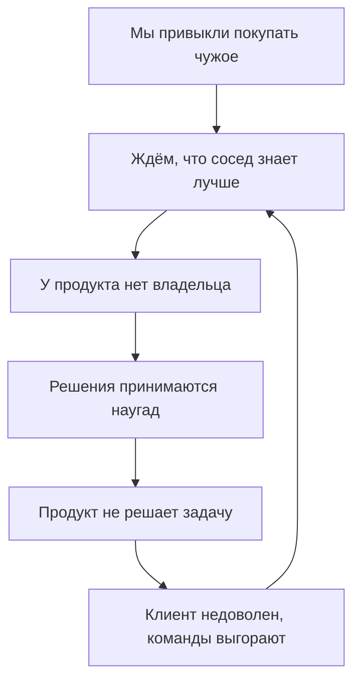
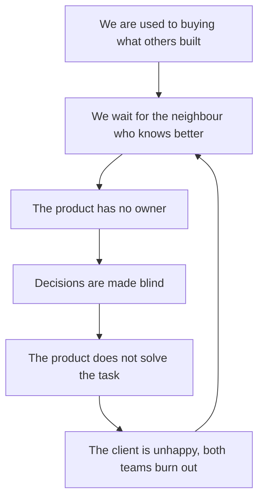
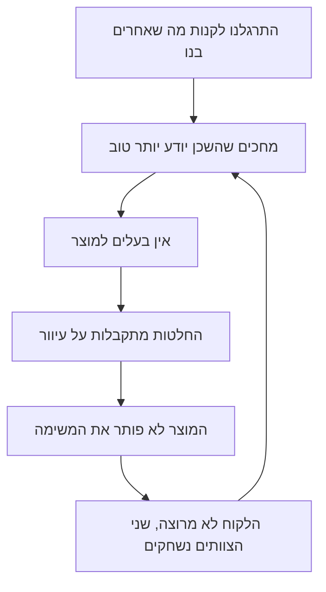

<!-- lang:ru -->

## Введение

Есть разговор, который я слышал почти дословно в трёх разных компаниях. Заказчик собирает совещание и говорит: «Нам нужен свой продукт вместо ушедшего. Сделайте, чтобы работало так же, только лучше и дешевле». Через полгода то же совещание выглядит иначе: «Почему это не работает? Мы же вам объяснили, чего хотим». А на стороне исполнителя — люди, которые уже месяц не могут закрыть одну и ту же задачу, потому что им так и не сказали, как должно быть «правильно».

Обе стороны при этом искренне уверены, что проблема в другой стороне. И обе, если копнуть, ведут себя одинаково: ждут, что сосед знает лучше.

## Привычка, которая осталась после чужого продукта

Двадцать лет мы покупали готовое. Это было рационально: продукт уже проверен рынком, документация написана, сообщество отвечает на вопросы, а вендор обязан по договору. Мы научились быть хорошими покупателями и внедренцами. Мы умеем составить требования к чужому продукту, сравнить три вендора по табличке, провести пилот и выбить скидку. Это реальная компетенция, и она никуда не делась.

Проблема в том, что вместе с ней мы усвоили несколько поведений, которые были правильными для покупателя и стали вредными для производителя.

Покупатель не обязан знать, как продукт устроен внутри. Покупатель не отвечает за то, что вендор накосячил. Покупатель может сказать: «Это ваша зона ответственности, разбирайтесь». Покупатель имеет право на позицию «мне нужен результат, а как вы его получите — ваше дело». Всё это абсолютно нормально, когда продукт делал кто-то другой, а ты его купил.

А потом продукт делаешь ты. И те же самые люди — с той же самой головой.

## Что происходит на самом деле

Заказчик приходит не с задачей, а с референсом. «Хочу как в SAP, только чтобы у нас». Он не описывает, как устроен его процесс, — он описывает, как выглядел чужой продукт на скриншоте. Он честно считает, что этого достаточно, потому что с покупкой чужого продукта этого действительно хватало: там за него думал вендор. Внутренняя логика решения его никогда не касалась — а теперь касается, но он этого ещё не понял.

Исполнитель приходит не с решением, а с ожиданием требований. Он ждёт, что заказчик «напишет нормальное ТЗ», а заказчик не может — он же никогда не писал. Дальше продуктовая команда делает то, что ей привычно: уточняет у «бизнеса», собирает конференции, оформляет бэклог. Заказчик отвечает на вопросы формально и вскользь, потому что для него это неприятная бюрократия перед настоящей работой. Спецификация получается одновременно подробной и бессмысленной.

Дальше сборка. Каждый спорный вопрос решается не по существу, а по принципу «а как было в старом продукте». Старый продукт становится единственным источником истины, хотя его никто толком не понимал и продолжает не понимать. Если в старом было плохо — воспроизводим плохо, потому что «привыкли». Если в старом было непонятно — воспроизводим непонятно, потому что «наверное, так надо».

В результате получается продукт, за который никто не отвечает. Заказчик считает, что за продукт отвечает исполнитель. Исполнитель считает, что отвечает за реализацию, а за смысл отвечает заказчик. Поддержка считает, что отвечает за приём обращений, а не за то, что продукт неудобен. Разработка считает, что отвечает за задачи в бэклоге, а не за то, что эти задачи не решают проблему.

## Три роли, у которых нет владельца

Самое неприятное в этой истории — она выглядит как обычный конфликт заказчика и подрядчика, а на деле это отсутствие владельца у продукта. Причём провал идёт сразу по трём линиям.

**Владелец продукта на стороне заказчика** не назначен или назначен формально — «на общественных началах, он же лучше всех знает, чего мы хотим». Такой человек остаётся закупщиком по мышлению: он собирает требования и передаёт, но не решает, что продукт должен делать, когда требования противоречат друг другу. А они всегда противоречат.

**Владелец продукта на стороне исполнителя** тоже не назначен. Есть менеджер, который ведёт договор, есть тимлид, который ведёт разработку, но нет человека, который отвечает за то, что продукт в итоге имеет смысл. Такой человек должен уметь сказать «нет» и заказчику, и своей команде, и это дорогая роль — её обычно и не заводят.

**Владелец эксплуатации** не назначен тем более. Кто разбирается, когда продукт ведёт себя странно? По договору — исполнитель. По факту — тот, кто первым догадался позвонить. Это значит, что обратная связь от реального использования не доходит до решений по продукту, а любое неудобство превращается в спор о том, чья это вина.

Пока владельца нет, работает принцип «сосед знает лучше». Заказчик ждёт, что исполнитель проявит инициативу. Исполнитель ждёт, что заказчик сформулирует. Оба ждут, что кто-то третий, более опытный, придёт и объяснит, как надо. Третий не приходит, потому что раньше третьим был вендор.

## Как это выглядит в симптомах

Если убрать формулировки, проблема опознаётся по набору повторяющихся признаков.

- **Референс вместо задачи.** Все обсуждения сводятся к тому, как было в чужом продукте, и никто не может ответить, зачем это было нужно и что изменилось в процессе компании с тех пор.
- **Требования приходят в виде пожеланий.** «Хотелось бы удобно», «чтобы было понятно», «чтобы как у людей» — и ни одного числа, ни одного сценария, ни одного случая, по которому можно проверить, что получилось.
- **Сроки обсуждаются раньше смысла.** Первое, что фиксируется, — дата демо. К моменту демо не определено, что считается успехом, поэтому успехом объявляется то, что успели показать.
- **Ошибки не принадлежат никому.** Каждая проблема проходит цепочку «это не мы, это они» и умирает в переписке. Никто не ведёт список проблем, потому что список проблем — это список обязательств.
- **Поддержка появляется последней.** Про то, как продукт будут эксплуатировать, вспоминают на приёмке. Люди, которые будут жить с продуктом каждый день, не участвовали ни в одном решении.
- **Внутренний критик выключен.** Любой, кто говорит «мне кажется, это неудобно», слышит в ответ «покажи требования». Через пару месяцев таких людей в команде не остаётся.
- **Выгорание идёт волнами.** Сначала выгорает исполнитель: он делает много, а смысла не прибавляется. Потом заказчик: он платит и получает разочарование. Потом обе стороны начинают искать виноватого вместо продукта.

## Почему это дорого обеим сторонам

Продукт, за который никто не отвечает, не может быть хорошим — не потому, что команда плохая, а потому, что качество требует решений, а решения требуют владельца. Каждое «а давайте уточним у заказчика» — это остановка, а каждое «заказчик всё равно не знает» — это решение, принятое наугад человеком без полномочий.

Дальше начинается конкретная бухгалтерия. Переделки после приёмки, потому что цель проявилась только на приёмке. Поддержка, которая тратит часы на объяснение очевидного, потому что продукт никто не учил объяснять. Люди, которые уходят не из-за переработок, а из-за ощущения бессмысленности: они весь день принимают решения, за которые никто не готов ответить.

И самое неприятное: следующая попытка начинается с той же точки. Потому что вывод, который делают обе стороны, звучит не «нам нужен владелец продукта», а «с этим подрядчиком не повезло» или «заказчик не умеет ставить задачи». То есть проблема не исправляется, а переносится на новых людей.

## Что менять

Решение не в том, чтобы «проявить больше ответственности» или «улучшить коммуникацию». Коммуникация — следствие. Менять нужно правило: пока продукт делается для себя, он всё равно остаётся чужим, если у него нет одного названного владельца с правом решать.

Практически это означает четыре вещи.

**Владелец продукта назначается до старта, а не после провала.** Один человек на стороне заказчика, у которого есть полномочия говорить «делаем так», и один на стороне исполнителя, у которого есть полномочия говорить «это противоречит смыслу продукта». Имена записаны в договор или в устав проекта, а не подразумеваются.

**Вход в работу — сценарий, а не референс.** Не «как в старом», а «сотрудник делает X, сейчас это занимает Y, после запуска должно занимать Z». Если сценарий не сформулирован, задача не берётся в работу — не потому, что бюрократия, а потому, что иначе её нечем проверить.

**Ошибки принадлежат продукту, а не сторонам.** Единый список проблем, где у каждой есть владелец и срок. Не «баг заказчика» и «баг исполнителя», а «проблема продукта», которую кто-то конкретный ведёт до закрытия. Споров о вине становится меньше просто потому, что появляется место, куда их складывать.

**Люди, которые будут жить с продуктом, участвуют в решениях.** Поддержка и эксплуатация — не финальная инстанция, а постоянный участник. Они первыми видят, что продукт неудобен, и их замечание должно быть аргументом, а не заявкой в очередь.

## Заключение

Импортозамещение — это не замена одного продукта на другой. Это смена роли: из покупателя в производителя. Покупателю можно не знать, как всё устроено внутри, — производителю нельзя. Покупатель может ждать, что вендор разберётся, — производитель, который ждёт, что разберётся сосед, производит ровно то, что мы видим последние несколько лет.

Пока обе стороны ждут друг от друга, что кто-то другой знает лучше, продукт будет общим и ничьим одновременно. А общий продукт всегда получается плохим — и это не про компетенции, а про то, что за него некому ответить.

<!-- lang:en -->

## Introduction

There is a conversation I have heard almost word for word at three different companies. The customer calls a meeting and says: "We need our own product now that the foreign one is gone. Make it work the same, only better and cheaper." Six months later the same meeting sounds different: "Why doesn't this work? We told you what we wanted." And on the vendor's side sit people who have been unable to close the same task for a month, because nobody ever told them what "right" means.

Both sides sincerely believe the problem is the other side. And both, if you dig, behave the same way: they wait for the neighbour who supposedly knows better.

## A habit that outlived the foreign product

For twenty years we bought ready-made. That was rational: the product was already proven on the market, the documentation was written, the community answered questions, and the vendor was obligated by contract. We learned to be good buyers and implementers. We can write requirements for someone else's product, compare three vendors in a spreadsheet, run a pilot and negotiate a discount. That is a real skill, and it has not gone anywhere.

The problem is that along with it we absorbed a set of behaviours that were right for a buyer and became harmful for a producer.

A buyer does not have to know how the product works inside. A buyer is not responsible for the vendor's mistakes. A buyer can say: "That is your area, sort it out." A buyer is entitled to the position "I need a result, how you get it is your business." All of that is perfectly normal when someone else built the product and you bought it.

And then you are the one building it. With exactly the same people and exactly the same heads.

## What actually happens

The customer arrives not with a task but with a reference. "I want it like SAP, only ours." He does not describe how his own process works — he describes what someone else's product looked like in a screenshot. He honestly believes that is enough, because when you bought someone else's product it really was enough: the vendor did the thinking for you. The internal logic of the solution never concerned him — and now it does, but he has not noticed yet.

The vendor arrives not with a solution but with an expectation of requirements. He expects the customer to "write a proper spec", and the customer cannot — he has never written one. So the product team does what it is used to: asks "the business", holds conferences, grooms the backlog. The customer answers formally and in passing, because for him this is annoying bureaucracy before the real work. The specification comes out simultaneously detailed and meaningless.

Then comes the build. Every disputed question is settled not on the merits but by "how it was in the old product". The old product becomes the only source of truth, even though nobody understood it properly then and nobody does now. If the old one was bad, we reproduce bad, because "that's what people are used to". If the old one was unclear, we reproduce unclear, because "that's probably how it should be".

The result is a product nobody is accountable for. The customer thinks the vendor is accountable. The vendor thinks he is accountable for delivery, while meaning is the customer's job. Support thinks it is accountable for taking tickets, not for the product being inconvenient. Engineering thinks it is accountable for backlog items, not for those items failing to solve the problem.

## Three roles, no owner

The nastiest part of this story is that it looks like an ordinary customer–contractor conflict, while in fact it is a product without an owner. And it fails on three lines at once.

**The product owner on the customer side** is either not appointed or appointed formally — "on a volunteer basis, he knows best what we want". Such a person stays a procurement officer in mindset: he collects requirements and hands them over, but does not decide what the product should do when requirements contradict each other. And they always contradict.

**The product owner on the vendor side** is not appointed either. There is a manager running the contract and a team lead running the development, but nobody is accountable for the product making sense. That person has to be able to say "no" both to the customer and to his own team, and that is an expensive role — so it usually is not created.

**The operations owner** is not appointed at all. Who investigates when the product behaves strangely? By contract, the vendor. In practice, whoever thought to call first. That means feedback from real use never reaches product decisions, and every inconvenience turns into an argument about whose fault it is.

While there is no owner, the "the neighbour knows better" principle runs things. The customer waits for the vendor to show initiative. The vendor waits for the customer to formulate. Both wait for some third party, more experienced, to come and explain how it should be done. The third party never comes, because the third party used to be the vendor.

## What the symptoms look like

Strip away the wording and the problem is recognisable by a set of recurring signs.

- **A reference instead of a task.** Every discussion comes back to how it was in the foreign product, and nobody can say why it was needed or what has changed in the company's process since.
- **Requirements arrive as wishes.** "It should be convenient", "it should be clear", "like other companies have it" — and not a single number, scenario or case against which the result could be checked.
- **Deadlines are discussed before meaning.** The first thing fixed is the demo date. By the demo, success has not been defined, so whatever got shown is declared a success.
- **Mistakes belong to nobody.** Every problem goes through the chain of "not us, them" and dies in a chat thread. Nobody keeps a problem list, because a problem list is a list of commitments.
- **Support shows up last.** How the product will be operated comes up at acceptance. The people who will live with it every day took part in none of the decisions.
- **The internal critic is switched off.** Anyone who says "this feels inconvenient" is answered with "show me the requirement". In a couple of months there are no such people left on the team.
- **Burnout comes in waves.** First the vendor burns out: he does a lot and it adds no meaning. Then the customer: he pays and gets disappointment. Then both sides start looking for someone to blame instead of a product.

## Why it costs both sides

A product nobody is accountable for cannot be good — not because the team is bad, but because quality requires decisions, and decisions require an owner. Every "let's check with the customer" is a stop, and every "the customer doesn't know anyway" is a decision made blind by someone without authority.

Then the actual accounting begins. Rework after acceptance, because the goal only became visible at acceptance. Support spending hours explaining the obvious, because nobody taught the product to explain itself. People leaving not because of overtime but because of futility: all day long they make decisions nobody is prepared to stand behind.

And the worst part: the next attempt starts from the same point. Because the conclusion both sides draw is not "we need a product owner" but "we were unlucky with this contractor" or "the customer can't write requirements". The problem is not fixed; it is handed to new people.

## What to change

The answer is not "take more responsibility" or "communicate better". Communication is a consequence. The rule to change is this: as long as a product is built for yourself, it still remains someone else's if it has no single named owner with the right to decide.

In practice that means four things.

**The product owner is appointed before the start, not after the failure.** One person on the customer side with the authority to say "this is how we do it", and one on the vendor side with the authority to say "this contradicts what the product is for". The names go into the contract or the project charter rather than being implied.

**Work starts from a scenario, not a reference.** Not "like the old one" but "an employee does X, today it takes Y, after launch it should take Z". If the scenario is not formulated, the task does not start — not out of bureaucracy, but because otherwise there is nothing to check it against.

**Mistakes belong to the product, not to the sides.** One list of problems, each with an owner and a date. Not "customer bug" and "vendor bug", but "product problem" that a specific person drives to closure. Arguments about blame get rarer simply because there is a place to put them.

**The people who will live with the product take part in decisions.** Support and operations are not the final instance but a permanent participant. They are the first to see that the product is inconvenient, and their remark has to count as an argument, not as a ticket in a queue.

## Conclusion

Import substitution is not replacing one product with another. It is a change of role: from buyer to producer. A buyer may not know how things work inside — a producer may not. A buyer may wait for the vendor to figure it out — a producer who waits for the neighbour to figure it out produces exactly what we have seen for the past several years.

As long as both sides wait for the other to know better, the product will be shared and ownerless at the same time. And a shared product always turns out bad — not because of competence, but because nobody is there to answer for it.

<!-- lang:he -->

## מבוא

יש שיחה ששמעתי כמעט מילה במילה בשלוש חברות שונות. הלקוח מכנס ישיבה ואומר: "אנחנו צריכים מוצר משלנו במקום זה שעזב. תעשו שיעבוד כמו הקודם, רק טוב וזול יותר". חצי שנה אחר כך אותה ישיבה נראית אחרת: "למה זה לא עובד? הרי הסברנו לכם מה אנחנו רוצים". ובצד המבצע יושבים אנשים שכבר חודש לא מצליחים לסגור את אותה משימה, כי אף אחד לא אמר להם מה אמור להיות "נכון".

שני הצדדים משוכנעים בכנות שהבעיה היא בצד השני. ושניהם, אם חופרים, מתנהגים אותו דבר: מחכים שהשכן יודע יותר טוב.

## הרגל שנשאר אחרי המוצר הזר

עשרים שנה קנינו מוצר מוכן. זה היה הגיוני: המוצר כבר נבדק בשוק, התיעוד כתוב, הקהילה עונה לשאלות, והספק מחויב בחוזה. למדנו להיות קונים ומטמיעים טובים. אנחנו יודעים לנסח דרישות למוצר זר, להשוות שלושה ספקים בטבלה, להריץ פיילוט ולהוציא הנחה. זו יכולת אמיתית והיא לא נעלמה לשום מקום.

הבעיה היא שיחד איתה ספגנו כמה דפוסי התנהגות שהיו נכונים לקונה והפכו מזיקים ליצרן.

קונה לא חייב לדעת איך המוצר בנוי מבפנים. קונה לא אחראי לכך שהספק פשע. קונה יכול לומר: "זה באחריותכם, תסתדרו". לקונה יש זכות לעמדה "אני צריך תוצאה, ואיך תשיגו אותה — שלכם". כל זה נורמלי לחלוטין כשמישהו אחר יצר את המוצר ואתה קנית אותו.

ואז אתה זה שמייצר את המוצר. ואותם אנשים בדיוק — עם אותו ראש בדיוק.

## מה באמת קורה

הלקוח מגיע לא עם משימה אלא עם רפרנס. "אני רוצה כמו ב-SAP, רק שלנו". הוא לא מתאר איך בנוי התהליך שלו — הוא מתאר איך נראה המוצר הזר בצילום מסך. הוא באמת חושב שזה מספיק, כי בקניית מוצר זר זה אכן הספיק: מישהו אחר חשב בשבילו. ההיגיון הפנימי של הפתרון מעולם לא עניין אותו — ועכשיו הוא נוגע לו, אבל הוא עוד לא שם לב.

המבצע מגיע לא עם פתרון אלא עם ציפייה לדרישות. הוא מצפה שהלקוח "יכתוב אפיון נורמלי", והלקוח לא יכול — הוא מעולם לא כתב כזה. אחר כך צוות המוצר עושה את מה שהוא רגיל: מברר אצל "העסק", מכנס ישיבות, מסדר את הבייקלוג. הלקוח עונה רשמית ובחטף, כי בשבילו זו ביורוקרטיה מעצבנת לפני העבודה האמיתית. האפיון יוצא גם מפורט וגם חסר משמעות.

ואז מגיע הפיתוח. כל שאלה שנויה במחלוקת נפתרת לא לגופה אלא לפי "איך זה היה במוצר הישן". המוצר הישן הופך למקור האמת היחיד, למרות שאף אחד לא הבין אותו אז וגם לא עכשיו. אם בישן היה רע — משחזרים רע, כי "כולם רגילים". אם בישן היה לא ברור — משחזרים לא ברור, כי "כנראה שככה צריך".

התוצאה היא מוצר שאין לו בעלים. הלקוח חושב שבעל המוצר הוא המבצע. המבצע חושב שהוא אחראי על המימוש, ועל המשמעות אחראי הלקוח. התמיכה חושבת שהיא אחראית על קליטת פניות, לא על כך שהמוצר לא נוח. הפיתוח חושב שהוא אחראי על המשימות בבייקלוג, לא על כך שהמשימות האלה לא פותרות את הבעיה.

## שלושה תפקידים בלי בעלים

הדבר המעצבן ביותר בסיפור הזה הוא שהוא נראה כמו סכסוך רגיל בין לקוח לקבלן, ובפועל מדובר בהיעדר בעלים למוצר. והכשל מתרחש בבת אחת בשלושה מישורים.

**בעל המוצר בצד הלקוח** לא ממונה, או ממונה רשמית — "על בסיס התנדבותי, הוא הרי יודע הכי טוב מה אנחנו רוצים". אדם כזה נשאר קונה במוחו: הוא אוסף דרישות ומעביר אותן הלאה, אבל לא מחליט מה המוצר צריך לעשות כשדרישות סותרות זו את זו. והן תמיד סותרות.

**בעל המוצר בצד המבצע** גם הוא לא ממונה. יש מנהל שמוביל את החוזה, יש ראש צוות שמוביל את הפיתוח, אבל אין אדם שאחראי לכך שלמוצר יהיה היגיון. אדם כזה צריך לדעת לומר "לא" גם ללקוח וגם לצוות שלו, וזה תפקיד יקר — ולכן בדרך כלל לא מקימים אותו.

**בעל התפעול** לא ממונה בכלל. מי חוקר כשהמוצר מתנהג מוזר? לפי החוזה — המבצע. בפועל — מי שהראשון חשב להתקשר. כלומר, משוב משימוש אמיתי לא מגיע להחלטות על המוצר, וכל אי-נוחות הופכת לוויכוח על אשמה.

כל עוד אין בעלים, עובד העיקרון "השכן יודע יותר טוב". הלקוח מחכה שהמבצע יראה יוזמה. המבצע מחכה שהלקוח ינסח. שניהם מחכים שמישהו שלישי, מנוסה יותר, יבוא ויסביר איך צריך. השלישי לא מגיע, כי קודם השלישי היה הספק.

## איך זה נראה בסימפטומים

אם מורידים את הניסוחים, הבעיה מזוהה לפי סט של סימנים חוזרים.

- **רפרנס במקום משימה.** כל דיון חוזר לשאלה איך זה היה במוצר הזר, ואף אחד לא יכול לומר למה זה היה נחוץ ומה השתנה בתהליך החברה מאז.
- **דרישות מגיעות כמשאלות.** "שיהיה נוח", "שיהיה ברור", "כמו שיש אצל אחרים" — ולא מספר אחד, לא תרחיש אחד, לא מקרה שדרכו אפשר לבדוק מה יצא.
- **לוחות זמנים נדונים לפני המשמעות.** הדבר הראשון שנקבע הוא תאריך הדמו. עד הדמו לא הוגדר מה נחשב הצלחה, ולכן הצלחה היא מה שהספיקו להראות.
- **טעויות לא שייכות לאף אחד.** כל בעיה עוברת את השרשרת "זה לא אנחנו, זה הם" ומתה בהתכתבות. אף אחד לא מנהל רשימת בעיות, כי רשימת בעיות היא רשימת התחייבויות.
- **התמיכה מגיעה אחרונה.** על איך יתפעלו את המוצר נזכרים בקבלה. האנשים שיחיו עם המוצר כל יום לא השתתפו באף החלטה.
- **המבקר הפנימי כבוי.** כל מי שאומר "לי זה נראה לא נוח" שומע בתגובה "תראה לי את הדרישה". בעוד כמה חודשים אנשים כאלה כבר לא נשארים בצוות.
- **שחיקה מגיעה בגלים.** קודם נשחק המבצע: הוא עושה הרבה והמשמעות לא גדלה. אחר כך הלקוח: הוא משלם ומקבל אכזבה. ואז שני הצדדים מתחילים לחפש אשם במקום מוצר.

## למה זה יקר לשני הצדדים

מוצר שאין לו בעלים לא יכול להיות טוב — לא כי הצוות גרוע, אלא כי איכות דורשת החלטות, והחלטות דורשות בעלים. כל "בוא נברר עם הלקוח" הוא עצירה, וכל "הלקוח ממילא לא יודע" הוא החלטה שהתקבלה על עיוור בידי מי שאין לו סמכות.

מכאן מתחילה הנהלת החשבונות האמיתית. עיבוד מחדש אחרי הקבלה, כי המטרה התגלתה רק בקבלה. תמיכה ששורפת שעות על הסבר המובן מאליו, כי לאף אחד לא לימד את המוצר להסביר את עצמו. אנשים שעוזבים לא בגלל שעות נוספות אלא בגלל תחושת חוסר טעם: כל היום הם מקבלים החלטות שאף אחד לא מוכן לעמוד מאחוריהן.

והדבר הכי מבאס: הניסיון הבא מתחיל מאותה נקודה. כי המסקנה ששני הצדדים מגיעים אליה היא לא "צריך בעל מוצר" אלא "לא התמזל מזלנו עם הקבלן הזה" או "הלקוח לא יודע להגדיר משימות". כלומר, הבעיה לא מתוקנת — היא מועברת לאנשים חדשים.

## מה לשנות

הפתרון אינו "לגלות יותר אחריות" או "לשפר את התקשורת". תקשורת היא תוצאה. צריך לשנות את הכלל: כל עוד המוצר נעשה בשבילך, הוא נשאר זר אם אין לו בעל אחד בשם שיכול להחליט.

בפועל זה אומר ארבעה דברים.

**בעל המוצר ממונה לפני ההתחלה, לא אחרי הכישלון.** אדם אחד בצד הלקוח שיש לו הסמכות לומר "עושים כך", ואדם אחד בצד המבצע שיש לו הסמכות לומר "זה סותר את המשמעות של המוצר". השמות נרשמים בחוזה או במסמך הפרויקט, ולא משתמעים.

**הכניסה לעבודה היא תרחיש, לא רפרנס.** לא "כמו בישן", אלא "עובד עושה X, היום זה לוקח Y, אחרי ההשקה זה צריך לקחת Z". אם התרחיש לא מנוסח, המשימה לא נכנסת לעבודה — לא מתוך ביורוקרטיה, אלא כי אחרת אין במה לבדוק אותה.

**טעויות שייכות למוצר, לא לצדדים.** רשימת בעיות אחת, שלכל אחת בה יש בעלים ותאריך. לא "באג של הלקוח" ו"באג של המבצע", אלא "בעיית מוצר" שמישהו ספציפי מוביל עד סגירה. ויכוחים על אשמה מתמעטים פשוט כי יש להם מקום להישפך אליו.

**האנשים שיחיו עם המוצר משתתפים בהחלטות.** תמיכה ותפעול הם לא הערכאה האחרונה אלא משתתף קבוע. הם הראשונים לראות שהמוצר לא נוח, וההערה שלהם צריכה להיות טיעון ולא פנייה בתור.

## סיכום

החלפת יבוא היא לא החלפת מוצר אחד באחר. זו החלפת תפקיד: מקונה ליצרן. קונה יכול לא לדעת איך הכל בנוי מבפנים — יצרן לא יכול. קונה יכול לחכות שהספק יסתדר — יצרן שמחכה שהשכן יסתדר מייצר בדיוק את מה שאנחנו רואים בשנים האחרונות.

כל עוד שני הצדדים מחכים זה מזה שמישהו אחר יודע יותר טוב, המוצר יהיה משותף ונטול בעלים בו זמנית. ומוצר משותף תמיד יוצא גרוע — וזה לא עניין של כישורים, אלא של העובדה שאין מי שיענה עליו.
