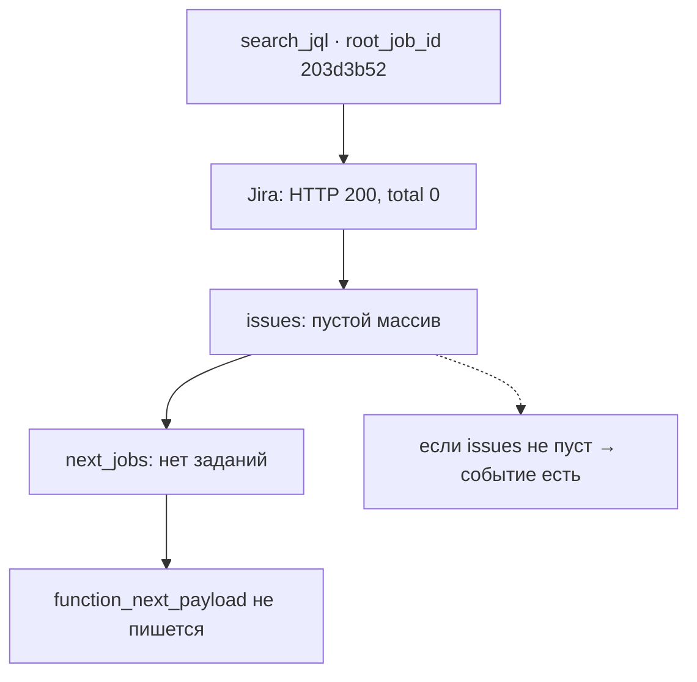
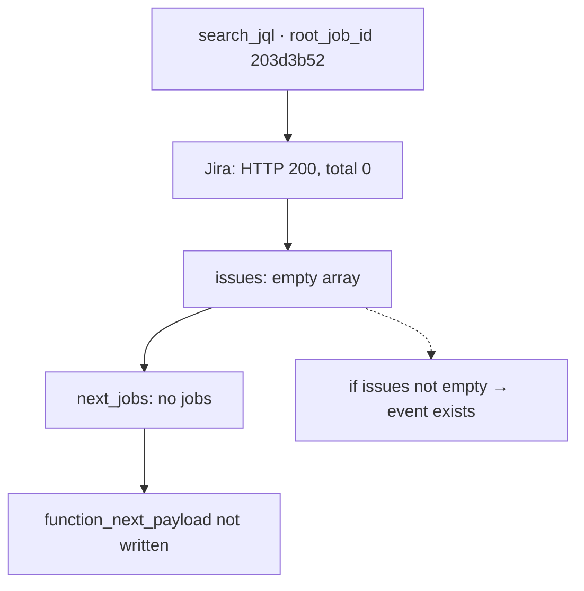
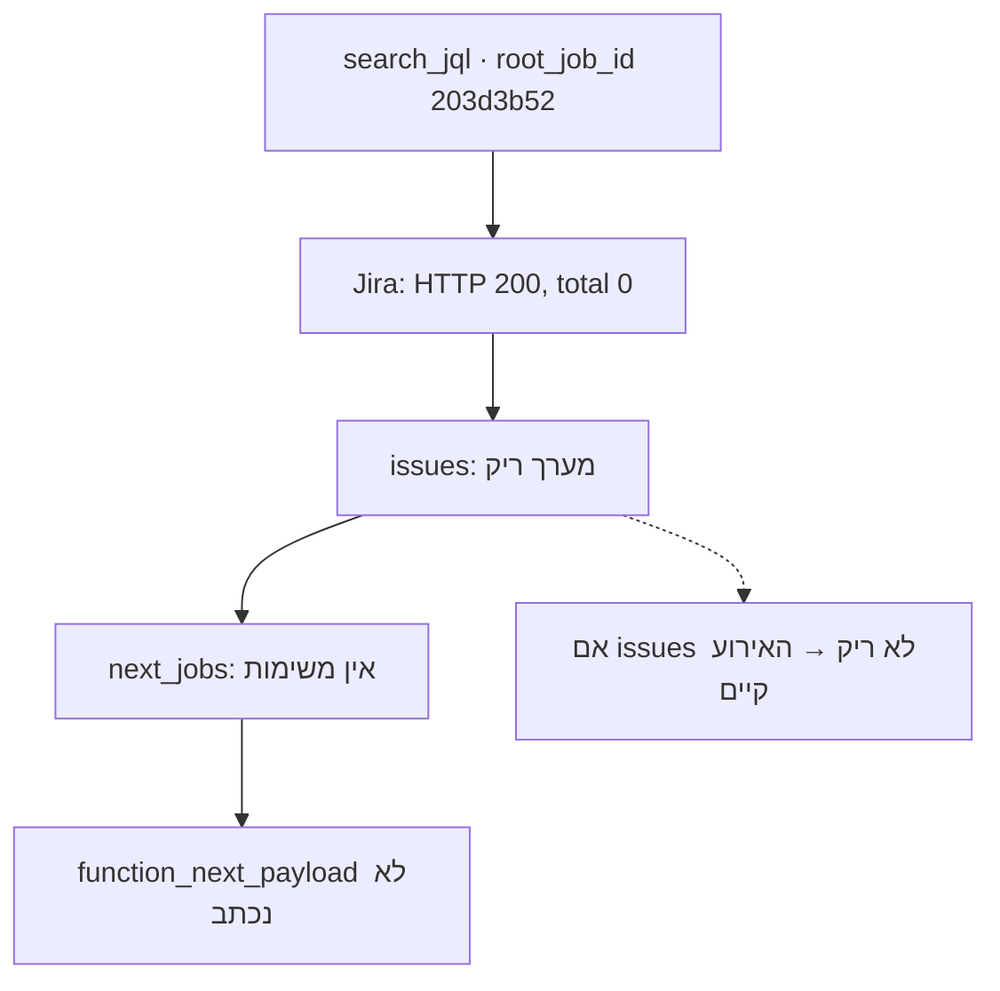

<!-- lang:ru -->

## Симптом

Фича в проде. Тестов зелёных — семьсот сорок семь. Контракт поднят, документация обновлена. Включаю TRACE на живом инстансе, прогоняю запрос — и в логах воркера нет ни одного `function_next_payload`.

Первая мысль любого инженера в этот момент: «код в контейнер не попал».

Как включить TRACE: уровень логирования читается из конфига инстанса, а не из кода (принцип II не просто так). Меняю на `TRACE`, перезапускаю под, отправляю в бота привычную команду с JQL-запросом и жду записи в `journalctl`. Записи нет.

## Шаг 1: а код вообще в контейнере?

Захожу внутрь `localhost/worker:dev`, смотрю файл с хелпером — на месте. Запускаю probe вручную, эмитируя событие из REPL — запись в логе есть, формат правильный.

Вывод: код рабочий, эмиссия рабочая, логгер настроен. Проблема не в сборке.

## Шаг 2: реконструкция каскада

Дальше — искать не код, а данные. Беру `root_job_id` из логов одного запроса и смотрю все задания каскада:

- задание `search_jql` — ровно одно;
- дочерних заданий — ноль;
- событий `function_next_payload` — ноль.

Три нуля. Это уже подозрительно: каскад есть, а детей нет. Функция отработала, но ничего не породила.

## Шаг 3: а что ответила Jira?

Смотрю в том же логе ответ Jira на JQL-запрос. Он выглядит так:

```text
event: jira_search_result
  status: 200
  total: 0
  issues: []
```

HTTP 200, ошибки нет, просто ноль задач. Фильтр `59251`, на котором всё это крутится, оказался пуст. Значит, функция честно вернула `next_jobs: []`, и по требованию FR-007 (пустой список — событие не пишется) — событие и не должно было появиться.

Вот как это выглядит целиком:



## Улики

| Уровень | Что видно | Что значит |
| --- | --- | --- |
| Контейнер | хелпер на месте, probe пишет | код свежий |
| Каскад | 1 задание, 0 детей | функция отработала |
| Jira | `HTTP 200, total: 0` | данных нет |
| Спека | FR-007: пустой список — нет записи | поведения совпадает с требованием |

## Не баг, а пустые данные

Это самый неприятный класс производственных дефектов: все системы работают правильно, а результат выглядит как поломка. Спека была права, код был прав, логгер был прав — не было данных для события.

Урок — сформулирую его как правило: «в логе тишина» не равно «код сломан». Сначала спросите, было ли вообще что логировать. По опыту, в двух случаях из трёх на этой стадии выясняется, что событие писать было не из чего.

И ещё одна деталь, которая сэкономила время: у события всегда есть предшественник. Сначала смотрится ответ внешнего API, потом — построенные из него задания, и только в конце — эмиссия. Если бы я начал с кода эмиссии, то проверил бы больше трёх файлов вместо одной строки в логе Jira.

Второй урок уже про процесс: тест на пустой результат у меня был (тот самый седьмой тест из поста 8), но в проде я про него забыл. Спека помнила, а я — нет.

## Про безопасность логов

В этом TRACE`-логе рядом с полезной строкой лежит ещё две вещи: заголовок `Authorization: Bearer …` с токеном Jira и полный payload задач с ключами и описаниями из реальной боевой доски. Показывает это именно TRACE-режим, который включается на десять минут для расследования.

Отсюда правило, которое я добавил себе в культуру после этой фичи: сырые TRACE-логи не выкладываются никуда — ни в блог, ни в issue tracker. В этой серии всё перефразировано, все идентификаторы заданий и ключи вымышленные.

## Осадочек

Расследование закрыто, дефекта нет. Но остался вопрос, который превратит следующую часть в переделку архитектуры: если функция может не породить заданий — должна ли она вообще молчать?

Тогда казалось, что ответ очевиден. Оказалось — нет.

---

[← Пост 9: `/speckit.analyze`](/ru/dev/blog/sdd-09-analyze-findings/) · [Пост 11: эмиссия переезжает в функции →](/ru/dev/blog/sdd-11-emission-moves-to-functions/)

<!-- lang:en -->

## The symptom

The feature is in production. Green tests: seven hundred and forty-seven. The contract is bumped, the documentation updated. I enable TRACE on a live instance, run a request — and the worker log has not a single `function_next_payload`.

The first thought of any engineer at that moment: "the code did not make it into the container".

How to enable TRACE: the log level is read from the instance config, not from the code (principle II for a reason). I switch it to `TRACE`, restart the pod, send the bot the usual command with a JQL query and wait for a record in `journalctl`. No record.

## Step 1: is the code even in the container?

I go inside `localhost/worker:dev` and look at the helper file — it is there. I run a probe manually, emitting an event from the REPL — the record is in the log, the format is right.

Conclusion: the code works, emission works, the logger is configured. The problem is not the build.

## Step 2: reconstructing the cascade

Next — look not at the code but at the data. I take the `root_job_id` from one request's logs and look at every job in the cascade:

- the `search_jql` job — exactly one;
- child jobs — zero;
- `function_next_payload` events — zero.

Three zeros. That is already suspicious: there is a cascade but no children. The function ran but produced nothing.

## Step 3: what did Jira answer?

I look at the Jira response to the JQL query in the same log. It looks like this:

```text
event: jira_search_result
  status: 200
  total: 0
  issues: []
```

HTTP 200, no error, simply zero tasks. The `59251` filter everything runs on turned out to be empty. So the function honestly returned `next_jobs: []`, and per requirement FR-007 (empty list — no event) there should have been no event.

Here is the whole picture:



## Evidence

| Level | What is visible | What it means |
| --- | --- | --- |
| Container | helper present, probe writes | the code is fresh |
| Cascade | 1 job, 0 children | the function ran |
| Jira | `HTTP 200, total: 0` | there is no data |
| Spec | FR-007: empty list — no record | behaviour matches the requirement |

## Not a bug but empty data

This is the nastiest class of production defects: every system works correctly, yet the result looks like a failure. The spec was right, the code was right, the logger was right — there was no data for the event.

I will formulate the lesson as a rule: "silence in the log" is not the same as "the code is broken". First ask whether there was anything to log at all. In my experience, in two cases out of three at this stage it turns out there was nothing to write an event from.

One more detail that saved time: an event always has a predecessor. You look at the external API response first, then at the jobs built from it, and only then at the emission. Had I started with the emission code, I would have checked more than three files instead of one line in the Jira log.

The second lesson is about process: I had a test for the empty result (that seventh test from post 8), but in production I forgot about it. The spec remembered; I did not.

## About log security

In this TRACE log, next to the useful line, there are two more things: an `Authorization: Bearer …` header with a Jira token, and the full payload of tasks with keys and descriptions from a real production board. TRACE mode, which gets switched on for ten minutes during an investigation, shows exactly that.

Hence a rule I added to my culture after this feature: raw TRACE logs are never published anywhere — not to a blog, not to an issue tracker. In this series everything is paraphrased and all job identifiers and keys are fictional.

The investigation is closed, there is no defect. But a question remained that will turn the next part into an architecture change: if a function can produce no jobs — should it stay silent at all?

Back then the answer seemed obvious. It turned out not to be.

---

[← Post 9: `/speckit.analyze`](/en/dev/blog/sdd-09-analyze-findings/) · [Post 11: emission moves into the functions →](/en/dev/blog/sdd-11-emission-moves-to-functions/)

<!-- lang:he -->

## הסימפטום

הפיצ'ר בפרודקשן. טסטים ירוקים: שבע מאות ארבעים ושבעה. החוזה עודכן, התיעוד עודכן. מדליק TRACE על instance חי, מריץ בקשה — ובלוג של ה-worker אין אף `function_next_payload` אחד.

המחשבה הראשונה של כל מהנדס ברגע כזה: "הקוד לא הגיע לקונטיינר".

איך מדליקים TRACE: רמת הלוג נקראת מקונפיג ה-instance, לא מהקוד (עקרון II לא סתם). מחליף ל-`TRACE`, מפעיל מחדש את הפוד, שולח לבוט את הפקודה הרגילה עם שאילתת JQL ומחכה לרשומה ב-`journalctl`. אין רשומה.

## שלב 1: הקוד בכלל בקונטיינר?

נכנס ל-`localhost/worker:dev`, מסתכל על קובץ ה-helper — במקום. מריץ probe ביד, פולט אירוע מה-REPL — הרשומה בלוג, הפורמט נכון.

מסקנה: הקוד עובד, הפליטה עובדת, הלוגר מוגדר. הבעיה לא בבנייה.

## שלב 2: שחזור המפל

הלאה — לחפש לא קוד אלא נתונים. לוקח את ה-`root_job_id` מהלוגים של בקשה אחת ומסתכל על כל משימות המפל:

- משימת `search_jql` — בדיוק אחת;
- משימות ילדים — אפס;
- אירועי `function_next_payload` — אפס.

שלושה אפסים. זה כבר חשוד: יש מפל אבל אין ילדים. הפונקציה רצה אבל לא הולידה כלום.

## שלב 3: מה ענתה Jira?

מסתכל באותו לוג על תשובת Jira לשאילתת JQL. היא נראית כך:

```text
event: jira_search_result
  status: 200
  total: 0
  issues: []
```

HTTP 200, אין שגיאה, פשוט אפס משימות. הפילטר `59251` שכל המערכת רצה עליו התברר כריק. כלומר הפונקציה החזירה בכנות `next_jobs: []`, ולפי דרישה FR-007 (רשימה ריקה — אין אירוע) גם לא היה אמור להיווצר אירוע.

הנה התמונה המלאה:



## ראיות

| רמה | מה רואים | מה זה אומר |
| --- | --- | --- |
| קונטיינר | ה-helper במקום, probe כותב | הקוד טרי |
| מפל | משימה 1, ילדים 0 | הפונקציה רצה |
| Jira | `HTTP 200, total: 0` | אין נתונים |
| מפרט | FR-007: רשימה ריקה — אין רשומה | ההתנהגות תואמת את הדרישה |

## לא באג אלא נתונים ריקים

זה הסוג המעצבן ביותר של פגמי פרודקשן: כל המערכות עובדות נכון, אבל התוצאה נראית כמו תקלה. המפרט צדק, הקוד צדק, הלוגר צדק — לא היו נתונים לאירוע.

אנסח את הלקח ככלל: "שקט בלוג" אינו "הקוד שבור". קודם שואלים אם היה בכלל מה לתעד. מניסיון, בשניים מכל שלושה מקרים בשלב הזה מתברר שלא היה ממה לכתוב אירוע.

עוד פרט שחסך זמן: לאירוע תמיד יש קודם. קודם מסתכלים בתשובת ה-API החיצוני, אחר כך במשימות שנבנו ממנה, ורק בסוף בפליטה. אילו התחלתי מקוד הפליטה, הייתי בודק יותר משלושה קבצים במקום שורה אחת בלוג של Jira.

הלקח השני הוא על תהליך: היה לי טסט לתוצאה ריקה (הטסט השביעי מהפוסט 8), אבל בפרודקשן שכחתי ממנו. המפרט זכר, אני לא.

## על אבטחת לוגים

בלוג ה-TRACE הזה, ליד השורה השימושית, יש עוד שני דברים: כותרת `Authorization: Bearer …` עם טוקן של Jira, ו-payload מלא של משימות עם מפתחות ותיאורים מלוח ייצור אמיתי. בדיוק את זה מציג מצב TRACE, שמדליקים לעשר דקות לצורך חקירה.

מכאן כלל שהוספתי לתרבות שלי אחרי הפיצ'ר הזה: לוגי TRACE גולמיים לא מפורסמים לשום מקום — לא לבלוג ולא ל-issue tracker. בסדרה הזאת הכל מנוסח מחדש, וכל מזהי המשימות והמפתחות בדויים.

החקירה סגורה, אין פגם. אבל נשארה שאלה שתהפוך את החלק הבא לשינוי ארכיטקטורה: אם פונקציה יכולה לא להוליד משימות — האם היא בכלל צריכה לשתוק?

אז התשובה נראתה מובנת מאליה. התברר שהיא לא.

---

[← פוסט 9: `/speckit.analyze`](/he/dev/blog/sdd-09-analyze-findings/) · [פוסט 11: הפליטה עוברת לפונקציות →](/he/dev/blog/sdd-11-emission-moves-to-functions/)
