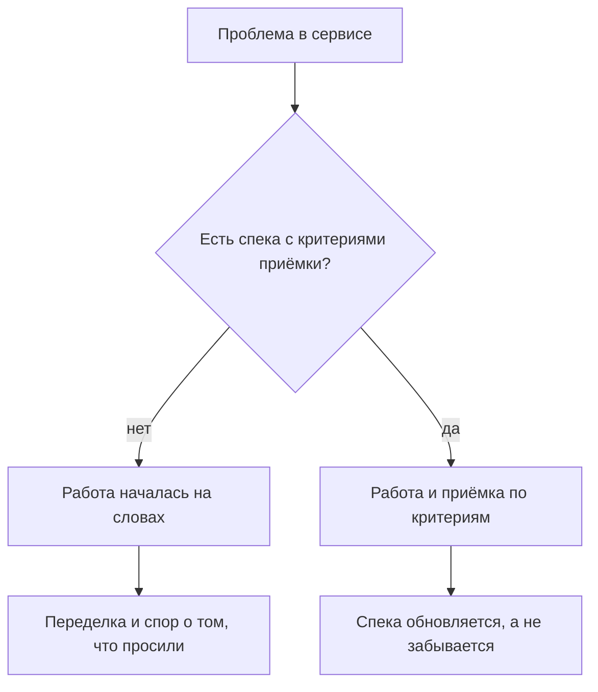
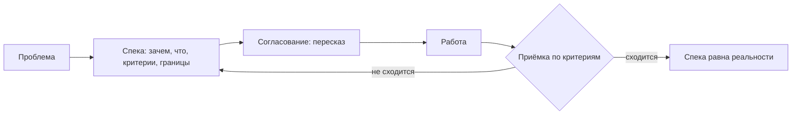
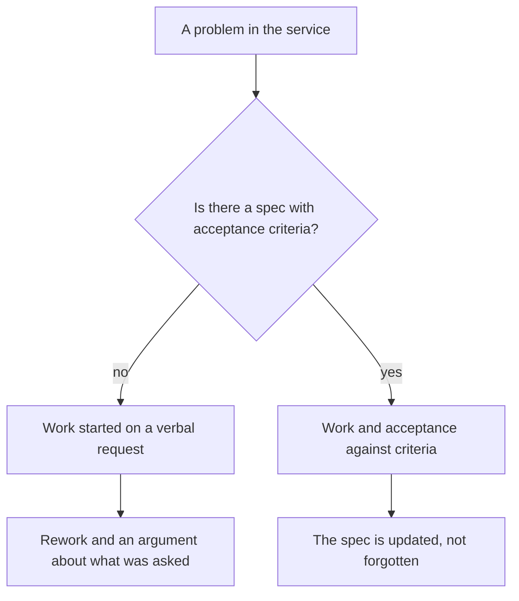
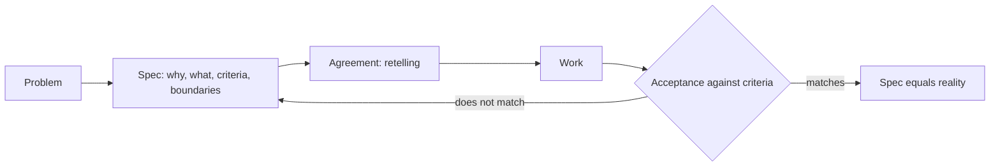
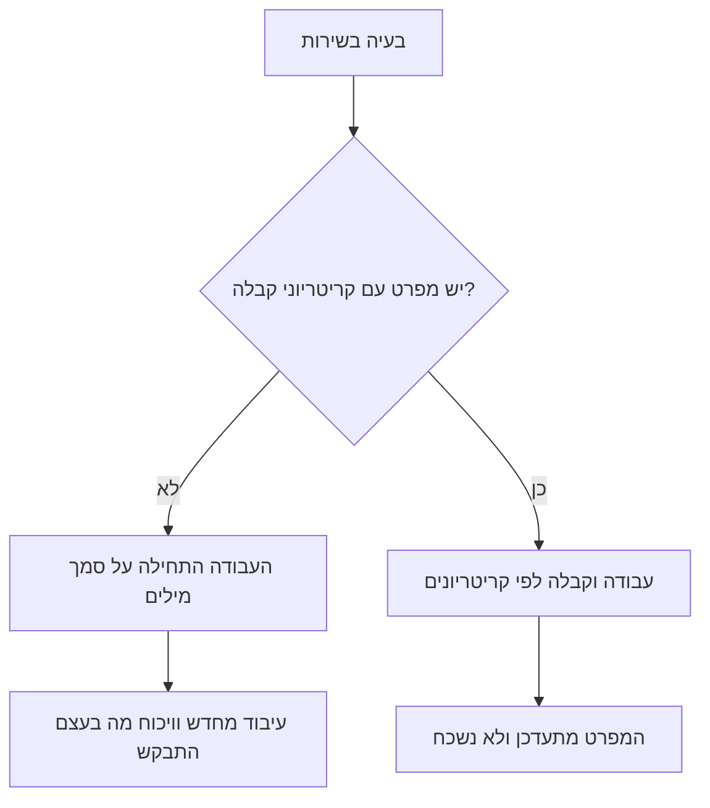
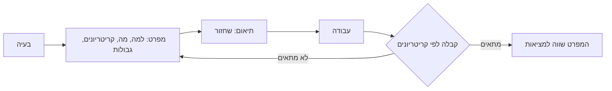

<!-- lang:ru -->

## Введение: продукт лида — инструкции

Инженер спрашивает: «а что именно нужно в отчёте?» — и я слышу, что объясняю это в третий раз. Первый раз — когда просил. Второй — когда он принёс не то. Третий — сейчас, когда выяснилось, что фильтровать заявки по клиенту нельзя: в отчёте окажутся имена.

Кода я не пишу. Мой продукт — решения, которые исполняют другие люди: заявка в разработку, регламент, которому следует смена, автоматизация в Jira, шаблон ответа в базе знаний, метрика, по которой кто-то обязан что-то сделать. Каждый из этих предметов — спецификация. Вопрос только в том, записана она или произнесена вслух.

Устная спека — самая дорогая форма. Три случая из моей практики, все узнаваемые:

- **«Нужен дашборд по просроченным заявкам».** Через две недели дашборд есть — общий, с суммарной цифрой по всем линиям. Нужного разреза нет, фильтр по клиенту невозможен по приватности, а «просроченные» разработчик понял как «нарушен SLA», хотя я имел в виду «висит без ответа». Переделка, вторая итерация и слегка испорченное доверие к моим постановкам.
- **«Опиши регламент эскалации в L3».** Документ получился гладкий и на этом закончился: в нём не было правила для самого частого случая — инженер L3 не ответил два часа. Смена импровизирует, каждый по-своему, и разбор каждого такого случая снова приходит ко мне.
- **«Сделай бота, чтобы напоминал инженерам о зависших заявках».** Бот напоминает. Через неделю в рабочем канале сорок уведомлений в день, канал выключен, а вместе с ним и остальные оповещения. Никто не написал, когда напоминать не надо и сколько раз повторять.

Во всех трёх случаях работа была выполнена. Провалилась формулировка.

Именно поэтому идея spec-driven development — сначала спека с критериями приёмки, потом работа — оказалась нужна мне не как инженеру, а как лиду поддержки. В dev-серии я разбирал полный цикл на реальной фиче: [конституцию и спеки](/ru/dev/blog/sdd-01-constitution-and-specs/), план, задачи, приёмку. Здесь — другая сторона того же инструмента: что он даёт человеку, который не пишет код, но ежедневно ставит задачи и принимает результат.

Дальше: из чего состоит спека на языке поддержки, на каких пяти участках она окупается, как внедрить её без бюрократии, как отличить хорошую спеку от красивой и какие вопросы обычно задают, когда слышат «пишите спецификации».

## Что такое спека на языке поддержки

Спека — не документ. Это ответ на вопрос «как исполнитель поймёт, что сделал правильно, не спрашивая меня». У неё четыре обязательных блока и два служебных поля.

**Зачем.** Проблема, кто от неё страдает и что будет, если ничего не делать. Без этого блока исполнитель выбирает самое дешёвое прочтение задачи — и формально прав. «Улучшить оповещения» без «зачем» превращается в сорок уведомлений в день.

**Что.** Наблюдаемое поведение: что происходит, когда, с кем и с какими данными. Не «улучшить контроль очереди», а «если заявка критичности 1–2 не имеет первого ответа 30 минут, дежурный получает сообщение в канал `#support-alerts`; повтор через 15 минут; не больше двух повторов». Это два предложения, и по ним можно работать.

**Критерии приёмки.** Как проверяем, что готово. Не «работает корректно», а сценарий и ожидаемый результат: «заявка с критичностью 3 и без ответа 29 минут — уведомления нет». Критерий приёмки — единственный блок, который защищает от спора на приёмке: спор идёт не о качестве работы, а о соответствии заранее записанному тексту.

**Что не входит.** Самая дешёвая строчка в любой спеке. Она снимает половину расползания объёма: «уведомления для почты и телефона в эту работу не входят». Без неё объём работы определяет исполнитель, и определяет щедро.

Служебные поля — **владелец** (кто решает, что правильно, если исполнитель и заказчик разошлись) и **дата с версией** (когда сверяли с реальностью). Спека без владельца превращается в обсуждение, спека без даты — в миф.

| Как это выглядит без спеки | Как это выглядит в спеке |
| --- | --- |
| «Сделайте отчёт по просроченным заявкам» | «Отчёт по заявкам без первого ответа более 30 минут, разрез по линиям, без персональных данных; готово, когда выгрузка за прошлый месяц совпадает с ручным подсчётом» |
| «Регламент эскалации в L3» | «Если L3 не ответил за 2 часа — эскалация на лида L3; если лид не ответил за 4 часа — уведомление руководству; критерий: два тестовых случая проходят по регламенту» |
| «Автоматизация напоминаний» | «Триггер, адресат, лимит повторов, условие остановки; готово, когда тестовая заявка даёт ровно два уведомления и ни одного после закрытия» |

Есть тест, который отсекает лишнее: если работу будет исполнять тот же человек, который её придумал, — полная спека не нужна, достаточно критерия приёмки. Всё остальное — для передачи другому.

## Пять участков, где спека окупается

У лида поддержки нет одного места, куда приходит работа. Есть пять, и в каждом цена устной постановки своя.

| Участок | Что происходит без спеки | Что даёт спека |
| --- | --- | --- |
| Заявка в разработку или продукту | Три итерации уточнений, «мы имели в виду другое» на приёмке | Инженер стартует без вопросов, приёмка по записанным критериям |
| Регламент и маршрут (триаж, эскалация) | Документ описывает общий случай и молчит про границы | Проверяемое поведение, включая исключения и владельца |
| Автоматизация (Jira, боты, воркеры) | «Пусть напоминает» превращается в шум, который выключают | Триггер, адресат, лимит, условие остановки |
| База знаний и шаблон ответа | Статья пишется «когда будет время» и не пишется никогда | Критерий готовности и владелец статьи |
| Метрика и дашборд | Дашборд, который никто не открывает | Паспорт метрики: формула, источник, порог, действие |

Последние два участка связаны напрямую: KCS отвечает на вопрос, когда писать статью, а паспорт метрики — на вопрос, по какому признаку метрика вообще имеет право существовать. Спека не заменяет ни то, ни другое; она задаёт форму, в которой эти решения перестают быть устными. С маршрутами так же: [триаж при первом касании](/ru/blog/support-lead-triage-first-touch/) описывает, кто и куда ведёт заявку, а спека добавляет к маршруту то, чего в нём обычно нет, — границы и критерий приёмки.

Заявка в разработку — отдельный случай, потому что там появляется вторая сторона. Мой инструмент здесь — карточка проблемы: сколько клиентов затронуто, какая частота, во что обходится обходной путь. Спека прикладывается к карточке, а не заменяет её: карточка объясняет, почему это важно, спека — что именно должно измениться.

## Как внедрять: от конституции до пилота

Внедрение я бы не начинал с шаблона в вики. Порядок важен, потому что каждый шаг использует предыдущий.

**Шаг 0. Конституция сервиса.** Одна страница принципов, которые не переопределяет ни одна спека: границы SLA, приватность (какие данные клиента в каком канале допустимы), тон общения, кто какие решения принимает, правило «ни одного тихого нарушения SLA». Без этого каждая спека спорит с предыдущей, и спор каждый раз решается голосом лида. Логика границ разобрана в статье [«Границы ответственности»](/ru/blog/support-lead-boundaries/), а формула неизменяемых принципов — в dev-серии: [пять принципов конституции](/ru/dev/blog/sdd-03-constitution-five-principles/).

**Шаг 1. Пилот на прошлой переделке.** Возьмите последнюю заявку, которую пришлось переделывать, и напишите спеку, которая должна была быть. Никакого риска, полчаса работы — и сразу видно, где именно разошлись. Это лучше любой презентации о пользе спецификаций.

**Шаг 2. Шаблон из четырёх блоков.** Зачем, что, критерии приёмки, что не входит — плюс владелец и дата. Одна страница максимум. Хранится там, где живёт результат: если спека лежит в личной папке, она перестаёт существовать в момент отправки. Обязательное правило — ссылка на спеку в тикете.

**Шаг 3. Три веса спеки.** Бюрократия начинается там, где на одноразовую задачу требуют квартальный документ. Вес выбирается по цене ошибки, а не по важности темы.

| Случай | Формат | Время | Обязательный минимум |
| --- | --- | --- | --- |
| Инцидент | одна строка плюс критерий | 5 минут после тушения | Что сломалось и как поймём, что не сломается снова |
| Обычная заявка | полстраницы | 15–20 минут | Что, критерий приёмки, что не входит |
| Квартальная инициатива | спека плюс план и задачи | 2–3 часа | Всё перечисленное плюс риски и связь с конституцией |

**Шаг 4. Согласование до старта, а не после.** Ритуал на двадцать минут: исполнитель пересказывает спеку своими словами. Не «понял, делаю», а пересказ. Разошёлся пересказ — правим спеку, не исполнителя. Асинхронный вариант для мелких задач: молчаливое согласие с дедлайном 24 часа, дальше старт.

**Шаг 5. Приёмка по критериям и сверка.** Результат принимается по списку критериев, а не по ощущению. То, что не сошлось, возвращается в спеку — не в чат. Раз в квартал — сверка: беру два старых регламента и проверяю, совпадает ли записанное с реальностью. Устаревший регламент хуже отсутствующего: он даёт ложную уверенность, что правило есть.

И правило, которое держит всю конструкцию: **нет критерия приёмки — нет старта**. Единственное исключение — инцидент, который тушат сейчас. Но после тушения спека пишется обязательно, иначе инцидент закрыт только формально.

## Как оценивать качество результата

Проверять надо две вещи: качество спеки до работы и качество исхода после. Это разные вопросы, и смешивать их — самая частая ошибка.

### Четыре вопроса вместо ревью

Ревью спеки в поддержке не бывает: нет ни роли, ни времени. Заменяет его короткий тест, который я задаю себе или исполнителю перед стартом.

1. Может ли исполнитель начать, не задав ни одного вопроса?
2. Можно ли проверить результат, не спрашивая меня?
3. Понятно ли, что в эту работу **не** входит?
4. Знает ли исполнитель, что будет считаться провалом?

Три «да» из четырёх — спека рабочая. Два — это заявка, а не спека. Ноль — это разговор, который ещё предстоит.

### Метрики самой спеки

| Метрика | Как считать | Что значит плохое значение |
| --- | --- | --- |
| Доля заявок с критерием приёмки | По выборке заявок за месяц | Критериев нет — приёмка идёт по настроению |
| Уточнения после старта | Комментарии в тикете после начала работы | Спека не отвечает на вопросы, которые обязана |
| Доля работ, принятых с первого предъявления | Принято без доработок / всего | Приёмка не была описана заранее |
| Время от постановки до старта | Дата спеки → дата первого коммита или действия | Согласование дороже самой работы |
| Доля спек с владельцем и датой сверки | По реестру спек | Спеки устаревают молча |

Считать всё не нужно. Достаточно выборки в десять-пятнадцать заявок в месяц: этого хватает, чтобы увидеть направление, и мало, чтобы превратить измерение в отчётность. Правило из паспорта метрики действует и здесь: нет действия, которое меняется от цифры, — нет метрики.

### Метрики исхода

- **Переделки.** Сколько работ вернулось с «сделали не то». Считаются по одной причине: это единственная цифра, которая прямо переводится в недели разработки и в доверие.
- **Мёртвые результаты.** Сколько сделано и не используется: дашборд, которым не открывают, бот, который выключили, регламент, который не читают. Признание честнее, чем защита.
- **Время до результата.** От проблемы до работающего изменения. Спека обычно сокращает его — не потому, что ускоряет работу, а потому, что убирает вторую итерацию.
- **Находки сверки.** Сколько раз записанное разошлось с реальностью. Если ноль — сверку не проводят, а имитируют.

Плохие метрики для этой задачи: количество спек и объём документов. Как только они становятся целью, спеки растут и перестают читаться. Мерить надо переделки и вопросы, а не страницы.

### Как проверять чужую спеку

Половина работы приходит ко мне как спека от другой команды: продукта, разработки, вендора. Три вопроса, которые я задаю до того, как согласиться: что будет считаться готовым, что в эту работу не входит, как мы проверим это на наших данных. Это не придирки: без ответов риск переносится на поддержку — и всплывает через месяц, когда переделывать уже дорого.

## Ошибки, которые я совершал

Каждую из этих ошибок я делал сам, некоторые повторно.

1. **Спека после работы.** Формально есть, фактически это описание сделанного. Лечение: если писать лень, писать только критерий приёмки — одна строка, которая уже работает.
2. **Спека вместо разговора.** Восемь страниц там, где нужны двадцать минут обсуждения. Лечение: сначала разговор, из него — четыре блока, не наоборот.
3. **Критерий приёмки вида «должно работать».** Его нельзя проверить, значит его нет. Лечение: сценарий и ожидаемый результат, желательно с числом.
4. **Нет блока «что не входит».** Объём расползается на середине, и виноватым оказывается исполнитель. Лечение: одна строчка, всегда, даже в аварийной спеке.
5. **Спека без владельца.** Спор о том, что правильно, уезжает к исполнителю, и он решает за заказчика. Лечение: у спеки один владелец-заказчик и один исполнитель, оба названы.
6. **Спека на всё подряд.** Включая разовые задачи и личные договорённости. Лечение: три веса спеки и честное «здесь хватит одной строки».

Самую дорогую из них стоит разобрать отдельно — она случилась не на мелкой задаче, а на инструменте, который строился три недели.

### Кейс: отчёт, который был нужен не за этим

Директор попросил отчёт по «болям» клиентов. Я услышал «умный» и построил инструмент: он собирает обращения, суммаризирует их за период и показывает динамику тем. На приёмке MVP выяснилось, что нужна была механическая выгрузка в канал Mattermost: одна таблица раз в неделю, чтобы менеджеры видели, на что жалуются клиенты, и обсуждали это на планерке. Суммаризация, динамика, тренды — всё это решало мою задачу, а не директора.

Ошибка была не в исполнении, а в порядке блоков. Спека началась с «что»: я спроектировал то, что умею, вместо того чтобы спросить «зачем». А «зачем» звучало так: чтобы команда раз в неделю видела боли клиентов и говорила о них вслух. Механическая выгрузка отвечала этому на сто процентов — и стоила бы дня работы вместо трёх недель.

Спека, которую следовало написать: **зачем** — еженедельный разговор о болях клиентов на планерке; **что** — выгрузка обращений за неделю в канал, сгруппированная по темам; **критерий приёмки** — человек, не участвовавший в разработке, находит нужную боль за минуту и понимает, откуда она взялась; **что не входит** — дашборд, тренды, автоматическая суммаризация. Последнюю строчку я не написал. Именно она и выросла в три недели.

## Прочие вопросы

**Не превратится ли это в бюрократию?** Превратится, если требовать полную спеку на любую задачу. Сдерживают три веса спеки и одно правило: если согласование занимает больше времени, чем работа, спека не нужна.

**Сколько времени это отнимает?** Пятнадцать-двадцать минут на обычную заявку. Окупается одной переделкой: в моей практике переделка стоит двух недель разработки и примерно недели доверия к постановкам.

**Где хранить?** Там, где живёт результат, и с обязательной ссылкой из тикета. Личная папка — это не хранение, а черновик.

**Кто пишет спеку?** Заказчик, а не исполнитель. Если спеку пишет исполнитель, он решает за заказчика, и это выясняется только на приёмке.

**Что если исполнитель — внешняя команда или подрядчик?** Спека становится контрактом: в ней появляются границы и порядок приёмки, её согласуют письменно, а не «в рабочем порядке».

**Как быть с обращениями клиентов?** Обращение — это заявка, но спека на неё внутренняя: клиент описывает боль, мы формулируем поведение и критерии приёмки. Пересылать клиенту нашу внутреннюю спеку не нужно, а вот показать, что мы поняли проблему, — полезно.

**SDD против Agile и канбана?** Не против. SDD не меняет процесс, он задаёт форму входа в него: спека с критериями — это и есть Definition of Ready, без которого задача не попадает в работу.

**Что делать со старыми регламентами?** Инвентаризация и квартальная сверка двух-трёх документов. Не переписать всё сразу — это отдельный проект, который не делается никогда.

## Вердикт

Spec-driven development полезен лиду поддержки не потому, что дисциплинирует команду. Он полезен потому, что позволяет быть в работе, не присутствуя в каждом разговоре: решение, записанное один раз с критерием приёмки, работает без меня — и его можно проверить без меня.

Мера зрелости лида здесь простая: сколько его решений продолжает работать, когда он в отпуске. Спека — самый дешёвый способ увеличить это число.

---

[← Пять результатов работы лида поддержки](/ru/blog/support-lead-five-results/) · [Серия об SDD в разработке](/ru/dev/blog/sdd-01-constitution-and-specs/)

<!-- lang:en -->

## Introduction: a lead's product is instructions

An engineer asks, "what exactly do you need in that report?" — and I hear myself explaining it for the third time. First, when I asked. Second, when he brought back the wrong thing. Third, now, when it turns out requests can't be filtered by client: the report would contain names.

I don't write code. My product is decisions other people execute: a request to development, a regulation a shift follows, an automation in Jira, a response template in the knowledge base, a metric somebody is obliged to act on. Each of those is a specification. The only question is whether it is written down or spoken aloud.

A spoken spec is the most expensive form. Three cases from my practice, all recognisable:

- **"We need a dashboard for overdue tickets."** Two weeks later the dashboard exists — a single one, with a total across all lines. The cut I needed isn't there, filtering by client is impossible for privacy reasons, and the developer read "overdue" as "SLA breached", while I meant "sitting without a first response". Rework, a second iteration and slightly damaged trust in my requests.
- **"Write the L3 escalation regulation."** The document came out smooth and ended there: it had no rule for the most common case — the L3 engineer didn't answer for two hours. The shift improvises, each in their own way, and every such case lands back on my desk.
- **"Make a bot that reminds engineers about stuck tickets."** The bot reminds. A week later the working channel holds forty notifications a day, the channel is muted, and with it all the other alerts. Nobody wrote down when not to remind and how many times to repeat.

In all three cases the work was done. The wording failed.

That is why the idea of spec-driven development — a spec with acceptance criteria first, work second — turned out to matter to me not as an engineer but as a support lead. In the dev series I went through the full cycle on a real feature: [the constitution and the specs](/en/dev/blog/sdd-01-constitution-and-specs/), the plan, the tasks, the acceptance. Here is the other side of the same tool: what it gives a person who writes no code but assigns work and accepts results every day.

What follows: what a spec looks like in the language of support, where it pays for itself, how to adopt it without bureaucracy, how to tell a good spec from a pretty one, and the questions people ask when they hear "write specifications".

## What a spec is in the language of support

A spec is not a document. It is the answer to "how will the executor know they did it right without asking me". It has four mandatory blocks and two service fields.

**Why.** The problem, who suffers from it, and what happens if nothing is done. Without this block the executor picks the cheapest interpretation — and is formally right. "Improve the alerts" without a "why" turns into forty notifications a day.

**What.** Observable behaviour: what happens, when, to whom, with what data. Not "improve queue control" but "if a priority 1–2 ticket has had no first response for 30 minutes, the on-call engineer gets a message in `#support-alerts`; repeat after 15 minutes; no more than two repeats". Two sentences, and work can start from them.

**Acceptance criteria.** How we check it is done. Not "works correctly" but a scenario and an expected result: "a priority 3 ticket with no response for 29 minutes — no notification". This block is the only one that protects against an argument at acceptance: the argument is not about the quality of the work but about matching a text written in advance.

**What is out of scope.** The cheapest line in any spec. It removes half the scope creep: "email and phone notifications are not part of this work". Without it the executor decides the scope, and decides generously.

The service fields are **owner** (who decides what is right when executor and requester disagree) and **date with version** (when it was last checked against reality). A spec without an owner becomes a discussion; a spec without a date becomes a myth.

| What it looks like without a spec | What it looks like in a spec |
| --- | --- |
| "Make a report on overdue tickets" | "A report on tickets without a first response for more than 30 minutes, split by line, no personal data; done when last month's export matches a manual count" |
| "L3 escalation regulation" | "If L3 has not answered within 2 hours — escalate to the L3 lead; if the lead has not answered within 4 hours — notify management; criterion: two test cases pass against the regulation" |
| "Automate the reminders" | "Trigger, recipient, repeat limit, stop condition; done when a test ticket produces exactly two notifications and none after it is closed" |

There is a test that cuts the excess: if the person who invents the work also executes it, a full spec is unnecessary — an acceptance criterion is enough. Everything else exists for handing work to someone else.

## Five places where a spec pays off

A support lead has no single inbox. There are five, and the price of a verbal request differs in each.

| Area | What happens without a spec | What the spec gives |
| --- | --- | --- |
| A request to development or product | Three rounds of clarification, "we meant something else" at acceptance | The engineer starts without questions, acceptance against written criteria |
| Regulation and routing (triage, escalation) | The document describes the general case and stays silent about the edges | Observable behaviour, including exceptions and an owner |
| Automation (Jira, bots, workers) | "Let it remind" becomes noise that gets muted | Trigger, recipient, limit, stop condition |
| Knowledge base and response template | The article is written "when there is time" and never is | A readiness criterion and an article owner |
| Metric and dashboard | A dashboard nobody opens | A metric passport: formula, source, threshold, action |

The last two areas are directly connected: KCS answers when to write the article, and the metric passport answers on what grounds a metric has the right to exist at all. A spec replaces neither; it sets the form in which those decisions stop being verbal. Routing works the same way: [triage at first touch](/en/blog/support-lead-triage-first-touch/) describes who routes a ticket where, and the spec adds what a regulation usually lacks — boundaries and an acceptance criterion.

A request to development is a separate case, because a second party appears there. My tool here is the problem card: how many clients are affected, how often, what the workaround costs. The spec is attached to the card rather than replacing it: the card explains why this matters, the spec explains what exactly must change.

## How to adopt it: from a constitution to a pilot

I would not start the adoption with a template in a wiki. The order matters, because each step uses the previous one.

**Step 0. The service constitution.** One page of principles no spec overrides: SLA boundaries, privacy (which client data may go into which channel), tone of voice, who takes which decisions, and the "no silent SLA violations" rule. Without it every spec argues with the previous one, and the argument is settled by the lead's voice each time. The logic of boundaries is unrolled in [Ownership boundaries](/en/blog/support-lead-boundaries/), and the formula of inviolable principles — in the dev series: [five constitutional principles](/en/dev/blog/sdd-03-constitution-five-principles/).

**Step 1. A pilot on the last rework.** Take the last request that had to be redone and write the spec that should have existed. No risk, half an hour of work — and you see exactly where the paths diverged. Better than any presentation on the value of specifications.

**Step 2. A four-block template.** Why, what, acceptance criteria, out of scope — plus owner and date. One page at most. Stored where the result lives: a spec in a personal folder stops existing the moment it is sent. The mandatory rule is a link to the spec from the ticket.

**Step 3. Three weights of a spec.** Bureaucracy starts where a one-off task demands a quarterly document. The weight is chosen by the cost of an error, not by the importance of the topic.

| Case | Format | Time | Mandatory minimum |
| --- | --- | --- | --- |
| Incident | one line plus a criterion | 5 minutes after the fire | What broke and how we will know it won't again |
| Ordinary request | half a page | 15–20 minutes | What, acceptance criterion, out of scope |
| Quarterly initiative | a spec plus a plan and tasks | 2–3 hours | All of the above plus risks and a link to the constitution |

**Step 4. Agreement before the start, not after.** A twenty-minute ritual: the executor retells the spec in their own words. Not "got it, doing it" but a retelling. If the retelling diverges, we fix the spec, not the executor. The asynchronous version for small tasks: silent consent with a 24-hour deadline, then start.

**Step 5. Acceptance against criteria and convergence.** The result is accepted against the list of criteria, not against a feeling. Whatever did not match goes back into the spec — not into a chat. Once a quarter — a convergence pass: I take two old regulations and check whether what is written matches reality. An outdated regulation is worse than a missing one: it gives false confidence that the rule exists.

And the rule that holds the whole construction: **no acceptance criterion — no start**. The only exception is an incident being fought right now. But after the fire the spec is written without fail, otherwise the incident is closed only on paper.

## How to judge the quality of the result

Two things need checking: the quality of the spec before the work and the quality of the outcome after it. These are different questions, and mixing them is the most common mistake.

### Four questions instead of a review

There is no spec review in support: neither the role nor the time exists. It is replaced by a short test I run on myself or the executor before the start.

1. Can the executor begin without asking a single question?
2. Can the result be verified without asking me?
3. Is it clear what this work does **not** include?
4. Does the executor know what will count as a failure?

Three "yes" out of four — a working spec. Two — a request, not a spec. Zero — a conversation that is still ahead.

### Metrics of the spec itself

| Metric | How to count | What a bad value means |
| --- | --- | --- |
| Share of requests with an acceptance criterion | Sample of last month's requests | No criteria — acceptance runs on mood |
| Clarifications after the start | Ticket comments after work began | The spec doesn't answer the questions it must |
| Share of work accepted first time | Accepted without rework / total | Acceptance was not described in advance |
| Time from request to start | Spec date → first commit or action | Agreement costs more than the work |
| Share of specs with an owner and a check date | From the spec register | Specs go stale silently |

You don't need to count everything. A sample of ten to fifteen requests a month is enough: enough to see a direction, little enough to keep measurement from turning into reporting. The rule from the metric passport applies here too: no action that changes because of the number — no metric.

### Outcome metrics

- **Reworks.** How much work came back as "not what we asked for". Count these for one reason: it is the only figure that translates directly into weeks of development and into trust.
- **Dead results.** How much was built and is not used: a dashboard nobody opens, a bot that got muted, a regulation nobody reads. Admitting it is cheaper than defending it.
- **Time to result.** From the problem to a working change. A spec usually shortens it — not because it speeds up the work but because it removes the second iteration.
- **Convergence findings.** How many times what was written diverged from reality. If it's zero, the convergence pass is being imitated rather than run.

Bad metrics for this task: the number of specs and the volume of documents. The moment they become targets, specs grow and stop being read. Measure reworks and questions, not pages.

### How to check someone else's spec

Half the work arrives as a spec from another team: product, development, a vendor. Three questions I ask before agreeing: what will count as done, what is out of scope, and how we will verify it on our data. These aren't nitpicks: without answers the risk moves to support — and surfaces a month later, when rework is expensive.

## Mistakes I have made

I made every one of these myself, some of them repeatedly.

1. **The spec after the work.** Formally it exists; in fact it describes what was done. Cure: if writing is too much effort, write only the acceptance criterion — one line that already works.
2. **A spec instead of a conversation.** Eight pages where twenty minutes of discussion were needed. Cure: a conversation first, the four blocks out of it, not the other way round.
3. **An acceptance criterion like "must work".** It cannot be verified, therefore it does not exist. Cure: a scenario and an expected result, preferably with a number.
4. **No "out of scope" block.** The scope creeps halfway through, and the executor ends up blamed. Cure: one line, always, even in an emergency spec.
5. **A spec without an owner.** The argument about what is right travels to the executor, who decides for the requester. Cure: a spec has one owning requester and one executor, both named.
6. **A spec for everything.** Including one-off tasks and personal agreements. Cure: three weights of a spec and an honest "one line is enough here".

The most expensive one deserves its own breakdown — it happened not on a small task but on a tool that took three weeks to build.

### Case: a report that was needed for something else

A director asked for a report on client "pains". I heard "smart" and built a tool: it collects tickets, summarises them over a period and shows the dynamics of topics. At the MVP acceptance it turned out the request was for a mechanical export into a Mattermost channel: one table a week, so managers could see what clients complain about and discuss it at the stand-up. Summaries, dynamics, trends — all of it solved my problem, not the director's.

The mistake was not in the execution but in the order of the blocks. The spec started with "what": I designed what I know how to build instead of asking "why". And the "why" was: so that the team sees client pains once a week and says them out loud. A mechanical export served that one hundred percent — and would have cost a day of work instead of three weeks.

The spec that should have existed: **why** — a weekly conversation about client pains at the stand-up; **what** — a weekly ticket export into the channel, grouped by topic; **acceptance criterion** — someone who took no part in the build finds the pain they need within a minute and sees where it came from; **out of scope** — dashboard, trends, automatic summarisation. I didn't write that last line. That is exactly what grew into three weeks.

## Other questions

**Won't this turn into bureaucracy?** It will, if a full spec is demanded for every task. Three weights and one rule hold it back: if agreement takes longer than the work, the spec is unnecessary.

**How much time does it take?** Fifteen to twenty minutes for an ordinary request. It pays for itself with one rework: in my practice a rework costs two weeks of development and about a week of trust in my requests.

**Where to store it?** Where the result lives, with a mandatory link from the ticket. A personal folder is not storage but a draft.

**Who writes the spec?** The requester, not the executor. If the executor writes it, they decide for the requester, and that only shows up at acceptance.

**What if the executor is an external team or a contractor?** The spec becomes a contract: it carries boundaries and an acceptance procedure, and it is agreed in writing rather than informally.

**What about customer requests?** A request is a request, but the spec for it is internal: the client describes the pain, we formulate the behaviour and the acceptance criteria. Sending our internal spec to the client is unnecessary, but showing that we understood the problem is useful.

**SDD versus Agile and kanban?** Not versus. SDD doesn't change the process; it sets the form of entry into it: a spec with criteria is the Definition of Ready, without which a task does not enter the work.

**What about old regulations?** An inventory and a quarterly convergence pass over two or three documents. Not rewriting everything at once — that is a separate project that never happens.

## Verdict

Spec-driven development is useful to a support lead not because it disciplines the team. It is useful because it lets you be in the work without being in every conversation: a decision written down once with an acceptance criterion works without me — and can be verified without me.

The measure of a lead's maturity here is simple: how many of their decisions keep working while they are on vacation. A spec is the cheapest way to raise that number.

---

[← The Five Results of a Support Lead's Work](/en/blog/support-lead-five-results/) · [The SDD series in development](/en/dev/blog/sdd-01-constitution-and-specs/)

<!-- lang:he -->

## מבוא: התוצר של מנהל התמיכה — הוראות

מהנדס שואל: "מה בדיוק צריך בדוח הזה?" — ואני שומע את עצמי מסביר בפעם השלישית. בפעם הראשונה — כשהזמנתי. בשנייה — כשהוא הביא משהו אחר. בשלישית — עכשיו, כשמתברר שאי אפשר לסנן פניות לפי לקוח: הדוח יכיל שמות.

קוד אני לא כותב. התוצר שלי הוא החלטות שאנשים אחרים מבצעים: פנייה לפיתוח, נוהל שהמשמרת פועלת לפיו, אוטומציה ב-Jira, תבנית תשובה בבסיס הידע, מדד שמישהו חייב לעשות לפיו משהו. כל אחד מהדברים האלה הוא מפרט. השאלה היחידה היא אם הוא כתוב או נאמר בעל פה.

מפרט בעל פה הוא הצורה היקרה ביותר. שלושה מקרים מהניסיון שלי, כולם מוכרים:

- **"צריך דאשבורד לפניות באיחור".** אחרי שבועיים הדאשבורד קיים — אחד, עם מספר כולל לכל הקווים. החיתוך שהייתי צריך אין בו, סינון לפי לקוח בלתי אפשרי מטעמי פרטיות, ו"באיחור" המפתח הבין כ"הפרת SLA", בעוד אני התכוונתי ל"תקוע בלי תשובה". עיבוד מחדש, איטרציה שנייה וקצת פחות אמון בהזמנות שלי.
- **"תכתוב נוהל הסלמה ל-L3".** המסמך יצא חלק ובזה נגמר: לא היה בו כלל למקרה הנפוץ ביותר — מהנדס L3 לא ענה שעתיים. המשמרת מאלתרת, כל אחד בדרכו, וכל מקרה כזה חוזר אליי.
- **"תעשה בוט שיזכיר למהנדסים על פניות תקועות".** הבוט מזכיר. אחרי שבוע יש בערוץ העבודה ארבעים התראות ביום, הערוץ מושתק, ואיתו שאר ההתראות. אף אחד לא כתב מתי לא כדאי להזכיר ובכמה חזרות.

בכל שלושת המקרים העבודה נעשתה. הניסוח נכשל.

בדיוק משום כך הרעיון של spec-driven development — קודם מפרט עם קריטריוני קבלה, אחר כך עבודה — התגלה כנחוץ לי לא כמהנדס אלא כמנהל תמיכה. בסדרת הפיתוח עברתי את המחזור המלא על פיצ'ר אמיתי: [חוקה ומפרטים](/he/dev/blog/sdd-01-constitution-and-specs/), תוכנית, משימות, קבלה. כאן — הצד השני של אותו כלי: מה הוא נותן לאדם שלא כותב קוד אבל מדי יום מזמין עבודה ומקבל תוצאות.

ומה הלאה: ממה מורכב מפרט בשפת התמיכה, באיזה חמישה מקומות הוא משתלם, איך מיישמים אותו בלי ביורוקרטיה, איך מבדילים מפרט טוב ממפרט יפה ואילו שאלות שואלים כששומעים "כתבו מפרטים".

## מהו מפרט בשפת התמיכה

מפרט הוא לא מסמך. הוא התשובה לשאלה "איך המבצע ידע שהוא עשה נכון בלי לשאול אותי". יש בו ארבעה חלקים מחייבים ושני שדות שירות.

**למה.** הבעיה, מי סובל ממנה ומה יקרה אם לא נעשה כלום. בלעדיו המבצע בוחר את הפירוש הזול ביותר — ובצדק פורמלי. "לשפר התראות" בלי "למה" הופך לארבעים התראות ביום.

**מה.** התנהגות נצפית: מה קורה, מתי, למי ועם איזה נתונים. לא "לשפר את בקרת התור" אלא "אם לפנייה בדחיפות 1–2 אין תשובה ראשונה במשך 30 דקות, התורן מקבל הודעה בערוץ `#support-alerts`; חזרה אחרי 15 דקות; לא יותר משתי חזרות". שני משפטים — ואפשר לעבוד.

**קריטריוני קבלה.** איך בודקים שהכול מוכן. לא "עובד כראוי" אלא תרחיש ותוצאה צפויה: "פנייה בדחיפות 3 בלי תשובה 29 דקות — אין התראה". זה החלק היחיד שמגן מפני ויכוח בקבלה: הוויכוח אינו על איכות העבודה אלא על התאמה לטקסט שנכתב מראש.

**מה לא נכלל.** השורה הזולה ביותר בכל מפרט. היא מורידה חצי מהתפשטות ההיקף: "התראות למייל ולטלפון לא נכללות בעבודה הזאת". בלעדיה את ההיקף קובע המבצע, וקובע בנדיבות.

שדות השירות — **בעלים** (מי מחליט מה נכון כשהמבצע והמזמין חולקים) ו**תאריך עם גרסה** (מתי הוצלב עם המציאות). מפרט בלי בעלים הופך לדיון; מפרט בלי תאריך הופך למיתוס.

| איך זה נראה בלי מפרט | איך זה נראה במפרט |
| --- | --- |
| "תעשו דוח על פניות באיחור" | "דוח על פניות בלי תשובה ראשונה יותר מ-30 דקות, חיתוך לפי קווים, בלי נתונים אישיים; מוכן כשהייצוא של החודש שעבר מתאים לספירה ידנית" |
| "נוהל הסלמה ל-L3" | "אם L3 לא ענה תוך שעתיים — הסלמה למנהל L3; אם המנהל לא ענה תוך 4 שעות — עדכון להנהלה; קריטריון: שני מקרי בדיקה עוברים לפי הנוהל" |
| "אוטומציה של תזכורות" | "טריגר, נמען, מגבלת חזרות, תנאי עצירה; מוכן כשפנייה לבדיקה מפיקה בדיוק שתי התראות ואף אחת אחרי סגירה" |

יש מבחן שמקצץ את העודף: אם את העבודה יבצע אותו אדם שהגה אותה — מפרט מלא אינו נחוץ, די בקריטריון קבלה. כל השאר נועד להעברה לאדם אחר.

## חמישה מקומות שבהם מפרט משתלם

למנהל תמיכה אין תיבת עבודה אחת. יש חמישה, ובכל אחד המחיר של הזמנה בעל פה שונה.

| מקום | מה קורה בלי מפרט | מה נותן המפרט |
| --- | --- | --- |
| פנייה לפיתוח או למוצר | שלושה סבבי הבהרות, "התכוונו למשהו אחר" בקבלה | המהנדס מתחיל בלי שאלות, קבלה לפי קריטריונים כתובים |
| נוהל וניתוב (טריאז', הסלמה) | המסמך מתאר את המקרה הכללי ושותק לגבי הקצוות | התנהגות ניתנת לבדיקה, כולל חריגים ובעלים |
| אוטומציה (Jira, בוטים, workers) | "שיזכיר" הופך לרעש שמשתיקים | טריגר, נמען, מגבלה, תנאי עצירה |
| בסיס ידע ותבנית תשובה | המאמר נכתב "כשיהיה זמן" ולא נכתב לעולם | קריטריון מוכנות ובעלים למאמר |
| מדד ודאשבורד | דאשבורד שאיש לא פותח | דרכון מדד: נוסחה, מקור, סף, פעולה |

שני המקומות האחרונים קשורים ישירות: KCS עונה מתי לכתוב את המאמר, ודרכון המדד עונה על מה מעמיד מדד בכלל זכות קיום. מפרט לא מחליף לא זה ולא זה; הוא קובע את הצורה שבה ההחלטות האלה מפסיקות להיות בעל פה. גם המסלולים עובדים כך: [מיון במגע ראשון](/he/blog/support-lead-triage-first-touch/) מתאר מי מוביל פנייה ולאן, והמפרט מוסיף למסלול את מה שבדרך כלל חסר בו — גבולות וקריטריון קבלה.

פנייה לפיתוח היא מקרה נפרד, כי שם מופיע צד שני. הכלי שלי כאן הוא כרטיס הבעיה: כמה לקוחות נפגעו, באיזו תדירות, כמה עולה מעקף. המפרט מצורף לכרטיס ולא מחליף אותו: הכרטיס מסביר למה זה חשוב, המפרט — מה בדיוק צריך להשתנות.

## איך מיישמים: מחוקה לפיילוט

לא הייתי מתחיל את היישום מתבנית בוויקי. הסדר חשוב, כי כל צעד נשען על הקודם.

**צעד 0. חוקת השירות.** עמוד אחד של עקרונות שאין מפרט שעוקף אותם: גבולות SLA, פרטיות (אילו נתוני לקוח מותרים באיזה ערוץ), טון הדיבור, מי מקבל אילו החלטות, והכלל "בלי הפרות SLA שקטות". בלעדיה כל מפרט מתווכח עם הקודם, והוויכוח נפתר בכל פעם בקולו של המנהל. ההיגיון של הגבולות מפורק במאמר [גבולות אחריות](/he/blog/support-lead-boundaries/), והנוסחה של עקרונות שאין לעבור עליהם — בסדרת הפיתוח: [חמשת עקרונות החוקה](/he/dev/blog/sdd-03-constitution-five-principles/).

**צעד 1. פיילוט על עיבוד מחדש מהעבר.** קחו את הפנייה האחרונה שהיה צריך לעבד מחדש וכתבו את המפרט שהיה צריך להיות. בלי סיכון, חצי שעה של עבודה — ומיד רואים איפה הדרכים נפרדו. זה טוב מכל מצגת על התועלת של מפרטים.

**צעד 2. תבנית של ארבעה חלקים.** למה, מה, קריטריוני קבלה, מה לא נכלל — ועוד בעלים ותאריך. עמוד אחד לכל היותר. נשמרת במקום שבו חי התוצאה: מפרט בתיקייה אישית מפסיק להתקיים ברגע השליחה. כלל מחייב — קישור למפרט מהפנייה.

**צעד 3. שלושה משקלים של מפרט.** ביורוקרטיה מתחילה במקום שבו דורשים מסמך רבעוני על משימה חד-פעמית. המשקל נבחר לפי מחיר הטעות, לא לפי חשיבות הנושא.

| מקרה | פורמט | זמן | מינימום מחייב |
| --- | --- | --- | --- |
| תקלה | שורה אחת ועוד קריטריון | 5 דקות אחרי הכיבוי | מה נשבר ואיך נדע שזה לא יקרה שוב |
| פנייה רגילה | חצי עמוד | 15–20 דקות | מה, קריטריון קבלה, מה לא נכלל |
| יוזמה רבעונית | מפרט ועוד תוכנית ומשימות | 2–3 שעות | כל הנ"ל ועוד סיכונים וקשר לחוקה |

**צעד 4. תיאום לפני ההתחלה, לא אחרי.** ריטואל של עשרים דקות: המבצע משחזר את המפרט במילים שלו. לא "הבנתי, מתחיל" אלא שחזור. השחזור סטה — מתקנים את המפרט, לא את המבצע. גרסה א-סינכרונית למשימות קטנות: הסכמה בשתיקה עם מועד של 24 שעות, ואחריו מתחילים.

**צעד 5. קבלה לפי קריטריונים והצלבה.** התוצאה מתקבלת לפי רשימת הקריטריונים, לא לפי תחושה. מה שלא התאים חוזר למפרט — לא לצ'אט. פעם ברבעון — הצלבה: אני לוקח שני נהלים ישנים ובודק אם הכתוב מתאים למציאות. נוהל מיושן גרוע מנוהל חסר: הוא נותן ביטחון שווא שהכלל קיים.

והכלל שמחזיק את כל המבנה: **אין קריטריון קבלה — אין התחלה**. היוצא מן הכלל היחיד הוא תקלה שמכבים עכשיו. אבל אחרי הכיבוי כותבים את המפרט בלי פשרות, אחרת התקלה סגורה רק על הנייר.

## איך להעריך את איכות התוצאה

צריך לבדוק שני דברים: איכות המפרט לפני העבודה ואיכות התוצאה אחריה. אלה שאלות שונות, ועירבובן הוא הטעות הנפוצה ביותר.

### ארבע שאלות במקום סקירה

סקירת מפרטים בתמיכה לא קיימת: אין תפקיד ואין זמן. במקומה עומד מבחן קצר שאני מריץ על עצמי או על המבצע לפני ההתחלה.

1. יכול המבצע להתחיל בלי לשאול אף שאלה?
2. אפשר לבדוק את התוצאה בלי לשאול אותי?
3. ברור מה **לא** נכלל בעבודה הזאת?
4. יודע המבצע מה ייחשב כישלון?

שלוש "כן" מתוך ארבע — מפרט עובד. שתיים — זו בקשה, לא מפרט. אפס — זה שיחה שעוד לפנינו.

### מדדים של המפרט עצמו

| מדד | איך לספור | מה אומר ערך רע |
| --- | --- | --- |
| חלק הפניות עם קריטריון קבלה | לפי מדגם פניות של החודש | אין קריטריונים — הקבלה לפי מצב רוח |
| הבהרות אחרי ההתחלה | תגובות בפנייה אחרי תחילת העבודה | המפרט לא עונה על השאלות שהוא חייב |
| חלק העבודות שהתקבלו בהגשה הראשונה | התקבל בלי עיבוד מחדש / סך הכל | הקבלה לא תוארה מראש |
| זמן מהזמנה עד התחלה | תאריך המפרט → הקומיט או הפעולה הראשונה | התיאום יקר מהעבודה עצמה |
| חלק המפרטים עם בעלים ותאריך הצלבה | לפי מרשם המפרטים | מפרטים מתיישנים בשקט |

לא צריך לספור הכול. מדגם של עשר עד חמש עשרה פניות בחודש מספיק: מספיק כדי לראות כיוון, מעט מספיק כדי שהמדידה לא תהפוך לדיווח. הכלל מדרכון המדד תקף גם כאן: אין פעולה שמשתנה בגלל המספר — אין מדד.

### מדדי התוצאה

- **עיבודים מחדש.** כמה עבודות חזרו כ"עשו משהו אחר". סופרים אותן מסיבה אחת: זה המספר היחיד שמתרגם ישירות לשבועות פיתוח ולאמון.
- **תוצאות מתות.** כמה נעשה ואינו בשימוש: דאשבורד שאיש לא פותח, בוט שהושתק, נוהל שאיש לא קורא. הודאה בזה זולה מהגנה על זה.
- **זמן עד התוצאה.** מהבעיה ועד שינוי שעובד. מפרט בדרך כלל מקצר אותו — לא כי הוא מזרז את העבודה אלא כי הוא מסיר את האיטרציה השנייה.
- **ממצאי הצלבה.** כמה פעמים הכתוב סטה מהמציאות. אם אפס — את ההצלבה לא עורכים אלא מחקים.

מדדים גרועים למשימה הזאת: מספר המפרטים ונפח המסמכים. ברגע שהם הופכים למטרה, המפרטים גדלים ומפסיקים להיקרא. צריך למדוד עיבודים מחדש ושאלות, לא עמודים.

### איך לבדוק מפרט של אחרים

חצי מהעבודה מגיע אליי כמפרט מצוות אחר: מוצר, פיתוח, ספק. שלוש שאלות שאני שואל לפני שאני מסכים: מה ייחשב מוכן, מה לא נכלל בעבודה הזאת ואיך נבדוק אותה על הנתונים שלנו. אלה לא קפדנות: בלי תשובות הסיכון עובר לתמיכה — וצף חודש אחר כך, כשעיבוד מחדש כבר יקר.

## טעויות שאני עצמי עשיתי

כל אחת מהטעויות האלה עברתי בעצמי, חלקן יותר מפעם אחת.

1. **מפרט אחרי העבודה.** פורמלית הוא קיים, בפועל זה תיאור של מה שנעשה. התרופה: אם לכתוב עצלנות — לכתוב רק את קריטריון הקבלה, שורה אחת שכבר עובדת.
2. **מפרט במקום שיחה.** שמונה עמודים במקום עשרים דקות של דיון. התרופה: קודם שיחה, וממנה ארבעה חלקים — לא להיפך.
3. **קריטריון קבלה מסוג "צריך לעבוד".** אותו אי אפשר לבדוק, כלומר הוא לא קיים. התרופה: תרחיש ותוצאה צפויה, עדיף עם מספר.
4. **אין חלק "מה לא נכלל".** ההיקף מתפשט באמצע, ובסוף המבצע אשם. התרופה: שורה אחת, תמיד, אפילו במפרט חירום.
5. **מפרט בלי בעלים.** הוויכוח מה נכון עובר למבצע, והוא מחליט בשם המזמין. התרופה: למפרט יש מזמין אחד כבעלים ומבצע אחד, ושניהם נקובים בשם.
6. **מפרט לכל דבר.** כולל משימות חד-פעמיות והסכמות אישיות. התרופה: שלושה משקלים של מפרט והודאה כנה ש"כאן די בשורה אחת".

היקרה מכולן ראויה לפירוק נפרד — היא לא קרתה במשימה קטנה אלא בכלי שנבנה שלושה שבועות.

### מקרה: דוח שנדרש למשהו אחר

מנהל בכיר ביקש דוח על "הכאבים" של לקוחות. אני שמעתי "חכם" ובניתי כלי: הוא אוסף פניות, מסכם אותן לתקופה ומראה את הדינמיקה של הנושאים. בקבלת ה-MVP התברר שהתבקש ייצוא מכני לערוץ Mattermost: טבלה אחת בשבוע, כדי שהמנהלים יראו על מה הלקוחות מתלוננים וידברו על זה בישיבת הבוקר. סיכום, דינמיקה, מגמות — כל אלה פתרו את הבעיה שלי, לא שלו.

הטעות לא הייתה בביצוע אלא בסדר החלקים. המפרט התחיל מ"מה": עיצבתי את מה שאני יודע לבנות במקום לשאול "למה". וה"למה" היה: שהצוות יראה פעם בשבוע את הכאבים של הלקוחות ויגיד אותם בקול. ייצוא מכני ענה על זה במאה אחוז — והיה עולה יום עבודה במקום שלושה שבועות.

המפרט שהיה צריך להיכתב: **למה** — שיחה שבועית על כאבי הלקוחות בישיבת הבוקר; **מה** — ייצוא פניות של השבוע לערוץ, מקובץ לפי נושאים; **קריטריון קבלה** — מי שלא השתתף בפיתוח מוצא את הכאב שהוא מחפש בתוך דקה ומבין מאיפה הוא בא; **מה לא נכלל** — דאשבורד, מגמות, סיכום אוטומטי. את השורה האחרונה לא כתבתי. בדיוק היא צמחה לשלושה שבועות.

## שאלות נוספות

**זה לא יהפוך לביורוקרטיה?** יהפוך, אם ידרשו מפרט מלא לכל משימה. מחזיקים את זה שלושה משקלים וכלל אחד: אם התיאום אורך יותר מהעבודה, המפרט לא נחוץ.

**כמה זמן זה לוקח?** חמש עשרה עד עשרים דקות לפנייה רגילה. זה משתלם בעיבוד מחדש אחד: בניסיון שלי עיבוד כזה עולה שבועיים פיתוח וכשבוע של אמון בהזמנות.

**איפה לאחסן?** במקום שבו חייה התוצאה, ועם קישור חובה מהפנייה. תיקייה אישית היא לא אחסון אלא טיוטה.

**מי כותב את המפרט?** המזמין, לא המבצע. אם המבצע כותב אותו, הוא מחליט בשם המזמין, וזה מתברר רק בקבלה.

**מה אם המבצע הוא צוות חיצוני או ספק?** המפרט הופך לחוזה: מופיעים בו גבולות וסדר קבלה, ומתאמים אותו בכתב ולא "באופן עבודה".

**מה עם פניות של לקוחות?** פנייה היא פנייה, אבל המפרט שלה פנימי: הלקוח מתאר את הכאב, אנחנו מנסחים את ההתנהגות ואת קריטריוני הקבלה. לשלוח ללקוח את המפרט הפנימי אין צורך, אבל להראות שהבנו את הבעיה — מועיל.

**SDD מול Agile וקנבן?** לא מול. SDD לא משנה את התהליך, הוא קובע את צורת הכניסה אליו: מפרט עם קריטריונים הוא ה-Definition of Ready, שבלעדיו משימה לא נכנסת לעבודה.

**מה לעשות עם נהלים ישנים?** מלאי והצלבת רבעון של שניים-שלושה מסמכים. לא לכתוב הכול מחדש בבת אחת — זה פרויקט נפרד שלעולם לא קורה.

## פסיקה

Spec-driven development מועיל למנהל תמיכה לא מפני שהוא מכניס משמעת בצוות. הוא מועיל מפני שהוא מאפשר להיות בעבודה בלי להיות בכל שיחה: החלטה שנכתבה פעם אחת עם קריטריון קבלה עובדת בלי שאני נוכח — ואפשר לבדוק אותה בלי שאני נוכח.

המדד לבגרות של מנהל כאן פשוט: כמה מההחלטות שלו ממשיכות לעבוד כשהוא בחופשה. מפרט הוא הדרך הזולה ביותר להגדיל את המספר הזה.

---

[← חמש התוצאות של ראש התמיכה](/he/blog/support-lead-five-results/) · [הסדרה על SDD בפיתוח](/he/dev/blog/sdd-01-constitution-and-specs/)
