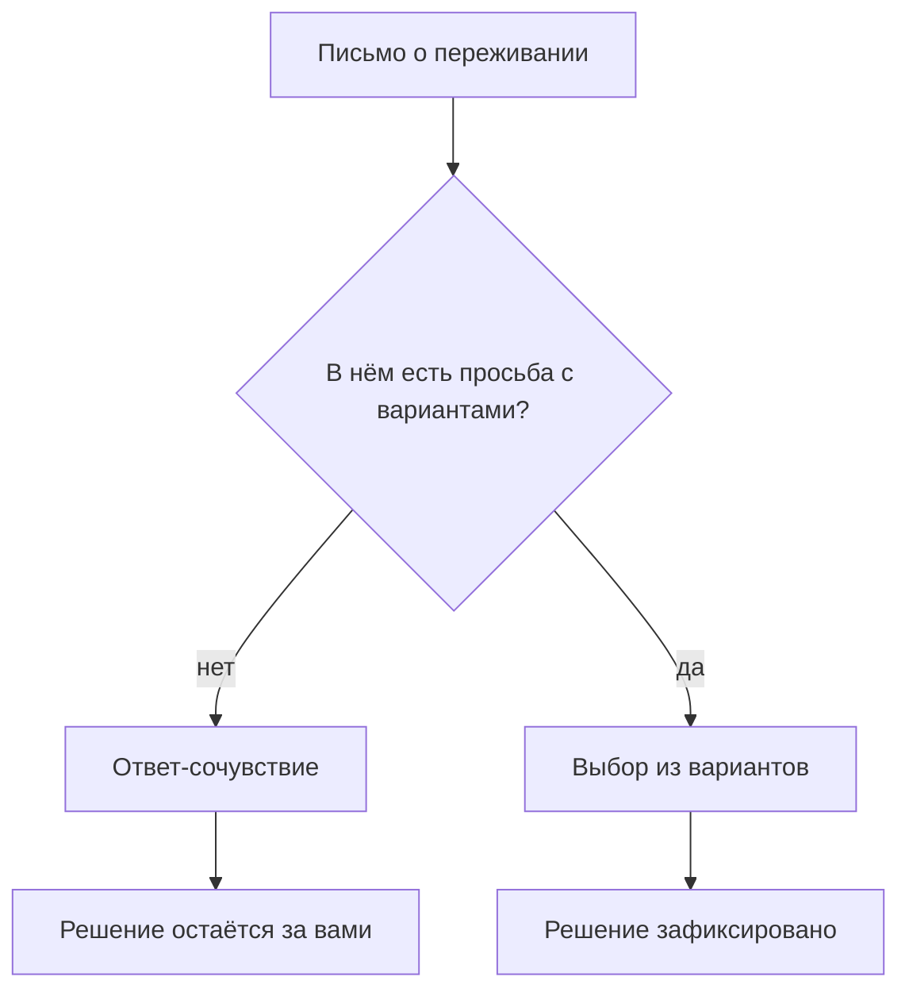
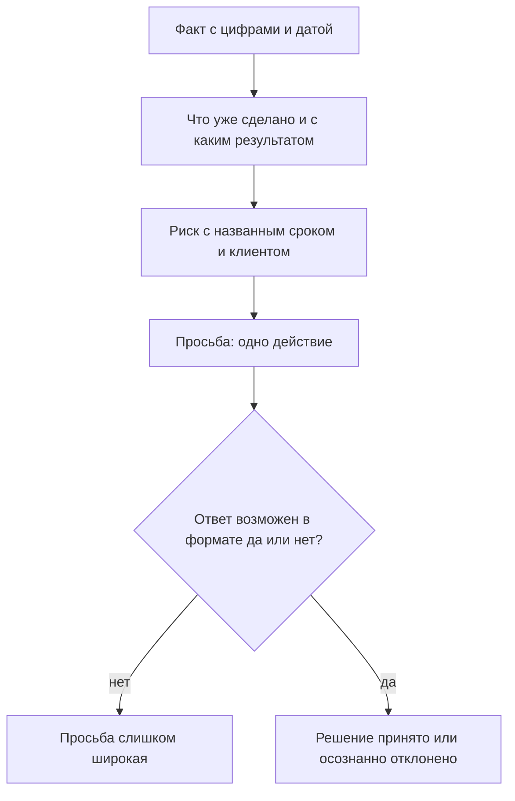
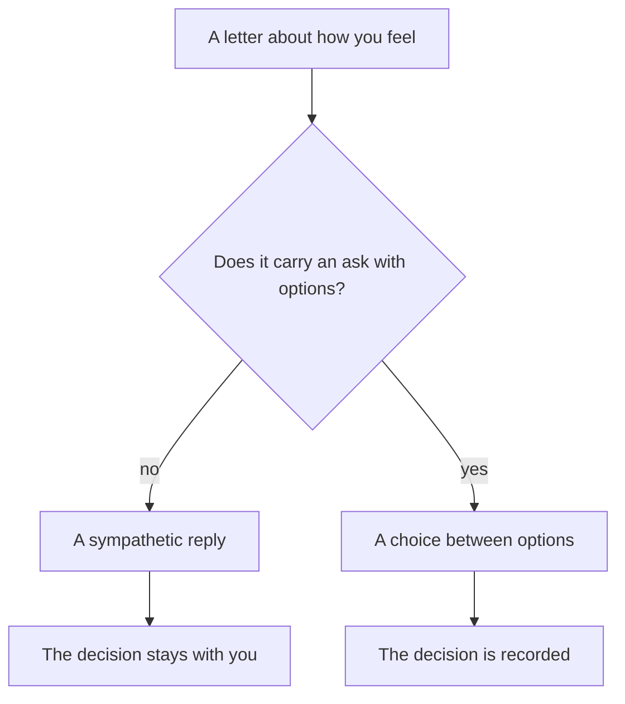
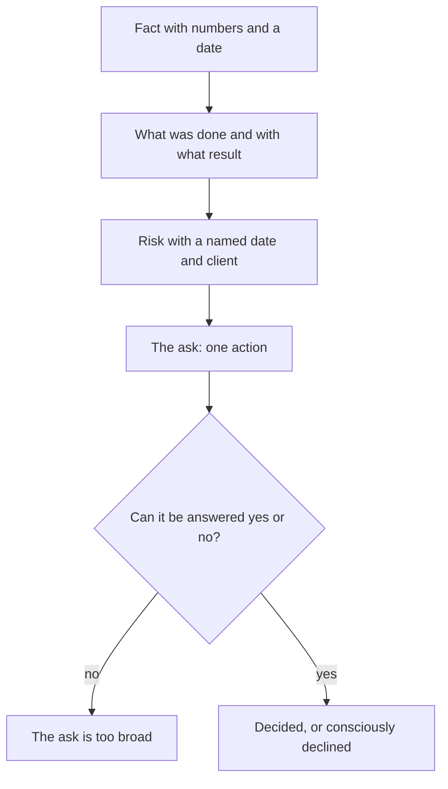
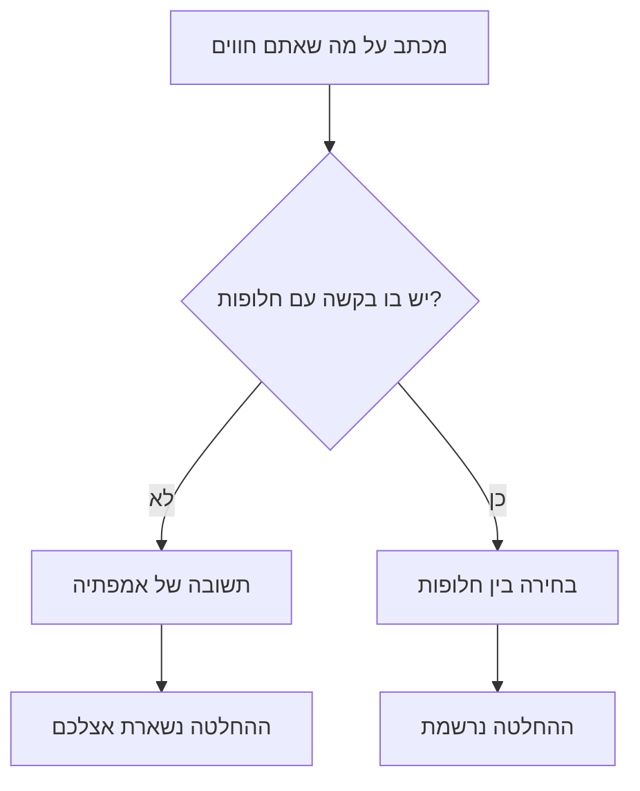
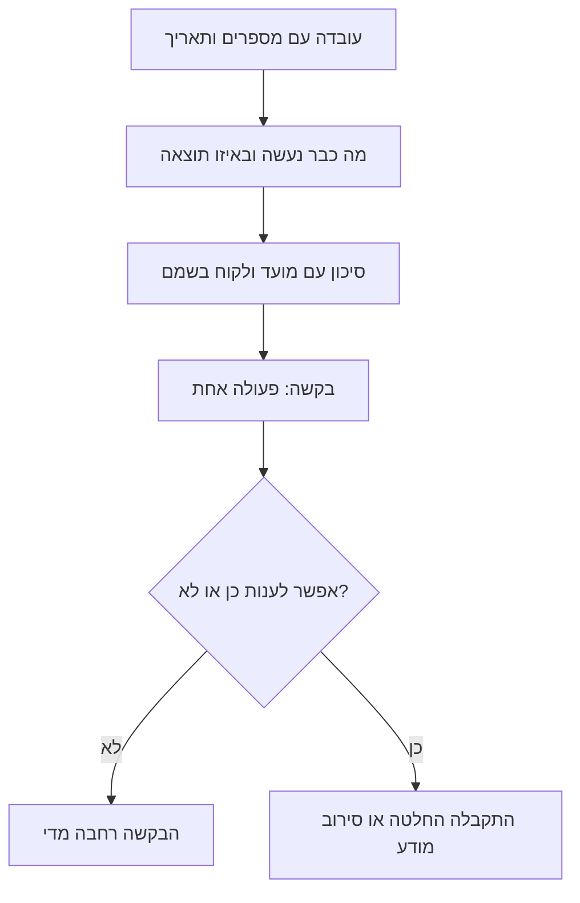

<!-- lang:ru -->

## Введение

Одно из первых писем наверх я написал в состоянии, которое казалось мне полностью оправданным: три недели без выходных, два инцидента подряд, два инженера болеют, и всё это на фоне обещанных сроков. Письмо было длинное, эмоциональное и честное. В ответ я получил одну строчку: «Держись, мы в тебя верим».

Сочувствие — вежливая форма отказа. Не потому, что руководитель чёрствый, а потому, что в таком письме не было просьбы, на которую можно ответить иначе: не было варианта, не было цены, не было срока. Оно было о моём состоянии, а решения принимаются по состоянию сервиса — вещи разные, хоть и связанные.

С тех пор я пишу письма наверх по двум шаблонам. **Эскалация** — когда проблема выходит за пределы сервиса и требует вмешательства с той стороны: факт, что сделано, риск, просьба. **Запрос ресурсов** — когда не хватает часов: данные, следствие, просьба с альтернативами. Разница в предмете, логика одна: превратить переживание в условие задачи, у которого есть ответ.

## Почему «нам нужна помощь» не приводит к решению

На первый взгляд просьба о помощи — самая безобидная форма коммуникации. На практике она ломается о три вещи.

Во-первых, в ней нет предмета спора. Руководитель не может ответить на «нам нужна помощь» — только спросить, какая именно и сколько. То есть работу по формулировке проблемы он получает вместо вас.

Во-вторых, в ней нет выбора. Решение сводится к «помочь или не помочь», а люди в основном выбирают второй вариант, когда цена первого не названа.

В-третьих, она неизменно читается как признание бессилия — так она и написана. Отсюда и «держись»: человеку в тяжёлом состоянии интереснее посочувствовать, чем вдаваться в детали, которых он не знает.

Как это выглядит по цепочке:

Иногда помогают и сочувственные письма — если честно говорить, что это эмоция, а не просьба. Но скорее как исключение и с открытым текстом: «мне нужна поддержка, а не решение, сформулирую к пятнице».

## Шаблон эскалации

Эскалация — это передача проблемы тем, у кого больше полномочий, а не тем, кому больше повезло с должностью. Структура из четырёх блоков.

**Факт.** Что случилось, когда началось, кого касается, какие цифры подтверждают. Без оценок и без прилагательных: «с такого-то числа доля заявок без ответа растёт», а не «ситуация совершенно ужасная».

**Что сделано.** Какие попытки предприняты, что показали. Это блок, который отличает эскалацию от переноса ответственности: видно, что проблема не вывалена наверх, а доведена до момента, где нужны полномочия.

**Риск.** Что будет, если не вмешаться, с гораздо более конкретной привязкой: какой клиент, какой срок, какой норматив. Риск без следствия — это настроение, его не обсуждают.

**Просьба.** Конкретное действие, которое нужно от адресата: решение, доступ, письмо, ресурс, приоритет. Формулируется так, чтобы можно было ответить «да» или «нет».

Как блоки складываются в действие:

Отдельное правило: одна эскалация — один вопрос. Если в письме три просьбы, ответом будет обсуждение самой удобной из них, а остальные тихо исчезнут.

Ещё два коротких правила. Адресат — тот, у кого есть полномочия, а не тот, кто ближе в оргструктуре: письмо руководителю, который сам не владеет вопросом, гарантирует ещё один круг пересылки и потерю доверия обеих сторон. И второе: эскалировать надо до того, как срок истёк. Эскалация после нарушения читается не как управление риском, а как объяснение провала, и обсуждают в ней уже не решение, а виновного.

## Шаблон запроса ресурсов

Этот шаблон тесно связан с расчётом мощности: без него запрос превращается в «дайте человека». Логика из трёх частей.

**Данные.** Цифры за период: объём, сроки, дефицит часов и допущения, на которых это посчитано. Допущения выписаны явно, чтобы их можно было оспорить.

**Следствие.** Что перестанет выполняться без изменений и к какому сроку. Здесь важно говорить в терминах обязательств, а не самочувствия: не «команда не выдержит», а «к такой-то дате перестанет выполняться такой-то норматив».

**Запрос с альтернативами.** Всегда не один вариант, а как минимум два: добавить часы, уменьшить объём, изменить норматив письменно. Наличие альтернатив превращает просьбу в выбор — даже когда руководство выбирает не тот вариант, на который вы рассчитывали.

Формально запрос — это одна страница и приложение. На странице — три блока и дата, к которой нужен ответ; в приложении — расчёт и выгрузки для тех, кто будет его проверять. Смешивать уровни не стоит: руководителю нужен вывод, аналитику — исходные данные, и это разные документы.

Есть и неприятная часть: запрос ресурсов иногда заканчивается отказом. Это нормальный исход, если отказ осознанный и зафиксирован вместе со следствием: тогда при следующем обсуждении вы не начинаете с нуля и не тратите письмо на напоминание.

## Плохо и хорошо на одном кейсе

Самый наглядный способ объяснить разницу — взять одну ситуацию и написать её дважды. Ниже — не готовый текст для копирования, а сравнение формы: две версии одного и того же события.

В плохой версии письмо начинается с фона и эмоции, потом идёт перечисление всего, что происходило, и заканчивается фразой вроде «нам нужно что-то решать». Читатель получает три страницы контекста и ни одного действия.

В хорошей версии та же ситуация описана иначе: одна строка факта с датой, абзац о том, что уже сделано, одна строка риска с конкретным следствием, одна явная просьба с датой, к которой нужен ответ. Объём — треть от первой версии.

Что при этом не меняется: картина проблемы и её серьёзность. Плохое письмо не преувеличено, хорошее не преуменьшено. Меняется только то, что читателю теперь есть что ответить.

<!-- вилка: свои два письма — один и тот же кейс до и после перехода на шаблон. -->

## Чего не писать

Список невелик, но каждую ошибку я встречал десятки раз — и в чужих письмах, и в своих.

- **Обвинения.** «Разработка опять не ответила» — это эмоция, а не факт; замените на сроки и на попытки связаться.
- **Детали без вывода.** Полная хронология без итога заставляет руководителя делать вашу работу: вычитывать главное из тридцати строк.
- **Просьбы без вариантов.** «Нужно больше людей» без альтернатив ставит руководителя перед выбором да/нет, а такой выбор почти всегда заканчивается нет.
- **Ложная срочность.** Если каждое письмо помечено «срочно», через месяц срочным не считается ни одно.
- **Скрытый ультиматум.** «Иначе будем вынуждены…» без конкретного варианта — это давление, и оно читается безошибочно.
- **Просьба не к тому адресату.** Эскалация руководителю, который не владеет вопросом, тратит доверие обеих сторон.

И одно правило для себя: перед отправкой прочитать письмо и ответить на вопрос, какое решение принял бы я, если бы у меня было две минуты. Если ответ не формулируется — письмо ещё не готово.

Шаблоны не делают просьбу мягче и не гарантируют согласия. Они делают другое: превращают разговор об усталости в разговор о приоритетах и ресурсах — а такой разговор может закончиться решением, даже если оно будет отрицательным.

<!-- lang:en -->

## Introduction

One of my first letters upward was written in a state that felt entirely justified: three weeks without a day off, two incidents in a row, two engineers sick, all of it against promised dates. The letter was long, emotional and honest. The answer was one line: "Hang in there, we believe in you."

Sympathy is a polite form of refusal. Not because the manager is callous, but because there was no ask in that letter that could have been answered any other way: no option, no cost, no date. It was about my state, and decisions are made about the state of the service - related things, but not the same.

Since then I write upward using two templates. **Escalation** - when a problem leaves the service's scope and needs intervention from the other side: fact, what was done, risk, ask. **A resource request** - when hours are short: data, consequence, a request with options. The subject differs, the logic is the same: turn an experience into a problem statement that has an answer.

## Why "we need help" doesn't lead to a decision

At first glance asking for help is the most harmless form of communication. In practice it breaks on three things.

First, it contains nothing to argue about. The manager can't answer "we need help" - only ask what kind and how much. That is, they get the job of formulating the problem instead of you.

Second, it contains no choice. The decision collapses into "help or not help", and people mostly choose the second when the price of the first isn't named.

Third, it inevitably reads as an admission of helplessness - because that's how it is written. Hence "hang in there": it is easier to sympathise with someone in a bad state than to dig into details you don't know.

Here is how that chain runs:

Emotional letters help too sometimes - if you say honestly that this is an emotion, not an ask. But as an exception and in plain words: "I need support, not a decision; I'll have the formulation by Friday."

## The escalation template

Escalation means handing a problem to those with more authority, not to those with luckier titles. Four blocks.

**Fact.** What happened, when it started, who is affected, which numbers confirm it. No judgements, no adjectives: "since this date the share of unanswered tickets has been growing", not "the situation is absolutely terrible".

**What was done.** Which attempts were made and what they showed. This block is what separates escalation from offloading responsibility: it shows the problem wasn't dumped upward but taken to the point where authority is needed.

**Risk.** What happens if nobody intervenes, tied to something far more concrete: which client, which date, which target. Risk without a consequence is a mood, and moods don't get discussed.

**The ask.** A specific action required from the recipient: a decision, access, a letter, a resource, a priority. Phrased so that it can be answered yes or no.

How the blocks add up to action:

A separate rule: one escalation, one question. If the letter carries three asks, the answer will be a discussion of the most convenient one, and the rest quietly disappear.

Two more short rules. The recipient should be the person with authority, not the nearest one in the org chart: a letter to a manager who doesn't own the question guarantees another forwarding round and costs trust on both sides. And second: escalate before the date expires. An escalation after a breach reads not as risk management but as explaining a failure, and what gets discussed is the culprit rather than the decision.

## The resource request template

This template is closely tied to the capacity calculation: without it, the request turns into "give me a person". Three parts.

**Data.** Figures for a period: volume, timings, the shortfall of hours and the assumptions they rest on. Assumptions are stated explicitly so they can be challenged.

**Consequence.** What stops being met without changes and by which date. What matters here is speaking in terms of commitments rather than feelings: not "the team won't hold up" but "by this date this target stops being met".

**A request with options.** Never one option but at least two: add hours, reduce volume, change the target in writing. Having options turns the ask into a choice - even when management picks the one you weren't counting on.

Formally, a request is one page plus an appendix. The page carries three blocks and the date by which an answer is needed; the appendix carries the calculation and the exports for whoever will verify it. Mixing the levels is a mistake: the manager needs the conclusion, the analyst needs the source data, and these are different documents.

There is an unpleasant part too: a resource request sometimes ends in a refusal. That's a normal outcome, provided the refusal is conscious and recorded together with the consequence: then the next discussion doesn't start from zero, and the letter isn't spent on a reminder.

## Bad and good on one case

The clearest way to show the difference is to take one situation and write it twice. What follows is not text to copy but a comparison of form: two versions of the same event.

In the bad version the letter opens with background and emotion, then goes through everything that happened, and ends with something like "we need to do something about it". The reader gets three pages of context and not a single action.

In the good version the same situation is described differently: one line of fact with a date, a paragraph on what has been done, one line of risk with a concrete consequence, one explicit ask with the date the answer is needed. It is a third of the length.

What doesn't change: the picture of the problem and its seriousness. The bad letter isn't exaggerated and the good one isn't softened. Only one thing changes - now the reader has something to answer.

<!-- вилка: свои два письма — один и тот же кейс до и после перехода на шаблон. -->

## What not to write

The list is short, but I have met each mistake dozens of times - in other people's letters and in my own.

- **Accusations.** "Engineering ignored us again" is an emotion, not a fact; replace it with dates and attempts to reach them.
- **Details without a conclusion.** A full chronology without a verdict makes the manager do your work: pick the main thing out of thirty lines.
- **Asks without options.** "We need more people" with no alternatives puts the manager before a yes/no choice, and that choice almost always ends in no.
- **False urgency.** If every letter is marked urgent, in a month none of them is.
- **A hidden ultimatum.** "Otherwise we'll be forced to…" with no concrete option is pressure, and it is read instantly.
- **An ask to the wrong person.** Escalating to a manager who doesn't own the question spends the trust of both sides.

And one rule for yourself: before sending, read the letter and answer what decision you would make with two minutes to spare. If the answer doesn't form, the letter isn't ready.

Templates don't make a request softer and don't guarantee agreement. They do something else: they turn a conversation about fatigue into a conversation about priorities and resources - and that conversation can end in a decision, even a negative one.

<!-- lang:he -->

## מבוא

אחד המכתבים הראשונים שלי כלפי מעלה נכתב במצב שנראה לי מוצדק לחלוטין: שלושה שבועות בלי יום חופש, שתי תקלות ברצף, שני מהנדסים חולים, והכל על רקע מועדים שהובטחו. המכתב היה ארוך, רגשי וישר. התשובה היתה שורה אחת: "תחזיק מעמד, אנחנו מאמינים בך".

אמפתיה היא צורה מנומסת של סירוב. לא מפני שהמנהל אדיש, אלא מפני שבמכתב כזה לא היתה בקשה שאפשר היה לענות עליה אחרת: לא היתה חלופה, לא היה מחיר, לא היה תאריך. הוא היה על המצב שלי, והחלטות מתקבלות לפי מצב השירות — דברים קרובים, אבל לא זהים.

מאז אני כותב כלפי מעלה לפי שתי תבניות. **הסלמה** — כשבעיה יוצאת מגבולות השירות ודורשת התערבות מהצד השני: עובדה, מה נעשה, סיכון, בקשה. **בקשת משאבים** — כשחסרות שעות: נתונים, תוצאה, בקשה עם חלופות. הנושא שונה, ההיגיון אחד: להפוך חוויה לניסוח בעיה שיש לו תשובה.

## למה "אנחנו צריכים עזרה" לא מוביל להחלטה

במבט ראשון בקשה לעזרה היא הצורה התמימה ביותר של תקשורת. בפועל היא נשברת על שלושה דברים.

ראשית, אין בה על מה להתווכח. המנהל לא יכול לענות ל"אנחנו צריכים עזרה" — הוא יכול רק לשאול איזו עזרה וכמה. כלומר, את עבודת הניסוח הוא מקבל במקומכם.

שנית, אין בה בחירה. ההחלטה מצטמצמת ל"לעזור או לא לעזור", ואנשים בוחרים בדרך כלל באפשרות השנייה כשמחיר הראשונה לא נאמר.

שלישית, היא נקראת תמיד כהודאה בחוסר אונים — כי כך היא כתובה. מכאן גם ה"תחזיק מעמד": קל יותר לרחם על מי שמצבו קשה מאשר לצלול לפרטים שלא מכירים.

כך נראית השרשרת:

לפעמים גם מכתבים רגשיים עוזרים — אם אומרים בכנות שזו רגש ולא בקשה. אבל כחריג ובמילים מפורשות: "אני צריך תמיכה ולא החלטה, אגבש ניסוח עד יום שישי".

## תבנית הסלמה

הסלמה היא העברת בעיה למי שיש לו יותר סמכות, ולא למי שהתמזל מזלו בתפקיד. ארבעה בלוקים.

**עובדה.** מה קרה, מתי התחיל, את מי זה נוגע, אילו מספרים מאשרים זאת. בלי הערכות ובלי שמות תואר: "מתאריך כזה גדל חלק הפניות בלי מענה", ולא "המצב נורא לחלוטין".

**מה נעשה.** אילו נסיונות נעשו ומה הם הראו. זה הבלוק שמבדיל בין הסלמה לבין גלגול אחריות: רואים שהבעיה לא נזרקה למעלה אלא הובאה לנקודה שבה נדרשת סמכות.

**סיכון.** מה יקרה אם לא יתערבו, עם הצמדה לקונקרטי בהרבה: איזה לקוח, איזה מועד, איזה תקן. סיכון בלי תוצאה הוא מצב רוח, ועל מצב רוח לא מדברים.

**בקשה.** פעולה מפורשת שנדרשת מהנמען: החלטה, הרשאה, מכתב, משאב, עדיפות. מנוסחת כך שאפשר לענות עליה כן או לא.

כך הבלוקים מתחברים לפעולה:

כלל נפרד: הסלמה אחת — שאלה אחת. אם המכתב נושא שלוש בקשות, התשובה תהיה דיון בנוחה שבהן, והשאר ייעלמו בשקט.

עוד שני כללים קצרים. הנמען — מי שיש לו סמכות ולא מי שקרוב יותר בהיררכיה: מכתב למנהל שלא מחזיק בשאלה מבטיח עוד סבב העברות ואובדן אמון משני הצדדים. והשני: להסלים לפני שהמועד פג. הסלמה אחרי הפרה נקראת לא כניהול סיכון אלא כהסבר של כישלון, ומה שנדון בה הוא האשם ולא ההחלטה.

## תבנית בקשת משאבים

התבנית הזאת קשורה הדוק לחישוב כושר הנשיאה: בלעדיה הבקשה הופכת ל"תנו אדם". שלושה חלקים.

**נתונים.** מספרים לתקופה: נפח, זמנים, המחסור בשעות וההנחות שעליהן זה מחושב. ההנחות כתובות במפורש כדי שאפשר יהיה לערער עליהן.

**תוצאה.** מה יפסיק להתקיים בלי שינוי ועד איזה תאריך. כאן חשוב לדבר במונחים של התחייבויות ולא של תחושות: לא "הצוות לא יעמוד בזה" אלא "עד תאריך כזה יפסיק להתקיים תקן כזה".

**בקשה עם חלופות.** תמיד לא חלופה אחת אלא לפחות שתיים: להוסיף שעות, להקטין נפח, לשנות תקן בכתב. עצם קיום החלופות הופך את הבקשה לבחירה — גם כשההנהלה בוחרת באפשרות שלא חיכיתם לה.

מבחינה צורנית בקשה היא עמוד אחד ותוספת. בעמוד — שלושה בלוקים והתאריך שעד אליו נדרשת תשובה; בתוספת — החישוב והייצואים למי שיבדוק אותו. לא כדאי לערבב רמות: להנהלה דרושה המסקנה, לאנליטיקאי — נתוני המקור, ואלה מסמכים שונים.

יש גם חלק לא נעים: בקשת משאבים לפעמים נגמרת בסירוב. זו תוצאה סבירה, בתנאי שהסירוב מודע ונרשם יחד עם התוצאה: אז הדיון הבא לא מתחיל מאפס ולא מבזבז מכתב על תזכורת.

## רע וטוב על אותו מקרה

הדרך הברורה ביותר להסביר את ההבדל — לקחת מצב אחד ולכתוב אותו פעמיים. להלן לא טקסט להעתקה אלא השוואת צורה: שתי גרסאות של אותו אירוע.

בגרסה הרעה המכתב פותח ברקע וברגש, ממשיך בפירוט של כל מה שקרה, ומסתיים במשהו כמו "צריך לעשות עם זה משהו". הקורא מקבל שלושה עמודים של הקשר ואף לא פעולה אחת.

בגרסה הטובה אותו מצב מתואר אחרת: שורה אחת של עובדה עם תאריך, פסקה על מה שכבר נעשה, שורה אחת של סיכון עם תוצאה קונקרטית, ובקשה מפורשת אחת עם התאריך שבו נדרשת תשובה. שליש מהאורך.

מה שלא משתנה: תמונת הבעיה וחומרתה. המכתב הרע לא מוגזם והטוב לא מרוכך. משתנה רק דבר אחד — עכשיו לקורא יש מה לענות.

<!-- вилка: свои два письма — один и тот же кейс до и после перехода на шаблон. -->

## מה לא לכתוב

הרשימה קצרה, אבל כל טעות בה פגשתי עשרות פעמים — גם במכתבים של אחרים וגם בשלי.

- **האשמות.** "הפיתוח שוב לא ענה" — זה רגש ולא עובדה; החליפו אותו במועדים ובנסיונות ליצור קשר.
- **פרטים בלי מסקנה.** כרונולוגיה מלאה בלי סיכום מכריחה את המנהל לעשות את העבודה שלכם: לסנן את העיקר משלושים שורות.
- **בקשות בלי חלופות.** "צריך יותר אנשים" בלי חלופות מציב את המנהל בפני בחירה של כן או לא, ובחירה כזאת נגמרת כמעט תמיד בלא.
- **דחיפות מדומה.** אם כל מכתב מסומן כדחוף, בעוד חודש שום דבר לא נחשב דחוף.
- **אולטימטום סמוי.** "אחרת נהיה חייבים ל..." בלי חלופה קונקרטית — זה לחץ, והוא נקרא מיד.
- **בקשה לנמען הלא נכון.** הסלמה למנהל שלא מחזיק בשאלה מבזבזת את האמון של שני הצדדים.

וכלל אחד לעצמכם: לפני השליחה לקרוא את המכתב ולענות על השאלה איזו החלטה הייתם מקבלים אם היו לכם שתי דקות. אם התשובה לא מגובשת — המכתב עוד לא מוכן.

תבניות לא מרככות את הבקשה ולא מבטיחות הסכמה. הן עושות משהו אחר: הופכות שיחה על עייפות לשיחה על עדיפויות ומשאבים — ושיחה כזאת יכולה להסתיים בהחלטה, גם אם שלילית.
