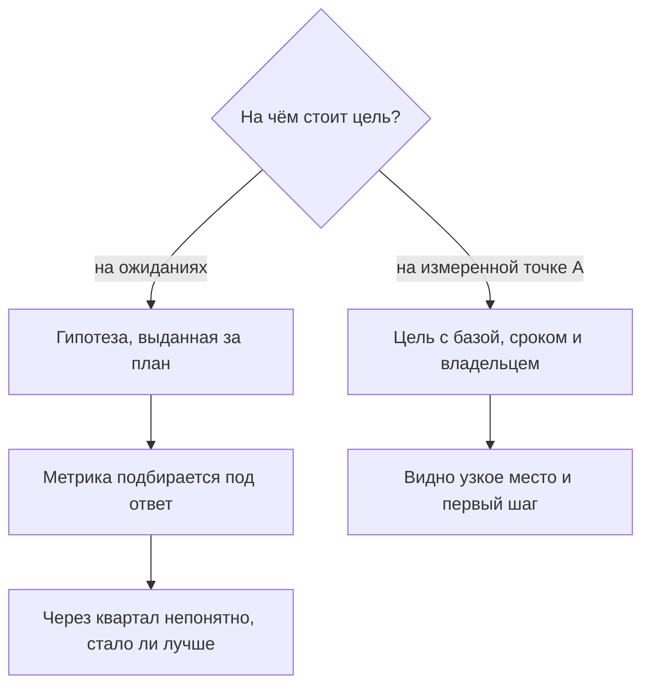
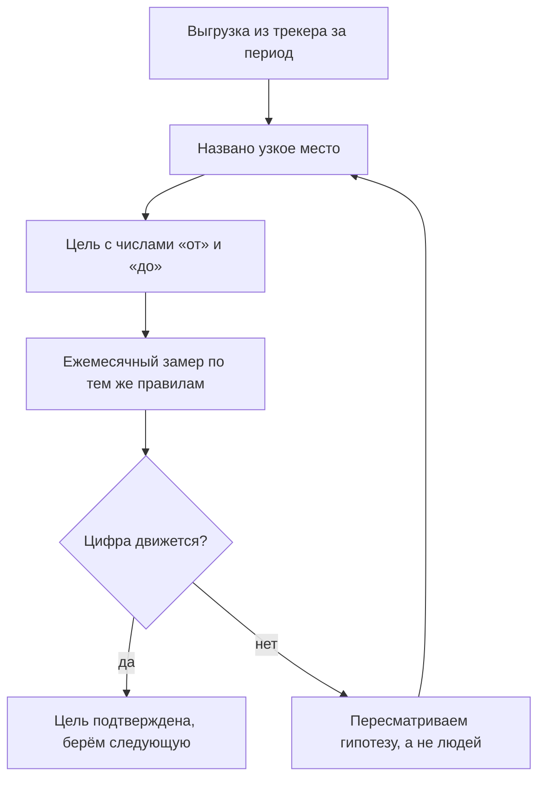
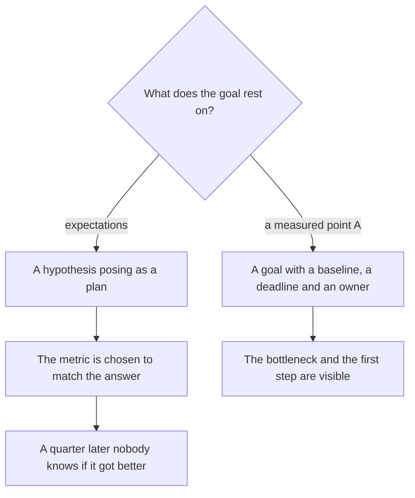
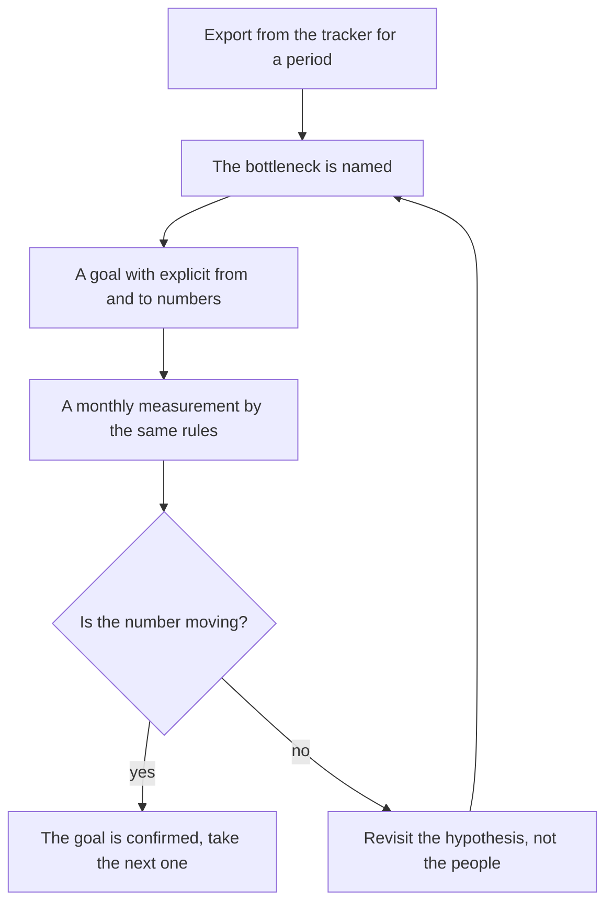
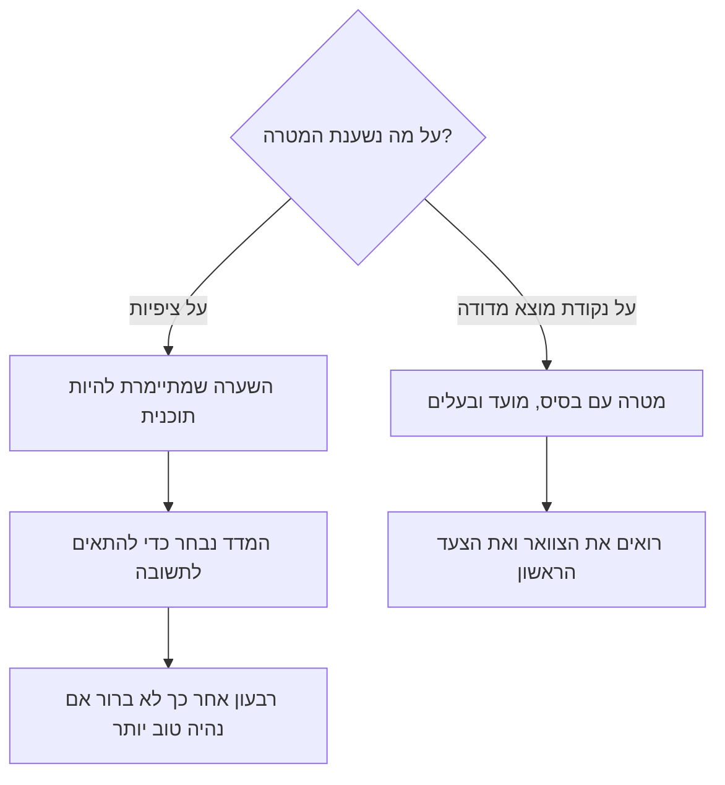
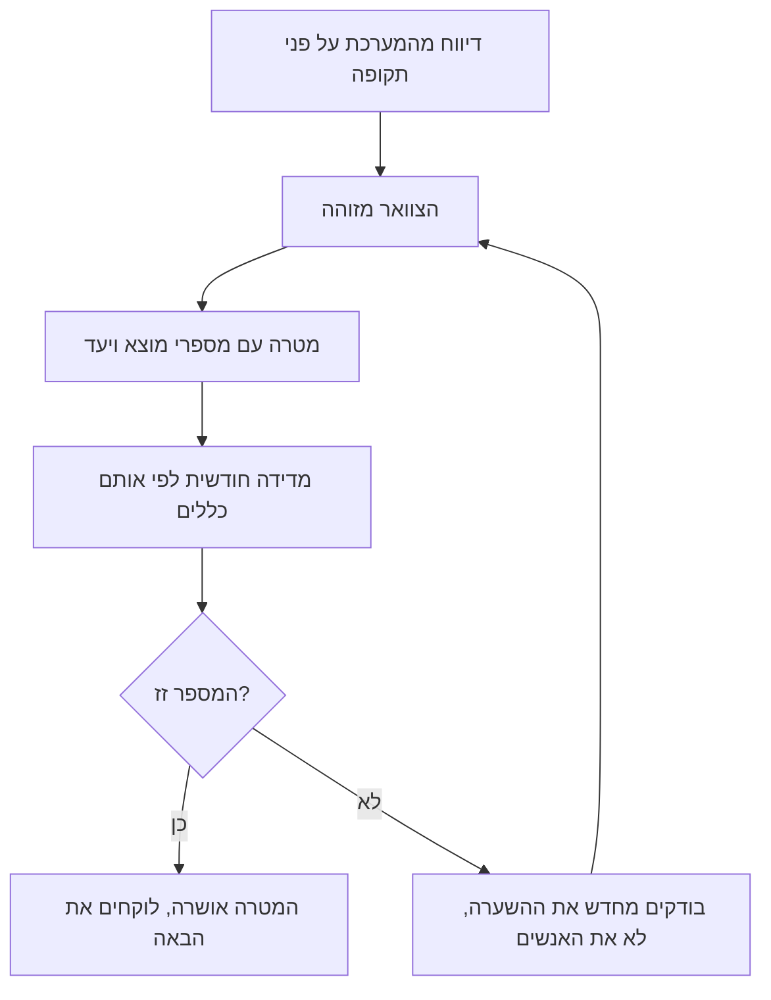

<!-- lang:ru -->

## Введение

В первый рабочий день на позиции лида поддержки у меня было два документа: список ожиданий от руководства и уверенность, что я знаю, как их выполнить. Через месяц выяснилось, что половина ожиданий измерялась не тем, чем я думал, а вторая половина не измерялась никак. Цифры, которые я называл на планёрках, были не состоянием сервиса, а суммой чужих впечатлений.

В предыдущей статье серии — [«Границы ответственности»](/ru/blog/support-lead-boundaries/) — речь шла о том, чтобы освободить время лида от чужих решений. Эта статья о следующем шаге: что делать с освободившимся временем в первые недели, чтобы год не превратился в набор громких обещаний.

Тезис простой и неприятный: цель, поставленная до измерения, — это гипотеза, которая выдаёт себя за план. Она звучит правильно, она нравится руководству, и у неё нет ни одного шанса сработать, потому что никто не знает, от какой точки она отсчитывается.

## Цели в день старта — типовая ошибка

Цели редко придумывает лид в первый день. Обычно они приходят готовыми: из ожиданий руководителя, из описания вакансии, из прошлогоднего плана, из опыта предыдущей компании. «Первый ответ в течение 30 минут», «сократить время решения вдвое», «поднять удовлетворённость клиентов» — всё это звучит как постановка задачи, но по сути является пожеланием.

Почему такие цели не переживают первый месяц:

- **У них нет начала.** Формулировка «сократить время решения вдвое» не содержит числа «от», только «до». Через квартал невозможно сказать, стало ли лучше, — сравнивать не с чем.
- **Они описывают не тот объект.** Время решения, посчитанное средним по всем заявкам, включает те, что месяцами висят в ожидании ответа клиента. Метрика двигается не тогда, когда работает команда, а тогда, когда клиент соизволил ответить.
- **Измеритель подбирается задним числом.** Сначала цель, потом метрика, которая её «подтвердит». Так появляются отчёты, где всё хорошо, и ощущение, что сервис живёт не той жизнью, которую показывают цифры.
- **Первая неудача убивает доверие к плану.** Цифра не сдвинулась за месяц — и вывод делается не «мы не знаем, откуда считаем», а «план не работает, лид не тянет».
- **Команда не видит связи.** Инженер читает «цель года» и не понимает, что из этого меняется в его смене. Цель, которая не превращается в ежедневное действие, живёт только в презентации.

В годовом плане, по которому я работаю, это названо первой типовой ошибкой лида: цель до измерения. Логика её проста — измерять страшно, потому что факт может оказаться хуже, чем ожидания. Поэтому цель ставится первой: она создаёт ощущение контроля. Только контроль этот мнимый.

Как выглядит развилка:

Дальше — что именно меняет измеренная точка А.

## Что меняет точка А

Baseline (в русской практике — базовая линия, точка А) — это измеренное состояние сервиса на входе: сколько заявок приходит, какого они рода, сколько времени проходит до первого ответа и до решения, какая доля решений возвращается, где поток стоит. Не оценка, не ощущение «вроде справляемся», а счёт по событиям из трекера.

Пример, который делает разницу очевидной. Цель «первый ответ за 30 минут» при факте «первый ответ приходит через три дня» — это не цель, это другой сервис с другим штатом и другой очередью. Между фактом и целью лежит не мотивация, а работа: триаж первого касания, дежурства, распределение потока, регламент эскалаций. Цель, поставленная без этого зазора, выбирает не работа, а фантазия — и через месяц выясняется, что двигали не то.

Три функции baseline, которые важны больше самой цифры:

1. **Масштаб.** Он почти всегда отличается от того, что кажется. Нагрузка распределена неравномерно, часть потока — не инциденты, а вопросы и запросы на изменение, и работать с ними нужно по-разному.
2. **Узкое место.** Гипотез о том, что мешает, обычно пять. Факт называет одну — и это экономит квартал.
3. **Проверяемость.** Цель с точкой А звучит иначе: не «ускорить реакцию», а «первый ответ с трёх дней до восьми часов к концу второго квартала». Её можно проверить, оспорить и разбить на шаги.

<!-- вилка: 3–4 фактических значения точки А — MTTA, доля реопенов, доля решений по базе знаний, просроченные заявки. -->

Как замыкается работа с точкой А:

## Baseline из трекера за первый месяц

Первый месяц — единственное время, когда у вас есть право не знать цифр. Дальше это право заканчивается, и каждая формулировка «нам кажется» стоит доверия. Поэтому выгрузка делается сразу и целиком, даже если разбирать её вы будете постепенно.

Что стоит выгрузить в первую очередь:

| Показатель | Что показывает | Зачем в точке А |
| --- | --- | --- |
| Объём и структура потока | Заявок в неделю по категориям: инцидент, вопрос, запрос на изменение | Масштаб и правильная очередь |
| Критичность | Распределение по приоритетам и доля критичных | Где реальный риск, а где шум |
| Время первого ответа | От создания заявки до первого содержательного ответа | Дисциплина реакции, а не занятость |
| Время до решения | От создания до закрытия — с разделением на время в работе и время в ожидании | Работа команды отдельно от ожидания клиента |
| Реопены и возвраты | Доля заявок, открытых повторно | Качество решения, а не скорость закрытия |
| Доля решений по базе знаний | Заявки, закрытые со ссылкой на статью | Зрелость знаний и потенциал самообслуживания |
| Доля эскалаций | Передачи в L2 и L3 | Где ломается маршрут и не хватает компетенций |
| Возраст бэклога | Заявки, висящие дольше норматива | Тихие нарушения, которых не видно в отчётах |
| Нагрузка по инженерам | Распределение заявок и времени | Мощность и одноточечные риски |

Несколько правил, без которых выгрузка превращается в набор несопоставимых чисел:

- **Один период, один источник.** Все показатели считаются за одинаковое окно из одного трекера. Данные из чата, из почты и из памяти в baseline не входят.
- **Определения записаны.** «Первый ответ» — это что именно: шаблонное подтверждение получения или содержательный ответ? Пока определение не зафиксировано, цифру можно трактовать как угодно.
- **Считаем по событиям, а не по текущим статусам.** Заявка, закрытая сегодня, была создана месяц назад; отчёт по текущим статусам этого не покажет.
- **Время в работе и время в ожидании — раздельно.** Иначе виноватым в сроках автоматически становится клиент или, наоборот, команда.
- **Никаких ручных правок.** Как только первая цифра «поправлена, чтобы не выглядело так плохо», весь baseline перестаёт быть аргументом.
- **История важнее месяца.** Если в трекере есть квартал или год, берите их: сезонность в поддержке заметна только на длинном окне. Если данных мало, так и напишите — «выборка за три недели».

<!-- вилка: свои выгрузки — какие поля, за какой период, где хранится таблица. -->

Отдельно стоит посчитать, чего в трекере нет. Обычно это стоимость ручных операций, время на переключение между системами и работа, которая не оставляет заявки: разбор инцидентов в чате, консультации коллег, обучение. Эти цифры baseline не покажет, но именно они объясняют, почему инженер «занят, но заявки не закрываются».

## Калибровка с руководством

Второй месяц — время разговора, и его лучше готовить как защиту проекта, а не как отчёт о проделанном. На входе — выгрузка, на выходе — согласованные цели с числами «от» и «до».

Схема разговора состоит из четырёх шагов:

1. **Факт.** Показываете точку А без прикрас и без оправданий: столько заявок, такие сроки, такие возвраты.
2. **Узкое место.** Называете одну-две причины, подтверждённые данными, а не ощущением.
3. **Вектор.** Предлагаете, что изменится, если сделать конкретные шаги, и какие это цели даёт на год.
4. **Запрос.** Если для вектора нужен ресурс — человек, инструмент, решение руководства, — он называется прямо и в том же разговоре.

Правила, которые я вывел из собственных ошибок в этом разговоре:

- **Приходить с выгрузкой, а не с настроением.** Фраза «команда перегружена» обсуждается, фраза «в очереди висят заявки старше норматива, вот они» — решается.
- **Каждая цель имеет четыре атрибута:** «от», «до», срок и владельца. Цель без владельца — это не цель, а пожелание.
- **Цель, требующая ресурса, содержит запрос ресурса.** Обещать ускорение реакции без изменения штата — способ через квартал объяснять провал.
- **Промежуточные вехи вместо годовых обещаний.** «К концу первого квартала — первый ответ в течение дня, к концу второго — восемь часов» обсуждается легче и проверяется честнее, чем одна цифра на год.
- **Договорённость фиксируется письменно, с датой пересмотра.** Иначе через полгода будет новая версия разговора и новые ожидания.
- **Baseline — не оправдание.** Как только цифры начинают использоваться для объяснения, почему мы медленные, разговор теряет смысл. Они нужны, чтобы показать движение.

Отдельная ловушка — руководитель, который настаивает на цели, недостижимой при текущем ресурсе. Спорить с формулировкой бесполезно: спор идёт о будущем, а аргументы лежат в настоящем. Работает другое — согласиться с направлением и разложить его на вехи с условиями: «к такой-то дате выходим на такую-то цифру при таком-то ресурсе; если ресурса нет, веха сдвигается на столько-то». Так цель остаётся амбициозной, а вы — не человеком, который обещал и не сделал.

<!-- вилка: ваш разговор о целях — что было на входе, какие цели согласовали, какой ресурс запросили. -->

## Что должно остаться после первых двух месяцев

Короткий чек-лист, по которому видно, что старт удался:

- выгрузка из трекера существует и обновляется по одному правилу;
- у каждого показателя записано определение, и спорить о смысле цифры больше не нужно;
- названо узкое место, и оно подтверждено данными, а не авторитетом;
- цели года сформулированы как проверяемые результаты с числами «от» и «до»;
- у каждой цели есть срок, владелец и, если нужно, запрос ресурса;
- договорённость с руководством зафиксирована письменно и имеет дату пересмотра.

Точка А — это не бюрократия и не недоверие к команде. Это способ перестать спорить о том, что происходит, и начать спорить о том, что делать. Следующий шаг — превратить согласованные цели в дорожную карту на двенадцать месяцев: четыре квартала, где каждый следующий опирается на результат предыдущего. Об этом — в следующей статье серии.

<!-- lang:en -->

## Introduction

On my first day as a support lead I had two documents: the list of management's expectations and the certainty that I knew how to meet them. A month later it turned out that half of those expectations were measured by something other than what I had in mind, and the other half were not measured at all. The numbers I quoted in meetings were not the state of the service but the sum of other people's impressions.

The previous article of the series — ["Ownership boundaries"](/en/blog/support-lead-boundaries/) — was about freeing the lead's time from other people's decisions. This one is about the next step: what to do with that freed time in the first weeks so the year does not turn into a set of loud promises.

The point is simple and uncomfortable: a goal set before the measurement is a hypothesis pretending to be a plan. It sounds right, management likes it, and it has no chance of working, because nobody knows which point it is counted from.

## Goals on day one are the standard mistake

Leads rarely invent goals on day one. They arrive ready-made: from the manager's expectations, from the job description, from last year's plan, from the previous company's experience. "First response within 30 minutes", "halve the resolution time", "raise customer satisfaction" — all of it sounds like a task, yet it is a wish.

Why such goals don't survive the first month:

- **They have no starting point.** "Halve the resolution time" contains no "from", only a "to". A quarter later you cannot say whether things got better — there is nothing to compare against.
- **They describe the wrong object.** Resolution time averaged over all tickets includes the ones hanging for months while the client answers. The metric moves not when the team works but when the client deigns to reply.
- **The measuring stick is picked afterwards.** First the goal, then the metric that will "confirm" it. That is how reports appear where everything is fine, and the feeling that the service lives a life the numbers don't show.
- **The first failure kills trust in the plan.** The number didn't move in a month — and the conclusion drawn is not "we don't know what we are counting" but "the plan doesn't work, the lead can't cope".
- **The team sees no connection.** An engineer reads the "goal of the year" and cannot tell what changes in their shift. A goal that never becomes a daily action lives only in the presentation.

The annual plan I work by calls this the first standard mistake of a lead: a goal before the measurement. The logic is simple — measuring is frightening, because the fact may be worse than the expectations. So the goal comes first: it creates a feeling of control. Except the control is imaginary.

Here is the fork:

Next — what exactly a measured point A changes.

## What point A changes

A baseline is the measured state of the service on entry: how many tickets arrive, of what kind, how much time passes before the first response and before resolution, what share of resolutions comes back, where the flow stalls. Not an estimate, not a feeling of "we seem to be coping", but a count of events from the tracker.

An example that makes the difference obvious. A goal of "first response in 30 minutes" against a fact of "the first response arrives in three days" is not a goal — it is a different service with a different headcount and a different queue. Between the fact and the goal lies not motivation but work: first-touch triage, duty shifts, flow distribution, an escalation policy. A goal set without that gap is chosen by fantasy rather than by work, and a month later it turns out you moved the wrong thing.

Three functions of the baseline matter more than the number itself:

1. **Scale.** It is almost always different from what it seems. The load is unevenly distributed, part of the flow is not incidents but questions and change requests, and they must be handled differently.
2. **The bottleneck.** There are usually five hypotheses about what is in the way. The fact names one — and that saves a quarter.
3. **Verifiability.** A goal with point A sounds different: not "speed up the response" but "first response from three days to eight hours by the end of Q2". It can be checked, challenged and split into steps.

<!-- вилка: 3–4 фактических значения точки А — MTTA, доля реопенов, доля решений по базе знаний, просроченные заявки. -->

How the loop around point A closes:

## A baseline from the tracker in the first month

The first month is the only time you have the right not to know the numbers. After that the right expires, and every "it seems to us" costs trust. So the export is done at once and in full, even if you will work through it gradually.

What to pull first:

| Indicator | What it shows | Why it belongs in point A |
| --- | --- | --- |
| Volume and structure of the flow | Tickets per week by category: incident, question, change request | Scale and the right queue |
| Priority | Distribution across priorities and the share of critical ones | Where the real risk is and where the noise |
| Time to first response | From ticket creation to the first substantive answer | Response discipline rather than busyness |
| Time to resolution | From creation to closure — split into time in work and time waiting | The team's work separately from the client's waiting |
| Reopens and returns | Share of tickets opened again | Quality of the resolution rather than speed of closing |
| Share resolved from the knowledge base | Tickets closed with a reference to an article | Maturity of knowledge and the potential for self-service |
| Escalation rate | Handovers to L2 and L3 | Where the route breaks and competences are missing |
| Backlog age | Tickets pending longer than the norm | Silent breaches invisible in reports |
| Load per engineer | Distribution of tickets and time | Capacity and single points of failure |

A few rules without which the export turns into a set of incomparable numbers:

- **One period, one source.** Every indicator is counted over the same window from the same tracker. Data from chat, from email and from memory is not part of a baseline.
- **Definitions are written down.** "First response" is what exactly: a template acknowledgement or a substantive answer? Until the definition is fixed, the number can be read any way you like.
- **Count events, not current statuses.** A ticket closed today was created a month ago; a report on current statuses will not show that.
- **Time in work and time waiting — separately.** Otherwise the client or, conversely, the team automatically becomes guilty of the delays.
- **No manual edits.** The moment the first number is "corrected so it doesn't look so bad", the whole baseline stops being an argument.
- **History beats a month.** If the tracker holds a quarter or a year, take those: seasonality in support only shows on a long window. If there is little data, say so — "a three-week sample".

<!-- вилка: свои выгрузки — какие поля, за какой период, где хранится таблица. -->

It is worth counting separately what the tracker does not have. Usually that is the cost of manual operations, the time spent switching between systems, and the work that leaves no ticket: incident discussions in chat, consultations with colleagues, mentoring. The baseline will not show these numbers, yet they are exactly what explains why an engineer is "busy but tickets don't get closed".

## Calibration with management

The second month is the time for the conversation, and it is better prepared as a project defence than as a report on work done. The input is the export; the output is agreed goals with "from" and "to" numbers.

The conversation has four steps:

1. **Fact.** Show point A without varnish and without excuses: this many tickets, these times, these reopens.
2. **Bottleneck.** Name one or two causes backed by data, not by a feeling.
3. **Vector.** Propose what will change if specific steps are taken, and which annual goals that yields.
4. **Ask.** If the vector needs a resource — a person, a tool, a management decision — it is named plainly and in the same conversation.

Rules I derived from my own mistakes in that conversation:

- **Come with an export, not with a mood.** "The team is overloaded" gets discussed; "there are tickets older than the norm in the queue, here they are" gets decided.
- **Every goal has four attributes:** "from", "to", a deadline and an owner. A goal without an owner is a wish, not a goal.
- **A goal that needs a resource contains the resource request.** Promising a faster response without changing the headcount is a way to explain a failure a quarter later.
- **Milestones instead of annual promises.** "By the end of Q1 — first response within a day, by the end of Q2 — eight hours" is easier to discuss and more honestly checked than a single number for the year.
- **The agreement is written down, with a review date.** Otherwise in six months there will be a new version of the conversation and new expectations.
- **The baseline is not an excuse.** As soon as the numbers start being used to explain why we are slow, the conversation loses its point. They exist to show movement.

A separate trap is the manager who insists on a goal unreachable with the current resource. Arguing about the wording is useless: the argument is about the future, while the evidence lies in the present. Something else works — accept the direction and break it into milestones with conditions: "by this date we reach this number with this resource; without the resource the milestone moves by so much". The goal stays ambitious, and you are not the person who promised and failed.

<!-- вилка: ваш разговор о целях — что было на входе, какие цели согласовали, какой ресурс запросили. -->

## What should remain after the first two months

A short checklist that shows the start worked:

- the tracker export exists and is updated by one rule;
- every indicator has a written definition, and the meaning of a number is no longer a debate;
- the bottleneck is named and backed by data rather than by authority;
- the annual goals are stated as verifiable results with "from" and "to" numbers;
- every goal has a deadline, an owner and, where needed, a resource request;
- the agreement with management is written down and has a review date.

Point A is not bureaucracy and not distrust of the team. It is a way to stop arguing about what is happening and start arguing about what to do. The next step is to turn the agreed goals into a twelve-month roadmap: four quarters where each rests on the result of the previous one. That is the next article of the series.

<!-- lang:he -->

## מבוא

ביום העבודה הראשון שלי כמנהל תמיכה היו לי שני מסמכים: רשימת הציפיות של ההנהלה, והביטחון שאני יודע איך למלא אותן. כעבור חודש התברר שחצי מהציפיות נמדדו במשהו אחר ממה שחשבתי, והחצי השני לא נמדד בכלל. המספרים שציטטתי בישיבות לא היו מצב השירות אלא סכום של רשמים של אחרים.

המאמר הקודם בסדרה — ["גבולות אחריות"](/he/blog/support-lead-boundaries/) — עסק בשחרור הזמן של מנהל התמיכה מהחלטות של אחרים. המאמר הזה עוסק בצעד הבא: מה לעשות עם הזמן שהתפנה בשבועות הראשונים, כדי שהשנה לא תהפוך לאוסף של הבטחות רועשות.

הטענה פשוטה ולא נוחה: מטרה שנקבעה לפני המדידה היא השערה שמתיימרת להיות תוכנית. היא נשמעת נכון, היא מוצאת חן בעיני ההנהלה, ואין לה סיכוי לעבוד — כי אף אחד לא יודע מאיזו נקודה סופרים אותה.

## מטרות ביום הראשון — הטעות השגרתית

מנהל התמיכה כמעט ולא ממציא מטרות ביום הראשון. הן מגיעות מוכנות: מציפיות הממונה, מתיאור התפקיד, מהתוכנית של השנה שעברה, מהניסיון של החברה הקודמת. "תגובה ראשונה בתוך 30 דקות", "לחצות את זמן הפתרון", "להעלות את שביעות הרצון של הלקוחות" — כל זה נשמע כמו הצבת משימה, אבל בפועל זה משאלה.

למה מטרות כאלה לא שורדות את החודש הראשון:

- **אין להן נקודת התחלה.** "לחצות את זמן הפתרון" לא מכיל "מ", רק "ל". רבעון אחר כך אי אפשר לומר אם נהיה טוב יותר — אין עם מה להשוות.
- **הן מתארות את האובייקט הלא נכון.** זמן פתרון כממוצע על כל הפניות כולל גם את אלה שתלויות חודשים בהמתנה לתשובת הלקוח. המדד זז לא כשהצוות עובד אלא כשהלקוח טרח להגיב.
- **המדד נבחר בדיעבד.** קודם המטרה, אחר כך המדד ש"יאשר" אותה. כך נולדים דוחות שבהם הכל בסדר, ותחושה שהשירות חי חיים אחרים מאלה שהמספרים מראים.
- **הכישלון הראשון הורג את האמון בתוכנית.** המספר לא זז בחודש — והמסקנה היא לא "אנחנו לא יודעים ממה לספור" אלא "התוכנית לא עובדת, מנהל התמיכה לא עומד בזה".
- **הצוות לא רואה קשר.** מוקדן קורא את "מטרת השנה" ולא מבין מה משתנה במשמרת שלו. מטרה שלא הופכת לפעולה יומיומית חיה רק במצגת.

בתוכנית השנתית שלפיה אני עובד זה נקרא הטעות השגרתית הראשונה של מנהל תמיכה: מטרה לפני מדידה. ההיגיון פשוט — למדוד מפחיד, כי העובדה עשויה להיות גרועה מהציפיות. לכן המטרה באה ראשונה: היא יוצרת תחושת שליטה. אלא שהשליטה הזאת מדומה.

כך נראית ההסתעפות:

המשך — מה בדיוק משנה נקודת מוצא מדודה.

## מה משנה נקודת המוצא

בסיס (baseline, נקודה א) הוא מצב השירות הנמדד בכניסה: כמה פניות מגיעות, מאיזה סוג, כמה זמן עובר עד התגובה הראשונה ועד הפתרון, איזה חלק מהפתרונות חוזר, ואיפה הזרימה נתקעת. לא הערכה, לא תחושה של "נראה שאנחנו מסתדרים", אלא ספירה של אירועים מהמערכת.

דוגמה שממחישה את ההבדל. מטרה של "תגובה ראשונה בתוך 30 דקות" מול עובדה של "התגובה הראשונה מגיעה כעבור שלושה ימים" — זאת לא מטרה, זה שירות אחר עם כוח אדם אחר ותור אחר. בין העובדה למטרה לא עומדת מוטיבציה אלא עבודה: מיון במגע ראשון, תורנויות, חלוקת הזרימה, נוהל הסלמות. מטרה שנקבעה בלי הפער הזה נבחרת על ידי דמיון ולא על ידי עבודה, וכעבור חודש מתברר שהזזנו את הדבר הלא נכון.

שלוש פונקציות של הבסיס חשובות יותר מהמספר עצמו:

1. **קנה מידה.** הוא כמעט תמיד שונה ממה שנדמה. העומס מפוזר בצורה לא אחידה, חלק מהזרימה הוא לא תקלות אלא שאלות ובקשות שינוי, וצריך לטפל בהן אחרת.
2. **הצוואר.** יש בדרך כלל חמש השערות לגבי מה מפריע. העובדה מצביעה על אחת — וזה חוסך רבעון.
3. **אפשרות לבדיקה.** מטרה עם נקודת מוצא נשמעת אחרת: לא "להאיץ את התגובה" אלא "תגובה ראשונה משלושה ימים לשמונה שעות עד סוף הרבעון השני". אפשר לבדוק אותה, לערער עליה ולפרק אותה לצעדים.

<!-- вилка: 3–4 фактических значения точки А — MTTA, доля реопенов, доля решений по базе знаний, просроченные заявки. -->

כך נסגר המעגל סביב נקודת המוצא:

## בסיס מהמערכת בחודש הראשון

החודש הראשון הוא הזמן היחיד שבו יש לכם הזכות לא לדעת מספרים. אחריו הזכות הזאת נגמרת, וכל "נדמה לנו" עולה באמון. לכן הדיווח נעשה מיד ובמלואו, גם אם תפרקו אותו בהדרגה.

מה להוציא קודם:

| מדד | מה הוא מראה | למה הוא נחוץ בבסיס |
| --- | --- | --- |
| היקף ומבנה הזרימה | פניות בשבוע לפי קטגוריה: תקלה, שאלה, בקשת שינוי | קנה מידה ותור נכון |
| דחיפות | התפלגות לפי עדיפויות וחלק הפניות הקריטיות | איפה הסיכון האמיתי ואיפה הרעש |
| זמן לתגובה ראשונה | מרגע פתיחת הפנייה ועד תשובה מהותית | משמעת תגובה ולא עומס |
| זמן לפתרון | מרגע הפתיחה עד הסגירה — בפיצול לזמן בעבודה ולזמן המתנה | עבודת הצוות בנפרד מההמתנה ללקוח |
| פתיחות חוזרות | חלק הפניות שנפתחו שוב | איכות הפתרון ולא מהירות הסגירה |
| פתרון מתוך בסיס הידע | פניות שנסגרו עם הפניה למאמר | בגרות הידע והפוטנציאל לשירות עצמי |
| שיעור הסלמות | העברות ל-L2 ול-L3 | איפה נשבר המסלול ואיפה חסרות יכולות |
| גיל תור הפניות | פניות שממתינות מעבר לנוהל | הפרות שקטות שלא נראות בדוחות |
| עומס לפי מוקדן | התפלגות הפניות והזמן | כושר נשיאה וסיכוני נקודה בודדת |

כמה כללים שבלעדיהם הדיווח הופך לאוסף של מספרים בלתי־ניתנים להשוואה:

- **תקופה אחת, מקור אחד.** כל המדדים נספרים על אותו חלון מאותה מערכת. נתונים מצ'אט, מדואר ומזיכרון לא נכללים בבסיס.
- **ההגדרות כתובות.** "תגובה ראשונה" — מה בדיוק: אישור תבניתי או תשובה מהותית? כל עוד ההגדרה לא קבועה, אפשר לפרש את המספר איך שרוצים.
- **סופרים אירועים, לא סטטוסים נוכחיים.** פנייה שנסגרה היום נפתחה לפני חודש; דוח לפי סטטוסים נוכחיים לא יראה את זה.
- **זמן בעבודה וזמן בהמתנה — בנפרד.** אחרת האשמה בעיכובים נופלת אוטומטית על הלקוח או, להפך, על הצוות.
- **בלי תיקונים ידניים.** ברגע שהמספר הראשון "תוקן כדי שלא ייראה כל כך רע", כל הבסיס מפסיק להיות טיעון.
- **היסטוריה עדיפה על חודש.** אם במערכת יש רבעון או שנה — קחו אותם: עונתיות בתמיכה נראית רק על חלון ארוך. אם הנתונים מעטים, כתבו זאת — "מדגם של שלושה שבועות".

<!-- вилка: свои выгрузки — какие поля, за какой период, где хранится таблица. -->

שווה לספור בנפרד את מה שאין במערכת. בדרך כלל אלה עלות הפעולות הידניות, הזמן על מעבר בין מערכות, ועבודה שלא משאירה פנייה: ניתוח תקלות בצ'אט, התייעצויות עם עמיתים, חניכה. הבסיס לא יראה את המספרים האלה, אבל בדיוק הם מסבירים למה מוקדן "עמוס אבל הפניות לא נסגרות".

## כיול עם ההנהלה

החודש השני הוא זמן השיחה, ומוטב להכין אותה כהגנת פרויקט ולא כדוח על מה שנעשה. בקלט — הדיווח, בפלט — מטרות מוסכמות עם מספרי מוצא ויעד.

לשיחה ארבעה שלבים:

1. **עובדה.** מציגים את נקודת המוצא בלי ייפוי ובלי התנצלות: כל כך הרבה פניות, זמנים כאלה, פתיחות חוזרות כאלה.
2. **צוואר.** מציינים סיבה אחת או שתיים שמבוססות על נתונים ולא על תחושה.
3. **וקטור.** מציעים מה ישתנה אם ייעשו צעדים קונקרטיים, ואילו מטרות שנתיות זה נותן.
4. **בקשה.** אם הווקטור דורש משאב — אדם, כלי, החלטת הנהלה — הוא נאמר ישירות ובאותה שיחה.

כללים שהסקתי מהטעויות שלי באותה שיחה:

- **לבוא עם דיווח, לא עם מצב רוח.** "הצוות עמוס" מתווכחים עליו; "בתור תלויות פניות מעל לנוהל, הנה הן" — מחליטים על זה.
- **לכל מטרה ארבעה מאפיינים:** מוצא, יעד, מועד ובעלים. מטרה בלי בעלים היא משאלה, לא מטרה.
- **מטרה שדורשת משאב מכילה בקשת משאב.** הבטחת תגובה מהירה יותר בלי שינוי בכוח האדם היא דרך להסביר כישלון כעבור רבעון.
- **אבני דרך במקום הבטחות שנתיות.** "עד סוף הרבעון הראשון — תגובה ראשונה בתוך יום, עד סוף השני — שמונה שעות" קל יותר לדון בה ונבדקת ביושר מאשר מספר אחד לשנה.
- **ההסכמה נרשמת בכתב, עם תאריך בחינה מחדש.** אחרת בעוד חצי שנה תהיה גרסה חדשה של השיחה וציפיות חדשות.
- **הבסיס אינו תירוץ.** ברגע שמתחילים להשתמש במספרים כדי להסביר למה אנחנו איטיים, לשיחה אין טעם. הם נועדו להראות תנועה.

מלכודת נפרדת היא הממונה שמתעקש על מטרה בלתי־מושגת עם המשאב הנוכחי. להתווכח על הניסוח חסר תועלת: הוויכוח על העתיד, והטיעונים נמצאים בהווה. משהו אחר עובד — להסכים עם הכיוון ולפרק אותו לאבני דרך עם תנאים: "עד תאריך כזה מגיעים למספר כזה עם משאב כזה; בלי המשאב אבן הדרך נדחית בכך וכך". המטרה נשארת שאפתנית, ואתם לא האדם שהבטיח ולא עמד בזה.

<!-- вилка: ваш разговор о целях — что было на входе, какие цели согласовали, какой ресурс запросили. -->

## מה צריך להישאר אחרי החודשיים הראשונים

רשימת בדיקה קצרה שמראה שההתחלה הצליחה:

- הדיווח מהמערכת קיים ומתעדכן לפי כלל אחד;
- לכל מדד יש הגדרה כתובה, ואין יותר ויכוח על משמעות המספר;
- הצוואר מזוהה ומבוסס על נתונים ולא על סמכות;
- מטרות השנה מנוסחות כתוצאות ניתנות לבדיקה עם מספרי מוצא ויעד;
- לכל מטרה יש מועד, בעלים ואם צריך — בקשת משאב;
- ההסכמה עם ההנהלה נרשמה בכתב ויש לה תאריך בחינה מחדש.

נקודת המוצא היא לא בירוקרטיה ולא חוסר אמון בצוות. היא דרך להפסיק להתווכח על מה קורה ולהתחיל להתווכח על מה לעשות. הצעד הבא — להפוך את המטרות המוסכמות למפת דרכים לשנים עשר חודש: ארבעה רבעונים, שכל אחד נשען על התוצאה של זה שלפניו. על כך במאמר הבא בסדרה.
