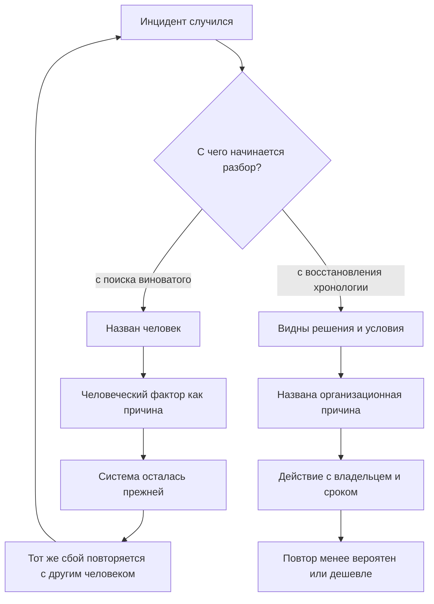
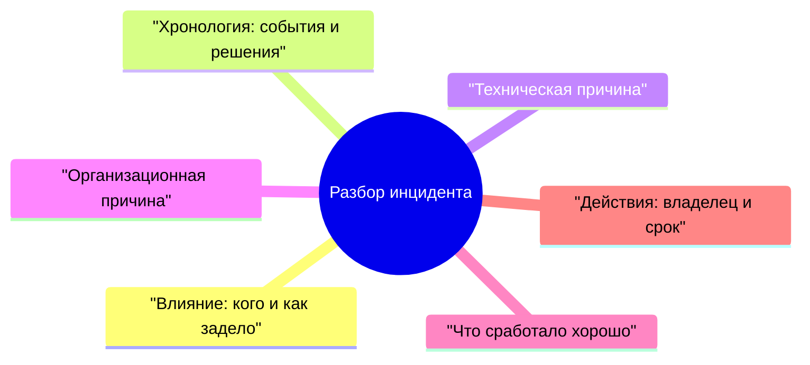
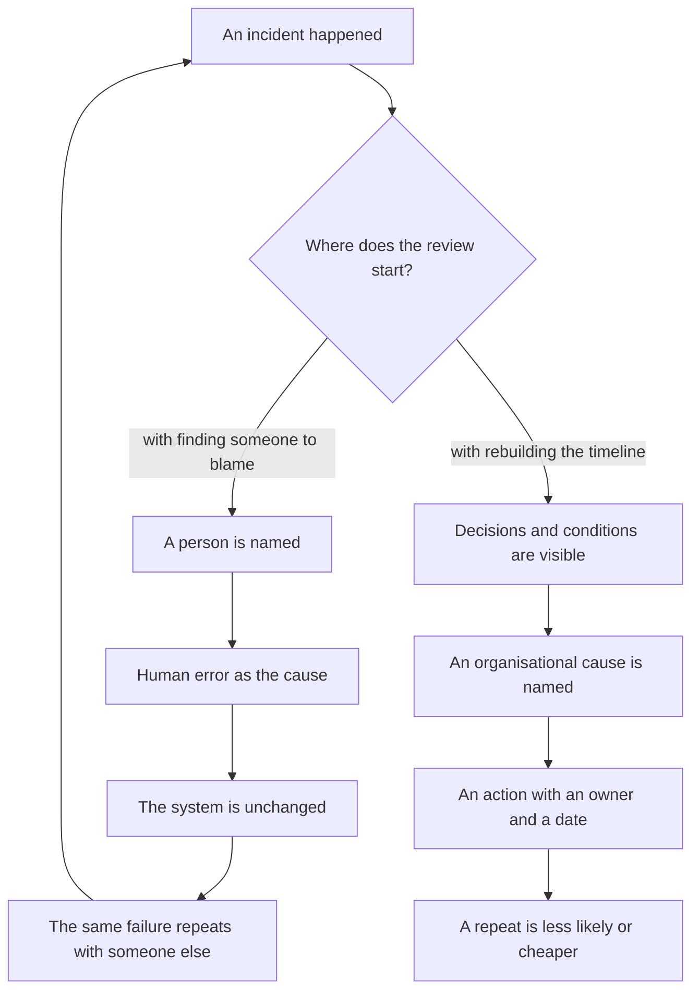
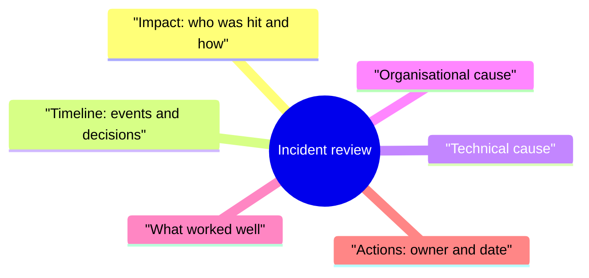
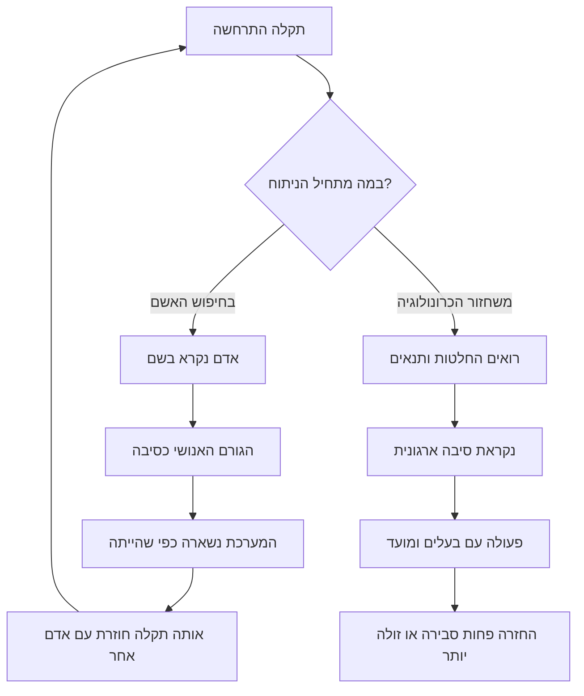
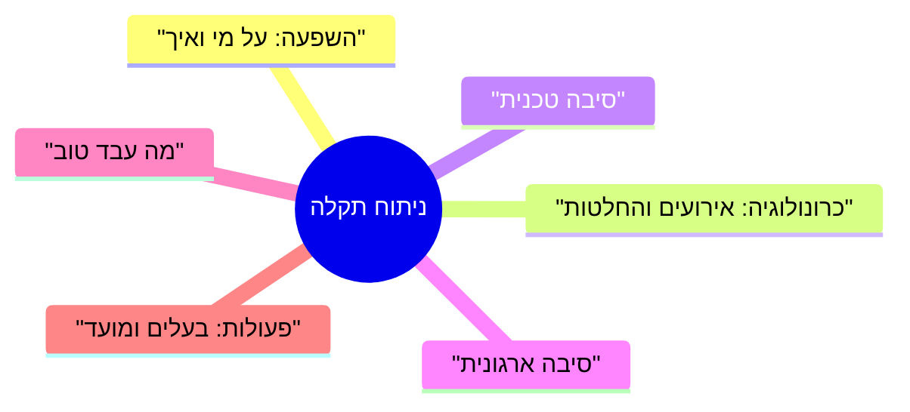

<!-- lang:ru -->

## Введение

Разбор инцидента — редкий момент, когда команда получает право говорить об ошибках вслух. В остальное время ошибка стоит доверия клиента, и люди это помнят. Поэтому разбор с вопроса «кто это сделал» даёт предсказуемое: в следующий раз о проблеме узнают позже, когда её уже нельзя скрыть.

Я провёл достаточно таких встреч, чтобы зафиксировать для себя правило: на разборе обсуждают решения и условия, в которых они принимались, а не людей. Такой разбор называют blameless — разбор без обвинений. Его цель — организационная причина: отсутствующий регламент, неоднозначный признак в мониторинге, нехватка прав, пропущенная проверка перед изменением.

Важно не путать это с безответственностью. «Без имён» относится к прошлому, а не к будущему: у каждого действия после разбора есть владелец и срок. Дальше — почему поиск виноватого не мешает повтору, из чего состоит разбор, как писать хронологию без имён и что делать с действиями после встречи.

Она продолжает внешний контур серии: в «Годе лида по кварталам» разборы стоят в четвёртом квартале — как способ замкнуть цикл, а не как ритуал отчётности.

## Почему поиск виноватого не предотвращает повтор

Виноватый находится почти всегда, и почти всегда это не тот, кто задал условия: дежурный инженер не создавал мониторинг с зелёным статусом и не писал регламент. Он оказался последним в цепочке, где решение выглядело правильным.

Что происходит дальше, если разбор останавливается на фамилии:

- **Найденный виноватый закрывает вопрос.** Дальше обсуждается поведение человека, а не система вокруг него. Встреча заканчивается с ощущением порядка и без единого изменения в регламенте или мониторинге.
- **«Человеческий фактор» ничего не объясняет.** Это не причина, а место, где причина проявилась. Содержательный вопрос: почему решение выглядело правильным в момент, когда его принимали, и почему система не поймала его до клиента.
- **Люди начинают защищаться, а не рассказывать.** Участник забывает упомянуть, что видел предупреждение в чате, потому что это звучит как признание вины. Восстанавливать картину потом дороже, чем провести разбор честно.
- **Система остаётся прежней.** Действие «провести беседу» не меняет ни признак в мониторинге, ни порядок в очереди. Через месяц то же случается с другим дежурным.
- **Следующий инцидент приходит позже.** Команда учится, что о сбое выгодно молчать до последнего. Между проблемой и её признанием появляется задержка, которую никто не измеряет, но все чувствуют.

Круг замыкается так:

Левая ветка приятнее по ощущениям: у неё есть финал и виновник. Правая медленнее на входе — нужно собирать хронологию и признавать, что часть вины лежит на процессах, которые вы же и построили. Зато только она меняет то, от чего зависит повтор.

## Структура разбора

Структура защищает встречу от подмены: без неё обсуждается самое интересное — техническая причина, — а влияние и организационные условия остаются за кадром.

Минимальный состав разбора:

Поля по существу:

- **Влияние.** Кого задело, какие каналы, что было недоступно и сколько это продолжалось. Поле идёт первым не из вежливости: без него разбор превращается в семинар о редкой причине, а ущерб остаётся невысказанным.
- **Хронология.** События и решения по часам систем: заявки, мониторинг, чат дежурства, история изменений. Не по памяти — она выравнивает картину под уже известный финал.
- **Техническая причина.** Цепочка «что сломалось — почему это привело к отказу». Отвечает на вопрос «как», а не «кто», и находится быстрее остальных полей.
- **Организационная причина.** Почему система допускала изменение без проверки, почему признак не попал в мониторинг, почему первая линия не увидела массовость. Это поле задаёт действия, которые предотвращают повтор.
- **Что сработало хорошо.** Обязательное поле, иначе разбор превращается в наказание. Что сократило время восстановления, какая договорённость выдержала. Успешные решения полезно повторять не меньше, чем исправлять неудачные.
- **Действия.** Список с типами, владельцами и датами — отдельный разговор в конце статьи.

Два правила. Разбор проводится в первые рабочие дни, пока хронология собирается по логам, а не по легендам. Ведёт его человек, не участвовавший в восстановлении, — иначе разговор скатывается в пересказ своих действий.

## Хронология без имён

Главная техника blameless-разбора — роли вместо фамилий. Вместо «инженер не проверил срок действия сертификата» в хронологии появляется «дежурный инженер не получил уведомления об истечении сертификата».

Разница не косметическая. Фамилия приклеивает к событию оценку: прочитав её, участники обсуждают, внимателен ли человек, а не то, что он видел на экране. Роль оставляет место для вопроса об условиях — единственного, на который можно ответить действием.

Три причины, по которым роль точнее имени:

1. **Хронология становится проверяемой.** Роль сверяется со сменным графиком и логами; имя тянет за собой воспоминания о человеке, а не о событии.
2. **Люди перестают редактировать себя.** Пока в записи будет фамилия, участник думает о формулировке, а не о фактах.
3. **Организационная причина видна раньше.** Если один и тот же шаг повторяется у разных людей, вопрос «кто виноват» теряет смысл, а вопрос «что общего у этих условий» становится очевидным.

Формат записи я держу из четырёх элементов: момент, событие, что было известно участнику, какое решение принято. Работает не форма, а дисциплина заполнения:

- **Момент — по часам систем.** «Утром» и «сразу после обеда» не восстанавливаются и не сверяются.
- **Событие — факт, без оценки.** «Шлюз вернул ошибку рукопожатия», а не «шлюз вёл себя странно».
- **Что было известно — ключевой элемент.** Решение оценивается вместе с информацией, которая была у человека в тот момент, а не с той, что появилась к разбору.
- **Решение — с вариантами, которые были видны.** Полезно записать не только что сделали, но и что казалось альтернативой.

Отдельно про правки. Согласованная хронология не переписывается: уточнения добавляются отдельной строкой с пометкой. Противоречия между участниками остаются в тексте: два разных воспоминания — факт о процессе, где информация не была общей, а не повод выяснить, кто из двоих прав.

<!-- вилка: фрагмент своей хронологии — 3–5 строк «роль — событие — известное — решение» из реального разбора. -->

## Разобранный пример

Ниже — типовой сценарий, техническая причина в котором скучная, а организационная — нет.

**Влияние.** Клиенты пишут в поддержку, что не получают ответов на письма; остальные каналы работают. Снаружи сервис молчит, хотя заявки в трекере создаются исправно.

**Хронология.** Плановое изменение на шлюзе применяется по регламенту; дежурный инженер видит зелёный статус; в течение смены приходят однотипные жалобы, каждую обрабатывают отдельно; инженер второй линии замечает совпадение времени жалоб с окном изменения.

**Техническая причина.** В цепочке сертификатов остался промежуточный сертификат с истёкшим сроком; часть почтовых серверов на такое рукопожатие реагирует отказом.

**Организационная причина.** У планового изменения не было критерия «канал принимает письмо после изменения»; у мониторинга — проверки бизнес-функции, только доступности порта; у первой линии — признака массовости по одному каналу, поэтому одинаковые заявки прошли как разные.

**Что сработало хорошо.** Инженер второй линии сопоставил время жалоб с окном изменения, и поиск сократился; дежурный сохранял входящие письма, поэтому влияние удалось описать точно.

**Действия.** Синтетическая проверка приёма письма после изменений — владелец в эксплуатации; правило триажа «однотипные заявки по одному каналу сводятся в один инцидент» — владелец в поддержке; проверка цепочки сертификатов в регламенте изменения — владелец в инфраструктуре.

Такой разбор занимает меньше часа, и основное время уходит не на техническую причину, а на разговор о том, почему три команды не имели общей картины.

<!-- вилка: свой инцидент — влияние, хронология в три строки, организационная причина, что сработало. -->

## Судьба действий

Самая частая проблема разбора — не качество выводов, а то, что решения не выполняются. Причины обычно одни и те же, и почти все они управляемые.

- **Владелец — человек, а не команда.** «Команда должна наладить мониторинг» не имеет владельца, а значит, и срока. Формулировка «эту проверку делает инженер эксплуатации, срок — такая-то дата» имеет.
- **Срок — дата, а не квартал.** «В следующем квартале» звучит как обязательство, но не является им.
- **Действие живёт в общем трекере.** Отдельный документ про инциденты читают один раз — на том же разборе. Действие в обычной очереди задач получает приоритет и видимость.
- **Действий немного.** Пять-семь строк на разбор — предел, после которого часть не выполнится.
- **У действия есть тип.** Устранить причину, ускорить обнаружение, ускорить восстановление, снизить влияние — четыре разные задачи, и одновременно они почти не решаются. Иногда дешевле не предотвращать сбой, а сократить время его обнаружения.
- **Статус — на следующем разборе.** Первые минуты каждой встречи уходят на прошлые действия: сделано, в работе, просрочено. Просроченное обсуждается как организационная причина — срок был нереалистичный или приоритет не дан, — а не как вопрос дисциплины.

<!-- вилка: как вы ведёте действия после разборов — где они лежат, как проверяется статус, что было с первым разбором. -->

Разбор без имён не делает команду мягче — он делает её быстрее: люди приходят с фактами, а не с защитной версией событий, и организационная причина находится на первой встрече, а не на третьей. Хронология без имён — не вежливость, а инструмент: она позволяет обсуждать условия, которые создали ошибку, и менять именно их.

Дальше в серии — «Карточка проблемы для продукта, которую не закрыть без статуса»: о том, что делать с причинами, которые нельзя исправить внутри поддержки.

<!-- lang:en -->

## Introduction

An incident review is the rare moment when a team gets permission to talk about mistakes out loud. The rest of the time a mistake costs a client's trust, and people remember that. So a review that opens with "who did this" delivers something predictable: next time the problem is discovered later, when it can no longer be hidden.

I have run enough of these meetings to have settled on a rule for myself: a review discusses decisions and the conditions they were made in, not people. That kind of review is called blameless. Its goal is the organisational cause: a missing procedure, an ambiguous signal in monitoring, a lack of access rights, a check skipped before a change.

It matters not to confuse this with irresponsibility. "Without names" applies to the past, not to the future: every action after the review has an owner and a date. What follows is why finding someone to blame does not prevent a repeat, what a review consists of, how to write a timeline without names, and what happens to the actions after the meeting.

This article continues the outer contour of the series: in "A support lead's year by quarters" the reviews sit in the fourth quarter, as a way to close the loop rather than as a reporting ritual.

## Why finding someone to blame does not prevent a repeat

The guilty party is almost always found, and almost always it is not the person who set the conditions: the on-call engineer did not build the monitoring that showed green, and did not write the procedure. They were simply the last link in a chain where the decision looked correct.

What happens next if the review stops at a surname:

- **The culprit is named, and the question closes.** From there the discussion is about a person's behaviour, not the system around them. The meeting ends with a sense of order and without a single change to the procedure or the monitoring.
- **"Human error" explains nothing.** It is not a cause but the place where the cause surfaced. The substantive question is why the decision looked correct at the moment it was taken, and why the system did not catch it before the client did.
- **People start defending themselves instead of telling the story.** A participant forgets to mention that they saw a warning in the chat, because it sounds like an admission of guilt. Rebuilding the picture afterwards costs more than running the review honestly.
- **The system stays as it was.** The action "have a word with them" changes neither the signal in monitoring nor the order of the queue. A month later the same thing happens to a different on-call engineer.
- **The next incident arrives late.** The team learns that it pays to stay quiet about a failure until the last moment. A delay appears between the problem and its admission, which nobody measures and everybody feels.

The loop closes like this:

The left branch feels better: it has an ending and a culprit. The right one is slower to start — you have to assemble a timeline and admit that part of the blame lies with the processes you built yourself. But only the right one changes what a repeat depends on.

## The structure of a review

Structure protects the meeting from being hijacked: without it the most interesting thing gets discussed — the technical cause — while the impact and the organisational conditions stay out of frame.

The minimum contents of a review:

The fields, substantively:

- **Impact.** Who was hit, which channels, what was unavailable and how long it lasted. The field comes first not out of politeness: without it the review turns into a seminar about a rare cause while the damage goes unspoken.
- **Timeline.** Events and decisions by system clocks: tickets, monitoring, the on-call chat, change history. Not from memory — memory smooths the picture to fit the ending it already knows.
- **Technical cause.** The chain of "what broke — why that led to a failure". It answers "how", not "who", and it is found faster than any other field.
- **Organisational cause.** Why the system allowed a change without a check, why the signal never reached monitoring, why the first line did not see the scale. This field is what sets the actions that prevent a repeat.
- **What worked well.** A mandatory field, otherwise the review turns into punishment. What shortened recovery, which agreement held. Successful decisions are worth repeating no less than failed ones are worth fixing.
- **Actions.** A list with types, owners and dates — a separate conversation at the end of the article.

Two rules. The review happens in the first working days, while the timeline is still assembled from logs rather than from legends. It is run by someone who did not take part in the recovery — otherwise the conversation slides into a retelling of their own actions.

## A timeline without names

The main technique of a blameless review is roles instead of surnames. Instead of "the engineer did not check the certificate expiry date", the timeline says "the on-call engineer did not receive a notification about the certificate expiring".

The difference is not cosmetic. A surname glues an evaluation onto the event: reading it, participants discuss whether the person is attentive, not what they saw on the screen. A role leaves room for the question about conditions — the only one that can be answered with an action.

Three reasons why a role is more precise than a name:

1. **The timeline becomes verifiable.** A role is checked against the shift schedule and the logs; a name drags along memories of the person rather than of the event.
2. **People stop editing themselves.** While a surname is in the record, a participant thinks about wording rather than about facts.
3. **The organisational cause shows up earlier.** If the same step repeats across different people, the question "who is to blame" loses its point, and the question "what do these conditions have in common" becomes obvious.

I keep the record format to four elements: the moment, the event, what the participant knew, and which decision was taken. What works is not the form but the discipline of filling it in:

- **The moment — by system clocks.** "In the morning" and "right after lunch" cannot be reconstructed or checked.
- **The event — a fact, without evaluation.** "The gateway returned a handshake error", not "the gateway was behaving strangely".
- **What was known — the key element.** A decision is judged together with the information the person had at that moment, not with what appeared by the time of the review.
- **The decision — with the options that were visible.** It helps to record not only what was done but what looked like an alternative.

A separate note on edits. An agreed timeline is not rewritten: clarifications are added as a separate line with a note. Contradictions between participants stay in the text: two different memories are a fact about a process where information was not shared, not a reason to work out which of the two is right.

<!-- вилка: фрагмент своей хронологии — 3–5 строк «роль — событие — известное — решение» из реального разбора. -->

## A worked example

Below is a typical scenario whose technical cause is boring and whose organisational cause is not.

**Impact.** Clients write to support that they are not getting replies to their emails; the other channels work. From the outside the service is silent, even though tickets are being created in the tracker as usual.

**Timeline.** A scheduled change on the gateway is applied according to the procedure; the on-call engineer sees a green status; during the shift identical complaints arrive and each is handled separately; a second-line engineer notices that the complaint times coincide with the change window.

**Technical cause.** An intermediate certificate with an expired date had been left in the certificate chain; some mail servers reject a handshake like that.

**Organisational cause.** The scheduled change had no criterion "the channel accepts mail after the change"; monitoring had no check of the business function, only of port availability; the first line had no signal of scale on a single channel, so identical tickets went through as different ones.

**What worked well.** The second-line engineer matched the complaint times with the change window, and the search got shorter; the on-call engineer kept the incoming messages, so the impact could be described precisely.

**Actions.** A synthetic check of mail acceptance after changes — owner in operations; a triage rule "identical tickets on one channel are merged into one incident" — owner in support; a check of the certificate chain in the change procedure — owner in infrastructure.

A review like that takes less than an hour, and most of the time goes not to the technical cause but to the conversation about why three teams had no shared picture.

<!-- вилка: свой инцидент — влияние, хронология в три строки, организационная причина, что сработало. -->

## The fate of actions

The most common problem with a review is not the quality of the conclusions but the fact that the decisions do not get carried out. The reasons are usually the same, and almost all of them are manageable.

- **The owner is a person, not a team.** "The team should sort out monitoring" has no owner, and therefore no date. "This check is done by the operations engineer, due by such and such a date" has both.
- **The deadline is a date, not a quarter.** "Next quarter" sounds like a commitment but is not one.
- **The action lives in the shared tracker.** A separate document about incidents is read once — at that same review. An action in the ordinary task queue gets priority and visibility.
- **There are few actions.** Five to seven lines per review is the limit, beyond which part of them will not be done.
- **An action has a type.** Remove the cause, detect faster, recover faster, reduce impact — four different jobs, and they are rarely solved at the same time. Sometimes it is cheaper not to prevent a failure but to shorten the time it is detected.
- **The status is checked at the next review.** The first minutes of every meeting go to previous actions: done, in progress, overdue. An overdue action is discussed as an organisational cause — the date was unrealistic or priority was never given — not as a question of discipline.

<!-- вилка: как вы ведёте действия после разборов — где они лежат, как проверяется статус, что было с первым разбором. -->

A review without names does not make a team softer — it makes it faster: people arrive with facts instead of a defensive version of events, and the organisational cause is found at the first meeting rather than at the third. A timeline without names is not politeness but a tool: it lets you discuss the conditions that produced the error, and change exactly those.

Next in the series — "A problem card for product that won't close without a status": what to do with the causes that cannot be fixed inside support.

<!-- lang:he -->

## מבוא

ניתוח תקלה הוא אחד הרגעים הבודדים שבהם הצוות מקבל רשות לדבר על טעויות בקול. בשאר הזמן טעות עולה באמון הלקוח, והאנשים זוכרים את זה. לכן ניתוח שמתחיל בשאלה "מי עשה את זה" נותן תוצאה צפויה: בפעם הבאה הבעיה תתגלה מאוחר יותר, כשלא אפשר עוד להסתיר אותה.

העברתי מספיק פגישות כאלה כדי לקבוע לעצמי כלל: בניתוח דנים בהחלטות ובתנאים שבהם הן התקבלו, לא באנשים. ניתוח כזה נקרא blameless — ניתוח בלי האשמות. המטרה שלו היא הסיבה הארגונית: נוהל חסר, סימן לא חד־משמעי בניטור, חוסר הרשאות, בדיקה שהוחמצה לפני שינוי.

חשוב לא לבלבל את זה עם חוסר אחריות. "בלי שמות" מתייחס לעבר, לא לעתיד: לכל פעולה אחרי הניתוח יש בעלים ומועד. בהמשך — למה חיפוש האשם לא מונע חזרה, ממה מורכב הניתוח, איך כותבים כרונולוגיה בלי שמות ומה עושים עם הפעולות שאחרי הפגישה.

המאמר ממשיך את המעגל החיצוני של הסדרה: ב"שנה של מנהל תמיכה לפי רבעונים" הניתוחים עומדים ברבעון הרביעי — כדרך לסגור מעגל, לא כטקס דיווח.

## למה חיפוש האשם לא מונע חזרה

אשם נמצא כמעט תמיד, וכמעט תמיד זה לא מי שקבע את התנאים: המוקדן התורן לא בנה ניטור שמציג סטטוס ירוק ולא כתב את הנוהל. הוא פשוט היה האחרון בשרשרת שבה ההחלטה נראתה נכונה.

מה קורה אחר כך, אם הניתוח נעצר על שם משפחה:

- **האשם שנמצא סוגר את השאלה.** בהמשך דנים בהתנהגות של אדם, לא במערכת שסביבו. הפגישה נגמרת בתחושה של סדר ובלי שינוי אחד בנוהל או בניטור.
- **"הגורם האנושי" לא מסביר דבר.** זה לא סיבה אלא המקום שבו הסיבה התגלתה. השאלה המהותית: למה ההחלטה נראתה נכונה ברגע קבלתה, ולמה המערכת לא עצרה אותה לפני שהגיעה ללקוח.
- **אנשים מתחילים להתגונן במקום לספר.** משתתף שוכח להזכיר שראה אזהרה בצ'אט, כי זה נשמע כמו הודאה באשמה. לשחזר את התמונה אחר כך יקר יותר מלעשות את הניתוח ביושר.
- **המערכת נשארת כפי שהייתה.** פעולה כמו "לשוחח עם העובד" לא משנה לא את הסימן בניטור ולא את סדר התור. כעבור חודש אותו דבר קורה למוקדן תורן אחר.
- **התקלה הבאה מגיעה מאוחר יותר.** הצוות לומד שכדאי לשתוק על תקלה עד הרגע האחרון. בין הבעיה להודאה בה נוצר עיכוב שאיש לא מודד, אבל כולם מרגישים אותו.

המעגל נסגר כך:

הענף השמאלי נעים יותר להרגשה: יש לו סוף ומישהו שאשם. הימני איטי יותר בהתחלה — צריך לאסוף כרונולוגיה ולהכיר בכך שחלק מהאשמה מונח על תהליכים שאתם עצמכם בניתם. אבל רק הוא משנה את מה שממנו נובעת החזרה.

## מבנה הניתוח

המבנה מגן על הפגישה מפני החלפה: בלעדיו דנים בדבר המעניין ביותר — בסיבה הטכנית — וההשפעה והתנאים הארגוניים נשארים מחוץ לתמונה.

ההרכב המינימלי של הניתוח:

השדות לגופם:

- **השפעה.** את מי זה פגע, באילו ערוצים, מה לא היה זמין וכמה זמן זה נמשך. השדה הזה ראשון לא מתוך נימוס: בלעדיו הניתוח הופך לסמינר על סיבה נדירה, והנזק נשאר בלי מילים.
- **כרונולוגיה.** אירועים והחלטות לפי השעון של המערכות: פניות, ניטור, צ'אט התורנות, היסטוריית שינויים. לא לפי הזיכרון — הוא מיישר את התמונה לסוף הידוע מראש.
- **סיבה טכנית.** השרשרת "מה נשבר — למה זה הוביל לכשל". עונה על השאלה "איך", לא "מי", ונמצאת מהר יותר מכל שדה אחר.
- **סיבה ארגונית.** למה המערכת אפשרה שינוי בלי בדיקה, למה הסימן לא נכנס לניטור, למה הקו הראשון לא ראה את ההיקף. השדה הזה קובע את הפעולות שמונעות חזרה.
- **מה עבד טוב.** שדה חובה, אחרת הניתוח הופך לענישה. מה קיצר את זמן השיקום, איזו הסכמה החזיקה מעמד. החלטות מוצלחות שווה לחזור עליהן לא פחות מלתקן כאלה שנכשלו.
- **פעולות.** רשימה עם סוגים, בעלים ותאריכים — על זה נדבר בנפרד בסוף המאמר.

שני כללים. הניתוח נערך בימי העבודה הראשונים, כל עוד הכרונולוגיה נאספת מהלוגים ולא מהאגדות. מנהל אותו אדם שלא השתתף בשיקום — אחרת השיחה גולשת לסיפור על המעשים של עצמו.

## כרונולוגיה בלי שמות

הטכניקה המרכזית של ניתוח blameless היא תפקידים במקום שמות משפחה. במקום "המהנדס לא בדק את תוקף התעודה" מופיע בכרונולוגיה "המוקדן התורן לא קיבל התראה על פקיעת התעודה".

ההבדל אינו קוסמטי. שם משפחה מדביק לאירוע הערכה: אחרי שקוראים אותו, המשתתפים דנים בשאלה אם האדם קשוב, ולא במה שהוא ראה על המסך. תפקיד משאיר מקום לשאלה על התנאים — השאלה היחידה שאפשר לענות עליה בפעולה.

שלושה נימוקים לכך שתפקיד מדויק יותר משם:

1. **הכרונולוגיה נהיית ניתנת לבדיקה.** תפקיד אפשר להצליב עם לוח המשמרות ועם הלוגים; שם גורר אחריו זיכרונות על האדם, לא על האירוע.
2. **אנשים מפסיקים לערוך את עצמם.** כל עוד ברשומה יש שם משפחה, המשתתף חושב על הניסוח ולא על העובדות.
3. **הסיבה הארגונית נראית מוקדם יותר.** אם אותו צעד חוזר אצל אנשים שונים, השאלה "מי אשם" מאבדת משמעות, והשאלה "מה משותף לתנאים האלה" נעשית מובנת מאליה.

את הפורמט של הרשומה אני מחזיק בארבעה מרכיבים: הרגע, האירוע, מה היה ידוע למשתתף, ואיזו החלטה התקבלה. מה שעובד זה לא הטופס אלא המשמעת במילוי:

- **הרגע — לפי שעון המערכות.** "בבוקר" ו"מיד אחרי הצהריים" לא משתחזרים ולא ניתנים להצלבה.
- **האירוע — עובדה, בלי הערכה.** "השער החזיר שגיאת לחיצת יד", לא "השער התנהג מוזר".
- **מה היה ידוע — המרכיב המרכזי.** את ההחלטה שופטים יחד עם המידע שהיה לאדם באותו רגע, ולא עם זה שהופיע לקראת הניתוח.
- **ההחלטה — עם האפשרויות שהיו גלויות.** שווה לרשום לא רק מה עשו, אלא גם מה נראה אז כחלופה.

בנפרד על תיקונים. כרונולוגיה שסוכמה לא נכתבת מחדש: הבהרות מתווספות בשורה נפרדת עם סימון. סתירות בין המשתתפים נשארות בטקסט: שני זיכרונות שונים הם עובדה על תהליך שבו המידע לא היה משותף, ולא סיבה לברר מי מהשניים צודק.

<!-- вилка: фрагмент своей хронологии — 3–5 строк «роль — событие — известное — решение» из реального разбора. -->

## דוגמה מנותחת

להלן תרחיש טיפוסי שהסיבה הטכנית בו משעממת, והארגונית — לא.

**השפעה.** לקוחות כותבים לתמיכה שהם לא מקבלים תשובות למיילים; שאר הערוצים עובדים. מבחוץ השירות שותק, למרות שפניות בטראקר נוצרות כיאות.

**כרונולוגיה.** שינוי מתוכנן בשער מוחל לפי הנוהל; המוקדן התורן רואה סטטוס ירוק; במהלך המשמרת מגיעות תלונות מאותו סוג, כל אחת מטופלת בנפרד; מוקדן מהקו השני מבחין שהתזמון של התלונות חופף לחלון השינוי.

**סיבה טכנית.** בשרשרת התעודות נשארה תעודת ביניים שפג תוקפה; חלק משירותי הדואר מגיבים ללחיצת יד כזאת בסירוב.

**סיבה ארגונית.** לשינוי המתוכנן לא היה קריטריון "הערוץ מקבל מייל אחרי השינוי"; לניטור — בדיקה של פונקציה עסקית, ורק של זמינות הפורט; לקו הראשון — סימן להיקף בערוץ אחד, ולכן פניות זהות עברו כפניות שונות.

**מה עבד טוב.** המוקדן מהקו השני הצליב את זמן התלונות עם חלון השינוי, והחיפוש התקצר; המוקדן התורן שמר את המיילים הנכנסים, ולכן אפשר היה לתאר את ההשפעה במדויק.

**פעולות.** בדיקה סינתטית לקליטת מייל אחרי שינויים — הבעלים בתפעול; כלל מיון "פניות זהות בערוץ אחד נאספות לתקלה אחת" — הבעלים בתמיכה; בדיקת שרשרת התעודות בנוהל השינוי — הבעלים בתשתית.

ניתוח כזה אורך פחות משעה, ורוב הזמן הולך לא על הסיבה הטכנית אלא על השאלה למה לשלוש קבוצות לא הייתה תמונה משותפת.

<!-- вилка: свой инцидент — влияние, хронология в три строки, организационная причина, что сработало. -->

## גורל הפעולות

הבעיה השכיחה ביותר בניתוח היא לא איכות המסקנות, אלא שהחלטות לא מתבצעות. הסיבות בדרך כלל אותן סיבות, וכמעט כולן ניתנות לניהול.

- **הבעלים הוא אדם, לא קבוצה.** ל"הצוות צריך לסדר את הניטור" אין בעלים, ולכן גם אין מועד. לניסוח "את הבדיקה הזאת עושה מוקדן התפעול, המועד — תאריך כזה" יש.
- **המועד הוא תאריך, לא רבעון.** "ברבעון הבא" נשמע כמו התחייבות, אבל אינו כזה.
- **הפעולה חיה בטראקר המשותף.** מסמך נפרד על תקלות קוראים פעם אחת — בניתוח עצמו. פעולה בתור העבודה הרגיל מקבלת עדיפות ונראות.
- **הפעולות מעטות.** חמש־שבע שורות לניתוח — הגבול שאחריו חלקן לא יתבצע.
- **לפעולה יש סוג.** לחסל את הסיבה, לזרז את הגילוי, לזרז את השיקום, לצמצם את ההשפעה — ארבע משימות שונות, וכמעט לא נפתרות בו־זמנית. לפעמים זול יותר לא למנוע תקלה אלא לקצר את זמן הגילוי שלה.
- **סטטוס — בניתוח הבא.** הדקות הראשונות של כל פגישה מוקדשות לפעולות הקודמות: בוצע, בתהליך, באיחור. מה שאיחר נדון כסיבה ארגונית — המועד לא היה מציאותי או שלא ניתנה עדיפות — ולא כשאלת משמעת.

<!-- вилка: как вы ведёте действия после разборов — где они лежат, как проверяется статус, что было с первым разбором. -->

ניתוח בלי שמות לא עושה את הצוות רך יותר — הוא עושה אותו מהיר יותר: אנשים מגיעים עם עובדות ולא עם גרסה מגוננת של האירועים, והסיבה הארגונית נמצאת בפגישה הראשונה ולא בשלישית. כרונולוגיה בלי שמות היא לא נימוס אלא כלי: היא מאפשרת לדון בתנאים שיצרו את הטעות ולשנות בדיוק אותם.

בהמשך הסדרה — "כרטיס בעיה למוצר שאי אפשר לסגור בלי סטטוס": על מה לעשות עם סיבות שאי אפשר לתקן בתוך התמיכה.
