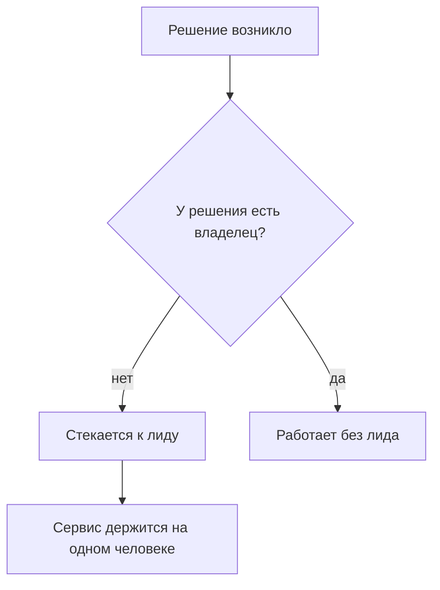
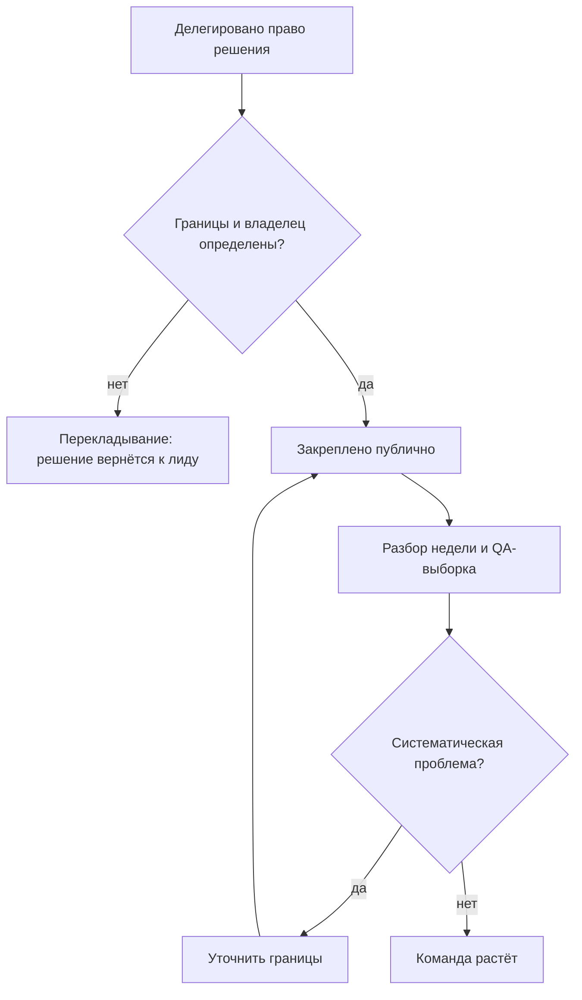
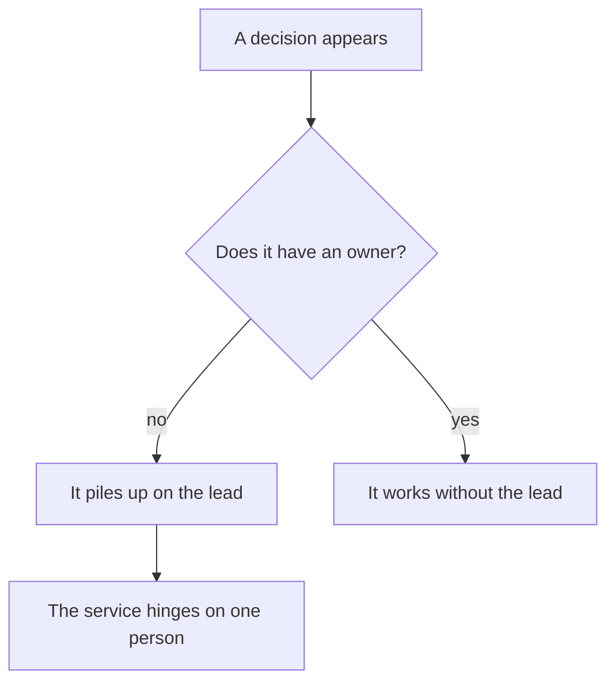
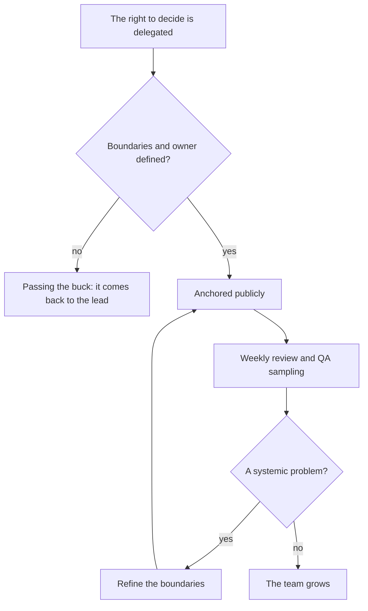
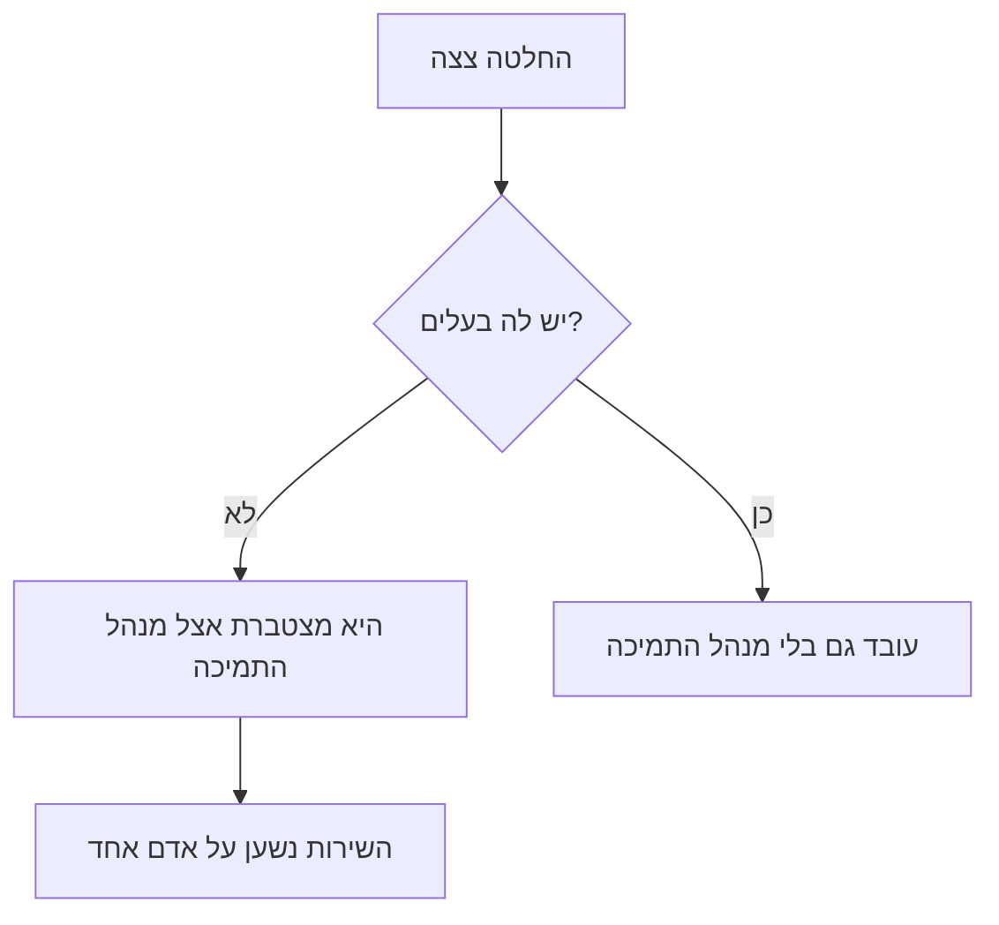
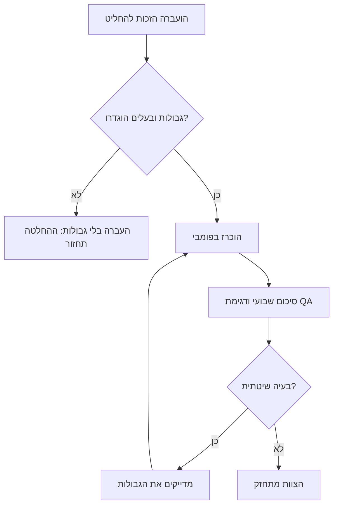

<!-- lang:ru -->

## Введение

Первые недели на позиции лида поддержки я помню одной картинкой: день съеден чужими решениями. Инженер приходит согласовать приоритет, разработчик — уточнить, кто скажет клиенту о переносе, руководитель — спросить, почему зависла заявка. К вечеру выясняется, что работу, ради которой существует лид, я не сделал.

Проблема не в трудоголизме и не в нехватке времени. Проблема в том, что у роли нет зафиксированных границ. Лид без границ превращается в единственного диспетчера: всё проходит через него, ничего не движется без него, и любая его болезнь или отпуск останавливает сервис. В предыдущей статье серии — [«Пять результатов работы лида поддержки»](/ru/blog/support-lead-five-results/) — я разобрал, чем работа лида отличается от работы диспетчера по существу. Здесь — про механику, которая защищает это различие на практике: три списка, из годового плана, по которому я работаю. Что я решаю сам, что делегирую и от чего отказываюсь.

Прежде чем разбирать списки, посмотрим на механику без них. Решения, у которых нет владельца, стекаются к самому доступному человеку. Самый доступный человек в поддержке — лид.

Дальше — как перевести это со ступеньки «стекается к лиду» на рельсы «работает без лида»: сначала заметить симптомы, затем составить три списка и превратить их в договор с руководством.

## Симптомы размытых границ

Размытые границы не объявляют себя. Они проявляются в повседневности, и стоит свериться с коротким списком симптомов:

- **Эскалации по умолчанию.** Каждый нестандартный тикет рано или поздно оказывается у лида — не потому, что инженер не может его решить, а потому, что «так принято». Триггер эскалации — не сложность, а неопределённость: «я не знаю, чьё это решение».
- **Лид — обязательный согласующий.** Обещание клиенту, перенос срока, доступ к системе, изменение регламента — всё требует вашей подписи. Пока вы в отпуске, эти операции просто не происходят.
- **Решения живут в чатах и голосом.** Через неделю никто не помнит, кто и почему решил отдать заявку на доработку. Споры перезапускаются с нуля, и арбитром снова оказываетесь вы.
- **День уходит на тактику.** Разбор зависших заявок и ответы на «а как быть с этим?» съедают день, а на процессы, качество и людей времени не остаётся. При этом формально вы «всё успеваете» — просто не делаете свою работу.
- **Команда не решает без вас даже мелочи.** Инженер может закрыть тикет сам, но всё равно спрашивает — не потому, что не знает ответа, а потому, что однажды за самостоятельность уже получил разброс. Так воспитывается беспомощность, которую потом же и ругают.

<!-- вилка: 2–3 симптома из собственной практики — что именно съедало день до введения списков. -->

За этими симптомами стоит одна и та же механика. И важно видеть её обратную сторону: границы — это не забор между вами и командой, а контракт доверия. Инженер готов брать решения только там, где понимает, где его права заканчиваются и кто его подстрахует. Чем прозрачнее границы, тем больше решений команда готова взять на себя — и тем меньше ваших подписей нужно сервису, чтобы работать.

## Список «решаю сам»

Первый список — решения, которые остаются у лида. Принцип отбора простой: остаются решения, цена ошибки которых высока или которые задают правила для всех.

- **Спорная критичность.** Когда инженеры расходятся в оценке, решение принимает лид: от него зависят таймеры реакции и порядок очереди.
- **Обещания клиенту за рамками регламента.** Компенсации, перенос сроков, исключения из SLA — всё, что создаёт обязательства, которых нет в договоре или регламенте.
- **Состав команды и распределение по проектам.** Кто на какой линии работает, кого брать на проект, кто дежурит.
- **Правила игры.** Регламенты, приоритеты очереди, критерии качества: их меняет тот, кто отвечает за результат.
- **Эскалация наверх.** Когда проблема выходит за пределы сервиса — на уровень руководства — решение о том, как и когда поднимать, остаётся за лидом.

Полезный тест для каждого пункта: «могу ли я объяснить, почему это решение не может принять инженер?» Если объяснение сводится к «я так привык», пункт переезжает в список «делегирую».

Ориентир по объёму: список «решаю сам» помещается на одну-две строки. Если он длиннее десяти пунктов, вы перепутали лидерство с контролем — и вернули себе все симптомы из предыдущего раздела.

<!-- вилка: ваш список «решаю сам» — 3–5 пунктов из практики. -->

## Список «делегирую»

Второй список — то, что уходит в команду. Здесь главная ошибка — путать делегирование задачи с делегированием права решения. «Разберись с тикетом» — это задача: инженер разбирается, а решение всё равно приносит вам. Делегирование звучит иначе: «тикет твой. Ты выбираешь маршрут и говоришь клиенту, что дальше. Я оставляю себе только критичность».

Разница между этими двумя формулировками — вся разница между диспетчером и лидом.

Что уходит в список «делегирую»:

- разбор тикетов в пределах регламента — включая нестандартные, если цена ошибки умеренная;
- коммуникацию с клиентом по типовым ситуациям: статусы, переносы в рамках SLA, уточнения;
- дежурства и распределение потока внутри смены;
- наставничество и приём новых инженеров;
- подготовку регулярных статусов и отчётов.

У каждого делегированного решения должны быть две вещи: **границы** (что инженер решает сам, в каком случае эскалирует и кому) и **владелец** (именно человек, а не «команда»). Делегирование без границ — не делегирование, а перекладывание: решение всё равно вернётся к вам, только позже и с испорченным контекстом.

Как устроен рабочий цикл делегирования:

И ещё одно правило, которое легко пропустить: право решения закрепляется публично. Если вы договорились с инженером один на один, через неделю очередь вернётся к вам — остальные-то не в курсе. Формулировка «по этим вопросам теперь идёте к Ане, не ко мне» должна прозвучать на общем разборе и быть видимой в регламенте.

Дальше начинается часть, о которой обычно забывают: делегирование не заканчивается в момент передачи. У каждого делегированного блока нужны точки контроля — не потому, что вы не доверяете, а потому, что у решения должен быть владелец и у вас, и у инженера. Достаточно лёгкого ритма: разбор нескольких делегированных решений на еженедельном разборе и QA-выборка, которая показывает качество решений независимо от того, кто их принимал. Если в выборке появляется систематическая проблема — это не повод забрать решение назад, а повод уточнить границы: вероятно, они были сформулированы размыто.

И удержите себя от обратного хода. Первые ошибки в делегированной зоне неизбежны, и соблазн «ладно, вернём как было» огромный. Но каждый возврат решения учит команду одному: границы — это декорация, настоящие решения всё равно у вас.

<!-- вилка: что вы делегировали за последний месяц и как объявили это команде. -->

## Список «отказываюсь»

Третий список — самый трудный. Отказаться — значит сознательно уйти из роли, которая давала ощущение контроля. В годовом плане таких ролей названы две, и обе знакомы каждому лиду:

- **Единственный диспетчер.** Тикеты маршрутизируются триажем и матрицей, а не мной. Пока маршрутизация — моя личная функция, сервис держится на одном человеке, а триаж не развивается.
- **Обязательный согласующий.** У типовых операций — регламент вместо моей подписи. Если операция типовая, она должна выполняться без меня; если не типовая — она в списке «решаю сам».

Можно добавить и третью роль, менее очевидную:

- **Самый компетентный эксперт по каждому продукту.** Если самая глубокая экспертиза в команде — вы, то ваш отпуск — инцидент, а ваш уход — катастрофа. Задача лида — чтобы критичная экспертиза была минимум у двоих; это отдельная работа с матрицей компетенций, и она заслуживает отдельной статьи серии.

Почему список «отказываюсь» труднее остальных: отказ не выглядит достижением. Договорённость «я больше не согласовываю переносы в рамках SLA» со стороны похожа на «лид расслабился». Держаться здесь помогает одна мысль: вы не теряете контроль — вы переносите его из своей головы в систему. Регламенты, триаж, матрица взаимодействий, владельцы решений — это и есть контроль, который не зависит от вашего самочувствия и графика.

Сообщение команде — критичный шаг, и его стоит делать прямым текстом: что именно вы перестаёте делать, с какой даты, что делать в спорных случаях и кто подстраховывает в переходный период. Молчаливый отказ (просто перестал отвечать) читается командой как обида или каприз.

Переходный период стоит спланировать так же честно, как сам отказ. Первые недели после сообщения — не время доказывать твёрдость: если инженер застрял в спорном случае, лучше один раз решить вместе с ним и обсудить это на разборе, чем заставлять сервис ждать. Полезно также договориться об обратном ходе: какие события легитимно возвращают функцию к вам (например, уход двух инженеров подряд или провал норматива подхвата) и как это фиксируется. Отказ без условий возврата выглядит догмой, а с условиями — управляемым решением.

<!-- вилка: формулировка сообщения команде — что вы перестаёте делать, с какой даты, куда идти в спорных случаях. -->

## Договор с руководством

Три списка работают, когда они существуют не в голове, а в документе, который виден и согласован с руководством. Это не бюрократия, а три конкретные выгоды.

Во-первых, руководство знает, какие решения ждать от вас, а какие — от команды. Нет сценария «почему это согласование ушло к инженеру?» — потому что есть документ, где это написано.

Во-вторых, делегирование получает защиту. Когда инженер принимает решение в своих границах, это не самоволье, а исполнение договора. Без документа любая ошибка делегированного решения читается как «надо было согласовать с лидом» — и список «делегирую» тихо умирает.

В-третьих, отказ от ролей перестаёт быть «лид расслабился». «Я больше не диспетчер и не согласующий» — это зафиксированная стратегия с объяснением, где теперь живут эти функции, а не каприз.

Форма проще, чем кажется: страница текста или таблица с тремя колонками. Плюс ревизия раз в квартал, и она должна быть содержательной: какие пункты переехали между списками (делегированное устояло — значит, можно отказываться от следующей роли), где границы оказались размытыми на практике, какие решения стали типовыми и заслуживают регламента вместо вашего согласования. Ревизия без переездов — признак, что списки существуют только на бумаге.

Важно понимать место этого списка в году. Списки границ — не бытовая оптимизация, а часть стратегической рамки: они нужны до того, как вы начнёте мерить baseline и договариваться о целях. Нельзя строить годовую дорожную карту, если половина вашего времени уходит на чужие решения — измерения будут врать, а цели — подстраиваться под хаос. Об этом — следующая статья серии.

И последнее. Границы — это не про то, чтобы делать меньше. Это про то, чтобы ценность лида концентрировалась там, где её не может создать никто другой: правила игры, споры о критичности, развитие людей, контракт с руководством. Всё остальное — чья-то возможность вырасти, которую вы отбираете, решая за других.

<!-- lang:en -->

## Introduction

The first weeks in a support lead role I remember as a single picture: a day eaten by other people's decisions. An engineer comes to align on a priority, a developer wants to know who will tell the client about a delay, a manager asks why a ticket is stuck. By evening, the work the lead exists for didn't get done.

The problem isn't workaholism or a lack of time. The role has no fixed boundaries. A lead without boundaries turns into the single dispatcher: everything goes through them, nothing moves without them, and any sick day or vacation stops the service. In the previous article of the series — ["The five results of a support lead"](/en/blog/support-lead-five-results/) — I broke down what separates a lead from a dispatcher. Here it's the mechanism that protects that distinction: three lists from the annual plan I work by. What I decide myself, what I delegate, and what I walk away from.

First, the mechanics without the lists. Decisions with no owner drift to the most available person — and in support that's the lead.

Next — how to get from "piles up on the lead" to "works without the lead": notice the symptoms, build the three lists, and turn them into an agreement with management.

## Symptoms of blurred boundaries

Blurred boundaries don't announce themselves — they show up in the everyday. Check yourself against a short list:

- **Escalation by default.** Every non-standard ticket sooner or later lands on the lead — not because the engineer can't solve it, but because "that's how it's done". The trigger isn't difficulty but uncertainty: "I don't know whose decision this is."
- **The lead is the mandatory approver.** A client promise, a deadline change, system access, a process update — everything needs your sign-off. While you're on vacation, these operations simply don't happen.
- **Decisions live in chats and in the air.** A week later nobody remembers who decided to hand the ticket to engineering; disputes restart from zero, and the arbiter is you again.
- **The day goes to tactics.** Unblocking stuck tickets and answering "what do we do about this?" eats the day; nothing is left for processes, quality, or people. Formally you "get everything done" — you just don't do your job.
- **The team won't decide small things without you.** An engineer could close the ticket but still asks — because they once took heat for being proactive. That's how learned helplessness is bred — the very thing that gets blamed later.

<!-- вилка: 2–3 симптома из собственной практики — что именно съедало день до введения списков. -->

Behind these symptoms is the same mechanics. And the flip side matters: boundaries aren't a fence but a trust contract. An engineer owns decisions only where they know where their rights end and who backs them up. The clearer the boundaries, the more decisions the team takes — and the fewer of your signatures the service needs.

## The "decide myself" list

The first list — decisions that stay with the lead. The selection principle: decisions whose error cost is high, or that set the rules for everyone.

- **Contested priority.** When engineers disagree on severity, the lead decides: reaction timers and queue order depend on it.
- **Client promises beyond the process.** Compensation, deadline changes, SLA exceptions — obligations absent from the contract or the process.
- **Team composition and project allocation.** Who works which line, who joins a project, who is on duty.
- **Rules of the game.** Processes, queue priorities, quality criteria: whoever owns the result changes them.
- **Escalation upward.** When a problem leaves the service's scope for management level, how and when to raise it stays with the lead.

A useful test for each item: "can I explain why an engineer can't make this decision?" If the explanation boils down to "I'm used to it", the item moves to the "delegate" list. A size guideline: the "decide myself" list fits in a line or two. If it's longer than ten items, you've confused leadership with control — and brought back every symptom above.

<!-- вилка: ваш список «решаю сам» — 3–5 пунктов из практики. -->

## The "delegate" list

The second list — what goes to the team. The main mistake is confusing delegating a task with delegating the right to decide. "Sort out the ticket" is a task: the engineer works on it but brings the decision back to you. Delegation sounds different: "the ticket is yours. You pick the route and tell the client what's next. I keep only the priority." The difference between the two phrasings is the entire difference between a dispatcher and a lead.

What goes into the "delegate" list:

- ticket handling within the process — including non-standard ones, when the error cost is moderate;
- client communication in routine situations: statuses, in-SLA reschedules, clarifications;
- shifts and flow distribution within a shift;
- onboarding of new engineers;
- preparation of regular statuses and reports.

Every delegated decision needs two things: **boundaries** (what the engineer decides alone, when to escalate, and to whom) and an **owner** (a specific person, not "the team"). Delegation without boundaries isn't delegation but passing the buck: the decision comes back to you anyway, later and with corrupted context. The working cycle of delegation:

One more rule that's easy to miss: the right to decide is anchored publicly. If you agreed with an engineer one-on-one, within a week the queue is back on you — the rest weren't told. "For these questions you now go to Anya, not to me" must be said at the general review and be visible in the process docs.

Then comes the usually forgotten part: delegation doesn't end at the handover. Every delegated block needs checkpoints: a few delegated decisions in the weekly review, plus QA sampling of decision quality regardless of who made them. A systemic problem in the sample isn't a reason to take the decision back; it's a reason to refine the boundaries — most likely they were phrased vaguely. And hold yourself against walking it back: every retraction teaches the team that boundaries are decoration.

<!-- вилка: что вы делегировали за последний месяц и как объявили это команде. -->

## The "walk away" list

The third list is the hardest: to walk away means to consciously leave a role that gave a sense of control. The annual plan names two such roles, familiar to every lead:

- **The single dispatcher.** Tickets are routed by triage and the matrix, not by me. While routing is my personal function, the service hinges on one person and triage never matures.
- **The mandatory approver.** Routine operations have a process instead of my signature. If an operation is routine, it must run without me; if it isn't, it belongs in the "decide myself" list.

A third, less obvious role: **the deepest expert on every product**. If the deepest expertise in the team is you, your vacation is an incident and your departure is a catastrophe. The lead's job is to have critical expertise in at least two people — separate work with the competency matrix, deserving its own article in the series.

Why the "walk away" list is the hardest: quitting a role doesn't look like an achievement. The agreement "I no longer approve in-SLA reschedules" looks from the outside like "the lead got lazy". What helps here is one thought: you don't lose control — you move it from your head into the system. Processes, triage, the interaction matrix, decision owners — control that doesn't depend on how you feel or what your calendar looks like.

Telling the team is a critical step, and it should be done in plain words: exactly what you stop doing, from what date, what to do in contested cases, and who covers the transition. Silent quitting (just stopped replying) reads as resentment or a whim. Plan the transition just as honestly: the first weeks aren't the time to prove firmness — if an engineer is stuck, solve it together once and discuss it in the review. And agree on the way back: which events legitimately return the function to you (two engineers leaving in a row, a failed pickup norm) and how that gets recorded.

<!-- вилка: формулировка сообщения команде — что вы перестаёте делать, с какой даты, куда идти в спорных случаях. -->

## The agreement with management

The three lists work when they exist not in your head but in a document that is visible and agreed with management. That's not bureaucracy — it's three concrete benefits.

First, management knows which decisions to expect from you and which from the team — there's a document that says so.

Second, delegation gets protection: when an engineer decides within their boundaries, that's not unauthorized action but executing the agreement. Without the document, any mistake in a delegated decision reads as "should have checked with the lead" — and the "delegate" list quietly dies.

Third, walking away from roles stops being "the lead got lazy": "I'm no longer the dispatcher or the approver" becomes a recorded strategy with an explanation of where those functions now live.

The form is simpler than it seems: a page of text or a three-column table. Plus a quarterly revision, and it should be substantive: which items moved between lists (delegated items that held up mean you can drop the next role), where boundaries proved blurry, which decisions became routine and deserve a process instead of your sign-off. A revision without movements means the lists exist only on paper.

It's worth understanding where this sits in the year: boundaries aren't everyday optimization — they're part of the strategic frame, needed before you measure the baseline and negotiate goals. You can't build an annual roadmap while half your time goes to other people's decisions — the measurements will lie and the goals will bend to the chaos. That's the next article in the series.

And the last thing: boundaries aren't about doing less. They're about concentrating the lead's value where nobody else can create it — rules of the game, contested priorities, growing people, the contract with management. Everything else is someone's chance to grow, which you take away by deciding for others.

<!-- lang:he -->

## מבוא

את השבועות הראשונים בתפקיד מנהל תמיכה אני זוכר כתמונה אחת: היום נבלע בהחלטות של אחרים. מהנדס מגיע לתאם עדיפות, מפתח רוצה לדעת מי יגיד ללקוח על דחייה, ההנהלה שואלת למה פנייה תקועה. אחרי הצהריים מתברר שהעבודה שלשמה קיים מנהל התמיכה — לא נעשתה.

הבעיה לא בעבודה מרובה ולא במחסור בזמן. הבעיה שלתפקיד אין גבולות מוגדרים. מנהל תמיכה בלי גבולות הופך למנתב היחיד: הכל עובר דרכו, כלום לא זז בלעדיו, וכל יום מחלה או חופשה עוצרים את השירות. במאמר הקודם בסדרה — ["חמשת התוצרים של מנהל תמיכה"](/he/blog/support-lead-five-results/) — פירקתי מה מבדיל מנהל ממנתב לעומק. כאן — המנגנון שמגן על ההבדל הזה בפועל: שלוש רשימות מהתוכנית השנתית שלפיה אני עובד. מה אני מחליט בעצמו, מה אני מאציל וממה אני פורש.

לפני הרשימות — המנגנון בלעדיהן. החלטות בלי בעלים מצטברות אצל האדם הזמין ביותר. האדם הזמין ביותר בתמיכה — מנהל התמיכה.

המשך — איך עוברים מ"מצטבר אצל מנהל התמיכה" אל "עובד גם בלעדיו": קודם לזהות תסמינים, אחר כך לבנות את שלוש הרשימות ולהפוך אותן להסכם עם ההנהלה.

## תסמינים של גבולות מטושטשים

גבולות מטושטשים לא מכריזים על עצמם. הם מתגלים בשגרה, ושווה לבדוק את עצמכם מול רשימה קצרה:

- **הסלמות כברירת מחדל.** כל פנייה לא־סטנדרטית מגיעה במוקדם או במאוחר אל מנהל התמיכה — לא מפני שהמהנדס לא יכול לפתור אותה, אלא מפני ש"כך נהוג". הטריגר להסלמה הוא לא מורכבות אלא חוסר ודאות: "אני לא יודע של מי ההחלטה הזאת".
- **מנהל התמיכה — המאשר ההכרחי.** הבטחה ללקוח, דחיית מועד, גישה למערכת, שינוי נוהל — הכל דורש את החתימה שלכם. כל עוד אתם בחופשה, הפעולות האלה פשוט לא קורות.
- **החלטות חיות בצ'אטים ובעל־פה.** שבוע אחרי אף אחד לא זוכר מי ולמה החליט להעביר פנייה לפיתוח. הוויכוחים מתחילים מחדש, והשופט — שוב אתם.
- **היום הולך לטקטיקה.** פתיחת פניות תקועות ומענה ל"מה עושים עם זה?" בולעים את היום; לא נשאר זמן לתהליכים, לאיכות ולאנשים. באופן רשמי אתם "מספיקים הכל" — פשוט לא עושים את העבודה שלכם.
- **הצוות לא מחליט בלעדיכם גם פרטים קטנים.** מהנדס יכול לסגור פנייה לבד, ועדיין שואל — לא מפני שהוא לא יודע את התשובה, אלא מפני שפעם אחת כבר קיבל על יוזמה עצמאית באז. כך מגודלת חוסר־אונים נלמדת — אותה אחת שמוטחים עליה אחר־כך.

<!-- вилка: 2–3 симптома из собственной практики — что именно съедало день до введения списков. -->

מאחורי התסמינים האלה עומד אותו מנגנון. וחשוב לראות גם את הצד ההפוך: גבולות הם לא גדר ביניכם ובין הצוות — הם חוזה אמון. מהנדס מוכן לקחת החלטות רק שם, היכן שהוא מבין היכן מסתיימות הרשאות שלו ומי גובה אותו. ככל שהגבולות שקופים יותר, כך הצוות מוכן לקחת על עצמו יותר החלטות — וכך השירות צריך פחות חתימות שלכם כדי לעבוד.

## הרשימה "מחליט בעצמו"

הרשימה הראשונה — החלטות שנשארות אצל מנהל התמיכה. עקרון הסינון פשוט: נשארות החלטות שעלות טעות בהן גבוהה, או שהן קובעות כללים לכולם.

- **עדיפות שנויה במחלוקת.** כשמהנדסים חלוקים בהערכה, ההחלטה של מנהל התמיכה: ממנו תלויים טיימרים לזמני תגובה וסדר התור.
- **הבטחות ללקוח מחוץ לנוהל.** פיצוי, דחיית מועדים, חריגות מ-SLA — כל מה שיוצר התחייבויות שאינן בחוזה או בנוהל.
- **הרכב הצוות וההקצאה לפרויקטים.** מי על איזה קו עובד, מי מצטרף לפרויקט, מי בתורנות.
- **כללי המשחק.** נהלים, עדיפויות תור, קריטריוני איכות: את זה משנה מי שאחראי על התוצאה.
- **הסלמה כלפי מעלה.** כשבעיה יוצאת מגבולות השירות אל רמת ההנהלה — איך ומתי להרים אותה נשאר למנהל התמיכה.

מבחן שימושי לכל סעיף: "האם אוכל להסביר למה מהנדס לא יכול לקבל את ההחלטה הזאת?" אם ההסבר מסתכם ב"כך נהוג אצלי" — הסעיף עובר לרשימה "מאציל".

קנה מידה: רשימת "מחליט בעצמו" נכנסת לשורה־שתיים. אם היא ארוכה מעשרה סעיפים — בלבלתם הנהגה עם שליטה, והחזרתם לעצמכם את כל התסמינים מהסעיף הקודם.

<!-- вилка: ваш список «решаю сам» — 3–5 пунктов из практики. -->

## הרשימה "מאציל"

הרשימה השנייה — מה עובר לצוות. הטעות המרכזית כאן — לבלבל בין האצלת משימה לבין האצלת זכות החלטה. "תסתכל על הפנייה" — זאת משימה: המהנדס מתמודד, אבל את ההחלטה עדיין מביא אליכם. האצלה נשמעת אחרת: "הפנייה שלך. אתה בוחר את המסלול ואומר ללקוח מה הלאה. לעצמי אני משאיר רק את העדיפות".

ההבדל בין שני הניסוחים האלה — כל ההבדל בין מנתב למנהל.

מה נכנס לרשימה "מאציל":

- טיפול בפניות במסגרת הנוהל — כולל לא־סטנדרטיות, כשעלות הטעות מתונה;
- תקשורת עם הלקוח במצבים שגרתיים: סטטוסים, דחיות בתוך SLA, הבהרות;
- תורנויות וחלוקת זרימה בתוך משמרת;
- חונכות וקליטת מהנדסים חדשים;
- הכנת סטטוסים ודוחות קבועים.

לכל החלטה מואצלת דרושים שני דברים: **גבולות** (מה המהנדס מחליט לבד, מתי מסלים ולמי) ו**בעלים** (אדם מסוים, לא "הצוות"). האצלה בלי גבולות איננה האצלה אלא העברת אחריות: ההחלטה תחזור אליכם בכל זאת — מאוחר יותר ועם הקשר מקולקל.

כך נראה מחזור העבודה של ההאצלה:

ועוד כלל שקל לפספס: זכות ההחלטה מוכרזת בפומבי. אם סיכמתם עם מהנדס אחד־על־אחד, בתוך שבוע התור יחזור אליכם — השאר הרי לא בפנים. הניסוח "בנושאים האלה עכשיו פונים לאניה, לא אליי" חייב להישמע בסיכום הכללי ולהיות גלוי בנוהל.

ואז מתחיל החלק שבדרך כלל שוכחים ממנו: האצלה לא נגמרת ברגע ההעברה. לכל בלוק מואצל דרושות נקודות בקרה — לא מפני שאין אמון, אלא מפני שלהחלטה יש בעלים גם אצלכם וגם אצל המהנדס. מספיק קצב קל: סקירת כמה החלטות מואצלות בסיכום השבועי ודגימת QA שמראה את איכות ההחלטות בלי תלות במי קיבל אותן. אם בדגימה מופיעה בעיה שיטתית — זה לא סיבה לקחת את ההחלטה בחזרה, אלא סיבה לדייק את הגבולות: כנראה נוסחו בערפול.

ועצרו את עצמכם מלחזור אחורה. טעויות ראשונות באזור המואצל בלתי־נמנעות, והפיתוי "טוב, נחזור כמו שהיה" עצום. אבל כל החזרה של החלטה מלמדת את הצוות דבר אחד: הגבולות קישוט, ההחלטות האמיתיות עדיין אצלכם.

<!-- вилка: что вы делегировали за последний месяц и как объявили это команде. -->

## הרשימה "פורש"

הרשימה השלישית — הקשה ביותר. לפרוש — זה לצאת במכוון מתפקיד שנתן תחושת שליטה. בתוכנית השנתית מוזכרים שני תפקידים כאלה, ושניהם מוכרים לכל מנהל:

- **המנתב היחיד.** פניות מנותבות על ידי מיון ומטריצה, לא על ידי. כל עוד הניתוב — הפונקציה האישית שלי, השירות נשען על אדם אחד והמיון לא מתפתח.
- **המאשר ההכרחי.** לפעולות שגרתיות — נוהל במקום החתימה שלי. אם פעולה שגרתית — היא צריכה להתבצע בלעדי; אם לא — היא ברשימה "מחליט בעצמו".

אפשר להוסיף תפקיד שלישי, פחות מובן:

- **המומחה הכי עמוק בכל מוצר.** אם המומחיות הכי עמוקה בצוות — אתם, אז החופשה שלכם היא תקלה והעזיבה שלכם — אסון. המטרה של מנהל התמיכה — שלמומחיות קריטית יהיה לפחות שני אנשים; זאת עבודה נפרדת עם מטריצת כשרים, והיא ראויה למאמר נפרד בסדרה.

למה הרשימה "פורש" הכי קשה: פרישה לא נראית כהישג. הסכמה "אני כבר לא מאשר דחיות בתוך SLA" נראית מבחוץ כ"מנהל התרשל". מה שעוזר להחזיק כאן — מחשבה אחת: אתם לא מאבדים שליטה — אתם מעבירים אותה מהראש אל המערכת. נהלים, מיון, מטריצת אינטראקציות, בעלי החלטות — זו בדיוק השליטה שלא תלויה במצב הרוח ובלוח הזמנים שלכם.

הודעה לצוות — צעד קריטי, ושווה לעשות אותו במילים ישירות: מה בדיוק אתם מפסיקים לעשות, מאיזה תאריך, מה עושים במקרים שנויים במחלוקת ומי גובה בתקופת המעבר. פרישה שקטה (פשוט הפסקתי לענות) נקראת אצל הצוות כנטירה או כקפריזה.

את תקופת המעבר שווה לתכנן באותה כנות כמו את הפרישה עצמה. השבועות הראשונים אחרי ההודעה — לא הזמן להוכיח קשיחות: אם מהנדס נתקע במקרה שנוי במחלוקת, עדיף לפתור פעם אחת יחד איתו ולדון בזה בסיכום, מאשר להשאיר את השירות להמתין. שווה גם להסכים על חזרה אחורה: אילו אירועים מחזירים לגיטימית את התפקיד אליכם (למשל, עזיבת שני מהנדסים ברצף או כשל בתקן האיסוף) ואיך זה נרשם. פרישה בלי תנאי חזרה נראית דוגמה; עם תנאים — החלטה מנוהלת.

<!-- вилка: формулировка сообщения команде — что вы перестаёте делать, с какой даты, куда идти в спорных случаях. -->

## ההסכם עם ההנהלה

שלוש הרשימות עובדות כשהן קיימות לא בראש אלא במסמך שגלוי ומאושר עם ההנהלה. זו לא בירוקרטיה אלא שלוש תועלות קונקרטיות.

ראשית, ההנהלה יודעת ממי לצפות לאילו החלטות — מכם או מהצוות. אין תרחיש "למה האישור הזה עבר למהנדס?" — כי יש מסמך שכותב את זה.

שנית, להאצלה יש הגנה. כשמהנדס מקבל החלטה בתוך הגבולות שלו — זו לא יוזמה סמכותית אלא ביצוע של ההסכם. בלי המסמך כל טעות בהחלטה מואצלת נקראת "היה צריך להתייעץ עם המנהל" — ורשימת "מאציל" מתה בשקט.

שלישית, פרישה מתפקידים מפסיקה להיות "מנהל התרשל". "אני כבר לא מנתב ולא מאשר" — זו אסטרטגיה רשומה עם הסבר היכן חיות הפונקציות האלה עכשיו, ולא קפריזה.

הצורה פשוטה יותר ממה שנדמה: עמוד טקסט או טבלה עם שלוש עמודות. ועוד סקירה רבעונית, והיא צריכה להיות משמעותית: אילו סעיפים עברו בין הרשימות (מה שהואצל והחזיק מעמד — אפשר לפרוש מהתפקיד הבא), היכן הגבולות התבררו מטושטשים בפועל, אילו החלטות נהיו שגרתיות וראויות לנוהל במקום האישור שלכם. סקירה בלי מעברים — סימן שהרשימות קיימות רק על הנייר.

חשוב להבין את מקום הרשימה הזאת בשנה. רשימות הגבולות אינן אופטימיזציה יומיומית אלא חלק מהמסגרת האסטרטגית: הן דרושות לפני שתתחילו למדוד baseline ולתאם מטרות. אי אפשר לבנות מפת דרכים שנתית כשחצי מהזמן שלכם הולך להחלטות של אחרים — המדידות ישקרו והמטרות יתאימו את עצמן לכאוס. על זה — המאמר הבא בסדרה.

ואחרון. גבולות הם לא על לעשות פחות. הם על לרכז את ערך המנהל שם, שם שאף אחד אחר לא יכול ליצור אותו: כללי המשחק, מחלוקות עדיפות, פיתוח אנשים, ההסכם עם ההנהלה. כל השאר — הזדמנות של מישהו לצמוח, שאתם לוקחים על ידי החלטה בשביל אחרים.
