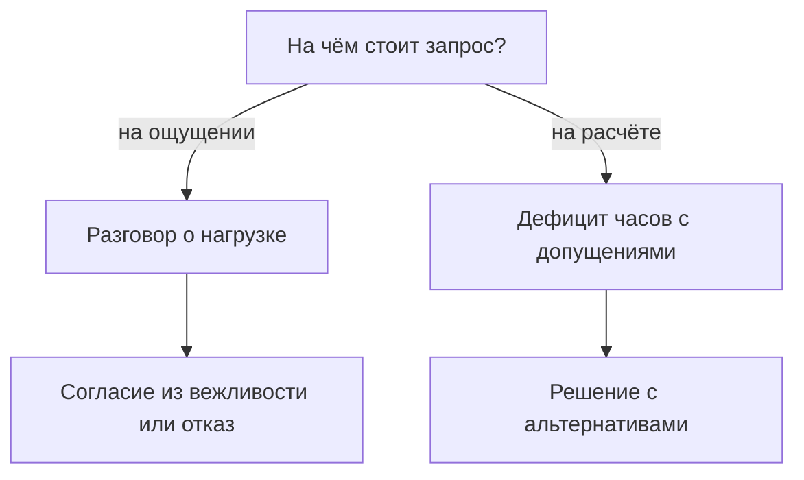
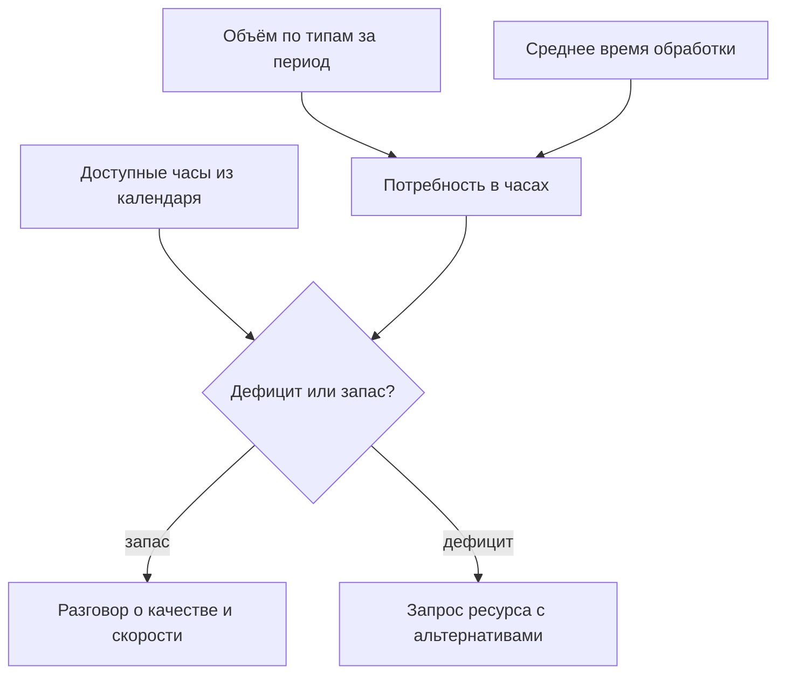
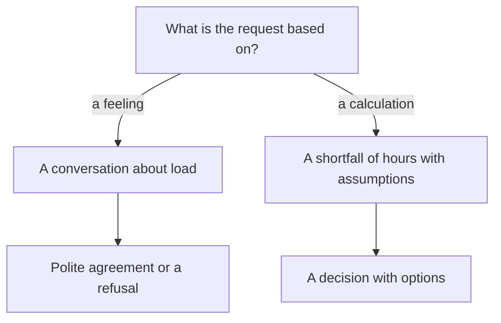
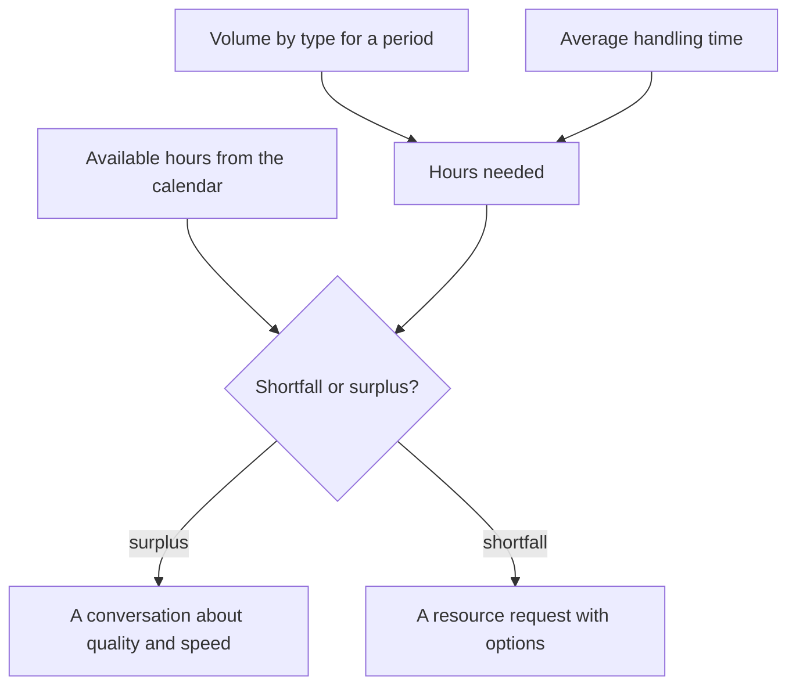
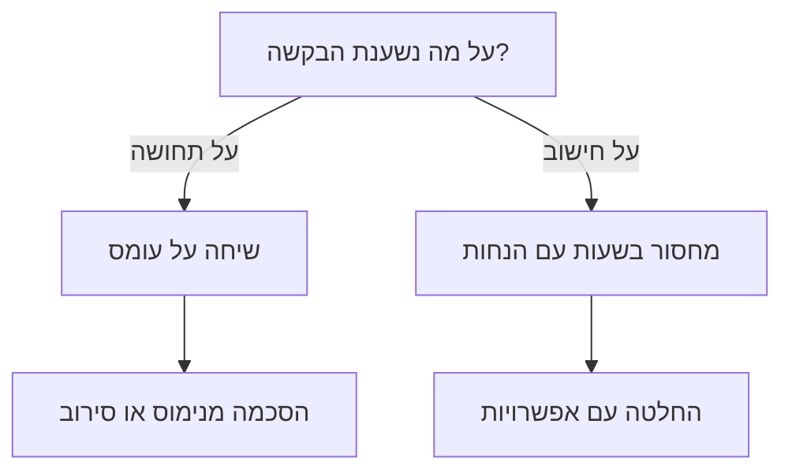
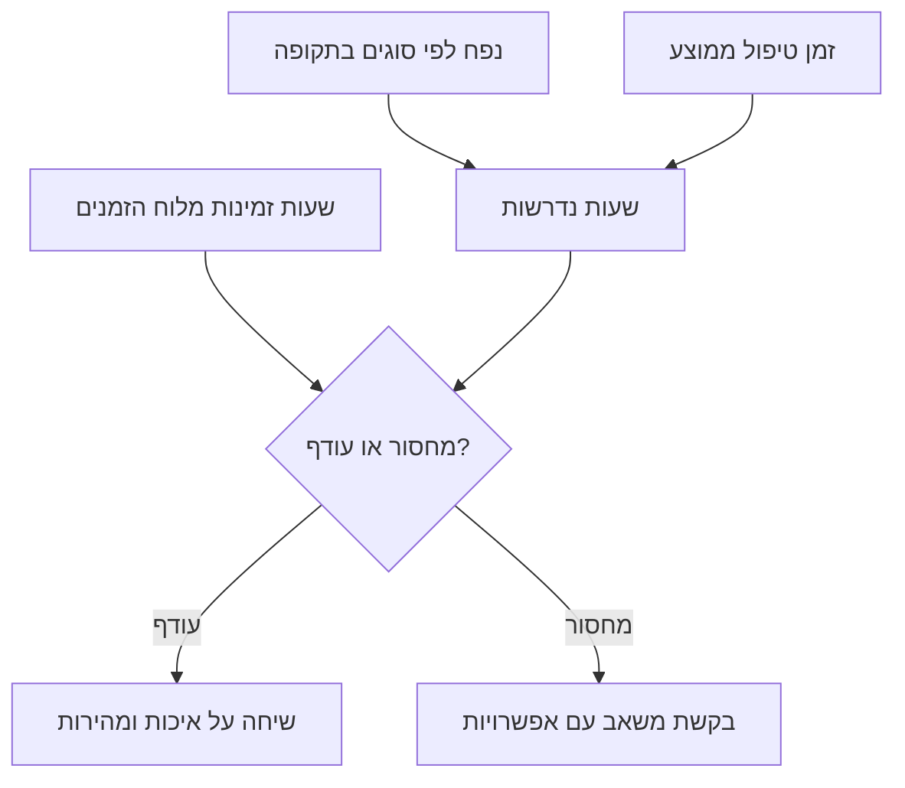

<!-- lang:ru -->

## Введение

Первый запрос на нового инженера я написал в тоне, который казался мне убедительным: команда перегружена, люди работают на пределе, нужен ещё один человек. Ответ руководителя был вежливым и убийственным: «Принесите расчёт». Расчёта не было. Были три истории про тяжёлую неделю и обида человека, который честно старается.

Через год я принёс тот же запрос в другом виде: одна страница, несколько чисел, два явных допущения и три варианта решения. Разговор занял пятнадцать минут и закончился решением. Изменился не руководитель и не бюджет — изменился формат: перегрузка превратилась в дефицит часов, который можно проверить, оспорить и закрыть.

Тезис статьи простой: потребность в людях — это формула мощности, а не ощущение перегрузки. В формуле три части: объём работы, среднее время на единицу и доступные часы. Пока она не посчитана, любой разговор о найме — переговоры о доверии к лиду, а не о ресурсах. Доверие — плохой фундамент для штатного расписания.

Считать приходится от измеренной точки А. Без выгрузки из трекера формула собирается из тех же ощущений, только в виде таблицы. Как устроена точка А, я разбирал в статье «Baseline раньше целей»; здесь считаем, что она уже есть.

## Почему «мы перегружены» не работает

Фраза «мы перегружены» честная, и именно поэтому с ней так трудно спорить. Проблема не в честности, а в том, что из неё нельзя вывести действие.

- **Она не различает причину.** Перегрузка бывает от объёма, от типа потока, от ожидания ответа клиента, от потерь на переключениях между системами, от того, что половина смены уходит на согласования. Лечится каждое по-разному: наймом, триажем, автоматизацией, изменением процесса. Слово «перегружены» не говорит, какое из пяти.
- **У неё нет масштаба.** Одинаково звучит у команды из трёх человек и из десяти: тяжёлые недели есть у всех, и руководитель не может отличить норму от аномалии.
- **Она не проверяется и не оспаривается.** С ощущением можно только согласиться или не согласиться — то есть поверить или не поверить. Проверить нечего, поэтому разговор быстро переходит на личности.
- **В ней нет альтернатив.** Просьба звучит как «дайте человека», и решение сводится к бинарному выбору: да или нет. Отказ после такой просьбы выглядит как отказ от проблемы, а не как выбор приоритета.
- **Она обесценивается от повтора.** Каждый месяц одна и та же фраза превращается в фон, а фон не обсуждают.
- **У неё есть цена для лида.** Один отказ на «мы перегружены» учит не просить, и дальше команда тянет нагрузку молча — пока не начнёт уходить.

Есть и вторая сторона: руководитель, который соглашается на «перегружены» без расчёта, покупает себе проблему. Через месяц появляется человек, а очередь не сокращается — потому что причина была не в количестве людей. После двух таких историй доверие к запросам падает уже у обеих сторон.

Поэтому я строю запрос не как жалобу, а как развилку с проверяемыми ответвлениями:

Дальше — как устроен расчёт, который делает разговор коротким.

## Формула мощности

Формула на одну строку выглядит почти унизительно просто: потребность в часах равна объёму работы, умноженному на среднее время на единицу. Доступные часы берутся из календаря. Разница между первым и вторым — и есть дефицит, с которым идут к руководству.

Ошибки почти никогда не в арифметике. Они во входных данных, поэтому разбирать надо именно их.

- **Объём.** Считается по событиям из трекера за один и тот же период, с разбивкой по типам: инцидент, вопрос, запрос на изменение. Почта, чат и «ещё были звонки» в объём не входят — иначе число нельзя будет повторить. Окно должно быть длинным: месяц показывает случайную неделю, квартал — сезонность.
- **Среднее время.** Это время обработки, а не время жизни заявки. Ожидание ответа клиента, ожидание релиза и ожидание согласования считаются отдельно: команда не тратит на них часы, но трекер складывает их в общий срок. Кроме разбора, в обработку входит коммуникация, перепроверка и переключение между системами — то, чего в заявке не видно.
- **Доступные часы.** Не «столько-то человек в штате», а календарь: кто в отпуске, кто на обучении, кто занят проектом, кто дежурит. Об этом следующий раздел, потому что именно здесь расчёт чаще всего и рушится.
- **Единицы.** Всё в инженер-часах за одну и ту же неделю. Как только одна часть в часах, а другая в заявках, формула перестаёт складываться, и спор возвращается.

Полезная проверка на устойчивость — пересчитать формулу без самой тяжёлой недели периода. Если дефицит исчез, речь идёт не о мощности, а о пике: его закрывают буфером и очерёдностью, а не наймом. Если дефицит остался — это структурная нехватка часов, и она не рассосётся сама.

Отдельно стоит сказать, чего формула не даёт. Она не показывает потребность «до человека»: результат зависит от допущений, а допущение про среднее время — величина, которая сама меняется. Она даёт порядок величины и, что важнее, показывает, какие допущения нужно оспорить. Если руководитель не согласен с числом, у нас есть предмет разговора: какое из трёх слагаемых он считает другим и почему.

Как формула превращается в решение:

## Календарь доступности

Доступные часы — самая недооценённая часть формулы. Штат умножить на сорок часов в неделю легко, но полученное число не имеет отношения к работе: часть этих часов уже продана заранее.

Что вычитается из номинала:

- отпуска и больничные — не «по факту», а по графику на год вперёд;
- обучение, наставничество и приём новых инженеров;
- проектные обязательства: внедрения, миграции, разовые интеграции;
- дежурства, если они забирают человека из очереди, а не идут поверх неё;
- регулярные встречи и разборы;
- потери на переключение между заявками и системами.

Последний пункт обычно самый спорный, и правильно: он не виден в трекере, и каждый сервис оценивает его по-своему. Я не беру коэффициент с потолка, а вывожу его из сверки: сколько часов по календарю было доступно и сколько заявок реально закрыто. Полученную долю потерь я показываю рядом с расчётом как отдельное допущение — с ним можно спорить, но нельзя делать вид, что потерь нет.

Отдельно про сезонность. Пик отпусков известен в январе, а перегрузка в июле каждый год выглядит как сюрприз. Календарь доступности на двенадцать месяцев — единственный способ увидеть провал заранее и либо сдвинуть инициативы, либо взять временный ресурс, либо честно предупредить о сроках.

Календарь полезен и без запроса на найм. Видно, в какие месяцы лучше не запускать инициативы, где нужен временный ресурс на проект и когда отпуск лида не обвалит очередь. Половина срывов сроков объясняется не ленью, а тем, что план на год составлялся без календаря.

<!-- вилка: свой календарь доступности — как считаются отпуска, проектные обязательства и потери на переключение, какой коэффициент потерь получился по сверке. -->

## Нормативы внутри расчёта

Внутренние нормативы — та часть картины, которую легко забыть, потому что они не про объём, а про форму обслуживания.

Норматив вроде «подхват за пятнадцать минут в рабочие часы» — это не пожелание, а зарезервированные часы. Кто-то должен в любой момент бросить текущую заявку и взяться за новую; значит, его нельзя ставить на длинную задачу, и его мощность в очереди меньше номинальной. Таймеры реакции устроены так же: чем строже норматив, тем больше часов уходит не на работу, а на готовность к работе.

Отсюда два вывода, которые меняют разговор о найме.

Первый: норматив и мощность — связанные величины, и менять надо одну из них. Если часов не хватает, вариантов ровно два — добавить часы или изменить норматив. Обещание сохранить норматив без часов выполняется героизмом конкретных людей, и героизм — не ресурс, потому что не масштабируется и заканчивается выгоранием.

Второй: расчёт показывает, какие нормативы дороже всего. Иногда выясняется, что строгий таймер реакции на все типы заявок стоит больше, чем весь остальной сервис, — и сужение норматива до критичных категорий освобождает часы без найма и без потери качества там, где оно нужно.

<!-- вилка: ваши нормативы — подхват, таймеры реакции — и сколько часов они стоят по расчёту; какие нормативы пересматривались. -->

## Запрос ресурсов по данным

У запроса, который срабатывает, три части: данные, следствие, варианты.

**Данные.** Одна страница: объём по типам, среднее время, доступные часы, дефицит с указанием периода и источников. Допущения выписаны отдельно, чтобы их можно было оспорить по одному, а не целиком.

**Следствие.** Что произойдёт, если ничего не менять: какие нормативы перестанут выполняться, какие заявки уйдут в просрочку, какие инициативы встанут. Не «будет плохо», а «к такой-то дате перестанет выполняться такой-то норматив». Это самая неудобная часть, и её пропускают чаще всего: без следствия запрос читается как просьба, а не как выбор.

**Варианты.** Запрос без альтернатив — это ультиматум, даже если он написан вежливо. Их обычно три, и они редко исключают друг друга:

1. **Добавить часы.** Наём, подряд, временное усиление на пик.
2. **Уменьшить объём.** Самообслуживание, база знаний, отсечение потока, который не должен доходить до инженеров.
3. **Изменить норматив.** Сознательно и письменно, с объяснением, что именно перестаёт выполняться.

Разговор с руководителем я строю как выбор из этих трёх, а не как просьбу о первом. Иногда выбирают второй вариант, и это нормальный результат: запрос ресурсов и запрос найма — разные вещи. Плохой исход только один — «оставим как есть» без изменения норматива: тогда решение принято, но ответственность за него не зафиксирована.

И последнее, что делает запрос рабочим: дата пересмотра. «Возвращаемся к вопросу через квартал, смотрим, сдвинулся ли дефицит» — это часть решения, а не вежливость. Без неё разговор заканчивается согласием или отказом, а через полгода начинается заново с нуля и с теми же эмоциями.

<!-- вилка: свой расчёт и пример запроса — что было на входе, какие варианты предложены, что выбрало руководство. -->

Формула мощности не делает лида сильнее и не отменяет неприятных разговоров. Она делает другое: превращает нагрузку в предмет управления. Пока дефицит часов не посчитан, единственный доступный инструмент — героизм команды, а он заканчивается. Следующая статья серии — о том, как договориться с соседними командами, чтобы часть этого объёма вообще не доходила до поддержки: взаимодействия без матрицы держатся на личных договорённостях и памяти.

<!-- lang:en -->

## Introduction

My first request for another engineer was written in a tone I thought was persuasive: the team is overloaded, people are at their limit, we need one more. The answer from my manager was polite and devastating: "Bring me the numbers." There were no numbers. There were three stories about a hard week and the resentment of someone who was genuinely trying.

A year later I brought the same request in a different shape: one page, a few figures, two explicit assumptions, three options. The conversation took fifteen minutes and ended with a decision. What changed was not the manager and not the budget. The format changed: overload turned into a shortfall of hours that could be checked, challenged and closed.

The point of this article is simple: headcount is a capacity formula, not a feeling of overload. The formula has three parts: the volume of work, the average time per unit, and the hours available. Until it is calculated, every hiring conversation is a negotiation about trust in the lead rather than about resources. Trust is a poor foundation for a staffing plan.

The calculation starts from a measured point A. Without an export from the tracker the formula is assembled from the same feelings, only in a spreadsheet. I went through point A in "Baseline before goals"; here we assume it exists.

## Why "we're overloaded" doesn't work

The sentence "we're overloaded" is honest, and that is exactly why it is hard to argue with. The problem is not honesty. The problem is that no action follows from it.

- **It doesn't separate the causes.** Overload comes from volume, from the mix of the flow, from waiting on the client, from switching costs between systems, from half a shift going to approvals. Each is fixed differently: hiring, triage, automation, a process change. "Overloaded" doesn't say which of the five it is.
- **It has no scale.** It sounds identical for a team of three and a team of ten: every team has hard weeks, and the manager cannot tell routine from anomaly.
- **It can't be checked or challenged.** With a feeling you can only agree or disagree - that is, believe or not believe. There is nothing to verify, so the conversation slides towards personalities.
- **It carries no options.** The ask sounds like "give me a person", and the decision collapses into a binary yes or no. A refusal after such an ask looks like abandoning the problem rather than choosing a priority.
- **It wears out with repetition.** The same sentence every month becomes background, and background doesn't get discussed.
- **It costs the lead something.** One refusal of "we're overloaded" teaches you not to ask, and then the team carries the load in silence until people start leaving.

There is a second side to it: a manager who agrees to "overloaded" without numbers is buying themselves a problem. A month later there is a new person and the queue hasn't shrunk, because the cause was never headcount. After two rounds like that, trust in requests drops on both sides.

So I build the request not as a complaint but as a fork with verifiable branches:

Next, how the calculation that makes the conversation short actually works.

## The capacity formula

On one line it looks almost insultingly simple: the hours needed equal the volume of work multiplied by the average time per unit. The hours available come from the calendar. The gap between the two is the shortfall you take to management.

Mistakes are almost never in the arithmetic. They are in the inputs, so the inputs are what needs breaking down.

- **Volume.** Counted from tracker events over one fixed period, split by type: incident, question, change request. Email, chat and "there were also some calls" don't count - otherwise the number can't be reproduced. The window has to be long: a month shows you a random week, a quarter shows seasonality.
- **Average time.** This is handling time, not ticket lifetime. Waiting for the client, waiting for a release and waiting for an approval are counted separately: the team spends no hours on them, yet the tracker lumps them into the total. Handling includes communication, re-checking and switching between systems - the parts that never show up on the ticket.
- **Available hours.** Not "we have this many people on staff" but a calendar: who is on vacation, who is training, who is on a project, who is on duty. That gets its own section below, because this is where the calculation usually collapses.
- **Units.** Everything in engineer-hours for the same week. As soon as one part is in hours and another in tickets, the formula stops adding up and the argument comes back.

A useful robustness check: recalculate without the heaviest week of the period. If the shortfall disappears, this isn't capacity but a peak - peaks are covered with a buffer and sequencing, not with hiring. If the shortfall remains, it is a structural shortage of hours, and it will not dissolve on its own.

Worth saying plainly what the formula does not give you. It doesn't produce a headcount accurate to the person: the result depends on assumptions, and the average handling time is itself a moving figure. It gives you an order of magnitude and, more importantly, it shows which assumptions deserve a challenge. If the manager disagrees with the number, we now have something to discuss: which of the three parts they read differently, and why.

How the formula turns into a decision:

## The availability calendar

Available hours are the most underrated part of the formula. Multiplying headcount by forty hours a week is easy, but the resulting number has nothing to do with the work: part of those hours is already sold in advance.

What gets subtracted from the nominal figure:

- vacations and sick leave - not "as it happens" but by the plan for a year ahead;
- training, mentoring and onboarding new engineers;
- project commitments: rollouts, migrations, one-off integrations;
- duty shifts, when they take a person out of the queue rather than sitting on top of it;
- recurring meetings and reviews;
- switching costs between tickets and systems.

The last item is usually the most contested, and rightly so: it isn't visible in the tracker and every service estimates it its own way. I don't take the coefficient out of thin air - I derive it by reconciling the hours the calendar offered with the tickets actually closed. That loss share sits next to the calculation as an explicit assumption. You can argue with it, but you can't pretend the losses aren't there.

Seasonality deserves its own note. The vacation peak is known in January, yet the July overload looks like a surprise every year. A twelve-month availability calendar is the only way to see the dip in advance and either move initiatives, bring in temporary capacity, or honestly warn about the dates.

<!-- вилка: свой календарь доступности — как считаются отпуска, проектные обязательства и потери на переключение, какой коэффициент потерь получился по сверке. -->

## Targets inside the calculation

The internal targets are the part that is easy to forget, because they aren't about volume but about the shape of the service.

A target like "pick up within fifteen minutes during working hours" is not a wish, it is reserved hours. Someone has to drop the current ticket at any moment and take a new one; that means they can't be put on a long task, and their capacity in the queue is below nominal. Reaction timers work the same way: the stricter the target, the more hours go not into work but into readiness to work.

Two conclusions follow, and both change the hiring conversation.

The first: a target and capacity are connected quantities, and one of them has to move. If the hours are short, there are exactly two options - add hours or change the target. Promising to keep the target without the hours is delivered through heroism by specific people, and heroism is not a resource: it doesn't scale and it ends in burnout.

The second: the calculation shows which targets are the most expensive. Sometimes it turns out that a strict reaction timer on every ticket type costs more than the rest of the service combined - and narrowing the target to critical categories frees hours with no hiring and no loss of quality where quality is actually needed.

<!-- вилка: ваши нормативы — подхват, таймеры реакции — и сколько часов они стоят по расчёту; какие нормативы пересматривались. -->

## Requesting resources with data

A request that works has three parts: data, consequence, options.

**Data.** One page: volume by type, average time, available hours, the shortfall with its period and sources. Assumptions are listed separately so they can be challenged one by one rather than wholesale.

**Consequence.** What happens if nothing changes: which targets stop being met, which tickets go overdue, which initiatives stall. Not "it will be bad" but "by this date this target stops being met". This is the most uncomfortable part, and it is the one most often skipped: without a consequence the request reads as a favour, not as a choice.

**Options.** A request without alternatives is an ultimatum, however politely it is written. There are usually three, and they rarely exclude each other:

1. **Add hours.** Hiring, contractors, temporary reinforcement for a peak.
2. **Reduce the volume.** Self-service, the knowledge base, cutting the flow that should never reach engineers.
3. **Change the target.** Deliberately and in writing, with an explanation of what stops being met.

I frame the conversation with management as a choice between those three, not as a plea for the first. Sometimes they pick the second, and that's a normal outcome: a resource request and a hiring request are different things. There is only one bad ending - "let's keep it as it is" with no change to the target: the decision then exists, but nobody owns its consequences.

And the last thing that makes a request work: a review date. "We come back to this in a quarter and see whether the shortfall moved" is part of the decision, not a courtesy. Without it the conversation ends in a yes or a no, and six months later it restarts from zero with the same emotions.

<!-- вилка: свой расчёт и пример запроса — что было на входе, какие варианты предложены, что выбрало руководство. -->

The capacity formula doesn't make a lead stronger and doesn't remove difficult conversations. It does something else: it turns load into a subject of management. While the shortfall of hours is uncounted, the only tool available is team heroism, and that runs out. The next article in the series is about agreeing with neighbouring teams so that part of this volume never reaches support at all: interactions without a matrix rest on personal deals and memory.

<!-- lang:he -->

## מבוא

את הבקשה הראשונה שלי למהנדס נוסף כתבתי בטון שנראה לי משכנע: הצוות בעומס יתר, האנשים על הקצה, צריך עוד אדם אחד. התשובה של המנהל היתה מנומסת וקטלנית: "תביא חישוב". חישוב לא היה. היו שלושה סיפורים על שבוע קשה ועלבון של אדם שבאמת מנסה.

שנה אחר כך הבאתי את אותה בקשה בצורה אחרת: עמוד אחד, כמה מספרים, שתי הנחות מפורשות ושלוש אפשרויות. השיחה ארכה חמש עשרה דקות והסתיימה בהחלטה. לא המנהל השתנה ולא התקציב — השתנתה הצורה: עומס יתר הפך למחסור בשעות שאפשר לבדוק, לערער עליו ולסגור.

הטענה של המאמר פשוטה: הצורך באנשים הוא נוסחת כושר נשיאה, לא תחושת עומס. בנוסחה שלושה חלקים: נפח העבודה, זמן הטיפול הממוצע ליחידה והשעות הזמינות. כל עוד היא לא מחושבת, כל שיחה על גיוס היא משא ומתן על האמון במנהל התמיכה ולא על משאבים. אמון הוא יסוד גרוע לתקן כוח אדם.

החישוב יוצא מנקודת מוצא מדודה. בלי ייצוא מהמערכת הנוסחה נבנית מאותן תחושות, רק בטבלה. את נקודת המוצא פירקתי במאמר "בסיס לפני מטרות"; כאן מניחים שהיא כבר קיימת.

## למה "אנחנו בעומס יתר" לא עובד

המשפט "אנחנו בעומס יתר" ישר, ובדיוק מפני כך קשה להתווכח איתו. הבעיה לא ביושרה אלא בעובדה שאי אפשר לגזור ממנה פעולה.

- **הוא לא מבדיל בין הסיבות.** עומס יתר נובע מנפח, מהרכב הזרימה, מהמתנה לתשובת הלקוח, מהפסדי מעבר בין מערכות, ומכך שחצי משמרת הולכת לאישורים. כל אחד מהם מתוקן אחרת: גיוס, מיון, אוטומציה, שינוי תהליך. המילה "עומס" לא אומרת איזה מבין החמישה.
- **אין לו קנה מידה.** הוא נשמע זהה אצל צוות של שלושה ואצל צוות של עשרה: לכל צוות יש שבועות קשים, וההנהלה לא יכולה להבדיל בין שגרה לחריגה.
- **אי אפשר לבדוק אותו או לערער עליו.** עם תחושה אפשר רק להסכים או לא להסכים — כלומר להאמין או לא להאמין. אין מה לבדוק, ולכן השיחה גולשת עד מהרה לעניינים אישיים.
- **אין בו אפשרויות.** הבקשה נשמעת כמו "תנו אדם", וההחלטה מצטמצמת לבחירה בין כן ללא. סירוב אחרי בקשה כזאת נראה כמו נטישת הבעיה ולא כמו בחירת עדיפות.
- **הוא נשחק מחזרה.** אותו משפט בכל חודש הופך לרקע, ועל רקע לא מדברים.
- **יש לו מחיר למנהל התמיכה.** סירוב אחד ל"אנחנו בעומס יתר" מלמד לא לבקש, ואז הצוות סוחב את הנפח בשקט — עד שאנשים מתחילים לעזוב.

יש גם צד שני: מנהל שמסכים ל"עומס יתר" בלי חישוב קונה לעצמו בעיה. כעבור חודש יש אדם נוסף והתור לא התקצר, מפני שהסיבה לא היתה מספר האנשים. אחרי שני סבבים כאלה האמון בבקשות יורד אצל שני הצדדים.

לכן אני בונה את הבקשה לא כתלונה אלא כהסתעפות עם ענפים ניתנים לבדיקה:

המשך — איך בנוי החישוב שעושה את השיחה לקצרה.

## נוסחת כושר הנשיאה

בשורה אחת הנוסחה נראית פשוטה עד כדי עלבון: השעות הנדרשות שוות לנפח העבודה כפול זמן הטיפול הממוצע ליחידה. השעות הזמינות נלקחות מלוח הזמנים. הפער בין השניים הוא המחסור שאיתו הולכים להנהלה.

הטעויות כמעט אף פעם לא בחשבון. הן בנתוני הקלט, ולכן את הקלט צריך לפרק.

- **נפח.** נספר לפי אירועים במערכת על פני תקופה קבועה, בפילוח לפי סוג: תקלה, שאלה, בקשת שינוי. דואר, צ'אט ו"היו גם כמה שיחות" לא נכנסים לנפח — אחרת אי אפשר לשחזר את המספר. החלון צריך להיות ארוך: חודש מראה שבוע מקרי, רבעון מראה עונתיות.
- **זמן ממוצע.** זה זמן הטיפול, לא זמן החיים של הפנייה. המתנה לתשובת הלקוח, המתנה לגרסה והמתנה לאישור נספרות בנפרד: הצוות לא מוציא עליהן שעות, אבל המערכת מחברת אותן לזמן הכולל. הטיפול כולל גם תקשורת, בדיקה חוזרת ומעבר בין מערכות — מה שלא נראה בפנייה עצמה.
- **שעות זמינות.** לא "יש לנו כל כך הרבה אנשים", אלא לוח זמנים: מי בחופשה, מי בהדרכה, מי בפרויקט, מי בתורנות. על זה הסעיף הבא, מפני שכאן החישוב קורס לרוב.
- **יחידות.** הכל בשעות־מהנדס לאותו שבוע. ברגע שחלק אחד בשעות והשני בפניות, הנוסחה מפסיקה להסתדר והוויכוח חוזר.

בדיקת יציבות שכדאי לעשות: לחשב מחדש בלי השבוע הכבד ביותר בתקופה. אם המחסור נעלם — זה לא כושר נשיאה אלא שיא, ושיאים מכסים בחוצץ ובסדר עדיפויות, לא בגיוס. אם המחסור נשאר — זה חוסר מבני בשעות, והוא לא ייעלם מעצמו.

שווה לומר בפה מלא מה הנוסחה לא נותנת. היא לא מפיקה מספר אנשים מדויק: התוצאה תלויה בהנחות, וזמן הטיפול הממוצע הוא בעצמו גודל משתנה. היא נותנת סדר גודל, וחשוב מזה — היא מראה על אילו הנחות שווה להתווכח. אם ההנהלה לא מסכימה עם המספר, יש לנו על מה לדבר: איזה משלושת החלקים היא קוראת אחרת ולמה.

כך הנוסחה הופכת להחלטה:

## לוח הזמינות

השעות הזמינות הן החלק המוזנח ביותר בנוסחה. קל להכפיל כוח אדם בארבעים שעות בשבוע, אבל למספר שמתקבל אין קשר לעבודה: חלק מהשעות האלה כבר מכור מראש.

מה מורידים מהמספר הנומינלי:

- חופשות ומחלות — לא "לפי מה שיקרה" אלא לפי התוכנית לשנה קדימה;
- הדרכות, חונכות וקליטת מהנדסים חדשים;
- התחייבויות בפרויקטים: הטמעות, מיגרציות, אינטגרציות חד־פעמיות;
- תורנויות, כשהן מוציאות אדם מהתור ולא יושבות מעליו;
- פגישות וסקירות קבועות;
- הפסדי מעבר בין פניות ומערכות.

הסעיף האחרון הוא בדרך כלל השנוי ביותר במחלוקת, ובצדק: הוא לא נראה במערכת וכל שירות מעריך אותו בדרכו. אני לא לוקח את המקדם מהאוויר — אני גוזר אותו מהתאמה בין השעות שלוח הזמנים הציע ובין הפניות שנסגרו בפועל. אותו חלק הפסדים מוצג לצד החישוב כהנחה מפורשת. אפשר להתווכח איתה, אבל אי אפשר להעמיד פנים שההפסדים לא קיימים.

על עונתיות בנפרד. שיא החופשות ידוע בינואר, ובכל שנה העומס ביולי נראה כמו הפתעה. לוח זמינות לשנים עשר חודש הוא הדרך היחידה לראות את השפל מראש ולבחור: להזיז יוזמות, להביא משאב זמני או להזהיר בכנות לגבי המועדים.

<!-- вилка: свой календарь доступности — как считаются отпуска, проектные обязательства и потери на переключение, какой коэффициент потерь получился по сверке. -->

## תקנים בתוך החישוב

תקנים פנימיים הם החלק שקל לשכוח, מפני שהם לא על נפח אלא על צורת השירות.

תקן כמו "איסוף בתוך חמש עשרה דקות בשעות העבודה" הוא לא משאלה אלא שעות שמורות. מישהו צריך בכל רגע לזרוק את הפנייה הנוכחית ולקחת חדשה; כלומר, אי אפשר לשים אותו על משימה ארוכה, וכושר הנשיאה שלו בתור נמוך מהנומינלי. טיימרים לזמני תגובה עובדים באותו אופן: ככל שהתקן מחמיר, יותר שעות הולכות לא לעבודה אלא למוכנות לעבודה.

מכאן שתי מסקנות, ושתיהן משנות את שיחת הגיוס.

הראשונה: תקן וכושר נשיאה הם גדלים קשורים, ואחד מהם צריך לזוז. אם השעות חסרות, יש בדיוק שתי אפשרויות — להוסיף שעות או לשנות את התקן. הבטחה לשמור על התקן בלי השעות מתקיימת בגבורה של אנשים מסוימים, וגבורה היא לא משאב: היא לא מתרחבת ולקראת סופה באה שחיקה.

השנייה: החישוב מראה אילו תקנים הם היקרים ביותר. לפעמים מתברר שטיימר תגובה מחמיר לכל סוגי הפניות עולה יותר מכל שאר השירות — וצמצום התקן לקטגוריות קריטיות משחרר שעות בלי גיוס ובלי אובדן איכות במקום שבו האיכות באמת נחוצה.

<!-- вилка: ваши нормативы — подхват, таймеры реакции — и сколько часов они стоят по расчёту; какие нормативы пересматривались. -->

## בקשת משאבים לפי נתונים

לבקשה שעובדת יש שלושה חלקים: נתונים, תוצאה, אפשרויות.

**נתונים.** עמוד אחד: נפח לפי סוגים, זמן ממוצע, שעות זמינות, המחסור עם התקופה והמקורות. ההנחות כתובות בנפרד, כדי שאפשר יהיה לערער עליהן אחת־אחת ולא על הכל יחד.

**תוצאה.** מה יקרה אם לא משנים דבר: אילו תקנים יפסיקו להתקיים, אילו פניות ייפלו לפיגור, אילו יוזמות ייעצרו. לא "יהיה רע" אלא "עד תאריך כזה לא יתקיים תקן כזה". זה החלק הכי לא נוח, והוא זה שמדלגים עליו לרוב: בלי התוצאה הבקשה נקראת כמחווה ולא כבחירה.

**אפשרויות.** בקשה בלי חלופות היא אולטימטום, גם אם היא מנוסחת בנימוס. יש בדרך כלל שלוש, והן ממעטות לשלול זו את זו:

1. **להוסיף שעות.** גיוס, קבלן, תגבור זמני לשיא.
2. **להקטין את הנפח.** שירות עצמי, בסיס ידע, קטימת זרימה שלא אמורה להגיע למהנדסים.
3. **לשנות את התקן.** במכוון ובכתב, עם הסבר מה בדיוק מפסיק להתקיים.

את השיחה עם ההנהלה אני בונה כבחירה מבין השלוש, לא כבקשה שבעד הראשונה. לפעמים בוחרים בשנייה, וזו תוצאה סבירה: בקשת משאבים ובקשת גיוס הן דברים שונים. סוף רע יש רק אחד — "נשאיר כמו שזה" בלי שינוי התקן: אז ההחלטה קיימת, אבל האחריות עליה לא נרשמה באף מקום.

והדבר האחרון שהופך בקשה לעובדת: תאריך בחינה. "נחזור לזה בעוד רבעון ונראה אם המחסור זז" הוא חלק מההחלטה ולא נימוס. בלעדיו השיחה נגמרת בכן או בלא, ובעוד חצי שנה היא מתחילה מאפס ועם אותן רגשות.

<!-- вилка: свой расчёт и пример запроса — что было на входе, какие варианты предложены, что выбрало руководство. -->

נוסחת כושר הנשיאה לא הופכת את מנהל התמיכה לחזק יותר ולא מבטלת שיחות לא נעימות. היא עושה משהו אחר: היא הופכת עומס לנושא לניהול. כל עוד המחסור בשעות לא מחושב, הכלי היחיד שעומד לרשותנו הוא גבורה של הצוות, והיא נגמרת. המאמר הבא בסדרה — על איך מסכמים עם צוותים שכנים שחלק מהנפח הזה בכלל לא יגיע לתמיכה: אינטראקציות בלי מטריצה נשענות על הסדרים אישיים ועל זיכרון.
