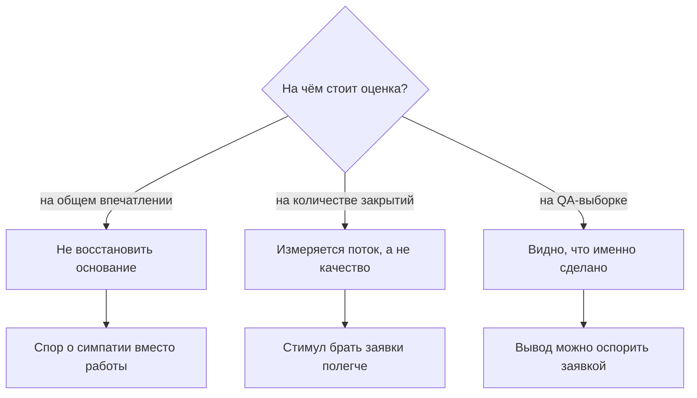
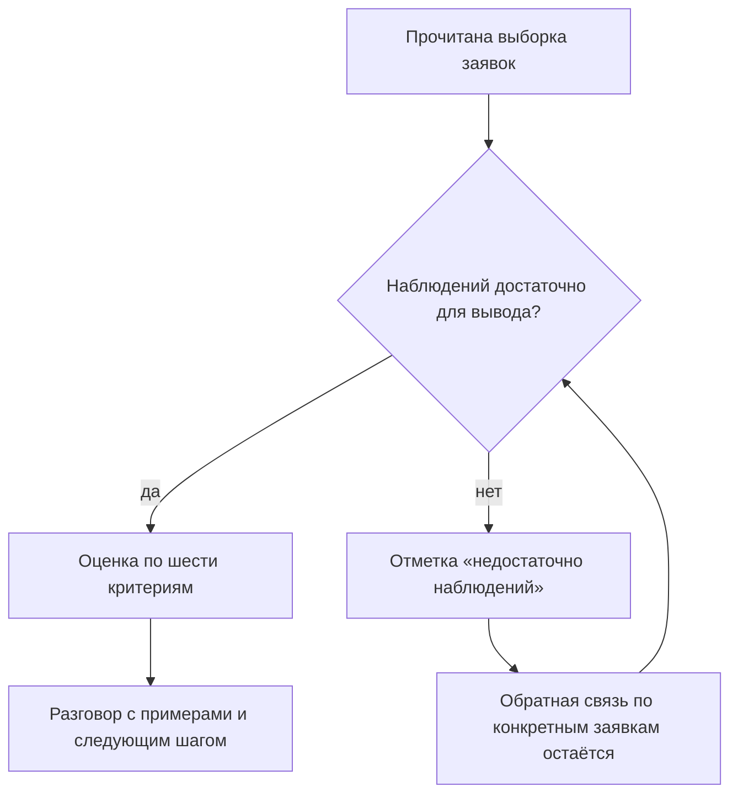
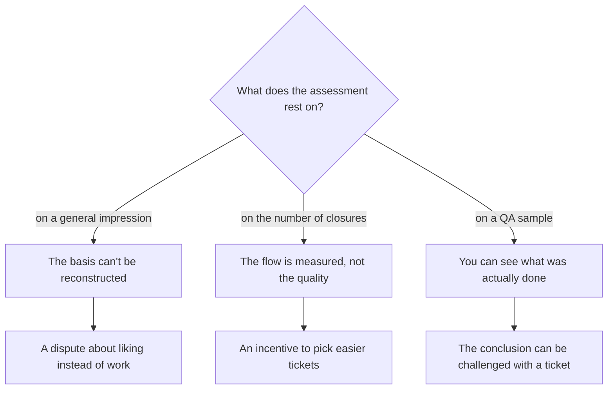
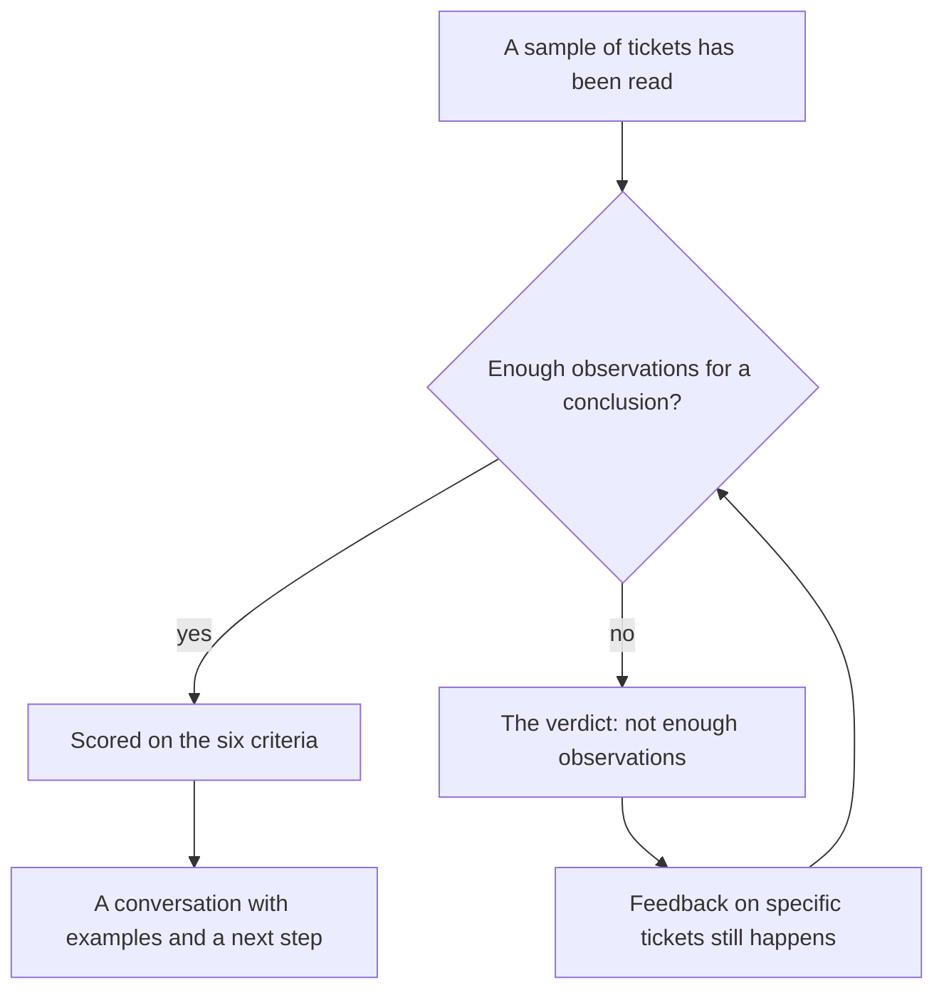
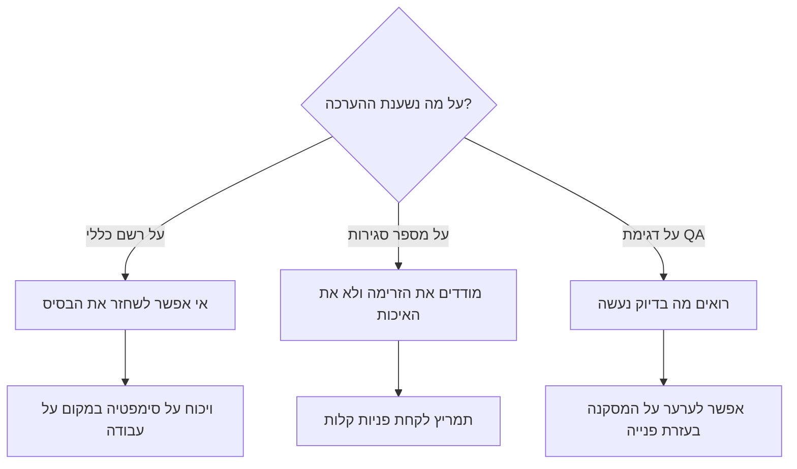
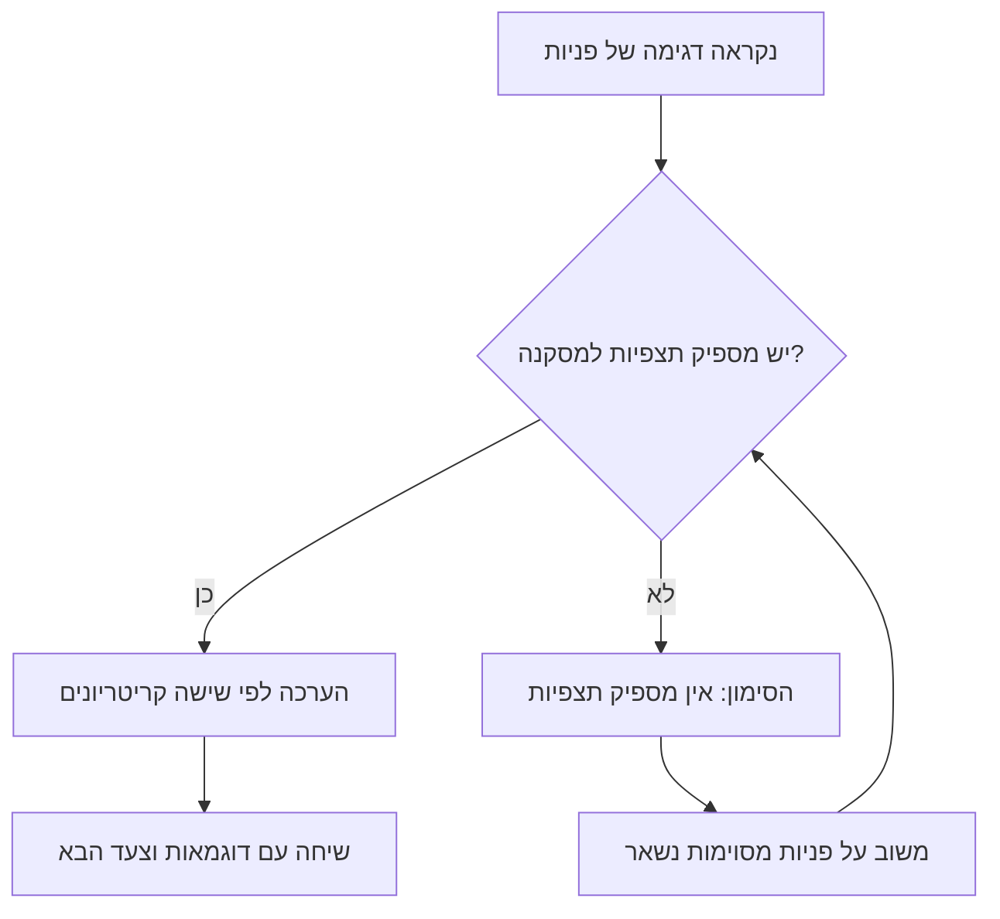

<!-- lang:ru -->

## Введение

Первые оценки в роли лида я ставил по впечатлению и стеснялся этого. Впечатление складывалось из последних десяти разговоров, из того, кто громче жалуется на сложность, из того, чьи заявки случайно попадались мне на глаза. Формально это была оценка по фактам — я же читал заявки. На самом деле факты были выбраны памятью, а не выборкой, и об этом знал каждый в команде.

Тезис, который я теперь считаю обязательным: инженера оценивают по наблюдаемым фактам из QA-выборки, а не по количеству закрытий и не по общему ощущению. Выборка — не бюрократия, а способ сделать разговор о качестве повторяемым: одни и те же критерии, один и тот же порядок, возможность оспорить вывод конкретной заявкой.

Эта статья — про четыре части этой конструкции: почему привычные способы не работают, как устроена выборка, что такое чек-лист шести критериев и когда честный вывод — «недостаточно наблюдений».

## Почему «на глаз» и по закрытиям не работает

Количество закрытий выглядит как метрика, потому что оно есть в трекере и всегда свежее. Но оно измеряет поток, а не человека.

- **Поток распределён неравномерно.** Кто-то в этот период брал типовые быстрые заявки, кто-то — тяжёлые, с воспроизведением и перепиской. При одинаковом качестве цифры у них будут разными, и не в пользу второго.
- **Закрытие — событие, а не качество.** Тикет можно закрыть с формальным ответом, и счётчик это оценит так же, как настоящую работу.
- **Оценка по счётчику создаёт стимул.** Люди начинают выбирать заявки полегче и закрывать побыстрее — то есть делать ровно то, за что потом придётся извиняться перед клиентами.
- **Впечатление невоспроизводимо.** Через месяц ни вы, ни инженер не восстановите, почему вывод был именно таким. А разговор, который нельзя восстановить, слышится как «мне так кажется».

Схема развилки выглядит так: у оценки может быть один из трёх оснований, и только третье переживает проверку.

Дальше — как устроена третья ветка.

## QA-выборка

Выборка — это несколько закрытых заявок за период, прочитанных целиком: переписка клиента, комментарии внутри, история смены статусов и итоговое решение. Не только текст ответа клиенту — именно история, потому что в ней видны остановки, лишние итерации и то, был ли следующий шаг назван.

Правила, без которых выборка превращается в охоту на ведьм:

- **Случайность с покрытием.** Заявки берутся не «интересные мне», а по сетке: разные инженеры, разные категории, разные уровни критичности. Иначе в выборку попадают только ссоры с клиентами.
- **Пачкой, а не построчно.** Ни один вывод не делается по одной заявке. Разбор идёт пачкой, и повторяющийся паттерн виден только в ней.
- **Те же критерии каждый раз.** Если критерии меняются под случай, сравнивать нечего.
- **Читает не только лид.** Второй человек в роли оценщика — самая дешёвая гарантия того, что оценка не отражает ваши отношения с инженером.
- **Сначала факт, потом разговор.** Вывод формулируется до встречи, а не в ходе неё.

<!-- вилка: свой размер выборки и правила отбора — сколько заявок, откуда, кто ещё читает. -->

Важно, что выборка — не проверка на ошибку. Её задача — увидеть, как выглядит работа, а не поймать за руку. Если задача формулируется как «найти, за что снизить», люди узнают это быстрее, чем вы закончите первый квартал.

## Чек-лист шести критериев

Каждая прочитанная заявка оценивается по шести критериям по шкале 0/1/2. Шкала сознательно грубая: 0 — не сделано или сделано так, что пришлось бы переделывать; 1 — сделано, но с оговорками; 2 — сделано так, что заявку можно показывать как пример. Пять баллов из десяти создают иллюзию точности и спор о единицах, а не о работе.

| Критерий | Что наблюдается в заявке | Что значит «2» |
| --- | --- | --- |
| Понимание проблемы | Воспроизведение, уточнения, формулировка сути | Клиент подтвердил, что проблему поняли верно |
| Полнота решения | Устранена причина, а не только симптом | Заявка не вернулась и возвращаться не должна |
| Коммуникация | Ясность, следующий шаг, ожидания по времени | Клиенту не нужен повторный вопрос «что дальше» |
| Соблюдение процесса | Категория, критичность, сроки, маршрут | Процесс помог, а не мешал |
| Работа со знаниями | Ссылка на статью, вклад в базу знаний | Решение зафиксировано, им сможет воспользоваться другой |
| Передача и эскалация | Пакет контекста, владелец, что уже проверено | Следующий не переспрашивал ничего |

Отдельно про критерий работы со знаниями: речь не о количестве написанных статей. KCS (Knowledge-Centered Service — подход, в котором статья пишется в момент решения задачи, а не после) в выборке виден иначе: осталась ли в заявке ссылка, по которой следующий человек решит ту же проблему быстрее.

Зачем именно шесть, а не двадцать: каждый критерий должен быть виден в заявке глазами, без дополнительных опросов. Двадцать критериев дают красивую таблицу и никакой оценки — человек не может держать в голове двадцать требований, поэтому любое детальное оценивание сводится к двум-трем критериям, которые в данном месяце кажутся важными.

<!-- вилка: сверьте формулировки шести критериев со §6.2 годового плана — здесь они даны в рабочем виде. -->

И ещё одно: балл не суммируется в одну цифру «качества». Сумма шести критериев скрывает профиль: инженер с отличной коммуникацией и слабым решением не станет «средним» — у него разные сильные стороны, и работать с ними надо по-разному.

## Отметка «недостаточно наблюдений»

Самая полезная часть конструкции — возможность не делать вывод. Иногда выборка просто мала: человек был в отпуске, вышел недавно, весь период провёл на дежурстве с однотипными заявками. Вывести оценку из такого материала значит выдумать её.

Это не пробел процесса, а его штатный результат. Как он читается:

Три правила, которые держат эту отметку честной.

- **Она не заменяет обратную связь.** Даже при недостатке наблюдений конкретную заявку можно разобрать: что было хорошо, что переделали бы.
- **Она не должна становиться привычкой.** Если по одному и тому же человеку она висит третью выборку подряд, дело не в выборке, а в распределении потока.
- **Вывод из количества закрытий не делается никогда.** Нельзя подменить отсутствие наблюдений цифрой из трекера — это ровно то, от чего мы уходили.

## Разговор об оценке

Оценка существует не для того, чтобы её поставили, а для того, чтобы после неё что-то изменилось. Поэтому разговор строится по тем же критериям, что и выборка, и начинается с самооценки.

Порядок, который у меня работает:

1. **Самооценка по тем же шести критериям.** Человек читает свои заявки и ставит баллы.
2. **Сверка расхождений.** Обсуждаются не баллы, а случаи, где оценки разошлись сильно.
3. **Одна-две заявки — как пример, не как приговор.** Пример должен быть узнаваемым, но не унизительным.
4. **Один следующий шаг.** Не список из семи пунктов, а одно изменение в работе до следующей выборки.

<!-- вилка: обезличенный пример разговора — что было в выборке, что разошлось и чем закончилось. -->

Отдельно стоит договориться, что оценка по наблюдаемым фактам не равна аттестации. Это инструмент развития и разговор о качестве: если инженер впервые слышит о своих слабых местах в момент, когда от него ждут цифру для ежегодного пересмотра зарплаты, — виновата не выборка, а то, что ею не пользовались весь год.

<!-- lang:en -->

## Introduction

The first assessments I gave as a lead were based on impressions, and I was embarrassed by it. The impression was built from the last ten conversations, from whoever complained loudest about difficulty, from the tickets that happened to land in front of me. Formally it was fact-based — I did read tickets. In reality the facts were selected by memory rather than by a sample, and everyone on the team knew it.

The claim I now treat as mandatory: an engineer is assessed by observable facts from a QA sample, not by the number of closures and not by a general feeling. The sample isn't bureaucracy, it's a way to make the conversation about quality repeatable: the same criteria, the same order, and a conclusion you can challenge with a specific ticket.

This article covers four parts of that construction: why the familiar methods don't work, how the sample is built, what the six-criteria checklist is, and when the honest verdict is "not enough observations".

## Why eyeballing and closure counts don't work

Closure count looks like a metric because it's in the tracker and it's always fresh. But it measures the flow, not the person.

- **The flow isn't distributed evenly.** Someone took quick routine tickets this period, someone took the heavy ones with reproduction and back-and-forth. At equal quality their numbers will differ — and not in the second person's favour.
- **A closure is an event, not a quality.** A ticket can be closed with a formal answer, and the counter will score it the same as real work.
- **Judging by the counter creates an incentive.** People start picking easier tickets and closing them faster — that is, doing exactly what will later require apologies to clients.
- **An impression can't be reproduced.** A month later neither you nor the engineer can reconstruct why the conclusion was what it was. And a conversation you can't reconstruct sounds like "it seems to me".

The fork looks like this: an assessment can rest on one of three foundations, and only the third survives scrutiny.

Next: how the third branch is built.

## QA sampling

A sample is several closed tickets per period, read end to end: the client conversation, the internal comments, the status history, and the final resolution. Not just the reply to the client — the history, because that's where you see the stalls, the extra iterations, and whether the next step was ever named.

Rules without which a sample turns into a witch hunt:

- **Random with coverage.** Tickets are picked by a grid, not by "the ones I find interesting": different engineers, different categories, different severities. Otherwise the sample fills up with arguments with clients.
- **In batches, not one by one.** No conclusion is drawn from a single ticket. The review happens in a batch, and a recurring pattern is only visible in one.
- **The same criteria every time.** If the criteria shift to fit the case, there's nothing to compare.
- **Not only the lead reads.** A second reader is the cheapest guarantee that the assessment doesn't reflect your relationship with the engineer.
- **Fact first, conversation second.** The conclusion is formulated before the meeting, not during it.

<!-- вилка: свой размер выборки и правила отбора — сколько заявок, откуда, кто ещё читает. -->

What matters is that the sample isn't an error hunt. Its job is to see what the work looks like, not to catch someone. If the task is framed as "find a reason to lower the score", people learn that faster than you finish the first quarter.

## The six-criteria checklist

Every ticket read is scored on six criteria using a 0/1/2 scale. The scale is deliberately coarse: 0 — not done, or done in a way that would need redoing; 1 — done with caveats; 2 — done in a way that makes the ticket a good example. Five points out of ten create an illusion of precision and a dispute about units rather than about work.

| Criterion | What is observed in the ticket | What "2" means |
| --- | --- | --- |
| Understanding the problem | Reproduction, clarifications, a statement of the essence | The client confirmed the problem was understood correctly |
| Completeness of the solution | The cause was removed, not just the symptom | The ticket didn't come back and shouldn't |
| Communication | Clarity, the next step, time expectations | The client needed no follow-up "what now" |
| Following the process | Category, severity, deadlines, routing | The process helped rather than got in the way |
| Working with knowledge | A link to an article, a contribution to the knowledge base | The solution is recorded so someone else can reuse it |
| Handover and escalation | A context package, an owner, what's already checked | The next person had nothing to re-ask |

A note on the knowledge criterion: it isn't about how many articles someone wrote. KCS (Knowledge-Centered Service — an approach where the article is written while the problem is being solved, not afterwards) shows up in a sample differently: is there a link in the ticket that lets the next person solve the same problem faster.

Why six and not twenty: each criterion has to be visible in the ticket with your own eyes, without extra surveys. Twenty criteria produce a beautiful table and no assessment at all — nobody holds twenty requirements in their head, so any detailed scoring collapses into the two or three criteria that seem important this month.

<!-- вилка: сверьте формулировки шести критериев со §6.2 годового плана — здесь они даны в рабочем виде. -->

One more thing: the scores don't add up to a single "quality number". The sum of six criteria hides the profile: an engineer with excellent communication and weak solutions doesn't become "average" — their strengths and gaps are in different places, and each needs different work.

## The "not enough observations" verdict

The most useful part of the construction is the permission not to conclude. Sometimes the sample is simply small: the person was on vacation, joined recently, spent the period on duty with uniform tickets. Deriving an assessment from that material means inventing it.

That isn't a gap in the process, it's a regular outcome of it. It reads like this:

Three rules that keep the verdict honest.

- **It doesn't replace feedback.** Even with too few observations, a specific ticket can be reviewed: what went well, what you'd redo.
- **It must not become a habit.** If it hangs over the same person for a third sample in a row, the problem isn't the sample, it's how the flow is distributed.
- **A conclusion is never drawn from closure counts.** Absent observations can't be replaced by a tracker number — that is exactly what we were escaping.

## The conversation about the assessment

An assessment doesn't exist to be given, it exists so that something changes afterwards. So the conversation follows the same criteria as the sample and starts with self-assessment.

The order that works for me:

1. **Self-assessment on the same six criteria.** The person reads their own tickets and scores them.
2. **Reconciling the gaps.** What gets discussed isn't the scores but the cases where the scores diverged sharply.
3. **One or two tickets as an example, not a verdict.** The example should be recognisable, not humiliating.
4. **One next step.** Not a list of seven items, but one change in the work before the next sample.

<!-- вилка: обезличенный пример разговора — что было в выборке, что разошлось и чем закончилось. -->

It's worth agreeing separately that assessment by observable facts isn't an appraisal. It's a development tool and a conversation about quality: if an engineer first hears about their weak spots at the moment a number is expected for the annual salary review, the sample isn't to blame — the blame is that nobody used it all year.

<!-- lang:he -->

## מבוא

את ההערכות הראשונות שלי כמנהל תמיכה נתתי לפי רשמים והתביישתי בזה. הרשם נבנה מעשר השיחות האחרונות, ממי שהתלונן חזק יותר על מורכבות, ומהפניות שבאופן מקרי נתקלתי בהן. פורמלית זאת הייתה הערכה לפי עובדות — הרי קראתי פניות. בפועל העובדות נבחרו על ידי הזיכרון ולא על ידי דגימה, וזה ידע כל אחד בצוות.

הטענה שאני מחשיב מאז כמחייבת: מוקדן מוערך לפי עובדות נצפות מדגימת QA, ולא לפי מספר הפניות שנסגרו ולא לפי תחושה כללית. הדגימה אינה בירוקרטיה אלא דרך להפוך את השיחה על האיכות לחזרתית: אותם קריטריונים, אותו סדר, ואפשרות לערער על המסקנה בעזרת פנייה מסוימת.

המאמר הזה עוסק בארבעה חלקים של המבנה הזה: למה השיטות הרגילות לא עובדות, איך בנויה הדגימה, מהי רשימת שישה קריטריונים ומתי המסקנה הכנה היא "אין מספיק תצפיות".

## למה "בעין" ולפי מספר סגירות לא עובד

מספר הפניות שנסגרו נראה כמו מדד מפני שהוא קיים במערכת ותמיד טרי. אבל הוא מודד את הזרימה ולא את האדם.

- **הזרימה אינה מתחלקת באופן אחיד.** מישהו בתקופה הזאת לקח פניות מהירות ושגרתיות, מישהו — את הכבדות, עם שחזור והתכתבות. באותה איכות המספרים שלהם יהיו שונים, ולא לטובת השני.
- **סגירה היא אירוע, לא איכות.** אפשר לסגור פנייה בתשובה פורמלית, והמונה יעריך את זה כמו עבודה אמיתית.
- **הערכה לפי המונה יוצרת תמריץ.** אנשים מתחילים לבחור פניות קלות ולסגור מהר — כלומר לעשות בדיוק את מה שאחר כך ידרוש התנצלויות בפני לקוחות.
- **רשם אינו ניתן לשחזור.** כעבור חודש לא אתם ולא המוקדן תשחזרו למה המסקנה הייתה דווקא כך. ושיחה שאי אפשר לשחזר נשמעת כמו "כך נדמה לי".

השרטוט של ההסתעפות נראה כך: להערכה יכול להיות אחד משלושה בסיסים, ורק השלישי שורד בדיקה.

המשך — איך בנוי הענף השלישי.

## דגימת QA

הדגימה היא כמה פניות סגורות מהתקופה, שנקראו מתחילתן ועד סופן: התכתבות הלקוח, ההערות הפנימיות, היסטוריית החלפת הסטטוסים והפתרון הסופי. לא רק הטקסט שנשלח ללקוח אלא ההיסטוריה, כי בה רואים את העצירות, הסבבים המיותרים ואם ציין צעד הבא.

כללים שבלעדיהם הדגימה הופכת למצוד מכשפות:

- **מקריות עם כיסוי.** הפניות נלקחות לא לפי "מה שמעניין אותי" אלא לפי רשת: מוקדנים שונים, קטגוריות שונות, רמות דחיפות שונות. אחרת לדגימה נכנסות רק מריבות עם לקוחות.
- **בקבוצה, לא אחת־אחת.** אף מסקנה לא נשענת על פנייה אחת. הדיון נעשה בקבוצה, ותבנית חוזרת נראית רק בה.
- **אותם קריטריונים בכל פעם.** אם הקריטריונים משתנים לפי המקרה, אין מה להשוות.
- **לא רק מנהל התמיכה קורא.** קורא שני בתפקיד מעריך הוא ההבטחה הזולה ביותר שההערכה לא משקפת את היחסים שלכם עם המוקדן.
- **קודם עובדה, אחר כך שיחה.** המסקנה מנוסחת לפני הפגישה ולא תוך כדי.

<!-- вилка: свой размер выборки и правила отбора — сколько заявок, откуда, кто ещё читает. -->

חשוב שהדגימה אינה בדיקה לאיתור טעויות. תפקידה לראות איך נראית העבודה, ולא לתפוס מישהו. אם המשימה מנוסחת כ"למצוא על מה להוריד את הציון", אנשים ילמדו את זה מהר יותר משתסיימו את הרבעון הראשון.

## רשימת שישה קריטריונים

כל פנייה שנקראה מוערכת לפי שישה קריטריונים בסולם 0/1/2. הסולם גס במכוון: 0 — לא נעשה, או נעשה כך שהיה צריך לעשות מחדש; 1 — נעשה עם הסתייגויות; 2 — נעשה כך שאפשר להראות את הפנייה כדוגמה. חמישה מתוך עשרה יוצרים אשליה של דיוק וויכוח על יחידות במקום על עבודה.

| קריטריון | מה נצפה בפנייה | מה משמעות "2" |
| --- | --- | --- |
| הבנת הבעיה | שחזור, הבהרות, ניסוח התמצית | הלקוח אישר שהבעיה הובנה נכון |
| שלמות הפתרון | הוסרה הסיבה ולא רק הסימפטום | הפנייה לא חזרה ולא אמורה לחזור |
| תקשורת | בהירות, צעד הבא, ציפיות לזמן | ללקוח לא נדרשה שאלת המשך "מה הלאה" |
| עמידה בתהליך | קטגוריה, דחיפות, מועדים, מסלול | התהליך עזר ולא הפריע |
| עבודה עם ידע | הפניה למאמר, תרומה לבסיס הידע | הפתרון נרשם כך שאדם אחר יוכל להשתמש בו |
| העברה והסלמה | חבילת הקשר, בעלים, מה כבר נבדק | לאדם הבא לא נשארו שאלות |

הערה על קריטריון העבודה עם ידע: הכוונה אינה לכמה מאמרים נכתבו. KCS (Knowledge-Centered Service — גישה שבה המאמר נכתב בזמן פתרון הבעיה ולא אחריו) נראה בדגימה אחרת: האם נשארה בפנייה הפניה שתאפשר לאדם הבא לפתור את אותה בעיה מהר יותר.

למה דווקא שישה ולא עשרים: כל קריטריון חייב להיות נראה בפנייה בעיניים, בלי סקרים נוספים. עשרים קריטריונים נותנים טבלה יפה ובלי הערכה בכלל — אדם לא מחזיק עשרים דרישות בראש, ולכן כל הערכה מפורטת מצטמצמת לשניים־שלושה קריטריונים שנראים חשובים בחודש הזה.

<!-- вилка: сверьте формулировки шести критериев со §6.2 годового плана — здесь они даны в рабочем виде. -->

ועוד דבר: הציונים לא מתחברים למספר "איכות" אחד. סכום שישה קריטריונים מסתיר את הפרופיל: מוקדן עם תקשורת מצוינת ופתרון חלש לא הופך ל"בינוני" — אצלו חוזקות ושחיקות במקומות שונים, וצריך לעבוד עם כל אחד מהם אחרת.

## הסימון "אין מספיק תצפיות"

החלק המועיל ביותר במבנה הוא האפשרות לא להסיק מסקנה. לפעמים הדגימה פשוט קטנה: האדם היה בחופשה, הצטרף לאחרונה, או העביר את התקופה בתורנות עם פניות אחידות. לגזור הערכה מחומר כזה פירושו להמציא אותה.

זה אינו פער בתהליך אלא תוצאה רגילה שלו. כך הוא נקרא:

שלושה כללים שמחזיקים את הסימון הזה כן.

- **הוא לא מחליף משוב.** גם כשיש מעט תצפיות, פנייה מסוימת אפשר לפרק: מה היה טוב, מה היינו עושים מחדש.
- **אסור לו להפוך להרגל.** אם לאותו אדם הוא תלוי בדגימה שלישית ברצף, הבעיה אינה בדגימה אלא בחלוקת הזרימה.
- **מסקנה ממספר סגירות לא מוסקת לעולם.** אי אפשר להחליף היעדר תצפיות במספר מהמערכת — זה בדיוק מה שממנו ברחנו.

## השיחה על ההערכה

ההערכה אינה קיימת כדי שתינתן אלא כדי שמשהו ישתנה אחריה. ולכן השיחה בנויה לפי אותם קריטריונים ובפתחה הערכה עצמית.

הסדר שעובד אצלי:

1. **הערכה עצמית לפי אותם שישה קריטריונים.** האדם קורא את הפניות שלו ונותן ציונים.
2. **סגירת פערים.** לא דנים בציונים אלא במקרים שבהם הציונים התרחקו מאוד.
3. **פנייה אחת או שתיים כדוגמה, לא כפסק דין.** הדוגמה צריכה להיות מזוהה אך לא משפילה.
4. **צעד הבא אחד.** לא רשימה של שבעה סעיפים אלא שינוי אחד בעבודה עד הדגימה הבאה.

<!-- вилка: обезличенный пример разговора — что было в выборке, что разошлось и чем закончилось. -->

שווה להסכים בנפרד שהערכה לפי עובדות נצפות אינה הערכת ביצועים שנתית. זה כלי פיתוח ושיחה על איכות: אם מוקדן שומע לראשונה על נקודות החולשה שלו ברגע שמצפים ממנו למספר לקראת בחינת השכר, אשמה אינה הדגימה אלא העובדה שלא השתמשו בה כל השנה.
