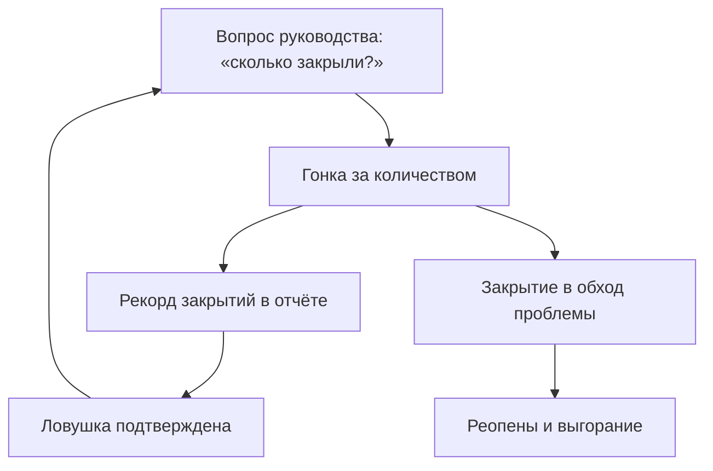
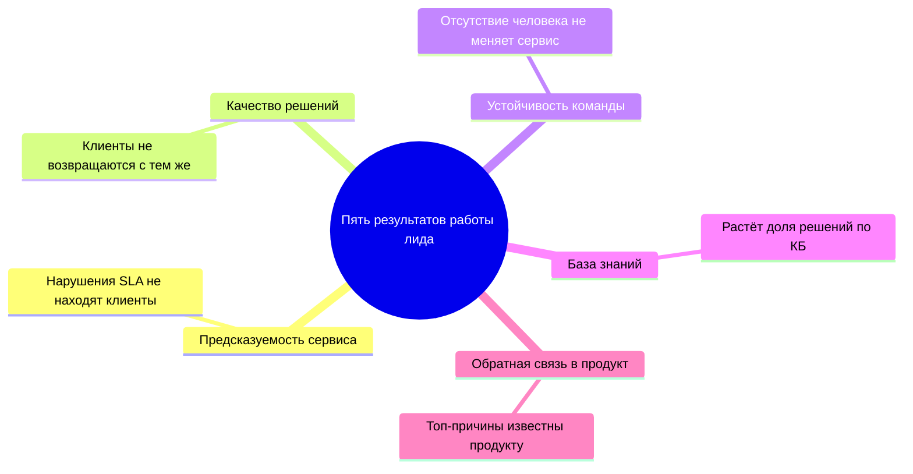
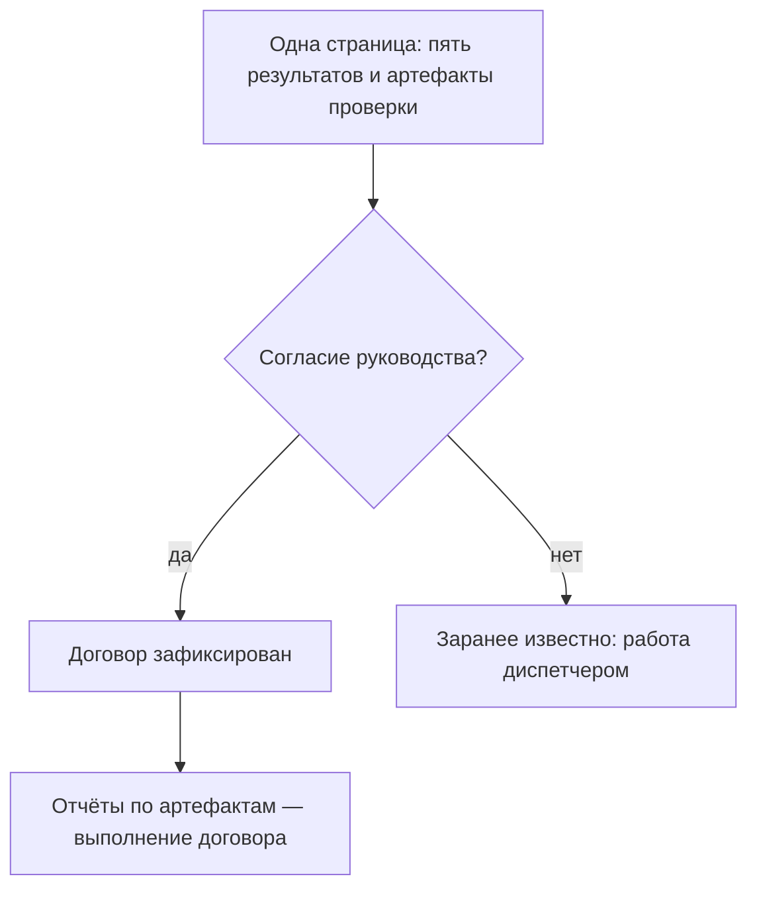
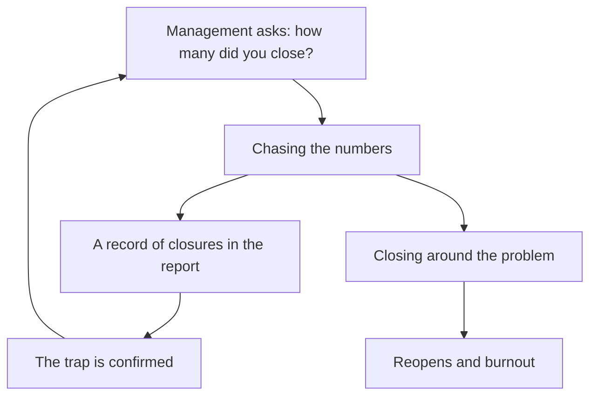
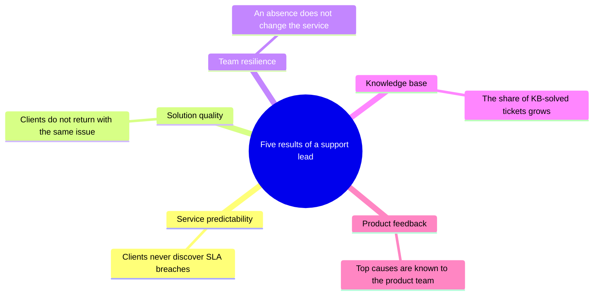
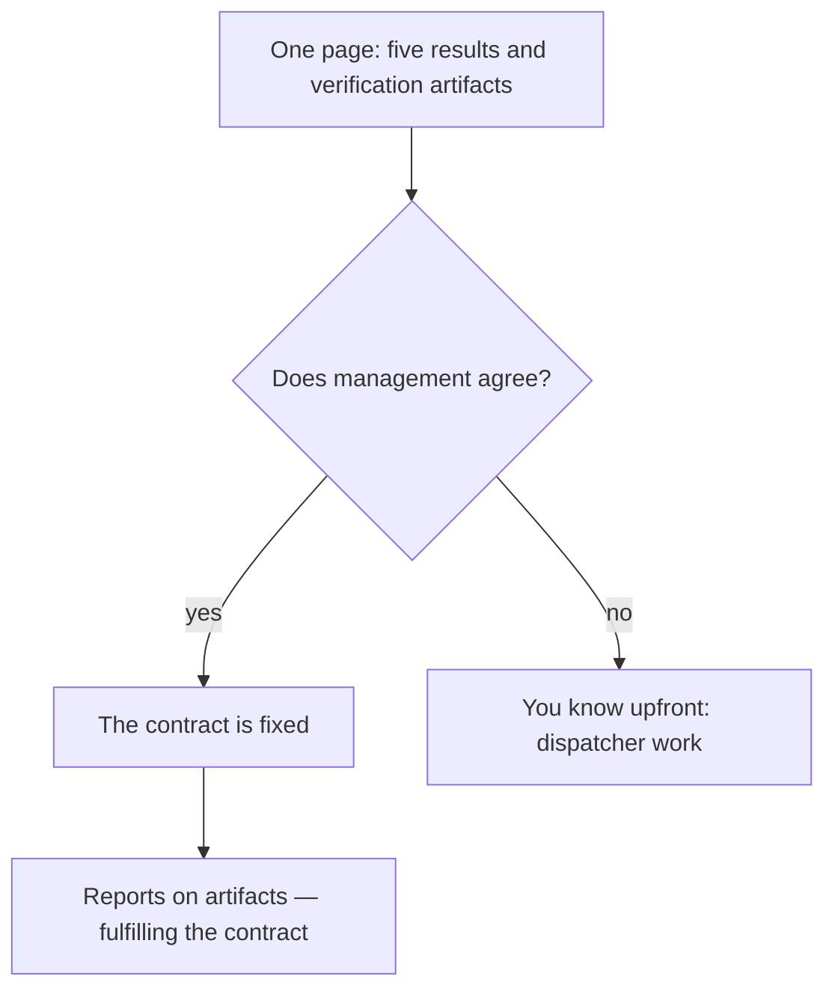
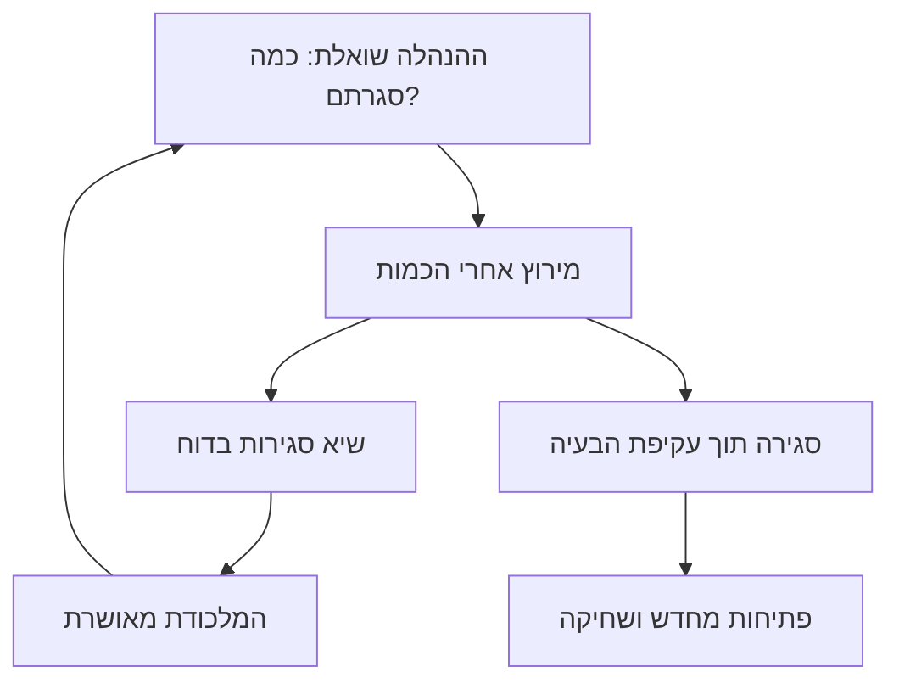
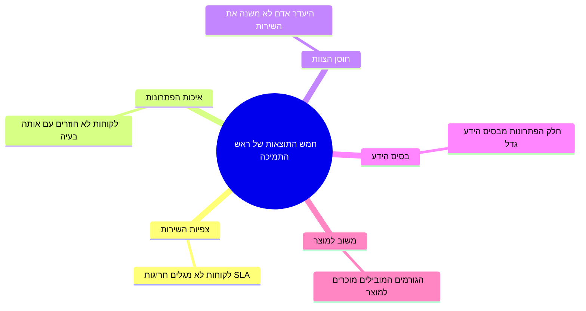
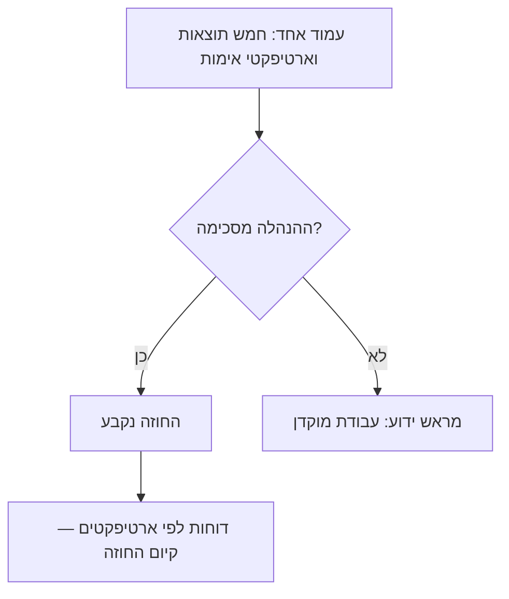

<!-- lang:ru -->

## Введение

Это первая статья серии о том, как выстроить поддержку как управляемый сервис. Серия следует логике года работы лида: сначала стратегическая рамка — что вообще является результатом, — затем операционные процессы, знания, команда, внешний контур и метрики.

Когда я спрашиваю у руководителей поддержки, чем измеряется их работа, чаще всего слышу одно и то же: количество закрытых заявок, среднее время ответа, размер очереди. Это удобные цифры — их видно в трекере каждую минуту, и они складываются в ощущение «система работает». Но это цифры деятельности, а не результата.

Работа лида поддержки измеряется не тем, сколько заявок прошло через сервис, а тем, что изменилось в сервисе за счёт его работы. Я сформулировал для себя пять таких результатов: предсказуемость сервиса, качество решений, устойчивость команды, база знаний и обратная связь в продукт. Каждый из них можно проверить — не идеальной метрикой из учебника, а конкретным артефактом, который либо есть, либо нет.

Если вы не можете назвать пять результатов своей работы — вы работаете диспетчером. Диспетчер тоже нужен, но его цена определяется количеством обработанных заявок. Лид должен стоить дороже, и эта статья — о том, чем именно.

## Ловушка «сделано больше — значит хорошо»

Самая коварная ловушка в нашей профессии выглядит так: квартал закрывается рекордом закрытых заявок, команда работает на пределе, отчёт выглядит великолепно. А через месяц вы обнаруживаете, что доля повторно открытых заявок выросла, клиентов стало больше раздражаться, а инженеры выгорают — потому что «закрыть любой ценой» означает закрывать в обход проблемы: без выяснения причины, без записи в базу знаний, без честного разговора с клиентом.

Знакомая картина? И у неё есть системная причина: когда единственная понятная метрика — «сделано больше», команда оптимизирует именно её. Всё, что не попадает в эту метрику — качество, знания, предупреждение проблем, — становится «невидимым» и по умолчанию приносится в жертву.

Хуже всего то, что ловушка самоподдерживается. Рекорд закрытий попадает в отчёт, руководство довольно, лид получает подтверждение, что всё делает правильно — и в следующем квартале команда снова гонится за количеством. Исправлять последствия — реопены, повторные обращения, выгорание — придётся тому же лиду, но уже без ресурса: время потрачено на гонку за цифрой. Разорвать этот круг можно только одним способом — договориться о других результатах до того, как цифры стали целью.

Как замыкается этот круг:

Заметьте: никто не выбирает эту ловушку сознательно. Она возникает сама — из отчётности, которую удобно собрать, из вопросов руководства «сколько закрыли за неделю?», из привычки измерять то, что измеряется легко. Противоядие одно: заранее определить, какие результаты на самом деле нужны от сервиса, и договориться об их проверке. Именно это — пять результатов, о которых дальше.

## Пять результатов работы лида

Обзор пяти результатов — у каждого своё направление работы и свой наблюдаемый признак:

### 1. Предсказуемость сервиса

Предсказуемость — это когда клиент, инженер и руководство знают, что и когда произойдёт с заявкой. Заявка с критичной проблемой получает таймер реакции; эскалация в L3 уходит с понятным пакетом и договорённостью о сроке; SLA-нарушение не «случается», а прогнозируется заранее — и клиент предупреждён до того, как срок истёк.

Разница между сервисом с регламентом и предсказуемым сервисом видна в первый же сбой. В первом случае регламент есть, но живёт в документе: заявка с горящим сроком лежит в общей очереди, эскалация заменяется сообщением «передали профильной команде», и клиент узнаёт о нарушении первым. Во втором случае регламент встроен в работу: критичность назначена при первом касании, срок виден в очереди каждый день, риск нарушения — повод для действия, а не для надежды.

Признак, по которому результат видно: нарушения SLA не находят клиенты. Если о просрочке вы узнаёте от разгневанного письма, а не из своего еженедельного обзора очереди, — предсказуемости пока нет, есть только регламент на бумаге.

### 2. Качество решений

Заявка закрывается решением, а не «не воспроизводится» и не «попробуйте перезагрузить». Инженер понимает причину, фиксирует её и сообщает клиенту, что именно сделано и почему больше не повторится.

Здесь важно не спутать закрытие с решением. Закрытие — это событие в трекере; решение — состояние клиента: проблема ушла, клиент понимает, что произошло, и знает, что делать, если увидит похожие симптомы. Их часто путают, потому что в трекере выглядит одинаково, а измеряется первое в разы проще. Но доверие клиента зарабатывается именно вторым: человек, который дважды описал одну и ту же проблему и дважды получил «попробуйте ещё раз», не станет третьим разом писать в поддержку — он напишет руководству вашего клиента.

Признак: клиенты не возвращаются с той же проблемой. Формально — низкая доля реопенов, фактически — QA-выборка, где инженер по нескольким заявкам подтверждает: причина найдена, решение полное, ответ клиенту понятен.

### 3. Устойчивость команды

Сервис переживает отпуск, болезнь и увольнение ключевого человека без просадки. Знания распределены: критичный навык есть минимум у двух человек, любой входящий тикет кто-то подхватывает за 15 минут — не потому что «дежурит герой», а потому что это норма, проверяемая расчётом.

Одноточечный риск — самый дешёвый в обнаружении и самый дорогой при событии. Пока носитель критичного знания на месте, всё работает и кажется, что проблема надумана. Затем он уходит — в отпуск, в другую компанию, в выгорание — и вместе с ним уходит то, чему не учили: как настраивается интеграция, почему падает очередь, куда смотреть при странной ошибке. Сервис не падает мгновенно; он медленно гниёт месяцами, пока знание восстанавливается методом проб и ошибок.

Признак: отсутствие одного человека не меняет ни скорость, ни качество сервиса. Если ваш единственный специалист по интеграциям уходит в отпуск и очередь по интеграциям встаёт — устойчивости нет, есть точка отказа с именем и фамилией.

### 4. База знаний

Решения накапливаются и переиспользуются. Инженер, встретив знакомую проблему, ищет в базе, а не в памяти коллег; найдя неточность — исправляет статью. База растёт в момент решения, а не «когда-нибудь в свободное время».

Последняя оговорка важнее, чем кажется. «Напишем статью, когда разгрузимся» — это обещание, которое не исполняется никогда: разгрузки не будет, а контекст решения — симптомы, версии, подводные камни — стирается из памяти за считанные дни. Статья, написанная через месяц, восстанавливается по памяти и теряет самое ценное — детали, которые и делают её применимой. Поэтому единственный рабочий момент для базы знаний — само решение тикета: нашёл в базе — использовал; не нашёл — написал, пока держишь проблему в голове.

Признак: растёт доля заявок, решённых по базе знаний. И вторая, менее очевидная: новые инженеры выходят на рабочую скорость быстрее — им не нужно годами впитывать опыт через рядом сидящего наставника.

### 5. Обратная связь в продукт

Поддержка — единственная команда, которая знает реальные проблемы клиентов в объёме и с контекстом. Но список «у нас всё плохо» продукт игнорирует — и справедливо: без масштаба («сколько клиентов»), цены («сколько часов поддержки»), обхода и конкретного предложения это не данные, а настроение. Обратная связь работает, когда повторяющиеся проблемы превращаются в карточки с данными: сколько клиентов затронуто, сколько часов поддержки съедено, какой есть обходной путь, что предлагаем. И у каждой карточки появляется статус — принято, отложено, отклонено.

Без этой петли поддержка обречена обслуживать одни и те же проблемы вечно — и тратить на них растущий объём команды. С этой петлёй каждая системная проблема получает шанс уйти из потока навсегда: исправлена в продукте или покрыта обходом и инструкцией.

Признак: топ-причины квартала известны продукту, часть из них исправлена или получила обход. Поддержка перестаёт быть «страдателем» и становится источником данных, на которые опирается развитие.

## Как проверить каждый результат

Проверяемость — ключевое свойство всех пяти. Не идеальная метрика, а артефакт, по которому раз в месяц можно ответить на вопрос: стало лучше или хуже?

| Результат | Артефакт проверки |
| --- | --- |
| Предсказуемость | Еженедельный контроль очереди по фильтрам рисков; журнал SLA-нарушений с причинами — каждое нарушение разъяснено, а не «сгорело» |
| Качество решений | QA-выборка заявок по чек-листу; доля реопенов — как грубый сигнал, а не как оценка инженера |
| Устойчивость команды | Матрица компетенций: критичный навык уровня 3+ минимум у двух людей; аудит живучести — «что сломается, когда меня не будет» |
| База знаний | Доля решений по базе знаний; доля статей, обновлённых за квартал |
| Обратная связь | Карточки проблем со статусами продукта; квартальный отчёт топ-причин |

Обратите внимание: ни один артефакт не требует идеальных данных или дорогих систем. Журнал нарушений — это записи в трекере; QA-выборка — час в неделю на несколько заявок; карточка проблемы — документ на страницу. Проверяемость достигается дисциплиной, а не инфраструктурой.

Второй практический вопрос — кто и как часто проверяет. Раз в месяц достаточно: реже — результаты теряются в шуме, чаще — проверка становится ритуалом ради самого ритуала. Проверять должен сам лид: это не аудит сверху, а его собственный инструмент управления. И один жёсткий запрет: артефакты не должны превращаться в отчётность. Как только таблица «результат → артефакт» начинает заполняться «для руководства», она умирает — люди заполняют её так, чтобы не было вопросов, и она перестаёт показывать правду. Эти артефакты — рабочие инструменты лида, которые показывают руководству только выводы, а не сырые таблицы.

И наоборот: если артефакта нет — результата нет. Не «плохо измеряется», а нет. Нельзя управлять тем, что нельзя проверить; честнее признать «этого мы пока не делаем», чем докладывать о результате, которого не существует.

## Пять результатов как контракт с руководством

Самое важное назначение этого списка — не самоанализ, а договор. Пять результатов — это мой контракт с руководством: вот что я обещаю производить, вот как каждый результат проверяется, вот по каким артефактам вы сможете увидеть это в конце года.

Этот разговор стоит провести в первые месяцы работы, до калибровки целей по метрикам. Иначе ловушка «сделано больше» вернётся — теперь уже в форме KPI, который вам поставят вместо вас. Практически это выглядит так: вы приходите с одной страницей — пять результатов, у каждого признак и артефакт проверки, — и спрашиваете: «Согласны ли вы, что через год сервис должен отличаться именно этим?» Согласие фиксируется, и у вас появляется легитимность: теперь ежемесячные отчёты о предсказуемости и знаниях — это не «отписка вместо цифр», а выполнение договора.

Обе ветки этого разговора:

Руководство, которое согласилось с пятью результатами, больше не спрашивает «сколько закрыли» — оно спрашивает «что стало предсказуемее» и «какие проблемы ушли в продукт». Если же согласия нет — это тоже ценный сигнал: вам заранее известно, как будут оценивать вашу работу, и вы можете осознанно решать, готовы ли вы работать диспетчером.

Второе следствие: эти же пять результатов становятся каркасом года. Стабилизация сервиса — это предсказуемость. Знания и самообслуживание — база знаний. Оценка и развитие команды — устойчивость и качество. Разборы инцидентов и карточки проблем — обратная связь в продукт. В следующей статье серии — о границах ответственности: что лид делает сам, что делегирует и от чего отказывается сознательно.

<!-- lang:en -->

## Introduction

This is the first article in a series about running support as a managed service. The series follows the logic of a support lead's year: first the strategic frame — what actually counts as a result — then operational processes, knowledge, the team, the external circuit, and metrics.

When I ask support leads how their work is measured, I most often hear the same list: number of closed tickets, average response time, queue size. These are convenient numbers — visible in the tracker every minute, adding up to a feeling that "the system works." But they are numbers of activity, not of result.

A support lead's work is measured not by how many tickets passed through the service, but by what changed in the service because of that work. I have formulated five such results for myself: service predictability, solution quality, team resilience, the knowledge base, and feedback into the product. Each can be verified — not with a perfect textbook metric, but with a concrete artifact that either exists or does not.

If you cannot name five results of your work, you are working as a dispatcher. A dispatcher is needed too, but their price is set by the number of tickets processed. A lead should cost more — and this article is about exactly what makes the difference.

## The "did more — means good" trap

The most insidious trap in our profession looks like this: the quarter closes with a record number of closed tickets, the team works at its limit, the report looks magnificent. A month later you discover that the share of reopened tickets has grown, clients are increasingly irritated, and engineers are burning out — because "close at any cost" means closing around the problem: without finding the cause, without writing to the knowledge base, without an honest conversation with the client.

Sound familiar? And it has a systemic cause: when the only understandable metric is "did more," the team optimizes exactly that. Everything that does not fit into this metric — quality, knowledge, problem prevention — becomes "invisible" and is sacrificed by default.

Worse still, the trap sustains itself. The closure record makes it into the report, management is pleased, the lead receives confirmation that everything is being done right — and next quarter the team chases the numbers again. Fixing the consequences — reopens, repeat contacts, burnout — falls to the same lead, but without resources: the time was spent racing toward the number. There is only one way to break the circle: agree on different results before the numbers become the goal.

Here is how that circle closes:

Note that nobody chooses this trap deliberately. It arises on its own — out of reporting that is easy to collect, out of management's question "how many did you close this week?", out of the habit of measuring what is easy to measure. The antidote is one: decide in advance which results the service actually needs, and agree on how they will be verified. Those are the five results that follow.

## The five results of a support lead

An overview of the five results — each with its own direction of work and observable sign:

### 1. Service predictability

Predictability means the client, the engineer, and management all know what will happen to a ticket and when. A critical ticket gets a response timer; an escalation to L3 goes out with a clear package and an agreed deadline; an SLA breach is not something that "happens" — it is predicted in advance, and the client is warned before the deadline expires.

The difference between a service that has a regulation and a predictable service shows at the very first failure. In the first case, the regulation exists but lives in a document: a ticket with a burning deadline sits in the general queue, escalation is replaced by a message "we passed it to the relevant team," and the client is the first to learn about the breach. In the second, the regulation is built into the work: criticality is assigned at first touch, deadlines are visible in the queue every day, and breach risk is a reason to act, not to hope.

The sign by which the result is visible: clients never discover SLA breaches. If you learn about a missed deadline from an angry email rather than from your own weekly queue review, there is no predictability yet — only a regulation on paper.

### 2. Solution quality

A ticket is closed with a solution, not with "cannot reproduce" or "try rebooting." The engineer understands the cause, records it, and tells the client what exactly was done and why it will not happen again.

It is important not to confuse closing with solving. A closure is an event in the tracker; a solution is the client's state: the problem is gone, the client understands what happened, and knows what to do if similar symptoms reappear. The two are often confused because they look identical in the tracker, and the first is far easier to measure. But client trust is earned by the second: a person who described the same problem twice and twice received "try again" will not write to support a third time — they will write to their own management.

The sign: clients do not return with the same problem. Formally — a low share of reopens; in practice — a QA sample where an engineer confirms across several tickets: the cause was found, the solution is complete, the reply to the client is clear.

### 3. Team resilience

The service survives a vacation, an illness, or the departure of a key person without degradation. Knowledge is distributed: a critical skill exists in at least two people, and any incoming ticket is picked up within 15 minutes — not because "a hero is on duty," but because that is the norm, verified by calculation.

Single-point risk is the cheapest to detect and the most expensive when it fires. While the carrier of critical knowledge is present, everything works and the problem seems invented. Then they leave — on vacation, to another company, into burnout — and what nobody was taught leaves with them: how the integration is configured, why the queue fails, where to look for a strange error. The service does not fall instantly; it rots slowly for months while the knowledge is restored by trial and error.

The sign: one person's absence changes neither the speed nor the quality of the service. If your only integrations specialist goes on vacation and the integrations queue stalls — there is no resilience, there is a single point of failure with a first and last name.

### 4. The knowledge base

Solutions accumulate and get reused. An engineer who meets a familiar problem searches the base rather than colleagues' memories; finding an inaccuracy, they fix the article. The base grows at the moment of solving, not "sometime in free time."

That last caveat matters more than it seems. "We'll write the article when things calm down" is a promise that is never kept: the calm never comes, and the context of the solution — symptoms, versions, pitfalls — fades from memory within days. An article written a month later is reconstructed from memory and loses the most valuable part — the details that make it applicable. So the only working moment for the knowledge base is the ticket resolution itself: found it in the base — used it; did not find it — wrote it while the problem is still in your head.

The sign: the share of tickets solved from the knowledge base grows. And a second, less obvious one: new engineers reach working speed faster — they do not need years to absorb experience from a mentor sitting nearby.

### 5. Feedback into the product

Support is the only team that knows clients' real problems at scale and with context. But a list of "everything is bad" is ignored by the product team — justifiably: without scale ("how many clients"), cost ("how many support hours"), a workaround, and a concrete proposal, it is not data, it is a mood. Feedback works when recurring problems turn into cards with data: how many clients are affected, how many support hours are consumed, what workaround exists, what we propose. And each card acquires a status — accepted, postponed, declined.

Without this loop, support is doomed to serve the same problems forever, spending a growing share of the team on them. With it, every systemic problem gets a chance to leave the flow for good: fixed in the product or covered by a workaround and an instruction.

The sign: the top causes of the quarter are known to the product team, and some of them are fixed or covered. Support stops being the sufferer and becomes a source of data that development relies on.

## How to verify each result

Verifiability is the key property of all five. Not a perfect metric, but an artifact that answers one question monthly: did it get better or worse?

| Result | Verification artifact |
| --- | --- |
| Predictability | Weekly queue control by risk filters; an SLA breach log with causes — every breach is explained, not "burned away" |
| Solution quality | A QA sample of tickets against a checklist; the reopen share as a rough signal, not as an engineer's rating |
| Team resilience | A competency matrix: critical skill at level 3+ in at least two people; a resilience audit — "what breaks when I am gone" |
| Knowledge base | The share of tickets solved from the KB; the share of articles updated in the quarter |
| Feedback | Problem cards with product statuses; a quarterly report of top causes |

Note that none of these artifacts requires perfect data or expensive systems. The breach log is entries in the tracker; the QA sample is an hour a week on a few tickets; a problem card is a one-page document. Verifiability is achieved by discipline, not infrastructure.

The second practical question is who verifies and how often. Once a month is enough: less often, and the results drown in noise; more often, and the check becomes ritual for its own sake. The lead should be the one verifying: this is not an audit from above but their own management instrument. And one strict prohibition: artifacts must not turn into reporting. As soon as the "result → artifact" table starts being filled "for management," it dies — people fill it to avoid questions, and it stops showing the truth. These artifacts are the lead's working instruments; management sees conclusions, not raw tables.

Conversely: if there is no artifact, there is no result. Not "poorly measured" — there is none. You cannot manage what you cannot verify; it is more honest to admit "we do not do this yet" than to report a result that does not exist.

## The five results as a contract with management

The most important purpose of this list is not self-analysis but agreement. The five results are my contract with management: here is what I promise to produce, here is how each result is verified, and here are the artifacts by which you will see it at the end of the year.

This conversation is worth having in the first months, before targets are calibrated into metrics. Otherwise the "did more" trap returns — this time as a KPI set by someone else. In practice it looks like this: you arrive with a single page — five results, each with its sign and verification artifact — and ask: "Do you agree that in a year the service should differ in exactly these ways?" The agreement is fixed, and you gain legitimacy: monthly reports on predictability and knowledge are no longer "a substitute for numbers" but the fulfillment of the contract.

Both branches of that conversation:

Management that has agreed to the five results stops asking "how many did you close" and starts asking "what became more predictable" and "which problems went into the product." If there is no agreement, that too is a valuable signal: you know in advance how your work will be judged, and you can consciously decide whether you are ready to work as a dispatcher.

The second consequence: these same five results become the frame of the year. Service stabilization is predictability. Knowledge and self-service are the knowledge base. Assessment and development of the team are resilience and quality. Incident reviews and problem cards are feedback into the product. The next article in the series is about boundaries of responsibility: what a lead does personally, what they delegate, and what they give up consciously.

<!-- lang:he -->

## מבוא

זה המאמר הראשון בסדרה על הפיכת התמיכה לשירות מנוהל. הסדרה עוקבת אחרי הלוגיקה של שנת עבודה של ראש תמיכה: קודם המסגרת האסטרטגית — מה בכלל נחשב לתוצאה — ואז תהליכים תפעוליים, ידע, צוות, מעגל החוץ והמדדים.

כשאני שואל ראשי תמיכה איך נמדדת העבודה שלהם, אני שומע לרוב את אותה רשימה: מספר כרטיסים שנסגרו, זמן תגובה ממוצע, גודל התור. אלה מספרים נוחים — רואים אותם במערכת בכל דקה, והם מתלכדים לתחושה ש"המערכת עובדת". אבל אלה מספרים של פעילות, לא של תוצאה.

את עבודת ראש התמיכה מודדים לא בכמה כרטיסים עברו בשירות, אלא במה שהשתנה בשירות בזכות העבודה שלו. ניסחתי לעצמי חמש תוצאות כאלה: צפיות השירות, איכות הפתרונות, חוסן הצוות, בסיס הידע ומשוב למוצר. כל אחת מהן ניתנת לאימות — לא במדד מושלם מהספרות, אלא בארטיפקט קונקרטי שקיים או לא קיים.

אם אינך יכול לנקוב בחמש תוצאות של העבודה שלך — אתה עובד כמוקדן. גם מוקדן נחוץ, אבל המחיר שלו נקבע לפי מספר הכרטיסים שעיבד. ראש תמיכה צריך לעלות יותר — והמאמר הזה הוא בדיוק על מה.

## המלכודת של «עשינו יותר — סימן טוב»

המלכודת הערמומית ביותר במקצוע שלנו נראית כך: הרבעון נסגר עם שיא של כרטיסים סגורים, הצוות עובד על קצה היכולת, הדוח נראה מצוין. חודש אחרי אתה מגלה שחלק הכרטיסים שנפתחו מחדש גדל, לקוחות מתרגזים יותר ויותר, והמהנדסים נשחקים — כי "לסגור בכל מחיר" אומר לסגור תוך עקיפת הבעיה: בלי לגלות את הסיבה, בלי לרשום לבסיס הידע, בלי שיחה כנה עם הלקוח.

נשמע מוכר? ויש לזה סיבה שיטתית: כשהמדד המובן היחיד הוא "עשינו יותר", הצוות מייעל בדיוק אותו. כל מה שלא נכנס למדד הזה — איכות, ידע, מניעת בעיות — הופך "בלתי נראה" ונזנח כברירת מחדל.

הגרוע מכל — המלכודת מקיימת את עצמה. שיא הסגירות מגיע לדוח, ההנהלה מרוצה, ראש התמיכה מקבל אישור שהוא עושה הכול נכון — וברבעון הבא הצוות שוב מתחרה על הכמות. לתקן את התוצאות — פתיחות מחדש, פניות חוזרות, שחיקה — יצטרך אותו ראש תמיכה, אבל כבר בלי משאבים: הזמן הושקע במירוץ אחרי המספר. יש דרך אחת לשבור את המעגל: להסכים על תוצאות אחרות עוד לפני שהמספרים הפכו למטרה.

כך נסגר המעגל:

שימו לב: אף אחד לא בוחר במלכודת הזאת במכוון. היא נוצרת מעצמה — מתוך דוחות שקל לאסוף, מהשאלה של ההנהלה "כמה סגרתם השבוע?", מההרגל למדוד את מה שקל למדוד. התרופה אחת: להחליט מראש אילו תוצאות באמת דרושות מהשירות, ולהסכים איך יאמתו אותן. אלה חמש התוצאות שלהן המאמר.

## חמש התוצאות של ראש התמיכה

סקירה של חמש התוצאות — לכל אחת כיוון עבודה משלה וסימן נצפה:

### 1. צפיות השירות

צפיות — זה כשללקוח, למהנדס ולהנהלה ידוע מה יקרה עם הכרטיס ומתי. כרטיס עם בעיה קריטית מקבל טיימר תגובה; הסלמה ל-L3 יוצאת עם חבילה ברורה ומועד מוסכם; חריגת SLA לא "קורית" — היא חזויה מראש, והלקוח מוזהר לפני שהמועד פג.

ההבדל בין שירות שיש לו נוהל לבין שירות צפוי נראה כבר בתקלה הראשונה. במקרה הראשון הנוהל קיים, אבל הוא חי במסמך: כרטיס עם מועד שנשרף יושב בתור הכללי, ההסלמה מוחלפת בהודעה "העברנו לצוות הרלוונטי", והלקוח הוא הראשון לגלות על החריגה. במקרה השני הנוהל מובנה בעבודה: הקריטיות נקבעת במגע הראשון, המועדים נראים בתור בכל יום, וסיכון חריגה הוא סיבה לפעול — לא לקוות.

הסימן: חריגות SLA לא מתגלות על ידי לקוחות. אם אתה למד על פגית מועד ממייל זועם ולא מסקירת התור השבועית שלך — אין עדיין צפיות, יש רק נוהל על הנייר.

### 2. איכות הפתרונות

כרטיס נסגר בפתרון, ולא ב"לא משוחזר" ולא ב"נסה להפעיל מחדש". המהנדס מבין את הסיבה, מתעד אותה ואומר ללקוח מה בדיוק נעשה ולמה זה לא יחזור.

חשוב לא לבלבל סגירה עם פתרון. סגירה היא אירוע במערכת; פתרון הוא מצב הלקוח: הבעיה נעלמה, הלקוח מבין מה קרה ויודע מה לעשות אם יופיעו תסמינים דומים. מבלבלים ביניהם לעיתים קרובות, כי במערכת הם נראים אותו דבר, ואת הראשון הרבה יותר קל למדוד. אבל אמון הלקוח נרכש דווקא בשני: מי שתיאר את אותה בעיה פעמיים וקיבל פעמיים "נסה שוב" — לא יכתוב בפעם השלישית לתמיכה, הוא יכתוב להנהלה של הלקוח שלך.

הסימן: לקוחות לא חוזרים עם אותה בעיה. פורמלית — חלק נמוך של פתיחות מחדש; בפועל — דגימת QA שבה המהנדס מאשר לפי כמה כרטיסים: הסיבה נמצאה, הפתרון מלא, התשובה ללקוח ברורה.

### 3. חוסן הצוות

השירות שורד חופשה, מחלה או עזיבה של אדם מפתח בלי ירידה. הידע מפוזר: מיומנות קריטית קיימת אצל לפחות שני אנשים, וכל כרטיס נכנס נתפס תוך 15 דקות — לא כי "גיבור בתור", אלא כי זו נורמה שנבדקת בחישוב.

סיכון נקודתי — הזול ביותר לגילוי והיקר ביותר באירוע. כל עוד נושא הידע הקריטי במקום, הכול עובד ונדמה שהבעיה מדומיינת. ואז הוא הולך — לחופשה, לחברה אחרת, לשחיקה — ואיתו הולך מה שאף אחד לא למד: איך מגדירים את האינטגרציה, למה התור נופל, איפה לחפש שגיאה מוזרה. השירות לא נופל מיד; הוא נרקב לאט במשך חודשים, בזמן שהידע משוחזר בניסוי וטעייה.

הסימן: היעדרות של אדם אחד לא משנה לא את המהירות ולא את איכות השירות. אם מומחה האינטגרציות היחיד שלך יוצא לחופשה ותור האינטגרציות עומד — אין חוסן, יש נקודת כשל עם שם פרטי ומשפחה.

### 4. בסיס הידע

פתרונות מצטברים ונעשה בהם שימוש חוזר. מהנדס שפוגש בעיה מוכרת מחפש בבסיס, ולא בזיכרון של עמיתים; מוצא אי-דיוק — מתקן את המאמר. הבסיס גדל ברגע הפתרון, ולא "מתישהו בזמן הפנוי".

ההסגה האחרונה חשובה יותר משנדמה. "נכתוב מאמר כשנתפנה" — זו הבטחה שלעולם לא מתקיימת: ההתפנות לא תגיע, והקשר של הפתרון — תסמינים, גרסאות, מוקשים — נמחה מהזיכרון תוך ימים. מאמר שנכתב חודש אחרי משוחזר מהזיכרון ומאבד את החלק היקר ביותר — את הפרטים שהופכים אותו לשמיש. לכן הרגע העובד היחיד לבסיס הידע — פתרון הכרטיס עצמו: מצאת בבסיס — השתמשת; לא מצאת — כתבת, כל עוד הבעיה בראש.

הסימן: חלק הכרטיסים שנפתרו מבסיס הידע גדל. ושני, פחות מובן מאליו: מהנדסים חדשים מגיעים למהירות עבודה מהר יותר — לא צריך שנים כדי לספוג ניסיון ממנחה שיושב לידך.

### 5. משוב למוצר

התמיכה — הצוות היחיד שמכיר את הבעיות האמיתיות של הלקוחות בהיקף ובהקשר. אבל רשימה של "הכול רע" נזנחת על ידי המוצר — בצדק: בלי היקף ("כמה לקוחות"), מחיר ("כמה שעות תמיכה"), עוקף והצעה קונקרטית זה לא נתונים אלא מצב רוח. משוב עובד כשבעיות חוזרות הופכות לכרטיסים עם נתונים: כמה לקוחות מושפעים, כמה שעות תמיכה נצרכו, איזה עוקף קיים, מה מציעים. ולכל כרטיס מופיע סטטוס — אושר, נדחה במועד, נדחה.

בלי הלולאה הזאת התמיכה נידונה לשרת את אותן בעיות לנצח — ולהשקיע בהן חלק גדל של הצוות. עם הלולאה כל בעיה שיטתית מקבלת סיכוי לצאת מהזרם סופית: תוקנה במוצר או כוסתה בעוקף ובהוראות.

הסימן: הגורמים המובילים של הרבעון מוכרים למוצר, וחלקם תוקן או כוסה. התמיכה מפסיקה להיות "הסובלת" והופכת למקור נתונים שהפיתוח נשען עליו.

## כיצד לאמת כל תוצאה

היכולת לאימות — התכונה המרכזית של כולן. לא מדד מושלם, אלא ארטיפקט שלפיו פעם בחודש אפשר לענות על השאלה: האם השתפר?

| תוצאה | ארטיפקט אימות |
| --- | --- |
| צפיות | בקרת תור שבועית לפי מסנני סיכון; יומן חריגות SLA עם סיבות — כל חריגה מוסברת, ולא "נשרפה" |
| איכות פתרונות | דגימת QA של כרטיסים לפי צ'ק-ליסט; חלק הפתיחות מחדש כאות גס, לא כדירוג המהנדס |
| חוסן הצוות | מטריצת מיומנויות: מיומנות קריטית ברמה 3+ אצל לפחות שניים; ביקורת חוסן — "מה ישבר כשלא אהיה" |
| בסיס הידע | חלק הפתרונות מבסיס הידע; חלק המאמרים שעודכנו ברבעון |
| משוב | כרטיסי בעיות עם סטטוסים של המוצר; דוח רבעוני של הגורמים המובילים |

שימו לב: אף ארטיפקט לא דורש נתונים מושלמים או מערכות יקרות. יומן החריגות — רשומות במערכת; דגימת QA — שעה בשבוע על כמה כרטיסים; כרטיס בעיה — מסמך בעמוד אחד. יכולת האימות מושגת במשמעת, לא בתשתית.

השאלה המעשית השנייה — מי בודק ובאיזו תדירות. פעם בחודש מספיק: פחות — התוצאות טבועות ברעש; יותר — הבדיקה הופכת טקס לשם הטקס. לבדוק צריך את ראש התמיכה עצמו: זו לא ביקורת מלמעלה אלא כלי הניהול שלו. ואיסור אחד נוקשה: ארטיפקטים לא צריכים להפוך לדוחות. ברגע שהטבלה "תוצאה → ארטיפקט" מתחילה להתמלא "להנהלה" — היא מתה: ממלאים אותה כדי שלא יהיו שאלות, והיא מפסיקה להראות את האמת. הארטיפקטים האלה — כלי עבודה של ראש התמיכה; ההנהלה רואה מסקנות, לא טבלאות גלם.

ולהיפך: אין ארטיפקט — אין תוצאה. לא "נמדד רע" — אין. לא ניתן לנהל את מה שאי אפשר לאמת; יותר כן להודות "אנחנו עוד לא עושים את זה" מאשר לדווח על תוצאה שלא קיימת.

## חמש התוצאות כחוזה מול ההנהלה

הייעוד החשוב ביותר של הרשימה — לא ניתוח עצמי אלא הסכם. חמש התוצאות — החוזה שלי מול ההנהלה: הנה מה שאני מבטיח לייצר, הנה איך כל תוצאה נאמתת, והנה הארטיפקטים שלפיהם תראו את זה בסוף השנה.

שיחה כזאת שווה לקיים בחודשים הראשונים, לפני כיול היעדים למדדים. אחרת המלכודת "עשינו יותר" תחזור — הפעם בצורת KPI שיקבעו לך במקומך. בפועל זה נראה כך: אתה מגיע עם עמוד אחד — חמש תוצאות, לכל אחת סימן וארטיפקט אימות — ושואל: "האם אתם מסכימים שבעוד שנה השירות צריך להשתנות בדיוק באלה?" ההסכמה נרשמת, ויש לך לגיטימציה: דוחות חודשיים על צפיות וידע — זה לא "תחליף למספרים" אלא קיום החוזה.

שני הענפים של השיחה הזאת:

הנהלה שהסכימה עם חמש התוצאות מפסיקה לשאול "כמה סגרתם" — ומתחילה לשאול "מה נעשה צפוי יותר" ו"אילו בעיות יצאו למוצר". אם הסכמה אין — גם זה אות חשוב: מראש ידוע לך איך יעריכו את העבודה שלך, ואתה יכול להחליט במודע אם אתה מוכן לעבוד כמוקדן.

ההשלכה השנייה: אותן חמש תוצאות הופכות לשלד של השנה. ייצוב השירות — זו צפיות. ידע ושירות עצמי — זה בסיס הידע. הערכה ופיתוח הצוות — חוסן ואיכות. ניתוחי תקלות וכרטיסי בעיות — משוב למוצר. במאמר הבא בסדרה — גבולות האחריות: מה ראש תמיכה עושה בעצמו, מה הוא מעביר לאחרים, וממה הוא פורש במכוון.
