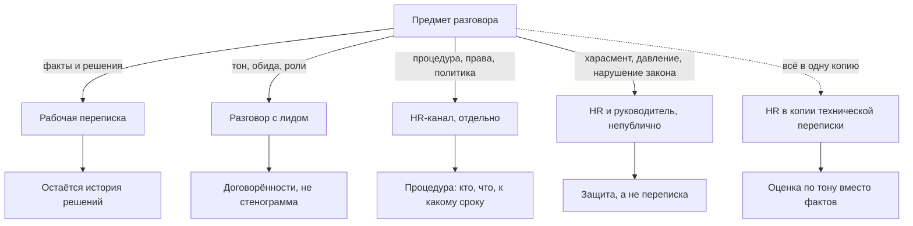
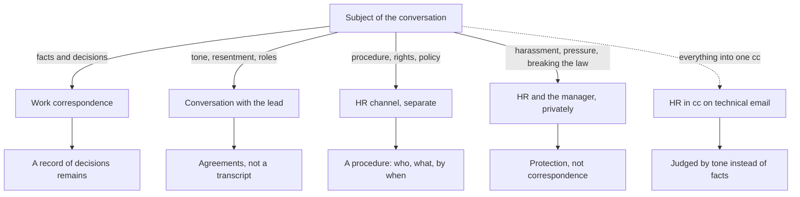
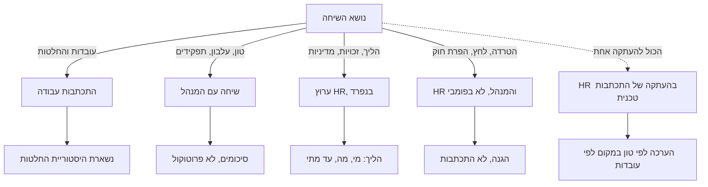

<!-- lang:ru -->

## Введение

Сцена повторяется. Инженер и смежная команда — или инженер и клиентский менеджер — спорят по почте, чья это зона ответственности. Тема письма обрастает `RE:` и `FW:`, сообщения становятся длиннее, в них появляются «в очередной раз» и «мы уже обсуждали». И в какой-то момент в копии оказывается HR-менеджер: его поставил инженер, лид или аккаунт-менеджер — или письмо просто переслали «чтобы были в курсе».

Со стороны это выглядит разумно: спор вышел за пределы техники, нужен свидетель. На практике почти всегда это ошибка — не потому, что HR плохой специалист, а потому, что у канала меняется назначение, и об этом никто не договаривался. В почте это заметнее, чем где-либо: письмо не переписка, а документ с датой, автором и списком адресатов.

Тезис, из которого я исхожу: техническая переписка — канал фактов и решений. Как только в копии появляется человек, чья работа — оценивать людей, а не разбирать проблему, канал перестаёт производить правду. Дальше — что при этом теряет сотрудник, что теряет компания, где здесь юридическая сторона и как устроить три канала вместо одного.

<!-- вилка: 2–3 собственных эпизода — кто и зачем поставил HR в копию. -->

## Три способа, которыми HR оказывается в копии

Все три выглядят как забота и заканчиваются одинаково.

**Сотрудник ставит HR в копию как защиту.** Логика понятна: «пусть HR видит, как со мной разговаривают». Но HR — не адвокат сотрудника. У него другой мандат: он отвечает за процедуру и за интересы компании, а не за исход спора в пользу пригласившего. Человек входит в переписку с ожиданием союзника и остаётся в ней свидетелем.

**Руководитель ставит HR в копию как свидетеля.** «Чтобы был независимый человек». Независимый человек без технического контекста не разбирает спор — он читает тон. А решение, принятое по тону, всегда проигрывает решению, принятому по фактам.

**Письмо пересылают HR постфактум.** Самый частый и самый неконтролируемый вариант: «переслал, чтобы были в курсе». Здесь хуже всего то, что автор письма об этом не знает. Он писал коллеге, а письмо читают в другом кабинете, без контекста и без возможности ответить.

Общее у всех трёх случаев одно: в переписку входит третья сторона, у которой нет технического контекста, но есть полномочия влиять на карьеру.

## Эмоциональная цена для сотрудника

- **Письмо меняет жанр.** Человек писал рабочее сообщение, а написал заявление — просто потому, что в копии появился адресат, который оценивает не проблему, а его.
- **Непрямая оценка компетентности.** Когда HR в копию ставит сам руководитель, подчинённый читает это не как «нужен свидетель», а как «моя квалификация под вопросом». Сказать это прямо никто не решается, а списком адресатов оно говорится без слов — и обсуждению уже не подлежит, потому что формально в письме написано только «коллеги, в копии Ирина из HR». Разбирать приходится не то, что сказано, а то, что подразумевалось, — а подразумеваемое оспорить нельзя.
- **Свидетели в копии.** У письма есть список адресатов, и он виден. Оценка, высказанная в такой переписке, отличается от оценки с глазу на глаз не содержанием, а тем, что её видели и что её можно переслать дальше.
- **Эффект протокола.** Как только в переписке есть тот, кто «фиксирует», письма становятся короче и осторожнее. Правда о собственных ошибках исчезает первой — а именно она нужна, чтобы разобрать инцидент.
- **Иллюзия союзника.** Самое дорогое последствие. Человек, поставивший HR в копию за защитой, узнаёт, что защиты не будет, — и делает вывод не про этот случай, а про компанию целиком.
- **Тихий выход из канала.** После пары таких переписок человек перестаёт писать в почту и звонит. Знание, которое должно было осесть в архиве, оседает в чьей-то памяти.
- **Тревога без объяснения.** «Раз HR в копии — дело серьёзно» читается без слов, независимо от того, что HR написал. Насколько серьёзно и чем это грозит, человек не знает и додумывает худшее; тревога начинается раньше разговора и часто заканчивается резюме на внешних площадках.

## Эмоциональная цена для компании

Компания платит тем же, но с задержкой.

| Что происходит | Чем это оборачивается |
| --- | --- |
| Переписка теряет диагностическую ценность | Инциденты разбирают по осторожным формулировкам, причины остаются невыясненными |
| HR судит о техническом споре по тону | Решение принимается по тому, кто вежливее, а не по тому, кто прав |
| Конфликт не решается, а замораживается | Стороны перестают писать друг другу напрямую и работают через копии |
| Люди уходят из почты в звонки и мессенджеры | Компания узнаёт о проблеме, когда заявление уже написано |

Хуже всего то, что компания узнаёт об этом последней. Внешне всё прилично: письма есть, HR в курсе, вопрос «взят на контроль».

## Юридическая сторона: письмо — это документ

Дальше — не юридическая консультация, а то, как это устроено в общем виде; конкретика зависит от вашего трудового права и внутренних политик.

Ключевое изменение при появлении HR в копии — не эмоциональное, а доказательственное. Письмо и так документ, но письмо с HR в адресатах читается иначе: это не рабочий обмен репликами, а позиция, зафиксированная в корпоративной почте.

Отсюда — риски для сотрудника:

- **Формулировки читаются без интонации.** «Я не заметил», «я виноват, что не проверил», «это моя ошибка» в письме превращаются в признание, которое потом трудно объяснить контекстом.
- **Письмо живёт дольше разговора.** Корпоративная почта архивируется и принадлежит компании; удалённое письмо остаётся у получателей и в резервных копиях.
- **Пересылка без вашего участия.** Одно нажатие «переслать» меняет круг читателей, и автор об этом не узнает.
- **Оценки коллег фиксируются.** Реплика «он опять не разобрался» остаётся в архиве и всплывает при аттестации или споре — вне ситуации, в которой была сказана.
- **Чужие персональные данные.** Клиентские данные, детали обращений, имена во вложениях — копия с HR расширяет круг тех, кто имеет к ним доступ.

Обратная сторона, которую нельзя промолчать: есть ситуации, где присутствие HR в переписке — единственная защита. Харасмент, давление, нарушение трудовых прав — здесь проблема не в HR, а в том, что нет отдельной процедуры и человеку приходится звать его в рабочую почту.

Риски для компании:

- **Момент осведомлённости.** С того момента, как HR в копии, компания знает о проблеме. Дальнейшее бездействие перестаёт быть нейтральным.
- **Обязательства, которых никто не давал.** Фраза инженера «мы это компенсируем» в письме с HR в адресатах читается как позиция компании, а не как мнение сотрудника.
- **Подпись работает против автора.** Имя, должность и отдел в подписи превращают личную реплику в высказывание от лица компании.
- **Неполное доказательство.** Письма есть, процедуры нет: результат фиксируется, причины и решения — нет.
- **Письменные формулировки, которые раньше жили в курилке.** Шутки, оценки, раздражение — всё, что в устном разговоре забывается, в архиве остаётся.

## Три канала вместо одного

Практический вывод простой: у трёх разных предметов не может быть одного канала.

| Предмет | Канал | Кто ведёт | Что остаётся после |
| --- | --- | --- | --- |
| Технический факт, решение, срок | Рабочая переписка | Инженер | История решений |
| Тон, обида, конфликт ролей | Разговор с лидом | Лид | Договорённости, без стенограммы |
| Оформление, права, политика | HR-канал | HR | Процедура с шагами и сроками |
| Харасмент, давление, нарушение закона | Непублично | HR и руководитель | Защита, а не переписка |

## Правила, которые держат копию под контролем

Правила, которые я держу у себя в команде.

- **HR в копии — по приглашению и с названной целью.** «Я здесь, чтобы зафиксировать процедуру, техническую часть не оцениваю» — фраза, которая снимает половину тревоги. В письме её нужно написать явно: интонации там нет.
- **Сначала лид, потом HR.** Конфликт двух людей — работа лида. Если лид не справился, HR подключается не к переписке, а к лиду.
- **Роль HR в переписке — секретарь процесса.** Сроки, шаги, ссылка на политику. Не оценки технической части и не оценки людей в письменном виде.
- **Не ставить в копию того, кто не действует.** Копия — это не «чтобы видел», а «чтобы сделал». Лишний адресат удорожает каждое следующее письмо.
- **Пиши так, как будто это прочитают через год и в другом составе.** В почте это не метафора: архив и пересылка делают это буквальным.
- **Стоп-слово.** Если переписка стала эмоциональной, разговор переезжает в звонок, а в почту возвращается только итог: факты и решения.

## Что делать, если HR уже в копии

- Не спорить с фактом присутствия: это выглядит как эскалация, а не как позиция.
- Сузить предмет вслух: «спасибо, что подключились; здесь фиксируем технические факты, вопросы ролей разберём отдельно».
- Переписать свои формулировки: только факты, без оценок себя и коллег, без лишних персональных данных и вложений.
- Зафиксировать процедуру: кто, что, к какому сроку — до конца дня, пока переписка не закрылась.
- Поговорить с лидом до, а не после: разговор с HR не заменяет разговор с руководителем.

<!-- вилка: что из этого сработало у вас — и что вы бы сделали иначе. -->

## Заключение

Появление HR в копии не решает конфликт — оно переносит его в письменный вид и делает дороже для всех: сотрудник теряет канал, где можно было говорить правду, компания получает документ без процедуры. Правило, которое я держу: техническая переписка — про факты, люди — в разговоре, процедуры — в HR-канале. А если HR понадобился в копии, значит, до этого не хватило лида.

<!-- lang:en -->

## Introduction

The scene repeats. An engineer and a neighbouring team — or an engineer and an account manager — argue over email about whose responsibility it is. The subject line collects `RE:` and `FW:`, the messages get longer, and phrases like "yet again" and "we discussed this already" appear. At some point an HR manager ends up in cc: the engineer added them, the lead added them, or someone simply forwarded the thread "for awareness".

From the outside it looks sensible: the argument has left technical ground and needs a witness. In practice it is almost always a mistake — not because HR is bad at the job, but because the channel changes purpose and nobody agreed to that. In email this shows more clearly than anywhere else: an email is not a conversation, it is a document with a date, an author and a list of recipients.

The claim I start from: technical correspondence is a channel for facts and decisions. As soon as the cc holds someone whose job is to evaluate people rather than untangle a problem, the channel stops producing the truth. What follows: what the employee loses, what the company loses, where the legal side is, and how to arrange three channels instead of one.

<!-- вилка: 2–3 собственных эпизода — кто и зачем поставил HR в копию. -->

## Three ways HR ends up in cc

All three look like care and end the same way.

**The employee puts HR in cc as protection.** The logic is clear: "let HR see how they talk to me". But HR is not the employee's advocate. The mandate is different: HR owns the procedure and the company's interests, not the argument ending in the inviter's favour. The person enters the correspondence expecting an ally and stays in it with a witness.

**The manager puts HR in cc as a witness.** "So there is an independent person." An independent person without technical context does not untangle the argument — they read the tone. And a decision made on tone always loses to a decision made on facts.

**The thread is forwarded to HR after the fact.** The most common and least controlled option: "forwarded so you are aware". The worst part is that the author never knows. They wrote to a colleague, and the email is read in another office, without context and without a chance to reply.

What all three share: a third party enters the correspondence — someone with no technical context but with the standing to affect a career.

## The emotional cost for the employee

- **The email changes genre.** The person was writing a work message and wrote a statement, simply because the cc now holds someone who evaluates them rather than the problem.
- **An indirect verdict on competence.** When the manager is the one adding HR to cc, the subordinate reads it not as "a witness is needed" but as "my qualification is in question". Nobody dares say that directly, while a list of recipients says it without words — and it cannot be challenged, because formally the email says only "colleagues, Irina from HR is in cc". You end up discussing what was implied rather than what was said, and an implication cannot be disputed.
- **Witnesses in cc.** An email has a recipient list, and that list is visible. An assessment made in such a thread differs from one made face to face not in content but in having been seen and in being forwardable.
- **The protocol effect.** Once someone in the thread is "recording", emails get shorter and more careful. The truth about one's own mistakes disappears first — and that is exactly what an incident review needs.
- **The illusion of an ally.** The most expensive consequence. Someone who put HR in cc for protection learns that there will be no protection — and draws a conclusion about the company as a whole rather than about this case.
- **A quiet exit from the channel.** After a couple of threads like this, the person stops writing email and picks up the phone. Knowledge that should have settled in the archive settles in somebody's memory.
- **Anxiety without explanation.** "HR is in cc, so it is serious" reads without words, whatever HR wrote. How serious and what it threatens, the person does not know and fills in the worst; the anxiety starts before any conversation and often ends with a CV on job boards.

## The emotional cost for the company

The company pays the same price, only later.

| What happens | What it turns into |
| --- | --- |
| The correspondence loses diagnostic value | Incidents are reviewed through cautious wording, causes stay unclear |
| HR judges a technical argument by tone | The decision goes to whoever is more polite, not to whoever is right |
| The conflict is not resolved but frozen | The sides stop writing to each other directly and work through cc |
| People leave email for calls and messengers | The company learns about the problem once the resignation is written |

The worst part is that the company finds out last. Outwardly everything is respectable: the emails exist, HR is aware, the matter is "under control".

## The legal side: an email is a document

What follows is not legal advice but how this works in general terms; the specifics depend on your labour law and internal policies.

The key change when HR lands in cc is not emotional but evidentiary. An email is a document anyway, but an email with HR among the recipients reads differently: not a working exchange but a position recorded in corporate mail.

Risks for the employee:

- **Wording is read without intonation.** "I did not notice", "my fault for not checking", "that was my mistake" turn into an admission in writing, hard to explain by context afterwards.
- **An email outlives a conversation.** Corporate mail is archived and belongs to the company; a deleted email remains with the recipients and in backups.
- **Forwarding without your involvement.** One click on "forward" changes the readership, and the author never learns about it.
- **Colleagues' assessments become permanent.** A line like "he failed to figure it out again" stays in the archive and resurfaces at an appraisal or a dispute, outside the situation it was said in.
- **Other people's personal data.** Customer data, details of requests, names in attachments — an HR in cc widens the circle with access to them.

The other side must not go unmentioned: there are situations where HR's presence in the correspondence is the only protection. Harassment, pressure, violation of labour rights — here the problem is not HR but the absence of a separate procedure, which forces a person to call HR into work email.

Risks for the company:

- **The moment of awareness.** From the moment HR is in cc, the company knows about the problem. Further inaction stops being neutral.
- **Commitments nobody made.** An engineer's "we will compensate for this" in an email with HR among the recipients reads as the company's position, not the employee's opinion.
- **The signature works against its author.** Name, title and department in the signature turn a personal remark into a statement on the company's behalf.
- **Incomplete evidence.** The emails exist, the procedure does not: the outcome is recorded, the causes and decisions are not.
- **Written wording that used to live in the smoking area.** Jokes, assessments, irritation — everything a spoken conversation forgets stays in the archive.

## Three channels instead of one

The practical conclusion is simple: three different subjects cannot share one channel.

| Subject | Channel | Who leads | What remains afterwards |
| --- | --- | --- | --- |
| A technical fact, a decision, a deadline | Work correspondence | The engineer | A record of decisions |
| Tone, resentment, a clash of roles | Conversation with the lead | The lead | Agreements, no transcript |
| Paperwork, rights, policy | HR channel | HR | A procedure with steps and dates |
| Harassment, pressure, breaking the law | Privately | HR and the manager | Protection, not correspondence |

## Rules that keep the cc under control

Rules I keep in my own team.

- **HR in cc — by invitation and with a stated purpose.** "I am here to record the procedure, I am not assessing the technical part" removes half the anxiety. In email it has to be written out: there is no intonation there.
- **The lead first, HR second.** A conflict between two people is the lead's job. If the lead failed, HR joins the lead, not the correspondence.
- **HR's role in the thread is process secretary.** Dates, steps, a link to the policy. Not assessments of the technical part, and no written assessments of people.
- **Do not cc anyone who does not act.** A cc is not "so they can see" but "so they will do something". Every extra recipient makes the next email more expensive.
- **Write as if it will be read in a year, by a different set of people.** In email this is not a metaphor: archiving and forwarding make it literal.
- **A stop word.** Once the correspondence turns emotional, the conversation moves to a call, and only the outcome returns to email: facts and decisions.

## What to do if HR is already in cc

- Do not argue with the fact of their presence: it looks like escalation, not like a position.
- Narrow the subject out loud: "thanks for joining; here we record technical facts, and we will discuss questions of roles separately".
- Rewrite your own wording: facts only, no assessments of yourself or colleagues, no unnecessary personal data and attachments.
- Record the procedure: who does what by when — before the end of the day, while the thread is still open.
- Talk to the lead before rather than after: a conversation with HR does not replace a conversation with your manager.

<!-- вилка: что из этого сработало у вас — и что вы бы сделали иначе. -->

## Conclusion

HR appearing in cc does not resolve the conflict — it moves it into written form and makes it more expensive for everyone: the employee loses a channel where the truth could be told, the company gets a document without a procedure. The rule I keep: technical correspondence is about facts, people belong in a conversation, procedures belong in the HR channel. And if HR was needed in cc, then before that the lead was missing.

<!-- lang:he -->

## מבוא

הסצנה חוזרת על עצמה. מהנדס וצוות שכן — או מהנדס ומנהל לקוח — מתווכחים במייל על גבולות האחריות. שורת הנושא מצטברת `RE:` ו־`FW:`, ההודעות נעשות ארוכות יותר, ומופיעות בהן "שוב פעם" ו"כבר דיברנו על זה". ובשלב מסוים נכנסת להעתקה מנהלת משאבי אנוש: המהנדס הוסיף אותה, המנהל הוסיף אותה, או שפשוט העבירו לה את המייל "שתהיה בעניין".

מבחוץ זה נראה הגיוני: הוויכוח יצא מהתחום הטכני וצריך עד. בפועל זו כמעט תמיד טעות — לא מפני שה־HR גרוע בעבודתו, אלא מפני שהערוץ משנה ייעוד ואיש לא סיכם על כך. במייל זה בולט יותר מבכל מקום אחר: מייל אינו שיחה אלא מסמך עם תאריך, מחבר ורשימת נמענים.

הטענה שממנה אני יוצא: התכתבות טכנית היא ערוץ של עובדות והחלטות. ברגע שבהעתקה מופיע אדם שתפקידו להעריך אנשים ולא לפרק בעיה, הערוץ מפסיק לייצר אמת. בהמשך — מה מפסיד העובד, מה מפסידה החברה, היכן הצד המשפטי ואיך מסדרים שלושה ערוצים במקום אחד.

<!-- вилка: 2–3 собственных эпизода — кто и зачем поставил HR в копию. -->

## שלוש דרכים שבהן ה־HR מגיע להעתקה

שלושתן נראות כמו דאגה ומסתיימות באותו אופן.

**העובד מכניס את ה־HR להעתקה כהגנה.** ההיגיון ברור: "שיראו איך מדברים איתי". אבל ה־HR אינו סנגור של העובד. המנדט שלו אחר: הוא אחראי על ההליך ועל האינטרסים של החברה, ולא על כך שהוויכוח יוכרע לזכות מי שהזמין אותו. האדם נכנס להתכתבות בציפייה לבעל ברית ונשאר בה עם עד.

**המנהל מכניס את ה־HR להעתקה כעד.** "שיהיה אדם בלתי תלוי". אדם בלתי תלוי בלי הקשר טכני לא מכריע בוויכוח — הוא קורא טון. והחלטה שמתקבלת לפי טון תמיד מפסידה להחלטה שמתקבלת לפי עובדות.

**המייל מועבר ל־HR בדיעבד.** האפשרות הנפוצה והפחות נשלטת: "העברתי שתהיו בעניין". הגרוע מכל הוא שהמחבר לא יודע על כך. הוא כתב לעמית, והמייל נקרא בחדר אחר, בלי הקשר ובלי אפשרות להשיב.

המשותף לשלושת המקרים: להתכתבות נכנס צד שלישי שאין לו הקשר טכני אבל יש לו סמכות להשפיע על קריירה.

## המחיר הרגשי לעובד

- **המייל מחליף ז'אנר.** האדם כתב הודעת עבודה וכתב הצהרה — רק מפני שבהעתקה הופיע נמען שמעריך לא את הבעיה אלא אותו.
- **הערכה עקיפה של המקצועיות.** כשהמנהל עצמו מכניס את ה־HR להעתקה, הכפוף קורא זאת לא כ"דרוש עד" אלא כ"המקצועיות שלי בסימן שאלה". אף אחד לא מעז לומר זאת ישירות, ורשימת הנמענים אומרת זאת בלי מילים — ואין על מה להתווכח, כי באופן פורמלי במייל כתוב רק "קולגות, אירינה מ־HR בהעתקה". מתברר שדנים במה שהתכוונו ולא במה שנאמר, והכוונה אינה ניתנת לערעור.
- **עדים בהעתקה.** למייל יש רשימת נמענים והיא גלויה. הערכה שנאמרת בהתכתבות כזאת נבדלת מהערכה פנים אל פנים לא בתוכן אלא בכך שהיא נראתה ואפשר להעביר אותה הלאה.
- **אפקט הפרוטוקול.** ברגע שבהתכתבות יש מי ש"מתעד", המיילים נעשים קצרים וזהירים יותר. האמת על הטעויות של עצמך נעלמת ראשונה — והיא בדיוק מה שנדרש כדי לנתח תקרית.
- **אשליית בעל הברית.** ההשלכה היקרה ביותר. מי שהכניס את ה־HR להעתקה כדי להתגונן מגלה שההגנה לא תגיע — ומסיק מסקנה לא על המקרה הזה אלא על החברה כולה.
- **יציאה שקטה מהערוץ.** אחרי כמה התכתבויות כאלה האדם מפסיק לכתוב מיילים ומתקשר. ידע שהיה אמור לשקוע בארכיון שוקע בזיכרון של מישהו.
- **חרדה בלי הסבר.** "אם ה־HR בהעתקה, זה רציני" נקרא בלי מילים, לא משנה מה ה־HR כתב. עד כמה רציני ומה זה מסכן, האדם לא יודע ומשלים את הגרוע; החרדה מתחילה לפני השיחה ולעיתים קרובות נגמרת בקורות חיים בלוחות דרושים.

## המחיר הרגשי לחברה

החברה משלמת את אותו מחיר, רק באיחור.

| מה קורה | למה זה מתגלגל |
| --- | --- |
| ההתכתבות מאבדת ערך אבחוני | תקריות מנותחות לפי ניסוחים זהירים, הסיבות נשארות לא ברורות |
| ה־HR שופט ויכוח טכני לפי טון | ההחלטה מתקבלת לפי מי שמנומס יותר ולא לפי מי שצודק |
| הקונפליקט לא נפתר אלא קופא | הצדדים מפסיקים לכתוב זה לזה ישירות ועובדים דרך העתקות |
| אנשים יוצאים מהמייל לשיחות ולמסנג'רים | החברה לומדת על הבעיה כשכבר נכתבה בקשת ההתפטרות |

הגרוע מכל הוא שהחברה לומדת על כך אחרונה. מבחוץ הכול מכובד: המיילים קיימים, ה־HR בעניין, הנושא "בטיפול".

## הצד המשפטי: מייל הוא מסמך

להלן לא ייעוץ משפטי אלא תיאור כללי; הפרטים תלויים בדיני העבודה ובנהלים הפנימיים שלכם.

השינוי המרכזי כשמופיע HR בהעתקה אינו רגשי אלא ראייתי. מייל הוא ממילא מסמך, אבל מייל שה־HR בין נמעניו נקרא אחרת: לא חילופי דברים בעבודה אלא עמדה שמתועדת בדואר הארגוני.

מכאן הסיכונים לעובד:

- **ניסוחים נקראים בלי אינטונציה.** "לא שמתי לב", "אשמתי שלא בדקתי", "זו הטעות שלי" הופכים במייל להודיה שקשה אחר כך להסביר בהקשר.
- **מייל חי יותר משיחה.** דואר ארגוני נשמר בארכיון ושייך לחברה; מייל שנמחק נשאר אצל הנמענים ובגיבויים.
- **העברה בלי ידיעתך.** לחיצה אחת על "העבר" משנה את מעגל הקוראים, והמחבר לא יודע על כך.
- **הערכות של עמיתים מתועדות.** משפט כמו "הוא שוב לא הצליח להבין" נשאר בארכיון וצף בהערכת עובדים או בוויכוח — מחוץ למצב שבו נאמר.
- **מידע אישי של אחרים.** נתוני לקוחות, פרטי פניות, שמות בקבצים מצורפים — העתקה עם HR מרחיבה את מעגל בעלי הגישה.

הצד השני שאסור לשתוק עליו: יש מצבים שבהם נוכחות ה־HR בהתכתבות היא ההגנה היחידה. הטרדה, לחץ, הפרת זכויות עובדים — כאן הבעיה אינה ה־HR אלא היעדר הליך נפרד, שמאלץ את האדם להזמין אותו לדואר העבודה.

סיכונים לחברה:

- **רגע הידיעה.** מרגע שה־HR בהעתקה, החברה יודעת על הבעיה. חוסר מעש מכאן והלאה מפסיק להיות ניטרלי.
- **התחייבויות שאיש לא נטל.** משפט של מהנדס כמו "אנחנו נפצה על זה" במייל שה־HR בין נמעניו נקרא כעמדת החברה ולא כדעה של עובד.
- **החתימה פועלת נגד הכותב.** שם, תפקיד ומחלקה בחתימה הופכים הערה אישית לאמירה בשם החברה.
- **ראיה חלקית.** המיילים קיימים, ההליך לא: התוצאה מתועדת, הסיבות וההחלטות לא.
- **ניסוחים כתובים שקודם חיו בפינת העישון.** בדיחות, הערכות, עצבים — כל מה ששיחה בעל פה שוכחת נשאר בארכיון.

## שלושה ערוצים במקום אחד

המסקנה המעשית פשוטה: לשלושה נושאים שונים לא יכול להיות ערוץ אחד.

| נושא | ערוץ | מי מוביל | מה נשאר אחר כך |
| --- | --- | --- | --- |
| עובדה טכנית, החלטה, מועד | התכתבות עבודה | המהנדס | היסטוריית החלטות |
| טון, עלבון, התנגשות תפקידים | שיחה עם המנהל | המנהל | סיכומים, בלי פרוטוקול |
| רישום, זכויות, מדיניות | ערוץ HR | HR | הליך עם שלבים ומועדים |
| הטרדה, לחץ, הפרת חוק | לא בפומבי | HR והמנהל | הגנה, לא התכתבות |

## כללים שמחזיקים את ההעתקה בשליטה

כללים שאני מחזיק אצלי בצוות.

- **HR בהעתקה — לפי הזמנה ועם מטרה מוצהרת.** "אני כאן כדי לתעד את ההליך, את החלק הטכני איני מעריכה" — משפט שמוריד חצי מהחרדה. במייל צריך לכתוב אותו במפורש: אין שם אינטונציה.
- **קודם המנהל, אחר כך HR.** קונפליקט בין שני אנשים הוא עבודת המנהל. אם המנהל לא הצליח, ה־HR מצטרף למנהל ולא להתכתבות.
- **תפקיד ה־HR בהתכתבות — מזכיר התהליך.** מועדים, שלבים, קישור למדיניות. לא הערכות של החלק הטכני ולא הערכות של אנשים בכתב.
- **לא להכניס להעתקה מי שלא פועל.** העתקה היא לא "שיראה" אלא "שיעשה". נמען מיותר מייקר כל מייל הבא.
- **לכתוב כך שיקראו את זה בעוד שנה ובהרכב אחר.** במייל זו לא מטפורה: הארכיון וההעברה הופכים את זה למוחשי.
- **מילת עצור.** אם ההתכתבות הפכה לרגשית, השיחה עוברת לטלפון, ולמייל חוזרת רק התוצאה: עובדות והחלטות.

## מה לעשות אם ה־HR כבר בהעתקה

- לא להתווכח עם עצם הנוכחות: זה נראה כמו הסלמה ולא כמו עמדה.
- לצמצם את הנושא בקול: "תודה שהצטרפת; כאן מתעדים עובדות טכניות, ושאלות תפקידים נדון בנפרד".
- לנסח מחדש את ההודעות שלך: רק עובדות, בלי הערכות של עצמך ושל עמיתים, בלי מידע אישי מיותר ובלי קבצים מצורפים מיותרים.
- לתעד את ההליך: מי, מה, עד מתי — עד סוף היום, לפני שההתכתבות נסגרת.
- לדבר עם המנהל לפני ולא אחרי: שיחה עם HR אינה מחליפה שיחה עם המנהל הישיר.

<!-- вилка: что из этого сработало у вас — и что вы бы сделали иначе. -->

## סיכום

הופעתו של HR בהעתקה אינה פותרת את הקונפליקט — היא מעבירה אותו לכתב וייקרת אותו לכולם: העובד מאבד ערוץ שבו אפשר היה לומר את האמת, והחברה מקבלת מסמך בלי הליך. הכלל שאני מחזיק: התכתבות טכנית היא על עובדות, אנשים שייכים לשיחה, והליכים שייכים לערוץ ה־HR. ואם ה־HR היה דרוש בהעתקה, סימן שלפני כן חסר המנהל.
