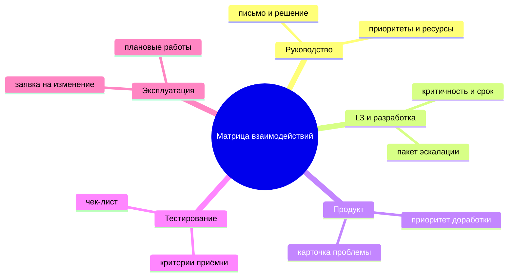
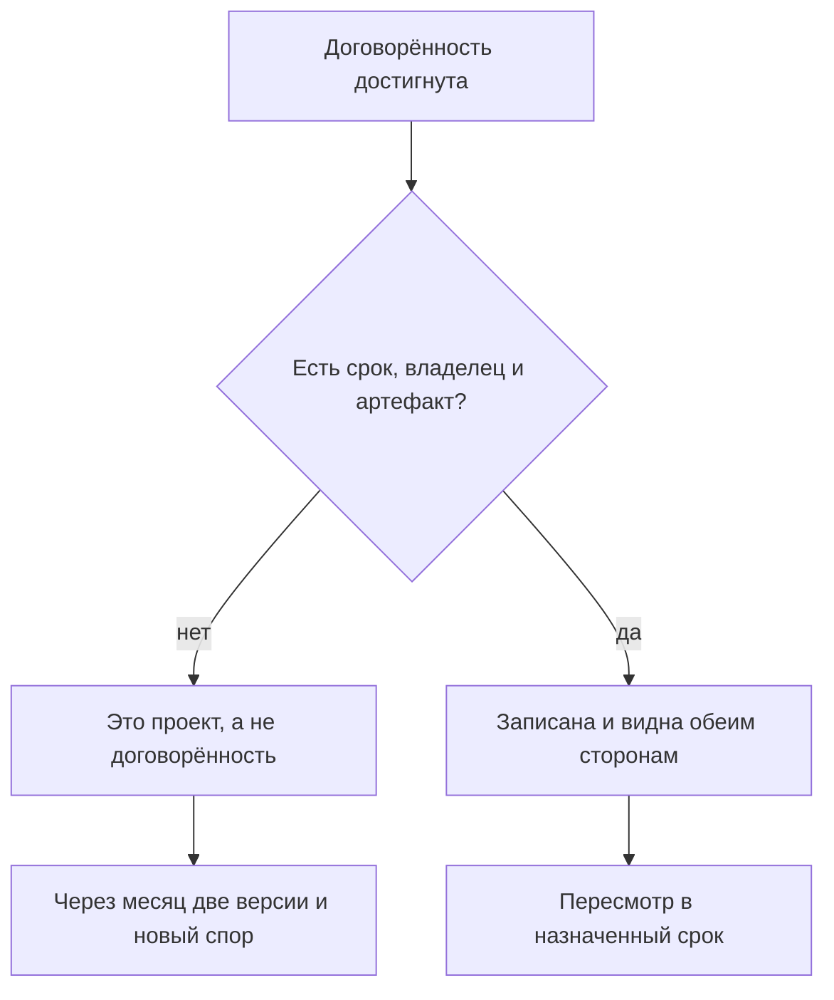
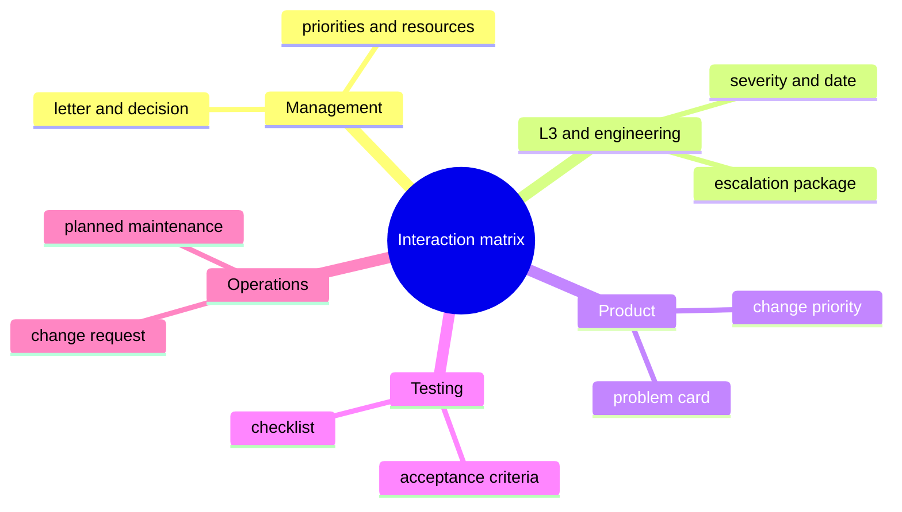
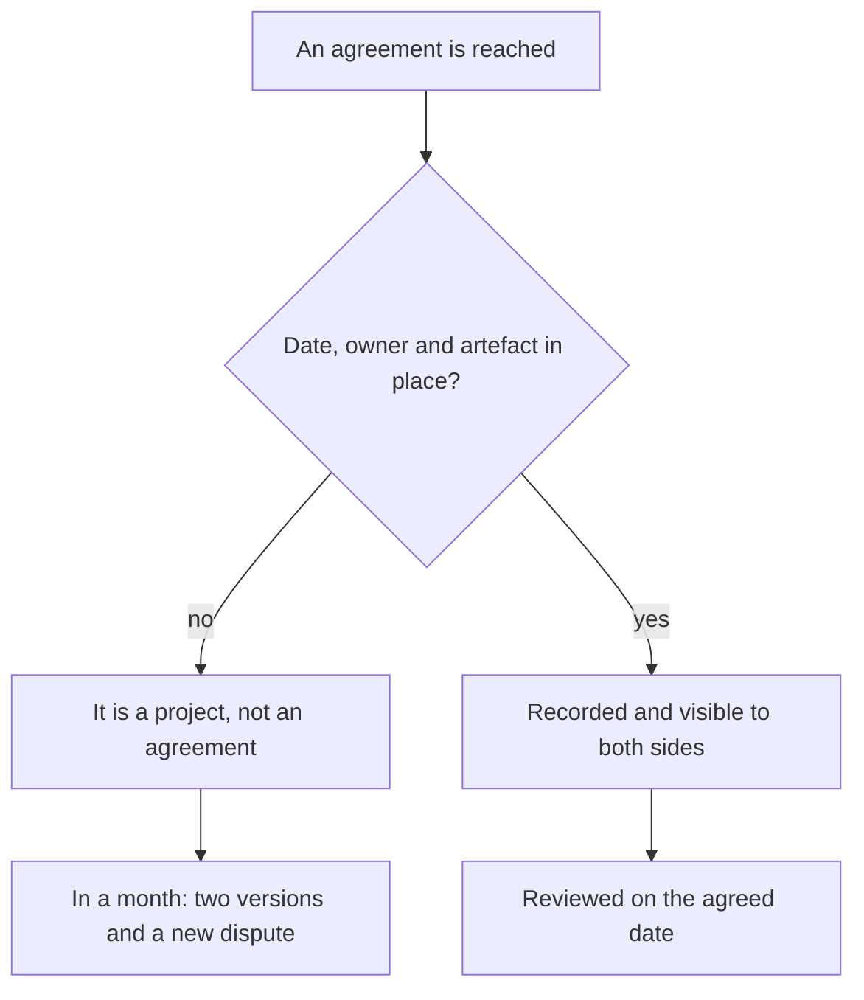
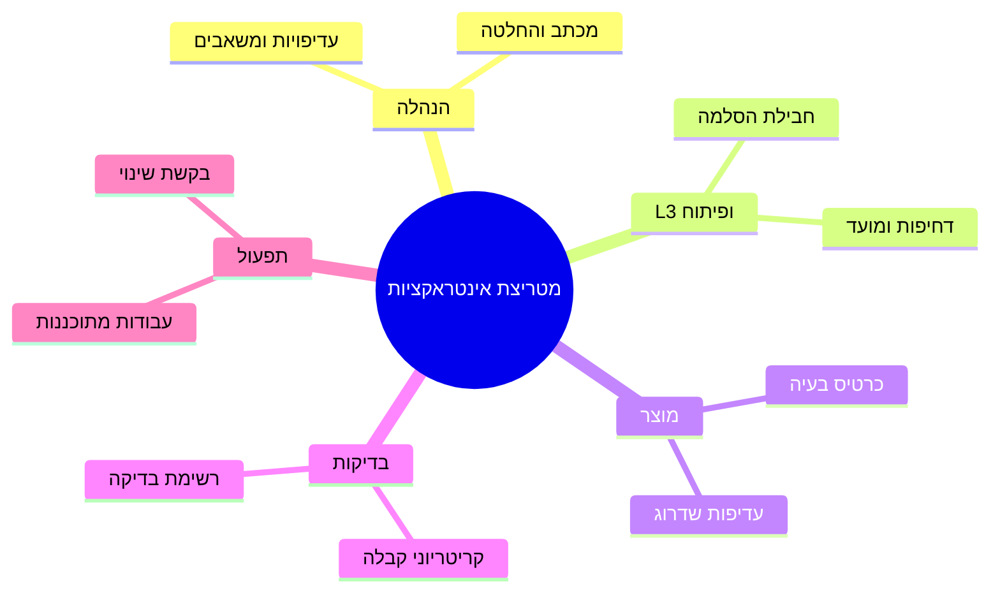
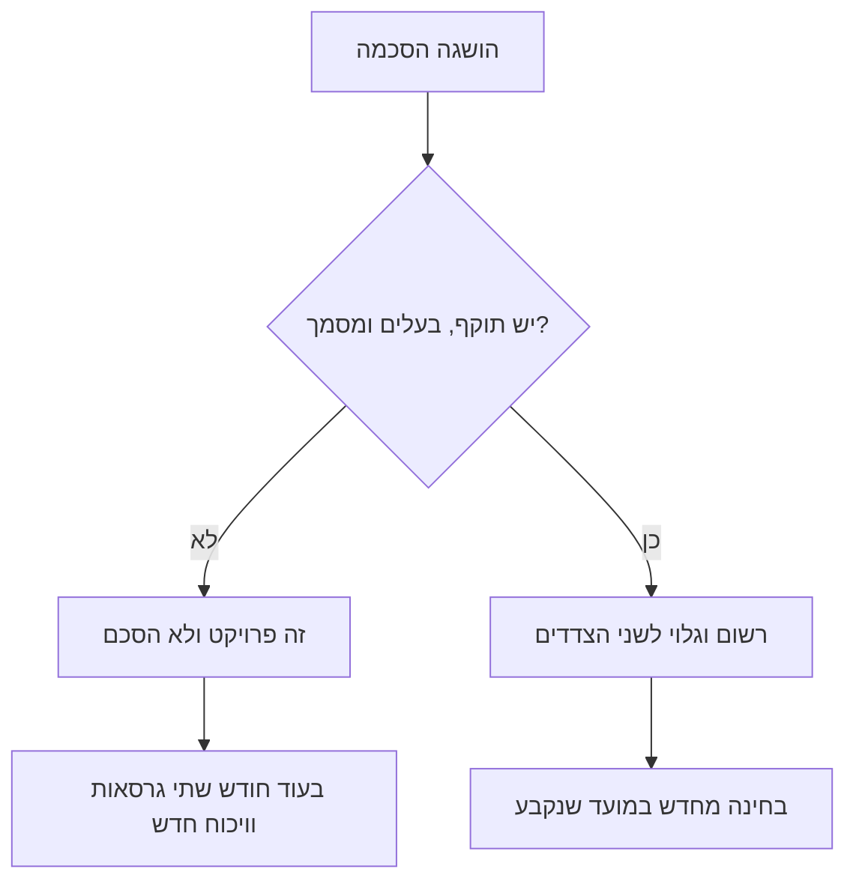

<!-- lang:ru -->

## Введение

Больше всего времени у меня уходило не на заявки, а на выяснение отношений с соседними командами. Разработка ждала от поддержки воспроизведения бага, поддержка ждала от разработки исправления, продукт ждал от всех сразу оценки сроков, руководство ждало от меня объяснений, почему всё вместе буксует. При этом каждый был по-своему прав и никто не был виноват.

Причина не в людях, а в допущении, которое все делают молча: что смежные команды читают мысли. Что всем очевидно, кто принимает решение о переносе релиза; что ясно, куда идёт заявка, которая не нашла бага; что понятно, чей ответ ждёт клиент. Ничего из этого не очевидно. Как только допущение проверяется на практике, начинается вежливая борьба за то, кто кому что должен.

Матрица взаимодействий — это таблица, которая заменяет чтение мыслей: кто принимает решения по каким вопросам, через какой канал это происходит и какой артефакт остаётся после. А правило «проект договорённости» дополняет её: у каждой договорённости есть срок, владелец и артефакт — иначе её просто нет.

Оба инструмента — часть внешнего контура в годовом плане, о котором речь шла в статье «Год лида по кварталам». Здесь — механика: как устроена матрица и как она вытаскивает из трясины конкретный разговор.

## Типовые трения

Трения с соседями редко бывают уникальными. За пару лет я собрал четыре повторяющихся сюжета — по одному на каждый важный контур.

**С руководством — ожидания против ресурса.** Руководство ставит цель, исходя из благих пожеланий клиентов, а поддержка знает цену этой цели в часах. Трение не в том, что цель плохая, а в том, что цена обсуждается после обещания. Итог — лид вынужден либо объяснять провал, либо тянуть героизмом.

**С L3 и разработкой — кто держит мяч.** Заявка уходит на третью линию, возвращается с «не воспроизводится», уходит обратно с логами, возвращается с «нужно видео». Пока таких передач три-четыре, всё выглядит как рабочая суета. Когда их десятки, меняется другое: заявка стареет, клиент злится, а формально никто не нарушает сроков, потому что в момент передачи таймер не идёт.

**С продуктом — язык боли и язык масштаба.** Поддержка приходит с историями конкретных клиентов, продукт отвечает приоритетами квартала. Обе стороны правы, и обе уходят неудовлетворёнными: у поддержки нет аргумента, кроме эмоционального, у продукта нет картины, сколько таких историй на самом деле.

**С тестированием и эксплуатацией — граница ответственности за качество.** Кто проверяет обходной путь, кто отвечает за то, что после релиза вырос поток обращений, кто сообщает клиентам о плановых работах. В обычном режиме это неважно, в инциденте — критично, и разбираться в инциденте поздно.

<!-- вилка: 2–3 своих примера трений — с кем, из-за чего, чем заканчивалось. -->

Во всех четырёх сюжетах общий элемент: вопрос «кто решает» не имеет ответа, записанного до конфликта. Дальше — как этот ответ фиксируется.

## Матрица взаимодействий

Матрица строится на четыре колонки: контур, вопросы, владелец решения, канал и артефакт. Строк — столько, сколько контуров, с которыми у сервиса есть регулярный обмен.

Для моего сервиса это выглядит так:

| Контур | Вопросы, которые он решает | Владелец решения | Канал и артефакт |
| --- | --- | --- | --- |
| Руководство | Приоритеты года, ресурсы, исключения из правил | Руководитель | Письмо на страницу и решение в нём |
| L3 и разработка | Критичность, причина дефекта, срок исправления | Технический лид контура | Пакет эскалации в трекере |
| Продукт | Приоритет доработки, включение в релиз | Владелец продукта | Карточка проблемы с данными |
| Тестирование | Критерии приёмки, регрессии | Тест-лид | Чек-лист приёмки |
| Эксплуатация | Плановые работы, доступы, окружения | Дежурный эксплуатации | Заявка на изменение |

Ключевое в таблице — не список контуров, а две вещи, которых обычно нигде нет: **имя владельца** и **артефакт**. Без имени решение «на уровне команды» не принимает никто, и через неделю вопрос возвращается к лиду поддержки — как к самому заинтересованному. Без артефакта решение живёт в чате до первого пересказа.

Канал и артефакт — не одно и то же, и путать их дорого. Канал — это где разговор происходит: почта, трекер, встреча. Артефакт — это что после него осталось: запись, документ, пункт регламента. Разговор в правильном канале без артефакта так же бесполезен, как документ, о котором никто не знает: через две недели в трекере будут ссылаться на «мы же обсуждали» без единого следа обсуждения.

По форме матрица похожа на RACI (матрица ответственности: кто выполняет, кто отвечает, кого консультируют, кого информируют), но задача у неё уже. RACI распределяет роли внутри одного проекта, а матрица взаимодействий отвечает на вопрос, который в проекте не задаётся: где граница между двумя разными сервисами и кто держит решение на стыке.

Как матрица выглядит в виде обзора:

Заполнять матрицу лучше не в одиночку. По каждой строке я сажусь с владельцем с той стороны и задаю три вопроса: какие решения по этому контуру ты принимаешь без меня, что тебе нужно от поддержки, чтобы принять их быстро, и какой артефакт останется после. Первые два вопроса дают содержание, третий — след, по которому потом видно, что договорённость существует, а не просто была озвучена.

<!-- вилка: своя матрица — контуры, владельцы, артефакты; что оказалось сюрпризом при заполнении. -->

## Правило «проект договорённости»

Договорённости рассыпаются не потому, что их нарушают злонамеренно, а потому, что они остаются проектом: «мы согласовали, что заявки с такими симптомами идут сразу в разработку». Согласовали где? Когда? Кто именно? До какого срока это действует? Если ответов нет, через месяц каждый будет помнить свою версию, и обе версии будут добросовестными.

Правило звучит так: у договорённости есть срок, владелец и артефакт — иначе её нет. Не потому, что нужна бюрократия, а потому, что без трёх элементов её невозможно ни проверить, ни пересмотреть, ни закончить.

- **Срок.** Договорённость — не закон на века, а рабочая гипотеза на период. Дата пересмотра снимает страх соглашаться: через квартал можно передумать без обвинений.
- **Владелец.** Человек, а не команда. Не «разработка решает критичность», а «критичность подтверждает такой-то инженер, в его отсутствие — его заместитель».
- **Артефакт.** Ссылка на запись в трекере, страница в базе знаний, пункт регламента, шаблон письма. Артефакт — это место, где договорённость живёт без нашего участия.

Как это правило работает на практике:

<!-- вилка: пример провала без артефакта — что договорились, как рассыпалось, что изменили. -->

Отдельно про пересмотр. Дата в календаре — не формальность: именно она превращает договорённость из обещания в управляемый объект. На пересмотре три вопроса: работает ли, что изменилось с тех пор, продолжаем или меняем. Без этого ритуала договорённости живут годами после того, как перестали быть верными, и мешают договариваться заново.

## Не обещать за другие команды

Самый дорогой навык в этом контуре — научиться не обещать за третью сторону. Клиент спрашивает: «Когда будет исправлено?» У лида поддержки два плохих ответа и один хороший.

Плохой первый — назвать дату, которую придумал сам. Через две недели выясняется, что приоритет поменялся, и виноватой оказывается поддержка, хотя она всего лишь была вежливой. Плохой второй — сказать «не знаю, это не к нам»: формально честно, для клиента — отказ от ответственности за собственный сервис.

Хороший ответ состоит из трёх частей: что известно точно, кто владелец вопроса на той стороне, когда будет следующее обновление. «Дефект подтверждён, исправление в работе у команды X, владелец вопроса — такой-то; следующее обновление — в среду, даже если новостей не будет». Это всё ещё обещание, но обещание про собственную коммуникацию, а не про чужой срок.

Есть и вторая часть навыка — не обещать и внутри. Когда инженер говорит клиенту «сейчас всё сделаем», а решение зависит от трёх команд, обещание разваливается в тот же день. Здесь помогает та же формула, только короче: что известно, кто владелец, когда обновление.

С матрицей этот навык становится техническим, а не характерным. Если в строке матрицы написано, что критичность подтверждает конкретный инженер на той стороне, то ответ клиенту уже не требует импровизации: я беру строку и говорю по ней. Без матрицы тот же ответ каждый раз собирается заново и зависит от того, насколько удачно сложился день.

## Внедрение без ещё одного документа

Главный риск матрицы — стать пятым документом в папке, который никто не открывает. Я видел это не раз: таблица красивая, на общем собрании представлена, через месяц никто не помнит, где она лежит.

Что удерживает её живой:

- **Она в одном месте с работой.** Ссылка на строку матрицы — в шаблоне эскалации, в карточке проблемы, в письме руководству. Тогда матрица читается в момент, когда нужна, а не на отдельном тренинге.
- **Она короткая.** Пять-семь строк, которые используются, лучше тридцати, которые описывают идеальный мир.
- **Она пересматривается на тех же встречах, где принимаются решения.** Раз в квартал — десять минут на общем разборе: какие строки устарели, где владелец сменился, какая договорённость истекла.
- **Она начинается с одной строки.** Самый работающий способ — выбрать один контур, где трение дороже всего, и заполнить только его. Второй контур добавится сам, когда первый начнёт экономить время.

Учить матрице отдельно не нужно — и это главный признак, что она живая. Если инженер при эскалации открывает шаблон и видит там поля из матрицы, он осваивает её за две недели без тренинга. Если же для неё нужен отдельный курс, значит таблица описывает мир, в котором никто не работает.

Что матрица не решает. Она не заменит доверия и не отменит того, что людям придётся разговаривать. Она убирает худший вид разговора — тот, в котором сначала выясняют, кто вообще должен был решать. После этого остаётся разговор по существу, и он, как правило, короткий.

И последнее, что стоит держать в голове: матрица — не про распределение вины, а про распределение решений. Строка «владелец — продукт» не означает «за это отвечает продукт, а мы умываем руки»: за качество ответа клиенту по-прежнему отвечает поддержка, а за приоритет — продукт. Как только эта разница теряется, матрица превращается в способ отфутболивать заявки, и доверие к ней исчезает быстрее, чем она успевает прижиться.

<!-- вилка: как матрица живёт у вас — где лежит, как часто пересматривается, что изменилось после внедрения. -->

<!-- lang:en -->

## Introduction

Most of my time went not to tickets but to sorting out relations with neighbouring teams. Engineering waited for support to reproduce a bug, support waited for engineering to fix it, product waited for everyone to estimate dates, management waited for me to explain why it was all stuck. Each side was right in its own way and nobody was to blame.

The cause isn't people, it's an assumption everyone makes silently: that neighbouring teams can read minds. That it's obvious who decides on a release delay, where a ticket goes when no bug is found, whose answer the client is waiting for. None of it is obvious. The moment the assumption meets reality, a polite fight starts over who owes what to whom.

The interaction matrix is the table that replaces mind-reading: who decides on which questions, through which channel it happens, and what artefact is left behind. The agreement-as-a-project rule completes it: every agreement needs a date, an owner and an artefact - otherwise it simply doesn't exist.

Both tools belong to the outer contour of the annual plan I described in "A support lead's year by quarters". Here it's the mechanics: how the matrix is built and how it pulls a specific conversation out of the mud.

## Typical friction

Friction with neighbours is rarely unique. Over a couple of years I collected four recurring stories - one per important contour.

**With management - expectations against resources.** Management sets a goal that grows out of clients' well-meant wishes, while support knows what that goal costs in hours. The friction isn't that the goal is bad; it's that the cost gets discussed after the promise. The result: the lead either explains a failure or carries it on heroism.

**With L3 and engineering - who holds the ball.** A ticket goes to the third line, comes back as "cannot reproduce", goes back with logs, returns asking for a video. With three or four handovers it looks like normal bustle. With dozens, something else changes: the ticket ages, the client gets angry, and formally nobody misses a deadline, because the timer doesn't run while the ticket is being handed over.

**With product - the language of pain and the language of scale.** Support arrives with stories about specific clients, product answers with quarterly priorities. Both are right and both leave dissatisfied: support has no argument beyond the emotional one, product has no picture of how many such stories there really are.

**With testing and operations - the boundary of responsibility for quality.** Who verifies the workaround, who owns the fact that the request flow grew after a release, who tells clients about planned maintenance. In normal mode it doesn't matter; in an incident it is critical, and an incident is too late to sort it out.

<!-- вилка: 2–3 своих примера трений — с кем, из-за чего, чем заканчивалось. -->

All four stories share one element: the question "who decides" has no answer written down before the conflict. Next, how that answer gets recorded.

## The interaction matrix

The matrix is built on four columns: contour, questions, decision owner, channel and artefact. There are as many rows as there are contours with a regular exchange with the service.

For my service it looks like this:

| Contour | Questions it decides | Decision owner | Channel and artefact |
| --- | --- | --- | --- |
| Management | Priorities for the year, resources, exceptions to the rules | The manager | A one-page letter and the decision in it |
| L3 and engineering | Severity, the cause of a defect, the fix date | The technical lead of the contour | Escalation package in the tracker |
| Product | Priority of a change, inclusion in a release | The product owner | A problem card with data |
| Testing | Acceptance criteria, regressions | The test lead | An acceptance checklist |
| Operations | Planned maintenance, access, environments | The operations duty engineer | A change request |

What matters in the table isn't the list of contours but two things that are usually missing everywhere: **the owner's name** and **the artefact**. Without a name, "the team level" decides nothing, and within a week the question is back with the support lead - the most interested party. Without an artefact, the decision lives in a chat until the first retelling.

Channel and artefact are not the same thing, and confusing them is expensive. The channel is where the conversation happens: email, tracker, meeting. The artefact is what remains after it: a record, a document, a clause in the process. A conversation in the right channel without an artefact is as useless as a document nobody knows about: two weeks later the tracker will refer to "we discussed it" with no trace of the discussion.

In shape the matrix resembles RACI (a responsibility matrix: who performs, who is accountable, who is consulted, who is informed), but its job is narrower. RACI allocates roles inside one project; the interaction matrix answers a question a project never asks: where the boundary between two different services runs, and who holds the decision at the seam.

What the matrix looks like as an overview:

Filling the matrix in alone is a bad idea. For each row I sit down with the owner on that side and ask three questions: which decisions in this contour do you make without me, what do you need from support to make them fast, and what artefact will be left behind. The first two questions give content, the third gives a trace that later shows the agreement exists rather than merely having been voiced.

<!-- вилка: своя матрица — контуры, владельцы, артефакты; что оказалось сюрпризом при заполнении. -->

## The agreement-as-a-project rule

Agreements fall apart not because they are broken on purpose but because they stay a project: "we agreed that tickets with these symptoms go straight to engineering". Agreed where? When? Who exactly? Until when? Without answers, in a month everyone remembers their own version, and both versions are in good faith.

The rule goes like this: an agreement has a date, an owner and an artefact - otherwise it doesn't exist. Not because bureaucracy is desirable, but because without the three elements it can't be checked, revised or ended.

- **A date.** An agreement isn't a law for the ages but a working hypothesis for a period. A review date removes the fear of agreeing: in a quarter you can change your mind without accusations.
- **An owner.** A person, not a team. Not "engineering decides severity" but "this engineer confirms severity; in their absence, their deputy".
- **An artefact.** A link to a tracker record, a knowledge base page, a clause in the process, an email template. The artefact is the place where the agreement lives without us.

How the rule works in practice:

<!-- вилка: пример провала без артефакта — что договорились, как рассыпалось, что изменили. -->

A note on the review. The date in the calendar is not a formality: it is what turns an agreement from a promise into a manageable object. The review has three questions: is it working, what has changed since, do we continue or change it. Without that ritual, agreements live for years after they stopped being true and get in the way of agreeing anew.

## Don't promise on behalf of other teams

The most expensive skill in this contour is learning not to promise on behalf of a third party. The client asks: "When will it be fixed?" The support lead has two bad answers and one good one.

The first bad one is to name a date you invented. Two weeks later the priority has changed, and support is the one to blame, though it was only being polite. The second bad one is "I don't know, that's not us": formally honest, for the client it is a refusal to own your own service.

The good answer has three parts: what is known for certain, who owns the question on the other side, when the next update comes. "The defect is confirmed, the fix is with team X, the owner is such-and-such; the next update is on Wednesday, even if there is no news." It is still a promise, but a promise about your own communication, not about someone else's deadline.

There is a second half to the skill - not promising internally either. When an engineer tells the client "we'll have it done", while the decision depends on three teams, the promise collapses the same day. The same formula helps here, only shorter: what is known, who owns it, when the update.

With the matrix, that skill becomes technical rather than a matter of character. If the matrix row says a specific engineer on the other side confirms severity, the answer to the client no longer needs improvisation: I take the row and speak from it. Without the matrix the same answer gets assembled afresh each time and depends on how well the day happens to go.

## Rolling it out without one more document

The main risk for the matrix is becoming the fifth document in a folder nobody opens. I have seen it more than once: a beautiful table, presented at a general meeting, and a month later nobody remembers where it lives.

What keeps it alive:

- **It sits where the work is.** A link to a matrix row goes into the escalation template, the problem card, the letter to management. Then the matrix is read at the moment it is needed, not at a separate training session.
- **It is short.** Five to seven rows that are used beat thirty that describe an ideal world.
- **It is revised in the same meetings where decisions are made.** Once a quarter - ten minutes at the general review: which rows are outdated, where the owner changed, which agreement expired.
- **It starts with one row.** The approach that works best is to pick the one contour where friction costs most and fill in only that. The second contour adds itself once the first starts saving time.

Nobody needs to be taught the matrix separately, and that is the main sign it is alive. If an engineer opens the escalation template and sees fields taken from the matrix, they learn it in two weeks without a course. If the matrix needs its own course, the table describes a world where nobody works.

What the matrix doesn't solve. It won't replace trust and won't spare people from having to talk. It removes the worst kind of conversation - the one that first works out who was even supposed to decide. What remains is a conversation about substance, and it is usually short.

And the last thing worth keeping in mind: the matrix is not about distributing blame but about distributing decisions. A row saying "owner: product" does not mean "product answers for this and we wash our hands": support still answers for the quality of the answer to the client, while product answers for the priority. Once that distinction gets lost, the matrix turns into a way to bounce tickets and loses trust faster than it manages to take root.

<!-- вилка: как матрица живёт у вас — где лежит, как часто пересматривается, что изменилось после внедрения. -->

<!-- lang:he -->

## מבוא

רוב הזמן שלי הלך לא לפניות אלא לבירור יחסים עם צוותים שכנים. הפיתוח חיכה שהתמיכה תשחזר תקלה, התמיכה חיכתה שהפיתוח יתקן, המוצר חיכה מכולם להערכת מועדים, וההנהלה חיכתה שאסביר למה הכל תקוע. כל אחד היה צודק בדרכו ואף אחד לא היה אשם.

הסיבה לא באנשים אלא בהנחה שכולם עושים בשקט: שצוותים שכנים קוראים מחשבות. שברור מי מחליט על דחיית גרסה, לאן הולכת פנייה שלא נמצא בה באג, ושל מי התשובה שהלקוח מחכה לה. שום דבר מזה לא ברור. ברגע שההנחה פוגשת מציאות, מתחיל מאבק מנומס על מי חייב מה למי.

מטריצת אינטראקציות היא הטבלה שמחליפה קריאת מחשבות: מי מחליט באילו שאלות, בערוץ איזה זה קורה ואיזה מסמך נשאר אחרי. וכלל "הסכם כפרויקט" משלים אותה: לכל הסכמה יש תוקף, בעלים ומסמך — אחרת היא פשוט לא קיימת.

שני הכלים הם חלק מהמעגל החיצוני בתוכנית השנתית, שתיארתי במאמר "שנה של מנהל תמיכה לפי רבעונים". כאן — המכניקה: איך בנויה המטריצה ואיך היא מוציאה שיחה מסוימת מהבוץ.

## חיכוכים שגרתיים

חיכוכים עם שכנים כמעט אף פעם לא ייחודיים. במשך שנתיים אספתי ארבעה סיפורים חוזרים — אחד לכל מעגל חשוב.

**עם ההנהלה — ציפיות מול משאבים.** ההנהלה מציבה מטרה שנולדה ממשאלות לב של לקוחות, והתמיכה יודעת מה המטרה הזאת עולה בשעות. החיכוך לא בכך שהמטרה גרועה, אלא בכך שהמחיר נדון אחרי ההבטחה. התוצאה: מנהל התמיכה או מסביר כישלון או סוחב אותו בגבורה.

**עם L3 והפיתוח — מי מחזיק את הכדור.** פנייה עוברת לקו השלישי, חוזרת עם "לא משוחזר", חוזרת עם לוגים, וחוזרת עם בקשה לסרטון. עם שלוש־ארבע העברות זה נראה כמו המולה רגילה. עם עשרות משתנה משהו אחר: הפנייה מזדקנת, הלקוח כועס, ובאופן רשמי אף אחד לא מפר מועדים, כי בזמן ההעברה הטיימר לא רץ.

**עם המוצר — שפת הכאב מול שפת הקנה מידה.** התמיכה מגיעה עם סיפורים על לקוחות מסוימים, המוצר עונה בעדיפויות הרבעון. שני הצדדים צודקים ושניהם יוצאים לא מסופקים: לתמיכה אין טיעון מלבד הרגשי, ולמוצר אין תמונה של כמה סיפורים כאלה יש באמת.

**עם הבדיקות והתפעול — גבול האחריות על האיכות.** מי מאמת את מעקף, מי אחראי לכך שאחרי גרסה גדל זרם הפניות, מי מודיע ללקוחות על עבודות מתוכננות. בשגרה זה לא חשוב, בתקלה זה קריטי, ובתקלה כבר מאוחר לברר.

<!-- вилка: 2–3 своих примера трений — с кем, из-за чего, чем заканчивалось. -->

בכל ארבעת הסיפורים יש יסוד משותף: לשאלה מי מחליט אין תשובה שכתובה לפני הקונפליקט. בהמשך — איך התשובה הזאת נרשמת.

## מטריצת האינטראקציות

המטריצה בנויה על ארבעה עמודות: מעגל, שאלות, בעל ההחלטה, ערוץ ומסמך. שורות — כמה מעגלים שיש איתם חליפין קבוע.

אצלי זה נראה כך:

| מעגל | השאלות שהוא מחליט | בעל ההחלטה | ערוץ ומסמך |
| --- | --- | --- | --- |
| הנהלה | עדיפויות השנה, משאבים, חריגות מהכללים | המנהל | מכתב בעמוד אחד וההחלטה בו |
| L3 ופיתוח | דחיפות, סיבת התקלה, מועד התיקון | המוביל הטכני של המעגל | חבילת הסלמה במערכת |
| מוצר | עדיפות השדרוג, הכנסה לגרסה | בעל המוצר | כרטיס בעיה עם נתונים |
| בדיקות | קריטריוני קבלה, רגרסיות | מוביל הבדיקות | רשימת בדיקה לקבלה |
| תפעול | עבודות מתוכננות, הרשאות, סביבות | התורן בתפעול | בקשת שינוי |

העיקר בטבלה הוא לא רשימת המעגלים אלא שני דברים שבדרך כלל חסרים בכל מקום: **שם הבעלים** ו**המסמך**. בלי שם, "ברמת הצוות" לא מחליט אף אחד, ובתוך שבוע השאלה חוזרת למנהל התמיכה — כאל הצד המעוניין ביותר. בלי מסמך, ההחלטה חיה בצ'אט עד הסיפור הראשון שלה מחדש.

ערוץ ומסמך הם לא אותו דבר, והבלבול ביניהם יקר. הערוץ הוא איפה השיחה קורית: דואר, מערכת, פגישה. המסמך הוא מה שנשאר אחריה: רשומה, מסמך, סעיף בנוהל. שיחה בערוץ הנכון בלי מסמך חסרת תועלת בדיוק כמו מסמך שאיש לא מכיר: בעוד שבועיים במערכת יסתמכו על "הרי דיברנו" בלי עקבות של השיחה.

בצורתה המטריצה דומה ל-RACI (מטריצת אחריות: מי מבצע, מי אחראי, מי מתייעץ ומי מעודכן), אבל התפקיד שלה צר יותר. RACI מחלקת תפקידים בתוך פרויקט אחד, ומטריצת האינטראקציות עונה על שאלה שבפרויקט לא נשאלת: איפה עובר הגבול בין שני שירותים שונים ומי מחזיק בהחלטה בתפר.

כך המטריצה נראית כמבט על:

למלא את המטריצה לבד זה רעיון גרוע. לכל שורה אני יושב עם הבעלים בצד השני ושואל שלוש שאלות: אילו החלטות במעגל הזה אתה מקבל בלעדיי, מה אתה צריך מהתמיכה כדי לקבל אותן מהר, ואיזה מסמך יישאר אחרי. שתי השאלות הראשונות נותנות תוכן, השלישית — עקבות שאחר כך מראות שההסכמה קיימת ולא רק נשמעה.

<!-- вилка: своя матрица — контуры, владельцы, артефакты; что оказалось сюрпризом при заполнении. -->

## כלל "הסכם כפרויקט"

הסכמות מתפוררות לא מפני שמפרים אותן בזדון, אלא מפני שהן נשארות פרויקט: "סיכמנו שפניות עם תסמינים כאלה הולכות ישר לפיתוח". סיכמנו איפה? מתי? מי בדיוק? עד מתי? כשאין תשובות, בעוד חודש לכל אחד יש הגרסה שלו, ושתי הגרסאות בתום לב.

הכלל אומר: להסכמה יש תוקף, בעלים ומסמך — אחרת היא לא קיימת. לא מפני שצריך ביורוקרטיה, אלא מפני שבלי שלושת היסודות אי אפשר לבדוק אותה, לבחון אותה מחדש ולסיים אותה.

- **תוקף.** הסכמה היא לא חוק לדורות אלא השערת עבודה לתקופה. תאריך בחינה מסיר את הפחד להסכים: בעוד רבעון אפשר לשנות דעה בלי האשמות.
- **בעלים.** אדם, ולא צוות. לא "הפיתוח מחליט על דחיפות" אלא "את הדחיפות מאשר מהנדס כזה, ובהיעדרו — הממלא מקום שלו".
- **מסמך.** קישור לרשומה במערכת, עמוד בבסיס ידע, סעיף בנוהל, תבנית מכתב. המסמך הוא המקום שבו ההסכמה חיה בלעדינו.

כך הכלל עובד בפועל:

<!-- вилка: пример провала без артефакта — что договорились, как рассыпалось, что изменили. -->

בנפרד על הבחינה מחדש. התאריך ביומן הוא לא פורמליות: הוא בדיוק מה שהופך הסכמה מהבטחה לאובייקט מנוהל. בבחינה שלוש שאלות: האם זה עובד, מה השתנה מאז, ממשיכים או משנים. בלי הטקס הזה הסכמות חיות שנים אחרי שהפסיקו להיות נכונות, ומפריעות להסכים מחדש.

## לא להבטיח בשם צוותים אחרים

המיומנות היקרה ביותר במעגל הזה — ללמוד לא להבטיח בשם צד שלישי. הלקוח שואל: מתי יתקנו? למנהל התמיכה יש שתי תשובות גרועות ואחת טובה.

הגרועה הראשונה — לנקוב בתאריך שהמצאת. בעוד שבועיים מתברר שהעדיפות השתנתה, והאשמה נופלת על התמיכה, שלמעשה רק היתה מנומסת. הגרועה השנייה — "אני לא יודע, זה לא אצלנו": מבחינה רשמית ישר, מבחינת הלקוח — התחמקות מאחריות על השירות שלכם.

התשובה הטובה מורכבת משלושה חלקים: מה ידוע בוודאות, מי בעל השאלה בצד השני, ומתי העדכון הבא. "התקלה אושרה, התיקון אצל צוות X, הבעלים — פלוני; העדכון הבא ביום רביעי, גם אם אין חדשות". זאת עדיין הבטחה, אבל הבטחה על התקשורת שלכם ולא על המועד של מישהו אחר.

יש למיומנות גם חצי שני — לא להבטיח גם בפנים. כשמוקדן אומר ללקוח "עכשיו נעשה", וההחלטה תלויה בשלושה צוותים, ההבטחה מתפוררת באותו יום. אותה נוסחה עוזרת כאן, רק קצרה: מה ידוע, מי הבעלים, מתי עדכון.

עם המטריצה המיומנות הזאת הופכת טכנית ולא עניין של אופי. אם בשורה במטריצה כתוב שמהנדס מסוים בצד השני מאשר דחיפות, התשובה ללקוח לא דורשת אלתור: אני לוקח את השורה ומדבר ממנה. בלי מטריצה אותה תשובה נבנית מחדש בכל פעם ותלויה בכמה מוצלח היה היום.

## הטמעה בלי עוד מסמך

הסיכון העיקרי של המטריצה — להפוך למסמך החמישי בתיקייה שאיש לא פותח. ראיתי את זה יותר מפעם: טבלה יפה, מוצגת בישיבה כללית, ובעוד חודש אף אחד לא זוכר איפה היא נמצאת.

מה משאיר אותה בחיים:

- **היא יושבת במקום שבו העבודה קורית.** קישור לשורה במטריצה — בתבנית ההסלמה, בכרטיס הבעיה, במכתב להנהלה. אז המטריצה נקראת ברגע שבו היא נחוצה ולא בהדרכה נפרדת.
- **היא קצרה.** חמש־שבע שורות שמשתמשים בהן עדיפות משלושים שמתארות עולם אידיאלי.
- **היא נבחנת מחדש באותן פגישות שבהן מתקבלות החלטות.** פעם ברבעון — עשר דקות בסיכום הכללי: אילו שורות התיישנו, איפה הבעלים התחלף, איזו הסכמה פגה.
- **היא מתחילה בשורה אחת.** הדרך הכי עובדת — לבחור מעגל אחד שבו החיכוך היקר ביותר ולמלא רק אותו. המעגל השני יתווסף מעצמו כשהראשון יתחיל לחסוך זמן.

אין צורך ללמד את המטריצה בנפרד, וזה הסימן העיקרי שהיא חיה. אם מוקדן פותח את תבנית ההסלמה ורואה בה שדות מהמטריצה, הוא קולט אותה בשבועיים בלי הדרכה. ואם בשבילה צריך קורס נפרד, סימן שהטבלה מתארת עולם שאיש לא עובד فيه.

מה המטריצה לא פותרת. היא לא תחליף אמון ולא תפטור אנשים משיחה. היא מסירה את הסוג הגרוע ביותר של שיחה — זאת שמבררת קודם כל מי בכלל היה אמור להחליט. אחריה נשארת שיחה לגופו של עניין, והיא בדרך כלל קצרה.

והדבר האחרון ששווה לזכור: המטריצה היא לא על חלוקת אשמה אלא על חלוקת החלטות. שורה שכתוב בה "בעלים — מוצר" לא אומרת "המוצר עונה על זה ואנחנו נוטלים ידיים": על איכות התשובה ללקוח עדיין עונה התמיכה, ועל העדיפות — המוצר. ברגע שההבדל הזה הולך לאיבוד, המטריצה הופכת לדרך להעביר פניות הלאה, והאמון בה נעלם מהר יותר משהספיקה להתבסס.

<!-- вилка: как матрица живёт у вас — где лежит, как часто пересматривается, что изменилось после внедрения. -->
