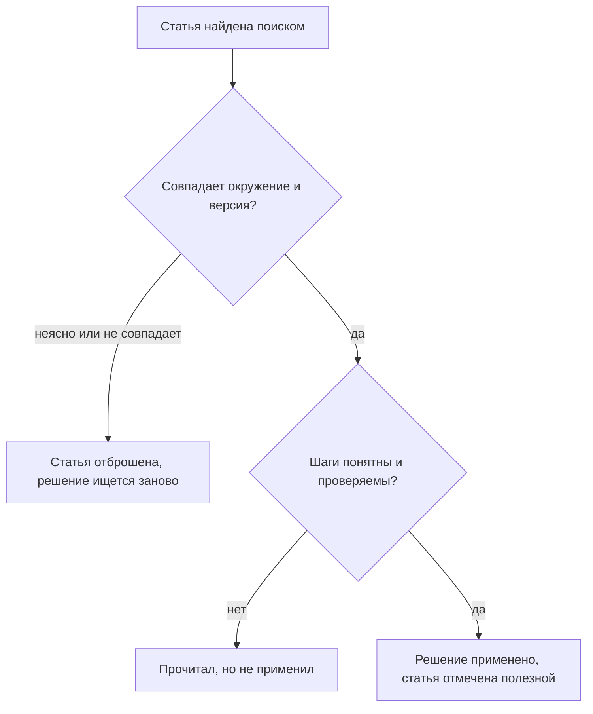
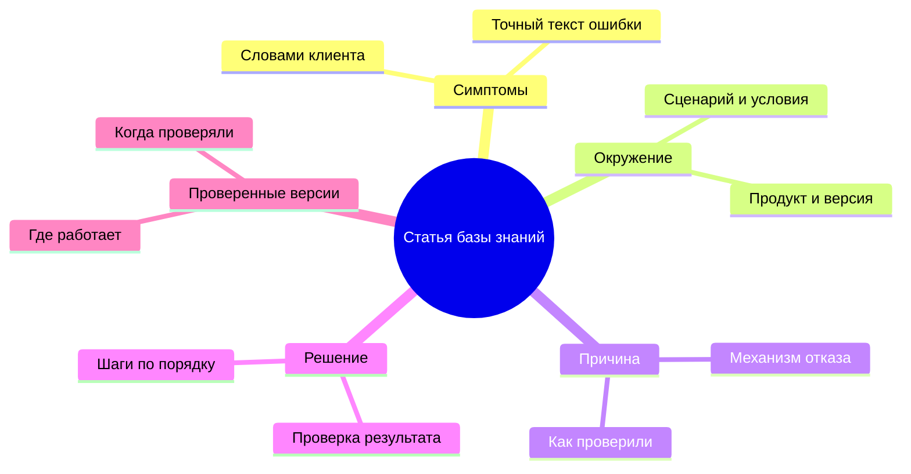
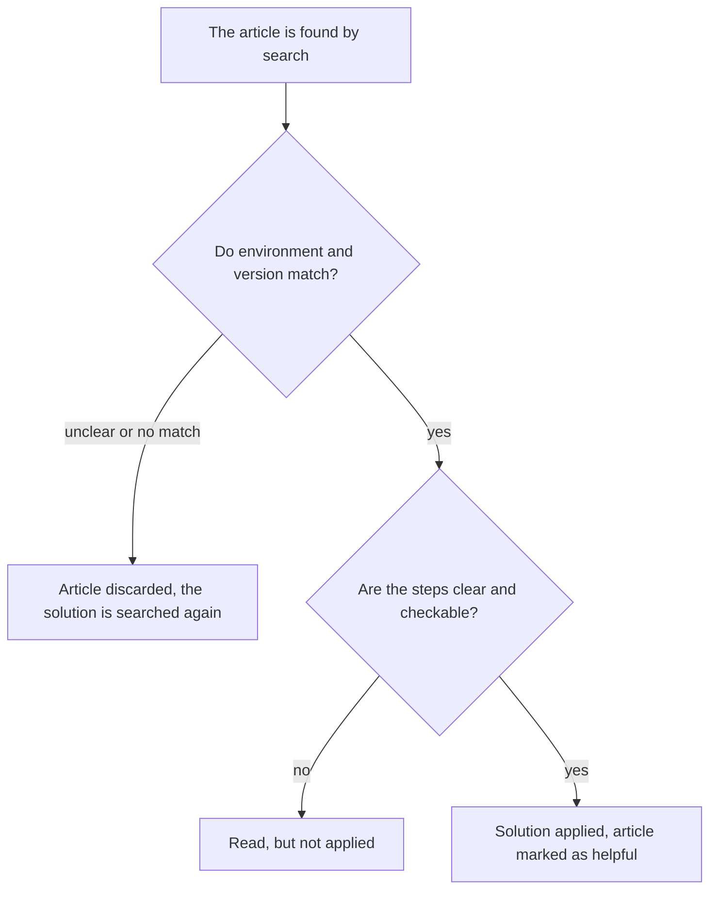
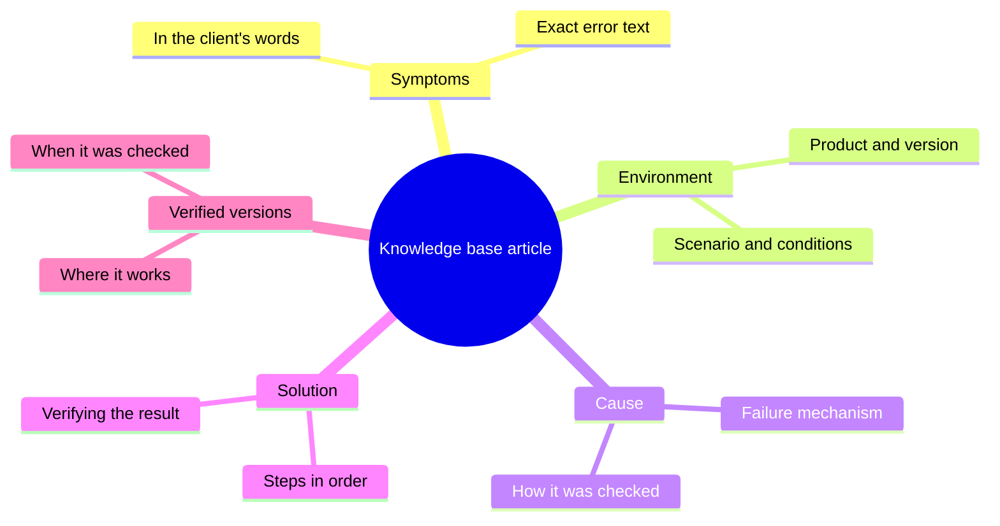
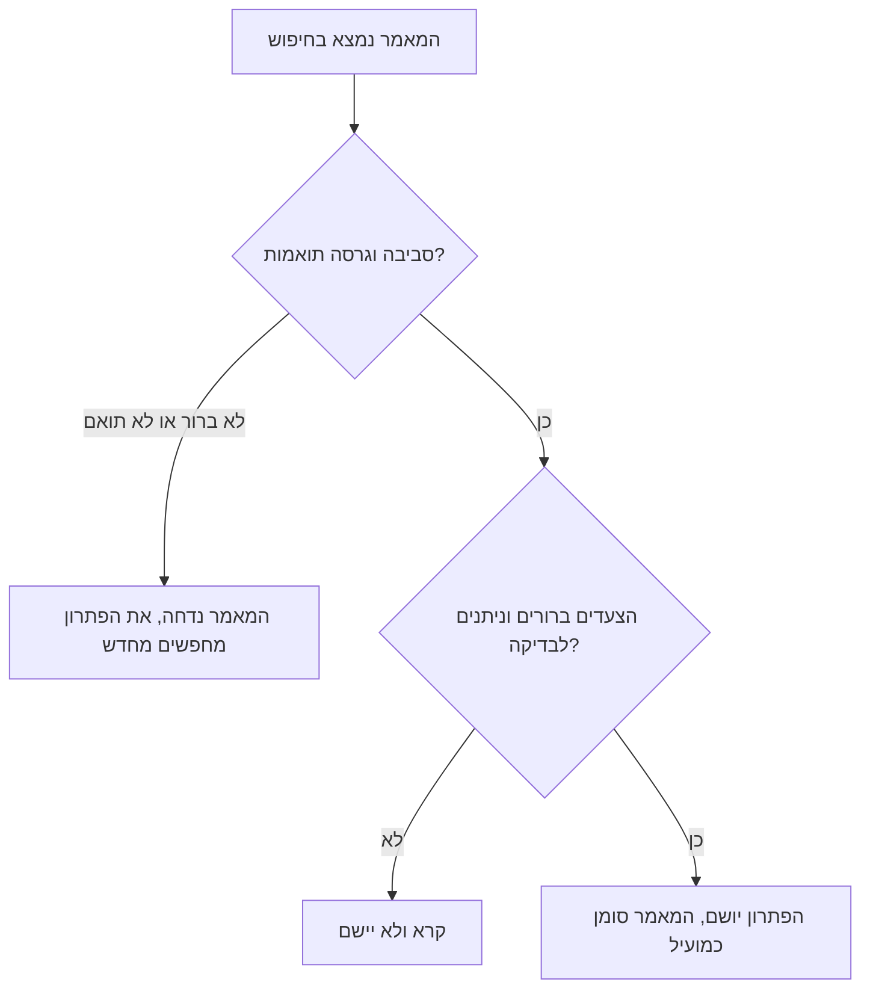
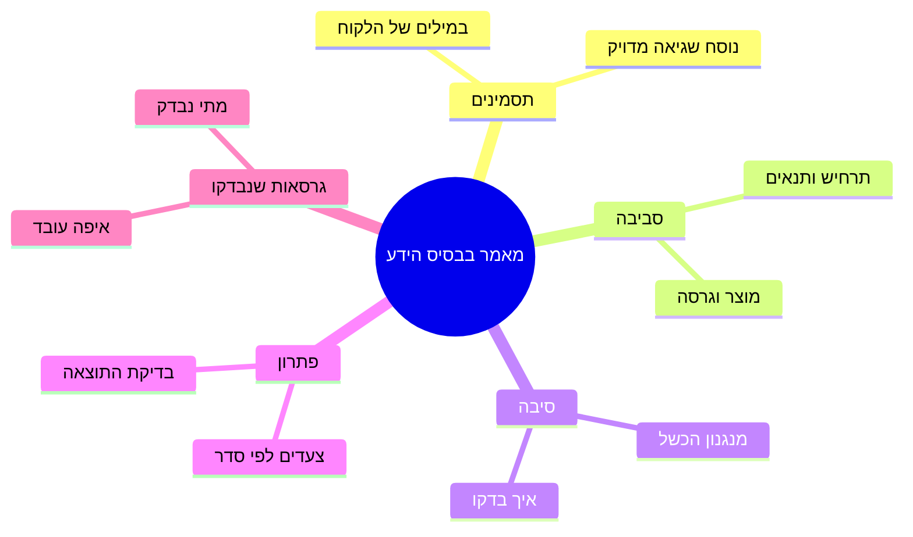

<!-- lang:ru -->

## Введение

Когда я предложил команде навести порядок в базе знаний, первая реакция была предсказуемой: «я не умею писать». Люди, которые каждый день объясняют клиентам сложные вещи простыми словами, были уверены, что статья — это литература, а литература — не их работа.

Через полгода те же люди писали статьи за десять минут и не считали это отдельной задачей. Изменилось не их отношение к тексту — изменился формат. Вместо чистого листа появился шаблон: пять блоков, каждый со своим вопросом. Когда знаешь, что первый блок — это симптомы словами клиента, а последний — версии, на которых решение проверено, писать становится нечем: остаётся только вспомнить, что было.

В статье «KCS в рабочем потоке: статья пишется в момент решения» речь шла о том, чтобы статья появлялась внутри тикета. Эта статья — о том, что именно в ней должно быть, чтобы черновик из тикета через месяц кто-то смог использовать повторно.

## Почему статьи в свободной форме не переиспользуются

Свободная форма кажется демократичной: пиши как думаешь, главное — по существу. На практике у неё три системных дефекта, и ни один не лечится призывом «пишите лучше».

**Поиск не находит.** Поиск работает по словам, а слова в свободном тексте — авторские. Инженер ищет «не открывается личный кабинет», статья называется «Проблема с авторизацией после обновления», а внутри — рассказ про токены. Совпадений нет, выдача пуста, и человек идёт в чат.

**Структуру не с чем сверить.** Читатель не может быстро ответить на свои вопросы: это про мою версию? Это про мой сценарий? Где проверить, что помогло? Он читает всё подряд или не читает вовсе — и в обоих случаях не доверяет результату.

**Версии не проверены.** Свободный текст не заставляет указать, на чём решение проверено. Статья живёт годами; продукт меняется; читатель применяет инструкцию к другой версии, получает другой результат и делает вывод, что база врёт.

За этими дефектами стоит одна причина: автор пишет для себя. Он помнит контекст, в котором разбирался, и не описывает его, потому что для него он очевиден. Читатель приходит через месяц или через год, контекста не знает и не может восстановить его по тексту. Шаблон заставляет автора ответить на вопросы, которые он сам себе не задавал.

Все три дефекта — про одно: читатель не может принять решение, применима ли статья к его случаю. Вот как выглядит его путь по свободной статье:

Любой блок шаблона ниже закрывает один из поворотов этой развилки. Поэтому шаблон — не бюрократия, а способ сократить число выходов «не применил».

## Шаблон статьи КБ

Шаблон, к которому я пришёл, состоит из пяти блоков. Он короткий намеренно: чем больше полей, тем меньше шансов, что их заполнят в тикете.

Теперь по блокам — что в них писать и что обычно пишут вместо этого.

| Блок | Вопрос, на который отвечает | Типичная ошибка заполнения |
| --- | --- | --- |
| Симптомы | Что видит клиент и какими словами он это называет | Пересказ терминами системы вместо фраз пользователя |
| Окружение | При каких условиях воспроизводится | «У всех» или отсутствие версии продукта |
| Причина | Почему это происходит | Название ошибки вместо механизма |
| Решение | Что сделать по шагам | Один абзац вместо последовательности с проверкой |
| Проверенные версии | Где решение действительно работает | «Актуально» без даты и без списка версий |

Несколько правил, которые я добавляю к шаблону:

- **Симптомы — словами клиента.** Не «ошибка авторизации», а то, что человек набрал бы в поиске: «после смены пароля не пускает в личный кабинет».
- **Окружение — только то, что влияет.** Перечислять всё подряд бессмысленно; нужны те два-три параметра, которые меняют исход.
- **Причина — механизм, а не ярлык.** «Просроченный сертификат на прокси» объясняет, почему помогло именно это решение, и позволяет читателю узнать ту же причину в другом симптоме.
- **Решение — шагами и с проверкой.** Последний шаг всегда отвечает на вопрос «как понять, что получилось».
- **Версии — обязательны.** Без них статья, которая не устаревает, существует только в мечтах.

<!-- вилка: ваши обязательные поля шаблона — что вы добавили к пяти блокам под свой продукт. -->

## Разобранный пример

Шаблон легко принять на словах и трудно применить. Поэтому в обучении я показываю не пустой шаблон, а одну статью, разобранную до конца: где симптом звучит как фраза клиента, где окружение сужено до параметров, которые действительно влияли, где причина объяснена механизмом, а в конце — версии, на которых решение проверено.

Что видно в хорошем разборе:

- **Симптом и причина — разные вещи.** В примере они не совпадают, и именно поэтому статья находится по словам клиента, а не по названию технологии.
- **Решение объясняет, а не только предписывает.** Читатель понимает, почему шаг нужен; если шаг не сработал, он может догадаться, где искать дальше.
- **Проверка результата отделена от шага.** «Перезапустить сервис» — шаг; «убедиться, что в журнале больше нет ошибки подключения» — проверка.
- **Границы применимости названы.** В разборе видно, в каком случае решение не поможет и что делать тогда.

<!-- вилка: обезличенный реальный пример статьи КБ целиком по шаблону — одна статья из вашей базы, приведённая целиком. -->

Для разбора стоит брать не самую сложную статью, а ту, на которую команда ссылается чаще всего. Именно её все читают в спешке, именно в ней ошибка формата стоит дороже всего — и именно на ней видно, зачем нужны блоки, которые обычно пропускают.

Разбор полезен ещё и тем, что снимает главный страх: статья по шаблону пишется быстрее свободного текста. Не нужно придумывать композицию и подбирать слова — нужно ответить на пять вопросов, ответы на которые у автора уже есть.

## Владелец КБ без отдельной ставки

Шаблон решает проблему структуры, но не решает проблему времени. Статьи стареют, дублируются, теряют актуальность — и кто-то должен это замечать. В статье «KCS в рабочем потоке» это роль владельца базы знаний; здесь — что именно она означает на практике, без отдельной ставки в штате.

Владелец базы знаний — это инженер с выделенными часами в неделю и мандатом менять чужие статьи. Его работа состоит из четырёх повторяющихся действий:

1. **Ревизия по сигналам.** Не «перечитать всё», а посмотреть, что произошло с базой за период: какие статьи открывали, какие отметили как неполезные, где появились дубли, что перестало открываться вообще.
2. **Слияние и чистка.** Две статьи про одно и то же — это хуже, чем одна: читатель выбирает неверную. Дубли сливаются, устаревшее уходит в архив.
3. **Правки авторам.** Владелец не переписывает всё сам; он возвращает автору конкретное замечание: «в статье про VPN не хватает версии клиента, добавь, пожалуйста».
4. **Структура.** Категории, названия, перекрёстные ссылки — то, что делает поиск работоспособным и что не видно ни в одном отдельном тикете.

Ключевое ограничение: у владельца не может быть больше одной-двух задач, кроме линии. Если он одновременно «главный по базе» и «главный по эскалациям», база будет обрабатываться по остаточному принципу — то есть никогда.

<!-- вилка: частота ревизии и её формат — раз в неделю или раз в две, по какому списку, сколько времени занимает. -->

И последнее, что я понял про владельца: роль работает только вместе с лидом. Владелец видит проблемы, но не всегда имеет право менять процесс — например, потребовать от команды отмечать полезность статьи. Такие решения остаются за лидом, и это ещё один повод держать разбор базы в регулярном ритме, а не в режиме пожара.

Шаблон, разбор и владелец — три вещи, которые превращают черновики из тикетов в базу, которой пользуются. Следующий шаг — заняться тем, что в базе повторяется чаще всего: повторяющимися проблемами и записями с владельцем.

<!-- lang:en -->

## Introduction

When I proposed tidying up the knowledge base, the first reaction was predictable: "I can't write". People who explain complicated things to clients in plain words every day were sure that an article is literature, and literature is not their job.

Six months later the same people were writing articles in ten minutes and did not treat it as a separate task. What changed was not their attitude to text — the format changed. Instead of a blank page there was a template: five blocks, each with its own question. Once you know that the first block is the symptoms in the client's words and the last one is the versions the fix was verified on, there is nothing left to invent — you only have to recall what happened.

The article "KCS in the workflow: the article is written at the moment of solving" was about making the article appear inside the ticket. This one is about what has to be in it so that a draft from a ticket can be reused by someone else a month later.

## Why free-form articles are not reused

Free form looks democratic: write as you think, substance is what matters. In practice it has three systemic defects, and none of them is cured by asking people to write better.

**Search does not find it.** Search works on words, and the words in free text belong to the author. An engineer searches for "can't open the customer portal", the article is called "Authorisation issue after the update", and inside it is a story about tokens. No matches, empty results, and the person goes to the chat.

**There is nothing to check the structure against.** The reader cannot quickly answer their own questions: is this about my version? Is this about my scenario? Where do I verify that it helped? They read everything in a row or nothing at all — and either way they do not trust the result.

**The versions are unverified.** Free text does not force anyone to state what the fix was verified on. The article lives for years; the product changes; the reader applies the instruction to a different version, gets a different result, and concludes that the base lies.

All three defects are about one thing: the reader cannot decide whether the article applies to their case. Here is their path through a free-form article:

Every block of the template below closes one turn of this fork. That is why the template is not bureaucracy but a way to reduce the number of "not applied" exits.

## The KB article template

The template I arrived at has five blocks. It is deliberately short: the more fields there are, the lower the chance they get filled in inside a ticket.

Now block by block — what to write there and what usually gets written instead.

| Block | The question it answers | The typical filling mistake |
| --- | --- | --- |
| Symptoms | What the client sees and what words they use for it | Retelling in system terms instead of user phrases |
| Environment | Under which conditions it reproduces | "Everyone" or a missing product version |
| Cause | Why it happens | The name of the error instead of the mechanism |
| Solution | What to do, step by step | One paragraph instead of a sequence with a check |
| Verified versions | Where the solution actually works | "Current" with no date and no version list |

A few rules I add to the template:

- **Symptoms in the client's words.** Not "authorisation error" but what the person would type into search: "after changing the password the customer portal rejects me".
- **Environment — only what matters.** Listing everything is pointless; you need the two or three parameters that change the outcome.
- **Cause — a mechanism, not a label.** "An expired certificate on the proxy" explains why this particular fix worked and lets the reader recognise the same cause behind a different symptom.
- **Solution — as steps, with a check.** The last step always answers the question "how do I know it worked".
- **Versions — mandatory.** Without them an article that never ages exists only in dreams.

<!-- вилка: ваши обязательные поля шаблона — что вы добавили к пяти блокам под свой продукт. -->

## A worked example

A template is easy to accept in words and hard to apply. So in training I show not an empty template but one article taken apart completely: where the symptom sounds like the client's phrase, where the environment is narrowed to the parameters that actually mattered, where the cause is explained as a mechanism, and at the end the versions the fix was verified on.

What a good example makes visible:

- **Symptom and cause are different things.** In the example they do not coincide, and that is exactly why the article is found by the client's words rather than by the name of the technology.
- **The solution explains, not just prescribes.** The reader understands why a step is needed; if the step did not work, they can guess where to look next.
- **The result check is separate from the step.** "Restart the service" is a step; "make sure the connection error is gone from the log" is a check.
- **The limits of applicability are named.** The example shows in which case the solution will not help and what to do then.

<!-- вилка: обезличенный реальный пример статьи КБ целиком по шаблону — одна статья из вашей базы, приведённая целиком. -->

For the dissection it is worth taking not the most complex article but the one the team references most often. It is the one everybody reads in a hurry, it is the one where a format mistake costs the most — and it is the one where you can see why the blocks people usually skip matter.

The example is also useful because it removes the main fear: an article written to the template takes less time than free text. There is no composition to invent and no words to pick — you have to answer five questions whose answers the author already has.

## A KB owner without a separate headcount

The template solves the problem of structure but not the problem of time. Articles age, get duplicated, lose relevance, and somebody has to notice. In "KCS in the workflow" this is the role of the knowledge base owner; here is what it means in practice, without a separate position on the staff list.

The knowledge base owner is an engineer with dedicated hours per week and a mandate to change other people's articles. The work consists of four recurring actions:

1. **Review by signals.** Not "reread everything" but looking at what happened to the base over the period: which articles were opened, which were marked unhelpful, where duplicates appeared, what stopped being opened at all.
2. **Merging and cleaning.** Two articles about the same thing are worse than one: the reader picks the wrong one. Duplicates get merged, the obsolete goes to the archive.
3. **Edits handed back to authors.** The owner does not rewrite everything personally; they return a specific remark to the author: "the article about the VPN is missing the client version, please add it".
4. **Structure.** Categories, titles, cross-references — the things that make search work and that are invisible in any single ticket.

The key constraint: the owner cannot have more than one or two other duties besides the line. If they are simultaneously the head of the base and the head of escalations, the base gets handled on a leftover basis — that is, never.

<!-- вилка: частота ревизии и её формат — раз в неделю или раз в две, по какому списку, сколько времени занимает. -->

And the last thing I understood about the owner: the role only works together with the lead. The owner sees the problems but does not always have the authority to change the process — for instance, to require the team to mark articles as helpful. Those decisions stay with the lead, which is one more reason to keep the base review on a regular rhythm rather than in firefighting mode.

The template, the example and the owner are the three things that turn drafts from tickets into a base people use. The next step is to deal with what repeats most often in the base: recurring problems and records with an owner.

<!-- lang:he -->

## מבוא

כשהצעתי לצוות לעשות סדר בבסיס הידע, התגובה הראשונה הייתה צפויה: "אני לא יודע לכתוב". אנשים שמסבירים ללקוחות כל יום דברים מורכבים במילים פשוטות היו בטוחים שמאמר הוא ספרות, וספרות היא לא העבודה שלהם.

כעבור חצי שנה אותם אנשים כתבו מאמרים בעשר דקות ולא התייחסו לזה כמשימה נפרדת. מה שהשתנה לא היה היחס שלהם לטקסט — השתנה הפורמט. במקום דף ריק הופיעה תבנית: חמישה בלוקים, לכל אחד שאלה משלו. כשיודעים שהבלוק הראשון הוא התסמינים במילים של הלקוח והאחרון הוא הגרסאות שבהן הפתרון נבדק, אין מה להמציא — נשאר רק להיזכר מה היה.

במאמר "KCS בזרימת העבודה: המאמר נכתב ברגע הפתרון" עסקנו בכך שהמאמר ייווצר בתוך הפנייה. המאמר הזה עוסק במה שצריך להיות בו, כדי שטיוטה מתוך פנייה תוכל לשמש מישהו אחר בעוד חודש.

## למה מאמרים בטקסט חופשי לא משמשים שימוש חוזר

טקסט חופשי נראה דמוקרטי: כתוב איך שאתה חושב, העיקר שיהיה לגוף העניין. בפועל יש לו שלושה פגמים מערכתיים, ואף אחד מהם לא נרפא בקריאה "לכתוב יותר טוב".

**החיפוש לא מוצא.** חיפוש עובד על מילים, והמילים בטקסט חופשי שייכות לכותב. מוקדן מחפש "לא נפתח אזור אישי", המאמר נקרא "בעיית הזדהות אחרי עדכון", ובפנים יש סיפור על טוקנים. אין התאמות, התוצאות ריקות, והאדם הולך לצ'אט.

**אין עם מה להשוות את המבנה.** הקורא לא יכול לענות מהר על השאלות שלו: זה נוגע לגרסה שלי? זה נוגע לתרחיש שלי? איפה בודקים שזה עזר? הוא קורא הכל ברצף או לא קורא בכלל — ובשני המקרים לא בוטח בתוצאה.

**הגרסאות לא נבדקו.** טקסט חופשי לא מחייב לציין על מה הפתרון נבדק. המאמר חי שנים; המוצר משתנה; הקורא מיישם את ההוראה על גרסה אחרת, מקבל תוצאה אחרת ומסיק שהבסיס משקר.

כל שלושת הפגמים הם על דבר אחד: הקורא לא יכול להחליט אם המאמר מתאים למקרה שלו. כך נראה המסלול שלו במאמר חופשי:

כל בלוק בתבנית שלמטה סוגר פנייה אחת בהסתעפות הזאת. לכן התבנית היא לא בירוקרטיה אלא דרך לצמצם את מספר היציאות של "לא יישם".

## תבנית המאמר בבסיס הידע

התבנית שאליה הגעתי מורכבת מחמישה בלוקים. היא קצרה במכוון: ככל שיש יותר שדות, כך קטן הסיכוי שימלאו אותם בתוך הפנייה.

עכשיו לפי בלוקים — מה לכתוב בהם ומה בדרך כלל כותבים במקום.

| בלוק | על איזו שאלה הוא עונה | הטעות השגרתית במילוי |
| --- | --- | --- |
| תסמינים | מה הלקוח רואה ובאילו מילים הוא מכנה את זה | סיפור במונחי המערכת במקום במשפטים של המשתמש |
| סביבה | באילו תנאים זה משוחזר | "אצל כולם" או היעדר גרסת מוצר |
| סיבה | למה זה קורה | שם השגיאה במקום מנגנון |
| פתרון | מה לעשות, צעד אחר צעד | פסקה אחת במקום רצף עם בדיקה |
| גרסאות שנבדקו | איפה הפתרון באמת עובד | "רלוונטי" בלי תאריך ובלי רשימת גרסאות |

כמה כללים שאני מוסיף לתבנית:

- **תסמינים במילים של הלקוח.** לא "שגיאת הזדהות" אלא מה שאדם היה מקליד בחיפוש: "אחרי החלפת סיסמה לא מכניסים אותי לאזור האישי".
- **סביבה — רק מה שמשפיע.** אין טעם לפרט הכל; דרושים אותם שניים־שלושה פרמטרים שמשנים את התוצאה.
- **סיבה — מנגנון ולא תווית.** "תעודה שפג תוקפה בפרוקסי" מסבירה למה דווקא הפתרון הזה עזר ומאפשרת לקורא לזהות את אותה סיבה מאחורי תסמין אחר.
- **פתרון — בצעדים ועם בדיקה.** הצעד האחרון תמיד עונה על השאלה "איך יודעים שזה הצליח".
- **גרסאות — חובה.** בלעדיהן מאמר שלא מתיישן קיים רק בחלומות.

<!-- вилка: ваши обязательные поля шаблона — что вы добавили к пяти блокам под свой продукт. -->

## דוגמה מפורקת

קל להסכים לתבנית במילים וקשה ליישם אותה. לכן בהדרכה אני מראה לא תבנית ריקה אלא מאמר אחד שמפורק עד הסוף: איפה התסמין נשמע כמו משפט של הלקוח, איפה הסביבה מצומצמת לפרמטרים שבאמת השפיעו, איפה הסיבה מוסברת כמנגנון, ובסוף — הגרסאות שבהן הפתרון נבדק.

מה רואים בדוגמה טובה:

- **תסמין וסיבה הם שני דברים שונים.** בדוגמה הם לא מתלכדים, ובדיוק בגלל זה המאמר נמצא לפי המילים של הלקוח ולא לפי שם הטכנולוגיה.
- **הפתרון מסביר ולא רק מורה.** הקורא מבין למה הצעד נדרש; אם הצעד לא עבד, הוא יכול לשער איפה לחפש הלאה.
- **בדיקת התוצאה נפרדת מהצעד.** "להפעיל מחדש את השירות" הוא צעד; "לוודא שאין יותר שגיאת חיבור ביומן" היא בדיקה.
- **גבולות התחולה נקראים בשמם.** בדוגמה רואים באיזה מקרה הפתרון לא יעזור ומה לעשות אז.

<!-- вилка: обезличенный реальный пример статьи КБ целиком по шаблону — одна статья из вашей базы, приведённая целиком. -->

לפירוק כדאי לקחת לא את המאמר המורכב ביותר אלא את זה שהצוות מפנה אליו הכי הרבה. דווקא אותו כולם קוראים בחופזה, דווקא בו טעות פורמט עולה ביוקר — ודווקא בו רואים למה הבלוקים שבדרך כלל מדלגים עליהם חשובים.

הדוגמה מועילה גם משום שהיא מורידה את הפחד העיקרי: מאמר לפי תבנית נכתב מהר יותר מטקסט חופשי. אין צורך להמציא קומפוזיציה ולבחור מילים — צריך לענות על חמש שאלות שתשובותיהן כבר נמצאות אצל הכותב.

## בעל בסיס הידע בלי משרה נפרדת

התבנית פותרת את בעיית המבנה אבל לא את בעיית הזמן. מאמרים מתיישנים, משתכפלים, מאבדים רלוונטיות — ומישהו צריך לשים לב. במאמר "KCS בזרימת העבודה" זה התפקיד של בעל בסיס הידע; כאן — מה הכוונה בפועל, בלי משרה נפרדת בטבלת כוח האדם.

בעל בסיס הידע הוא מוקדן שיש לו שעות מוקצות בשבוע ומנדט לשנות מאמרים של אחרים. העבודה מורכבת מארבע פעולות חוזרות:

1. **בחינה לפי אותות.** לא "לקרוא הכל מחדש" אלא להסתכל מה קרה לבסיס בתקופה: אילו מאמרים נפתחו, אילו סומנו כלא מועילים, איפה הופיעו כפילויות, מה הפסיק להיפתח בכלל.
2. **איחוד וניקוי.** שני מאמרים על אותו דבר גרועים מאחד: הקורא בוחר את הלא נכון. כפילויות מאוחדות, מיושן עובר לארכיון.
3. **תיקונים חזרה לכותבים.** הבעלים לא משכתב הכל בעצמו; הוא מחזיר לכותב הערה קונקרטית: "במאמר על ה-VPN חסרה גרסת הלקוח, בבקשה תוסיף".
4. **מבנה.** קטגוריות, שמות, קישורים צולבים — מה שעושה את החיפוש לעובד ומה שלא נראה באף פנייה בודדת.

המגבלה העיקרית: לבעל הבסיס לא יכולות להיות יותר מאחת־שתיים משימות נוספות מעבר לקו. אם הוא גם ראש הבסיס וגם ראש ההסלמות, הבסיס יטופל לפי מה שנשאר — כלומר אף פעם.

<!-- вилка: частота ревизии и её формат — раз в неделю или раз в две, по какому списку, сколько времени занимает. -->

והדבר האחרון שהבנתי על הבעלים: התפקיד עובד רק יחד עם מנהל התמיכה. הבעלים רואה את הבעיות אבל לא תמיד מוסמך לשנות את התהליך — למשל לדרוש מהצוות לסמן מאמרים כמועילים. החלטות כאלה נשארות אצל מנהל התמיכה, וזו סיבה נוספת להחזיק את בחינת הבסיס בקצב קבוע ולא במצב של שריפה.

התבנית, הדוגמה והבעלים — שלושה דברים שהופכים טיוטות מפניות לבסיס שמשתמשים בו. הצעד הבא — לעסוק במה שחוזר בבסיס הכי הרבה: תקלות חוזרות ורשומות עם בעלים.
