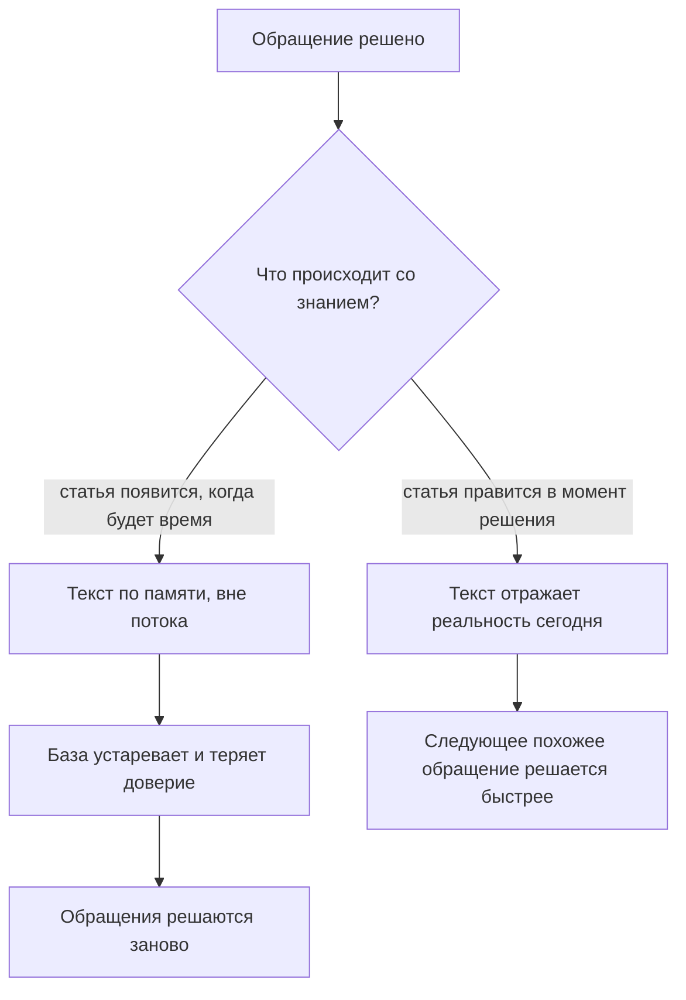
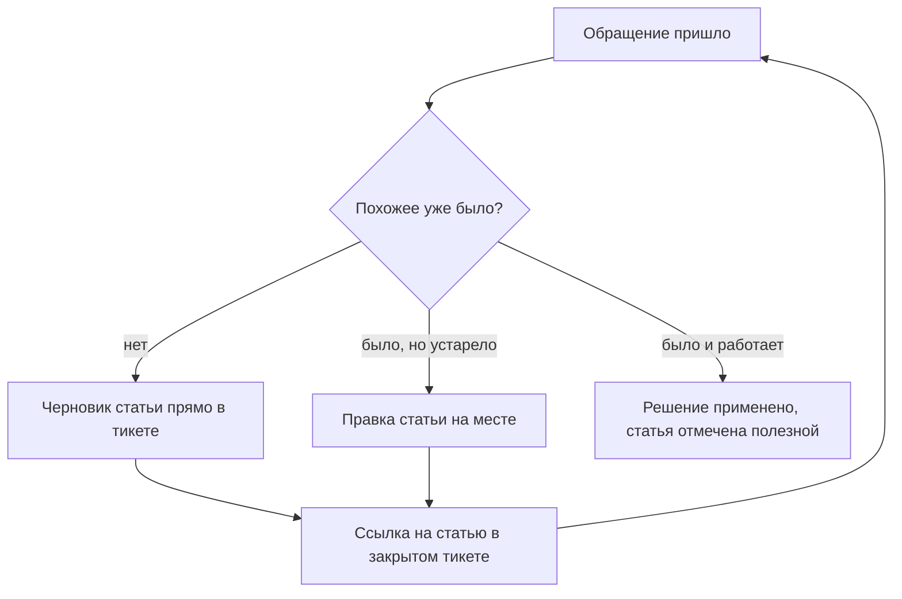
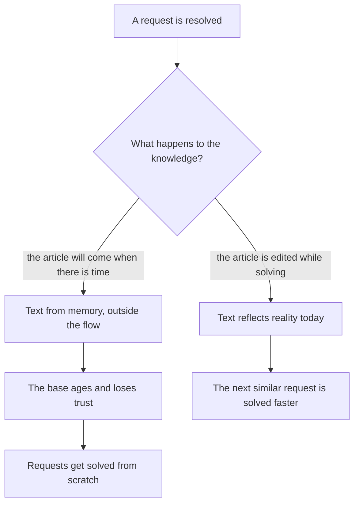
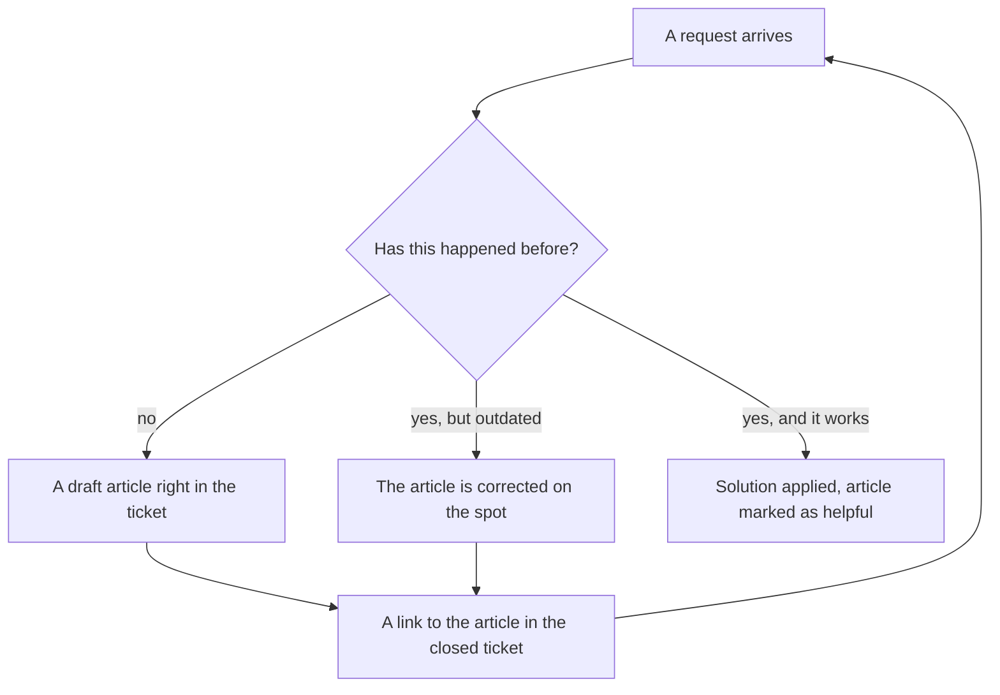
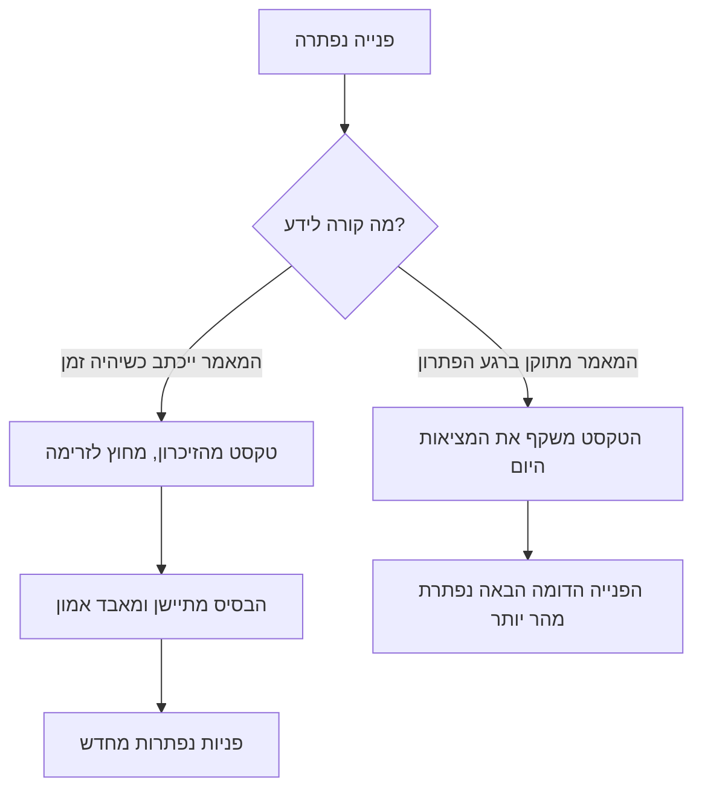
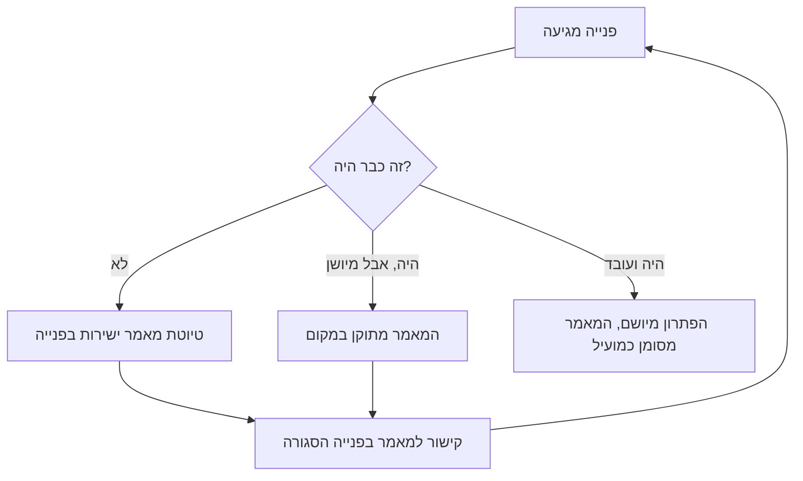

<!-- lang:ru -->

## Введение

Фразу «статью в базу знаний допишу, когда разгребу очередь» я произносил весь первый год на позиции лида поддержки. Очередь не разгребалась, статья не дописывалась, а база знаний жила в том состоянии, в каком её оставил предыдущий состав команды: несколько десятков статей из прошлого, часть — про версии продукта, которых уже нет, часть — про вопросы, которые никто не задаёт.

Тогда мне казалось, что дело в дисциплине: инженеры не любят писать, надо напомнить, поставить срок, попросить. Через год я понял, что база знаний была организована вне работы. Документирование стояло рядом с решением обращений — отдельной задачей на потом — и поэтому всегда проигрывало очереди. Как только я перестал делать из знаний отдельную задачу, база начала меняться без напоминаний.

Так работает KCS (Knowledge-Centered Service — подход, в котором база знаний растёт как побочный продукт решения обращений, а не как отдельный проект по написанию статей): знание создаётся, используется и улучшается в том же потоке, где закрываются тикеты. Это не инструмент и не регламент, а способ устроить работу.

В дорожной карте года знания стоят вторым кварталом, и не раньше: пока нет цифр по потоку, непонятно, какие статьи вообще нужны. Эта статья — про механику этого квартала. Предыдущие шаги блока — стабилизация сервиса: триаж при первом касании, контроль сроков, эскалация в L3.

## База как архив и база как инструмент

Две модели накопления знаний выглядят похоже в отчёте и расходятся в ежедневной работе.

**База как архив.** Знания документируются, когда есть время: в спокойную неделю, перед аудитом, по просьбе руководства. Пишут те, кто любит писать или кому неудобно отказать. Статья создаётся по памяти, после закрытия заявки, и описывает не то, что происходило, а то, что автор помнит о происходившем. Цель такой базы — факт её существования: «у нас есть база знаний, вот ссылка».

**База как инструмент.** Статья — рабочий предмет, которым пользуются внутри тикета. Её открывают до решения, по ней проверяют шаги, её правят, когда она не совпала с реальностью. Автор статьи — не «тот, кто умеет писать», а тот, кто только что решил проблему и знает, что именно помогло.

Разница видна в одном вопросе, который инженер задаёт себе, взяв новое обращение: «где посмотреть, было ли это раньше?» Если ответ — «спросить у Сени» или «полистать чат», база работает как архив независимо от того, сколько в ней статей. Если ответ — «поискать в базе», она работает как инструмент, даже если статей в ней немного.

Что происходит с архивом дальше — предсказуемо. Сначала статьи устаревают молча: продукт изменился, статья осталась. Потом команда перестаёт в них верить: один раз поиск выдал нерелевантное, второй раз — устаревшее, третий раз инженер пошёл в чат сразу. Потом новые статьи никто не пишет, потому что писать в свалку бессмысленно. Через год база существует только для отчёта, и её открывают, чтобы поставить галочку.

Развилка в чистом виде выглядит так:

Дальше — что именно означает «в момент решения» на уровне отдельного тикета.

## Solve Loop внутри тикета

В KCS рабочий цикл обращения называют Solve Loop — цикл решения. Он состоит из четырёх действий, и все четыре происходят внутри одной заявки, а не после неё.

1. **Искать.** Первое действие по обращению — поиск в базе, а не разбор с нуля. Не для отчёта, а чтобы не решать второй раз то, что уже решено.
2. **Использовать.** Найденное решение применяется. Если статья помогла — это отмечается прямо в статье или в тикете: без отметки никто не узнает, что она работает.
3. **Создать или исправить.** Если подходящего не нашлось — создаётся черновик. Если нашлось, но устарело — правится существующая статья. Оба действия занимают минуты, а не часы: это заготовка, а не публикация.
4. **Связать.** В закрытом тикете остаётся ссылка на статью, которую использовали или создали. Ссылка — не отчётность, а способ найти статью из истории обращений.

Мой первый вариант этого цикла был другим, и он не работал: я требовал полную статью по итогам закрытия заявки. В ответ приходило либо ничего, либо текст на две страницы, который никто не открывал. Требование «сразу хорошо» убивает сам механизм: человек, который только что разобрался в проблеме, готов записать суть, но не готов её редактировать.

Поэтому в рабочем варианте есть три разрешения, которые я выдаю команде явно:

- **Черновик не обязан быть красивым.** Ссылка, шаги, что помогло — достаточно. Формат и структуру доводит владелец базы знаний, об этом ниже.
- **Автор не обязан обобщать.** Статья, написанная по конкретному обращению, полезна уже тем, что она есть; обобщение — отдельная работа, и её делает не тот, кто закрывает тикет.
- **Исправить чужую статью можно и нужно.** Право правки есть у любого инженера, а не только у автора. Статья без владельца правок быстро превращается в музейный экспонат.

Как замыкается цикл внутри потока обращений:

Последняя стрелка в этой схеме — самая важная. Следующее обращение начинается с поиска, и качество этого поиска зависит от того, что осталось после предыдущего.

<!-- вилка: как устроен Solve Loop в вашем трекере — где инженер ищет статью, где создаёт черновик, как отмечает, что статья помогла. -->

## Evolve Loop и владелец КБ

У KCS есть второй цикл — Evolve Loop, цикл развития базы. Если Solve Loop отвечает на вопрос «как знание попадает в базу», то Evolve Loop — «что с базой происходит дальше». Статьи стареют, дублируются, обрастают противоречиями; структура категорий перестаёт совпадать с тем, о чём спрашивают клиенты. Без второго цикла первый работает в пустоту: чем активнее команда пишет, тем быстрее растёт свалка.

Evolve Loop опирается на сигналы использования, а не на мнение о качестве. Сигналы простые: сколько раз статью открыли, сколько раз отметили полезной, сколько тикетов закрыли со ссылкой на неё, что пишут в комментариях, возвращаются ли клиенты с той же проблемой после применения статьи.

Жизненный цикл статьи в такой системе выглядит так:

| Состояние | Как распознать | Что с этим делать |
| --- | --- | --- |
| Черновик | Создана в тикете, никем не проверена | Использовать, дополнять, отмечать полезность |
| Рабочая | Открывается, помогает, даёт закрытия | Следить за версиями продукта и обновлять |
| Устаревшая | Отметки «не помогло», повторные обращения | Переписать или убрать из поиска |
| Архив | Сценарий или продукт ушёл | Убрать из выдачи, сохранить как историю |

Этим циклом кто-то должен заниматься. В моей практике это роль, а не отдельная ставка: владелец базы знаний — инженер, у которого есть выделенные часы в неделю и мандат менять чужие статьи. Что он делает: разбирает отметки «не помогло», сливает дубли, чистит устаревшее, следит, чтобы у статей были понятные названия, и возвращает авторам правки, которые те не успели внести.

Роль без часов не работает. «Занимайся базой, когда есть время» — это ровно та формулировка, из которой вырос архив в первом разделе. Часы должны быть в календаре и защищены от очереди — так же, как время лида на изменения из статьи «Ритм руководителя: правило 40 %».

<!-- вилка: ритм владельца КБ — сколько часов в неделю, какие сигналы смотрит, что чинит первым. -->

## Почему квоты убивают базу

Самое популярное решение проблемы «база не растёт» — квота: столько-то статей в месяц на инженера. Я пробовал и его.

Квота измеряет объём, а не пользу. Как только объём становится критерием, команда начинает производить объём — не по злому умыслу, а потому что так устроен любой показатель. Что появляется в базе при квоте:

- **Статьи про то, что легко описать.** Простое обращение превращается в статью, сложное — нет, хотя именно сложное повторяется чаще.
- **Дубли и вариации.** Каждый пишет свою версию одной и той же инструкции, потому что искать и дополнять дольше, чем создать заново.
- **Копии тикетов.** Текст обращения и ответ, перенесённые в статью, без обобщения и без учёта окружения.
- **Неработающий поиск.** Чем больше почти одинаковых статей, тем хуже выдача, тем меньше доверия к базе — и тем быстрее команда возвращается в чат.
- **Приписки.** Последняя стадия: ссылка на статью ставится в тикет, чтобы выполнить показатель, а статья не открывалась вовсе.

Квоту легко заменить на измерители вклада, которые нельзя выполнить формально:

- доля обращений, решённых с использованием статьи;
- число правок существующих статей — исправление считается работой, а не побочным действием;
- доля статей, отмеченных полезными хотя бы один раз за период;
- число повторных обращений по теме статьи после её применения.

Если квота всё же нужна как временная мера для разгона, её стоит ставить на правки и разметку, а не на новые тексты. Правка требует, чтобы статью открыли и прочитали — а это уже работа с базой как с инструментом.

## Доля решений по КБ

Главный измеритель здоровья базы — доля решений по КБ: отношение заявок, закрытых с использованием статьи, ко всем закрытым заявкам. Она показывает не активность авторов, а реальную роль знаний в потоке.

Как и любая метрика, эта живёт или умирает от определения. «Закрыто со ссылкой на статью» — не то же самое, что «закрыто по статье». В первом случае достаточно прикрепить ссылку, во втором нужно, чтобы статья действительно дала решение. Поэтому в определении фиксируются две вещи: что считается использованием и как это подтверждается — отметкой полезности, полем в тикете или выборочной проверкой. Без этого метрика измеряет дисциплину заполнения поля, а не зрелость знаний.

Второе — с чем сравнивать. Абсолютное значение доли само по себе ничего не говорит: сервис с большим потоком типовых вопросов и сервис с индивидуальными инцидентами не сравнимы. Смысл появляется в динамике за квартал и в связке с другими показателями точки А — временем до решения, долей повторных обращений, долей эскалаций. Об этом подробно — в статье «Baseline раньше целей».

<!-- вилка: динамика доли решений по КБ за квартал — значение на старте, текущее значение, что повлияло. -->

Третье — кто смотрит на цифру и что делает. Метрика без действия остаётся картинкой. В моём ритме она разбирается раз в месяц вместе с сигналами Evolve Loop, и у разбора всегда есть один результат: что именно меняется в базе в следующем месяце — тема, формат, структура или ничего, потому что цифра в норме.

KCS не заканчивается запуском. Это поток, в котором статья — не результат проекта, а рабочий след решения. Следующий шаг блока — превратить черновики в статьи, которые можно переиспользовать: шаблон статьи базы знаний и роль её владельца.

<!-- lang:en -->

## Introduction

"I'll finish the knowledge base article once I clear the queue" is a sentence I said for my entire first year as a support lead. The queue never cleared, the article never got finished, and the knowledge base stayed in the state the previous team had left it in: a few dozen articles from the past, some about product versions that no longer existed, some about questions nobody asks.

Back then I thought it was a matter of discipline: engineers don't like writing, so remind them, set a deadline, ask politely. A year later I understood that the knowledge base had been organised outside the work. Documenting stood next to ticket resolution as a separate task for later, and so it always lost to the queue. The moment I stopped making a separate task out of knowledge, the base started changing without any reminders.

That is how KCS works (Knowledge-Centered Service — an approach in which the knowledge base grows as a by-product of resolving requests rather than as a separate article-writing project): knowledge is created, used and improved in the same flow where tickets get closed. It is not a tool and not a policy but a way of organising the work.

In the yearly roadmap knowledge sits in the second quarter, and not earlier: until you have numbers about the flow, you cannot know which articles are needed at all. This article is about the mechanics of that quarter. The earlier steps of the block are about stabilising the service: triage at first touch, deadline control, escalation to L3.

## A base as an archive and a base as a tool

The two models of accumulating knowledge look alike in a report and diverge in daily work.

**The base as an archive.** Knowledge gets documented when there is time: in a quiet week, before an audit, at management's request. It is written by those who like writing or who find it hard to refuse. The article is composed from memory, after the ticket is closed, and describes not what happened but what the author remembers about what happened. The purpose of such a base is the fact of its existence: "we have a knowledge base, here is the link".

**The base as a tool.** The article is a working object used inside the ticket. It is opened before solving, its steps are checked, it is corrected when it does not match reality. The author is not "the one who can write" but the one who has just solved the problem and knows exactly what helped.

The difference shows in a single question an engineer asks when picking up a new request: "where do I look to see whether this happened before?" If the answer is "ask Ben" or "scroll the chat", the base works as an archive no matter how many articles it holds. If the answer is "search the base", it works as a tool even when there are few articles in it.

What happens to an archive next is predictable. First the articles go stale silently: the product changed, the article did not. Then the team stops believing them: one search returned something irrelevant, a second returned something outdated, a third time the engineer went straight to the chat. Then nobody writes new articles, because writing into a dump makes no sense. A year later the base exists only for the report, and people open it to tick a box.

The fork in its pure form looks like this:

Next — what exactly "while solving" means at the level of a single ticket.

## The Solve Loop inside the ticket

In KCS the working cycle of a request is called the Solve Loop. It consists of four actions, and all four happen inside one ticket rather than after it.

1. **Search.** The first action on a request is a search in the base, not an analysis from scratch. Not for the report, but so that what is already solved is not solved twice.
2. **Use.** The solution found is applied. If the article helped, that is recorded in the article or the ticket: without the record nobody learns that it works.
3. **Create or fix.** If nothing suitable was found, a draft is created. If something was found but is outdated, the existing article is corrected. Both actions take minutes, not hours: it is a draft, not a publication.
4. **Link.** The closed ticket keeps a link to the article that was used or created. The link is not bookkeeping but a way to find the article from the history of requests.

My first version of this cycle was different, and it did not work: I demanded a complete article at the end of every ticket. What came back was either nothing or two pages nobody opened. The requirement "good from the start" kills the mechanism itself: a person who has just worked through a problem is ready to record the gist but not ready to edit it.

So the working version includes three permissions I grant the team explicitly:

- **A draft does not have to be pretty.** A link, the steps, what helped — that is enough. Format and structure are polished by the knowledge base owner, more on that below.
- **The author does not have to generalise.** An article written for one specific request is already useful because it exists; generalisation is separate work, and it is not done by the person closing the ticket.
- **Editing someone else's article is allowed and expected.** Any engineer has the right to edit, not only the author. An article without editors quickly turns into a museum piece.

How the cycle closes inside the flow of requests:

The last arrow in this diagram matters most. The next request starts with a search, and the quality of that search depends on what was left behind by the previous one.

<!-- вилка: как устроен Solve Loop в вашем трекере — где инженер ищет статью, где создаёт черновик, как отмечает, что статья помогла. -->

## The Evolve Loop and the KB owner

KCS has a second cycle — the Evolve Loop, the cycle of the base's development. If the Solve Loop answers "how knowledge gets into the base", the Evolve Loop answers "what happens to the base next". Articles age, get duplicated, accumulate contradictions; the category structure stops matching what clients actually ask about. Without the second cycle the first runs into a void: the more actively the team writes, the faster the dump grows.

The Evolve Loop rests on usage signals, not on opinions about quality. The signals are simple: how many times an article was opened, how many times it was marked helpful, how many tickets were closed with a link to it, what people write in comments, and whether clients come back with the same problem after the article was applied.

The life cycle of an article in such a system looks like this:

| State | How to recognise it | What to do about it |
| --- | --- | --- |
| Draft | Created in a ticket, reviewed by nobody | Use it, extend it, mark it as helpful |
| Working | Opened, helps, produces closures | Watch product versions and update it |
| Outdated | "Did not help" marks, repeat requests | Rewrite it or remove it from search |
| Archive | The scenario or the product is gone | Remove it from results, keep it as history |

Someone has to own this cycle. In my practice it is a role rather than a separate headcount: the knowledge base owner is an engineer with dedicated hours per week and a mandate to change other people's articles. What they do: work through "did not help" marks, merge duplicates, clean out the obsolete, make sure article titles are understandable, and hand back to authors the edits those authors did not get to.

A role without hours does not work. "Deal with the base when you have time" is exactly the wording the archive in the first section grew out of. The hours have to sit in the calendar and be protected from the queue — just like the lead's time for change in the article "The manager's rhythm: the 40 % rule".

<!-- вилка: ритм владельца КБ — сколько часов в неделю, какие сигналы смотрит, что чинит первым. -->

## Why quotas kill the base

The most popular answer to "the base is not growing" is a quota: this many articles per month per engineer. I tried that one too.

A quota measures volume, not usefulness. The moment volume becomes the criterion, the team starts producing volume — not out of malice, but because that is how any indicator works. What appears in the base under a quota:

- **Articles about what is easy to describe.** A simple request becomes an article, a complex one does not, even though the complex one repeats more often.
- **Duplicates and variants.** Everyone writes their own version of the same instruction, because searching and extending takes longer than creating from scratch.
- **Ticket copies.** The request text and the answer moved into an article, with no generalisation and no environment described.
- **A search that stops working.** The more nearly identical articles there are, the worse the results, the less trust in the base — and the faster the team goes back to the chat.
- **Pencil-whipping.** The final stage: a link to an article is put in the ticket to meet the indicator, while the article was never opened.

A quota is easy to replace with measures of contribution that cannot be met formally:

- the share of requests resolved using an article;
- the number of edits to existing articles — a correction counts as work, not as a side effect;
- the share of articles marked helpful at least once in the period;
- the number of repeat requests on the article's topic after it was applied.

If a quota is still needed as a temporary accelerator, it is better set on edits and tagging than on new texts. An edit requires the article to be opened and read — and that is already working with the base as a tool.

## The share of resolutions from the KB

The main measure of a base's health is the share of resolutions from the KB: the ratio of tickets closed using an article to all closed tickets. It shows not the authors' activity but the real role of knowledge in the flow.

Like any metric, this one lives or dies by its definition. "Closed with a link to an article" is not the same as "closed from an article". In the first case attaching a link is enough; in the second the article has to have actually produced the solution. So the definition fixes two things: what counts as use, and how it is confirmed — by a helpfulness mark, a field in the ticket, or a sample review. Without that the metric measures discipline in filling a field, not the maturity of knowledge.

Second, what to compare against. The absolute value of the share says nothing on its own: a service with a large flow of routine questions and a service with individual incidents are not comparable. Meaning appears in the quarter-on-quarter movement and in combination with the other indicators of point A — time to resolution, the share of repeat requests, the escalation rate. That is covered in detail in "Baseline before goals".

<!-- вилка: динамика доли решений по КБ за квартал — значение на старте, текущее значение, что повлияло. -->

Third, who looks at the number and what they do about it. A metric without an action stays a picture. In my rhythm it is reviewed once a month together with the Evolve Loop signals, and the review always produces one result: what exactly changes in the base next month — the topic, the format, the structure, or nothing at all, because the number is where it should be.

KCS does not end at launch. It is a flow in which an article is not the output of a project but the working trace of a solution. The next step of the block is to turn drafts into articles that can be reused: a knowledge base article template and the role of its owner.

<!-- lang:he -->

## מבוא

את המשפט "אשלים את המאמר בבסיס הידע כשארוקן את התור" אמרתי כל השנה הראשונה שלי כמנהל תמיכה. התור לא התרוקן, המאמר לא הושלם, ובסיס הידע נשאר במצב שהצוות הקודם השאיר: כמה עשרות מאמרים מהעבר, חלקם על גרסאות מוצר שכבר לא קיימות, חלקם על שאלות שאף אחד לא שואל.

אז נדמה לי שהעניין במשמעת: מוקדנים לא אוהבים לכתוב, צריך להזכיר, לקבוע מועד, לבקש. כעבור שנה הבנתי שבסיס הידע היה מאורגן מחוץ לעבודה. התיעוד עמד לצד פתרון הפניות כמשימה נפרדת ל"אחר כך", ולכן תמיד הפסיד לתור. ברגע שהפסקתי להפוך את הידע למשימה נפרדת, הבסיס התחיל להשתנות בלי תזכורות.

כך עובד KCS (Knowledge-Centered Service — גישה שבה בסיס הידע גדל כתוצר לוואי של פתרון פניות ולא כפרויקט נפרד של כתיבת מאמרים): הידע נוצר, משמש ומשתפר באותה זרימה שבה נסגרות הפניות. זה לא כלי ולא נוהל, אלא דרך לארגן את העבודה.

במפת הדרכים של השנה הידע נמצא ברבעון השני, ולא לפניו: כל עוד אין מספרים על הזרימה, לא ברור אילו מאמרים בכלל דרושים. המאמר הזה עוסק במכניקה של אותו רבעון. הצעדים הקודמים בבלוק הם ייצוב השירות: מיון במגע ראשון, בקרת זמנים, הסלמה ל-L3.

## בסיס כארכיון ובסיס ככלי

שני המודלים של צבירת ידע נראים דומים בדוח ונפרדים בעבודה היומיומית.

**בסיס כארכיון.** ידע מתועד כשיש זמן: בשבוע שקט, לפני ביקורת, לבקשת ההנהלה. כותבים אלה שאוהבים לכתוב או שקשה להם לסרב. המאמר נכתב מהזיכרון, אחרי סגירת הפנייה, והוא מתאר לא את מה שקרה אלא את מה שהכותב זוכר שקרה. המטרה של בסיס כזה היא עצם קיומו: "יש לנו בסיס ידע, הנה הקישור".

**בסיס ככלי.** המאמר הוא חפץ עבודה שמשתמשים בו בתוך הפנייה. פותחים אותו לפני הפתרון, בודקים לפי הצעדים, מתקנים אותו כשהוא לא מתאים למציאות. הכותב הוא לא "זה שיודע לכתוב" אלא זה שזה עתה פתר את הבעיה ויודע בדיוק מה עזר.

ההבדל נראה בשאלה אחת שמוקדן שואל כשהוא לוקח פנייה חדשה: "איפה רואים אם זה כבר היה?" אם התשובה היא "לשאול את דני" או "לגלול בצ'אט", הבסיס עובד כארכיון, לא משנה כמה מאמרים יש בו. אם התשובה היא "לחפש בבסיס", הוא עובד ככלי, גם כשהמאמרים בו מעטים.

מה קורה לארכיון בהמשך — צפוי. קודם המאמרים מתיישנים בשקט: המוצר השתנה, המאמר נשאר. אחר כך הצוות מפסיק להאמין בהם: חיפוש אחד נתן משהו לא רלוונטי, שני נתן משהו מיושן, בשלישי המוקדן הלך ישר לצ'אט. אחר כך אף אחד לא כותב מאמרים חדשים, כי לכתוב לתוך מזבלה חסר טעם. כעבור שנה הבסיס קיים רק בשביל הדוח, ופותחים אותו כדי לסמן וי.

ההסתעפות במלואה נראית כך:

המשך — מה בדיוק פירושו "ברגע הפתרון" ברמה של פנייה אחת.

## Solve Loop בתוך הפנייה

ב-KCS מחזור העבודה של פנייה נקרא Solve Loop — מחזור הפתרון. הוא מורכב מארבע פעולות, וכל הארבע קורות בתוך הפנייה ולא אחריה.

1. **לחפש.** הפעולה הראשונה בפנייה היא חיפוש בבסיס, לא ניתוח מאפס. לא בשביל הדוח, אלא כדי לא לפתור פעמיים את מה שכבר נפתר.
2. **להשתמש.** הפתרון שנמצא מיושם. אם המאמר עזר — מסמנים זאת במאמר או בפנייה: בלי סימון אף אחד לא ידע שהוא עובד.
3. **ליצור או לתקן.** אם לא נמצא מתאים — נוצרת טיוטה. אם נמצא אבל מיושן — מתקנים את המאמר הקיים. שתי הפעולות לוקחות דקות ולא שעות: זאת טיוטה, לא פרסום.
4. **לקשר.** בפנייה הסגורה נשאר קישור למאמר שהשתמשו בו או שנוצר. הקישור הוא לא דיווח אלא דרך למצוא את המאמר מתוך היסטוריית הפניות.

הגרסה הראשונה שלי של המחזור הזה הייתה אחרת, והיא לא עבדה: דרשתי מאמר שלם בסוף כל פנייה. בתגובה הגיע או כלום, או טקסט של שני עמודים שאף אחד לא פתח. הדרישה "טוב מההתחלה" הורגת את המנגנון עצמו: אדם שזה עתה התמודד עם בעיה מוכן לרשום את העיקר, אבל לא מוכן לערוך אותו.

לכן בגרסה העובדת יש שלוש הרשאות שאני נותן לצוות במפורש:

- **טיוטה לא חייבת להיות יפה.** קישור, צעדים, מה עזר — מספיק. פורמט ומבנה מלטש בעל בסיס הידע, על כך בהמשך.
- **הכותב לא חייב להכליל.** מאמר שנכתב לפנייה מסוימת כבר מועיל בעצם קיומו; ההכללה היא עבודה נפרדת, והיא לא נעשית על ידי מי שסוגר את הפנייה.
- **מותר וחשוב לתקן מאמר של אחר.** לכל מוקדן יש זכות עריכה, לא רק לכותב. מאמר בלי עורכים הופך מהר למוצג במוזיאון.

כך נסגר המחזור בתוך זרימת הפניות:

החץ האחרון בתרשים הוא החשוב ביותר. הפנייה הבאה מתחילה בחיפוש, ואיכות החיפוש הזה תלויה במה שהשאירה הפנייה הקודמת.

<!-- вилка: как устроен Solve Loop в вашем трекере — где инженер ищет статью, где создаёт черновик, как отмечает, что статья помогла. -->

## Evolve Loop ובעל בסיס הידע

ל-KCS יש מחזור שני — Evolve Loop, מחזור הפיתוח של הבסיס. אם Solve Loop עונה על השאלה "איך ידע נכנס לבסיס", Evolve Loop עונה על "מה קורה לבסיס אחר כך". מאמרים מתיישנים, משתכפלים, מצטברות בהם סתירות; מבנה הקטגוריות מפסיק להתאים למה שהלקוחות שואלים. בלי המחזור השני הראשון עובד אל תוך חלל ריק: ככל שהצוות כותב בחריצות רבה יותר, המזבלה גדלה מהר יותר.

Evolve Loop נשען על אותות שימוש, לא על דעה על איכות. האותות פשוטים: כמה פעמים פתחו את המאמר, כמה פעמים סימנו אותו כמועיל, כמה פניות נסגרו עם קישור אליו, מה כותבים בהערות, והאם לקוחות חוזרים עם אותה בעיה אחרי שהמאמר יושם.

מחזור החיים של מאמר במערכת כזאת נראה כך:

| מצב | איך מזהים | מה עושים עם זה |
| --- | --- | --- |
| טיוטה | נוצרה בפנייה, אף אחד לא בדק | להשתמש, להשלים, לסמן כמועיל |
| עובד | פותחים, עוזר, נותן סגירות | לעקוב אחרי גרסאות המוצר ולעדכן |
| מיושן | סימונים "לא עזר", פניות חוזרות | לשכתב או להוציא מהחיפוש |
| ארכיון | התרחיש או המוצר נעלמו | להוציא מהתוצאות, לשמור כהיסטוריה |

מישהו צריך לעסוק במחזור הזה. אצלי זאת תפקיד ולא משרה נפרדת: בעל בסיס הידע הוא מוקדן שיש לו שעות מוקצות בשבוע ומנדט לשנות מאמרים של אחרים. מה הוא עושה: מפרק סימונים של "לא עזר", מאחד כפילויות, מנקה מיושן, דואג שלמאמרים יהיו שמות מובנים, ומחזיר לכותבים תיקונים שלא הספיקו לעשות.

תפקיד בלי שעות לא עובד. "תעסוק בבסיס כשיש זמן" זה בדיוק הניסוח שממנו צמח הארכיון בפרק הראשון. השעות חייבות להיות ביומן ומוגנות מהתור — בדיוק כמו הזמן של מנהל התמיכה לשינויים במאמר "הקצב של המנהל: כלל 40 %".

<!-- вилка: ритм владельца КБ — сколько часов в неделю, какие сигналы смотрит, что чинит первым. -->

## למה מכסות הורגות את הבסיס

הפתרון הפופולרי ביותר לבעיה "הבסיס לא גדל" הוא מכסה: כל כך הרבה מאמרים בחודש למוקדן. גם אותו ניסיתי.

מכסה מודדת נפח ולא תועלת. ברגע שהנפח הופך לקריטריון, הצוות מתחיל לייצר נפח — לא מתוך כוונה רעה, אלא כי כך עובד כל מדד. מה מופיע בבסיס תחת מכסה:

- **מאמרים על מה שקל לתאר.** פנייה פשוטה הופכת למאמר, מורכבת לא, למרות שדווקא המורכבת חוזרת יותר.
- **כפילויות ווריאציות.** כל אחד כותב גרסה משלו לאותה הוראה, כי לחפש ולהשלים לוקח יותר זמן מאשר ליצור מחדש.
- **עותקים של פניות.** טקסט הפנייה והתשובה מועברים למאמר, בלי הכללה ובלי תיאור הסביבה.
- **חיפוש שלא עובד.** ככל שיש יותר מאמרים כמעט זהים, כך התוצאות גרועות יותר, האמון בבסיס קטן יותר — והצוות חוזר מהר יותר לצ'אט.
- **סימונים פיקטיביים.** השלב האחרון: קישור למאמר נכנס לפנייה כדי לעמוד במדד, והמאמר בכלל לא נפתח.

קל להחליף מכסה במדדי תרומה שאי אפשר למלא פורמלית:

- חלק הפניות שנפתרו בעזרת מאמר;
- מספר התיקונים במאמרים קיימים — תיקון נחשב לעבודה ולא לתופעת לוואי;
- חלק המאמרים שסומנו כמועילים לפחות פעם אחת בתקופה;
- מספר הפניות החוזרות בנושא המאמר אחרי שיושם.

אם מכסה בכל זאת דרושה כאמצעי זמני לתנופה, עדיף לשים אותה על תיקונים ותיוג ולא על טקסטים חדשים. תיקון מחייב לפתוח את המאמר ולקרוא אותו — וזאת כבר עבודה עם הבסיס ככלי.

## חלק הפתרונות מבסיס הידע

המדד המרכזי של בריאות הבסיס הוא חלק הפתרונות מבסיס הידע: היחס בין פניות שנסגרו תוך שימוש במאמר לבין כל הפניות שנסגרו. הוא מראה לא את פעילות הכותבים אלא את התפקיד האמיתי של הידע בזרימה.

כמו כל מדד, גם זה חי או מת לפי ההגדרה. "נסגר עם קישור למאמר" זה לא אותו דבר כמו "נסגר לפי מאמר". במקרה הראשון מספיק לצרף קישור, בשני המאמר צריך באמת לתת את הפתרון. לכן ההגדרה קובעת שני דברים: מה נחשב שימוש ואיך זה מאומת — בסימון "מועיל", בשדה בפנייה או בבדיקת מדגם. בלי זה המדד מודד משמעת במילוי שדה ולא בגרות של ידע.

השני — עם מה להשוות. ערך מוחלט של החלק לא אומר כלום בפני עצמו: שירות עם זרימה גדולה של שאלות שגרתיות ושירות עם תקלות אינדיבידואליות אינם ניתנים להשוואה. המשמעות מופיעה בתנועה בין רבעונים ובשילוב עם שאר מדדי נקודת המוצא — זמן לפתרון, חלק הפניות החוזרות, שיעור ההסלמות. על כך בהרחבה במאמר "בסיס לפני מטרות".

<!-- вилка: динамика доли решений по КБ за квартал — значение на старте, текущее значение, что повлияло. -->

השלישי — מי מסתכל על המספר ומה הוא עושה איתו. מדד בלי פעולה נשאר תמונה. בקצב שלי הוא נבחן פעם בחודש יחד עם אותות Evolve Loop, ולבחינה תמיד יש תוצאה אחת: מה בדיוק משתנה בבסיס בחודש הבא — הנושא, הפורמט, המבנה, או כלום, כי המספר במקום הנכון.

KCS לא נגמר בהשקה. זאת זרימה שבה המאמר הוא לא תוצר של פרויקט אלא עקב עבודה של פתרון. הצעד הבא בבלוק — להפוך טיוטות למאמרים שאפשר לעשות בהם שימוש חוזר: תבנית מאמר בבסיס הידע והתפקיד של בעליו.
