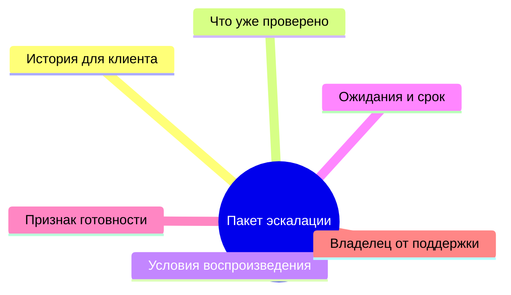
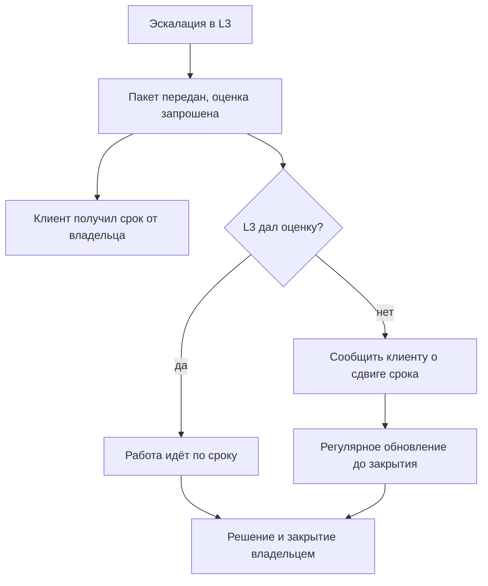
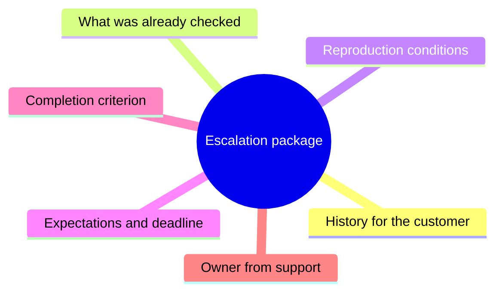
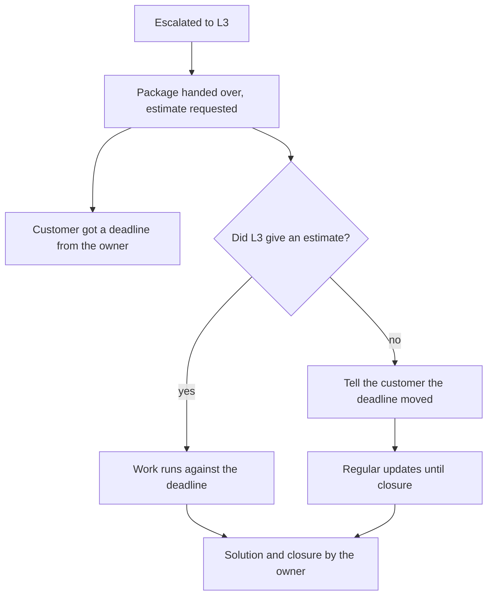
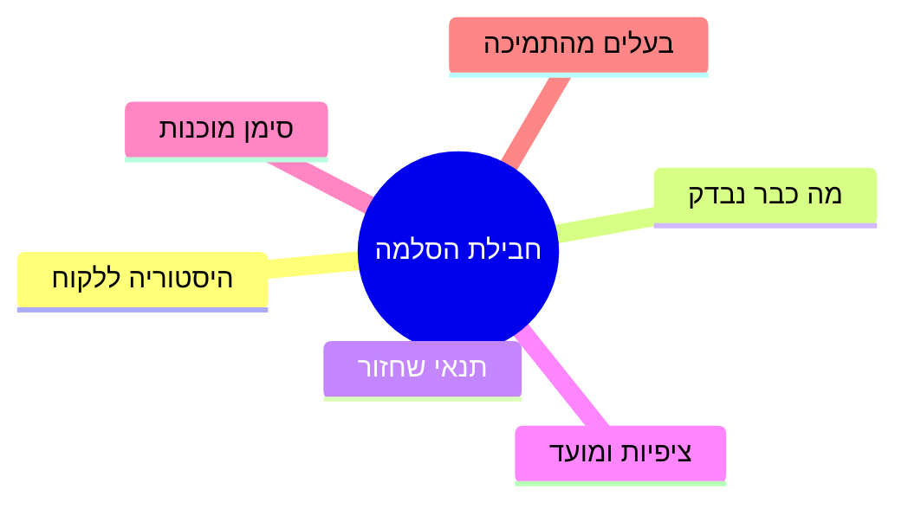
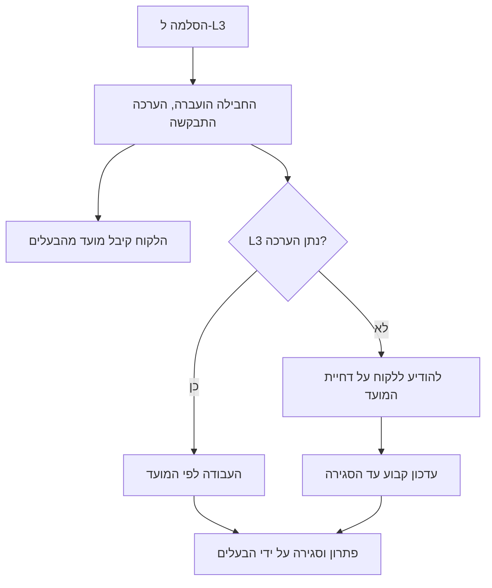

<!-- lang:ru -->

## Введение

Первые эскалации я делал с облегчением. Тикет уходил в третью линию, и вместе с ним уходило напряжение: теперь это не моя проблема. Через день выяснялось, что проблема всё ещё моя — клиент писал мне, разработчик спрашивал уточнения, а тикет возвращался с вопросом «а что вы уже проверили?». Работы стало больше, чем до эскалации.

Причина не в разработке, которая медленно отвечает, и не в клиенте, который торопит. Причина в том, что я передал тикет без пакета и без договорённости, а ответственность за клиента считал переданной вместе с ним. Ни того, ни другого в реальности не произошло.

В предыдущей статье серии — «Ни одного тихого нарушения SLA: еженедельный контроль очереди» — речь шла о контроле сроков и предупреждении нарушений. Эскалация — следующий шаг того же контура: что делать, когда срок под угрозой именно из-за зависимости от другой команды.

Тезис такой: эскалация — это передача работы с пакетом и договором о времени, но не передача ответственности за клиента. Разделение этих двух вещей и делает линию поддержки управляемой.

## Пакет эскалации

Пакет — это набор сведений, без которых третья линия не может начать. Его смысл не в бюрократии, а в экономии одного круга переписки: без пакета разработчик возвращает тикет с уточняющими вопросами, и первые сутки уходят не на решение, а на сбор контекста, который был у поддержки с самого начала.

Что входит в пакет:

- **История.** Что происходит с точки зрения клиента: что он делал, что ожидал, что получил.
- **Что уже проверено.** Дословно: какие шаги, в каком окружении, с каким результатом. «Перезагрузили» и «перезагрузили сервис на тестовом стенде, ошибка воспроизвелась» — разные сведения.
- **Условия воспроизведения.** Версия, окружение, время, шаги. Если не воспроизводится — так и написать, это тоже информация.
- **Ожидания клиента.** Не только «чтобы работало»: срок, который ему обещан, и что он будет делать, если решения не будет.
- **Признак готовности.** Что должно произойти, чтобы тикет считался решённым с точки зрения поддержки.
- **Владелец со стороны поддержки.** Имя, а не «команда».

Так выглядит состав пакета, если смотреть на него как на перечень, а не как на текст письма:

Пакет пишется один раз и потом только дополняется — в этом его сила. Он же становится основой для ответа клиенту: почти весь текст уже есть внутри.

Чем пакет не является — тоже полезно проговорить. Это не пересылка письма клиента: пересланное сообщение содержит эмоции, но не содержит проверок. Это не ссылка на ветку в чате: чат не читается через неделю. И это не список гипотез — гипотезы прикладываются отдельно и помечаются как гипотезы, иначе третья линия начинает проверять чужие догадки вместо своей работы. Пакет отвечает на вопрос «что известно точно», и именно это делает его полезным для обеих сторон: разработка не тратит время на сбор контекста, а поддержка не отвечает дважды на одни и те же вопросы.

<!-- вилка: свой шаблон пакета эскалации — какие поля обязательны и где он живёт. -->

## OLA с разработкой

Пакет решает половину проблемы: третья линия получает всё нужное. Вторая половина — время. Здесь начинается то, что в ITIL 4 называется OLA (Operational Level Agreement — внутреннее соглашение об уровне обслуживания между командами, в отличие от SLA с клиентом).

OLA отличается от SLA только стороной: обещание даётся не клиенту, а соседней команде. Механика та же: что именно обещаем, в каких единицах измеряется, что происходит при нарушении.

У OLA с разработкой обычно три предмета:

1. **Время первого ответа.** Не решения — ответа: «принял, смотрю» уже снимает неопределённость и позволяет сказать клиенту что-то определённое.
2. **Время до оценки.** Когда третья линия скажет, решается проблема в этом релизе или нет. Оценка — самый важный элемент: без неё нельзя назвать клиенту новый срок.
3. **Что при отказе.** Если L3 не берёт задачу — кто и в какой срок об этом сообщает, и куда задача идёт дальше.

Установить OLA проще всего не переговорами, а цифрой: прийти к разработке с фактическим временем первого ответа за последний месяц и спросить, какое значение они готовы держать. Договорённость, названная самим исполнителем, живёт дольше спущенной сверху.

Защищать OLA приходится двумя способами. Первый — измерять: то же время первого ответа по эскалациям, прозрачно для обеих сторон. Второй — регулярно смотреть на него вместе, а не вспоминать о договорённости в момент срыва. Систематическое нарушение OLA — не повод для скандала в конкретном тикете, а факт для разговора о ресурсе на уровне руководителей. Именно поэтому OLA иногда называют договором, который защищает не клиента, а команду поддержки.

<!-- вилка: фактическое время первого ответа L3 и что было сделано с нарушениями. -->

## Правило владельца клиента

Самое важное правило эскалации звучит коротко: ответственность за клиента не передаётся. Третья линия становится владельцем технической задачи — но не собеседником клиента и не тем, кто обещает сроки.

Из этого следует несколько практичных вещей.

- **Клиент всегда знает, кто говорит с ним.** Не «разработка», а конкретный человек из поддержки, который ведёт диалог.
- **Статус идёт с той же частотой, что и до эскалации.** Во время ожидания третьей линии клиент не должен проваливаться в вакуум: тишина после слова «эскалировали» читается как «забыли».
- **Срок обещает тот, кто может его пересогласовать.** Если срок называет лид поддержки по оценке разработки — то при изменении оценки первым узнаёт клиент, а не наоборот.
- **Возврат тикета не возвращает ничего автоматически.** Если задача вернулась без решения, поддержка не начинает с чистого листа: работа, уже проделанная третьей линией, остаётся частью истории.

Есть и обратная ошибка — гиперопека: поддержка пересказывает клиенту каждое движение разработчика, включая технические детали, которые клиенту не нужны. Правило владельца клиента — не про объём, а про ответственность: клиент получает не поток деталей, а понятный ответ, и получает его от одного человека.

Как это выглядит в работе:

## Чек-лист эскалации

Самая распространённая ошибка после эскалации — «передал в L3 и забыл». Антидот — короткий чек-лист, который проверяется на каждом тикете, который ушёл в другую команду.

1. **Пакет полный.** История, проверенное, условия, ожидания, признак готовности, владелец.
2. **OLA применён.** Время первого ответа и срок оценки названы, а не подразумеваются.
3. **Клиент знает срок и владельца.** Один человек ведёт диалог и обновляет статус.
4. **Есть контрольная точка.** Дата, к которой должен быть ответ от L3; если её нет в списке задач — её нет нигде.
5. **Тикет не остался без владельца.** У него два владельца: технический в L3 и клиентский в поддержке, и оба названы.
6. **Путь назад определён.** Чем закончится эскалация, если L3 откажет или не уложится: кому об этом сообщают и что дальше.

Чек-лист работает, пока у него есть внешний эффект: например, тикет без контрольной точки попадает в еженедельный разбор рисков. Без этого правила остаются намерением, а эскалации — поводом надеяться, что проблема решится сама.

<!-- вилка: сколько сейчас тикетов в эскалации и сколько из них без контрольной точки. -->

Самое ценное, что даёт такой порядок, — не скорость третьей линии, а возможность честно ответить клиенту в любой момент. Пока эскалация — это передача работы с пакетом и договорённостью, поддержка перестаёт быть промежуточным звеном и становится тем, кем должна быть: владельцем клиента.

<!-- lang:en -->

## Introduction

My first escalations felt like relief. The ticket went to the third line, and the tension went with it: now it's not my problem. A day later it turned out the problem was still mine — the customer was writing to me, the developer was asking for clarifications, and the ticket came back with "and what have you already checked?". There was more work than before the escalation.

The cause wasn't development replying slowly, or the customer hurrying things along. The cause was that I handed over the ticket without a package and without an agreement, while treating accountability for the customer as transferred with it. Neither had actually happened.

The previous article in the series — "Not one silent SLA breach: weekly queue control" — was about deadline control and warning before breaches. Escalation is the next step of the same loop: what to do when the deadline is at risk precisely because of a dependency on another team.

The thesis: escalation hands over work with a package and an agreement about time, but not accountability for the customer. Separating those two things is what makes a support line manageable.

## The escalation package

A package is the set of facts without which the third line can't start. Its purpose isn't bureaucracy but saving one round of correspondence: without a package the developer returns the ticket with clarifying questions, and the first day goes not to the solution but to collecting context support had from the beginning.

What the package contains:

- **History.** What's happening from the customer's point of view: what they did, what they expected, what they got.
- **What's already been checked.** Verbatim: which steps, in which environment, with what result. "Rebooted" and "rebooted the service on the test bench, the error reproduced" are different facts.
- **Reproduction conditions.** Version, environment, time, steps. If it doesn't reproduce, say so — that's information too.
- **The customer's expectations.** Not just "it should work": the deadline promised to them and what they will do if there's no solution.
- **The completion criterion.** What has to happen for the ticket to count as solved from support's point of view.
- **The owner on the support side.** A name, not "the team".

Here is the package as a list of parts rather than as the text of an email:

The package is written once and then only extended — that's its strength. It also becomes the basis for replying to the customer: almost the whole text is already inside.

It's worth saying what the package isn't, too. It isn't a forwarded customer email: a forwarded message carries emotion but not checks. It isn't a link to a chat thread: nobody reads a chat a week later. And it isn't a list of hypotheses — hypotheses are attached separately and marked as hypotheses, otherwise the third line starts testing someone else's guesses instead of doing its own job. The package answers "what is known for certain", and that's exactly what makes it useful to both sides: development doesn't spend time assembling context, and support doesn't answer the same questions twice.

<!-- вилка: свой шаблон пакета эскалации — какие поля обязательны и где он живёт. -->

## The OLA with development

The package solves half the problem: the third line gets everything it needs. The other half is time. That's where the ITIL 4 concept of an OLA comes in (Operational Level Agreement — an internal service commitment between teams, as opposed to an SLA with a customer).

An OLA differs from an SLA only in the party: the promise is made to a neighbouring team rather than to the customer. The mechanics are the same: what exactly we promise, how it is measured, and what happens when it's broken.

An OLA with development usually covers three things:

1. **First response time.** Not resolution — a response: "got it, looking" already removes the uncertainty and lets you tell the customer something definite.
2. **Time to an estimate.** When the third line will say whether the problem makes this release or not. The estimate matters most: without it you can't give the customer a new date.
3. **What happens on refusal.** If L3 doesn't take the task — who says so, by when, and where the task goes next.

An OLA is easiest to establish not with negotiation but with a number: come to development with the actual first response time from last month and ask which value they're ready to hold. An agreement the executor names themselves outlives one handed down from above.

Protecting the OLA takes two habits. First, measure: the same first response time on escalations, visible to both sides. Second, look at it together regularly, instead of recalling the agreement the moment it breaks. A systematic OLA breach isn't grounds for a fight inside one ticket; it's a fact for a conversation about resources at management level. That's why an OLA is sometimes described as an agreement that protects the support team rather than the customer.

<!-- вилка: фактическое время первого ответа L3 и что было сделано с нарушениями. -->

## The customer owner rule

The most important rule of escalation is short: accountability for the customer is not transferred. The third line becomes the owner of the technical task — but not the customer's counterpart and not the one promising deadlines.

A few practical consequences.

- **The customer always knows who is talking to them.** Not "development" but a specific person from support running the dialogue.
- **Status arrives at the same frequency as before the escalation.** While waiting on the third line, the customer must not fall into a vacuum: silence after the word "escalated" reads as "forgotten".
- **The deadline is promised by whoever can renegotiate it.** If the support lead names a date based on development's estimate, then when the estimate changes the customer hears it first, not the other way round.
- **A returned ticket doesn't reset anything automatically.** If the task comes back unsolved, support doesn't start from a blank page: the work the third line already did stays part of the history.

There's an opposite mistake too — overprotection: support retells every move of the developer, including technical detail the customer doesn't need. The customer owner rule isn't about volume but accountability: the customer gets a clear answer, not a stream of details, and gets it from one person.

How this looks in practice:

## The escalation checklist

The most common mistake after an escalation is "handed it to L3 and forgot". The antidote is a short checklist applied to every ticket that left for another team.

1. **The package is complete.** History, checks already done, conditions, expectations, completion criterion, owner.
2. **The OLA is applied.** First response time and estimate deadline are stated, not implied.
3. **The customer knows the deadline and the owner.** One person runs the dialogue and updates the status.
4. **There's a checkpoint.** A date by which L3 must answer; if it isn't in the task list, it doesn't exist anywhere.
5. **The ticket isn't ownerless.** It has two owners: a technical one in L3 and a customer one in support, and both are named.
6. **The way back is defined.** How the escalation ends if L3 refuses or misses: who is told and what happens next.

A checklist works only while it has an external effect: for example, a ticket without a checkpoint lands in the weekly risk review. Without that, the rules remain intentions and escalations remain a hope that the problem sorts itself out.

<!-- вилка: сколько сейчас тикетов в эскалации и сколько из них без контрольной точки. -->

The most valuable thing this discipline gives you isn't the third line's speed — it's the ability to answer the customer honestly at any moment. While escalation means handing over work with a package and an agreement, support stops being an intermediary and becomes what it should be: the owner of the customer.

<!-- lang:he -->

## מבוא

את ההסלמות הראשונות שלי עשיתי בהקלה. הפנייה עברה לקו השלישי, ואיתה עברה גם המתח: עכשיו זו לא הבעיה שלי. כעבור יום התברר שהבעיה עדיין שלי — הלקוח כתב אליי, המפתח ביקש הבהרות, והפנייה חזרה עם השאלה "ומה כבר בדקתם?". העבודה גדלה מזו שהייתה לפני ההסלמה.

הסיבה אינה בפיתוח שעונה לאט ואינה בלקוח שממהר. הסיבה היא שהעברתי את הפנייה בלי חבילה ובלי הסכמה, ואת האחריות ללקוח חשבתי כמועברת יחד איתה. לא זה ולא זה קרה במציאות.

המאמר הקודם בסדרה — "בלי הפרת SLA שקטה: בקרת תור שבועית" — עסק בבקרת מועדים ובהתראה לפני הפרות. הסלמה היא הצעד הבא של אותו מעגל: מה עושים כשהמועד בסכנה דווקא בגלל תלות בצוות אחר.

הטענה: הסלמה היא העברת עבודה עם חבילה ועם הסכמה על זמן, אבל לא העברת האחריות ללקוח. דווקא ההפרדה בין שני הדברים האלה הופכת את קו התמיכה למנוהל.

## חבילת ההסלמה

החבילה היא סט הפרטים שבלעדיהם הקו השלישי לא יכול להתחיל. מטרתה אינה בירוקרטיה אלא חיסכון של סבב התכתבות אחד: בלי חבילה המפתח מחזיר את הפנייה עם שאלות הבהרה, והיום הראשון הולך לא לפתרון אלא לאיסוף ההקשר שהיה לתמיכה מההתחלה.

מה נכנס לחבילה:

- **היסטוריה.** מה קורה מנקודת המבט של הלקוח: מה עשה, למה ציפה, מה קיבל.
- **מה כבר נבדק.** כלשונו: אילו צעדים, באיזו סביבה, עם איזו תוצאה. "הפעלנו מחדש" ו"הפעלנו מחדש את השירות בסביבת הבדיקות והשגיאה חזרה" הם שני פרטים שונים.
- **תנאי השחזור.** גרסה, סביבה, זמן, צעדים. אם לא משחזר — לכתוב כך, גם זה מידע.
- **ציפיות הלקוח.** לא רק "שיעבוד": המועד שהובטח לו ומה יעשה אם לא יהיה פתרון.
- **סימן המוכנות.** מה צריך לקרות כדי שהפנייה תיחשב פתורה מנקודת המבט של התמיכה.
- **בעלים מצד התמיכה.** שם, ולא "הצוות".

כך נראית החבילה כרשימת רכיבים ולא כטקסט של מכתב:

החבילה נכתבת פעם אחת ומכאן רק מתרחבת — זה הכוח שלה. היא גם הופכת לבסיס למענה ללקוח: כמעט כל הטקסט כבר נמצא בפנים.

שווה גם לומר מה החבילה אינה. היא אינה העברת מכתב של הלקוח: מכתב מועבר מכיל רגשות אבל לא בדיקות. היא אינה קישור לשרשור בצ'אט: בצ'אט לא קוראים אחרי שבוע. והיא אינה רשימת השערות — השערות מצורפות בנפרד ומסומנות כהשערות, אחרת הקו השלישי מתחיל לבדוק ניחושים של אחרים במקום את העבודה שלו. החבילה עונה על השאלה "מה ידוע בוודאות", וזה בדיוק מה שעושה אותה שימושית לשני הצדדים: הפיתוח לא מבזבז זמן על איסוף הקשר, והתמיכה לא עונה פעמיים על אותן שאלות.

<!-- вилка: свой шаблон пакета эскалации — какие поля обязательны и где он живёт. -->

## OLA עם הפיתוח

החבילה פותרת חצי מהבעיה: הקו השלישי מקבל את כל הדרוש. החצי השני הוא הזמן. כאן מתחיל מה שנקרא ב-ITIL 4 בשם OLA (Operational Level Agreement — הסכם פנימי על רמת שירות בין צוותים, להבדיל מ-SLA מול הלקוח).

ה-OLA נבדל מה-SLA רק בצד: ההבטחה ניתנת לא לצוות השכן ולא ללקוח. המכניקה זהה: מה בדיוק מבטיחים, באילו יחידות מודדים, ומה קורה כשמפרים.

ל-OLA עם הפיתוח יש בדרך כלל שלושה נושאים:

1. **זמן תגובה ראשונה.** לא פתרון — תגובה: "קיבלתי, מסתכל" כבר מסיר את אי הוודאות ומאפשר לומר ללקוח משהו מוגדר.
2. **זמן עד הערכה.** מתי הקו השלישי יגיד אם הבעיה נכנסת לגרסה הזאת או לא. ההערכה היא הרכיב החשוב ביותר: בלעדיה אי אפשר לתת ללקוח מועד חדש.
3. **מה קורה בסירוב.** אם L3 לא לוקח את המשימה — מי אומר על כך, באיזה מועד, ולאן המשימה ממשיכה.

את ה-OLA הכי קל לקבוע לא במשא ומתן אלא במספר: לבוא לפיתוח עם זמן התגובה הראשונה בפועל מהחודש האחרון ולשאול איזה ערך הם מוכנים להחזיק. הסכמה שהמבצע עצמו נוקב בה מחזיקה מעמד יותר מזו שמורדת מלמעלה.

להגן על ה-OLA צריך בשני אופנים. הראשון — למדוד: אותו זמן תגובה ראשונה בהסלמות, שקוף לשני הצדדים. השני — להסתכל עליו יחד באופן קבוע, ולא להיזכר בהסכמה ברגע הכשל. הפרה שיטתית של OLA אינה עילה לשערורייה בפנייה מסוימת, אלא עובדה לשיחה על משאבים ברמת הממונים. דווקא משום כך ה-OLA מכונה לעתים הסכם שמגן לא על הלקוח אלא על צוות התמיכה.

<!-- вилка: фактическое время первого ответа L3 и что было сделано с нарушениями. -->

## כלל בעל הלקוח

הכלל החשוב ביותר בהסלמה קצר: האחריות ללקוח אינה מועברת. הקו השלישי הופך לבעלים של המשימה הטכנית — אבל לא לבן השיח של הלקוח ולא למי שמבטיח מועדים.

מכאן נובעים כמה דברים מעשיים.

- **הלקוח תמיד יודע מי מדבר איתו.** לא "הפיתוח" אלא אדם מסוים מהתמיכה שמנהל את הדיאלוג.
- **הסטטוס מגיע באותה תכיפות כמו לפני ההסלמה.** בזמן ההמתנה לקו השלישי הלקוח לא אמור לנפול לוואקום: שתיקה אחרי המילה "העברנו" נקראת כ"שכחו אותנו".
- **את המועד מבטיח מי שיכול לתאם אותו מחדש.** אם מנהל התמיכה נוקב במועד לפי הערכת הפיתוח — כשההערכה משתנה, הלקוח שומע על כך ראשון, ולא להפך.
- **חזרת הפנייה לא מחזירה שום דבר אוטומטית.** אם המשימה חזרה בלי פתרון, התמיכה לא מתחילה מדף חלק: העבודה שהקו השלישי כבר עשה נשארת חלק מההיסטוריה.

יש גם הטעות ההפוכה — הגנת יתר: התמיכה משחזרת ללקוח כל תנועה של המפתח, כולל פרטים טכניים שהלקוח לא צריך. כלל בעל הלקוח אינו על נפח אלא על אחריות: הלקוח מקבל תשובה מובנת ולא זרם של פרטים, ומקבל אותה מאדם אחד.

כך זה נראה בעבודה:

## רשימת הבדיקה של ההסלמה

הטעות הנפוצה ביותר אחרי הסלמה — "העברתי ל-L3 ושכחתי". התרופה היא רשימת בדיקה קצרה שנבדקת בכל פנייה שיצאה לצוות אחר.

1. **החבילה שלמה.** היסטוריה, מה נבדק, תנאים, ציפיות, סימן מוכנות, בעלים.
2. **ה-OLA הוחל.** זמן התגובה הראשונה ומועד ההערכה נאמרים, ולא משתמעים.
3. **הלקוח יודע את המועד ואת הבעלים.** אדם אחד מנהל את הדיאלוג ומעדכן סטטוס.
4. **יש נקודת בקרה.** תאריך שבו אמור להגיע מענה מ-L3; אם היא לא ברשימת המשימות — היא לא קיימת בשום מקום.
5. **הפנייה לא נותרה בלי בעלים.** יש לה שני בעלים: טכני ב-L3 ולקוח בתמיכה, ושניהם נקובים בשמם.
6. **דרך החזרה מוגדרת.** איך נגמרת ההסלמה אם L3 מסרב או לא עומד בזמן: למי מודיעים ומה הלאה.

רשימת הבדיקה עובדת רק כשיש לה השפעה חיצונית: למשל, פנייה בלי נקודת בקרה נופלת לסקירת הסיכונים השבועית. בלי זה הכללים נשארים כוונה, וההסלמות — תקווה שהבעיה תסתדר מעצמה.

<!-- вилка: сколько сейчас тикетов в эскалации и сколько из них без контрольной точки. -->

הדבר היקר ביותר שהסדר הזה נותן אינו המהירות של הקו השלישי, אלא היכולת לענות ללקוח ביושר בכל רגע. כל עוד הסלמה היא העברת עבודה עם חבילה ועם הסכמה, התמיכה מפסיקה להיות חוליה מקשרת והופכת למה שהיא צריכה להיות: הבעלים של הלקוח.
