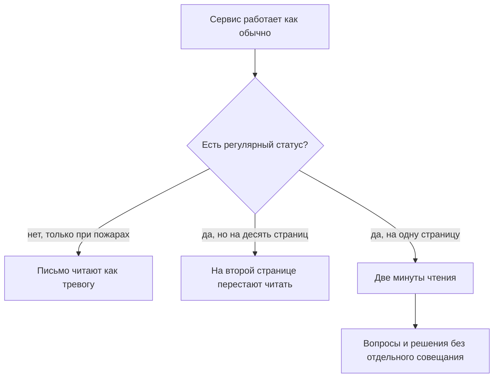
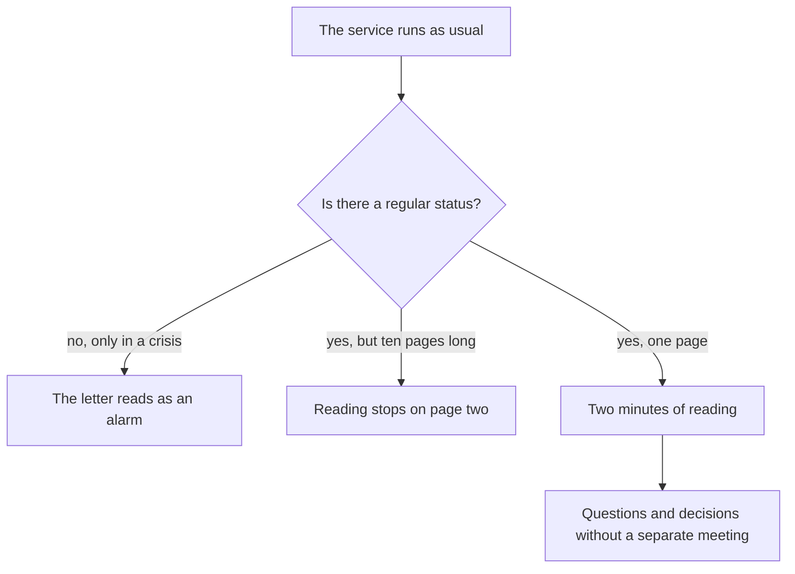
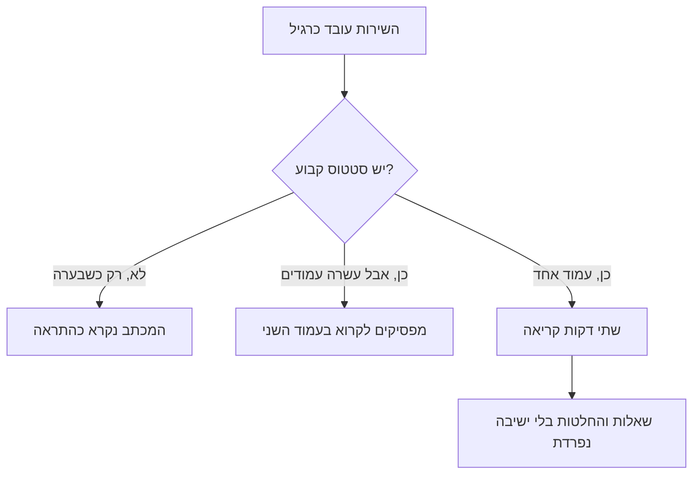

<!-- lang:ru -->

## Введение

Первый год я вёл статус поддержки так, как мне казалось правильным: раз в месяц собирал большую презентацию на тридцать слайдов, в которой было всё — метрики, графики, разборы, планы. Презентация была хорошая. Её никто не читал, включая меня самого через неделю после показа.

Однажды руководитель сказал фразу, которую я запомнил: «Я не могу читать отчёты длиннее страницы. Если тебе нужно больше — значит, ты не решил, что главное». Жестко и точно. Статус — это не доказательство проделанной работы, а инструмент решений, и у инструмента есть формат.

С тех пор контур прозрачности у меня состоит из двух вещей: еженедельное письмо на страницу и часовой обзор раз в месяц. Первое держит руководство в курсе и не требует его времени — читается за две минуты. Второе даёт место для разговора, который в письмо не влезает. Остальные отчёты и дашборды никуда не делись, но они перестали быть способом общения с руководством.

Этот текст — про механику: что в письме, из чего состоит час обзора и как статус меняет решения, а не только информирует.

## Тишина и отчёт на десять страниц

У коммуникации с руководством два вырожденных режима, и оба выглядят как работа.

**Тишина.** Пока всё в порядке, лид не пишет: зачем беспокоить, когда повода нет. Первое сообщение появляется, когда уже горит, и звучит как «у нас катастрофа». После двух-трёх таких писем включается режим по умолчанию: от лида ждут плохих новостей, любое его письмо читают с напряжением. Тишина кажется нейтральной, но она строит единственный сценарий — «лид пишет, когда плохо».

**Отчёт на десять страниц.** Другая крайность: лид пишет много, подробно и регулярно, выгружает всё, что есть в трекере, и добавляет разборы. Формально это полная прозрачность. Фактически руководитель перестаёт читать на второй странице — сначала по диагонали, потом никак. А если спросить его вне отчёта, он не сможет назвать ни одной цифры: объём вытеснил содержание.

Общее у этих режимов одно: ни один не приводит к решению. В первом случае решают без вас и без данных, во втором данные есть, но никто их не видел.

Есть и третий, самый коварный вариант: статус есть, он регулярный и даже короткий, но собирается из того, что легко посчитать. Тогда письмо много недель подряд выглядит благополучно, а очередь при этом растёт — потому что растут самые медленные заявки, а не самые заметные.

Полезно держать в голове простую мысль: статус нужен не для отчётности, а для того, чтобы руководство могло принять нужное решение в нужный момент — и чтобы это решение не требовало отдельного совещания. Дальше о том, как это выглядит на практике:

## Письмо на страницу: семь пунктов

Письмо пишется по одному и тому же шаблону каждую неделю. Постоянство важнее содержания одного письма: когда структура не меняется, руководитель за месяц запоминает, где искать ответ на свой вопрос, и перестаёт читать вступление.

Семь пунктов, каждый из которых отвечает на свой вопрос:

1. **Сводка.** Одна-две строки: это была обычная неделя или что-то вышло за рамки. Отвечает на вопрос «нужно ли вчитываться целиком».
2. **Объём.** Сколько пришло и по каким категориям. Отвечает на вопрос «что с потоком».
3. **Сроки.** Сколько заявок вне норматива, какие категории затронуты. Отвечает на вопрос «где болит сейчас».
4. **Инциденты.** Что случилось, чем закончилось, что изменим. Без имён виновных — только факты и решение.
5. **Очередь и висящие заявки.** Заявки, которые стареют и не закрываются своими силами. Отвечает на «что накопилось».
6. **Инициативы.** Где мы относительно заявленного плана: что сделано, что сдвинулось и почему.
7. **Просьбы.** Конкретно: какие решения или ресурсы нужны от руководства на этой неделе, с датой, к которой нужны.

Седьмой пункт — самый важный и самый часто пропускаемый. Письмо без просьб читается как сводка погоды: интересно, но делать ничего не нужно. Письмо с просьбами превращает его в рабочий инструмент.

Два правила, без которых шаблон не работает. Первое — формат страницы: не больше одной страницы, без вложений и без ссылок «см. дашборд», если в дашборде главное. Всё, что не влезло, идёт в месячный обзор, а не в следующее письмо. Второе — та же дата: письмо уходит в один и тот же день, чтобы не приходилось его ждать.

<!-- вилка: свой шаблон письма — точные формулировки семи пунктов, куда и когда отправляется, кто читатели. -->

## Часовой месячный обзор

Письмо хорошо для состояния, плохо для разговора. Раз в месяц нужен час, где собраны люди, принимающие решения, и есть возможность обсудить вещи, которые в две минуты чтения не влезают.

Повестка часа у меня всегда одна и та же:

- **Пять минут — картина по метрикам.** Не пересчёт цифр из писем, а динамика за месяц и один вывод из неё.
- **Пятнадцать минут — SLA-нарушения.** Не сводка, а два-три разбора: что именно произошло, какой системный элемент это породил, какое изменение последует.
- **Пятнадцать минут — инициативы.** Статус по каждой: сделано, в работе, встало. На «встало» — причина и решение, а не описание.
- **Пятнадцать минут — риски.** То, что ещё не случилось, но случится, если не менять ничего: ёмкость, ключевые люди, зависимости от третьих команд.
- **Десять минут — решения и поручения.** Фиксируются владельцы и сроки, всё остальное записывается в протокол.

Два условия, без которых час превращается в ещё один отчёт. Первое: на обзоре присутствуют те, кто может решать, а не только те, кто хочет слушать. Второе: у каждого пункта есть вывод — либо решение, либо сознательное «решили не делать», зафиксированное в протоколе. Обзор без решений хуже, чем его отсутствие: он занимает час и создаёт ощущение, что всё под контролем.

<!-- вилка: своя повестка обзора — кто участвует, где ведётся протокол, что изменилось после первых обзоров. -->

## Как статус меняет решения

Самая частая ошибка в статусах — считать, что цель — информировать. Информирование — побочный эффект. Цель — чтобы руководство смотрело на сервис теми же глазами, что и вы, и решало на тех же данных.

Это видно по тому, меняются ли решения. Если за квартал ни одно решение руководства не опиралось на ваши письма и обзоры, значит статус существует отдельно от управления: его читают, кивают и живут дальше.

Что делает статус работающим:

- **Цифры с действиями.** У каждой метрики в обзоре есть следствие: если значение такое, делаем это. Метрика без следствия превращает обзор в чтение графиков.
- **Плохие новости первыми.** В письме, где всё хорошо, плохая строка в конце читается как случайность. Плохая новость в первом абзаце даёт руководителю время на реакцию — и доверие к остальному тексту.
- **Одна тема требует решения.** В каждом письме и в каждом обзоре есть ровно одна вещь, где нужен ответ руководства. Если просьб десять, не будет выполнена ни одна.
- **История.** Письма складываются в хронологию: видно, когда появилась проблема и что делалось. Через полгода это единственный способ не начинать разговор с начала.

И техническая деталь, которая экономит час: обзор готовится заранее и рассылается до встречи. Если участники видят цифры впервые на самой встрече, первые двадцать минут уходят на их чтение, а не на разговор. Письмо и обзор — не два независимых ритуала, а один контур: недельные письма собираются в месячную картину, а решения из обзора возвращаются в следующие письма как выполненные или сдвинувшиеся пункты.

<!-- вилка: пример, когда статус изменил решение руководства — что было в письме, какое решение принято, к какому сроку. -->

Статус — не бюрократия и не доказательство занятости. Это способ сделать так, чтобы руководство узнавало о проблеме раньше, чем она станет инцидентом, и чтобы решения принимались в момент, когда их ещё дёшево принимать. Следующая статья серии — о том, как просить эти решения: эскалация и запрос ресурсов по схеме, а не по эмоциям.

<!-- lang:en -->

## Introduction

In my first year I ran the support status the way I thought was right: once a month I assembled a big thirty-slide deck covering everything - metrics, charts, reviews, plans. The deck was good. Nobody read it, including me a week after presenting it.

One day my manager said something I still remember: "I can't read reports longer than a page. If you need more, it means you haven't decided what matters." Harsh and accurate. A status report is not proof of work done; it is a decision-making tool, and a tool has a format.

Since then my transparency loop has consisted of two things: a weekly one-page letter and a monthly hour-long review. The first keeps management informed without consuming their time - it reads in two minutes. The second gives room for the conversation that doesn't fit into a letter. The other reports and dashboards didn't disappear, but they stopped being how I talk to management.

This text is about the mechanics: what goes into the letter, what the review hour is made of, and how a status changes decisions instead of merely informing.

## Silence and the ten-page report

Communication with management has two degenerate modes, and both look like work.

**Silence.** While everything is fine, the lead doesn't write: why bother anyone when there's no reason. The first message appears when something is already on fire, and it reads as "we have a catastrophe". After two or three letters like that, the default mode sets in: bad news is expected from this lead, and every message is read with tension. Silence feels neutral, but it builds exactly one scenario - "the lead writes when things are bad".

**The ten-page report.** The other extreme: the lead writes a lot, in detail and regularly, dumps everything the tracker holds and adds commentary. Formally that's full transparency. In practice the manager stops reading on page two - first diagonally, then not at all. And if you ask them outside the report, they can't name a single figure: volume displaced substance.

Both modes share one property: neither leads to a decision. In the first case decisions happen without you and without data; in the second the data exists but nobody has seen it.

There is a third, subtler variant: the status exists, it is regular and even short, but it is assembled from whatever is easy to count. Then week after week the letter looks healthy while the queue grows - because what grows is the slowest tickets, not the most visible ones.

It helps to hold one simple thought: a status is not for reporting, it is so management can make the right decision at the right moment - without needing a separate meeting. Here is what that looks like in practice:

## A one-page letter: seven points

The letter follows the same template every week. Consistency matters more than the content of any single letter: when the structure doesn't change, within a month the manager remembers where the answer to their question lives and stops reading the preamble.

Seven points, each answering its own question:

1. **Summary.** One or two lines: a normal week or something beyond it. Answers "do I need to read all of this".
2. **Volume.** How much came in, by category. Answers "what is the flow doing".
3. **Timings.** How many tickets are outside the target, which categories are affected. Answers "where does it hurt now".
4. **Incidents.** What happened, how it ended, what we change. No names to blame - facts and a decision only.
5. **Queue and ageing tickets.** Tickets that grow old and don't close on their own. Answers "what has piled up".
6. **Initiatives.** Where we are against the stated plan: what is done, what slipped and why.
7. **Asks.** Specifically: which decisions or resources are needed from management this week, with the date they're needed by.

The seventh point is the most important and the one most often dropped. A letter without asks reads like a weather report: interesting, but nothing to do. A letter with asks turns into a working tool.

Two rules without which the template fails. First, the page format: no more than one page, no attachments, no "see the dashboard" when the important part is in the dashboard. Whatever didn't fit goes to the monthly review, not into the next letter. Second, the same date: the letter goes out on the same day every week so nobody has to wait for it.

<!-- вилка: свой шаблон письма — точные формулировки семи пунктов, куда и когда отправляется, кто читатели. -->

## The hourly monthly review

A letter is good for state, bad for conversation. Once a month you need an hour where the people who make decisions are in the room and there is room to discuss what two minutes of reading can't hold.

The agenda of that hour is always the same:

- **Five minutes - the metric picture.** Not a recount of the numbers from the letters, but the month's movement and one conclusion from it.
- **Fifteen minutes - SLA breaches.** Not a summary but two or three reviews: what exactly happened, which systemic element produced it, which change follows.
- **Fifteen minutes - initiatives.** Status for each: done, in progress, stalled. For "stalled" - a cause and a decision, not a description.
- **Fifteen minutes - risks.** What hasn't happened yet but will if nothing changes: capacity, key people, dependencies on third teams.
- **Ten minutes - decisions and assignments.** Owners and dates get recorded; everything else goes into the minutes.

Two conditions without which the hour becomes yet another report. First, the review includes people who can decide, not only people who want to listen. Second, every item ends in a conclusion - either a decision or a deliberate "we decided not to", recorded in the minutes. A review without decisions is worse than none: it takes an hour and creates a feeling that everything is under control.

<!-- вилка: своя повестка обзора — кто участвует, где ведётся протокол, что изменилось после первых обзоров. -->

## How a status changes decisions

The most common mistake with statuses is believing the goal is to inform. Informing is a side effect. The goal is for management to look at the service with the same eyes you do, and decide on the same data.

That's visible in whether decisions change. If in a quarter not one management decision rested on your letters and reviews, the status exists separately from management: it gets read, nodded at, and life goes on.

What makes a status work:

- **Numbers with actions.** Every metric in the review has a consequence: if the value is this, we do that. A metric without a consequence turns the review into chart-reading.
- **Bad news first.** In a letter where everything is fine, a bad line at the end reads as an accident. Bad news in the first paragraph gives the manager time to react - and earns trust in the rest of the text.
- **One subject needs a decision.** Every letter and every review carries exactly one thing that needs an answer from management. If there are ten asks, none will be answered.
- **History.** Letters add up to a chronology: you can see when a problem appeared and what was done. Six months later that is the only way not to start the conversation over.

A technical detail that saves the hour too: the review is prepared in advance and sent out before the meeting. If participants see the numbers for the first time in the room, the first twenty minutes go to reading rather than talking. The letter and the review are not two independent rituals but one loop: weekly letters add up to a monthly picture, and decisions from the review come back in later letters as done or slipped items.

<!-- вилка: пример, когда статус изменил решение руководства — что было в письме, какое решение принято, к какому сроку. -->

A status is not bureaucracy and not proof of being busy. It is a way to make sure management learns about a problem before it becomes an incident, and that decisions are made while they are still cheap. The next article in the series is about asking for those decisions: escalation and resource requests by a template, not by emotion.

<!-- lang:he -->

## מבוא

בשנה הראשונה ניהלתי את הסטטוס של התמיכה כמו שנראה לי נכון: פעם בחודש הרכבתי מצגת גדולה של שלושים שקופיות ובה הכל — מדדים, גרפים, ניתוחים, תוכניות. המצגת היתה טובה. איש לא קרא אותה, כולל אני עצמי שבוע אחרי ההצגה.

יום אחד המנהל אמר משפט שזכרתי: "אני לא יכול לקרוא דוחות ארוכים מעמוד. אם צריך יותר — סימן שלא החלטת מה העיקר". חד ומדויק. סטטוס הוא לא הוכחה לעבודה שנעשתה אלא כלי לקבלת החלטות, ולכלי יש פורמט.

מאז מעגל השקיפות שלי מורכב משני דברים: מכתב שבועי בעמוד אחד וסקירה של שעה פעם בחודש. הראשון מחזיק את ההנהלה בעניינים בלי לגזול מזמנה — נקרא בשתי דקות. השני נותן מקום לשיחה שלא נכנסת למכתב. שאר הדוחות והדשבורדים לא נעלמו, אבל הם הפסיקו להיות הדרך שבה אני מדבר עם ההנהלה.

הטקסט הזה על המכניקה: מה יש במכתב, ממה מורכבת שעה של סקירה ואיך סטטוס משנה החלטות ולא רק מיידע.

## שתיקה ודוח בן עשרה עמודים

לתקשורת עם ההנהלה יש שני מצבים מנוונים, ושניהם נראים כמו עבודה.

**שתיקה.** כל עוד הכל בסדר, מנהל התמיכה לא כותב: למה להטריד כשאין סיבה. ההודעה הראשונה מופיעה כשכבר בוער, והיא נשמעת כמו "יש לנו אסון". אחרי שניים־שלושה מכתבים כאלה נכנס מצב ברירת מחדל: ממנו מחכים לחדשות רעות, וכל מכתב שלו נקרא במתח. שתיקה נראית ניטרלית, אבל היא בונה תרחיש אחד בלבד — הוא כותב כשהמצב רע.

**דוח בן עשרה עמודים.** הקצה השני: כותבים הרבה, בפירוט ובקביעות, מוציאים מהמערכת כל מה שיש ומוסיפים ניתוחים. מבחינה רשמית זו שקיפות מלאה. בפועל ההנהלה מפסיקה לקרוא בעמוד השני — קודם באלכסון, אחר כך בכלל לא. ואם שואלים אותה מחוץ לדוח, היא לא תזכור אף מספר: הנפח דחק את התוכן.

לשני המצבים יש תכונה משותפת: אף אחד מהם לא מוביל להחלטה. בראשון מחליטים בלעדיכם ובלי נתונים, בשני הנתונים קיימים אבל איש לא ראה אותם.

יש גם וריאנט שלישי, ערמומי יותר: הסטטוס קיים, הוא קבוע ואפילו קצר, אבל נבנה ממה שקל לספור. אז שבוע אחרי שבוע המכתב נראה תקין והתור גדל — מפני שגדלות הפניות האיטיות ביותר ולא הבולטות ביותר.

כדאי להחזיק מחשבה פשוטה: סטטוס לא נועד לדיווח אלא לכך שההנהלה תוכל לקבל את ההחלטה הנכונה ברגע הנכון — בלי צורך בישיבה נפרדת. כך זה נראה בפועל:

## מכתב בעמוד אחד: שבעה סעיפים

המכתב נכתב לפי אותה תבנית בכל שבוע. הקביעות חשובה יותר מהתוכן של מכתב אחד: כשהמבנה לא משתנה, בתוך חודש ההנהלה זוכרת איפה נמצא המענה לשאלה שלה ומפסיקה לקרוא את הפתיח.

שבעה סעיפים, כל אחד עונה על שאלה משלו:

1. **תמצית.** שורה או שתיים: שבוע רגיל או משהו מעבר לכך. עונה על השאלה האם צריך לקרוא את כל המכתב.
2. **נפח.** כמה הגיע ובאילו קטגוריות. עונה על השאלה מה קורה בזרימה.
3. **זמנים.** כמה פניות מחוץ לתקן ואילו קטגוריות נפגעו. עונה על השאלה איפה כואב עכשיו.
4. **תקלות.** מה קרה, איך נגמר ומה נשנה. בלי שמות אשמים — רק עובדות והחלטה.
5. **תור ופניות תקועות.** פניות שמזדקנות ולא נסגרות בכוחות עצמן. עונה על השאלה מה הצטבר.
6. **יוזמות.** איפה אנחנו מול התוכנית שהוצהרה: מה נעשה, מה נדחה ולמה.
7. **בקשות.** באופן קונקרטי: אילו החלטות או משאבים נדרשים מההנהלה השבוע, ועד איזה תאריך.

הסעיף השביעי הוא החשוב ביותר והנשמט ביותר. מכתב בלי בקשות נקרא כתחזית מזג אוויר: מעניין, אבל אין מה לעשות. מכתב עם בקשות הופך לכלי עבודה.

שני כללים שבלעדיהם התבנית לא עובדת. הראשון — פורמט העמוד: לא יותר מעמוד אחד, בלי קבצים מצורפים ובלי "ראו בדשבורד", אם הדשבורד הוא העיקר. מה שלא נכנס הולך לסקירה החודשית ולא למכתב הבא. השני — אותו תאריך: המכתב יוצא באותו יום בכל שבוע, כדי שלא צריך לחכות לו.

<!-- вилка: свой шаблон письма — точные формулировки семи пунктов, куда и когда отправляется, кто читатели. -->

## סקירה חודשית של שעה

מכתב טוב למצב, גרוע לשיחה. פעם בחודש צריך שעה שבה יושבים האנשים שמקבלים החלטות ויש מקום לדון במה שלא נכנס לשתי דקות קריאה.

סדר היום של השעה אצלי תמיד אותו דבר:

- **חמש דקות — תמונת המדדים.** לא ספירה מחדש של המספרים מהמכתבים אלא התנועה של החודש ומסקנה אחת ממנה.
- **חמש עשרה דקות — הפרות SLA.** לא סיכום אלא שניים־שלושה ניתוחים: מה בדיוק קרה, איזה יסוד מערכתי הוליד את זה ואיזה שינוי יבוא בעקבותיו.
- **חמש עשרה דקות — יוזמות.** סטטוס לכל אחת: נעשה, בתהליך, נעצר. על "נעצר" — סיבה והחלטה, לא תיאור.
- **חמש עשרה דקות — סיכונים.** מה שעדיין לא קרה אבל יקרה אם לא נשנה דבר: כושר נשיאה, אנשים מרכזיים, תלות בצוותים שלישיים.
- **עשר דקות — החלטות ומטלות.** נרשמים בעלים ומועדים, כל השאר נכנס לפרוטוקול.

שני תנאים שבלעדיהם השעה הופכת לעוד דוח. הראשון: בסקירה נוכחים מי שיכול להחליט ולא רק מי שרוצה לשמוע. השני: לכל סעיף יש מסקנה — החלטה או "החלטנו לא לעשות", שרשומה בפרוטוקול. סקירה בלי החלטות גרועה מהיעדרה: היא גוזלת שעה ויוצרת תחושה שהכל בשליטה.

<!-- вилка: своя повестка обзора — кто участвует, где ведётся протокол, что изменилось после первых обзоров. -->

## איך הסטטוס משנה החלטות

הטעות השכיחה ביותר בסטטוסים היא לחשוב שהמטרה היא ליידע. יידוע הוא תוצר לוואי. המטרה היא שההנהלה תביט בשירות בעיניים שלכם ותחליט על אותם נתונים.

רואים את זה בכך אם ההחלטות משתנות. אם ברבעון אף החלטה של ההנהלה לא נשענה על המכתבים והסקירות שלכם, הסטטוס קיים בנפרד מהניהול: קוראים אותו, מהנהנים וממשיכים הלאה.

מה הופך סטטוס לעובד:

- **מספרים עם פעולות.** לכל מדד בסקירה יש תוצאה: אם הערך כזה — עושים כך. מדד בלי תוצאה הופך את הסקירה לקריאת גרפים.
- **חדשות רעות קודם.** במכתב שבו הכל טוב, שורה רעה בסוף נקראת כמקרה. חדשה רעה בפסקה הראשונה נותנת להנהלה זמן לתגובה — ונותנת אמון לשאר הטקסט.
- **נושא אחד דורש החלטה.** בכל מכתב ובכל סקירה יש בדיוק דבר אחד שדורש תשובה מההנהלה. אם יש עשר בקשות, אף אחת לא תבוצע.
- **היסטוריה.** המכתבים מצטברים לכרונולוגיה: רואים מתי הבעיה הופיעה ומה נעשה. אחרי חצי שנה זו הדרך היחידה לא להתחיל את השיחה מהתחלה.

ועוד פרט טכני שחוסך את השעה: הסקירה מוכנה מראש ונשלחת לפני הפגישה. אם המשתתפים רואים את המספרים לראשונה בחדר, עשרים הדקות הראשונות הולכות לקריאה ולא לשיחה. מכתב וסקירה הם לא שני טקסים נפרדים אלא מעגל אחד: המכתבים השבועיים מצטברים לתמונה חודשית, והחלטות מהסקירה חוזרות למכתבים הבאים כסעיפים שבוצעו או נדחו.

<!-- вилка: пример, когда статус изменил решение руководства — что было в письме, какое решение принято, к какому сроку. -->

סטטוס הוא לא ביורוקרטיה ולא הוכחה לעומס. הוא דרך לוודא שההנהלה לומדת על בעיה לפני שהיא הופכת לתקלה, ושהחלטות מתקבלות כשהן עוד זולות. המאמר הבא בסדרה — על איך לבקש את ההחלטות האלה: הסלמה ובקשת משאבים לפי תבנית ולא לפי רגשות.
