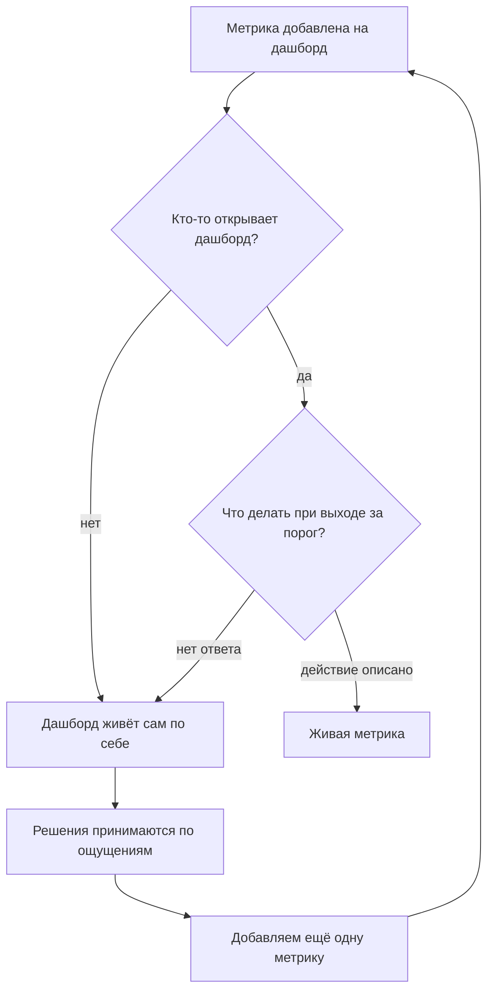
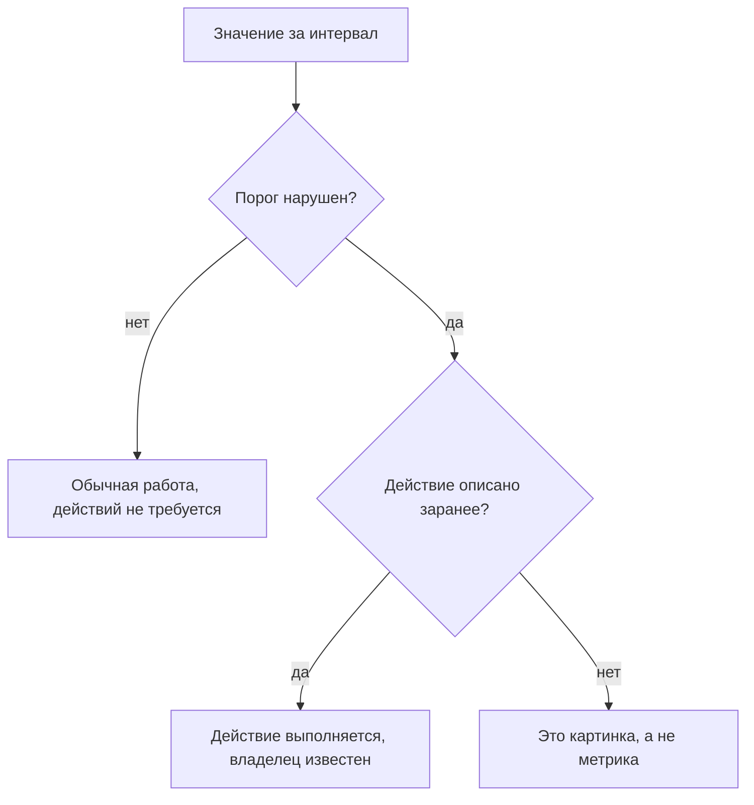
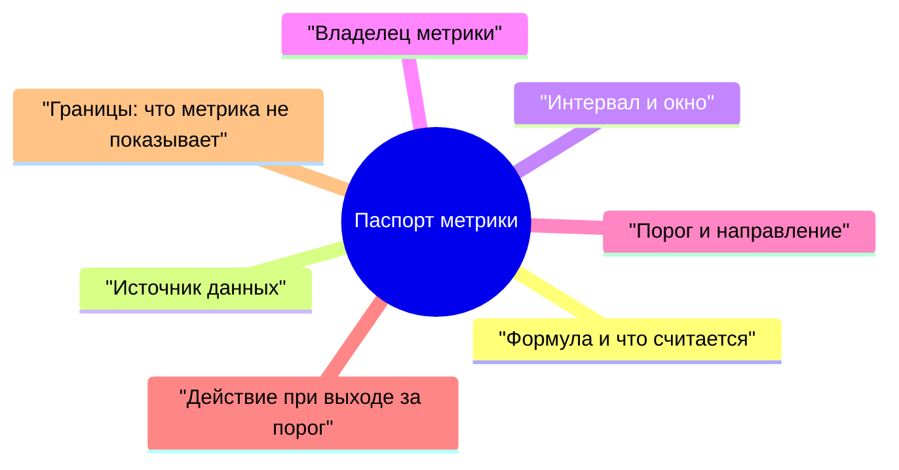
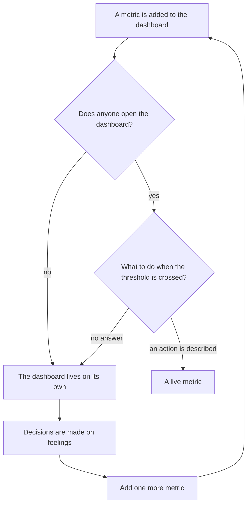
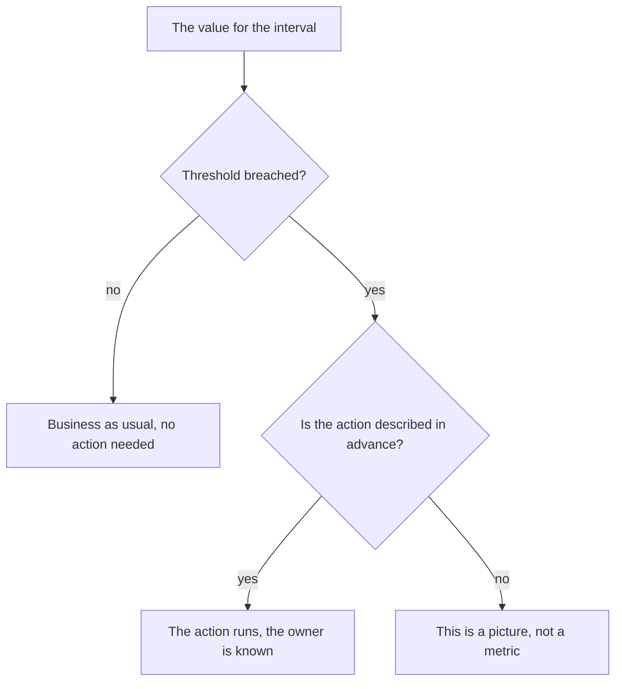
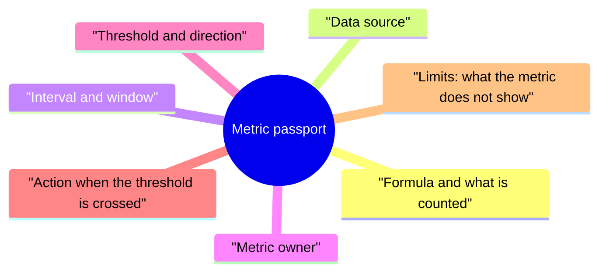
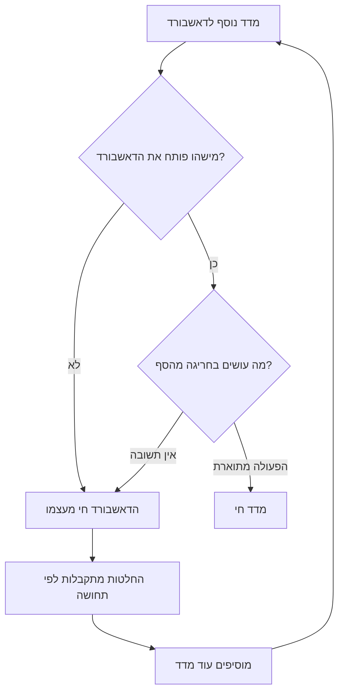
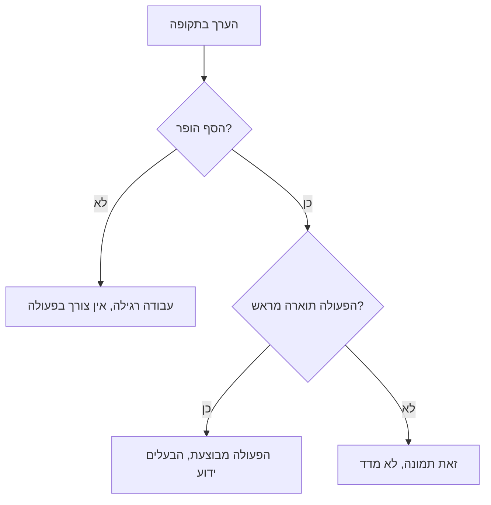
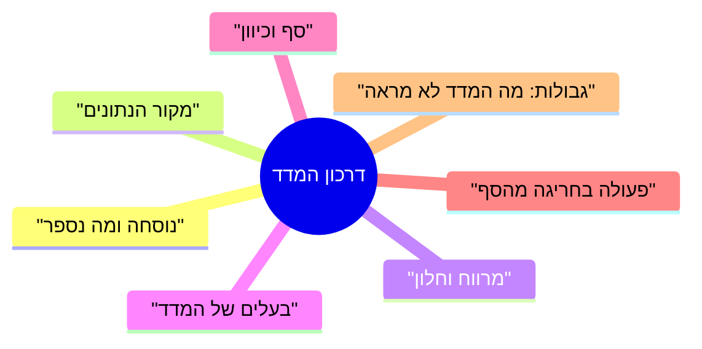

<!-- lang:ru -->

## Введение

Дашборд есть у каждой поддержки, и почти у каждой он не меняет ни одного решения. Цифры обновляются, графики живут своей жизнью, а разговор на планёрке всё равно идёт в терминах «вроде справляемся» и «вроде стало хуже». Метрика присутствует, решения — нет.

Я пришёл к простому критерию, который отсекает большинство бесполезных измерений: у метрики должно быть действие, которое наступает после выхода за порог. Если ответ на вопрос «что мы делаем, если значение ушло за границу» отсутствует, то это не метрика, а иллюстрация: она описывает прошлое и не влияет на будущее.

В этой статье — почему дашборды умирают, как выглядит критерий живой метрики, что записывается в паспорт и с каких трёх метрик стоит начинать, чтобы не утонуть. Она продолжает линию, начатую в «Baseline раньше целей»: там речь шла о том, откуда берутся числа и как они превращаются в цели; здесь — о том, как числа превращаются в действия.

## Музей метрик

Первый дашборд, который я получил в наследство, был красивым и бесполезным. Метрики в нём появлялись по одной: кому-то из руководства было интересно, сколько заявок приходит ночью, кому-то — какая доля клиентов пишет повторно. Каждое пожелание выполнялось, и через год на экране было столько графиков, что читать их стало невозможно.

Музей метрик узнаётся по признакам, которые не связаны с качеством самих цифр:

- **Дашборд никто не открывает.** Кроме случаев, когда нужно сделать скриншот для отчёта.
- **Значение не обсуждается.** На вопрос «почему упало» отвечают «сезонность», и на этом разговор заканчивается.
- **Ни одно решение не изменилось.** Ни приоритет очереди, ни штат, ни регламент — ничего не зависело от этих чисел.
- **Коллекция растёт.** Каждый квартал появляется новая метрика, а старая остаётся: убрать страшнее, чем добавить.

Механика вырождения простая: метрика добавляется, чтобы ответить на чей-то вопрос, но никто не договаривается, что делать с ответом. Через несколько циклов дашборд перестаёт быть инструментом и становится архивом.

Отдельная ловушка — удаление. Убрать метрику психологически труднее, чем добавить: кажется, что без неё мы ослепнем. На деле ослепляет как раз избыток графиков: когда их десяток, не смотрит никто.

Выход из круга один — не чистить дашборд, а договориться о действиях. Дальше — как выглядит эта договорённость.

## Критерий живой метрики

Один вопрос отделяет инструмент от картинки: что происходит в понедельник, если цифра за неделю вышла за порог? Ответ должен быть конкретным: кто-то что-то делает до такой-то даты. Если ответа нет, метрика не работает — сколько бы труда ни ушло на её сбор.

Из этого критерия вытекают три следствия, которые я проверяю у любой новой метрики.

**У метрики есть владелец.** Не «команда следит», а человек, который смотрит значение и запускает действие. Без владельца метрика живёт до первого отпуска.

**У метрики есть порог, а не только график.** Порог — это граница, за которой команда договорилась действовать. Он может быть грубым: важно не точное число, а то, что пересечение границы означает конкретный разговор, а не новую дискуссию о том, хорошая ли цифра.

**У метрики есть границы интерпретации.** Любая метрика что-то не показывает, и это записывается отдельно. Иначе через месяц её начнут использовать для выводов, которые она не поддерживает, — и доверие к ней умрёт вместе с первым таким выводом.

Как это выглядит в применении:

Есть и обратная проверка, которая нравится мне больше всего: метрика должна быть кому-то неудобна. Если значение всегда в норме и никогда не требует разговора, она не проверяет ничего, кроме собственной исправности.

## Паспорт метрики по полям

Паспорт — это страница на каждую метрику, где записано всё, без чего её невозможно интерпретировать одинаково. Форма скучная, но именно она убирает главный источник споров: разные люди считают разные вещи под одним названием.

Поля по существу:

- **Формула.** Что в числителе, что в знаменателе, что исключено из расчёта. Скучные детали вроде «считать по событиям, а не по текущим статусам» или «не учитывать заявки, закрытые по просьбе клиента» решают больше, чем сама метрика.
- **Источник данных.** Конкретная система и правило выгрузки. Один период — один источник: данные из трекера, чата и памяти не смешиваются.
- **Интервал и окно.** Как часто смотрим и за какой период считаем. Недельный контроль при квартальном окне — рабочая комбинация: она убирает шум отдельных недель.
- **Владелец.** Человек, который отвечает за значение и за действие. У него есть право прийти к лиду с проблемой по этой метрике.
- **Порог и направление.** Что считается нормой и какой дрейф является сигналом. Направление важнее абсолютного значения: медленный рост доли повторных обращений важнее, чем сама цифра сегодня.
- **Действие.** Что именно делается при выходе за порог: кто, что и в какой срок. Если действие невозможно сформулировать, метрика лишняя, и это повод её не заводить.
- **Границы.** Что метрика не показывает и для каких выводов не годится.

Полезное правило заполнения: паспорт пишет тот, кто будет действовать по метрике, а не тот, кто её собирает. Аналитик может посчитать что угодно, но если у значения нет потребителя, паспорт превращается в документ ради документа.

И ещё одно — про пересмотр. Паспорт не высечен в камне: формулы и пороги уточняются по мере накопления данных, но каждое изменение фиксируется с датой и причиной. Без этого через год невозможно сравнить значения: цифра та же, а считается уже иначе, и все выводы о движении становятся спорными.

<!-- вилка: пример одного своего паспорта целиком — формула, источник, окно, владелец, порог, действие. -->

## Набор метрик серии

Одна метрика отвечает на свой вопрос; только набор закрывает то, ради чего существует поддержка: быстро ли мы отвечаем, качественно ли решаем, растёт ли знание, не выгорает ли команда.

| Метрика | Что показывает | Что не показывает |
| --- | --- | --- |
| Время первого ответа (FRT) | Как быстро клиент получает содержательный ответ | Не отличает живой ответ от шаблонного, если определение не зафиксировано |
| MTTA — среднее время до подтверждения заявки | Скорость реакции дежурной смены | Скрывает распределение: среднее может быть в норме при провалах в отдельных сменах |
| MTTR по исходам — среднее время решения | Сколько проблема живёт у клиента | Смешивает работу команды с ожиданием клиента, если не разделять эти времена |
| FCR — доля решений при первом обращении | Как часто хватает одного касания | Растёт при агрессивном закрытии и падает при честной классификации |
| CSAT с охватом | Как клиент оценивает решение | Без охвата не интерпретируется: отвечают в основном крайние случаи |
| Доля повторных обращений | Качество решения, а не скорость закрытия | Зависит от того, считается ли обращение по той же теме повтором |
| Доля решений по базе знаний | Зрелость знаний и потенциал самообслуживания | Не показывает, была ли статья полезной: инженер мог сослаться и всё равно объяснить |
| eNPS команды | Насколько люди готовы рекомендовать работу здесь | Про людей, не про клиентов; измеряется редко и не годится для недельного контроля |

Несколько правил про набор целиком, без которых таблица превращается в тот самый музей.

**Метрик должно быть меньше, чем действий.** Если на дашборде десять чисел, из них живых обычно два-три. Остальные стоит убрать — не потому, что они плохие, а потому, что внимание команды ограничено.

**MTTA и MTTR считаются раздельно по критичности и по исходам.** Общая средняя по всем заявкам смешивает минуты и недели и не говорит ничего.

**CSAT не читается без охвата.** Удовлетворённость без доли ответивших — это оценка тех, у кого было настроение отвечать.

**Доля решений по базе знаний без контекста вводит в заблуждение.** Она растёт, когда статьи есть, и падает, когда классификация становится честнее.

**eNPS измеряется редко и не превращается в недельный контроль.** Его задача — увидеть динамику за квартал, а не ловить колебания.

<!-- вилка: какие метрики у вас на дашборде сейчас, какие из них действительно живые и какие данные есть в трекере. -->

## Старт с трёх метрик

Соблазн при перестройке дашборда — собрать сразу всё. Этот путь ведёт в тот же музей, только быстрее: десять паспортов за месяц не заполняет никто, даже сам автор идеи. Медленный старт выглядит менее убедительно в презентации, зато через квартал три живые метрики делают для управления больше, чем весь прошлый дашборд.

Рабочий старт — три метрики, по одной на каждый вопрос:

1. **Скорость.** Время первого ответа или MTTA — то, что команда может изменить своими действиями уже на этой неделе.
2. **Качество.** Доля повторных обращений или FCR — то, что не даёт гнать скорость за счёт клиента.
3. **Знание или люди.** Доля решений по базе знаний либо eNPS — то, что показывает, растёт ли система, а не только её пропускная способность.

Порядок внедрения, который я считаю рабочим:

- выбрать три метрики и написать три паспорта: коротко, на страницу каждую;
- измерить точку А по тем же правилам, по которым считаем дальше;
- договориться о порогах с командой, а не спустить их сверху: порог, в который никто не верит, не запускает действий;
- проверить через месяц главное: было ли хотя бы одно решение, принятое по этим числам? Если нет, метрика мёртвая — либо у неё не тот порог, либо не тот владелец;
- добавлять четвертую метрику только после того, как три проживут квартал.

<!-- вилка: свои паспорта трёх–пяти метрик и текущие значения — что стало действием в первый квартал. -->

Живая метрика меняет не отчёт, а поведение: кто-то открывает значение, видит выход за порог и делает то, что записано в паспорте. Всё остальное — графика, которая делает отчёт похожим на управление.

Следующая статья серии — «Аудит живучести: что сломается, когда вас не будет» — о том, какие из этих механизмов переживут ваш отпуск, а какие держатся только на привычке.

<!-- lang:en -->

## Introduction

Every support team has a dashboard, and almost every one of them changes no decisions. The numbers update, the charts live their own life, and the conversation at the stand-up still runs in terms of "we seem to be coping" and "it seems to have got worse". The metric is present; the decisions are not.

I arrived at a simple criterion that cuts off most useless measurements: a metric must have an action that follows when it crosses the threshold. If there is no answer to the question "what do we do when the value goes past the line", then it is not a metric but an illustration: it describes the past and does not affect the future.

This article is about why dashboards die, what the criterion of a live metric looks like, what goes into the passport, and which three metrics are worth starting with so as not to drown. It continues the line started in "Baseline before goals": there the subject was where the numbers come from and how they become goals; here it is how numbers become actions.

## The museum of metrics

The first dashboard I inherited was beautiful and useless. Its metrics appeared one at a time: someone in management was curious how many tickets arrive at night, someone else about what share of clients write again. Every wish was fulfilled, and a year later there were so many charts on the screen that reading them had become impossible.

A museum of metrics is recognised by signs that have nothing to do with the quality of the numbers themselves:

- **Nobody opens the dashboard.** Except when a screenshot is needed for a report.
- **The value is not discussed.** Asked "why did it drop", people answer "seasonality", and that is where the conversation ends.
- **Not one decision has changed.** Neither queue priority, nor headcount, nor procedure — nothing depended on these numbers.
- **The collection grows.** Every quarter brings a new metric while the old one stays: removing is scarier than adding.

The mechanics of degeneration are simple: a metric is added to answer someone's question, but nobody agrees on what to do with the answer. After a few cycles the dashboard stops being a tool and becomes an archive.

A separate trap is deletion. Removing a metric is psychologically harder than adding one: it feels as if without it we will go blind. In fact it is the ten charts that blind you: while everyone looks at them, nobody looks at any of them.

There is only one way out of the loop — not to clean up the dashboard but to agree on actions. What follows is what that agreement looks like.

## The criterion of a live metric

One question separates a tool from a picture: what happens on Monday if the number went past the threshold during the week? The answer must be concrete: someone does something by a certain date. If there is no answer, the metric is not working — however much effort went into collecting it.

Three consequences follow from this criterion, and I check them on any new metric.

**A metric has an owner.** Not "the team keeps an eye on it" but a person who looks at the value and starts the action. Without an owner a metric lives until the first vacation.

**A metric has a threshold, not just a chart.** A threshold is the line past which the team has agreed to act. It can be rough: what matters is not the exact number but that crossing the line means a specific conversation rather than a fresh debate about whether the number is good.

**A metric has limits of interpretation.** Any metric fails to show something, and that is recorded separately. Otherwise in a month it will be used for conclusions it does not support — and trust in it dies along with the first such conclusion.

How this looks in practice:

There is also a reverse test, which I like best: a metric should be inconvenient to someone. If the value is always within norm and never requires a conversation, it checks nothing but its own health.

## The metric passport, field by field

A passport is a page per metric recording everything without which it cannot be read the same way by different people. The form is boring, but it is exactly what removes the main source of disputes: different people count different things under one name.

The fields, substantively:

- **Formula.** What is in the numerator, what in the denominator, what is excluded from the calculation. Boring details like "count by events, not by current statuses" or "ignore tickets closed at the client's request" decide more than the metric itself.
- **Data source.** A specific system and an export rule. One period, one source: data from the tracker, the chat and memory is not mixed.
- **Interval and window.** How often we look and over what period we count. Weekly control over a quarterly window is a working combination: it removes the noise of individual weeks.
- **Owner.** The person responsible for the value and for the action. They have the right to come to the lead with a problem about this metric.
- **Threshold and direction.** What counts as normal and which drift is a signal. Direction matters more than the absolute value: a slow growth of the repeat-contact share matters more than the figure today.
- **Action.** What exactly is done when the threshold is crossed: who, what and by when. If the action cannot be formulated, the metric is superfluous, and that is a reason not to create it.
- **Limits.** What the metric does not show and which conclusions it is unfit for.

A useful rule when filling it in: the passport is written by the person who will act on the metric, not by the one who collects it. An analyst can compute anything, but if the value has no consumer, the passport turns into a document for the document's sake.

And one more thing, about revision. The passport is not carved in stone: formulas and thresholds are refined as data accumulates, but every change is recorded with a date and a reason. Without that, a year later the values cannot be compared: the number is the same but it is counted differently, and every conclusion about movement becomes arguable.

<!-- вилка: пример одного своего паспорта целиком — формула, источник, окно, владелец, порог, действие. -->

## The metric set of the series

A single metric speaks only about itself, and only a set covers the questions support exists for: are we answering fast, are we solving well, is knowledge growing, is the team burning out.

| Metric | What it shows | What it does not show |
| --- | --- | --- |
| Time to first response (FRT) | How fast the client gets a substantive answer | Does not distinguish a real answer from a template one, unless the definition is fixed |
| MTTA — mean time to acknowledge a ticket | How fast the on-call shift reacts | Hides the distribution: the average can be within norm while individual shifts fail |
| MTTR by outcomes — mean time to resolve | How long the problem lives for the client | Blends the team's work with the client's waiting, unless those times are separated |
| FCR — the share of resolutions at first contact | How often one touch is enough | Grows with aggressive closing and falls with honest classification |
| CSAT with coverage | How the client rates the resolution | Cannot be interpreted without coverage: mostly the extreme cases answer |
| Share of repeat contacts | The quality of the resolution, not the speed of closing | Depends on whether a contact on the same topic counts as a repeat |
| Share of resolutions linked to a knowledge base article | The maturity of knowledge and the potential for self-service | Does not show whether the article helped: an engineer could link it and still explain everything |
| Team eNPS | How willing people are to recommend working here | About people, not clients; measured rarely and unfit for weekly control |

A few rules about the set as a whole, without which the table turns into that very museum.

**There must be fewer metrics than actions.** If a dashboard has ten numbers, two or three of them are usually live. The rest are worth removing — not because they are bad but because the team's attention is limited.

**MTTA and MTTR are counted separately by criticality and by outcomes.** A single average across all tickets blends minutes and weeks and says nothing.

**CSAT cannot be read without coverage.** Satisfaction without the share of respondents is a rating from those who happened to be in the mood to answer.

**The share of resolutions linked to a knowledge base article is misleading without context.** It grows when articles exist and falls when classification becomes more honest.

**eNPS is measured rarely and does not become weekly control.** Its job is to see the dynamics over a quarter, not to catch fluctuations.

<!-- вилка: какие метрики у вас на дашборде сейчас, какие из них действительно живые и какие данные есть в трекере. -->

## Starting with three metrics

The temptation when rebuilding a dashboard is to collect everything at once. That path leads to the same museum, only faster: nobody fills in ten passports in a month, not even the author of the idea. A slow start looks less convincing in a presentation, but a quarter later three live metrics do more for management than the entire previous dashboard.

A working start is three metrics, one per question:

1. **Speed.** Time to first response or MTTA — something the team can change by its own actions this very week.
2. **Quality.** The share of repeat contacts or FCR — what keeps speed from being chased at the client's expense.
3. **Knowledge or people.** The share of resolutions linked to a knowledge base article or eNPS — what shows whether the system is growing rather than only its throughput.

The rollout order I consider workable:

- choose three metrics and write three passports: briefly, a page each;
- measure point A by the same rules we will count by later;
- agree on thresholds with the team rather than handing them down: a threshold nobody believes in starts no actions;
- check the main thing a month later: was there at least one decision taken on these numbers? If not, the metric is dead — either its threshold is wrong or its owner is;
- add a fourth metric only after the three have lived through a quarter.

<!-- вилка: свои паспорта трёх–пяти метрик и текущие значения — что стало действием в первый квартал. -->

A live metric changes not the report but the behaviour: someone opens the value, sees the threshold crossed, and does what is written in the passport. Everything else is graphics that make a report look like management.

The next article of the series — "Resilience audit: what breaks when you are gone" — is about which of these mechanisms will survive your vacation and which hold on habit alone.

<!-- lang:he -->

## מבוא

דאשבורד יש לכל תמיכה, וכמעט בכל תמיכה הוא לא משנה אף החלטה. המספרים מתעדכנים, הגרפים חיים חיים משל עצמם, והשיחה בישיבת הבוקר בכל זאת מתנהלת במונחים של "נראה שאנחנו מסתדרים" ו"נראה שנהיה גרוע יותר". המדד נוכח, ההחלטות — לא.

הגעתי לקריטריון פשוט שמסנן את רוב המדידות חסרות התועלת: למדד צריכה להיות פעולה שמתרחשת אחרי חריגה מהסף. אם אין תשובה לשאלה "מה אנחנו עושים אם הערך עבר את הגבול", זה לא מדד אלא איור: הוא מתאר את העבר ולא משפיע על העתיד.

במאמר הזה — למה דאשבורדים מתים, איך נראה הקריטריון של מדד חי, מה נרשם בדרכון ומאילו שלושה מדדים כדאי להתחיל כדי לא לטבוע. הוא ממשיך את הקו שהתחיל ב"בסיס לפני מטרות": שם דובר על מאיפה מגיעים המספרים ואיך הם הופכים למטרות; כאן — איך המספרים הופכים לפעולות.

## מוזיאון המדדים

הדאשבורד הראשון שקיבלתי בירושה היה יפה וחסר תועלת. המדדים בו נוספו אחד אחד: למישהו בהנהלה היה מעניין כמה פניות מגיעות בלילה, למישהו אחר — איזה חלק מהלקוחות פונה שוב. כל בקשה בוצעה, וכעבור שנה היו על המסך כל כך הרבה גרפים שאי אפשר היה לקרוא אותם.

מוזיאון המדדים מזוהה לפי סימנים שאינם קשורים לאיכות המספרים עצמם:

- **את הדאשבורד אף אחד לא פותח.** חוץ ממקרים שצריך צילום מסך לדוח.
- **הערך לא נדון.** על השאלה "למה ירד" עונים "עונתיות", ובזה השיחה נגמרת.
- **אף החלטה לא השתנתה.** לא עדיפות התור, לא כוח האדם, לא הנוהל — שום דבר לא היה תלוי במספרים האלה.
- **האוסף גדל.** כל רבעון נוסף מדד חדש, והישן נשאר: להסיר מפחיד יותר מאשר להוסיף.

המכניקה של ההידרדרות פשוטה: מדד נוסף כדי לענות על השאלה של מישהו, אבל אף אחד לא מסכים מה עושים עם התשובה. אחרי כמה מחזורים הדאשבורד מפסיק להיות כלי והופך לארכיון.

מלכודת נפרדת היא ההסרה. להסיר מדד קשה יותר מבחינה פסיכולוגית מאשר להוסיף: נדמה שבלעדיו נתעוור. בפועל דווקא עשרה גרפים הם שמעוורים: כל עוד כולם מסתכלים עליהם, אף אחד לא מסתכל.

יש מוצא אחד מהמעגל — לא לנקות את הדאשבורד אלא להסכים על פעולות. בהמשך — איך נראית ההסכמה הזאת.

## הקריטריון של מדד חי

שאלה אחת מפרידה בין כלי לתמונה: מה קורה ביום שני אם המספר לשבוע עבר את הסף? התשובה צריכה להיות קונקרטית: מישהו עושה משהו עד תאריך מסוים. אם אין תשובה, המדד לא עובד — ולא משנה כמה עבודה הושקעה באיסוף שלו.

מהקריטריון הזה נובעות שלוש מסקנות שאני בודק בכל מדד חדש.

**למדד יש בעלים.** לא "הצוות עוקב", אלא אדם שמסתכל על הערך ומפעיל את הפעולה. בלי בעלים מדד חי עד החופשה הראשונה.

**למדד יש סף, לא רק גרף.** הסף הוא הגבול שמעבר לו הצוות הסכים לפעול. הוא יכול להיות גס: חשוב לא המספר המדויק אלא העובדה שחציית הגבול משמעה שיחה קונקרטית, לא דיון חדש בשאלה אם המספר טוב.

**למדד יש גבולות פרשנות.** כל מדד לא מראה משהו, וזה נרשם בנפרד. אחרת כעבור חודש יתחילו להשתמש בו למסקנות שהוא לא תומך בהן — והאמון בו ימות יחד עם המסקנה הראשונה כזאת.

איך זה נראה ביישום:

יש גם בדיקה הפוכה, והיא האהובה עליי ביותר: המדד צריך להפריע למישהו. אם הערך תמיד בטווח התקין ואף פעם לא דורש שיחה, הוא לא בודק דבר מלבד תקינותו שלו.

## דרכון המדד לפי שדות

הדרכון הוא עמוד לכל מדד, שבו רשום כל מה שבלעדיו אי אפשר לפרש אותו באופן אחיד. הטופס משעמם, אבל דווקא הוא מסיר את מקור המחלוקת העיקרי: אנשים שונים סופרים דברים שונים תחת אותו שם.

השדות לגופם:

- **נוסחה.** מה במונה, מה במכנה, מה מוחרג מהחישוב. פרטים משעממים כמו "לספור לפי אירועים ולא לפי סטטוסים נוכחיים" או "לא להביא בחשבון פניות שנסגרו לבקשת הלקוח" מכריעים יותר מהמדד עצמו.
- **מקור הנתונים.** מערכת מסוימת וכלל הייצוא. תקופה אחת — מקור אחד: נתונים מהטראקר, מהצ'אט ומהזיכרון לא מתערבבים.
- **מרווח וחלון.** כמה פעמים מסתכלים ועל איזו תקופה סופרים. בקרה שבועית על חלון רבעוני היא שילוב עובד: היא מסירה את הרעש של שבועות בודדים.
- **בעלים.** האדם שאחראי על הערך ועל הפעולה. יש לו זכות לבוא למנהל התמיכה עם בעיה לגבי המדד הזה.
- **סף וכיוון.** מה נחשב לתקין ואיזו סטייה היא אות. הכיוון חשוב יותר מהערך המוחלט: עלייה איטית בחלק הפניות החוזרות חשובה יותר מהמספר עצמו היום.
- **פעולה.** מה בדיוק נעשה בחריגה מהסף: מי, מה ובאיזה מועד. אם אי אפשר לנסח פעולה, המדד מיותר, וזו סיבה לא להקים אותו.
- **גבולות.** מה המדד לא מראה ולאילו מסקנות הוא לא מתאים.

כלל שימושי למילוי: את הדרכון כותב מי שיפעל לפי המדד, לא מי שאוסף אותו. אנליטיקאי יכול לספור כל דבר, אבל אם לערך אין צרכן, הדרכון הופך למסמך לשם המסמך.

ועוד דבר — על בחינה מחדש. הדרכון לא חקוק באבן: נוסחאות וספים מתחדדים ככל שנצברים נתונים, אבל כל שינוי נרשם עם תאריך וסיבה. בלי זה כעבור שנה אי אפשר להשוות ערכים: המספר אותו מספר, אבל סופרים אותו אחרת, וכל המסקנות על תנועה נעשות שנויות במחלוקת.

<!-- вилка: пример одного своего паспорта целиком — формула, источник, окно, владелец, порог, действие. -->

## סט המדדים של הסדרה

מדד בודד מדבר על עניינו, ורק סט סוגר את השאלות שבגללן קיימת התמיכה: האם אנחנו עונים מהר, האם אנחנו פותרים באיכות, האם הידע גדל, והאם הצוות לא נשחק.

| מדד | מה הוא מראה | מה הוא לא מראה |
| --- | --- | --- |
| זמן לתגובה ראשונה (FRT) | כמה מהר הלקוח מקבל תשובה מהותית | לא מבדיל בין תשובה אנושית לתבניתית, אם ההגדרה לא נקבעה |
| MTTA — הזמן הממוצע עד אישור הפנייה | מהירות התגובה של המשמרת התורנית | מסתיר את ההתפלגות: הממוצע יכול להיות תקין כשיש כשלים במשמרות מסוימות |
| MTTR לפי תוצאות — זמן הפתרון הממוצע | כמה זמן הבעיה חיה אצל הלקוח | מערבב עבודת צוות עם המתנה של הלקוח, אם לא מפרידים בין הזמנים |
| FCR — חלק הפתרונות בפנייה הראשונה | באיזו תדירות מספיק מגע אחד | עולה כשסוגרים באגרסיביות ויורד כשהסיווג כן |
| CSAT עם כיסוי | איך הלקוח מעריך את הפתרון | בלי כיסוי אין לו פרשנות: עונים בעיקר מקרי הקצה |
| חלק הפניות החוזרות | איכות הפתרון, לא מהירות הסגירה | תלוי בשאלה אם פנייה באותו נושא נחשבת חזרה |
| חלק הפתרונות עם הפניה למאמר | בגרות הידע והפוטנציאל לשירות עצמי | לא מראה אם המאמר עזר: המוקדן יכול היה להפנות ובכל זאת להסביר |
| eNPS של הצוות | עד כמה אנשים מוכנים להמליץ לעבוד כאן | על אנשים, לא על לקוחות; נמדד לעיתים נדירות ולא מתאים לבקרה שבועית |

כמה כללים על הסט כולו, שבלעדיהם הטבלה הופכת למוזיאון ההוא.

**המדדים צריכים להיות פחות מהפעולות.** אם על הדאשבורד עשרה מספרים, מהם חיים בדרך כלל שניים־שלושה. את השאר שווה להסיר — לא מפני שהם גרועים, אלא מפני שתשומת הלב של הצוות מוגבלת.

**MTTA ו-MTTR נספרים בנפרד לפי קריטיות ולפי תוצאות.** ממוצע כללי על כל הפניות מערבב דקות ושבועות ולא אומר דבר.

**את CSAT אי אפשר לקרוא בלי כיסוי.** שביעות רצון בלי חלק המשיבים היא הערכה של מי שהיה במצב רוח לענות.

**חלק הפתרונות עם הפניה למאמר בלי הקשר מטעה.** הוא עולה כשיש מאמרים ויורד כשהסיווג נהיה כן יותר.

**eNPS נמדד לעיתים נדירות ולא הופך לבקרה שבועית.** התפקיד שלו הוא לראות דינמיקה ברבעון, לא לתפוס תנודות.

<!-- вилка: какие метрики у вас на дашборде сейчас, какие из них действительно живые и какие данные есть в трекере. -->

## התחלה משלושה מדדים

הפיתוי בבנייה מחדש של הדאשבורד הוא לאסוף הכול בבת אחת. הדרך הזאת מובילה לאותו מוזיאון, רק מהר יותר: עשרה דרכונים בחודש לא ממלא אף אחד, גם לא מחבר הרעיון. התחלה איטית נראית פחות משכנעת במצגת, אבל כעבור רבעון שלושה מדדים חיים עושים לניהול יותר מכל הדאשבורד הקודם.

התחלה עובדת — שלושה מדדים, אחד לכל שאלה:

1. **מהירות.** זמן לתגובה ראשונה או MTTA — מה שהצוות יכול לשנות בפעולות שלו כבר השבוע.
2. **איכות.** חלק הפניות החוזרות או FCR — מה שלא נותן לרדוף אחרי מהירות על חשבון הלקוח.
3. **ידע או אנשים.** חלק הפתרונות עם הפניה למאמר או eNPS — מה שמראה אם המערכת גדלה, ולא רק את תפוקת הזרימה שלה.

סדר ההטמעה שאני מחשיב לעובד:

- לבחור שלושה מדדים ולכתוב שלושה דרכונים: בקצרה, עמוד לכל אחד;
- למדוד את נקודה א לפי אותם כללים שלפיהם נספור בהמשך;
- להסכים על ספים עם הצוות, ולא להוריד אותם מלמעלה: סף שאיש לא מאמין בו לא מפעיל פעולות;
- לבדוק כעבור חודש את הדבר העיקרי: האם הייתה לפחות החלטה אחת שהתקבלה לפי המספרים האלה? אם לא, המדד מת — או שהסף שלו לא נכון, או שהבעלים לא נכון;
- להוסיף מדד רביעי רק אחרי ששלושה יחיו רבעון.

<!-- вилка: свои паспорта трёх–пяти метрик и текущие значения — что стало действием в первый квартал. -->

מדד חי משנה לא את הדוח אלא את ההתנהגות: מישהו פותח את הערך, רואה חריגה מהסף ועושה את מה שרשום בדרכון. כל השאר הוא גרפיקה שעושה מהדוח משהו שנראה כמו ניהול.

המאמר הבא בסדרה — "ביקורת חוסן: מה יישבר כשלא תהיו" — על אילו מהמנגנונים האלה ישרדו את החופשה שלכם, ואילו מחזיקים רק בהרגל.
