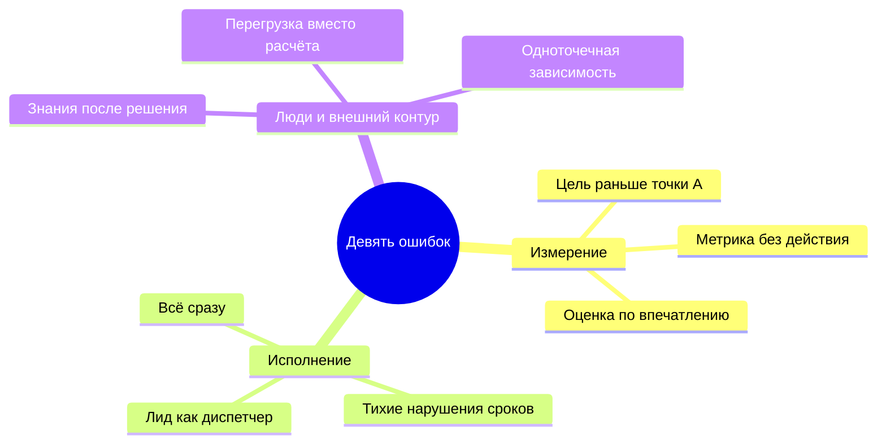
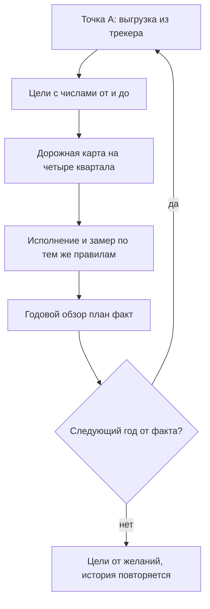
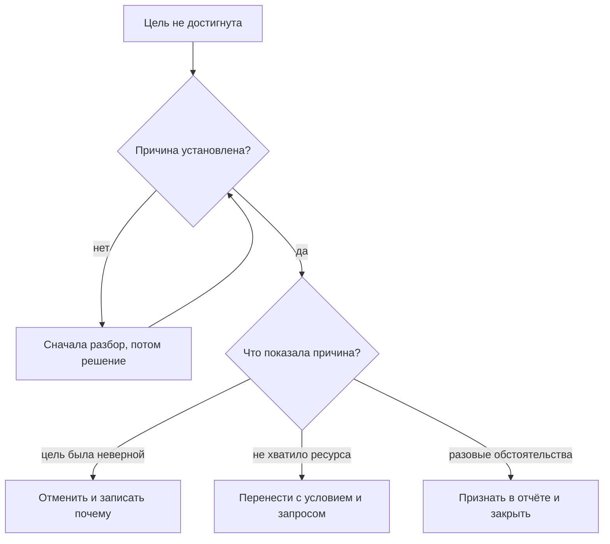
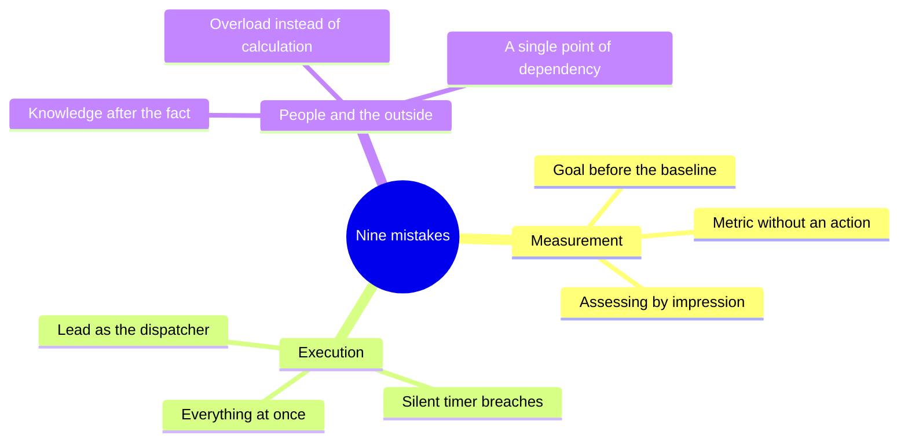
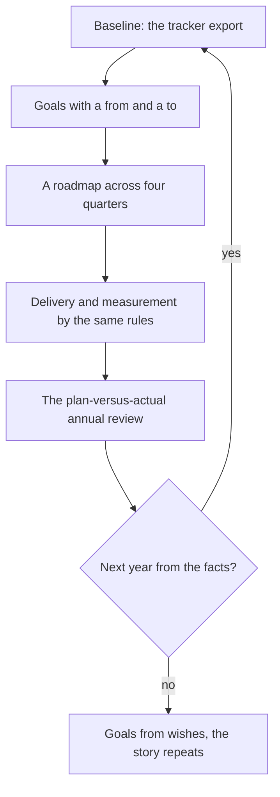
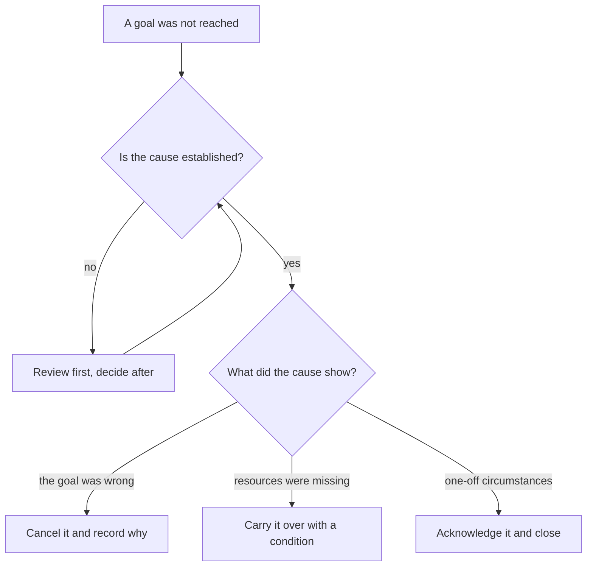
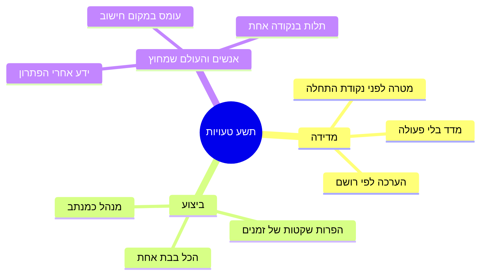
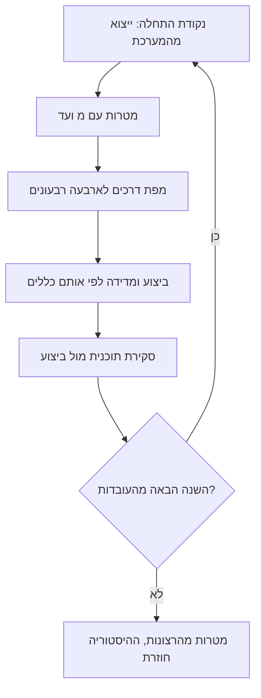
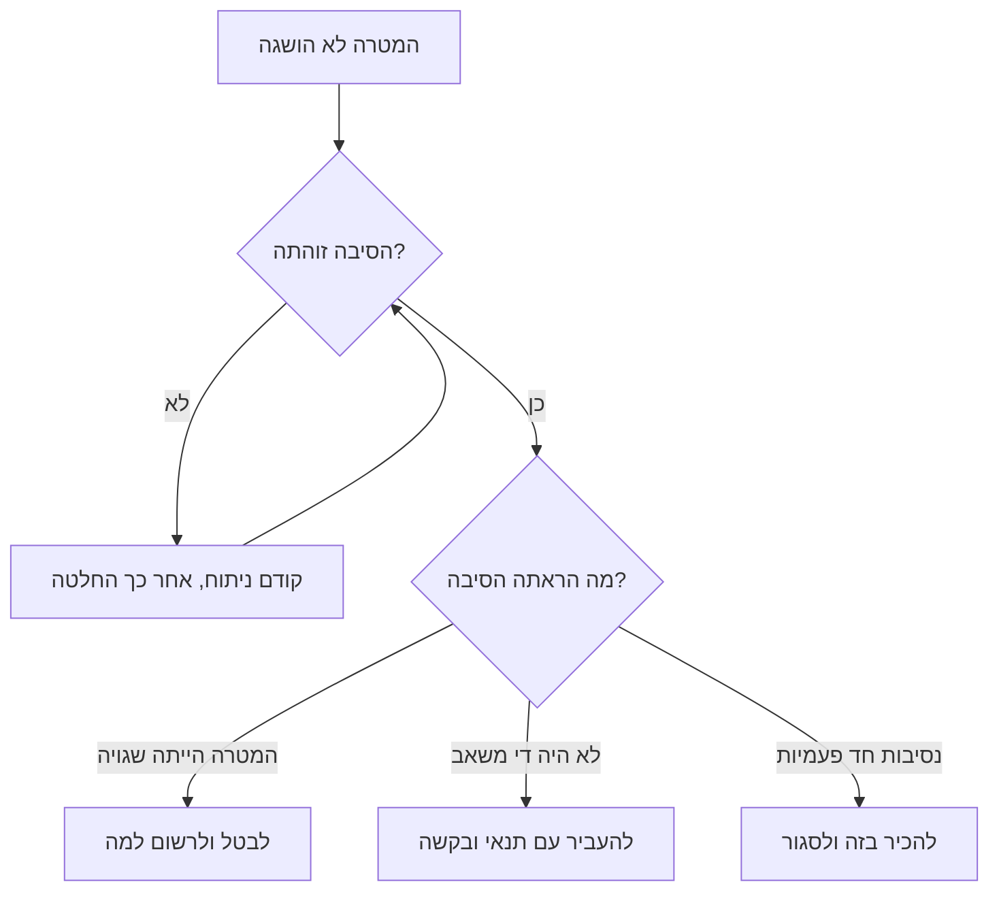

<!-- lang:ru -->

## Введение

Год у лида поддержки заканчивается дважды. Сначала закрывается последний квартал, потом — отчёт. И если с кварталом всё более или менее понятно, то отчёт — единственный момент в году, когда приходится честно ответить на вопрос, который весь год откладывался: что из обещанного действительно произошло.

За несколько лет и на нескольких сервисах я собрал свой список ошибок, которые совершал сам, — часть повторно. В годовом плане, по которому я работаю, он сведён к девяти формулировкам, и у каждой есть антидот: конкретный артефакт или правило, которое эту ошибку закрывает. Логика у всех девяти общая: в моменте ошибка выглядит как разумное действие — поставить цель, взять всё на себя, запустить побольше сразу, — а платить за неё приходится кварталом.

Эта статья закрывает серию, поэтому у неё две задачи. Первая — показать девять ошибок так, чтобы любую из них можно было узнать в собственной неделе. Вторая — довести год до отчёта: разобрать, как выглядит сверка «план/факт», как из неё получается план следующего года и что делать с тем, что не сбылось.

## Девять ошибок и антидоты

Важная оговорка: это не список чужих грехов. Я совершал каждую из этих ошибок и возвращаюсь к некоторым до сих пор — обычно после того, как сервис меняет масштаб или состав. Формат трёх колонок простой: как ошибка формулируется, как она выглядит на практике и чем лечится.

| Ошибка | Как выглядит на практике | Антидот |
| --- | --- | --- |
| Цель раньше измерения | Годовой план начинается с «поднять удовлетворённость», а точки А нет | Сначала выгрузка из трекера, потом цель с числами «от», «до», сроком и владельцем |
| Лид как единственный диспетчер | Каждый нестандартный тикет доходит до лида, его отпуск останавливает маршрутизацию | Три списка границ, триаж при первом касании, матрица маршрутов вместо личной функции |
| Всё сразу | Десяток инициатив в одном квартале, ни одна не закрыта | Правило последовательности: следующий квартал — только после результата предыдущего |
| Метрика без действия | Дашборд, который никто не открывает, и цифры, из которых ничего не следует | Паспорт метрики: формула, источник, порог и действие; нет действия — нет метрики |
| Тихие нарушения сроков | Просроченные заявки всплывают на разборе через месяц | Еженедельный контроль очереди и сигнал по таймеру, а не по памяти |
| Знания после решения | Статья в базу пишется «когда будет время» и не пишется никогда | KCS: статья создаётся в момент решения, у базы есть владелец и шаблон |
| Оценка по впечатлению | В 1:1 звучит «старается» и «молодец», критериев нет ни у кого | QA-выборка и критерии качества, наблюдаемые факты вместо ощущений |
| Перегрузка вместо расчёта | На каждой планёрке «мы перегружены», и ни одной формулы | Расчёт мощности и запрос ресурса по данным, с альтернативами |
| Одноточечная зависимость | Отпуск одного человека — инцидент, уход — катастрофа | Норматив подхвата, второй носитель каждого навыка, аудит живучести |

<!-- вилка: сверьте формулировки с §9 годового плана и добавьте 1–2 ошибки, которые встречались именно у вас. -->

Если присмотреться, девять ошибок делятся на три семейства, и каждое закрывается своим типом работы.

Измерение — про то, что мы не знаем, откуда считаем. Исполнение — про то, что мы берёмся за много и держим маршруты в своей голове. Люди и внешний контур — про то, что сервис держится на героизме и на отсутствии разговора с теми, кто вне поддержки. Внутри каждого семейства антидоты взаимозаменяемы по смыслу: выгрузка превращается в паспорт метрики, паспорт — в расчёт мощности, расчёт — в запрос ресурса.

И ещё одна общая черта: антидот не действие, а привычка. Выгрузка из трекера сделана один раз — это не точка А, а любопытство. Списки границ составлены один раз — это не границы, а документ, который устарел через месяц. Ошибки возвращаются каждый раз, когда сервис меняет масштаб, а привычка — то, что удерживает их за дверью.

<!-- вилка: какие из девяти ошибок вы совершали и что помогло конкретно вам. -->

## Годовой обзор план/факт

Годовой отчёт я понимаю не как презентацию достижений, а как сверку. В нём по каждому результату года видны четыре вещи: что планировали, что показал факт, чем объясняется расхождение и что из этого следует для следующего года. Если четвёртого пункта нет, отчёт превращается в исторический документ.

Структура отчёта повторяет структуру года: сначала базовая рамка (результаты, границы, baseline, дорожная карта), потом стабилизация, знания, люди, внешний контур, метрики. По каждой теме — короткий блок, а не рассказ о процессе. Правила, без которых сверка перестаёт быть сверкой:

- **Одни и те же определения.** Цифра в отчёте считается по тому же определению, что и в точке А. Если определение поменялось по ходу года, это фиксируется отдельной строкой, а не замалчивается.
- **Числа из трекера, а не из памяти.** Отчёт, собранный по воспоминаниям о тяжёлых месяцах, всегда рассказывает более драматичную историю, чем было.
- **Расхождение объясняется системой, а не людьми.** «Не хватило мощности», «цель была поставлена до измерения», «инициатива не имела критерия готовности» — это объяснения, с которыми можно работать. «Команда не вытянула» — нет.
- **Несбывшееся в отчёте есть.** Отчёт без провалов читается как отчёт, в котором их спрятали, и обесценивает всё остальное.
- **У каждого вывода есть адресат.** Изменение попадает в план, в регламент, в запрос ресурса или в отказ от цели — иначе оно остаётся настроением.

<!-- вилка: ваши результаты года — 3–5 показателей с планом и фактом и объяснением расхождения. -->

Отчёт, который собирается за один вечер в конце декабря, почти всегда получается или хвалебным, или паническим — зависит от того, каким был последний месяц. Поэтому я собираю его по кускам в течение года: каждый квартальный обзор добавляет свой блок, и в декабре остаётся только свести их и написать выводы. Побочная выгода важнее: квартальная сверка показывает расхождение тогда, когда ещё можно что-то изменить, а не тогда, когда уже поздно.

## План следующего года от факта

Главное правило перехода от отчёта к плану: следующий год начинается не с желаний, а с нового факта. Факт конца декабря — это точка А для января, и всё, что в прошлом году было целью, в этом становится отправной точкой. Именно поэтому серия и начинается с baseline: без измеренной точки отсчёта каждый следующий год стартует с нуля и с теми же обещаниями.

Цикл выглядит так:

Практически это выглядит скромнее, чем звучит. В план следующего года входит не больше четырёх-пяти результатов, у каждого есть владелец, срок и способ проверки. Всё, что не попало, живёт в списке «не сейчас» — и это нормально: план из четырёх пунктов, доведённых до конца, меняет сервис сильнее, чем план из девятнадцати, из которых не закрылся ни один.

<!-- вилка: что вошло в ваш план следующего года и от какого факта вы отсчитывались. -->

## Что делать с несбывшимся

Самый тяжёлый раздел отчёта — тот, где перечислено, что не сделано. Соблазн понятен: переформулировать так, чтобы выглядело выполненным, перенести в следующий год без объяснений или просто убрать. Все три способа гарантируют, что через год список будет длиннее.

С несбывшимся есть три честных исхода, и у каждого должен быть владелец решения.

Правила здесь такие:

1. **Различать «не сделали» и «не сработало».** Не сделали — не было времени, ресурса, приоритета. Не сработало — сделали, а метрика не двинулась. Лечение у этих случаев разное, и путать их нельзя.
2. **Не переписывать историю.** Формулировка цели в отчёте — та же, что была в плане, даже если сегодня она кажется наивной. Иначе через год не с чем сравнивать.
3. **У каждого несбывшегося пункта есть решение, а не статус.** «В работе» — это не решение. Отменить, перенести с условием, признать неверной — это решения.
4. **Перенос без условия — это отмена.** Если пункт переехал в следующий год, у него есть новый срок и новое условие; без них он переехал не в план, а в привычку.

И последнее правило этого раздела: разбор несбывшегося ведётся без имён. Как только в объяснении появляется конкретный человек, обсуждение перестаёт быть про систему: остальные начинают защищаться, а причины, которые действительно важно было найти, исчезают из разговора. «Не хватило мощности», «не было критерия готовности», «маршрут держался на одном человеке» — это формулировки, с которыми можно работать дальше. Имена в такой разбор не входят ни в каком виде — включая своё.

<!-- вилка: 2–3 пункта своего года, которые не сбылись, — что именно решили с каждым. -->

## Финал серии

Серия «Стратегия управления поддержкой» писалась как система, а не как набор советов: каждая статья опирается на предыдущую, и проверяется она не сама по себе, а вместе с соседними. Вот она целиком, в порядке выхода.

**Стратегическая рамка года**

- [Пять результатов работы лида поддержки](/ru/blog/support-lead-five-results/) — 2026-03-31
- [Границы ответственности](/ru/blog/support-lead-boundaries/) — 2026-06-07
- Baseline раньше целей — 2026-11-10
- Год лида по кварталам — 2026-11-13

**Стабилизация сервиса**

- Карта сервиса и Точка А — 2026-11-15
- Триаж при первом касании — 2026-11-18
- Ни одного тихого нарушения SLA — 2026-11-21
- Эскалация в L3 — 2026-11-24

**Знания как система**

- KCS в рабочем потоке — 2026-11-26
- Шаблон статьи базы знаний и владелец КБ — 2026-11-29
- Повторяющиеся проблемы — 2026-12-02
- Самообслуживание как Shift Left — 2026-12-05

**Команда: люди и развитие**

- Ритм руководителя: правило 40 % — 2026-12-07
- 1:1, которые не превращаются в отчёт — 2026-12-10
- Оценка по наблюдаемым фактам — 2026-12-13
- Матрица компетенций — 2026-12-15
- Мощность вместо героизма — 2026-12-18

**Внешний контур**

- Матрица взаимодействий — 2026-12-21
- Статус руководству — 2026-12-24
- Просить решения, а не сочувствия — 2026-12-26
- Blameless-разбор инцидента — 2026-12-29
- Карточка проблемы для продукта — 2026-12-31

**Метрики и замыкание года**

- Метрика без действия — 2027-01-04
- Аудит живучести — 2027-01-06
- Девять ошибок лида поддержки — эта статья

Спасибо, что дочитали до конца: год лида складывается не из методов, а из привычек, и девять ошибок — это не приговор, а список того, что стоит перенести в план. Если у вас есть своя ошибка, которой нет в таблице, — напишите, я буду рад дополнить список и обсудить его в следующей серии.

<!-- lang:en -->

## Introduction

A support lead's year ends twice. First the last quarter closes, then the report does. And while the quarter is more or less clear, the report is the one moment in the year when you have to answer honestly the question you kept postponing: how much of what was promised actually happened.

Over several years and across several services I've built my own list of mistakes I made myself — some of them repeatedly. In the annual plan I work by, it comes down to nine statements, and each has an antidote: a specific artefact or rule that closes that mistake. All nine share a logic: in the moment the mistake looks like a reasonable action — set a goal, take everything on yourself, launch a lot at once — and the bill arrives a quarter later.

This article closes the series, so it has two jobs. First, to present the nine mistakes so that any of them can be recognized in your own week. Second, to carry the year through to the report: what a plan-versus-actual review looks like, how next year's plan comes out of it, and what to do with what didn't happen.

## Nine mistakes and their antidotes

One caveat: this isn't a list of other people's sins. I've made every one of these mistakes and still return to some of them — usually after the service changes scale or composition. The three-column format is simple: how the mistake is phrased, how it looks in practice, and what cures it.

| Mistake | How it looks in practice | Antidote |
| --- | --- | --- |
| A goal before a measurement | The annual plan opens with "raise satisfaction", and there is no baseline | First a tracker export, then a goal with "from", "to", a deadline and an owner |
| The lead as the only dispatcher | Every non-standard ticket reaches the lead, and their vacation stops routing | Three boundary lists, triage at first touch, a routing matrix instead of a personal function |
| Everything at once | A dozen initiatives in one quarter, none of them finished | The sequence rule: the next quarter only after the previous one has a result |
| A metric without an action | A dashboard nobody opens and numbers nothing follows from | A metric passport: formula, source, threshold, action; no action, no metric |
| Silent timer breaches | Overdue tickets surface at a review a month later | A weekly queue check and an alert on the timer, not on memory |
| Knowledge after the fact | The knowledge base article is written "when there's time" and never is | KCS: the article is created at the moment of resolution, the base has an owner and a template |
| Assessing by impression | One-on-ones hear "they try hard" and "great job", and nobody has criteria | QA sampling and quality criteria, observable facts instead of feelings |
| Overload instead of calculation | Every stand-up says "we're overloaded" and there's not one formula | A capacity calculation and a resource request backed by data, with alternatives |
| A single point of dependency | One person's vacation is an incident, their departure a catastrophe | A pickup norm, a second holder of every skill, a resilience audit |

<!-- вилка: сверьте формулировки с §9 годового плана и добавьте 1–2 ошибки, которые встречались именно у вас. -->

Look closely and the nine mistakes fall into three families, each closed by its own kind of work.

Measurement is about not knowing where we count from. Execution is about taking on too much and keeping the routes in our own head. People and the outside world is about the service resting on heroism and on the absence of a conversation with those beyond support. Within each family the antidotes are interchangeable in spirit: the export turns into the metric passport, the passport into the capacity calculation, the calculation into a resource request.

One more shared feature: an antidote is a habit, not an action. A tracker export done once isn't a baseline, it's curiosity. Boundary lists written once aren't boundaries, they're a document that went stale in a month. The mistakes come back every time the service changes scale, and the habit is what keeps them outside the door.

<!-- вилка: какие из девяти ошибок вы совершали и что помогло конкретно вам. -->

## The plan-versus-actual annual review

I understand the annual report not as a presentation of achievements but as a reconciliation. For every result of the year it shows four things: what was planned, what the facts showed, what explains the gap, and what follows from it for next year. Without the fourth item, the report becomes a historical document.

The report's structure mirrors the year's: first the base frame (results, boundaries, baseline, roadmap), then stabilization, knowledge, people, the outside world, metrics. Each theme gets a short block, not a narrative of the process. The rules without which a reconciliation stops being one:

- **The same definitions.** A number in the report is counted by the same definition as at the baseline. If the definition changed during the year, that gets its own line rather than staying unsaid.
- **Numbers from the tracker, not from memory.** A report assembled from memories of hard months always tells a more dramatic story than what happened.
- **A gap is explained by the system, not by people.** "We lacked capacity", "the goal was set before the measurement", "the initiative had no definition of done" are explanations you can work with. "The team didn't deliver" is not.
- **What didn't happen is in the report.** A report without failures reads as a report where they were hidden, and it devalues everything else in it.
- **Every conclusion has a destination.** A change lands in the plan, in a process, in a resource request, or in dropping a goal — otherwise it stays a mood.

<!-- вилка: ваши результаты года — 3–5 показателей с планом и фактом и объяснением расхождения. -->

A report assembled in one evening at the end of December almost always comes out either triumphant or panicky, depending on what the last month looked like. So I assemble it in pieces across the year: each quarterly review adds its block, and in December all that's left is to merge them and write the conclusions. The side benefit matters more: a quarterly reconciliation shows the gap while you can still do something about it, not after.

## Next year's plan built from facts

The main rule for moving from report to plan: the next year starts not from wishes but from a new fact. The fact at the end of December is the baseline for January, and whatever was a goal last year becomes a starting point this year. That's exactly why the series opens with the baseline: without a measured starting point, every following year begins from zero and with the same promises.

The loop looks like this:

In practice this looks more modest than it sounds. Next year's plan holds no more than four or five results, each with an owner, a deadline, and a way to verify it. Everything that didn't make it lives on a "not now" list — and that's fine: a plan of four items carried to the end changes a service more than a plan of nineteen where not one closed.

<!-- вилка: что вошло в ваш план следующего года и от какого факта вы отсчитывались. -->

## What to do with what didn't happen

The hardest section of the report is the one listing what wasn't done. The temptation is clear: rephrase it so it looks delivered, carry it into next year without explanation, or simply drop it. All three guarantee that in a year the list will be longer.

There are three honest outcomes for what didn't happen, and each needs an owner for the decision.

The rules here:

1. **Tell "we didn't do it" from "it didn't work".** Didn't do it — no time, no resources, no priority. Didn't work — we did it and the metric didn't move. The treatment differs, and the two must not be confused.
2. **Don't rewrite history.** The goal is phrased in the report exactly as it was in the plan, even if today it looks naive. Otherwise in a year there's nothing to compare against.
3. **Every unfulfilled item gets a decision, not a status.** "In progress" isn't a decision. Cancel, carry over with a condition, admit it was wrong — those are decisions.
4. **Carrying over without a condition is cancelling.** If an item moved to next year, it has a new deadline and a new condition; without them it moved not into the plan but into a habit.

And the last rule of this section: the review of what didn't happen is held without names. The moment a specific person appears in the explanation, the discussion stops being about the system: everyone else starts defending themselves, and the causes that actually mattered disappear from the conversation. "We lacked capacity", "there was no definition of done", "the route rested on one person" are formulations you can keep working with. Names do not belong in such a review in any form — including your own.

<!-- вилка: 2–3 пункта своего года, которые не сбылись, — что именно решили с каждым. -->

## Series finale

The "Support management strategy" series was written as a system rather than a set of tips: every article rests on the previous one and is verified not on its own but together with its neighbours. Here it is in full, in publishing order.

**The year's strategic frame**

- [The five results of a support lead](/en/blog/support-lead-five-results/) — 2026-03-31
- [Ownership boundaries](/en/blog/support-lead-boundaries/) — 2026-06-07
- Baseline before goals — 2026-11-10
- The lead's year by quarters — 2026-11-13

**Stabilizing the service**

- The service map and Point A — 2026-11-15
- Triage at first touch — 2026-11-18
- Not one silent SLA breach — 2026-11-21
- L3 escalation — 2026-11-24

**Knowledge as a system**

- KCS in the workflow — 2026-11-26
- The knowledge base article template and its owner — 2026-11-29
- Recurring problems — 2026-12-02
- Self-service as Shift Left — 2026-12-05

**The team: people and growth**

- The manager's rhythm: the 40 percent rule — 2026-12-07
- One-on-ones that don't turn into a report — 2026-12-10
- Assessing by observable facts — 2026-12-13
- The competency matrix — 2026-12-15
- Capacity instead of heroism — 2026-12-18

**The outside world**

- The interaction matrix — 2026-12-21
- Status for management — 2026-12-24
- Asking for decisions, not sympathy — 2026-12-26
- The blameless incident review — 2026-12-29
- The problem card for product — 2026-12-31

**Metrics and closing the year**

- A metric without an action — 2027-01-04
- The resilience audit — 2027-01-06
- Nine mistakes of a support lead — this article

Thank you for reading to the end: a lead's year is built not from methods but from habits, and the nine mistakes are not a verdict but a list of what belongs in the plan. If you have a mistake that isn't in the table, write to me — I'll be glad to extend the list and discuss it in the next series.

<!-- lang:he -->

## מבוא

השנה של מנהל תמיכה נגמרת פעמיים: קודם נסגר הרבעון האחרון, אחר כך הדוח. ואם עם הרבעון פחות או יותר ברור, הדוח הוא הרגע היחיד בשנה שבו צריך לענות בכנות על השאלה שנדחתה כל השנה: כמה ממה שהובטח באמת קרה.

במשך כמה שנים ובכמה שירותים בניתי רשימה של טעויות שאני עצמי עשיתי — חלקן שוב ושוב. בתוכנית השנתית שלפיה אני עובד היא מצומצמת לתשע טעויות מנוסחות, ולכל אחת יש תרופה: חפץ או כלל מסוים שסוגר את הטעות. ההיגיון של כל התשע זהה: ברגע נתון הטעות נראית כמו פעולה הגיונית — לקבוע מטרה, לקחת הכל על עצמי, להשיק הרבה בבת אחת — והחשבון מגיע רבעון אחר כך.

המאמר הזה סוגר את הסדרה, ולכן יש לו שתי מטרות. הראשונה — להציג את תשע הטעויות כך שאפשר יהיה לזהות כל אחת מהן בשבוע שלכם. השנייה — להביא את השנה עד הדוח: איך נראית סקירת תוכנית מול ביצוע, איך ממנה נולדת התוכנית של השנה הבאה ומה עושים עם מה שלא קרה.

## תשע טעויות והתרופות שלהן

הסתייגות חשובה: זו לא רשימה של חטאי אחרים. עשיתי כל אחת מהן ואני חוזר לחלקן עד היום — בדרך כלל אחרי שהשירות משנה היקף או הרכב. פורמט של שלוש עמודות פשוט: איך הטעות מנוסחת, איך היא נראית בפועל ומה מרפא אותה.

| הטעות | איך היא נראית בפועל | התרופה |
| --- | --- | --- |
| מטרה לפני מדידה | התוכנית השנתית נפתחת ב"להעלות שביעות רצון", ואין נקודת התחלה | קודם ייצוא מהמערכת לניהול פניות, אחר כך מטרה עם "מ" ו"עד", מועד ובעלים |
| מנהל התמיכה כמנתב היחיד | כל פנייה לא־סטנדרטית מגיעה למנהל, והחופשה שלו עוצרת את הניתוב | שלוש רשימות גבולות, מיון במגע הראשון ומטריצת מסלולים במקום פונקציה אישית |
| הכל בבת אחת | תריסר יוזמות ברבעון אחד, ואף אחת לא נסגרה | כלל הרצף: הרבעון הבא — רק אחרי שיש תוצאה לרבעון הקודם |
| מדד בלי פעולה | לוח בקרה שאף אחד לא פותח ומספרים שמהם לא נובע כלום | דרכון מדד: נוסחה, מקור, סף ופעולה; אין פעולה — אין מדד |
| הפרות שקטות של זמנים | פניות באיחור צפות בדיון חודש אחר כך | בקרת תור שבועית והתראה לפי טיימר, לא לפי זיכרון |
| ידע אחרי הפתרון | המאמר בבסיס הידע נכתב "כשיהיה זמן" ולא נכתב לעולם | KCS: המאמר נוצר ברגע הפתרון, ולבסיס יש בעלים ותבנית |
| הערכה לפי רושם | בשיחות 1:1 נשמע "משתדל" ו"כל הכבוד", ולאף אחד אין קריטריונים | דגימת QA וקריטריוני איכות, עובדות נצפות במקום תחושות |
| עומס במקום חישוב | בכל ישיבת צוות "אנחנו עמוסים", ואף נוסחה אחת | חישוב כוח ופנייה למשאבים לפי נתונים, עם חלופות |
| תלות בנקודה אחת | חופשה של אדם אחד היא תקלה, עזיבה — אסון | תקן איסוף, מחזיק שני לכל כישור וביקורת עמידות |

<!-- вилка: сверьте формулировки с §9 годового плана и добавьте 1–2 ошибки, которые встречались именно у вас. -->

אם מסתכלים מקרוב, תשע הטעויות מתחלקות לשלוש משפחות, וכל אחת נסגרת בסוג עבודה משלה.

מדידה — על זה שאנחנו לא יודעים מאיפה אנחנו סופרים. ביצוע — על זה שאנחנו לוקחים על עצמנו יותר מדי ומחזיקים מסלולים בראש. אנשים והעולם שמחוץ — על זה שהשירות נשען על גבורה ועל היעדר שיחה עם מי שמחוץ לתמיכה. בתוך כל משפחה התרופות שקולות במהותן: הייצוא הופך לדרכון מדד, הדרכון לחישוב כוח, והחישוב לפנייה למשאבים.

ועוד תכונה משותפת: תרופה היא הרגל ולא פעולה. ייצוא אחד מהמערכת אינו נקודת התחלה אלא סקרנות. רשימות גבולות שנכתבו פעם אחת אינן גבולות אלא מסמך שהתיישן תוך חודש. הטעויות חוזרות בכל פעם שהשירות משנה היקף, וההרגל הוא מה שמחזיק אותן מחוץ לדלת.

<!-- вилка: какие из девяти ошибок вы совершали и что помогло конкретно вам. -->

## סקירת תוכנית מול ביצוע

את הדוח השנתי אני מבין לא כמצגת הישגים אלא כהצלבת נתונים. בו, לכל תוצאה של השנה, רואים ארבעה דברים: מה תוכנן, מה הראו העובדות, מה מסביר את הפער ומה נובע מזה לשנה הבאה. בלי הסעיף הרביעי הדוח הופך למסמך היסטורי.

מבנה הדוח חוזר על מבנה השנה: קודם המסגרת הבסיסית (תוצאות, גבולות, בסיס, מפת דרכים), אחר כך ייצוב, ידע, אנשים, העולם שמחוץ ומדדים. לכל נושא — בלוק קצר, לא סיפור על התהליך. הכללים שבלעדיהם ההצלבה מפסיקה להיות הצלבה:

- **אותן הגדרות.** המספר בדוח נספר לפי אותה הגדרה שבנקודת ההתחלה. אם ההגדרה השתנתה במהלך השנה — זה נרשם בשורה נפרדת ולא נשאר בשתיקה.
- **מספרים מהמערכת, לא מהזיכרון.** דוח שנאסף מזכרונות של חודשים קשים תמיד מספר סיפור דרמטי יותר ממה שהיה.
- **פער מוסבר על ידי המערכת, לא על ידי אנשים.** "לא היה כוח אדם", "המטרה נקבעה לפני המדידה", "ליוזמה לא היה קריטריון סיום" — אלה הסברים שאפשר לעבוד איתם. "הצוות לא עמד בזה" — לא.
- **מה שלא קרה נמצא בדוח.** דוח בלי כישלונות נקרא כדוח שבו הסתירו אותם, והוא מבטל את כל השאר.
- **לכל מסקנה יש כתובת.** שינוי נוחת בתוכנית, בנוהל, בפנייה למשאבים או בוויתור על מטרה — אחרת הוא נשאר מצב רוח.

<!-- вилка: ваши результаты года — 3–5 показателей с планом и фактом и объяснением расхождения. -->

דוח שנאסף בערב אחד בסוף דצמבר יוצא כמעט תמיד או מהלל או בהול — תלוי איך היה החודש האחרון. לכן אני אוסף אותו בחלקים במשך השנה: כל סקירה רבעונית מוסיפה את הבלוק שלה, ובדצמבר נשאר רק לאחד אותן ולכתוב את המסקנות. התועלת הצדדית חשובה יותר: סקירה רבעונית מראה את הפער כשעוד אפשר לעשות משהו, ולא אחרי.

## תוכנית השנה הבאה מהעובדות

הכלל המרכזי במעבר מדוח לתוכנית: השנה הבאה מתחילה לא מהרצונות אלא מעובדה חדשה. העובדה של סוף דצמבר היא נקודת ההתחלה של ינואר, וכל מה שהיה מטרה בשנה שעברה הופך השנה לנקודת מוצא. בדיוק בגלל זה הסדרה נפתחת ב-baseline: בלי נקודת מוצא מדודה כל שנה הבאה מתחילה מאפס ומאותן הבטחות.

כך נראה המחזור:

בפועל זה נראה צנוע יותר ממה שזה נשמע. לתוכנית של השנה הבאה נכנסים לא יותר מארבע־חמש תוצאות, ולכל אחת יש בעלים, מועד ודרך בדיקה. כל מה שלא נכנס חי ברשימת "לא עכשיו" — וזה בסדר: תוכנית של ארבעה סעיפים שהושלמו משנה את השירות יותר מאשר תוכנית של תשעה־עשר שאף אחד מהם לא נסגר.

<!-- вилка: что вошло в ваш план следующего года и от какого факта вы отсчитывались. -->

## מה עושים עם מה שלא קרה

הסעיף הקשה ביותר בדוח — זה שמונה את מה שלא נעשה. הפיתוי ברור: לנסח מחדש כך שזה ייראה כבוצע, להעביר לשנה הבאה בלי הסבר, או פשוט למחוק. כל שלוש הדרכים מבטיחות שבעוד שנה הרשימה תהיה ארוכה יותר.

למה שלא קרה יש שלוש תוצאות כנות, ולכל אחת צריך בעלים להחלטה.

הכללים כאן:

1. **להבחין בין "לא עשינו" ל"לא עבד".** לא עשינו — לא היה זמן, משאב או עדיפות. לא עבד — עשינו והמדד לא זז. הטיפול במקרים שונים, ואסור לבלבל ביניהם.
2. **לא לשכתב את ההיסטוריה.** המטרה מנוסחת בדוח כמו בתוכנית, גם אם היום היא נראית נאיבית. אחרת בעוד שנה אין עם מה להשוות.
3. **לכל סעיף שלא התקיים יש החלטה ולא סטטוס.** "בתהליך" אינו החלטה. לבטל, להעביר עם תנאי, להכיר בכך שהמטרה שגויה — אלה החלטות.
4. **העברה בלי תנאי היא ביטול.** אם סעיף עבר לשנה הבאה, יש לו מועד חדש ותנאי חדש; בלי אלה הוא עבר לא לתוכנית אלא להרגל.

והכלל האחרון של הסעיף: הניתוח של מה שלא קרה מתנהל בלי שמות. ברגע שנכנס הסבר עם אדם מסוים, הדיון מפסיק להיות על המערכת: האחרים מתחילים להתגונן, והסיבות שבאמת היה חשוב למצוא נעלמות מהשיחה. "לא היה די כוח אדם", "לא היה קריטריון סיום", "המסלול נשען על אדם אחד" — אלה נוסחות שאפשר להמשיך לעבוד איתן. שמות לא נכנסים לניתוח כזה בשום צורה — כולל השם שלכם.

<!-- вилка: 2–3 пункта своего года, которые не сбылись, — что именно решили с каждым. -->

## סיום הסדרה

הסדרה "אסטרטגיית ניהול תמיכה" נכתבה כמערכת ולא כאוסף עצות: כל מאמר נשען על הקודם, והוא נבדק לא בפני עצמו אלא יחד עם שכניו. הנה כולה, לפי סדר הופעתה.

**המסגרת האסטרטגית של השנה**

- [חמשת התוצרים של מנהל תמיכה](/he/blog/support-lead-five-results/) — 2026-03-31
- [גבולות אחריות](/he/blog/support-lead-boundaries/) — 2026-06-07
- Baseline לפני מטרות — 2026-11-10
- השנה של המנהל לפי רבעונים — 2026-11-13

**ייצוב השירות**

- מפת השירות ונקודת ההתחלה — 2026-11-15
- מיון במגע הראשון — 2026-11-18
- אף הפרה שקטה של SLA — 2026-11-21
- הסלמה ל-L3 — 2026-11-24

**ידע כמערכת**

- KCS בזרימת העבודה — 2026-11-26
- תבנית מאמר בבסיס הידע והבעלים שלו — 2026-11-29
- בעיות חוזרות — 2026-12-02
- שירות עצמי כ-Shift Left — 2026-12-05

**הצוות: אנשים והתפתחות**

- הקצב של המנהל: כלל 40 אחוז — 2026-12-07
- שיחות 1:1 שלא הופכות לדוח — 2026-12-10
- הערכה לפי עובדות נצפות — 2026-12-13
- מטריצת כשרים — 2026-12-15
- כוח במקום גבורה — 2026-12-18

**העולם שמחוץ**

- מטריצת אינטראקציות — 2026-12-21
- סטטוס להנהלה — 2026-12-24
- לבקש החלטות ולא הזדהות — 2026-12-26
- ניתוח תקלה בלי אשמים — 2026-12-29
- כרטיס בעיה למוצר — 2026-12-31

**מדדים וסגירת השנה**

- מדד בלי פעולה — 2027-01-04
- ביקורת עמידות — 2027-01-06
- תשע טעויות של מנהל תמיכה — המאמר הזה

תודה שקראתם עד הסוף: השנה של מנהל תמיכה נבנית לא משיטות אלא מהרגלים, ותשע הטעויות אינן גזר דין אלא רשימה של מה שכדאי להעביר לתוכנית. אם יש לכם טעות שאינה בטבלה — כתבו לי, אשמח להרחיב את הרשימה ולדון בה בסדרה הבאה.
