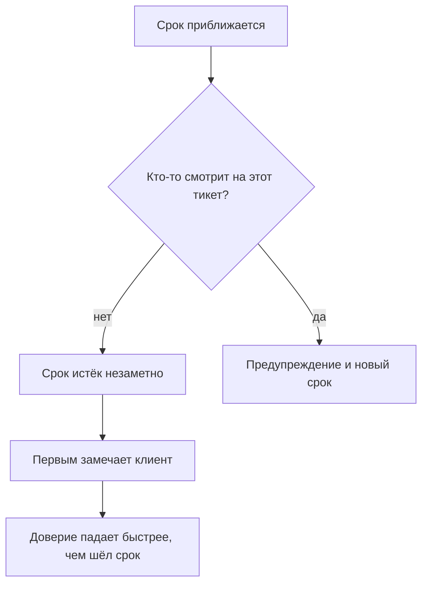
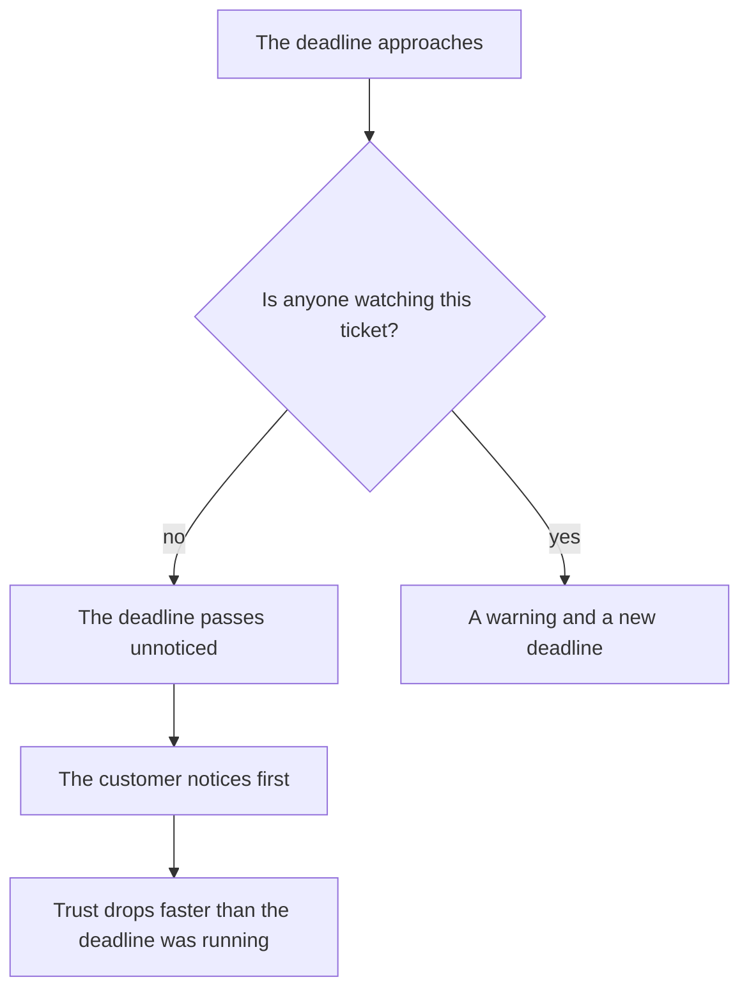
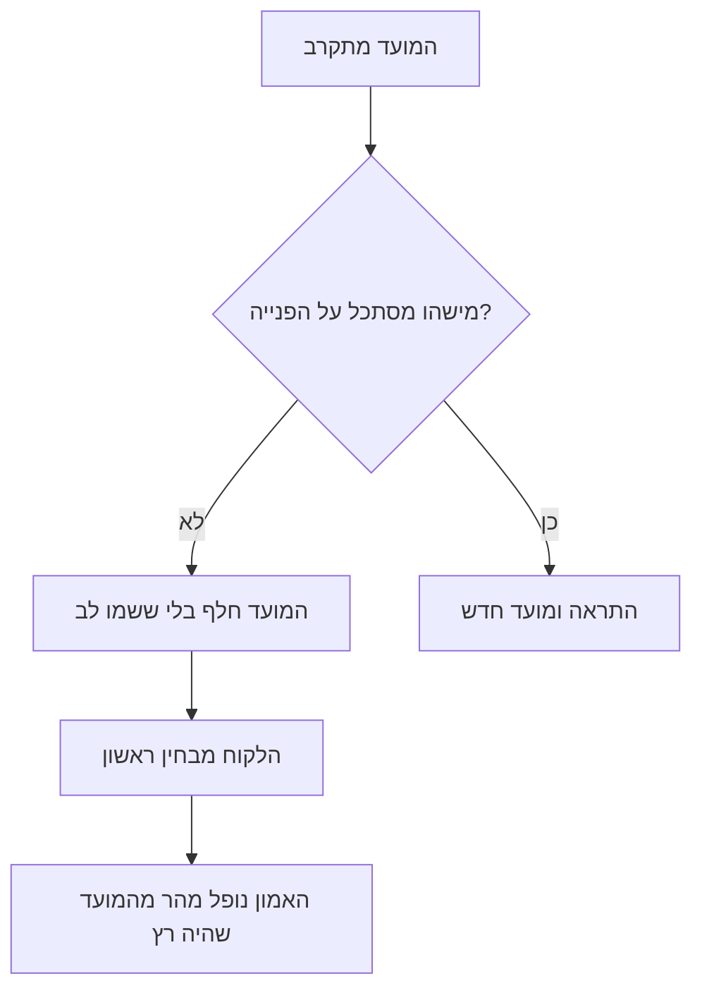

<!-- lang:ru -->

## Введение

О первом нарушении SLA (Service Level Agreement — соглашение об уровне сервиса с клиентом) я узнал из письма клиента. Не из отчёта, не из трекера, не от инженера — из письма, в котором было написано «вы обещали ответить вчера». Заявка при этом была в работе, инженер был занят другим, срок истёк спокойно и незаметно.

Именно это слово — незаметно — и есть проблема. Нарушение срока само по себе неприятно, но объяснимо: случилось, разобрали, поправили. Нарушение, о котором первым узнал клиент, ломает другое: веру в то, что сервис видит свою работу. После такого письма клиент начинает проверять сам, а каждый его вопрос звучит как недоверие.

В предыдущей статье серии — «Триаж при первом касании: категория, критичность, маршрут» — речь шла о том, чтобы каждое обращение на входе получало критичность, категорию и владельца. Эта статья о следующем контуре: о регулярном контроле, который замечает риск до того, как он станет фактом.

Тезис такой: нарушение срока — управляемое событие, если оно видно заранее. Тихое нарушение — это не сбой команды, а сбой контроля: никто не смотрит на очередь в те моменты, когда ещё можно что-то сделать.

## Почему нарушения находят клиенты

У тихого нарушения всегда один и тот же сценарий.

Почему так происходит почти всегда:

- **Трекер показывает статусы, а не риски.** Заявка «в работе» выглядит одинаково и за час до срока, и через неделю после него.
- **Смотрят на отчёт, а не на очередь.** Отчёт за прошлый месяц отвечает на вопрос, что уже случилось. Для предотвращения нужен список того, что случится на этой неделе.
- **Каждый думает, что смотрит кто-то другой.** Инженер считает, что сроки контролирует лид, лид — что ответственный инженер, а отчёт формируется автоматически и его никто не читает.
- **Срочное вытесняет важное.** Пока в очереди горит один инцидент, все остальные сроки продолжают идти — но внимания на них уже нет.

<!-- вилка: собственный случай тихого нарушения — как обнаружилось и чем закончилось. -->

У этого сценария есть неприятное свойство: он воспроизводится тем чаще, чем лучше команда справляется с текущим потоком. Чем меньше пожаров, тем меньше поводов смотреть в очередь целиком.

## Три фильтра рисков

Контроль, который работает, прост до скуки: раз в неделю выгрузка из трекера прогоняется через три фильтра, и каждый попавший туда тикет получает действие.

**Первый фильтр — срок истекает скоро.** Не «нарушен», а «будет нарушен, если ничего не изменить». Сюда попадают заявки, у которых до норматива осталась примерно четверть времени или меньше. Это самый важный фильтр: только здесь ещё можно успеть без последствий.

**Второй фильтр — нет ответа несколько дней.** Заявка открыта, но с ней ничего не происходит: ни ответа клиенту, ни движения внутри. Порог зависит от нормативов, но сам факт тишины важнее точной цифры: тишина в тикете всегда означает, что владелец потерял его из виду.

**Третий фильтр — реопен.** Заявка была закрыта и открыта снова. Это не новый тикет, а сообщение о том, что предыдущее решение не сработало — и по этому обращению счётчик времени обычно уже обнулён, хотя обещание клиенту — нет.

| Фильтр | Что ищем | Действие |
| --- | --- | --- |
| Срок истекает | До норматива меньше четверти времени | Связаться с владельцем и выбрать: успеть или пересогласовать срок |
| Нет ответа | Тишина в тикете несколько дней | Вернуть владельцу и назначить срок следующего шага |
| Реопен | Заявка открыта повторно | Разобрать причину возврата, а не только симптом |

Главное правило: **на каждый тикет из фильтра — действие, а не отметка «посмотрели»**. Действий всего три: успеть, пересогласовать, эскалировать. Четвёртого — «подождать ещё» — не существует, потому что это и есть механизм, которым рождаются тихие нарушения.

<!-- вилка: свои пороги фильтров и ритм прогона — когда и кем смотрится очередь. -->

Прогон занимает не весь день, а полчаса, и его ценность не в списке, а в привычке: очередь просматривается целиком, а не по кускам. Если раз в неделю этого не происходит, риск становится фактом без всякого злого умысла.

## Предупреждение до нарушения

Если фильтр сработал и понятно, что срок не выдержать, следующий шаг — сообщить об этом первым. Это неприятно и кажется признанием провала, хотя на самом деле всё наоборот: предупреждение — это выполнение обещания сообщать о проблемах раньше, чем их заметит клиент.

Сообщение клиенту строится из четырёх частей, и каждая обязательна:

1. **Что происходит.** Без обтекаемых формулировок: заявка в работе, срок сдвигается.
2. **Почему.** Одна-две фразы по существу. Не «сложная ситуация», а «нужно воспроизвести проблему на тестовом окружении».
3. **Новый срок.** Конкретный и реальный, а не «скоро». Срок, который не выдержан, — второе нарушение, хуже первого.
4. **Что делает клиент.** Обычно — ничего: он получает обновление к названному времени. Если от него что-то нужно, это говорится прямо.

Внутреннее сообщение отличается одним: в нём есть действие. Не «информирую о риске», а «предлагаю такой вариант: ускоряем внутри или переносим срок с согласия клиента; если второе, нужен ваш ответ до такого-то времени». Такое сообщение не требует от руководителя сочувствия, оно требует решения.

<!-- вилка: пример письма клиенту и короткого внутреннего сообщения о риске. -->

## Сигнал системной проблемы

Отдельный тикет в фильтре — рабочая ситуация. Два похожих риска в одной категории за неделю — уже гипотеза о системе, и её стоит проверять, пока она не превратилась в закономерность.

Различить случайность и систему помогают три вопроса.

- **Где именно повторяется?** Одна категория, один продукт, одна линия, один клиент. Если риск второй раз приходит из одного места, дело не в людях, а в правилах этого места.
- **Чем похожи сроки?** Например, риски появляются на этапе ожидания третьей линии. Значит, договорённость с ней не выдерживается — и никакая дисциплина внутри поддержки этого не исправит.
- **Что уже пытались сделать?** Если после первого случая ничего не изменилось, второй — не новость, а подтверждение.

Ответы обычно указывают на одну из двух причин: триаж поставил неверную критичность, и тикет попал не в ту очередь, или мощности не хватает на текущий поток. Первое лечится правилами, второе — только разговором о ресурсе. Смешивать эти два разговора нельзя: пока причина не названа, любое решение выглядит как «поработать интенсивнее».

Дальше сигнал живёт уже не в отчёте, а в повестке. Если причина — неверная критичность, правится матрица и обучение триажа. Если мощность — нужны цифры: сколько часов работы в неделю требует поток и сколько есть. Это уже не про контроль очереди, а про расчёт потребности, и эта тема — из другого раздела серии.

## Урок из нарушения

Нарушения будут. Даже с тремя фильтрами, согласованными сроками и предупреждениями остаются случаи, где всё пошло не так. Вопрос не в том, как их исключить, а в том, что остаётся после.

Я фиксирую в разборе четыре вещи, и ни одна из них не про имена:

- **Хронология.** Когда обращение пришло, когда получило критичность, когда попало к владельцу, когда срок стал под угрозой и когда истёк. Только время и события.
- **Что не сработало.** Фильтр не увидел, владелец не отреагировал, договорённость с другой командой не выдержалась. Формулировка без глаголов «забыл» и «прошляпил»: система, в которой можно забыть, — дефект системы.
- **Что было сделано после.** Предупреждение клиенту, перенос срока, компенсация — всё, что произошло по факту.
- **Одно изменение.** Не список из десяти пунктов, а одно правило, которое меняет процесс так, чтобы этот случай стал невозможен или заметен раньше.

Итог разбора — не наказание и не протокол для отчёта, а изменение в системе. Если после нарушения ничего не изменилось, кроме настроения участников, следующее нарушение — вопрос времени.

<!-- вилка: свой разбор нарушения — что было изменено в процессе после него. -->

Смысл всего этого контроля — не ноль нарушений. Ноль нарушений бывает только там, где нечего обещать. Смысл в том, чтобы ни одно нарушение не стало для клиента новостью, а для команды — сюрпризом. В статье [«Пять результатов работы лида поддержки»](/ru/blog/support-lead-five-results/) первым результатом названа предсказуемость: нарушения SLA не находят клиенты. Регулярный контроль очереди — самый дешёвый способ этого добиться.

<!-- lang:en -->

## Introduction

I learned about the first SLA (Service Level Agreement — the service commitment made to a customer) breach from a customer's email. Not from a report, not from the tracker, not from an engineer — from an email that said "you promised to reply yesterday". The ticket was in progress, the engineer was busy with something else, and the deadline had quietly passed.

That word — quietly — is the actual problem. A missed deadline is unpleasant but explainable: it happened, we reviewed it, we fixed it. A breach the customer notices first breaks something else: the belief that the service can see its own work. After that email, the customer starts checking for themselves, and every question of theirs sounds like distrust.

The previous article in the series — "Triage at first touch: category, priority, route" — was about every request getting a priority, a category, and an owner at entry. This article is about the next loop: regular control that spots a risk before it becomes a fact.

The thesis: a missed deadline is a manageable event if it's visible in advance. A silent breach isn't a team failure but a control failure: nobody looks at the queue at the moments when something could still be done.

## Why customers find the breaches

A silent breach always follows the same script.

Why this happens almost every time:

- **The tracker shows statuses, not risks.** A ticket "in progress" looks identical an hour before the deadline and a week after it.
- **People look at the report, not the queue.** Last month's report answers what already happened. Prevention needs the list of what will happen this week.
- **Everyone assumes someone else is watching.** The engineer thinks the lead owns the deadlines, the lead thinks the assigned engineer does, and the report generates itself and nobody reads it.
- **The urgent crowds out the important.** While one incident burns in the queue, every other deadline keeps running — but gets no attention.

<!-- вилка: собственный случай тихого нарушения — как обнаружилось и чем закончилось. -->

This script has an unpleasant property: it reproduces more often the better the team handles the current flow. The fewer fires, the fewer reasons to look at the queue as a whole.

## Three risk filters

Control that works is boringly simple: once a week the tracker export goes through three filters, and every ticket that lands in one gets an action.

**First filter — the deadline is close.** Not "breached" but "will be breached unless something changes". This catches tickets with roughly a quarter of the time budget left or less. It's the most important filter: it's the only place where you can still make it without consequences.

**Second filter — no reply for several days.** The ticket is open but nothing happens: no answer to the customer, no movement inside. The threshold depends on your standards, but the fact of silence matters more than the exact number: silence in a ticket always means the owner lost sight of it.

**Third filter — a reopen.** The ticket was closed and opened again. That's not a new ticket but a message that the previous solution didn't work — and on this request the clock has usually been reset, while the promise to the customer has not.

| Filter | What we look for | Action |
| --- | --- | --- |
| Deadline close | Less than a quarter of the time left | Contact the owner and choose: make it or renegotiate the deadline |
| No reply | Silence in the ticket for several days | Return it to the owner with a deadline for the next step |
| Reopen | The ticket was opened again | Work out why it came back, not just the symptom |

Main rule: **every ticket from a filter gets an action, not a "looked at it" note**. There are only three actions: make it, renegotiate, escalate. The fourth — "wait a bit longer" — doesn't exist, because that's exactly the mechanism that produces silent breaches.

<!-- вилка: свои пороги фильтров и ритм прогона — когда и кем смотрится очередь. -->

The run takes half an hour, not a whole day, and its value is in the habit rather than the list: the whole queue gets looked at instead of pieces of it. If that doesn't happen once a week, risk becomes fact with no malice involved.

## A warning before the breach

If a filter fires and it's clear the deadline won't hold, the next step is to say so first. It feels like admitting failure, though it's the opposite: a warning is you keeping the promise to report problems before the customer finds them.

The message to the customer has four parts, each mandatory:

1. **What's happening.** No evasive phrasing: the ticket is in progress, the deadline is moving.
2. **Why.** One or two sentences about the substance. Not "a complex situation" but "we need to reproduce the problem in the test environment".
3. **The new deadline.** Concrete and realistic, not "soon". A deadline you then miss is a second breach, worse than the first.
4. **What the customer does.** Usually nothing: they get an update by the stated time. If something is needed from them, it's said plainly.

The internal message differs in one thing: it carries an action. Not "flagging the risk" but "here's the option: speed it up internally or move the deadline with the customer's consent; if the latter, I need your answer by such a time". Such a message asks management for a decision, not for sympathy.

<!-- вилка: пример письма клиенту и короткого внутреннего сообщения о риске. -->

## The signal of a systemic problem

A single ticket in a filter is business as usual. Two similar risks in one category within a week is already a hypothesis about the system, and it's worth testing before it becomes a pattern.

Three questions separate coincidence from a system.

- **Where exactly does it repeat?** One category, one product, one line, one customer. If the risk arrives from the same place a second time, the problem is in the rules of that place, not in the people.
- **What do the deadlines have in common?** For example, risks appear while waiting on the third line. That means the agreement with it isn't holding — and no amount of discipline inside support fixes that.
- **What has already been tried?** If nothing changed after the first case, the second isn't news but confirmation.

The answers usually point to one of two causes: triage set the wrong priority and the ticket landed in the wrong queue, or capacity can't carry the current flow. The first is fixed with rules, the second only by a conversation about resources. The two conversations must not be mixed: until the cause is named, every solution looks like "work harder".

After that the signal lives on the agenda, not in the report. If the cause is a wrong priority, the matrix and triage training get fixed. If it's capacity, numbers are needed: how many hours of work per week the flow requires and how many exist. That's no longer queue control but a capacity calculation, and that topic belongs to another part of the series.

## The lesson from a breach

Breaches will happen. Even with three filters, agreed deadlines, and warnings, cases remain where everything went wrong. The question isn't how to eliminate them but what remains afterwards.

I record four things in the review, and none of them is about names:

- **The timeline.** When the request arrived, when it got a priority, when it reached the owner, when the deadline came under threat, and when it expired. Only time and events.
- **What failed.** The filter didn't see it, the owner didn't react, the agreement with another team didn't hold. Wording without "forgot" and "dropped the ball": a system where forgetting is possible is a defective system.
- **What was done after.** The warning to the customer, the moved deadline, the compensation — everything that actually happened.
- **One change.** Not a list of ten items but one rule that alters the process so this case becomes impossible or visible earlier.

The outcome of the review isn't punishment or a report protocol but a change in the system. If nothing changed after a breach except the mood of the participants, the next breach is a matter of time.

<!-- вилка: свой разбор нарушения — что было изменено в процессе после него. -->

The point of all this control isn't zero breaches. Zero breaches only happens where there's nothing to promise. The point is that no breach becomes news to the customer or a surprise to the team. In ["The five results of a support lead's work"](/en/blog/support-lead-five-results/) predictability is named the first result: SLA breaches don't reach the customer first. Regular queue control is the cheapest way to get there.

<!-- lang:he -->

## מבוא

על הפרת ה-SLA (Service Level Agreement — הסכם רמת השירות עם הלקוח) הראשונה שלי נודעתי ממכתב של הלקוח. לא מדוח, לא מהמערכת ולא ממוקדן — ממכתב שבו היה כתוב "הבטחתם לענות אתמול". הפנייה הייתה בעבודה, המוקדן היה עסוק בדבר אחר, והמועד חלף בשקט ובלי ששמנו לב.

דווקא המילה הזאת — בשקט — היא הבעיה. הפרת מועד כשלעצמה לא נעימה אבל מובנת: קרתה, פירקנו, תיקנו. הפרה שהלקוח מגלה ראשון שוברת משהו אחר: את האמון שהשירות רואה את העבודה של עצמו. אחרי מכתב כזה הלקוח מתחיל לבדוק בעצמו, וכל שאלה שלו נשמעת כמו חוסר אמון.

המאמר הקודם בסדרה — "מיון במגע ראשון: קטגוריה, דחיפות, מסלול" — עסק בכך שכל פנייה בכניסה תקבל דחיפות, קטגוריה ובעלים. המאמר הזה עוסק במעגל הבא: בקרה קבועה שמבחינה בסיכון לפני שהוא הופך לעובדה.

הטענה: הפרת מועד היא אירוע מנוהל אם היא נראית מראש. הפרה שקטה אינה כשל של הצוות אלא כשל של הבקרה: אף אחד לא מסתכל בתור ברגעים שבהם עוד אפשר לעשות משהו.

## למה הלקוחות מוצאים את ההפרות

להפרה שקטה תמיד אותו תרחיש.

למה זה קורה כמעט תמיד:

- **המערכת מציגה סטטוסים ולא סיכונים.** פנייה "בעבודה" נראית אותו דבר שעה לפני המועד ושבוע אחריו.
- **מסתכלים על הדוח ולא על התור.** הדוח של החודש שעבר עונה על מה שכבר קרה. למניעה צריך רשימה של מה יקרה השבוע.
- **כל אחד חושב שמישהו אחר מסתכל.** המוקדן חושב שהמועדים באחריות מנהל התמיכה, המנהל חושב שהם באחריות המוקדן האחראי, והדוח נוצר אוטומטית ואיש לא קורא אותו.
- **הדחוף דוחק את החשוב.** כל עוד בעיה אחת בוערת בתור, כל שאר המועדים ממשיכים לרוץ — אבל אין להם תשומת לב.

<!-- вилка: собственный случай тихого нарушения — как обнаружилось и чем закончилось. -->

לתרחיש הזה יש תכונה לא נעימה: הוא חוזר על עצמו לעתים קרובות יותר, ככל שהצוות מתמודד טוב יותר עם הזרימה השוטפת. ככל שפחות שריפות, כך פחות סיבות להסתכל בתור כולו.

## שלושה מסנני סיכון

בקרה שעובדת פשוטה עד שיעמום: פעם בשבוע הדיווח מהמערכת עובר שלושה מסננים, וכל פנייה שנופלת לאחד מהם מקבלת פעולה.

**המסנן הראשון — המועד עומד לפוג.** לא "הופר" אלא "יופר אם לא ישתנה משהו". לכאן נכנסות פניות שנשאר להן כרבע מהזמן או פחות. זה המסנן החשוב ביותר: רק כאן עוד אפשר להספיק בלי השלכות.

**המסנן השני — אין מענה כמה ימים.** הפנייה פתוחה אבל איתה לא קורה כלום: לא תשובה ללקוח ולא תנועה פנימית. הסף תלוי בנוהל, אבל עצם השתיקה חשוב מהמספר המדויק: שתיקה בפנייה תמיד אומרת שהבעלים איבד אותה מהעין.

**המסנן השלישי — פתיחה חוזרת.** הפנייה נסגרה ונפתחה שוב. זו לא פנייה חדשה אלא הודעה שהפתרון הקודם לא עבד — ובפנייה הזאת ספירת הזמן מתחילה בדרך כלל מאפס, בעוד ההבטחה ללקוח לא.

| מסנן | מה מחפשים | פעולה |
| --- | --- | --- |
| מועד עומד לפוג | נשאר פחות מרבע מהזמן | ליצור קשר עם הבעלים ולבחור: להספיק או לתאם מחדש |
| אין מענה | שתיקה בפנייה כמה ימים | להחזיר לבעלים ולקבוע מועד לצעד הבא |
| פתיחה חוזרת | הפנייה נפתחה שוב | לפרק את סיבת החזרה, ולא רק את הסימפטום |

הכלל המרכזי: **לכל פנייה מהמסנן — פעולה, ולא סימון "הסתכלנו"**. יש רק שלוש פעולות: להספיק, לתאם מחדש, להסלים. הרביעית — "לחכות עוד קצת" — לא קיימת, מפני שהיא בדיוק המנגנון שמייצר הפרות שקטות.

<!-- вилка: свои пороги фильтров и ритм прогона — когда и кем смотрится очередь. -->

ההרצה לא גוזלת יום שלם אלא חצי שעה, והערך שלה אינו ברשימה אלא בהרגל: התור נסקר כולו ולא בחתיכות. אם זה לא קורה פעם בשבוע, הסיכון הופך לעובדה בלי שום כוונת זדון.

## התראה לפני ההפרה

אם המסנן אותת וברור שהמועד לא יחזיק, הצעד הבא הוא להודיע על כך ראשון. זה לא נעים ונראה כהודאה בכישלון, אבל בפועל ההפך הוא הנכון: התראה היא קיום ההבטחה לדווח על בעיות לפני שהלקוח מבחין בהן.

ההודעה ללקוח בנויה מארבעה חלקים, וכל אחד מהם חובה:

1. **מה קורה.** בלי ניסוחים חלקלקים: הפנייה בעבודה, המועד זז.
2. **למה.** משפט או שניים לגוף העניין. לא "מצב מורכב" אלא "צריך לשחזר את הבעיה בסביבת בדיקות".
3. **המועד החדש.** קונקרטי ומציאותי, ולא "בקרוב". מועד שלא עומדים בו הוא הפרה שנייה, גרועה מהראשונה.
4. **מה עושה הלקוח.** בדרך כלל כלום: הוא מקבל עדכון עד השעה שנקבעה. אם נדרש ממנו משהו, אומרים זאת ישירות.

ההודעה הפנימית נבדלת בדבר אחד: יש בה פעולה. לא "מעדכן על סיכון" אלא "מציע אפשרות כזאת: להאיץ בפנים או להזיז את המועד בהסכמת הלקוח; אם השנייה, נדרשת תשובתכם עד שעה כזאת". הודעה כזאת לא מבקשת מהממונה אמפתיה, היא מבקשת החלטה.

<!-- вилка: пример письма клиенту и короткого внутреннего сообщения о риске. -->

## הסימן לבעיה שיטתית

פנייה בודדת במסנן — מצב עבודה רגיל. שני סיכונים דומים באותה קטגוריה בתוך שבוע — כבר השערה על המערכת, ושווה לבדוק אותה לפני שהיא הופכת לחוקיות.

שלוש שאלות עוזרות להבדיל בין מקריות למערכת.

- **איפה בדיוק זה חוזר?** אותה קטגוריה, אותו מוצר, אותו קו, אותו לקוח. אם הסיכון מגיע בפעם השנייה מאותו מקום, העניין בכללים של אותו מקום, ולא באנשים.
- **במה דומים המועדים?** למשל, הסיכונים מופיעים בשלב ההמתנה לקו השלישי. כלומר ההסכמה איתו לא מחזיקה — ושום משמעת בתוך התמיכה לא תתקן את זה.
- **מה כבר ניסו לעשות?** אם אחרי המקרה הראשון לא השתנה כלום, השני אינו חדשות אלא אישור.

התשובות מצביעות בדרך כלל על אחת משתי סיבות: המיון קבע דחיפות לא נכונה והפנייה נפלה לתור הלא נכון, או שאין כושר נשיאה לזרימה הנוכחית. הראשון נרפא בכללים, השני רק בשיחה על משאבים. אסור לערבב את שתי השיחות: כל עוד הסיבה לא נקראת בשמה, כל פתרון נראה כמו "לעבוד יותר קשה".

מכאן הסימן חי לא בדוח אלא בסדר היום. אם הסיבה היא דחיפות שגויה — מתקנים את המטריצה ואת ההדרכה למיון. אם זו כושר נשיאה — צריך מספרים: כמה שעות עבודה בשבוע דורשת הזרימה וכמה יש. זה כבר לא בקרת תור אלא חישוב צרכים, והנושא הזה שייך לחלק אחר בסדרה.

## השיעור מההפרה

הפרות יהיו. גם עם שלושה מסננים, מועדים מוסכמים והתראות נשארים מקרים שבהם הכל הלך לא כשורה. השאלה אינה איך לחסל אותם אלא מה נשאר אחריהם.

אני רושם בניתוח ארבעה דברים, ואף אחד מהם לא עוסק בשמות:

- **הכרונולוגיה.** מתי הפנייה הגיעה, מתי קיבלה דחיפות, מתי הגיעה לבעלים, מתי המועד עמד בסכנה ומתי חלף. רק זמן ואירועים.
- **מה לא עבד.** המסנן לא ראה, הבעלים לא הגיב, ההסכמה עם צוות אחר לא החזיקה. ניסוח בלי "שכח" ו"החמיץ": מערכת שבה אפשר לשכוח היא מערכת פגומה.
- **מה נעשה אחר כך.** ההתראה ללקוח, דחיית המועד, הפיצוי — כל מה שקרה בפועל.
- **שינוי אחד.** לא רשימה של עשרה סעיפים אלא כלל אחד שמשנה את התהליך כך שהמקרה הזה לא יתאפשר או ייראה מראש.

התוצאה של הניתוח אינה ענישה ואינה פרוטוקול לדוח, אלא שינוי במערכת. אם אחרי ההפרה לא השתנה כלום מלבד מצב הרוח של המשתתפים, ההפרה הבאה היא עניין של זמן.

<!-- вилка: свой разбор нарушения — что было изменено в процессе после него. -->

מטרת כל הבקרה הזאת אינה אפס הפרות. אפס הפרות קיים רק במקום שאין מה להבטיח. המטרה היא שאף הפרה לא תהיה חדשות ללקוח ולא הפתעה לצוות. במאמר ["חמש התוצאות של ראש התמיכה"](/he/blog/support-lead-five-results/) התוצאה הראשונה נקראת צפיות: הפרות SLA לא מגיעות קודם ללקוח. בקרת תור קבועה היא הדרך הזולה ביותר להגיע לשם.
