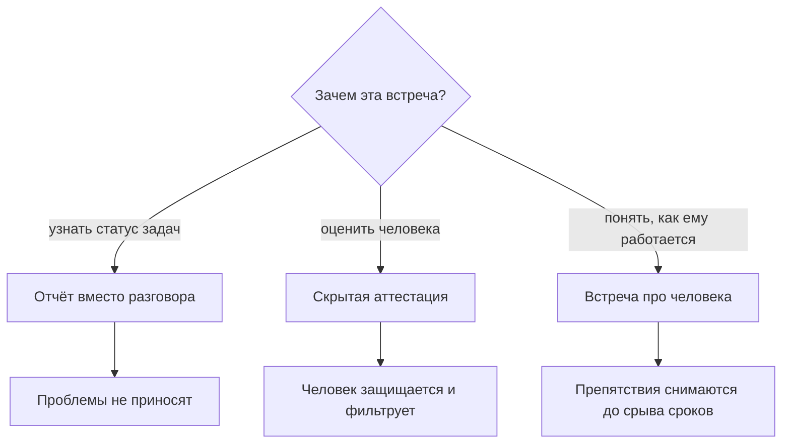
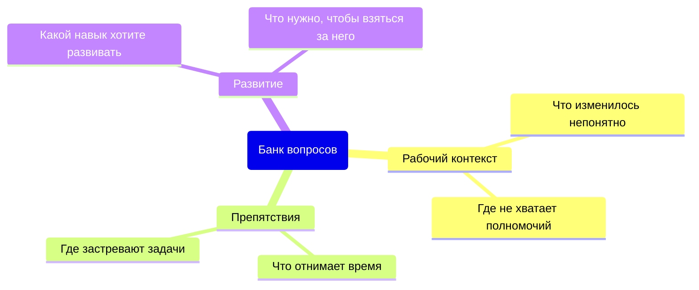
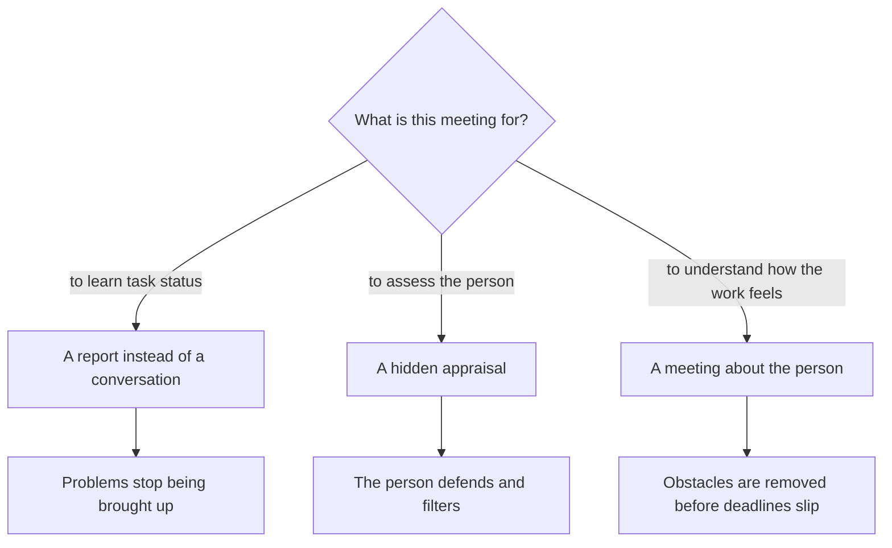
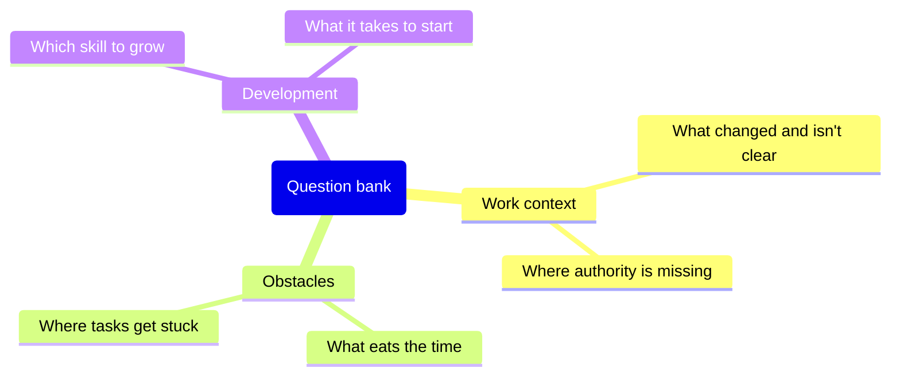
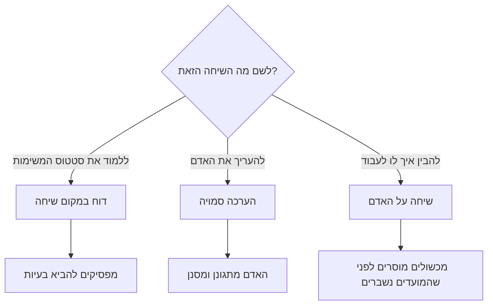
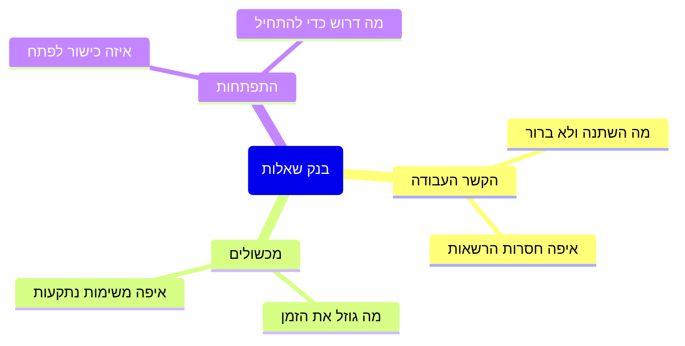

<!-- lang:ru -->

## Введение

Первые полгода встречи один на один у меня были отчётом с человеческим лицом. Я приходил со списком вопросов про задачи, инженер приходил с готовыми ответами, через полчаса мы расходились, и ни один из нас не сказал того, что действительно важно. Формально ритуал был: встреча стояла в календаре, проводилась регулярно, в ней даже фиксировались решения. Работать он начал только после того, как я поменял не расписание, а предмет разговора.

Тезис, к которому я пришёл: встреча один на один — ритуал про человека. Не про его задачи (они живут в трекере), не про его оценку (для этого есть наблюдаемые факты), а про то, как ему работается и что мешает. Превращённая в отчёт о статусе, встреча дублирует трекер; превращённая в аттестацию, она перестаёт получать правду.

Эта статья — про четыре вещи, которые удерживают формат: структуру, банк вопросов, границу личного и правила отмены. Она продолжает разговор о ритме лида — в статье «Ритм руководителя: правило 40 %» встреча один на один была одним из пяти обязательных ритуалов; здесь — как сделать так, чтобы этот час не был потерян.

## Два вырожденных формата

У встречи один на один есть два способа испортиться, и оба выглядят прилично со стороны.

**Отчёт о статусе.** Лид спрашивает: как дела с задачами, что с тем тикетом, когда закроешь этот. Инженер отвечает, лид записывает. Проблема не в содержании — проблема в том, что эта информация уже есть в трекере, а человек в такой встрече приносит только то, что безопасно принести. О препятствиях он не расскажет: препятствие — это признание, что не справляешься, а разговор идёт про сроки. Хуже того, статусная встреча дисциплинирует обратное: человек учится приходить с отчётом, а не с вопросом.

**Скрытая аттестация.** Лид не говорит «это оценка», но встреча устроена как оценка: расскажи, что у тебя не получилось, как ты оцениваешь свой уровень, почему ты не сделал то, что сделал бы на твоём месте я. Обратная связь здесь идёт в одну сторону и звучит как приговор. Итог предсказуем: человек начинает защищаться, готовит формулировки заранее и перестаёт приносить то, что может быть использовано против него. Через два месяца встречи становятся вежливыми и пустыми.

Схема выбора проста: у встречи должен быть один предмет, и он не может быть ни статусом, ни оценкой.

Дальше — как устроить разговор, у которого правильный предмет.

## Структура 40 минут

Формат, который у меня прижился, короткий: сорок минут и пять блоков. Важна не точность до минуты, а порядок: сначала человек, потом контекст, в конце — договорённости.

| Блок | Кто ведёт | Что должно остаться |
| --- | --- | --- |
| Что накопилось с прошлого раза | Инженер | Список тем, с которыми он пришёл |
| Препятствия | Инженер, лид разбирает | Одно-два препятствия с владельцем и сроком |
| Контекст и решения сверху | Лид | Понятное «почему», а не только «что меняется» |
| Развитие | Оба | Один следующий шаг по одному навыку |
| Итог | Лид | Решения с владельцем и датой |

Первая часть — его повестка, и здесь важно выдержать паузу. Если лид начинает со своих вопросов, дальше всё превращается в интервью. Работает простой ход: «с чего начнём — с того, что у тебя накопилось».

Вторая часть — препятствия, и это единственная часть, где лид не слушает, а действует. Препятствие — то, что мешает работать: нет доступа, непонятно, чья это задача, конфликт с соседней командой, инструкция устарела. Задача лида — не объяснить, почему так сложилось, а забрать препятствие с собой и вернуться с результатом.

Третья часть — контекст сверху: что меняется в компании, в продукте, в правилах и почему. Инженер, который понимает причину изменения, спорит с решением, а не саботирует его. Здесь же — решения, о которых нельзя говорить на общем разборе.

Четвёртая часть — развитие, и её легко провалить, если превратить в план на год. Достаточно одного навыка и одного следующего шага: что человек попробует до следующей встречи. Пятая часть — итог: два-три решения, у каждого владелец и дата.

Где фиксируются решения. Не в протоколе разговора — дословная запись делает людей осторожными. Достаточно строки в общем документе: что решили, кто сделает, к какому сроку. Личное не фиксируется, а решения, которые касаются других, пересказываются без атрибуции.

## Банк вопросов

Хороший вопрос на такой встрече не имеет готового ответа в трекере. Я держу банк из трёх групп и меняю его раз в несколько месяцев — вопросы, которые задаются годами, перестают вытаскивать что-либо, кроме вежливости.

Схема банка выглядит так: три группы, и у каждой — свой предмет.

Несколько формулировок из рабочего банка:

- Что за последние две недели отняло больше времени, чем ты ожидал?
- Где ты сейчас принимаешь решения без мандата — то есть спрашиваешь меня, хотя мог решить сам?
- Что я делаю такого, что мешает тебе работать?
- Какой навык тебе нужен, чтобы брать более сложные заявки, и что мешает начать?
- Что в правилах команды кажется тебе устаревшим?
- Чего ты ждал от этой роли и что оказалось не так?

<!-- вилка: 5–8 своих вопросов, которые реально работают в вашей команде. -->

Что в банке не работает: вопросы с готовой оценкой («тебе не кажется, что ты медленно закрываешь?»), вопросы-тесты («а как бы ты поступил на месте клиента?») и вопросы о прошлом, которое уже не изменить.

## Граница личного

На встрече один на один люди говорят не только о работе, и лид должен заранее понимать, что он делает с услышанным.

Провожу границу просто. Рабочие факты — то, что можно записать и передать: препятствия, договорённости, планы по навыкам. Личные признания — то, что человек рассказал о себе и своей жизни. Второе не записывается, не пересказывается и никогда не используется при оценке. Это не вежливость, а условие, без которого встреча работает в одну сторону.

Два уточнения, которые лучше проговорить вслух в самом начале, а не когда приспичило.

- Что я не могу держать в секрете. Есть вещи за рамками рабочего контекста — длительный больничный, угроза безопасности, нарушение закона, — которые нельзя оставить между двумя людьми. Обещать полную конфиденциальность, зная это, — обман, который в трудный момент выяснится.
- Что личное не станет рабочим. Если личные обстоятельства влияют на работу, обсуждается следствие, а не причина: перераспределение нагрузки, график, отсрочка, — без диагноза и подробностей.

Обратная сторона той же границы: лид не использует встречу как терапию для себя. Жаловаться инженеру на руководство, обсуждать с ним чужие проблемы или искать поддержку — способ лишить его возможности говорить о себе. Для таких разговоров у лида есть свои встречи с руководителем.

## Правила отмены

Самый частый способ убить этот ритуал — отменять его по уважительной причине. Инцидент, срочный запрос, встреча у руководства: в моменте всё выглядит логично, и через шесть недель встреч нет вообще.

Правила, которые работают у меня.

- **Перенос можно, отмену — нет.** Перенос означает конкретный новый слот, предложенный здесь же. «Ладно, на следующей неделе» слотом не является.
- **Если переносит лид — переносит редко и по одному разу.** Третий перенос подряд читается однозначно: он не важен. После третьего лучше сказать это словами и уменьшить частоту, чем продолжать обещать.
- **Если переносит инженер — это тоже сигнал.** Не потому, что он ленится, а потому, что разговор перестал быть для него полезным.
- **Пропущенная встреча не удлиняет следующую.** Догоняющие двухчасовые встречи не работают: они превращаются в тот самый отчёт, от которого мы уходили.

<!-- вилка: правила отмены в вашей практике — как часто переносили и что из этого следовало. -->

Встреча один на один стоит дорого — она забирает время у обоих. Но она единственная, где можно узнать о препятствии до того, как оно сорвало срок, и о выгорании до того, как человек написал заявление. Если этот час стабильно пропадает, начинать надо не с нового банка вопросов, а с правила отмены — и с честного ответа на вопрос, что вы на этой встрече делаете.

<!-- lang:en -->

## Introduction

For my first six months, one-on-ones were a status report with a human face. I came in with a list of questions about tasks, the engineer came in with ready answers, half an hour later we parted, and neither of us had said what actually mattered. Formally the ritual existed: it was in the calendar, it ran regularly, it even produced recorded decisions. It started working only when I changed what the conversation was about rather than when it happened.

The claim I arrived at: a one-on-one is a ritual about the person. Not about their tasks (those live in the tracker), not about their assessment (that needs observable facts), but about how the work feels and what gets in the way. Turned into a status report, the meeting duplicates the tracker; turned into an appraisal, it stops receiving the truth.

This article covers the four things that hold the format together: structure, a question bank, the boundary of the personal, and rules for cancelling. It continues the conversation about a lead's rhythm — in "The lead's rhythm: the 40% rule" the one-on-one was one of five mandatory rituals; here it's about making sure that hour isn't wasted.

## Two degenerate formats

A one-on-one has two ways to go wrong, and both look decent from the outside.

**The status report.** The lead asks how things are going with the tasks, what's up with that ticket, when this one will close. The engineer answers, the lead writes it down. The problem isn't the content — it's that the information already exists in the tracker, and in such a meeting a person only brings what is safe to bring. They won't mention obstacles: an obstacle is an admission that you're not coping, and the conversation is nominally about deadlines. Worse, a status meeting teaches the opposite habit: people learn to arrive with a report instead of a question.

**The hidden appraisal.** The lead never says "this is an assessment", but the meeting is built like one: tell me what you failed at, how you rate your own level, why you didn't do what I would have done in your place. Feedback flows one way and lands like a verdict. The result is predictable: the person starts defending, prepares their wording in advance, and stops bringing anything that could be used against them. Two months in, the meetings are polite and empty.

The choice is simple: a meeting needs one subject, and it can be neither status nor appraisal.

Next: how to run a conversation with the right subject.

## The 40-minute structure

The format that stuck with me is short: forty minutes and five blocks. Minute precision doesn't matter; the order does — the person first, then context, agreements last.

| Block | Who leads | What should remain |
| --- | --- | --- |
| What piled up since last time | The engineer | The list of topics they came with |
| Obstacles | The engineer, the lead works through them | One or two obstacles with an owner and a date |
| Context and decisions from above | The lead | A clear "why", not just "what changes" |
| Development | Both | One next step on one skill |
| Wrap-up | The lead | Decisions with an owner and a date |

The first block is their agenda, and holding the pause there matters. If the lead opens with their own questions, everything after becomes an interview. A simple move works: "where shall we start — with what's piled up on your side".

The second block is obstacles, and it's the only part where the lead doesn't listen but acts. An obstacle is what blocks the work: no access, unclear ownership, a conflict with a neighbouring team, an outdated instruction. The lead's job isn't to explain why it's like that but to take the obstacle away and come back with a result.

The third block is context from above: what's changing in the company, the product, the rules, and why. An engineer who understands the reason argues with a decision instead of quietly sabotaging it. This is also where decisions that can't be discussed in the general review belong.

The fourth block is development, and it's easy to ruin by turning it into an annual plan. One skill and one next step are enough: what the person will try before the next meeting. The fifth block is the wrap-up: two or three decisions, each with an owner and a date.

Where decisions get recorded. Not in a transcript — verbatim notes make people cautious. A line in a shared document is enough: what was decided, who does it, by when. Personal matters aren't recorded, and decisions that concern other people are passed on without attribution.

## A question bank

A good question for this meeting has no ready answer in the tracker. I keep a bank of three groups and reshuffle it every few months — questions asked for years stop pulling out anything but politeness.

The bank looks like this: three groups, each with its own subject.

A few phrasings from the working bank:

- What took more time than you expected over the last two weeks?
- Where are you deciding without a mandate right now — asking me although you could decide yourself?
- What do I do that gets in the way of your work?
- Which skill do you need to take on harder tickets, and what stops you from starting?
- What in the team's rules feels outdated to you?
- What did you expect from this role, and what turned out differently?

<!-- вилка: 5–8 своих вопросов, которые реально работают в вашей команде. -->

What doesn't work in a bank: questions with the verdict built in ("don't you think you're closing tickets slowly?"), test questions ("what would you do in the client's place?"), and questions about a past that can't be changed.

## The boundary of the personal

In a one-on-one people talk about more than work, and the lead should know in advance what they do with what they hear.

I draw the line simply. Work facts are what can be written down and passed on: obstacles, agreements, skill plans. Personal disclosures are what a person said about themselves and their life. The second is never recorded, never repeated, and never used in an assessment. That isn't politeness, it's the condition without which the meeting only works one way.

Two clarifications worth saying out loud at the start rather than when it's too late.

- What I can't keep secret. Some things sit outside the work context — a long sick leave, a safety threat, a breach of the law — and can't stay between two people. Promising full confidentiality while knowing that is a lie that surfaces at the worst moment.
- What personal matters won't become. If private circumstances affect the work, we discuss the consequence rather than the cause: redistributing load, the schedule, a deferral — without a diagnosis or details.

The other side of the same boundary: the lead doesn't use the meeting as therapy. Complaining to an engineer about management, discussing other people's problems, or seeking support takes away their room to talk about themselves. That's what the lead's own meetings with their manager are for.

## Rules for cancelling

The most common way to kill this ritual is to cancel it for a good reason. An incident, an urgent request, a meeting with management: in the moment it all makes sense, and six weeks later there are no meetings at all.

The rules that work for me.

- **Moving is allowed, cancelling isn't.** Moving means a specific new slot proposed right there. "Let's do next week" isn't a slot.
- **If the lead moves it, they do it rarely and once.** A third move in a row reads one way: it doesn't matter. After the third, better to say so out loud and reduce the frequency than keep promising.
- **If the engineer moves it, that's a signal too.** Not because they're lazy, but because the conversation stopped being useful to them.
- **A skipped meeting doesn't lengthen the next one.** Two-hour catch-up meetings don't work: they turn into exactly the report we were escaping.

<!-- вилка: правила отмены в вашей практике — как часто переносили и что из этого следовало. -->

A one-on-one is expensive — it takes time from both people. But it's the only place where you learn about an obstacle before it breaks a deadline, and about burnout before the resignation letter arrives. If that hour keeps disappearing, start with the cancellation rule — and with an honest answer to what you're actually doing in the meeting.

<!-- lang:he -->

## מבוא

בחצי השנה הראשונה שיחותיי אחת־על־אחד היו דוח סטטוס עם פנים אנושיות. באתי עם רשימת שאלות על משימות, המוקדן בא עם תשובות מוכנות, כעבור חצי שעה נפרדנו, ואף אחד מאיתנו לא אמר את מה שחשוב באמת. פורמלית הטקס התקיים: הוא היה בלוח הזמנים, התנהל בקביעות, ואפילו נרשמו בו החלטות. הוא התחיל לעבוד רק אחרי ששיניתי לא את התדירות אלא על מה מדברים.

הטענה שאליה הגעתי: שיחה אחת־על־אחד היא טקס על האדם. לא על המשימות שלו (אלה חיות במערכת), לא על ההערכה שלו (לכך דרושות עובדות נצפות), אלא על איך מתנהלת העבודה שלו ומה מפריע. כשהיא הופכת לדוח סטטוס, היא משכפלת את המערכת; כשהיא הופכת להערכה, היא מפסיקה לקבל את האמת.

המאמר הזה עוסק בארבעה דברים שמחזיקים את הפורמט: מבנה, בנק שאלות, גבול האישי וכללי ביטול. הוא ממשיך את השיחה על הקצב של מנהל התמיכה — במאמר "הקצב של מנהל התמיכה: חוק 40%" השיחה האחת־על־אחד הייתה אחד מחמישה טקסים מחייבים; כאן — איך לעשות שהשעה הזאת לא תלך לאיבוד.

## שני פורמטים מנוונים

לשיחה אחת־על־אחד יש שתי דרכים להיהרס, ושתיהן נראות הגונות מבחוץ.

**דוח סטטוס.** מנהל התמיכה שואל: איך הולך עם המשימות, מה עם הפנייה ההיא, מתי תסגור את זאת. המוקדן עונה, המנהל רושם. הבעיה אינה בתוכן — הבעיה היא שהמידע הזה כבר קיים במערכת, ובשיחה כזאת אדם מביא רק את מה שבטוח להביא. על מכשולים הוא לא יספר: מכשול הוא הודאה שאינך מתמודד, והשיחה הרי על מועדים. יתרה מזו, פגישת סטטוס מחנכת להרגל ההפוך: לומדים לבוא עם דוח ולא עם שאלה.

**הערכה סמויה.** המנהל לא אומר "זו הערכה", אבל השיחה בנויה כהערכה: ספר מה לא הצלחת, איך אתה מעריך את הרמה שלך, למה לא עשית את מה שהייתי עושה במקומך. המשוב הולך לכיוון אחד ונשמע כמו פסק דין. התוצאה צפויה: האדם מתחיל להתגונן, מכין ניסוחים מראש ומפסיק להביא כל דבר שאפשר להשתמש בו נגדו. בעוד חודשיים השיחות מנומסות וריקות.

הבחירה פשוטה: לשיחה צריך להיות נושא אחד, והוא לא יכול להיות סטטוס ולא הערכה.

המשך — איך לבנות שיחה עם הנושא הנכון.

## מבנה של 40 דקות

הפורמט שאצלי החזיק מעמד הוא קצר: ארבעים דקות וחמישה בלוקים. הדיוק בדקה לא חשוב — הסדר חשוב: קודם האדם, אחר כך ההקשר, ובסוף ההסכמות.

| בלוק | מי מוביל | מה צריך להישאר |
| --- | --- | --- |
| מה הצטבר מהפעם הקודמת | המוקדן | רשימת הנושאים שאיתם בא |
| מכשולים | המוקדן, המנהל מפרק | מכשול אחד או שניים עם בעלים ומועד |
| הקשר והחלטות מלמעלה | מנהל התמיכה | "למה" ברור, ולא רק "מה משתנה" |
| התפתחות | שניהם | צעד הבא אחד בכישור אחד |
| סיכום | מנהל התמיכה | החלטות עם בעלים ומועד |

הבלוק הראשון — סדר היום שלו, וכאן חשוב להחזיק את ההפסקה. אם המנהל מתחיל מהשאלות שלו, כל השאר הופך לראיון. מהלך פשוט עובד: "ממה נתחיל — ממה שהצטבר אצלך".

הבלוק השני — מכשולים, וזה החלק היחיד שבו המנהל לא מקשיב אלא פועל. מכשול — זה מה שמפריע לעבודה: אין הרשאה, לא ברור של מי המשימה, קונפליקט עם צוות שכן, הוראה מיושנת. תפקיד המנהל אינו להסביר למה כך קרה אלא לקחת את המכשול איתו ולחזור עם תוצאה.

הבלוק השלישי — הקשר מלמעלה: מה משתנה בחברה, במוצר, בכללים ולמה. מוקדן שמבין את הסיבה לשינוי מתווכח עם ההחלטה במקום לחבל בה בשקט. כאן גם מקומן של החלטות שאי אפשר לדון בהן בסיכום הכללי.

הבלוק הרביעי — התפתחות, וקל להרוס אותו אם הופכים אותו לתוכנית שנתית. מספיק כישור אחד וצעד הבא אחד: מה האדם ינסה עד השיחה הבאה. הבלוק החמישי — סיכום: שתיים־שלוש החלטות, ולכל אחת בעלים ומועד.

איפה נרשמות ההחלטות. לא בפרוטוקול של השיחה — רישום מילה במילה הופך אנשים לזהירים. מספיקה שורה במסמך משותף: מה הוחלט, מי יעשה, עד מתי. אישי לא נרשם, והחלטות שנוגעות לאחרים מועברות בלי ייחוס.

## בנק שאלות

לשאלה טובה לשיחה כזאת אין תשובה מוכנה במערכת. אני מחזיק בנק משלוש קבוצות ומחליף אותו כל כמה חודשים — שאלות שנשאלות שנים מפסיקות להוציא משהו חוץ מנימוס.

כך נראה הבנק: שלוש קבוצות, ולכל אחת נושא משלה.

כמה ניסוחים מהבנק העובד:

- מה בשבועיים האחרונים לקח יותר זמן ממה שציפית?
- איפה אתה מחליט היום בלי מנדט — כלומר שואל אותי למרות שיכולת להחליט לבד?
- מה אני עושה שמפריע לך לעבוד?
- איזה כישור דרוש לך כדי לקחת פניות מורכבות יותר, ומה מונע להתחיל?
- מה בכללי הצוות נראה לך מיושן?
- למה ציפית מהתפקיד הזה ומה התברר אחרת?

<!-- вилка: 5–8 своих вопросов, которые реально работают в вашей команде. -->

מה לא עובד בבנק: שאלות עם הערכה מובנית ("לא נדמה לך שאתה סוגר פניות לאט?"), שאלות מבחן ("מה היית עושה במקום הלקוח?") ושאלות על עבר שאי אפשר לשנות.

## גבול האישי

בשיחה אחת־על־אחד אנשים מדברים לא רק על עבודה, ומנהל התמיכה צריך לדעת מראש מה הוא עושה עם מה ששמע.

את הגבול אני מתווה בפשטות. עובדות עבודה — מה שאפשר לרשום ולהעביר הלאה: מכשולים, הסכמות, תוכניות כישורים. גילויים אישיים — מה שאדם סיפר על עצמו ועל חייו. השני לא נרשם, לא מועבר הלאה ולעולם לא משמש בהערכה. זה לא נימוס אלא תנאי שבלעדיו השיחה עובדת לכיוון אחד.

שני דברים שמוטב לומר בקול בהתחלה ולא כשכבר מאוחר.

- מה אני לא יכול לשמור בסוד. יש דברים מחוץ להקשר העבודה — מחלה ארוכה, איום על ביטחון, הפרת חוק — שאי אפשר להשאיר בין שני אנשים. הבטחה לסודיות מלאה ביודעין היא שקר שיתגלה ברגע הקשה.
- מה אישי לא יהפוך לעבודה. אם נסיבות אישיות משפיעות על העבודה, דנים בתוצאה ולא בסיבה: חלוקה מחדש של עומס, לוח זמנים, דחייה — בלי אבחון ובלי פרטים.

הצד השני של אותו גבול: המנהל לא משתמש בשיחה כטיפול לעצמו. להתלונן בפני המוקדן על ההנהלה, לדון איתו בבעיות של אחרים או לחפש תמיכה — זאת דרך לקחת ממנו את האפשרות לדבר על עצמו. לכך יש למנהל פגישות משלו עם הממונה.

## כללי ביטול

הדרך הנפוצה ביותר להרוג את הטקס הזה היא לבטל אותו מסיבה מוצדקת. תקלה, בקשה דחופה, פגישה אצל ההנהלה: ברגע עצמו הכל נראה הגיוני, וכעבור שישה שבועות אין שיחות בכלל.

הכללים שעובדים אצלי.

- **אפשר להעביר, אסור לבטל.** העברה משמעה חלון חדש וקונקרטי שמוצע שם במקום. "נו, בשבוע הבא" אינו חלון.
- **אם המנהל מעביר — עושה זאת לעתים רחוקות ופעם אחת.** העברה שלישית ברצף נקראת באופן חד־משמעי: זה לא חשוב. אחרי השלישית עדיף לומר את זה במילים ולהקטין את התדירות מלהמשיך להבטיח.
- **אם המוקדן מעביר — גם זה סימן.** לא מפני שהוא מתעצל, אלא מפני שהשיחה הפסיקה להיות לו מועילה.
- **שיחה שהוחמצה לא מאריכה את הבאה.** שיחות השלמה של שעתיים לא עובדות: הן הופכות בדיוק לדוח שממנו ברחנו.

<!-- вилка: правила отмены в вашей практике — как часто переносили и что из этого следовало. -->

שיחה אחת־על־אחד היא מחיר יקר: היא לוקחת זמן משניכם. אבל היא היחידה שבה נודע על מכשול לפני שהוא שבר מועד, ועל שחיקה לפני שהאדם הגיש מכתב התפטרות. אם השעה הזאת נעלמת בעקביות, להתחיל צריך מכלל הביטול — ומתשובה כנה על מה אתם בעצם עושים בשיחה הזאת.
