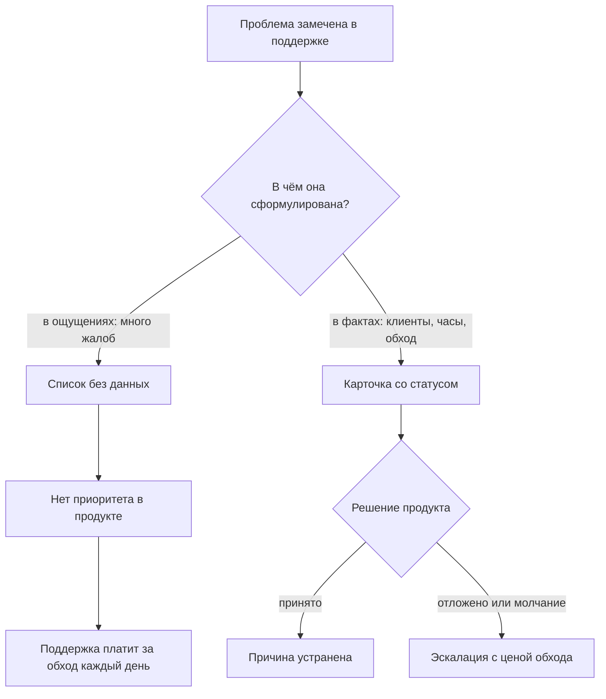
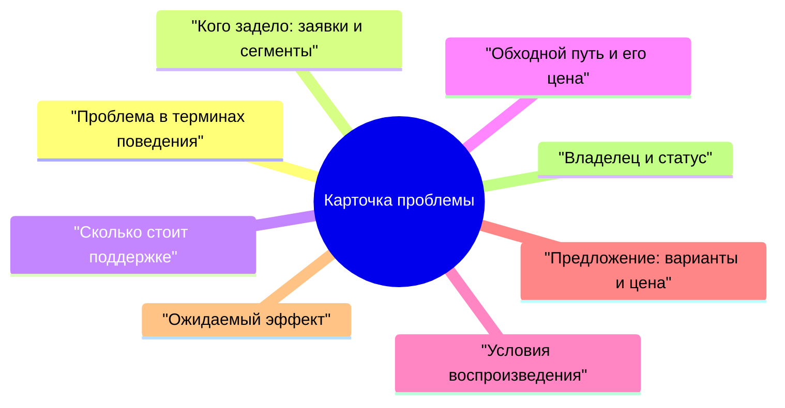
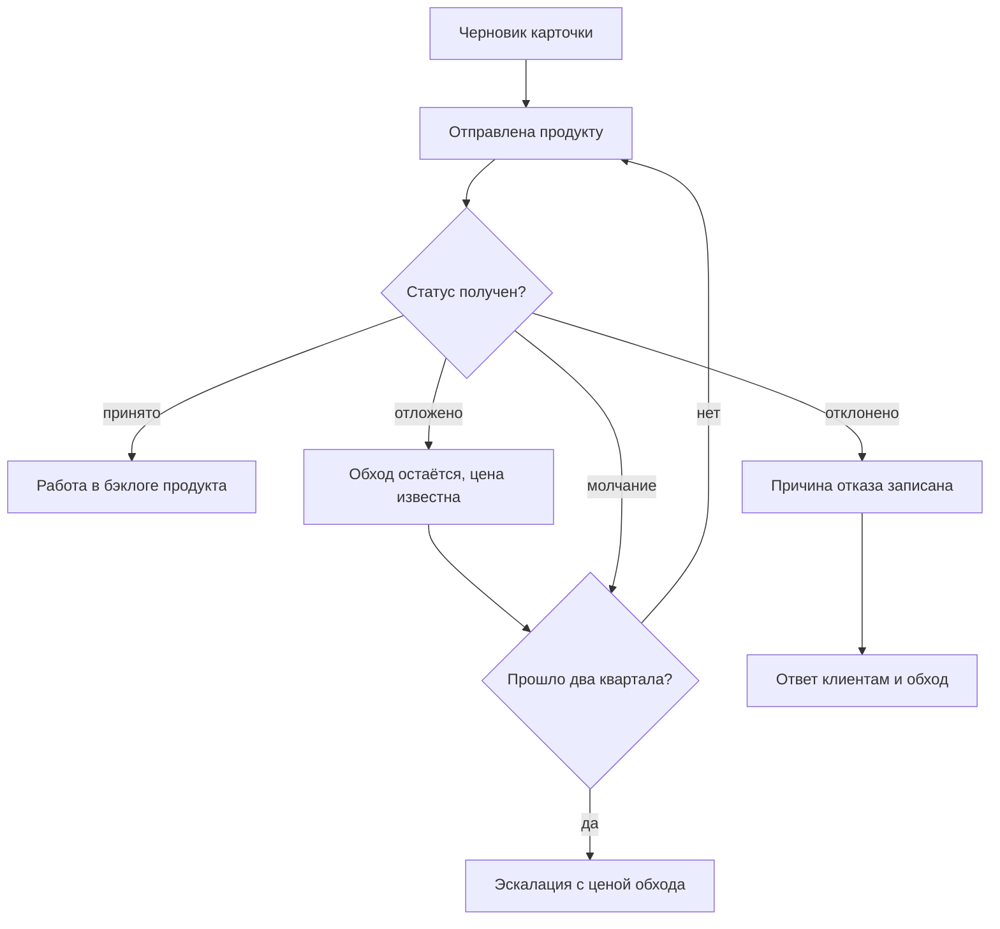
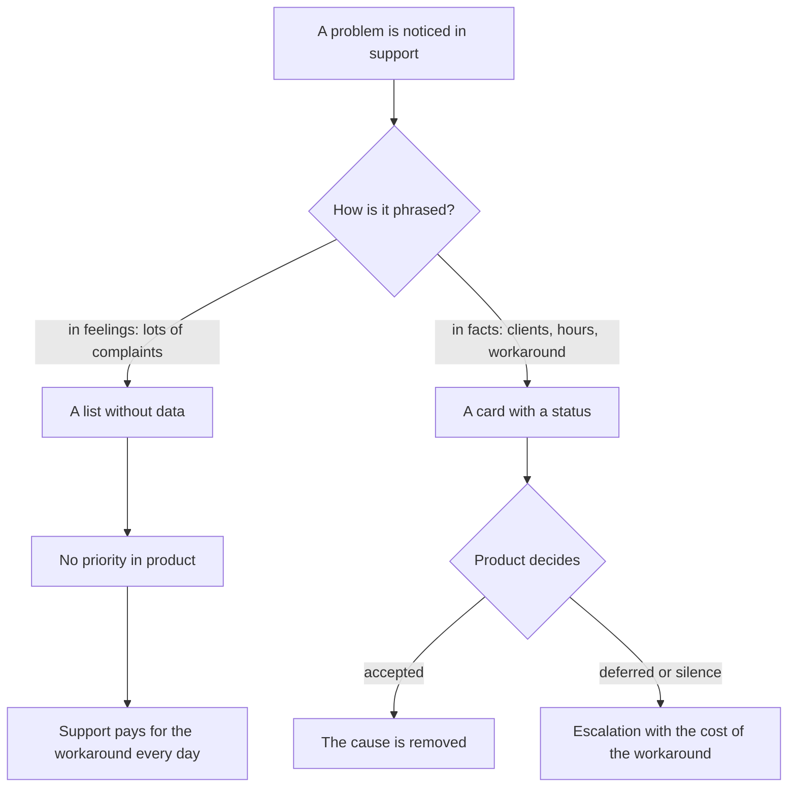
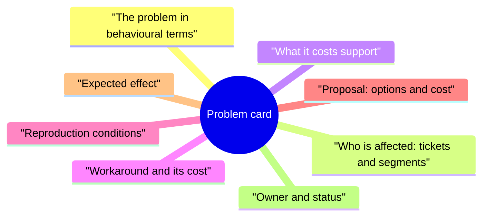
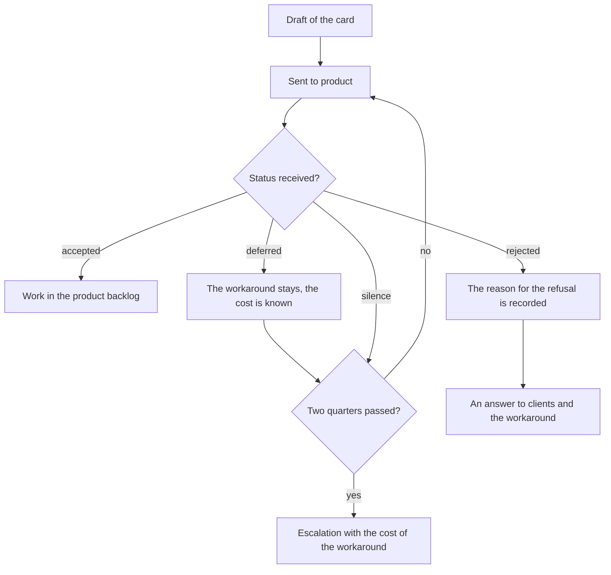
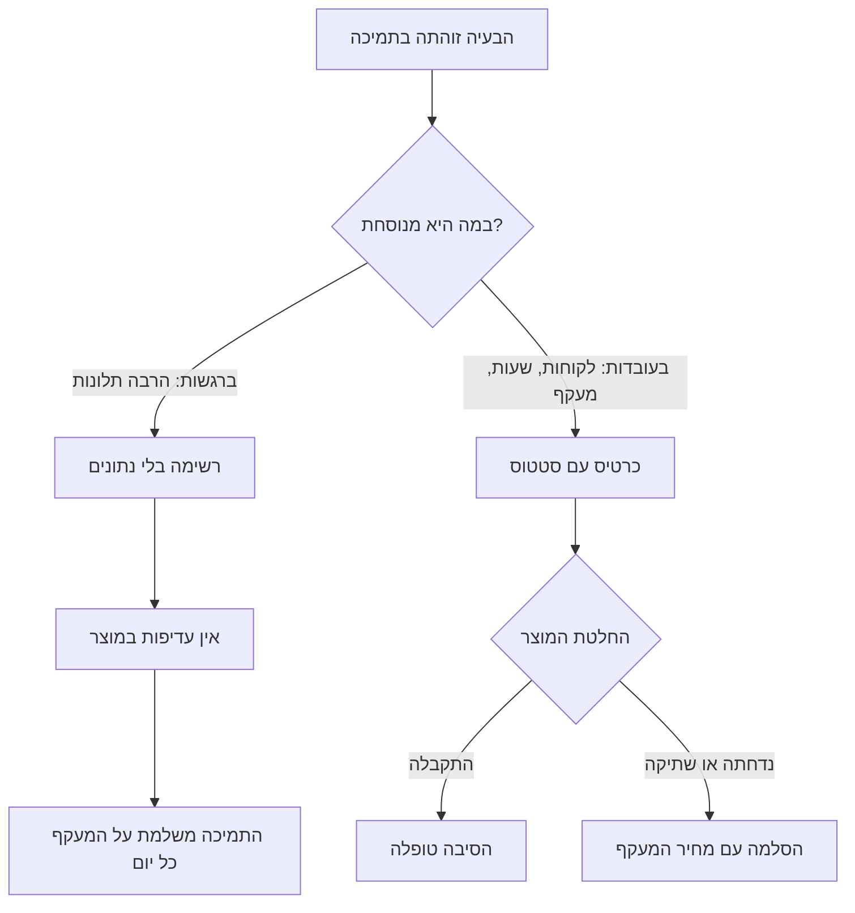
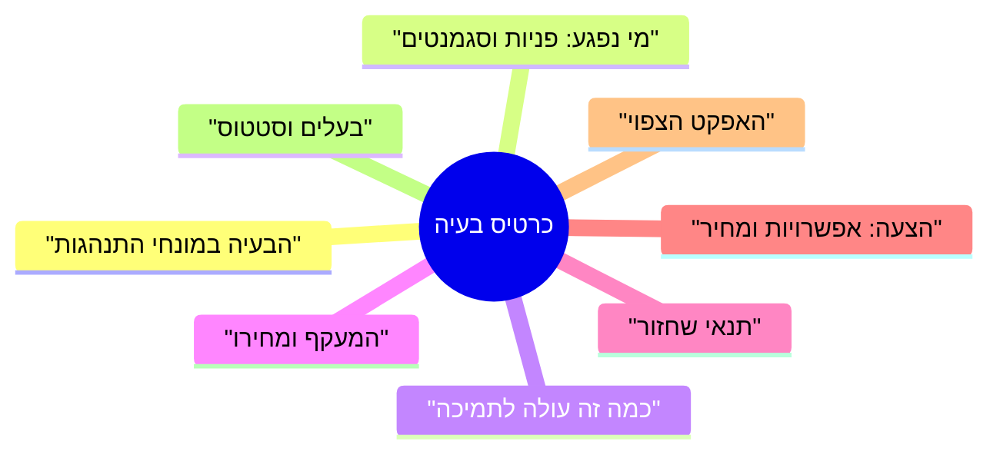
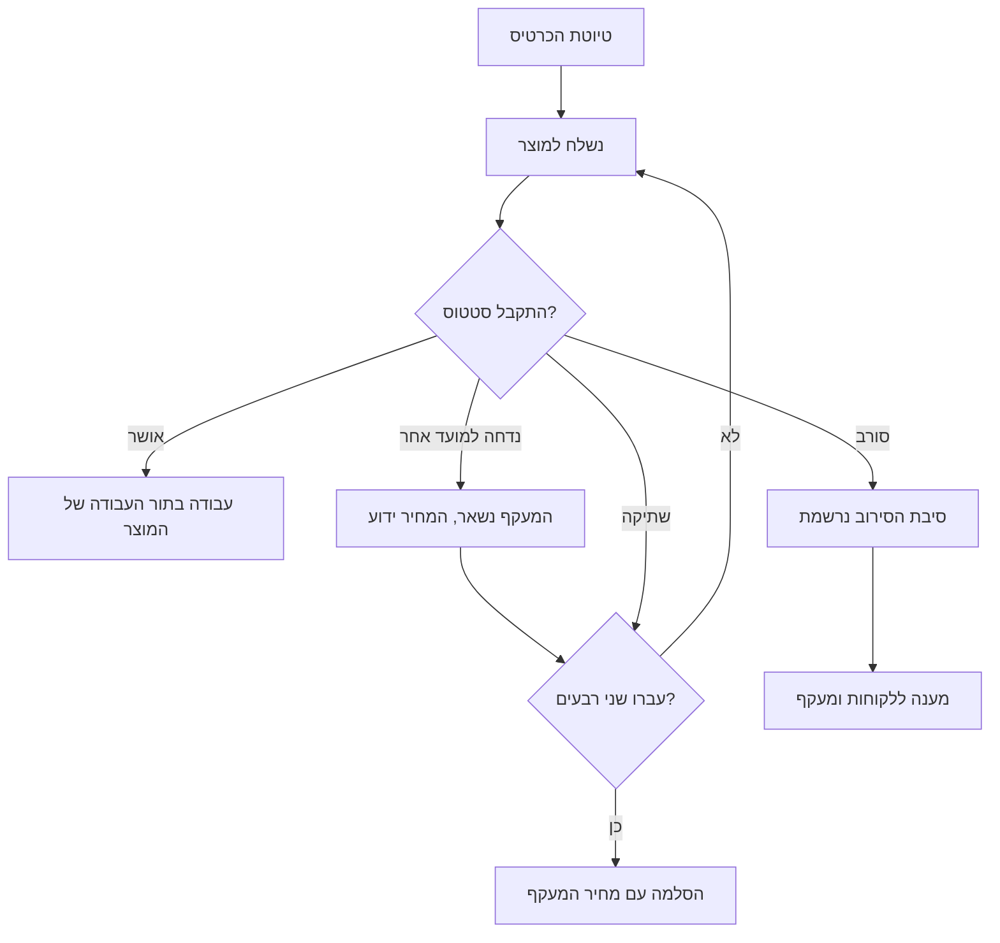

<!-- lang:ru -->

## Введение

Поддержка — единственное место в компании, где видно, что на самом деле ломается у клиента. Продукт смотрит на метрики, аналитику и план релиза; поддержка смотрит на людей, которые не смогли сделать свою работу. Между этими двумя картинами обычно нет канала, и проблема, о которой каждый день пишут в заявках, годами живёт в поддержке как «особенность продукта».

Я убеждён, что лид поддержки владеет самыми честными данными о проблемах клиентов в компании. Вопрос только в том, в каком виде эти данные выходят наружу. Формулировка «у нас много жалоб на выгрузку» не переживает первой встречи с планированием релиза, а карточка проблемы — переживает, потому что в ней есть клиенты, часы и цена обхода.

Blameless-разбор из прошлой статьи серии касался отдельного инцидента: сбой случился, его разобрали, действия получили владельцев. Эта статья о другом классе проблем — тех, что не закрываются одним действием, потому что решение лежит в продукте.

## Почему «у нас проблемы» игнорируется

Список болячек есть в каждой поддержке, и почти всегда он не работает. Дело не в том, что продукт не хочет слышать, а в том, что список не отвечает ни на один вопрос, который задаёт планирование.

- **У продукта своя очередь.** Приоритет определяется планом релиза и оценкой спроса, а не количеством сообщений в чате поддержки. Запрос без числа и сегмента проигрывает любой задаче, у которой есть оценка.
- **Проблема сформулирована как эмоция.** «Клиенты жалуются» не говорит, сколько клиентов, каких и что именно происходит. Продукт не может ни воспроизвести, ни оценить такую формулировку.
- **Не видна цена бездействия.** Пока поддержка не посчитала, сколько часов уходит на обход, проблема выглядит мелочью на фоне крупных задач.
- **Нет адресата.** Запрос без владельца на стороне продукта возвращается назад и умирает в переписке.
- **Нет статуса.** Проблема, которая «в работе», неотличима от проблемы, о которой забыли: через месяц никто не вспомнит, что уже решили.
- **Нет напоминания.** Сказали один раз — не повторили; через квартал никто не вспомнит ни проблему, ни того, кто её поднимал.

Развилка выглядит так:

Разница между ветками не в громкости жалобы, а в готовности приложить к ней числа и адресата. Дальше — из чего состоит эта работа.

## Анатомия карточки

Карточка — это не форма ради формы. Это минимальный набор сведений, при котором чужая боль становится задачей с оценкой. Я держу восемь полей:

| Поле | Что в нём | Зачем это продукту |
| --- | --- | --- |
| Проблема в терминах поведения | Что делает клиент и что получает вместо ожидаемого | Отделяет жалобу от сценария, который можно воспроизвести |
| Кого задело | Заявки, сегменты, критичность клиентов, частота | Даёт масштаб и основание для приоритета |
| Цена для поддержки | Часы и доля потока, повторные обращения | Показывает, сколько стоит бездействие |
| Обходной путь | Что инженеры делают вместо нормального решения и с каким риском | Показывает ручную работу, которую можно убрать |
| Условия воспроизведения | Окружение, версия, шаги, набор данных | Экономит продукту недели уточнений |
| Предложение | Варианты решения с ценой каждого | Переводит запрос из «почините» в выбор |
| Ожидаемый эффект | Что уйдёт из потока и что перестанет ломаться | Позволяет сравнивать с другими задачами |
| Владелец и статус | Имя человека в продукте, статус, дата следующего касания | Проблема перестаёт быть бесхозной |

Поля стоит разобрать не по порядку таблицы, а по тем, которые чаще всего заполняют неправильно.

**Кого задело.** Это первое, что спрашивает любой руководитель продукта. Ответ «все клиенты страдают» не проверяется и потому не весит ничего; ответ «вот список заявок, вот сегменты, вот повторные обращения» — проверяется и весит много. Важно не преувеличивать: одна раздутая цифра портит доверие ко всей карточке, и следующие пять нормальных карточек будут читать с подозрением.

**Цена для поддержки.** Считается не на глаз, а по событиям: сколько обращений в месяц по этой проблеме, сколько времени уходит на обход, сколько из них повторные. Даже грубая оценка по формуле «количество обращений умножить на среднее время обхода» сильнее, чем отсутствие оценки. Это единственный аргумент, который звучит в чужой системе приоритетов: не «клиентам неудобно», а «мы тратим столько-то часов в месяц на работу, которой не должно быть».

**Обходной путь.** Поле, которое чаще всего пропускают, а оно самое важное для разговора. Обход показывает две вещи: проблему уже решают руками, и это работает хуже, чем кажется. У обхода есть цена — время, риск ошибки, зависимость от конкретного инженера, — и именно она делает задачу продукта срочной.

**Предложение.** Поддержка вправе и должна предлагать решение: она видит сценарий чаще всех. Но предложение — это варианты с ценой, а не требование. «Можно поправить валидацию — это дешево; можно переделать форму — это дорого и закроет ещё две проблемы» даёт продукту выбор, а «сделайте нормально» — только раздражение.

**Владелец и статус.** Имя человека в продукте превращает карточку из письма в задачу. Не «команда продукта», а инженер или владелец направления, который взял карточку. Статус и дата следующего касания нужны, чтобы карточка не тонула.

Три правила, без которых карточка рассыпается: одна карточка — одна проблема (если внутри три причины, не движется ни одна); в карточке нет оценок людей и эмоций, только факты и сценарии; и всё, что записано, можно проверить по трекеру или документации.

<!-- вилка: поля своей карточки — как называется, где лежит, что реально заполняется, а что приходится вытаскивать руками. -->

## Ежеквартальный отчёт топ-причин

Карточки — это единица работы, а отчёт — способ показать их вместе. Раз в квартал я собираю страницу с топ-причинами: его читает тот, кто распределяет приоритеты продукта, и от него зависит, попадут ли эти проблемы в план.

Формат намеренно короткий: одна страница, без презентации, с таблицей по каждой причине.

- **Номер карточки и формулировка проблемы** — одна строка, в терминах поведения клиента.
- **Масштаб**: обращения за квартал и число затронутых клиентов.
- **Цена для поддержки**: часы и доля потока.
- **Тренд**: растёт, стабильно, снижается. Тренд важнее абсолютного числа: медленно растущая проблема через два квартала станет главной.
- **Статус и владелец** на стороне продукта.
- **Что просим**: решение или решение о приоритете, сформулированное как выбор.

Правила отбора в отчёт жёсткие и полезные:

- в отчёт попадают только карточки с данными — иначе это список желаний;
- сортировка по цене для поддержки, а не по дате появления: цель — расчистить поток, а не вести хронику;
- в отчёт входит блок «что уже сделано»: принятые и закрытые карточки. Без него встреча превращается в перечень претензий и теряет союзников;
- отчёт не повторяет резолюции прошлого квартала строка в строку: по каждой прошлой строке нужен статус.

Отчёт лучше готовить под конкретное решение. «Вот двадцать проблем» разбирать никто не будет; «вот пять, из которых две мы просим взять в квартал, по остальным просим решение об отсрочке» — обсуждаемо и заканчивается результатом.

<!-- вилка: формат своего отчёта — кому идёт, какой объём, что из него попало в план продукта. -->

## Статусы и эскалация молчания

Карточка без статуса превращается в письмо в никуда. Поэтому у статуса есть правила, и главное из них: статус ставит продукт, а поддержка отвечает за данные и сроки напоминаний.

Что стоит за этой схемой:

- **Молчание — не статус.** Если ответа нет в оговорённый срок, карточка получает отметку «молчание» с датой. Это не формальность: именно молчание съедает кварталы, а не отказы.
- **Отложено — не отказ.** У отсрочки есть причина и дата пересмотра. Без даты «отложено» — это вежливое «никогда».
- **Отклонено — тоже результат.** Причина записывается, поддержка сообщает клиентам и продолжает жить с обходом. Это честнее, чем тишина: обход становится видимым расходом.
- **Эскалация — с числами.** Если проблема отложена два квартала подряд, разговор идёт на уровень выше — не в формате «продукт нас не слышит», а с ценой обхода за период и риском. Просить решения, а не сочувствия, — отдельный навык, и он уже разобран в предыдущей части серии.

Отдельное правило — про то, чего в эскалации быть не должно. Карточки не используются как аргумент в спорах между командами или как способ показать, кто виноват в задержке. Как только карточка становится оружием, продукт начинает защищаться, а не читать данные, и канал закрывается.

<!-- вилка: как у вас устроены статусы — кто их ставит, сколько живёт карточка без ответа, был ли случай эскалации. -->

## Что меняется, когда карточки работают

Изменения видны не сразу и не только в цифрах — сильнее всего меняются разговоры.

Приоритет продукта перестаёт зависеть от громкости последнего письма. Появляется очередь, у которой есть основания: число клиентов и цена обхода. Спорить о такой очереди можно, но уже предметно — например, о том, какая цена считается выше.

Поддержка перестаёт быть единственным местом, где знают о проблеме. У неё появляется владелец на той стороне, а у лида — способ показать руководству, что происходит с потоком, не пересказывая заявки по одной.

Формируется история. Через год видно, какие проблемы решаются, какие закрываются отказом и что это значит для клиентов. Это самый убедительный аргумент при следующем разговоре о ресурсах: не обещания, а список решений и их последствий.

И меняется поведение инженеров. Когда у проблемы есть номер и статус, инженер первой линии перестаёт чувствовать, что пишет в пустоту: его наблюдения становятся данными. Это, пожалуй, самый дешёвый способ повысить вовлечённость, который я знаю.

<!-- вилка: история одной карточки — от записи до решения продукта: что было в данных, какой аргумент сработал, что изменилось после. -->

Карточка проблемы — не бюрократия, а минимальный формат, при котором боль клиента становится задачей с ценой и владельцем. Следующая статья серии — «Метрика без действия — это картинка: паспорт метрики» — о том, как убедиться, что числа, на которых стоят эти карточки, кто-то действительно использует для решений.

<!-- lang:en -->

## Introduction

Support is the only place in the company where you can see what actually breaks for the client. Product looks at metrics, analytics and the release plan; support looks at people who could not get their work done. There is usually no channel between these two pictures, and a problem that is written about in tickets every day lives in support for years as "a product quirk".

I am convinced that the support lead owns the most honest data about client problems in the company. The only question is the shape in which that data gets out. "We get a lot of complaints about the export" does not survive the first meeting with release planning; a problem card does, because it contains clients, hours and the cost of the workaround.

The blameless postmortem from the previous article of the series dealt with a single incident: a failure happened, it was reviewed, the actions got owners. This article is about a different class of problems — the ones no single action closes, because the solution lies in the product.

## Why "we have problems" gets ignored

Every support team has a list of pain points, and almost always the list does not work. Not because product does not want to hear, but because the list answers none of the questions that planning asks.

- **Product has its own queue.** Priority is set by the release plan and by demand estimates, not by the number of messages in a support chat. A request without a number and a segment loses to any task that has an estimate.
- **The problem is phrased as an emotion.** "Clients are complaining" does not say how many clients, which ones, or what exactly happens. Product can neither reproduce nor estimate that phrasing.
- **The cost of inaction is invisible.** Until support has counted how many hours go into the workaround, the problem looks like a trifle next to the big tasks.
- **There is no addressee.** A request with no owner on the product side comes back and dies in correspondence.
- **There is no status.** A problem that is "in progress" is indistinguishable from one that was forgotten: a month later nobody will remember what was already decided.
- **There is no reminder.** Said once, never repeated; a quarter later nobody remembers either the problem or who raised it.

The fork looks like this:

The difference between the branches is not the volume of the complaint but the willingness to attach numbers and an addressee to it. What follows is what that work consists of.

## The anatomy of the card

A card is not a form for the sake of a form. It is the minimum set of details at which someone else's pain becomes a task with an estimate. I keep eight fields:

| Field | What goes in it | Why product needs it |
| --- | --- | --- |
| The problem in behavioural terms | What the client does and what they get instead of the expected result | Separates a complaint from a scenario that can be reproduced |
| Who is affected | Tickets, segments, client criticality, frequency | Gives scale and a basis for priority |
| Cost to support | Hours and the share of the flow, repeat contacts | Shows what inaction costs |
| Workaround | What engineers do instead of the proper solution, and at what risk | Shows the manual work that can be removed |
| Reproduction conditions | Environment, version, steps, data set | Saves product weeks of clarification |
| Proposal | Solution options with the cost of each | Turns the request from "fix it" into a choice |
| Expected effect | What leaves the flow and what stops breaking | Makes the card comparable with other tasks |
| Owner and status | The name of the person in product, the status, the date of the next contact | The problem stops being ownerless |

The fields are worth going through not in the order of the table but by the ones that are most often filled in wrongly.

**Who is affected.** It is the first thing any head of product asks. The answer "all clients are suffering" cannot be checked and therefore weighs nothing; the answer "here is the list of tickets, here are the segments, here are the repeat contacts" can be checked and weighs a lot. The important thing is not to exaggerate: one inflated number ruins trust in the whole card, and the next five sound cards will be read with suspicion.

**Cost to support.** It is counted from events, not by eye: how many contacts a month about this problem, how much time the workaround takes, how many of them are repeat contacts. Even a rough estimate using the formula "number of contacts multiplied by average workaround time" is stronger than no estimate. This is the only argument that sounds inside someone else's system of priorities: not "clients find it inconvenient" but "we spend this many hours a month on work that should not exist".

**The workaround.** The field that is most often skipped, and the most important one for the conversation. A workaround shows two things: the problem is already being solved by hand, and that works worse than it seems. A workaround has a cost — time, the risk of error, dependence on a particular engineer — and that cost is exactly what makes the product task urgent.

**The proposal.** Support has the right and the duty to propose a solution: it sees the scenario more often than anyone. But a proposal is options with a cost, not a demand. "You could fix the validation — that's cheap; you could redo the form — that's expensive and closes two more problems" gives product a choice, while "make it work properly" gives only irritation.

**Owner and status.** The name of a person in product turns the card from a letter into a task. Not "the product team", but an engineer or a domain owner who has taken the card. The status and the date of the next contact exist so the card does not sink.

Three rules without which the card falls apart: one card, one problem (if there are three causes inside, none of them moves); the card contains no judgements about people and no emotions, only facts and scenarios; and everything recorded can be checked against the tracker or the documentation.

<!-- вилка: поля своей карточки — как называется, где лежит, что реально заполняется, а что приходится вытаскивать руками. -->

## The quarterly report of top causes

Cards are the unit of work; the report is how they are shown together. Once a quarter I put together a page with the top causes: it is read by the person who allocates product priorities, and whether these problems reach the plan depends on it.

The format is deliberately short: one page, no presentation, with a table for each cause.

- **The card number and the statement of the problem** — one line, in terms of client behaviour.
- **Scale**: contacts over the quarter and the number of affected clients.
- **Cost to support**: hours and the share of the flow.
- **Trend**: growing, stable, declining. Trend matters more than the absolute number: a slowly growing problem becomes the main one two quarters later.
- **Status and owner** on the product side.
- **What we ask for**: a decision or a decision about priority, phrased as a choice.

The rules for what gets into the report are strict and useful:

- only cards with data make it into the report — otherwise it is a wish list;
- sorting by cost to support, not by date of appearance: the goal is to clear the flow, not to keep a chronicle;
- the report includes a "what has already been done" block: cards accepted and closed. Without it the meeting turns into a list of grievances and loses allies;
- the report does not repeat last quarter's resolutions line by line: every previous line needs a status.

It is better to prepare the report for a specific decision. Nobody will work through "here are twenty problems"; "here are five, two of which we ask you to take into the quarter, and for the rest we ask for a decision to defer" is discussable and ends with a result.

<!-- вилка: формат своего отчёта — кому идёт, какой объём, что из него попало в план продукта. -->

## Statuses and the escalation of silence

A card without a status turns into a letter to nowhere. So the status has rules, and the main one is: product sets the status, support is responsible for the data and the reminder dates.

What stands behind this scheme:

- **Silence is not a status.** If there is no answer within the agreed period, the card gets a "silence" mark with a date. This is not a formality: it is silence that eats quarters, not refusals.
- **Deferred is not a refusal.** A deferral has a reason and a review date. Without a date, "deferred" is a polite "never".
- **Rejected is a result too.** The reason is recorded, support tells the clients and keeps living with the workaround. That is more honest than silence: the workaround becomes a visible expense.
- **Escalation — with numbers.** If a problem has been deferred two quarters in a row, the conversation moves a level up — not in the format "product doesn't hear us" but with the cost of the workaround over the period and the risk. Asking for decisions rather than sympathy is a separate skill, and it was already covered in the previous part of the series.

A separate rule is about what must not be in an escalation. Cards are not used as an argument in disputes between teams or as a way to show who is to blame for a delay. As soon as a card becomes a weapon, product starts defending itself instead of reading the data, and the channel closes.

<!-- вилка: как у вас устроены статусы — кто их ставит, сколько живёт карточка без ответа, был ли случай эскалации. -->

## What changes when cards work

The changes are not immediate and not only in the numbers — the conversations change most of all.

Product priority stops depending on the volume of the last letter. A queue appears that has grounds: the number of clients and the cost of the workaround. Such a queue can still be argued about, but substantively — for instance, about which cost counts as higher.

Support stops being the only place where the problem is known. It gets an owner on the other side, and the lead gets a way to show management what is happening with the flow without retelling tickets one by one.

A history forms. A year later it is visible which problems get solved, which are closed by a refusal and what that means for clients. That is the most convincing argument in the next conversation about resources: not promises but a list of decisions and their consequences.

And the behaviour of engineers changes. When a problem has a number and a status, a first-line engineer stops feeling that they are writing into the void: their observations become data. This is perhaps the cheapest way to raise engagement that I know.

<!-- вилка: история одной карточки — от записи до решения продукта: что было в данных, какой аргумент сработал, что изменилось после. -->

A problem card is not bureaucracy but the minimum format at which a client's pain becomes a task with a cost and an owner. The next article of the series — "A metric without an action is a picture: the metric passport" — is about making sure that the numbers these cards rest on are actually used by someone to make decisions.

<!-- lang:he -->

## מבוא

התמיכה היא המקום היחיד בחברה שבו רואים מה באמת נשבר אצל הלקוח. המוצר מסתכל על מדדים, אנליטיקה ותוכנית השחרור; התמיכה מסתכלת על אנשים שלא הצליחו לעשות את העבודה שלהם. בין שתי התמונות האלה בדרך כלל אין ערוץ, ובעיה שכותבים עליה כל יום בפניות חיה שנים בתוך התמיכה כ"מאפיין של המוצר".

אני משוכנע שלמנהל התמיכה יש את הנתונים הכי ישרים על בעיות של לקוחות בחברה. השאלה היחידה היא באיזו צורה הנתונים האלה יוצאים החוצה. הניסוח "יש לנו הרבה תלונות על הייצוא" לא שורד פגישה ראשונה עם תכנון השחרור, וכרטיס בעיה שורד — כי יש בו לקוחות, שעות ומחיר של מעקף.

הניתוח blameless מהמאמר הקודם בסדרה עסק בתקלה בודדת: התקלה קרתה, נותחה, ולפעולות נמצאו בעלים. המאמר הזה עוסק בסוג אחר של בעיות — כאלה שלא נסגרות בפעולה אחת, כי הפתרון נמצא במוצר.

## למה מתעלמים מ"יש לנו בעיות"

רשימת הכאבים קיימת בכל תמיכה, וכמעט תמיד היא לא עובדת. הבעיה היא לא שהמוצר לא רוצה לשמוע, אלא שהרשימה לא עונה על אף שאלה שתכנון השחרור שואל.

- **למוצר יש תור משלו.** העדיפות נקבעת לפי תוכנית השחרור והערכת הביקוש, לא לפי מספר ההודעות בצ'אט התמיכה. בקשה בלי מספר ובלי סגמנט מפסידה לכל משימה שיש לה הערכה.
- **הבעיה מנוסחת כרגש.** "לקוחות מתלוננים" לא אומר כמה לקוחות, אילו, ומה בדיוק קורה. המוצר לא יכול לא לשחזר ולא להעריך ניסוח כזה.
- **לא רואים את מחיר אי־המעש.** כל עוד התמיכה לא ספרה כמה שעות הולכות על המעקף, הבעיה נראית זוטה לעומת המשימות הגדולות.
- **אין נמען.** בקשה בלי בעלים בצד המוצר חוזרת חזרה ומתה בהתכתבות.
- **אין סטטוס.** בעיה ש"בתהליך" אינה ניתנת להבחנה מבעיה שנשכחה: כעבור חודש איש לא יזכור מה כבר הוחלט.
- **אין תזכורת.** אמרנו פעם אחת — לא חזרנו על זה; כעבור רבעון איש לא יזכור לא את הבעיה ולא מי העלה אותה.

ההסתעפות נראית כך:

ההבדל בין הענפים הוא לא בעוצמת התלונה אלא בנכונות לצרף לה מספרים ונמען. בהמשך — ממה מורכבת העבודה הזאת.

## אנטומיה של הכרטיס

הכרטיס הוא לא טופס לשם הטופס. זה סט מינימלי של פרטים שבו כאב של מישהו אחר הופך למשימה עם הערכה. אני מחזיק שמונה שדות:

| שדה | מה בו | למה זה נחוץ למוצר |
| --- | --- | --- |
| הבעיה במונחי התנהגות | מה הלקוח עושה ומה הוא מקבל במקום המצופה | מפריד בין תלונה לבין תרחיש שאפשר לשחזר |
| מי נפגע | פניות, סגמנטים, קריטיות של לקוחות, תדירות | נותן קנה מידה ובסיס לעדיפות |
| מחיר לתמיכה | שעות וחלק הזרימה, פניות חוזרות | מראה כמה עולה אי־מעש |
| מעקף | מה המוקדנים עושים במקום פתרון רגיל ובאיזה סיכון | מראה עבודה ידנית שאפשר להסיר |
| תנאי שחזור | סביבה, גרסה, צעדים, סט נתונים | חוסך למוצר שבועות של הבהרות |
| הצעה | אפשרויות פתרון עם מחיר לכל אחת | מתרגם את הבקשה מ"תתקנו" לבחירה |
| האפקט הצפוי | מה ייצא מהזרימה ומה יפסיק להישבר | מאפשר להשוות למשימות אחרות |
| בעלים וסטטוס | שם האדם במוצר, סטטוס, תאריך המגע הבא | הבעיה מפסיקה להיות בלי בעלים |

את השדות שווה לפרק לא לפי סדר הטבלה, אלא לפי אלה שממלאים בהם שגוי הכי הרבה.

**מי נפגע.** זאת השאלה הראשונה שכל מנהל מוצר שואל. התשובה "כל הלקוחות סובלים" אינה ניתנת לבדיקה ולכן לא שוקלת כלום; התשובה "הנה רשימת הפניות, הנה הסגמנטים, הנה הפניות החוזרות" — ניתנת לבדיקה ושוקלת הרבה. חשוב לא להגזים: מספר אחד מנופח הורג את האמון בכל הכרטיס, וחמשת הכרטיסים התקינים הבאים ייקראו בחשדנות.

**מחיר לתמיכה.** מחשיבים לא לפי העין אלא לפי אירועים: כמה פניות בחודש על הבעיה הזאת, כמה זמן הולך על המעקף, כמה מהן חוזרות. גם הערכה גסה לפי הנוסחה "מספר הפניות כפול זמן המעקף הממוצע" חזקה יותר מהיעדר הערכה. זה הטיעון היחיד שנשמע בתוך מערכת עדיפויות זרה: לא "ללקוחות לא נוח", אלא "אנחנו מוציאים כל כך הרבה שעות בחודש על עבודה שלא אמורה להתקיים".

**המעקף.** השדה שמדלגים עליו לרוב, והוא החשוב ביותר לשיחה. המעקף מראה שני דברים: את הבעיה כבר פותרים בידיים, וזה עובד פחות טוב ממה שנדמה. למעקף יש מחיר — זמן, סיכון טעות, תלות במוקדן מסוים — והוא בדיוק מה שהופך את משימת המוצר לדחופה.

**ההצעה.** לתמיכה יש זכות ואף חובה להציע פתרון: היא רואה את התרחיש יותר מכולם. אבל הצעה היא אפשרויות עם מחיר, לא דרישה. "אפשר לתקן את הוולידציה — זה זול; אפשר לבנות מחדש את הטופס — זה יקר וסוגר עוד שתי בעיות" נותן למוצר בחירה, ואילו "תעשו כמו שצריך" נותן רק עצבים.

**בעלים וסטטוס.** שם של אדם במוצר הופך את הכרטיס ממכתב למשימה. לא "צוות המוצר", אלא מוקדן או בעלים של תחום שלקח את הכרטיס. סטטוס ותאריך המגע הבא נחוצים כדי שהכרטיס לא ישקע.

שלושה כללים שבלעדיהם הכרטיס מתפרק: כרטיס אחד — בעיה אחת (אם בפנים שלוש סיבות, אף אחת לא זזה); בכרטיס אין הערכות של אנשים ורגשות, רק עובדות ותרחישים; וכל מה שרשום אפשר לבדוק בטראקר או בתיעוד.

<!-- вилка: поля своей карточки — как называется, где лежит, что реально заполняется, а что приходится вытаскивать руками. -->

## דוח רבעוני של הסיבות המובילות

כרטיסים הם יחידת העבודה, והדוח הוא הדרך להראות אותם יחד. פעם ברבעון אני מרכיב עמוד עם הסיבות המובילות: קורא אותו מי שמחלק את העדיפויות במוצר, וממנו תלוי אם הבעיות האלה ייכנסו לתוכנית.

הפורמט קצר במכוון: עמוד אחד, בלי מצגת, עם טבלה לכל סיבה.

- **מספר הכרטיס וניסוח הבעיה** — שורה אחת, במונחי ההתנהגות של הלקוח.
- **קנה מידה**: פניות ברבעון ומספר הלקוחות שנפגעו.
- **מחיר לתמיכה**: שעות וחלק הזרימה.
- **מגמה**: עולה, יציבה, יורדת. המגמה חשובה יותר מהמספר המוחלט: בעיה שגדלה לאט תהפוך בעוד שני רבעים לראשונה.
- **סטטוס ובעלים** בצד המוצר.
- **מה אנחנו מבקשים**: פתרון או החלטה על עדיפות, מנוסחת כבחירה.

כללי הסינון לדוח נוקשים ושימושיים:

- לדוח נכנסים רק כרטיסים עם נתונים — אחרת זאת רשימת משאלות;
- מיון לפי מחיר לתמיכה, לא לפי תאריך ההופעה: המטרה היא לפנות את הזרימה, לא לתעד כרוניקה;
- לדוח נכנס בלוק "מה כבר נעשה": כרטיסים שהתקבלו ונסגרו. בלעדיו הפגישה הופכת לרשימת תלונות ומאבדת בעלי ברית;
- הדוח לא חוזר על החלטות הרבעון הקודם שורה בשורה: לכל שורה מהעבר נדרש סטטוס.

עדיף להכין את הדוח לקראת החלטה מסוימת. "הנה עשרים בעיות" לא יפרק אף אחד; "הנה חמש, מתוכן שתיים אנחנו מבקשים לקחת לרבעון, ובשאר אנחנו מבקשים החלטה על דחייה" — נושא לדיון ומסתיים בתוצאה.

<!-- вилка: формат своего отчёта — кому идёт, какой объём, что из него попало в план продукта. -->

## סטטוסים והסלמה של שתיקה

כרטיס בלי סטטוס הופך למכתב לשום מקום. לכן לסטטוס יש כללים, והחשוב שבהם: את הסטטוס קובע המוצר, והתמיכה אחראית לנתונים ולמועדי התזכורות.

מה עומד מאחורי התרשים הזה:

- **שתיקה היא לא סטטוס.** אם אין תשובה במועד שסוכם, הכרטיס מקבל סימון "שתיקה" עם תאריך. זה לא פורמליות: דווקא השתיקה אוכלת רבעים, לא הסירובים.
- **נדחה למועד אחר — לא סירוב.** לדחייה יש סיבה ותאריך בחינה מחדש. בלי תאריך, "נדחה" הוא "אף פעם" מנומס.
- **סירוב הוא גם תוצאה.** הסיבה נרשמת, התמיכה מודיעה ללקוחות וממשיכה לחיות עם המעקף. זה ישר יותר משתיקה: המעקף הופך להוצאה גלויה.
- **הסלמה — עם מספרים.** אם הבעיה נדחתה שני רבעים ברצף, השיחה עוברת לרמה גבוהה יותר — לא בנוסח "המוצר לא שומע אותנו", אלא עם מחיר המעקף בתקופה והסיכון. לבקש החלטות ולא אמפתיה זה כישור נפרד, והוא כבר נותח בחלק הקודם של הסדרה.

כלל נפרד — על מה שאסור שיהיה בהסלמה. אין להשתמש בכרטיסים כטיעון בוויכוחים בין צוותים או כדרך להראות מי אשם בעיכוב. ברגע שהכרטיס הופך לנשק, המוצר מתחיל להתגונן במקום לקרוא נתונים, והערוץ נסגר.

<!-- вилка: как у вас устроены статусы — кто их ставит, сколько живёт карточка без ответа, был ли случай эскалации. -->

## מה משתנה כשהכרטיסים עובדים

את השינויים רואים לא מיד ולא רק במספרים — יותר מכל משתנות השיחות.

עדיפות המוצר מפסיקה להיות תלויה בעוצמה של המכתב האחרון. נוצר תור שיש לו בסיס: מספר הלקוחות ומחיר המעקף. על תור כזה אפשר להתווכח, אבל כבר לעניין — למשל על השאלה איזה מחיר נחשב גבוה יותר.

התמיכה מפסיקה להיות המקום היחיד שיודע על הבעיה. יש לה בעלים בצד השני, ולמנהל התמיכה — דרך להראות להנהלה מה קורה בזרימה, בלי לספר פניות אחת אחת.

נוצרת היסטוריה. כעבור שנה רואים אילו בעיות נפתרות, אילו נסגרות בסירוב ומה זה אומר ללקוחות. זה הטיעון המשכנע ביותר בשיחה הבאה על משאבים: לא הבטחות, אלא רשימת החלטות והשלכותיהן.

וגם ההתנהגות של המוקדנים משתנה. כשבעיה יש מספר וסטטוס, מוקדן בקו הראשון מפסיק להרגיש שהוא כותב לשום מקום: התצפיות שלו הופכות לנתונים. זאת כנראה הדרך הזולה ביותר להעלות מעורבות שאני מכיר.

<!-- вилка: история одной карточки — от записи до решения продукта: что было в данных, какой аргумент сработал, что изменилось после. -->

כרטיס בעיה הוא לא ביורוקרטיה אלא פורמט מינימלי שבו כאב של לקוח הופך למשימה עם מחיר ובעלים. המאמר הבא בסדרה — "מדד בלי פעולה הוא תמונה: דרכון המדד" — על איך לוודא שהמספרים שעליהם עומדים הכרטיסים האלה באמת משמשים מישהו להחלטות.
