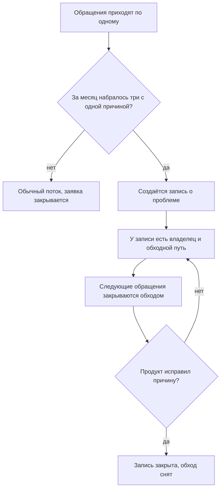
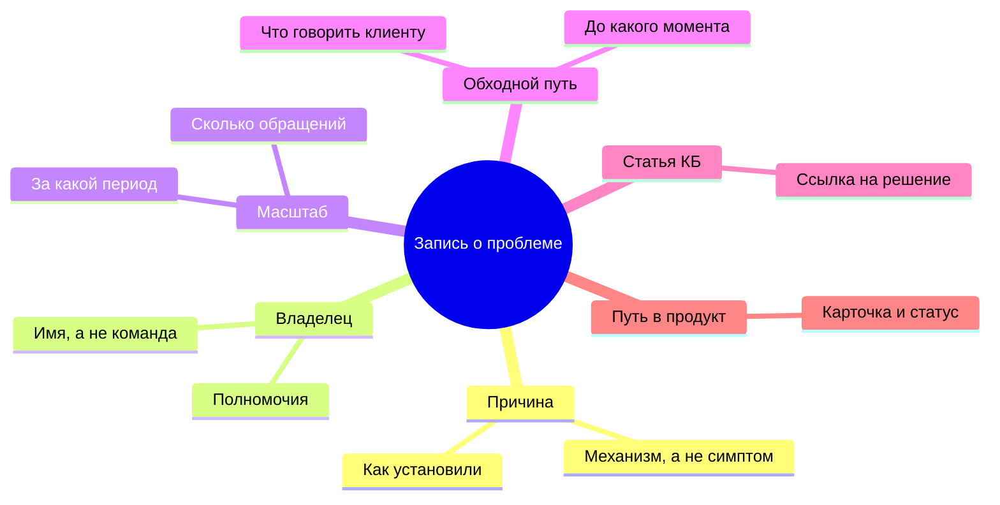
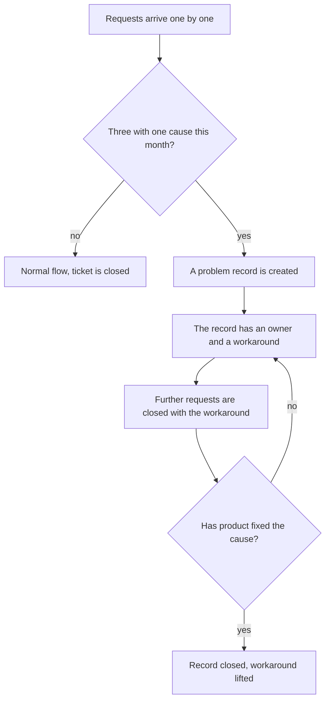
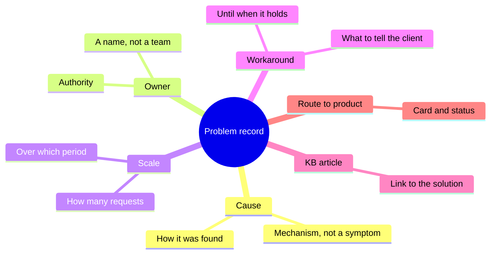
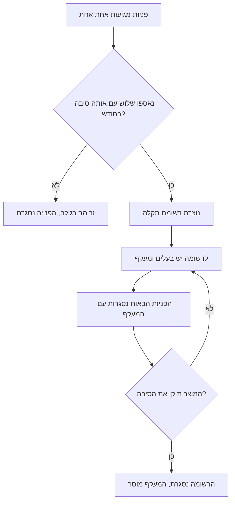
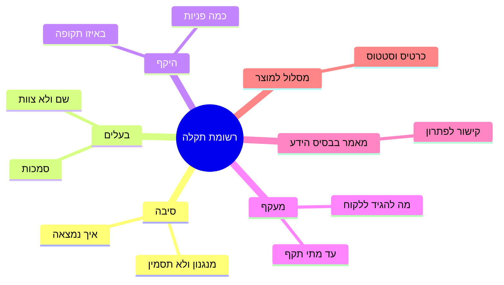

<!-- lang:ru -->

## Введение

Самый дорогой тикет в поддержке — тот, который команда уже решала. Не потому, что он сложный, а потому, что платит за него каждый раз другой инженер, и каждый раз заново.

Одно время я смотрел на отчёт и видел здоровье: поток закрывается, очередь не растёт, ни одного просроченного тикета. Потом слушал разбор недели и понимал, что три инженера рассказывают об одном и том же разными словами. В отчёте это были три успешно закрытые заявки; в реальности — одна проблема, которую никто не собирался решать.

Речь в этой статье о переходе, который стоит сервису больше всего: от потока заявок к списку проблем. Заявка — единица работы, и у неё есть срок. Проблема — единица причины, и у неё есть владелец, обходной путь и путь в продуктовый отчёт. Пока эти два списка не разделены, поддержка обречена решать одно и то же вечно.

## Невидимая стоимость одинаковых тикетов

Повторяющиеся обращения незаметны именно потому, что каждое из них выглядит нормально. Тикет пришёл, инженер разобрался, клиент получил ответ, заявка закрыта. Метрика «закрыто» растёт, а проблема не двигается.

Стоимость складывается из четырёх вещей, и ни одна не попадает в отчёт:

- **Часы команды.** Каждое повторение — это разбор с нуля: тот же поиск, те же проверки, те же эксперименты. Время списывается в операционку и не возвращается.
- **Доверие клиента.** Человек, который пишет третий раз за месяц и слышит «а вы пробовали…», делает вывод не про продукт, а про поддержку. Первый ответ ещё считается работой, третий — уже отпиской.
- **Знание, которое не оседает.** Инженер нашёл обход — и обход остался в его голове и в одном закрытом тикете. Через квартал он уйдёт в отпуск или в другую команду, и обход уйдёт вместе с ним.
- **Слепое пятно для продукта.** Пока проблема живёт тикетами, у продукта нет ни одного аргумента: ему нечего показать, кроме «клиенты жалуются». С записью о проблеме разговор меняется — но об этом ниже.

Всё это — цена отсутствия списка. Список начинается с правила, которое команда признаёт без обсуждений.

Почему такие повторы не видны в стандартном отчёте: он группирует заявки по категориям, а проблема живёт не в категории, а в причине. Две заявки в разных категориях могут иметь один и тот же механизм отказа, и никакая группировка их не сблизит. Поэтому искать повторы приходится не в дашборде, а на разборе недели и в поиске по текстам обращений.

## Правило трёх обращений

Правило простое: три обращения за месяц с одной причиной — не три тикета, а одна запись о проблеме. Одно обращение — случайность, два — совпадение, три — уже паттерн, с которым надо что-то делать.

В нём важны три уточнения, без которых правило превращается в формальность.

**Одна причина, а не один текст.** Совпадение формулировок ничего не значит: клиенты описывают одно и то же разными словами, а одно и то же слово может означать разные сбои. Считать надо по причине — по тому механизму, который инженер установил при разборе.

**Окно — месяц.** Год слишком долго: проблема успеет сожрать больше, чем стоит её решение. Неделя слишком коротко: часть проблем проявляется реже и не успеет набрать три обращения. Месяц — рабочий компромисс, и он же удобен как период обзора.

**Замечает любой, а не только лид.** Если три обращения замечает только лид, правило живёт ровно до первой загруженной недели. Триггер должен срабатывать на разборе недели, где команда сама называет повторы, а лид подтверждает — или на триаже, если в трекере есть поле для связи обращений.

Как это работает в потоке:

Обратите внимание на обратную стрелку: пока причина не исправлена, запись живёт и продолжает приносить пользу — именно этим она отличается от тикета.

<!-- вилка: как у вас работает правило трёх — кто замечает повторы, где ведётся список, что было до него. -->

## Анатомия записи о проблеме

Запись — не тикет и не заметка в чате. Это короткий документ, который живёт дольше любого обращения и читается теми, кто не участвовал в разборе. Вот набор понятий, из которых она состоит:

Поясню два блока, на которых чаще всего ломаются.

**Причина.** Формулировка должна описывать механизм: не «проблемы с доступом», а «после смены пароля старые сессии не инвалидируются». Такую причину можно проверить, передать продукту и закрыть. Формулировка через симптом проверке не поддаётся и годится только для поиска похожих тикетов.

**Владелец.** Имя человека, а не название команды. Владелец не обязан всё чинить сам: у него есть полномочия решать, что делать с проблемой, и он помнит контекст. Запись без владельца — это тот же тикет, только длиннее.

Остальные блоки служат читателю, а не бюрократии: масштаб показывает, стоит ли вкладываться; обходной путь даёт команде готовый ответ; статья в базе знаний превращает обход в переиспользуемое знание; путь в продукт делает проблему видимой там, где её могут устранить.

<!-- вилка: пример вашей записи о проблеме — причина, владелец, обходной путь, чем закончилась. -->

## Что даёт владелец

Главная выгода владельца не в том, что он быстрее реагирует. Она в том, что у проблемы появляется будущее.

Пока причины не исправлены, единственное, что может сделать поддержка, — дать клиенту рабочий ответ. Именно это и хранится в записи: обходной путь, проверенный и разрешённый, с границей «до какого момента он верен». Новый инженер не изобретает решение заново и не обещает того, чего не будет; клиент получает одинаковый ответ от любого сотрудника.

Второй эффект — экономия внимания лида. Без записи каждая повторная проблема возвращается к лиду заново: то в виде спора о приоритете, то в виде просьбы «посмотри, почему опять». С записью решение принято один раз и действует до изменения условий.

Третий — то, что видно снаружи. Список активных проблем с владельцами и статусами — лучший ответ на вопрос руководства «что происходит в поддержке». Он честнее графика закрытых заявок: показывает не активность, а состояние нерешённого.

Владельца при этом стоит брать из самой поддержки, а не из продукта. Владелец из поддержки знает клиентов и обход, принимает решения в своих границах и не ждёт чужого совещания; его задача — держать проблему в поле зрения, а не устранить причину своими руками. Если поставить владельцем продукт, запись умрёт: у продукта другой ритм, и поддержка снова останется без ответа.

<!-- вилка: сколько активных записей у вас одновременно и почему именно столько. -->

## Мост в продукт

Самая слабая часть этого механизма в большинстве команд — последний переход. Запись живёт внутри поддержки, а решение лежит в продукте; если между ними нет моста, запись превращается в вечный обходной путь.

Мост строится из того, что уже есть в записи: причина описана механизмом, масштаб известен, обход сформулирован. Из этого собирается карточка для продукта — с данными, статусом и владельцем на той стороне; о ней отдельно в статье «Карточка проблемы для продукта, которую не закрыть без статуса».

Правило, которое я считаю ключевым: запись о проблеме не закрывается по факту «мы отправили». Она закрывается, когда у неё появился внешний статус — принято в работу, отклонено с причиной, запланировано на версию. Отсутствие статуса — тоже статус, и его надо называть вслух на разборе.

<!-- вилка: пример пути от тикетов до карточки в продукте — что отправили, что ответили, чем закончилось. -->

И последнее. Список проблем живёт не в голове лида и не в треде чата, а в месте, доступном команде: иначе через месяц его придётся собирать заново. Неважно, таблица это или поле в трекере; важно, что его видит любой инженер до того, как начнёт разбирать очередное похожее обращение.

<!-- lang:en -->

## Introduction

The most expensive ticket in support is the one the team has already solved. Not because it is hard, but because a different engineer pays for it every time, and each time from scratch.

For a while I looked at the report and saw health: the flow was closing, the queue was not growing, not a single overdue ticket. Then I listened to the weekly review and understood that three engineers were telling the same story in different words. In the report those were three successfully closed tickets; in reality it was one problem that nobody intended to solve.

This article is about the transition that costs a service more than anything else: from a stream of requests to a list of problems. A request is a unit of work and it has a deadline. A problem is a unit of cause and it has an owner, a workaround and a route into the product report. Until those two lists are separated, support is condemned to solve the same thing forever.

## The invisible cost of identical tickets

Recurring requests are invisible precisely because each of them looks normal. The ticket came in, the engineer worked it out, the client got an answer, the ticket is closed. The "closed" metric grows while the problem does not move.

The cost consists of four things, and none of them reaches any report:

- **Team hours.** Every repetition is analysis from scratch: the same search, the same checks, the same experiments. The time goes into operations and does not come back.
- **Client trust.** Someone writing for the third time in a month and hearing "have you tried..." draws a conclusion not about the product but about support. The first answer still counts as work; the third is a brush-off.
- **Knowledge that does not settle.** The engineer found a workaround — and it stayed in their head and in one closed ticket. A quarter later they go on holiday or to another team, and the workaround goes with them.
- **A blind spot for product.** While the problem lives as tickets, product has no argument: nothing to show except "clients are complaining". With a problem record the conversation changes — more on that below.

All of that is the price of a missing list. The list starts with a rule the team accepts without debate.

Why such repetitions are invisible in the standard report: it groups tickets by category, while a problem lives not in a category but in a cause. Two tickets in different categories can share the same failure mechanism, and no grouping will bring them together. That is why repeats are looked for not on a dashboard but at the weekly review and in a search across request texts.

## The rule of three requests

The rule is simple: three requests in a month with one cause are not three tickets but one problem record. One request is an accident, two are a coincidence, three are a pattern that has to be dealt with.

Three clarifications matter in it; without them the rule turns into a formality.

**One cause, not one text.** Matching wording means nothing: clients describe the same thing in different words, and the same word can mean different failures. You count by cause — by the mechanism the engineer established during the analysis.

**The window is a month.** A year is too long: the problem will eat more than its solution is worth. A week is too short: some problems show up rarely and will not gather three requests. A month is a working compromise, and it is also a convenient review period.

**Anyone notices, not only the lead.** If only the lead notices three requests, the rule lives exactly until the first busy week. The trigger has to fire at the weekly review, where the team names the repeats themselves and the lead confirms — or at triage, if the tracker has a field for linking requests.

How this works in the flow:

Note the backward arrow: until the cause is fixed, the record lives and keeps paying off — that is exactly how it differs from a ticket.

<!-- вилка: как у вас работает правило трёх — кто замечает повторы, где ведётся список, что было до него. -->

## The anatomy of a problem record

A record is not a ticket and not a chat note. It is a short document that outlives any single request and is read by people who took no part in the analysis. These are the concepts it is made of:

Two blocks deserve an explanation, because they are where records usually break.

**Cause.** The wording has to describe a mechanism: not "access issues" but "after a password change, old sessions are not invalidated". Such a cause can be checked, handed to product and closed. A formulation through a symptom cannot be verified and is only good for finding similar tickets.

**Owner.** A person's name, not a team's name. The owner does not have to fix everything personally: they have the authority to decide what happens to the problem, and they remember the context. A record without an owner is the same ticket, only longer.

The remaining blocks serve the reader, not bureaucracy: scale shows whether the problem is worth investing in; the workaround gives the team a ready answer; the KB article turns the workaround into reusable knowledge; the route to product makes the problem visible where it can actually be eliminated.

<!-- вилка: пример вашей записи о проблеме — причина, владелец, обходной путь, чем закончилась. -->

## What an owner gives you

The main benefit of an owner is not faster reaction. It is that the problem acquires a future.

Until the causes are fixed, the only thing support can do is give the client a working answer. That is exactly what the record stores: a workaround, verified and approved, with the boundary "until when it holds". A new engineer does not reinvent the solution and does not promise what will not happen; the client gets the same answer from any team member.

The second effect is saving the lead's attention. Without a record, every recurring problem comes back to the lead anew: now as a priority argument, now as a request to "look why it happened again". With a record the decision is made once and holds until the conditions change.

The third is what is visible from outside. A list of active problems with owners and statuses is the best answer to management's question "what is happening in support". It is more honest than a chart of closed tickets: it shows the state of the unresolved rather than activity.

The owner, meanwhile, is better taken from support itself rather than from product. An owner from support knows the clients and the workaround, decides within their own boundaries and does not wait for someone else's meeting; their job is to keep the problem in sight, not to eliminate the cause with their own hands. If you make product the owner, the record dies: product has a different rhythm, and support is left without an answer again.

<!-- вилка: сколько активных записей у вас одновременно и почему именно столько. -->

## A bridge into product

The weakest part of this mechanism in most teams is the last transition. The record lives inside support while the solution lives in product; if there is no bridge between them, the record turns into a permanent workaround.

The bridge is built from what the record already holds: the cause described as a mechanism, the known scale, the formulated workaround. From that a card for product is assembled — with data, a status and an owner on the other side; that is covered separately in the article "A problem card for product that won't close without a status".

A rule I consider essential: a problem record does not close on the fact of "we sent it". It closes when it has an external status — accepted for work, rejected with a reason, scheduled for a version. The absence of a status is also a status, and it has to be said out loud at the review.

<!-- вилка: пример пути от тикетов до карточки в продукте — что отправили, что ответили, чем закончилось. -->

And one last thing. The list of problems does not live in the lead's head or in a chat thread but in a place the team can reach: otherwise in a month it will have to be reassembled. Whether that is a spreadsheet or a field in the tracker does not matter; what matters is that any engineer sees it before starting on the next similar request.

<!-- lang:he -->

## מבוא

הפנייה היקרה ביותר בתמיכה היא זו שהצוות כבר פתר. לא מפני שהיא קשה, אלא כי בכל פעם משלם עליה מוקדן אחר, ובכל פעם מאפס.

במשך תקופה הסתכלתי על הדוח וראיתי בריאות: הזרימה נסגרת, התור לא גדל, אף פנייה לא באיחור. אחר כך הקשבתי לניתוח השבועי והבנתי ששלושה מוקדנים מספרים את אותו סיפור במילים אחרות. בדוח אלה היו שלוש פניות שנסגרו בהצלחה; במציאות זאת היתה תקלה אחת שאף אחד לא התכוון לפתור.

המאמר הזה עוסק במעבר שעולה לשירות יותר מכל דבר אחר: מזרימת פניות לרשימת תקלות. פנייה היא יחידת עבודה ויש לה מועד. תקלה היא יחידת סיבה ויש לה בעלים, מעקף ומסלול לדוח המוצר. כל עוד שתי הרשימות לא מופרדות, התמיכה נידונה לפתור את אותו דבר לנצח.

## המחיר הבלתי נראה של פניות זהות

פניות חוזרות אינן נראות בדיוק מפני שכל אחת מהן נראית רגילה. הפנייה הגיעה, המוקדן פירק אותה, הלקוח קיבל תשובה, הפנייה נסגרה. מדד "נסגרו" גדל והתקלה לא זזה.

העלות מורכבת מארבעה דברים, ואף אחד מהם לא מגיע לשום דוח:

- **שעות של הצוות.** כל חזרה היא פירוק מאפס: אותו חיפוש, אותן בדיקות, אותם ניסויים. הזמן נספר בעבודה השוטפת ולא חוזר.
- **אמון הלקוח.** מי שכותב בפעם השלישית בחודש ושומע "האם ניסית..." מסיק מסקנה לא על המוצר אלא על התמיכה. התשובה הראשונה עוד נחשבת לעבודה, השלישית היא כבר מכתב תבניתי.
- **ידע שלא שוקע.** המוקדן מצא מעקף — והמעקף נשאר בראשו ובפנייה אחת סגורה. כעבור רבעון הוא יוצא לחופשה או עובר לצוות אחר, והמעקף יוצא איתו.
- **נקודה עיוורת למוצר.** כל עוד התקלה חיה כפניות, למוצר אין שום טיעון: אין מה להראות חוץ מ"לקוחות מתלוננים". עם רשומת תקלה השיחה משתנה — על כך בהמשך.

כל זה הוא המחיר של היעדר רשימה. הרשימה מתחילה בכלל שהצוות מקבל בלי ויכוח.

למה חזרות כאלה לא נראות בדוח הסטנדרטי: הוא מקבץ פניות לפי קטגוריות, והתקלה חיה לא בקטגוריה אלא בסיבה. שתי פניות בקטגוריות שונות יכולות לחלוק את אותו מנגנון כשל, ושום קיבוץ לא יקרב ביניהן. לכן מחפשים חזרות לא בלוח המחוונים אלא בניתוח השבועי ובחיפוש בטקסטי הפניות.

## כלל שלוש הפניות

הכלל פשוט: שלוש פניות בחודש עם אותה סיבה הן לא שלוש פניות אלא רשומת תקלה אחת. פנייה אחת היא מקרה, שתיים צירוף מקרים, שלוש זה כבר דפוס שצריך לעשות איתו משהו.

שלושה דיוקים חשובים בו; בלעדיהם הכלל הופך לפורמליות.

**סיבה אחת ולא נוסח אחד.** התאמת ניסוחים לא אומרת כלום: לקוחות מתארים את אותו דבר במילים שונות, ואותה מילה עשויה לתאר כשלים שונים. סופרים לפי סיבה — לפי המנגנון שהמוקדן זיהה בזמן הפירוק.

**החלון — חודש.** שנה זה ארוך מדי: התקלה תאכל יותר ממה ששווה הפתרון שלה. שבוע קצר מדי: חלק מהתקלות מופיעות לעתים רחוקות ולא יאספו שלוש פניות. חודש הוא פשרה עובדת, וגם תקופה נוחה לניתוח.

**מבחין כל אחד, לא רק מנהל התמיכה.** אם רק מנהל התמיכה מבחין בשלוש פניות, הכלל חי בדיוק עד השבוע העמוס הראשון. הטריגר צריך לפעול בניתוח השבועי, שבו הצוות עצמו מציין את החזרות והמנהל מאשר — או במיון, אם במערכת יש שדה לקישור פניות.

כך זה עובד בזרימה:

שימו לב לחץ האחורי: כל עוד הסיבה לא תוקנה, הרשומה חיה וממשיכה להניב — בדיוק בכך היא שונה מפנייה.

<!-- вилка: как у вас работает правило трёх — кто замечает повторы, где ведётся список, что было до него. -->

## אנטומיה של רשומת תקלה

רשומה היא לא פנייה ולא הערה בצ'אט. זה מסמך קצר שחי יותר מכל פנייה נקראת על ידי אנשים שלא השתתפו בפירוק. אלה המושגים שמהם היא בנויה:

שני בלוקים דורשים הסבר, כי בהם הרשומות נשברות לרוב.

**סיבה.** הניסוח צריך לתאר מנגנון: לא "בעיות גישה" אלא "אחרי החלפת סיסמה הסשנים הישנים לא מתבטלים". סיבה כזאת אפשר לבדוק, למסור למוצר ולסגור. ניסוח דרך תסמין לא ניתן לבדיקה ומתאים רק לחיפוש פניות דומות.

**בעלים.** שם של אדם ולא שם של צוות. הבעלים לא חייב לתקן הכל בעצמו: יש לו סמכות להחליט מה קורה עם התקלה, והוא זוכר את ההקשר. רשומה בלי בעלים היא אותה פנייה, רק ארוכה יותר.

שאר הבלוקים משרתים את הקורא ולא את הבירוקרטיה: ההיקף מראה אם שווה להשקיע; המעקף נותן לצוות תשובה מוכנה; המאמר בבסיס הידע הופך את המעקף לידע שאפשר להשתמש בו שוב; המסלול למוצר הופך את התקלה לנראית במקום שבו אפשר לחסל אותה.

<!-- вилка: пример вашей записи о проблеме — причина, владелец, обходной путь, чем закончилась. -->

## מה נותן הבעלים

התועלת העיקרית של בעלים אינה תגובה מהירה יותר. היא בכך שלתקלה יש עתיד.

כל עוד הסיבות לא תוקנו, הדבר היחיד שהתמיכה יכולה לעשות הוא לתת ללקוח תשובה שעובדת. בדיוק זה נשמר ברשומה: מעקף שנבדק ואושר, עם גבול "עד מתי הוא תקף". מוקדן חדש לא ממציא את הפתרון מחדש ולא מבטיח מה שלא יקרה; הלקוח מקבל אותה תשובה מכל עובד.

ההשפעה השנייה — חיסכון בתשומת הלב של מנהל התמיכה. בלי רשומה כל תקלה חוזרת חוזרת אליו מחדש: פעם כוויכוח על עדיפות, פעם כבקשה "תראה למה זה שוב". עם רשומה ההחלטה מתקבלת פעם אחת ותקפה עד שינוי התנאים.

השלישית — מה שנראה מבחוץ. רשימת תקלות פעילות עם בעלים וסטטוסים היא התשובה הטובה ביותר לשאלת ההנהלה "מה קורה בתמיכה". היא ישרה יותר מגרף הפניות הסגורות: היא מראה את מצב הלא־פתור ולא את הפעילות.

את הבעלים, אגב, עדיף לקחת מתוך התמיכה ולא מתוך המוצר. בעלים מהתמיכה מכיר את הלקוחות ואת המעקף, מחליט בגבולות שלו ולא ממתין לישיבה של מישהו אחר; תפקידו להחזיק את התקלה בשדה הראייה ולא לחסל את הסיבה בידיים. אם ממנים את המוצר לבעלים, הרשומה מתה: למוצר קצב אחר, והתמיכה שוב נשארת בלי תשובה.

<!-- вилка: сколько активных записей у вас одновременно и почему именно столько. -->

## גשר למוצר

החלק החלש ביותר במנגנון הזה ברוב הצוותים הוא המעבר האחרון. הרשומה חיה בתוך התמיכה והפתרון נמצא במוצר; אם אין ביניהם גשר, הרשומה הופכת למעקף נצחי.

הגשר נבנה ממה שכבר יש ברשומה: הסיבה מתוארת כמנגנון, ההיקף ידוע, המעקף מנוסח. מזה מרכיבים כרטיס למוצר — עם נתונים, סטטוס ובעלים בצד השני; על כך בנפרד במאמר "כרטיס בעיה למוצר שאי אפשר לסגור בלי סטטוס".

כלל שאני מחשיב מרכזי: רשומת תקלה לא נסגרת על עצם העובדה ש"שלחנו". היא נסגרת כשיש לה סטטוס חיצוני — התקבל לעבודה, נדחה עם סיבה, תוכנן לגרסה. גם היעדר סטטוס הוא סטטוס, וצריך לומר אותו בקול בניתוח.

<!-- вилка: пример пути от тикетов до карточки в продукте — что отправили, что ответили, чем закончилось. -->

והדבר האחרון. רשימת התקלות לא חיה בראש של מנהל התמיכה ולא בת'רד בצ'אט אלא במקום שהצוות יכול להגיע אליו: אחרת בעוד חודש יהיה צריך להרכיב אותה מחדש. לא חשוב אם זה גיליון או שדה במערכת; חשוב שכל מוקדן יראה אותה לפני שיתחיל לפרק פנייה דומה.
