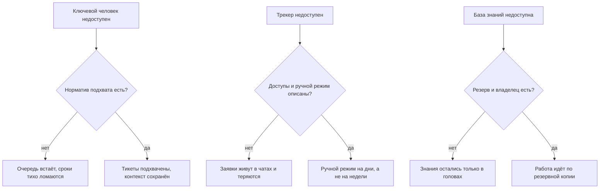
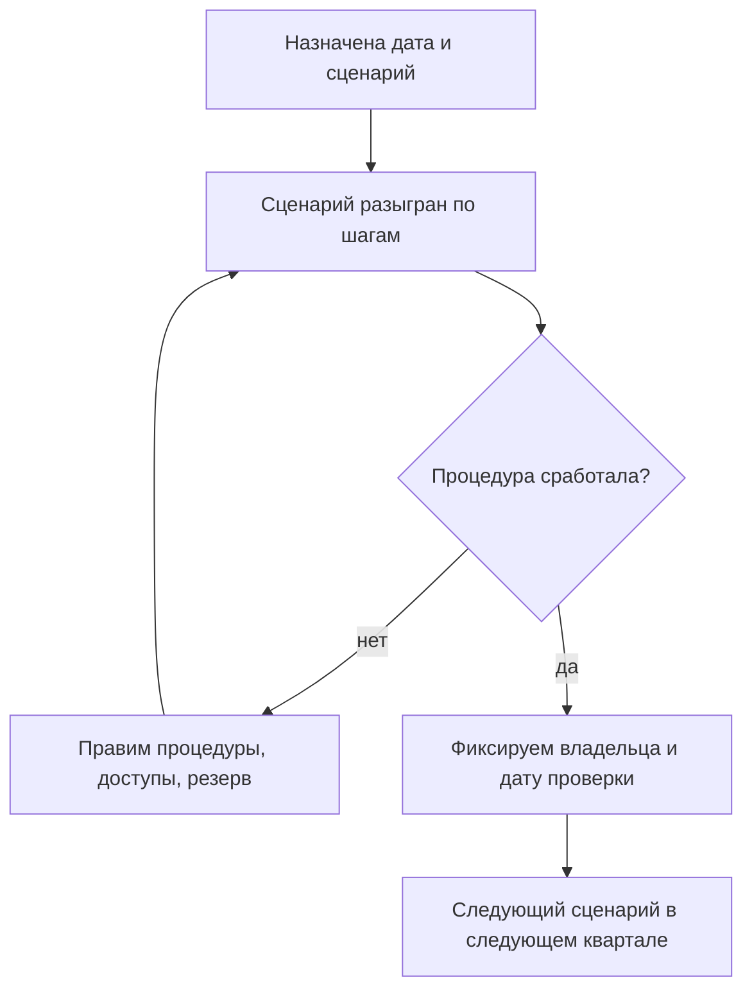
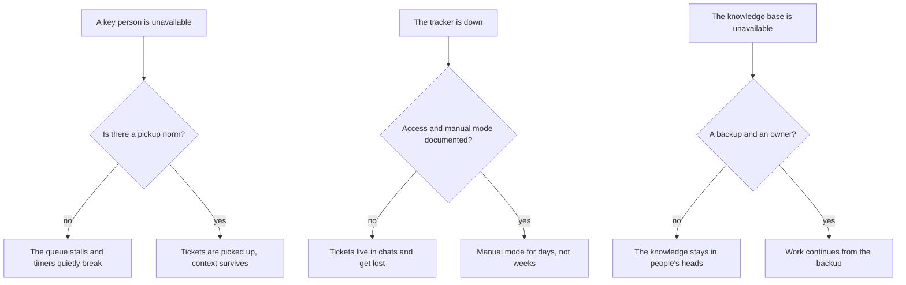
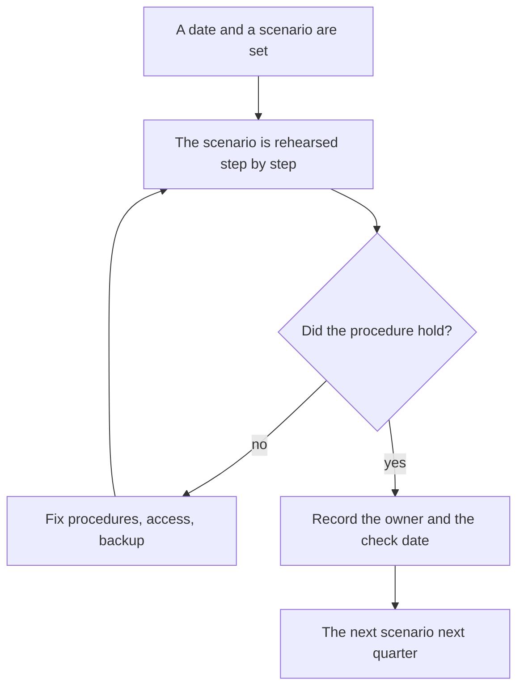
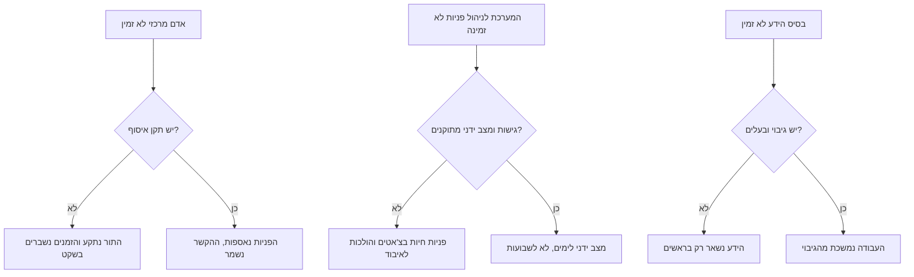
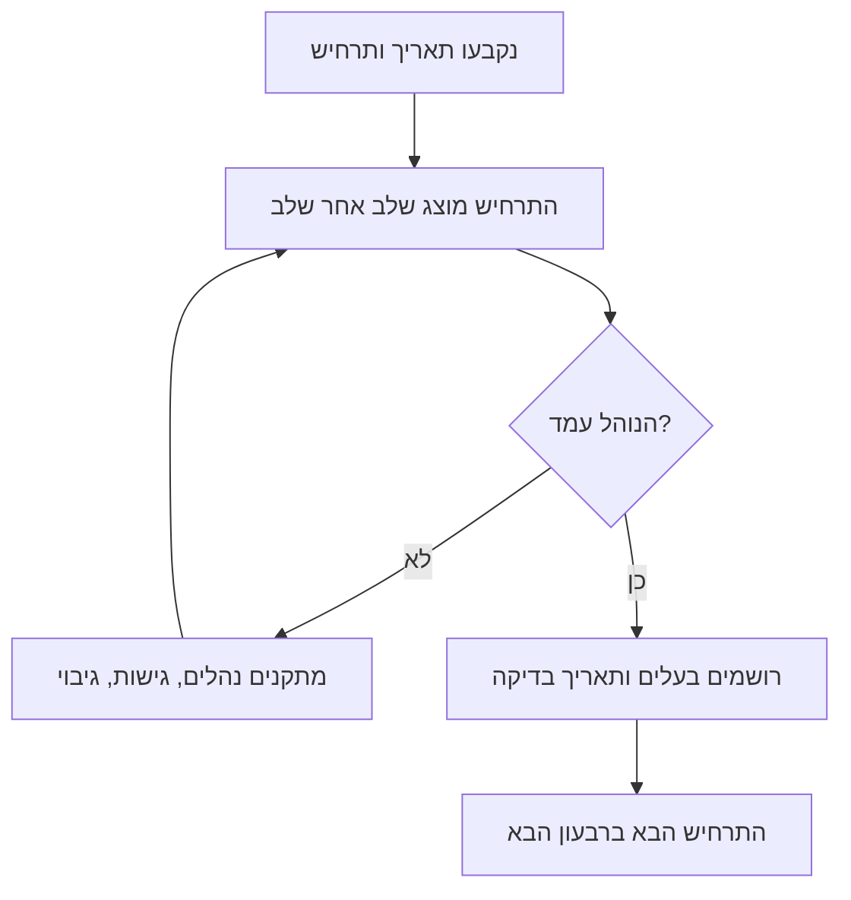

<!-- lang:ru -->

## Введение

У лида поддержки есть один честный тест на то, чем он на самом деле управляет: уйти и посмотреть, что останется. Не «справятся ли ребята» — они почти всегда справляются, — а с какой скоростью сервис начнёт терять заявки, обещания и контекст.

В предыдущей статье серии — «Метрика без действия — это картинка: паспорт метрики» — речь шла о том, чтобы у каждой цифры было действие. Эта статья — последняя проверка года: что произойдёт с сервисом, если из него вынуть конкретного человека. Называю эту проверку аудитом живучести. Это не про доверие к команде и не про поиск виноватых, а про поиск точек отказа до того, как отказ случится: в отпуске, на больничном, в день увольнения или в день, когда трекер лёг вместе с доступом к нему.

Тезис, из которого я исхожу: живучесть — это свойство системы, а не характера людей. Пока знание, маршрут и решение живут в одном человеке, сервис работает на его присутствии, а не на регламенте. Аудит нужен, чтобы увидеть этот разрыв в спокойное время, когда исправление стоит часа, а не репутации.

## Три сценария провала

Сценариев, которые стоит разыграть, много, но почти все сводятся к трём. Первый — недоступность ключевого человека: отпуск, болезнь, внезапный уход, две недели без связи. Второй — отказ инструмента: трекер недоступен, доступ отозван, интеграция сломана, почта не разбирается. Третий — потеря базы знаний: она устарела, она недоступна, её некому поддерживать, и знания вернулись туда, откуда мы их весь год вытаскивали — в головы.

Общее у них одно: каждый сценарий проверяет не героизм команды, а наличие норматива и владельца. Схема показывает, как сценарий расходится на два исхода:

Разница между верхней и нижней веткой каждого сценария — не в людях, а в том, существует ли заранее написанный ответ. Дальше разбираю норматив, который делает первый сценарий безобидным, и расчёт, который его проверяет.

## Норматив «подхват за 15 минут»

Норматив, на котором держится вся живучесть, звучит так: любая новая заявка подхвачена в течение пятнадцати минут в рабочее время. Подчёркиваю, что значит «подхвачена»: у заявки есть владелец, проставлены категория и критичность, клиент получил первый содержательный ответ или хотя бы честный срок. Подхват — это не решение. Требовать решения за пятнадцать минут бессмысленно; требовать, чтобы заявка не висела безымянной, — обязательно.

Что должно существовать, чтобы норматив выполнялся без конкретного человека:

- **Триаж при первом касании.** Категория, критичность и маршрут проставляются при приёме, а не после того, как заявка полежала. Без этого «подхват» превращается в «кто-нибудь посмотрел».
- **Дежурство с ротацией.** У очереди есть конкретный дежурный на каждый день, и его имя известно команде. Дежурный меняется по календарю, а не по договорённости в чате.
- **Матрица маршрутов.** Для типовых поводов записано, к кому уходит заявка: линия L2, продукт, эксплуатация, внешний подрядчик. Если маршрут держится в голове лида, подхват невозможен по определению.
- **Доступ у всех, кому он нужен.** Очередь, база знаний, регламенты и шаблоны ответов открываются не по личной просьбе, а по роли. Человек, который «знает, у кого попросить доступ», — это и есть одноточечный риск.
- **Эскалация с таймером.** Если заявка не подхвачена за норматив, это видно: дежурный получает сигнал, а не узнаёт о нарушении на еженедельном разборе.

<!-- вилка: ваш норматив подхвата — значение, часы работы, что считается подхватом и как фиксируется. -->

Отдельно стоит договориться, что норматив действует в рабочее время. Круглосуточный подхват — это другая модель смен и другой штат; обещать его без ресурса значит закладывать тихое нарушение в собственный регламент.

## Проверка нормативов расчётом

Норматив легко объявить и трудно доказать. Проверяется он расчётом мощности из статьи «Мощность вместо героизма»: объём потока за период, умноженный на среднее время обработки одной заявки, делённый на доступные часы команды. Пока расчёт сходится при полном составе, всё выглядит благополучно. Аудит живучести добавляет к нему один вопрос: сходится ли расчёт, если вычесть одного человека — и особенно если вычесть именно того, кто держит самый тяжёлый участок.

Считать нужно по трём вычетам.

1. **Минус ключевой инженер.** Доступные часы уменьшаются, а поток остаётся. Если после вычета норматив подхвата не выполняется даже на бумаге, никакой героизм его не выполнит и в жизни.
2. **Минус лид.** Если поток сходится только при вашем участии, значит часть работы — маршрутизация, споры о критичности, согласования — не передана. Это те самые роли, от которых вы вроде бы отказались, но только в документе.
3. **Минус инструмент.** Отказ трекера стоит не часов, а дней: пока заявки идут почтой, время первого ответа считается по другому правилу. В расчёте это выглядит как падение производительности на период восстановления — и этот период должен быть оценён заранее.

Второй способ проверки — по событиям, а не по модели. Берутся дни, когда ключевой человек отсутствовал, и по трекеру смотрятся заявки, пришедшие в эти дни: время до первого ответа, доля заявок, переназначенных повторно, число реопенов после возвращения человека. Если в такие дни сроки растут, а после возвращения заявки закрываются повторно, проблема не в людях, а в передаче контекста.

<!-- вилка: свой расчёт — сколько заявок в неделю, среднее время, доступные часы, что показал вычет одного человека. -->

## Процедуры восстановления

Аудит бесполезен, если заканчивается списком рисков. Каждый найденный риск получает процедуру — короткую, на страницу, с владельцем и датой проверки.

- **Передача дел.** Чек-лист на неделю отсутствия: какие заявки в работе, какие обещания даны клиентам, где ждут ответа, кого предупредить. Заполняется до отпуска, а не в первый день больничного.
- **Реестр доступов и аварийный вход.** Список систем и ролей, которые нужны для работы очереди, и порядок получения доступа в обход обычного согласования — с условиями, при которых он применяется, и с записью о применении.
- **Резерв базы знаний.** Владелец базы, периодичность выгрузки, где лежит копия и как она разворачивается. Проверка резерва — восстановление одной статьи, а не галочка в регламенте.
- **Ручной режим при отказе трекера.** Адрес, куда пишут клиенты, шаблон ответа, кто разбирает входящее, сколько такой режим выдерживает и как заявки потом переносятся в трекер.
- **Порядок объявления.** Кто и в какой момент сообщает команде и клиентам, что режим изменился, и кто принимает решение вернуться в обычный.

<!-- вилка: ваши процедуры — что уже написано, что проверялось на практике и чем закончилось. -->

## График аудита

Аудит живучести — не разовое мероприятие, а ритм. Минимальная частота, которая работает: раз в квартал по одному сценарию, с полной процедурой разбора. Один квартал — недоступность человека, следующий — отказ инструмента, третий — потеря знаний, четвёртый — сценарий, который выбрала команда.

Как выглядит цикл:

Главная ловушка графика — превратить аудит в театр: разыграть сценарий, убедиться, что «в целом все справились», и ничего не изменить. Поэтому у каждого аудита должен быть хотя бы один видимый результат: обновлённая процедура, новый доступ, выгруженный резерв или снятый с повестки риск. Аудит без изменения — это не проверка живучести, а отчёт о спокойствии.

Кого привлекать: второго инженера, который умеет работать в этом участке, представителя смежной команды, если сценарий затрагивает её, и руководителя — не для отчёта, а чтобы он увидел точки отказа своими глазами. Что обновляется по итогам: норматив подхвата, реестр доступов, резерв базы знаний, календарь дежурств и сам список рисков.

<!-- вилка: результаты вашего аудита — какие точки риска нашли, что закрыли, что осталось открытым. -->

Живучесть нельзя доказать презентацией. Её доказывает один факт: сервис работает, когда вас нет, и никто не выясняет по ходу дела, где лежит нужный доступ. Год, который заканчивается таким фактом, можно считать удавшимся — и следующий планировать от него, а не от пожеланий. Об этом — в последней статье серии: «Девять ошибок лида поддержки — и годовой отчёт».

<!-- lang:en -->

## Introduction

A support lead has exactly one honest test of what they actually manage: walk away and see what remains. Not "will the team cope" — they almost always cope — but how fast the service starts losing tickets, promises, and context.

The previous article in the series — "A metric without an action is a picture: the metric passport" — was about making every number lead to a decision. This one is the year's final check: what happens to the service when one specific person is removed from it. I call it a resilience audit. It isn't about trusting the team or hunting for someone to blame; it's about finding the failure points before they fail: on vacation, on sick leave, on the day someone resigns, or on the day the tracker goes down along with access to it.

The premise I start from: resilience is a property of the system, not of people's character. While the knowledge, the route, and the decision all live in one person, the service runs on that person's presence rather than on a process. The audit exists to expose that gap in calm times, when fixing it costs an hour instead of a reputation.

## Three failure scenarios

There are many scenarios worth rehearsing, but almost all of them collapse into three. The first is a key person being unavailable: vacation, illness, an abrupt resignation, two weeks without contact. The second is tool failure: the tracker is down, access is revoked, an integration breaks, inbound mail goes unread. The third is losing the knowledge base: it's stale, it's unavailable, nobody maintains it, and the knowledge has gone back to where we spent the whole year dragging it from — people's heads.

They share one thing: each scenario tests whether a norm and an owner exist, not whether the team is heroic. The diagram shows how each scenario splits into two outcomes:

The difference between the top and bottom branch of each scenario isn't people — it's whether a written answer exists in advance. Next I'll take the norm that makes the first scenario harmless, and the calculation that verifies it.

## The "picked up in 15 minutes" norm

The norm the whole resilience story rests on: every new ticket is picked up within fifteen minutes during working hours. Note what "picked up" means: the ticket has an owner, a category and a severity, and the client has a substantive first response or at least an honest timeline. Picking up is not resolving. Demanding a resolution in fifteen minutes is pointless; demanding that a ticket doesn't sit there unnamed is mandatory.

What must exist for this norm to hold without one specific person:

- **Triage at first touch.** Category, severity, and route are set on intake, not after the ticket has been sitting. Without that, "picked up" means "someone glanced at it".
- **A rotation of on-call duty.** The queue has a named person for each day, and the team knows who it is. Duty changes by calendar, not by an agreement in a chat.
- **A routing matrix.** For standard reasons a ticket has a written destination: L2, product, operations, an external vendor. If the route lives in the lead's head, pickup is impossible by definition.
- **Access for everyone who needs it.** The queue, the knowledge base, processes, and response templates are granted by role, not by a personal favour. A person who "knows who to ask for access" is the single point of failure.
- **Escalation with a timer.** A ticket that isn't picked up within the norm is visible: the on-call engineer gets an alert instead of learning about it at the weekly review.

<!-- вилка: ваш норматив подхвата — значение, часы работы, что считается подхватом и как фиксируется. -->

It's worth stating explicitly that the norm applies to working hours. Round-the-clock pickup is a different shift model with a different headcount; promising it without the resources means quietly writing a violation into your own process.

## Checking norms by calculation

A norm is easy to declare and hard to prove. It's verified with the capacity calculation from "Capacity instead of heroism": the volume of the flow over a period, multiplied by the average handling time per ticket, divided by the team's available hours. While the calculation balances at full strength, everything looks healthy. The resilience audit adds one question: does it still balance if you subtract one person — especially the one carrying the heaviest segment?

There are three subtractions to make.

1. **Minus the key engineer.** Available hours drop, the flow stays. If the pickup norm can't be met on paper after that subtraction, no amount of heroism will meet it in reality.
2. **Minus the lead.** If the flow only balances with your participation, then part of the work — routing, severity disputes, approvals — was never handed over. Those are exactly the roles you supposedly walked away from, but only in the document.
3. **Minus the tool.** A tracker outage costs days, not hours: while tickets arrive by email, first response time is counted by a different rule. In the calculation this looks like a productivity drop for the recovery period — and that period has to be estimated in advance.

The second way to check is by events rather than by model. Take the days when a key person was absent and look at the tickets that arrived then: time to first response, the share of tickets reassigned more than once, the number of reopenings after the person returned. If timers grow on those days and tickets get closed twice after the return, the problem isn't people — it's the handover of context.

<!-- вилка: свой расчёт — сколько заявок в неделю, среднее время, доступные часы, что показал вычет одного человека. -->

## Recovery procedures

An audit is useless if it ends with a list of risks. Every risk found gets a procedure — short, a page at most, with an owner and a check date.

- **Handover.** A checklist for a week of absence: which tickets are in progress, which promises were made to clients, where an answer is awaited, who needs to be warned. Filled in before vacation, not on the first day of sick leave.
- **Access register and emergency entry.** A list of systems and roles the queue needs, plus the path to access that bypasses normal approval — with the conditions under which it applies and a log of its use.
- **A knowledge base backup.** The base owner, the export cadence, where the copy lives, and how it is restored. Verifying the backup means restoring one article, not ticking a box in a process.
- **Manual mode for a tracker outage.** The address clients write to, the response template, who processes the inbox, how long this mode survives, and how tickets are migrated back into the tracker afterwards.
- **The announcement order.** Who tells the team and the clients that the mode has changed, at what point, and who decides to return to normal.

<!-- вилка: ваши процедуры — что уже написано, что проверялось на практике и чем закончилось. -->

## The audit schedule

A resilience audit isn't a one-off event but a rhythm. The minimum frequency that works: one scenario per quarter, with a full review afterwards. One quarter is a person being unavailable, the next is tool failure, the third is knowledge loss, the fourth is the scenario the team picks.

Here is the loop:

The main trap of any schedule is turning the audit into theatre: rehearse the scenario, confirm that "overall everyone coped", and change nothing. So every audit should have at least one visible result: an updated procedure, new access, an exported backup, or a risk taken off the list. An audit without a change isn't a resilience check — it's a report about calm.

Who to involve: the second engineer who can work that segment, a representative of the adjacent team if the scenario touches it, and the manager — not for a report, but so they see the failure points with their own eyes. What gets updated afterwards: the pickup norm, the access register, the knowledge base backup, the on-call calendar, and the risk list itself.

<!-- вилка: результаты вашего аудита — какие точки риска нашли, что закрыли, что осталось открытым. -->

Resilience can't be proven with a slide deck. One fact proves it: the service works when you're not there, and nobody has to figure out on the fly where the needed access lives. A year that ends with that fact can be called a success — and the next one planned from it rather than from wishes. That's the subject of the final article in the series: "Nine mistakes of a support lead — and the annual report".

<!-- lang:he -->

## מבוא

למנהל תמיכה יש מבחן כן אחד למה שהוא באמת מנהל: לצאת ולראות מה נשאר. לא "האם הצוות יסתדר" — הצוות כמעט תמיד מסתדר — אלא באיזו מהירות השירות מתחיל לאבד פניות, הבטחות והקשר.

במאמר הקודם בסדרה — "מדד בלי פעולה הוא תמונה: דרכון המדד" — עסקנו בכך שלכל מספר תהיה פעולה. המאמר הזה הוא הבדיקה האחרונה של השנה: מה יקרה לשירות אם יוציאו ממנו אדם מסוים. אני קורא לבדיקה הזאת ביקורת עמידות. היא לא על אמון בצוות ולא על חיפוש אשמים, אלא על איתור נקודות כשל לפני שהן נכשלות: בחופשה, ביום מחלה, ביום עזיבה או ביום שהמערכת לניהול פניות נפלה יחד עם הגישה אליה.

הנחת המוצא שלי: עמידות היא תכונה של המערכת, לא של האופי של האנשים. כל עוד הידע, המסלול וההחלטה חיים אצל אדם אחד, השירות עובד מנוכחותו ולא מהנוהל. הביקורת דרושה כדי לראות את הפער הזה בזמן שקט, כשהתיקון עולה שעה ולא מוניטין.

## שלושה תרחישי כשל

התרחישים ששווה לשחק בהם רבים, אבל כמעט כולם מתקבצים לשלושה. הראשון — אי־זמינות של אדם מרכזי: חופשה, מחלה, עזיבה פתאומית, שבועיים בלי קשר. השני — כשל של הכלי: המערכת לניהול פניות לא זמינה, הגישה נשללה, אינטגרציה נשברה, הדואר לא נקרא. השלישי — אובדן בסיס הידע: הוא מיושן, הוא לא נגיש, אין לו מתחזק, והידע חזר למקום שממנו גררנו אותו כל השנה — לראשים.

המשותף לכולם אחד: כל תרחיש בודק לא את הגבורה של הצוות אלא את קיומו של תקן ושל בעלים. התרשים מראה איך כל תרחיש מתפצל לשני כיוונים:

ההבדל בין הענף העליון לתחתון בכל תרחיש אינו באנשים, אלא בקיומה של תשובה כתובה מראש. בהמשך – התקן שהופך את התרחיש הראשון ללא־מזיק, והחישוב שבודק אותו.

## תקן "איסוף תוך 15 דקות"

התקן שכל העמידות נשענת עליו: כל פנייה חדשה נאספת תוך חמש־עשרה דקות בשעות העבודה. חשוב לדייק מה זה "נאספת": לפנייה יש בעלים, קטגוריה וקריטיות, והלקוח קיבל תגובה עניינית ראשונה או לפחות מועד כן. איסוף אינו פתרון. לדרוש פתרון בחמש־עשרה דקות זה חסר טעם; לדרוש שפנייה לא תישאר בלי שם — חובה.

מה חייב להתקיים כדי שהתקן יתבצע בלי אדם מסוים:

- **מיון במגע הראשון.** קטגוריה, קריטיות ומסלול נקבעים בקליטה, לא אחרי שהפנייה שכבה. בלי זה "איסוף" הופך ל"מישהו הסתכל".
- **תורנות עם רוטציה.** לתור יש תורן בשם לכל יום, והצוות יודע מי הוא. התורנות מתחלפת לפי לוח שנה ולא לפי סיכום בצ'אט.
- **מטריצת מסלולים.** לעילות טיפוסיות כתוב לאן הפנייה עוברת: קו L2, מוצר, תפעול, ספק חיצוני. אם המסלול יושב בראש של המנהל — איסוף בלתי אפשרי מלכתחילה.
- **גישה לכל מי שצריך.** התור, בסיס הידע, הנהלים ותבניות המענה נפתחים לפי תפקיד ולא לפי בקשה אישית. האדם ש"יודע ממי לבקש גישה" — הוא נקודת הכשל הבודדת.
- **הסלמה עם טיימר.** אם פנייה לא נאספה בתקן, זה נראה: התורן מקבל התראה ולא לומד על ההפרה בסיכום השבועי.

<!-- вилка: ваш норматив подхвата — значение, часы работы, что считается подхватом и как фиксируется. -->

שווה להסכים בנפרד שהתקן חל בשעות העבודה. איסוף מסביב לשעון הוא מודל משמרות אחר עם תקן כוח אדם אחר; להבטיח אותו בלי משאבים פירושו לרשום הפרה שקטה בנוהל של עצמכם.

## בדיקת התקנים בחישוב

קל להכריז תקן וקשה להוכיח אותו. הוא נבדק בחישוב הכוח מהמאמר "כוח במקום גבורה": היקף הזרימה בתקופה, כפול זמן הטיפול הממוצע לפנייה, חלקי השעות הזמינות של הצוות. כל עוד החישוב מסתדר בהרכב מלא, הכל נראה תקין. ביקורת העמידות מוסיפה שאלה אחת: האם החישוב מסתדר אם מחסירים אדם אחד — ובעיקר אם מחסירים את זה שמחזיק את הקטע הכבד ביותר.

יש לעשות שלוש הפחתות.

1. **פחות המהנדס המרכזי.** השעות הזמינות קטנות והזרימה נשארת. אם אחרי ההפחתה תקן האיסוף לא מתקיים אפילו על הנייר, שום גבורה לא תקיים אותו במציאות.
2. **פחות המנהל.** אם הזרימה מסתדרת רק בהשתתפותכם, חלק מהעבודה — ניתוב, מחלוקות עדיפות, אישורים — לא הועבר. אלה בדיוק התפקידים שמהם לכאורה פרשתם, אבל רק במסמך.
3. **פחות הכלי.** כשל של המערכת לניהול פניות עולה ימים ולא שעות: כל עוד פניות מגיעות במייל, זמן התגובה הראשונה נמדד בכלל אחר. בחישוב זה נראה כירידה בתפוקה לתקופת השחזור — ותקופה זו צריכה להיות מוערכת מראש.

הדרך השנייה לבדוק — לפי אירועים ולא לפי מודל. לוקחים ימים שבהם האדם המרכזי נעדר, ובודקים במערכת את הפניות שהגיעו באותם ימים: זמן עד התגובה הראשונה, שיעור הפניות שהועברו שוב, מספר הפתיחות מחדש אחרי חזרתו. אם בימים כאלה הזמנים גדלים ואחרי החזרה פניות נסגרות פעמיים, הבעיה אינה באנשים אלא בהעברת ההקשר.

<!-- вилка: свой расчёт — сколько заявок в неделю, среднее время, доступные часы, что показал вычет одного человека. -->

## נהלי שחזור

ביקורת חסרת תועלת אם היא נגמרת ברשימת סיכונים. כל סיכון שנמצא מקבל נוהל — קצר, עמוד אחד, עם בעלים ותאריך בדיקה.

- **העברת תיקים.** צ'ק־ליסט לשבוע היעדרות: אילו פניות בעבודה, אילו הבטחות ניתנו ללקוחות, היכן מחכים לתשובה, את מי להתריע. ממלאים לפני החופשה, לא ביום הראשון של המחלה.
- **מרשם גישות וכניסת חירום.** רשימת מערכות ותפקידים שנדרשים לתור, והמסלול לקבלת גישה בעקיפת האישור הרגיל — עם התנאים שבהם הוא מופעל ורישום של השימוש.
- **גיבוי בסיס הידע.** הבעלים של הבסיס, תדירות הייצוא, היכן הגיבוי ואיך משחזרים אותו. בדיקת הגיבוי היא שחזור של מאמר אחד, לא סימון וי בנוהל.
- **מצב ידני בכשל המערכת.** הכתובת שאליה כותבים הלקוחות, תבנית המענה, מי מטפל בנכנס, כמה זמן המצב הזה מחזיק ואיך הפניות עוברות אחר כך חזרה למערכת.
- **סדר ההודעה.** מי ומתי מודיע לצוות וללקוחות שהמצב השתנה, ומי מחליט לחזור לשגרה.

<!-- вилка: ваши процедуры — что уже написано, что проверялось на практике и чем закончилось. -->

## לוח הזמנים של הביקורת

ביקורת עמידות אינה אירוע חד־פעמי אלא קצב. התדירות המינימלית שעובדת: תרחיש אחד לרבעון, עם ניתוח מלא בסופו. רבעון אחד — אי־זמינות של אדם, הבא — כשל כלי, השלישי — אובדן ידע, הרביעי — התרחיש שהצוות בחר.

כך נראה המחזור:

המלכודת המרכזית של כל לוח זמנים — להפוך את הביקורת לתיאטרון: להציג את התרחיש, לוודא ש"בסך הכל כולם הסתדרו" ולא לשנות כלום. לכן לכל ביקורת צריכה להיות לפחות תוצאה אחת נראית: נוהל מעודכן, גישה חדשה, גיבוי מיוצא או סיכון שירד מהרשימה. ביקורת בלי שינוי היא לא בדיקת עמידות אלא דוח של שקט.

את מי לצרף: את המהנדס השני שיודע לעבוד בקטע הזה, נציג של צוות סמוך אם התרחיש נוגע בו, ואת ההנהלה — לא בשביל דוח, אלא כדי שתראה את נקודות הכשל בעיניים שלה. מה מתעדכן בסוף: תקן האיסוף, מרשם הגישות, גיבוי בסיס הידע, לוח התורנויות ורשימת הסיכונים עצמה.

<!-- вилка: результаты вашего аудита — какие точки риска нашли, что закрыли, что осталось открытым. -->

עמידות לא מוכיחים במצגת. אותה מוכיח עובדה אחת: השירות עובד כשאין אתכם, ואף אחד לא מגלה בדרך איפה נמצאת הגישה הנדרשת. שנה שמסתיימת בעובדה הזאת אפשר לקרוא לה מוצלחת — ואת הבאה לתכנן ממנה ולא מרצונות. על כך במאמר האחרון בסדרה: "תשע טעויות של מנהל תמיכה — והדוח השנתי".
