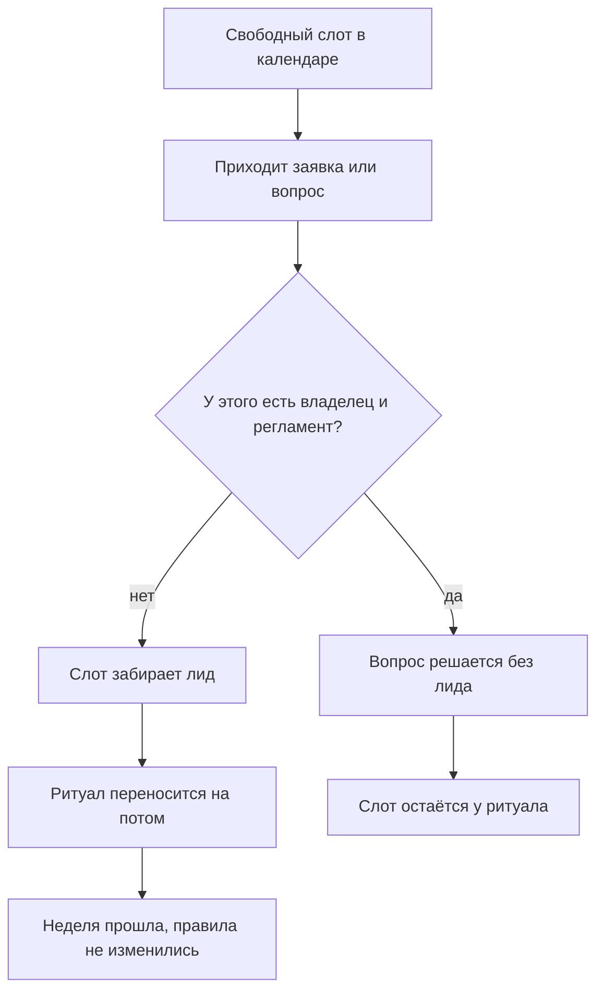
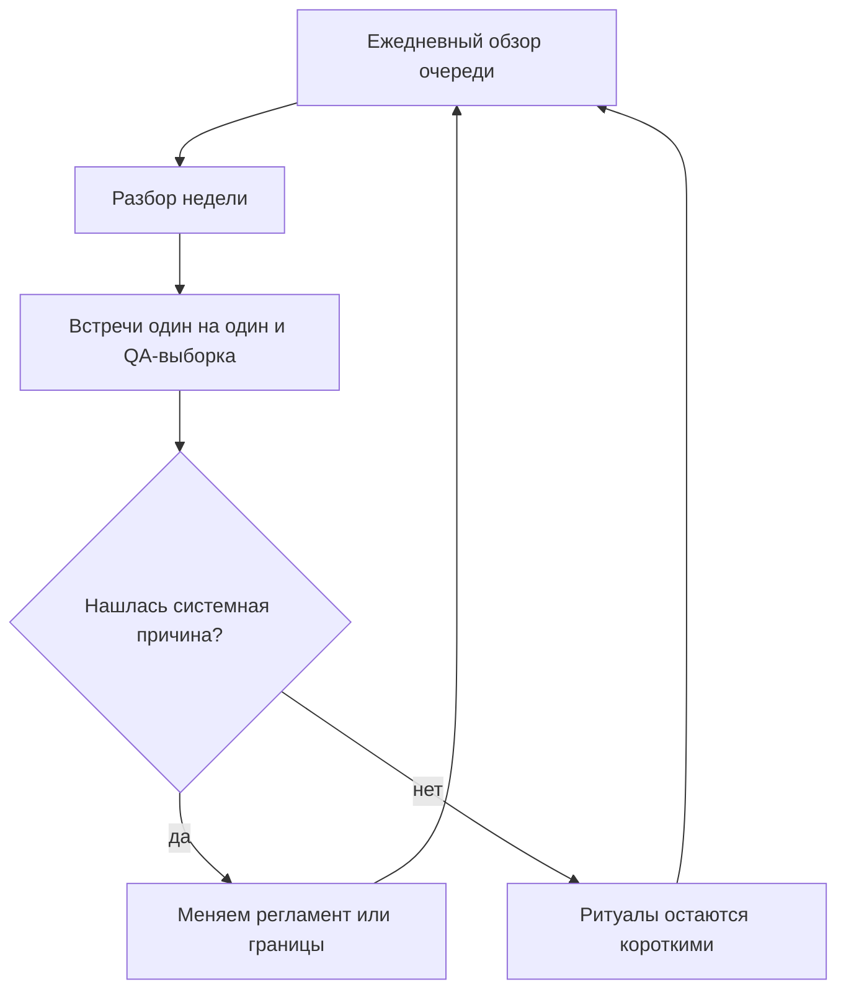
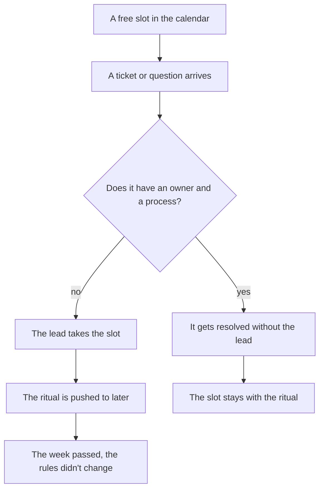
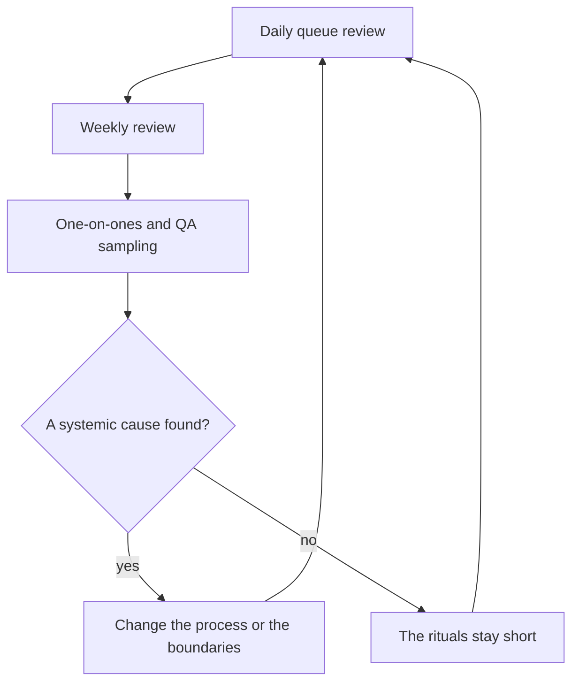
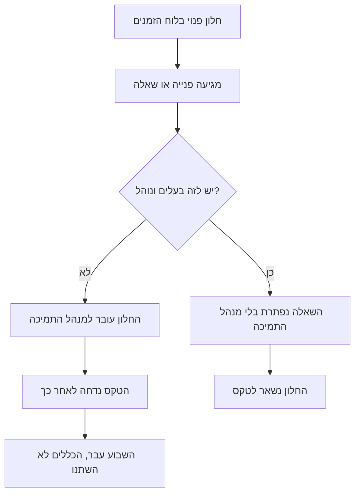
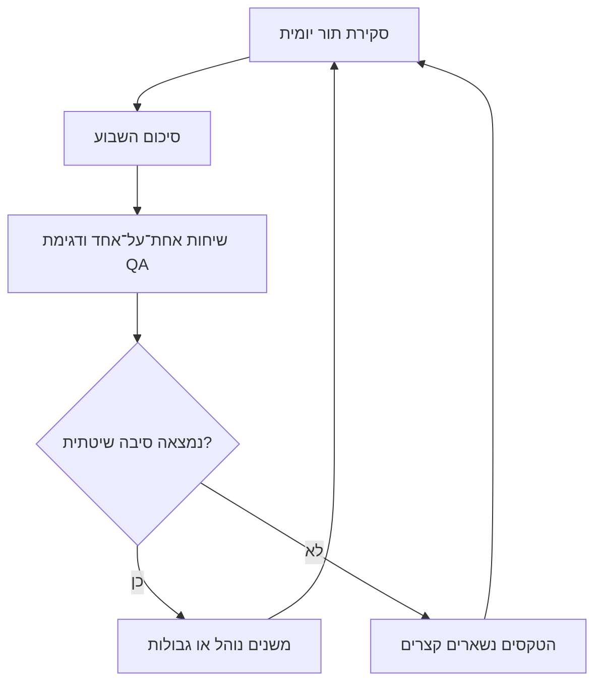

<!-- lang:ru -->

## Введение

Я долго считал, что главная проблема лида поддержки — нехватка времени и лечится она дисциплиной: раньше вставать, плотнее планировать день, меньше отвлекаться. Через несколько лет выяснилось обратное. Времени хватает. Уходит оно не туда.

День лида заполнен работой, которую кто-то должен делать, — вопрос только в том, кто именно. Чистка очереди, ответы на «а как тут поступить», согласования переносов, разбор зависших заявок: всё это работа, и она не ждёт. Ритуалы, ради которых роль существует, тоже стоят в календаре — обзор очереди, разбор недели, встречи один на один, выборка качества, статус руководству. Проблема в том, что поток не признаёт календарь: первым съедается именно то, что не горит сегодня, то есть ровно ритуалы.

Отсюда формулировка, которую я держу в годовом плане и считаю главным ограничением своего расписания: обязательные ритуалы имеют право занимать не больше 40 % рабочего времени. Не «желательно», не «постарайтесь» — бюджет. Всё, что выше, вычитается из другой строки, а эта строка — изменения, развитие людей и договорённости с руководством. В дорожной карте года она названа прямо: на то, что не горит сейчас, нужно не меньше двух дней в неделю.

Дальше — как посчитать свою неделю без самообмана, что входит в минимальный ритм, откуда взялось число 40 и что сокращать первым, когда оно всё равно не сходится.

## Где уходит неделя лида

Считать надо не по памяти. В пятницу память услужливо подсунет неделю пожаров и вычеркнет четыре часа встреч, на которых вы молчали. Я записывал иначе: в конце дня три-четыре слова в заметку — на что ушёл день, в конце недели — расклад по категориям.

Расклад почти всегда получается из шести строк: пожары и чистка очереди; ответы на вопросы команды; согласования и разрешения; встречи, которые ведут другие; отчёты и статусы; и последняя строка — то, ради чего роль существует: правила, качество, люди, договорённости.

Из такого расклада видны две вещи, которые трудно увидеть иначе. Первая: половина строк — не работа лида, а работа, которую некому было взять. Вторая, более неприятная: ритуалов в этом раскладе нет отдельной строкой — они растворены внутри пожаров, потому что обзор очереди превращается в разбор конкретной заявки, а встреча один на один — в разбор статуса по проекту. Ритуал, съеденный по дороге, не оставляет следа, и по итогам недели кажется, что его и не было.

<!-- вилка: свой расклад недели — 4–6 категорий и их доли. -->

Если вести записи не хочется, есть косвенные признаки. Календарь плотный, а вспомнить, какое решение про качество вы приняли на прошлой неделе, невозможно. Инженеры приносят проблемы, когда они уже случились. Отчёт руководству собирается из переписки в последний вечер. Любой из этих признаков означает одно и то же: ритуалы перестали быть работой и стали тем, что делают, если останется время.

Как выглядит эта утечка, видно на схеме: свободный слот в календаре не пустует — он заполняется входящим.

Схема показывает главное: утечка происходит не в момент, когда вы решили не проводить ритуал, а раньше — когда слот занял входящий, у которого не было владельца. Поэтому лечится она не силой воли, а границами: если у решения есть владелец и регламент, оно не обязано проходить через лида. Об этом подробнее — в статье [«Границы ответственности»](/ru/blog/support-lead-boundaries/).

## Минимальный ритм руководителя

Минимальный набор ритуалов у меня состоит из пяти позиций, и каждая отвечает на вопрос, которого иначе некому задать.

**Обзор очереди — ежедневно, в начале дня.** Это не разбор заявок, а взгляд на отклонения: что висит дольше норматива, что переоткрылось, где очередь растёт быстрее обычного. Разбор заявок — работа инженеров; обзор очереди — работа лида, потому что он видит поток целиком и может изменить правила, а не только закрыть одну заявку.

**Разбор недели.** Один регулярный блок, на котором смотрят не заявки, а повторяющиеся причины: что ломалось чаще всего, где решение принималось дважды, какие правила не сработали. Это единственное место, где решения становятся системными.

**Встреча один на один.** Ритуал про человека, а не про статус задач; его устройству посвящена отдельная статья серии — «1:1, которые не превращаются в отчёт и аттестацию».

**QA-выборка.** Несколько закрытых заявок, прочитанных целиком, — единственный способ говорить о качестве не по впечатлениям. Как устроена выборка и по каким критериям читается заявка, разобрано в статье «Оценка по наблюдаемым фактам».

**Статус руководству.** Регулярный, по одной и той же форме. Его смысл не в отчётности, а в том, чтобы ресурс и решения просили заранее, а не в момент аварии.

| Ритуал | Каденция | Что теряется без него |
| --- | --- | --- |
| Обзор очереди | Ежедневно, в начале дня | Отклонения замечаются, когда их уже разгребают |
| Разбор недели | Раз в неделю | Решения принимаются по одному, системные причины не видны |
| Встреча один на один | Раз в неделю или раз в две недели | О проблеме узнают, когда она уже случилась |
| QA-выборка | Каждую неделю | Качество обсуждается по впечатлениям и памяти |
| Статус руководству | Регулярно, в согласованной форме | Ресурс просят в момент аварии, и его не дают |

Почему пять, а не пятнадцать. У ритуала есть два признака: у него есть владелец и у него есть результат, который видно снаружи. Собрание, после которого ничего не изменилось, — не ритуал, а привычка. Пятнадцать ритуалов гарантируют, что половина из них именно такие, и съедят весь бюджет.

## Правило 40 %

40 % рабочего времени — это примерно два дня из пяти. Столько имеют право стоить ритуалы. Не потому, что это красивая доля, а потому, что остальное время нужно на работу, которую нельзя сделать между делом: изменения, развитие людей, разговор с руководством, разбор того, что не работает.

Порог именно такой, а не 60 или 80, по трём причинам.

- **Ритуалы обслуживают систему, а не развивают её.** Они показывают, что происходит, но не меняют правил. Если всё время уходит на наблюдение, менять правила некому.
- **Ритуал растягивается до отведённого времени.** Разбор недели, у которого нет конца, превращается в разбор одной заявки на всех. Ограничение держит форму.
- **Выше половины недели лид начинает оптимизировать ритуалы вместо сервиса.** Появляются более красивые отчёты, более подробные протоколы, более частые встречи — и ни одного изменения в правилах.

Измерять это лучше тем же недельным раскладом, а не трекером: трекер покажет заявки, а вам нужны часы. Если по итогам двух-трёх недель ритуалы съедают больше 40 %, правильный вопрос не «как ускориться», а «что из входящего не должно идти через меня». Ответ на него почти всегда лежит в границах и регламентах, а не в календаре.

Как замыкается цикл, ради которого ритуалы существуют:

Смысл цикла в последнем шаге: если ритуалы не приводят к изменению правил, они действительно только съедают время — и тогда их надо не защищать, а переделывать.

## Иерархия жертв

Неделя не сходится регулярно, и это нормально: инциденты не согласуются с календарём. Плохо не то, что приходится чем-то жертвовать, а то, что жертва выбирается случайно — первым падает то, что стоит в календаре последним. Поэтому жертвы стоит упорядочить заранее.

1. **Формат, а не содержание.** Отчёт-презентация становится письмом, встреча-синк — сообщением в канале, подробный протокол — тремя строками решений. Содержание остаётся, цена падает.
2. **Встречи, которые дублируют письменное.** Если итог встречи можно было прочитать, встреча не нужна.
3. **Глубина разбора недели.** Он может стать короче, но не может исчезнуть: без него решения снова принимаются по одному.
4. **Перенос встречи один на один.** И только по правилам: переносить можно, отменять нельзя. Если переносы идут третью неделю подряд, дело уже не в календаре.

Что не сокращается никогда — обзор очереди, QA-выборка и разбор недели. У них неприятное свойство: их отсутствие не видно месяц. Очередь выглядит нормально, пока не выясняется, что половина заявок висит за нормативом; качество кажется приемлемым, пока клиент не уходит. Именно поэтому они первые в списке на сокращение и последние, кому это можно позволить.

## Неделя в двух режимах

Разница между неделей с правилом и без него не в количестве сделанного, а в том, кто определяет день.

| Признак | Неделя без правила | Неделя с правилом |
| --- | --- | --- |
| Что определяет день | Входящий поток | Календарь ритуалов и решений |
| Где принимаются решения | В чатах и по одному | На разборе недели, с владельцем |
| Что видно в пятницу | Список закрытых заявок | Что изменилось в правилах |
| Откуда берётся время сверх бюджета | Из изменений и людей | Ниоткуда: бюджет не растёт |
| Что происходит в отпуске лида | Очередь встаёт | Ритуалы выполняет второй человек |

<!-- вилка: своё расписание ритуалов — дни, длительность, кто подстраховывает в отпуске. -->

Последняя строка в таблице важнее остальных. Ритм, который держится только на вас, — не ритм, а ещё одна форма одноточечного риска. Поэтому в расписании ритуалов стоит сразу записать второго человека: кто ведёт обзор очереди, когда вас нет, кто собирает статус, кто читает выборку. Это не делегирование роли, а страховка на две недели отпуска, и она проверяется просто: уйдите в отпуск и посмотрите, что из ритуалов выжило.

Правило 40 % — не про то, чтобы работать меньше. Оно про то, что управление имеет цену, и эту цену лучше платить регулярно и небольшими порциями, чем один раз, когда выяснится, что год прошёл в диспетчеризации. Всё, что сверх порога, оплачивает сервис: изменениями, которые не случились, и людьми, которые не выросли.

<!-- lang:en -->

## Introduction

For a long time I believed the main problem of a support lead was a shortage of time, and that discipline would fix it: get up earlier, plan the day tighter, get distracted less. A few years of that proved otherwise. There is enough time. It just goes to the wrong place.

A lead's day is filled with work somebody has to do — the only question is who. Clearing the queue, answering "what do we do here", approving deadline changes, unblocking stuck tickets: all of that is work, and none of it waits. The rituals the role exists for also sit in the calendar — the queue review, the weekly review, one-on-ones, quality sampling, the status update to management. The problem is that the inflow doesn't respect a calendar: whatever isn't on fire today gets eaten first, which means exactly the rituals.

Hence the formulation I keep in my annual plan and treat as the main constraint on my week: the mandatory rituals may take no more than 40% of working time. Not "ideally", not "try to" — a budget. Anything above it is subtracted from another line, and that line is change, growing people, and agreements with management. The annual roadmap spells it out: work that isn't on fire today needs at least two days a week.

What follows: how to measure your own week without self-deception, what belongs in the minimum rhythm, where the number 40 comes from, and what to cut first when it still doesn't add up.

## Where a lead's week goes

Don't measure from memory. On Friday, memory will helpfully serve up a week of fires and quietly drop the four hours of meetings where you said nothing. I recorded it differently: three or four words at the end of each day on where the day went, and a breakdown by category at the end of the week.

The breakdown almost always comes out as six lines: fires and queue clearing; answering the team's questions; approvals and permissions; meetings someone else runs; reports and statuses; and the last line — what the role exists for: rules, quality, people, agreements.

Two things become visible in that breakdown that are hard to see otherwise. First: half the lines aren't the lead's work, they're work nobody else was there to take. Second, and more uncomfortable: the rituals aren't a separate line at all. They're dissolved inside the fires, because the queue review turns into working one specific ticket and the one-on-one turns into a project status catch-up. A ritual eaten along the way leaves no trace, so by Friday it looks like it never happened.

<!-- вилка: свой расклад недели — 4–6 категорий и их доли. -->

If you don't want to keep records, there are indirect signs. The calendar is packed, yet you can't recall a single quality decision you made last week. Engineers bring you problems after they've already happened. The report to management gets assembled from chat history on the last evening. Any one of those means the same thing: the rituals stopped being work and became what you do if there's time left.

The leak looks like this: a free slot in the calendar never stays free — the inflow fills it.

The diagram shows the main point: the leak doesn't happen when you decide to skip a ritual, it happens earlier — when the slot was taken by an incoming item with no owner. Which is why willpower isn't the fix; boundaries are. If a decision has an owner and a process, it doesn't have to pass through the lead. More on that in ["Ownership boundaries"](/en/blog/support-lead-boundaries/).

## The minimum rhythm

My minimum set has five items, and each answers a question nobody else would ask.

**Queue review — every day, at the start of it.** This isn't ticket handling but a look at deviations: what's older than the norm, what reopened, where the queue is growing faster than usual. Handling tickets is the engineers' work; reviewing the queue is the lead's, because the lead sees the whole flow and can change rules rather than close one ticket.

**Weekly review.** One regular block that looks at recurring causes rather than tickets: what broke most often, where a decision was made twice, which rules didn't hold. It's the only place where decisions become systemic.

**One-on-one.** A ritual about the person, not about task status; its structure gets a separate article in the series — "One-on-ones that don't turn into a status report or an appraisal".

**QA sampling.** A few closed tickets read end to end — the only way to talk about quality without relying on impressions. How the sample is built and which criteria a ticket is read against is covered in "Assessment by observable facts".

**Status to management.** Regular, in one and the same form. Its purpose isn't reporting but getting resources and decisions requested in advance instead of during an incident.

| Ritual | Cadence | What is lost without it |
| --- | --- | --- |
| Queue review | Daily, at the start of the day | Deviations are noticed once they're already being cleaned up |
| Weekly review | Once a week | Decisions are made one by one, systemic causes stay invisible |
| One-on-one | Weekly or every two weeks | Problems surface after they've happened |
| QA sampling | Weekly | Quality is discussed from impressions and memory |
| Status to management | Regularly, in the agreed form | Resources are asked for mid-incident — and refused |

Why five and not fifteen. A ritual has two marks: it has an owner, and it has a result visible from outside. A meeting after which nothing changed isn't a ritual, it's a habit. Fifteen rituals guarantee that half of them are exactly that, and that they'll eat the whole budget.

## The 40% rule

40% of working time is roughly two days out of five. That is what rituals may cost. Not because the share is elegant, but because the rest of the week is needed for work you can't do in between other things: change, growing people, the conversation with management, digging into what doesn't work.

The threshold is this and not 60 or 80 for three reasons.

- **Rituals maintain the system, they don't develop it.** They show what's happening but don't change rules. If all the time goes to watching, nobody is left to change the rules.
- **A ritual expands to the time allotted.** A weekly review with no end turns into one ticket reviewed by everyone. The limit keeps the shape.
- **Past half the week, the lead starts optimizing rituals instead of the service.** Prettier reports, more detailed minutes, more frequent meetings — and not one change in the rules.

Measure it with the same weekly breakdown rather than with the tracker: the tracker shows tickets, and what you need is hours. If rituals eat more than 40% across two or three weeks, the right question isn't "how do I go faster" but "what of the incoming flow shouldn't be going through me". The answer almost always lives in boundaries and processes, not in the calendar.

Here is the cycle the rituals exist to close:

The point is in the last step: if rituals don't lead to a rule change, they really do only consume time — and then they need reworking, not defending.

## The hierarchy of sacrifices

The week regularly doesn't add up, and that's normal: incidents don't consult the calendar. The trouble isn't that something has to give, it's that the sacrifice gets chosen at random — whatever sits lowest in the calendar falls first. So it's worth ordering the sacrifices in advance.

1. **Format, not content.** The slide-deck report becomes an email, the sync meeting a channel message, the detailed minutes three lines of decisions. The content stays, the price drops.
2. **Meetings that duplicate what's written.** If the outcome could have been read, the meeting wasn't needed.
3. **The depth of the weekly review.** It can get shorter but can't disappear: without it, decisions go back to being made one at a time.
4. **Rescheduling the one-on-one.** And only by the rules: it can be moved, not cancelled. If it's been moved for three weeks straight, the problem isn't the calendar.

What never gets cut: the queue review, QA sampling, and the weekly review. They share an unpleasant property — their absence stays invisible for a month. The queue looks fine until half the tickets turn out to be past their norm; quality seems acceptable until a client leaves. That is exactly why they're first on the cutting list and last to be allowed.

## A week in two modes

The difference between a week with the rule and one without isn't how much got done — it's who defines the day.

| Trait | A week without the rule | A week with the rule |
| --- | --- | --- |
| What defines the day | The incoming flow | The calendar of rituals and decisions |
| Where decisions get made | In chats, one at a time | At the weekly review, with an owner |
| What's visible on Friday | A list of closed tickets | What changed in the rules |
| Where over-budget time comes from | From change and from people | Nowhere: the budget doesn't grow |
| What happens during the lead's vacation | The queue stalls | A second person runs the rituals |

<!-- вилка: своё расписание ритуалов — дни, длительность, кто подстраховывает в отпуске. -->

The last row matters more than the rest. A rhythm that holds only because of you isn't a rhythm, it's another form of single-point risk. So write the second person into the schedule right away: who runs the queue review while you're away, who assembles the status, who reads the sample. That's not delegating the role, it's insurance for two weeks of vacation, and it's tested simply: go on vacation and see which rituals survived.

The 40% rule isn't about working less. It's about management having a price, and about paying that price regularly and in small instalments rather than once, when it turns out the year went into dispatching. Everything above the threshold is paid for by the service: with changes that didn't happen and people who didn't grow.

<!-- lang:he -->

## מבוא

הרבה זמן חשבתי שהבעיה המרכזית של מנהל תמיכה היא מחסור בזמן, ושמשמעת תפתור אותה: לקום מוקדם יותר, לתכנן את היום בצפיפות, להתעסק בפחות דברים. אחרי כמה שנים התברר ההפך. יש מספיק זמן. הוא פשוט הולך למקום הלא נכון.

היום של מנהל התמיכה מלא בעבודה שמישהו חייב לעשות — השאלה רק מי. ניקוי התור, מענה ל"מה עושים כאן", אישור דחיות, פתיחת פניות תקועות: כל אלה עבודה, ואף אחת מהן לא ממתינה. הטקסים שלשמם קיים התפקיד גם הם בלוח הזמנים — סקירת התור, סיכום השבוע, שיחות אחת־על־אחד, דגימת איכות, סטטוס להנהלה. הבעיה היא שהזרימה לא מכירה לוח זמנים: מה שלא בוער היום נבלע ראשון, כלומר בדיוק הטקסים.

מכאן הניסוח שאני מחזיק בתוכנית השנתית ומתייחס אליו כאילוץ המרכזי של השבוע שלי: הטקסים המחייבים רשאים לתפוס לא יותר מ-40% מזמן העבודה. לא "כדאי", לא "נסו" — תקציב. כל מה שמעליו יורד משורה אחרת, והשורה הזאת היא שינוי, פיתוח אנשים והסכמות עם ההנהלה. במפת הדרכים השנתית זה כתוב במפורש: לעבודה שלא בוערת עכשיו דרושים לפחות יומיים בשבוע.

המשך — איך למדוד את השבוע שלכם בלי לרמות את עצמכם, מה נכנס לקצב המינימלי, מנין בא המספר 40, ומה לקצץ ראשון כשזה עדיין לא מסתדר.

## לאן הולך השבוע של מנהל התמיכה

לא למדוד מהזיכרון. ביום שישי הזיכרון ישמח להגיש שבוע של שריפות ולהשמיט בשקט ארבע שעות פגישות שבהן שתקתם. אני רשמתי אחרת: שלוש־ארבע מילים בסוף היום על מה שהיום הלך אליו, ובסוף השבוע — פירוק לפי קטגוריות.

הפירוק כמעט תמיד יוצא שש שורות: שריפות וניקוי התור; מענה לשאלות הצוות; אישורים והרשאות; פגישות שאחרים מובילים; דוחות וסטטוסים; והשורה האחרונה — מה שלשמו קיים התפקיד: כללים, איכות, אנשים, הסכמות.

מהפירוק הזה רואים שני דברים שקשה לראות אחרת. הראשון: חצי מהשורות אינן עבודה של מנהל התמיכה אלא עבודה שלא היה מי שייקח אותה. השני, הפחות נעים: לטקסים אין שורה נפרדת בכלל — הם מתמוססים בתוך השריפות, כי סקירת התור הופכת לטיפול בפנייה מסוימת ושיחה אחת־על־אחד הופכת לעדכון סטטוס על פרויקט. טקס שנבלע בדרך לא משאיר סימן, ולכן בסוף השבוע נדמה שהוא בכלל לא היה.

<!-- вилка: свой расклад недели — 4–6 категорий и их доли. -->

אם לא בא לכם לתעד, יש סימנים עקיפים. לוח הזמנים צפוף, אבל אתם לא מצליחים להיזכר בהחלטה אחת על איכות שקיבלתם בשבוע שעבר. מוקדנים מביאים לכם בעיות אחרי שהן כבר קרו. הדוח להנהלה מורכב מהתכתבות בערב האחרון. כל אחד מהסימנים האלה אומר אותו דבר: הטקסים הפסיקו להיות עבודה והפכו למה שעושים אם נשאר זמן.

כך נראית הדליפה: חלון פנוי בלוח הזמנים לא נשאר פנוי — הזרימה ממלאת אותו.

התרשים מראה את העיקר: הדליפה לא קורית ברגע שבו החלטתם לוותר על טקס, אלא קודם — כשאת החלון תפס משהו נכנס שאין לו בעלים. ולכן התיקון אינו כוח רצון אלא גבולות: אם להחלטה יש בעלים ונוהל, היא לא חייבת לעבור דרך מנהל התמיכה. על כך בהרחבה במאמר ["גבולות אחריות"](/he/blog/support-lead-boundaries/).

## הקצב המינימלי

הסט המינימלי שלי כולל חמישה דברים, וכל אחד מהם עונה על שאלה שאין מי שישאל אחרת.

**סקירת התור — כל יום, בתחילת היום.** זה לא טיפול בפניות אלא מבט על סטיות: מה תלוי יותר מהנוהל, מה נפתח מחדש, איפה התור גדל מהר מהרגיל. טיפול בפניות — עבודת המוקדנים; סקירת התור — עבודת מנהל התמיכה, כי הוא רואה את כל הזרימה ויכול לשנות כללים ולא רק לסגור פנייה אחת.

**סיכום השבוע.** בלוק קבוע אחד שמסתכל לא על פניות אלא על סיבות חוזרות: מה נשבר הכי הרבה, איפה החלטה התקבלה פעמיים, אילו כללים לא החזיקו. זה המקום היחיד שבו החלטות נהיות שיטתיות.

**שיחה אחת־על־אחד.** טקס שעוסק באדם ולא בסטטוס של משימות; למבנה שלו מוקדש מאמר נפרד בסדרה — "שיחות 1:1 שלא הופכות לדוח סטטוס ולהערכה".

**דגימת QA.** כמה פניות סגורות שנקראו מתחילתן ועד סופן — הדרך היחידה לדבר על איכות לא לפי רשמים. איך בנויה הדגימה ולפי אילו קריטריונים קוראים פנייה — במאמר "הערכה לפי עובדות נצפות".

**סטטוס להנהלה.** קבוע, באותה צורה. מטרתו אינה דיווח אלא בקשה מוקדמת של משאבים והחלטות, ולא בזמן תקלה.

| טקס | תדירות | מה הולך לאיבוד בלעדיו |
| --- | --- | --- |
| סקירת התור | כל יום, בתחילת היום | סטיות מתגלות כשכבר מטפלים בהן |
| סיכום השבוע | פעם בשבוע | החלטות מתקבלות אחת־אחת, סיבות שיטתיות לא נראות |
| שיחה אחת־על־אחד | פעם בשבוע או בשבועיים | על בעיה נודעים אחרי שהיא כבר קרתה |
| דגימת QA | כל שבוע | האיכות נדונת לפי רשמים וזיכרון |
| סטטוס להנהלה | בקביעות, בצורה מוסכמת | משאב מתבקש בזמן תקלה — ולא ניתן |

למה חמישה ולא חמישה־עשר. לטקס יש שני סימנים: יש לו בעלים, ויש לו תוצאה שנראית מבחוץ. ישיבה שאחריה לא השתנה כלום אינה טקס אלא הרגל. חמישה־עשר טקסים מבטיחים שחצי מהם בדיוק כאלה, ושהם יאכלו את כל התקציב.

## חוק 40%

40% מזמן העבודה הם בערך שניים מחמישה ימים. זה מה שמותר לטקסים לעלות. לא מפני שהחלק הזה יפה, אלא מפני ששאר הזמן דרוש לעבודה שאי אפשר לעשות בין לבין: שינוי, פיתוח אנשים, השיחה עם ההנהלה, חקירת מה שלא עובד.

הסף הוא זה ולא 60 או 80 משלוש סיבות.

- **טקסים מתחזקים את המערכת ואינם מפתחים אותה.** הם מראים מה קורה אבל לא משנים כללים. אם כל הזמן הולך להסתכלות, לא נשאר מי שישנה את הכללים.
- **טקס מתמתח לזמן שהוקצה לו.** סיכום שבוע בלי סוף הופך לדיון בפנייה אחת של כולם. הגבול שומר על הצורה.
- **מעל חצי שבוע מנהל התמיכה מתחיל לשפר טקסים במקום את השירות.** דוחות יפים יותר, פרוטוקולים מפורטים יותר, פגישות תכופות יותר — ואף שינוי אחד בכללים.

עדיף למדוד את זה באותו פירוק שבועי ולא במערכת: המערכת תראה פניות, ואתם צריכים שעות. אם לאורך שניים־שלושה שבועות הטקסים אוכלים יותר מ-40%, השאלה הנכונה אינה "איך להאיץ" אלא "מה מהנכנס לא צריך לעבור דרכי". התשובה כמעט תמיד נמצאת בגבולות ובנהלים, ולא בלוח הזמנים.

כך נסגר המעגל שלשמו קיימים הטקסים:

המשמעות בשלב האחרון: אם טקסים לא מובילים לשינוי בכללים, הם באמת רק אוכלים זמן — ואז צריך לשנות אותם, לא להגן עליהם.

## היררכיית הקורבנות

השבוע לא מסתדר באופן קבוע, וזה נורמלי: תקלות לא מתייעצות עם לוח הזמנים. הרע אינו בכך שצריך לוותר על משהו, אלא בכך שהקורבן נבחר במקרה — נופל ראשון מה שנמצא נמוך בלוח. ולכן שווה לסדר את הקורבנות מראש.

1. **צורה, לא תוכן.** דוח במצגת הופך למכתב, פגישת סינכרון להודעה בערוץ, פרוטוקול מפורט לשלוש שורות של החלטות. התוכן נשאר, המחיר יורד.
2. **פגישות שמכפילות את הכתוב.** אם את התוצאה אפשר היה לקרוא, הפגישה לא הייתה נחוצה.
3. **עומק סיכום השבוע.** הוא יכול להתקצר אבל לא להיעלם: בלעדיו החלטות חוזרות להתקבל אחת־אחת.
4. **דחיית שיחה אחת־על־אחד.** ורק לפי כללים: אפשר להעביר, אסור לבטל. אם הדחיות נמשכות שבוע שלישי, הבעיה כבר לא בלוח הזמנים.

מה שלא מקצצים אף פעם — סקירת התור, דגימת QA וסיכום השבוע. יש להם תכונה לא נעימה: ההיעדרות שלהם לא נראית במשך חודש. התור נראה תקין עד שמתברר שחצי מהפניות תלויות מעל לנוהל; האיכות נראית סבירה עד שלקוח עוזב. בדיוק מפני זה הם ראשונים ברשימת הקיצוץ ואחרונים שמותר להם.

## שבוע בשני מצבים

ההבדל בין שבוע עם החוק לשבוע בלעדיו אינו בכמה הספקנו אלא במי קובע את היום.

| סימן | שבוע בלי החוק | שבוע עם החוק |
| --- | --- | --- |
| מה קובע את היום | הזרימה הנכנסת | לוח הטקסים וההחלטות |
| איפה מתקבלות החלטות | בצ'אטים, אחת־אחת | בסיכום השבוע, עם בעלים |
| מה רואים ביום שישי | רשימת פניות סגורות | מה השתנה בכללים |
| מנין בא זמן מעל התקציב | משינוי ומאנשים | משום מקום: התקציב לא גדל |
| מה קורה בחופשה של המנהל | התור נעצר | אדם שני מבצע את הטקסים |

<!-- вилка: своё расписание ритуалов — дни, длительность, кто подстраховывает в отпуске. -->

השורה האחרונה חשובה יותר מכולן. קצב שנשען רק עליכם אינו קצב אלא עוד צורה של סיכון נקודה בודדת. ולכן שווה לרשום בתוך לוח הטקסים מיד אדם שני: מי מוביל את סקירת התור כשאינכם, מי מרכיב את הסטטוס, מי קורא את הדגימה. זו לא האצלת התפקיד אלא ביטוח לשבועיים חופשה, והוא נבדק בפשטות: צאו לחופשה ותראו אילו טקסים שרדו.

חוק 40% אינו על לעבוד פחות. הוא על כך שלניהול יש מחיר, ועדיף לשלם אותו בקביעות ובמנות קטנות מאשר פעם אחת, כשמתברר שהשנה עברה על ניתוב. כל מה שמעל הסף משלם השירות: בשינויים שלא קרו ובאנשים שלא צמחו.
