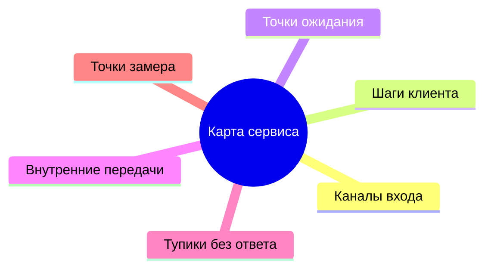
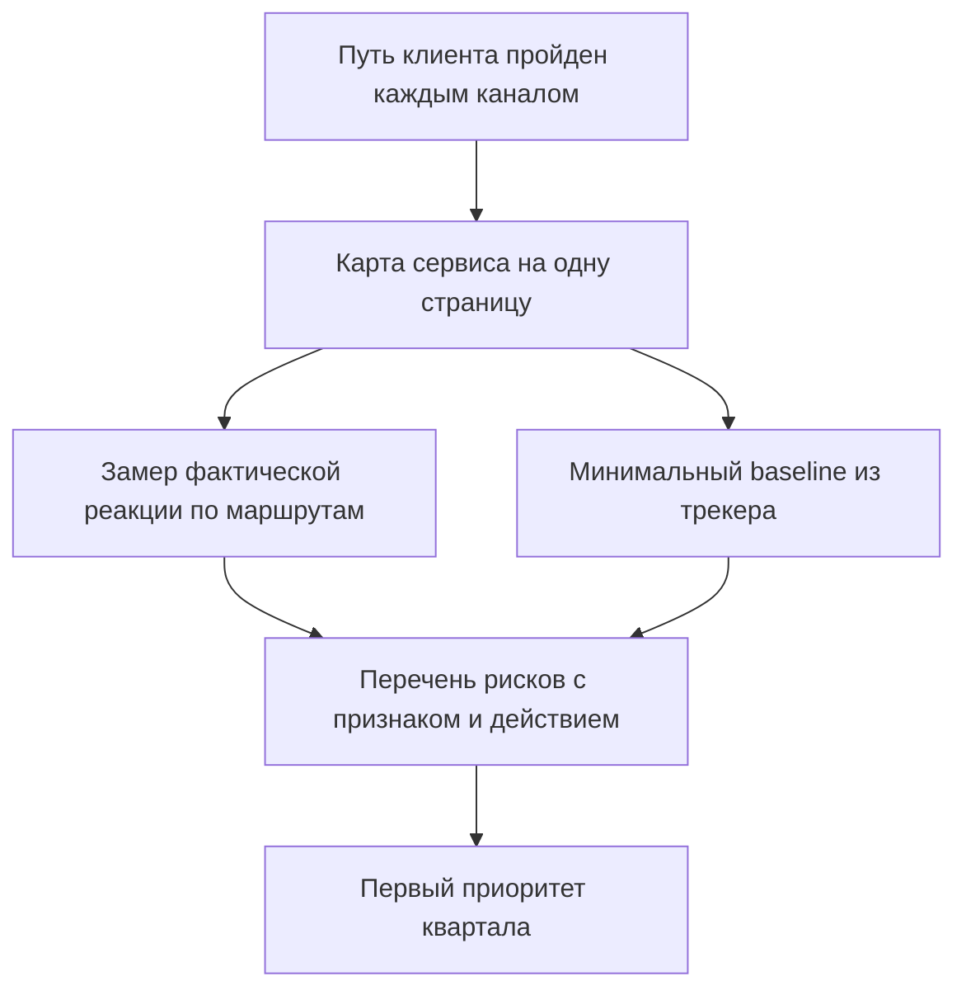
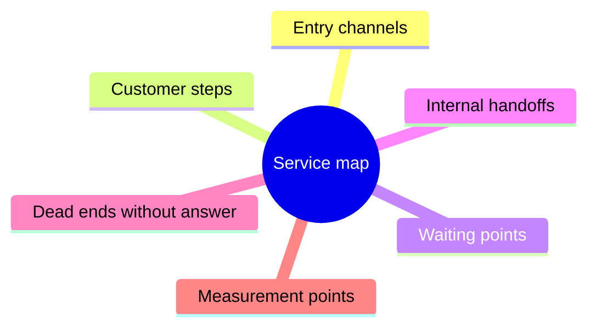
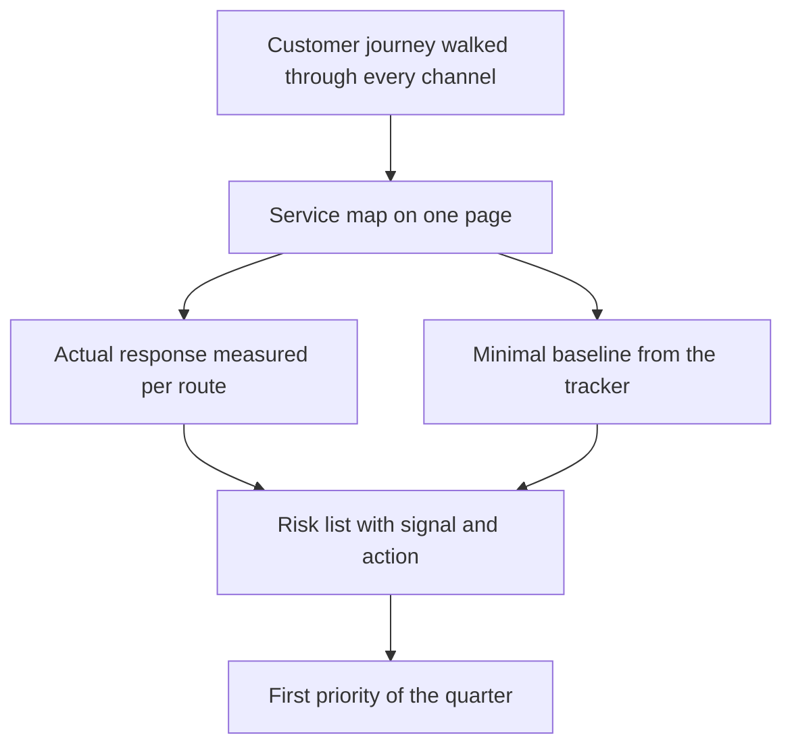
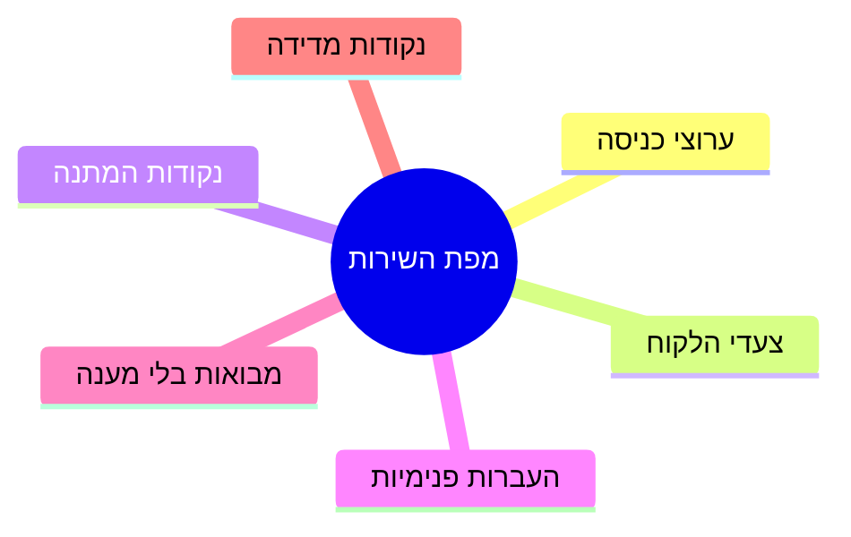
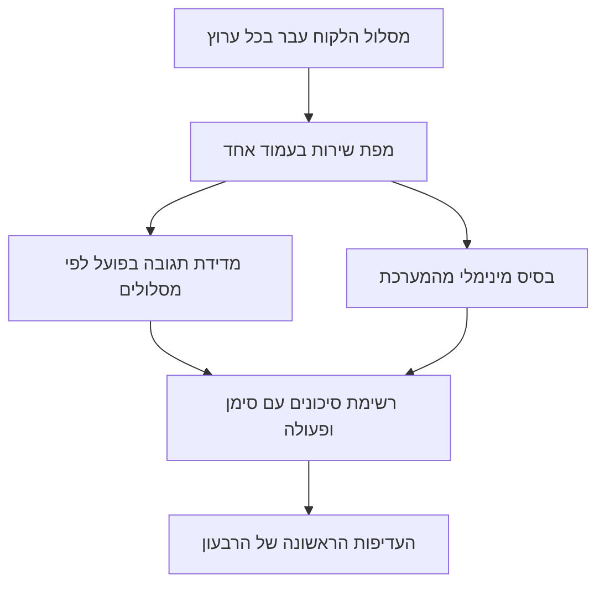

<!-- lang:ru -->

## Введение

Первый месяц в роли лида поддержки я потратил на регламенты: читал, сверял, задавал вопросы. В регламентах жил аккуратный сервис — заявка приходит в трекер, попадает в правильную очередь, инженер отвечает в срок, клиент доволен. В жизни жил другой сервис: половина обращений начиналась в чате с фразы «а можно вопрос», часть запросов вообще не доходила до трекера, а сроки, которые все считали выполненными, считались по определению, которого никто не помнил.

Разрыв между этими двумя сервисами — не признак плохой команды. Это нормальное состояние системы, которую никто никогда не описывал целиком: каждый её кусок появился в своё время, под свою задачу и своего клиента. Проблема начинается позже — когда лид приходит с планом улучшений, а плана некуда приложить, потому что неясно, что именно улучшается.

В предыдущих статьях серии речь шла о времени лида ([«Границы ответственности»](/ru/blog/support-lead-boundaries/)), о логике точки А («Baseline раньше целей») и о том, как из целей собирается год («Год лида по кварталам»). Эта статья — о шаге, который предшествует всем трём: как за первые недели получить описание сервиса и его точку А, не имея ни времени, ни данных, ни согласия на большие изменения.

Тезис такой: диагностика первого месяца отвечает на два вопроса — что видит клиент, когда идёт к решению, и сколько он на каждом шаге ждёт на самом деле. Первый ответ даёт карта сервиса, второй — замер фактической реакции. Вместе они превращаются в артефакты, с которыми уже можно разговаривать о целях.

## Пройти путь клиента каждым каналом

Первое упражнение стоит времени и выглядит странно: напишите в свою поддержку как клиент. Не «проверьте, работает ли форма», а пройдите путь целиком — почтой, через портал, по телефону, в чате, — и запишите, что происходит.

Что видно в этом упражнении и не видно изнутри:

- **Сколько нужно знать, чтобы просто отправить обращение.** Где на сайте написано, куда писать? Требует ли форма номер договора, который клиент не помнит? Просит ли выбрать категорию из списка, в котором нет его случая?
- **Что приходит в ответ на отправку.** Автоответ с номером заявки, письмо «мы получили ваше обращение», тишина. Автоответ — не формальность: именно он говорит клиенту, что его услышали, и именно его отсутствие рождает второе письмо и звонок.
- **Видит ли клиент статус.** Может ли он узнать, что с его заявкой, не написав ещё раз? Если нет, каждый статус превращается в новое обращение и новую единицу нагрузки.
- **Что происходит, когда он молчит.** Клиент не ответил на уточняющий вопрос: заявка ждёт его, инженера или никого? Ответ на этот вопрос часто объясняет половину «старых» тикетов.
- **Где путь обрывается.** Форма отправляется в пустоту, телефон в нерабочие часы говорит «перезвоните позже», чат закрывается без ответа.

Всё, что вы записали, складывается в одну страницу. Её структура простая и одинаковая для любого сервиса:

- **каналы входа** — откуда приходят обращения и какой канал главный;
- **шаги клиента** — что от него требуется на каждом этапе;
- **точки ожидания** — где он ждёт и чего именно;
- **внутренние передачи** — где заявка переезжает между людьми, очередями и системами;
- **тупики** — места, где обращение может остаться без ответа;
- **точки замера** — где в этом пути есть событие, по которому можно посчитать время.

Так выглядит набор элементов, которые нужно нанести на карту:

Карта без цифр — это ещё не диагностика, а список мест, где цифры нужно снять. Но у неё уже есть практическая польза: на ней видно, что «поддержка» — не одна очередь, а несколько маршрутов с разной скоростью и разными правилами. Дальше становится понятно, что мерить нужно не «сервис в целом», а каждый маршрут отдельно.

Отдельно пройдите путь, который клиент проходит после решения: закрытие заявки, письмо с итогом, повторное обращение по той же теме. Второй круг того же вопроса — самый честный показатель качества, и он почти никогда не описан в регламенте.

## Замер фактической реакции

Второй шаг — измерить, сколько клиент ждёт на самом деле. Не по нормативу и не по ощущению инженеров, а по событиям в трекере: от создания заявки до первого содержательного ответа и от создания до закрытия.

Три правила, без которых замер превращается в спор о словах.

**Первое: определение раньше числа.** «Первый ответ» — это автоответ, шаблонное подтверждение или сообщение, в котором есть ответ по существу? Пока определение не записано, цифру можно трактовать как угодно, и каждая сторона будет права. То же с «решением»: закрытие по инициативе инженера, по подтверждению клиента или по истечении срока — это три разных события.

**Второе: клиент ждёт не среднее.** Среднее время ответа скрывает хвост: если большинство заявок закрывается быстро, а часть висит неделями, среднее останется приличным, а клиенты будут помнить именно недели. Поэтому рядом со средним нужен девяностый процентиль — время, за которое закрывается девять заявок из десяти. Хвост и есть то, что портит репутацию сервиса.

**Третье: время в работе и время в ожидании — раздельно.** Заявка, которая ждёт ответа клиента, и заявка, которая ждёт свободного инженера, выглядят в отчёте одинаково и означают противоположное. Если их не разделить, виноватым в сроках автоматически становится или клиент, или команда — в зависимости от того, кто делает отчёт.

Что получается на выходе — небольшая таблица по каналам и маршрутам: медиана и девяностый процентиль первого ответа, то же для решения, доля заявок, у которых первого ответа не было вовсе. Несколько строк, которые уже можно показать руководству и обсудить без эмоций.

<!-- вилка: цифры фактической реакции по каналам — медиана и p90 первого ответа и решения, доля заявок без первого ответа. -->

Здесь же обычно обнаруживается первая неприятная вещь: часть потока не имеет заявки вообще. Вопросы в общем чате, звонки на личный номер, просьбы, переданные через коллег. Эти обращения невидимы для метрик, но занимают время команды — и именно они объясняют, почему инженер «занят, а заявки не закрываются».

## Baseline из трекера

Третья часть диагностики — выгрузка из трекера. Здесь легко утонуть: полей много, отчётов ещё больше, и первая попытка «сделать нормальный дашборд» обычно заканчивается дашбордом, которым никто не пользуется.

Полный список полей и правил выгрузки я разбирал в статье «Baseline раньше целей». В первый месяц достаточно четырёх разрезов, и у каждого есть конкретный вопрос, на который он отвечает.

| Разрез | Вопрос, на который отвечает | Что делать с ответом |
| --- | --- | --- |
| Объём и структура потока | Сколько обращений и какого рода: инциденты, вопросы, запросы на изменение | Понять, какие маршруты вообще нужны |
| Критичность | Как распределены приоритеты и какая доля заявок считается критичной | Найти очередь, которая держит риск |
| Возвраты и реопены | Какая доля заявок открывается повторно | Отделить скорость от качества решения |
| Возраст бэклога | Сколько заявок висит дольше норматива | Увидеть тихие нарушения и накопленный долг |

Четыре разреза не заменяют полноценный baseline, но дают главное — понимание масштаба и одну-две гипотезы о том, где узкое место. Гипотезы важны именно в этот момент: с ними можно идти к команде с вопросом, а не с обвинением.

<!-- вилка: собственные выгрузки первого месяца — какие разрезы взяли, за какой период, где лежит таблица. -->

Есть смысл сразу договориться о двух правилах, которые сэкономят месяцы споров. Первое: все цифры считаются за одно окно из одного источника. Второе: определения записаны рядом с таблицей. Не потому, что этого требует методика, а потому, что через квартал вы будете сравнивать новую цифру со старой, и вопрос «а как считали тогда» должен иметь ответ в документе, а не в чьей-то памяти.

## Перечень рисков

Последняя часть диагностики — перечень рисков. Это не реестр на сто строк и не формальная оценка вероятностей. Это короткий список того, что сломается первым, когда поток вырастет или когда из строя выйдет один элемент.

Метод простой: пройдите по карте сервиса и задайте каждой точке три вопроса.

- **Что будет, если объём вырастет вдвое?** Не «станет тяжелее», а конкретно: какая очередь встанет первой, какой канал перестанет отвечать в срок, где ручная операция превратится в бутылочное горлышко.
- **Что будет, если один человек исчезнет на две недели?** Не только инженер: владелец интеграции, единственный, кто умеет выгружать отчёт, автор регламента.
- **Что будет, если откажет внешняя система?** Трекер, почтовый шлюз, портал, телефония. Часть маршрутов после отказа не восстанавливается вообще — обращения просто теряются.

Ответы складываются в список из трёх-пяти позиций. У каждой — признак, по которому видно, что риск начал реализовываться, и первое действие. Именно этот список, а не общий призыв «повысить надёжность», становится повесткой первого квартала.

<!-- вилка: три главных риска из собственного перечня — что сломается первым при росте потока и почему. -->

Полезно сразу отделить риски, которые лечатся внутри поддержки, от тех, что требуют решений за её пределами. Первые попадают в план команды, вторые — в разговор с руководством: часть из них стоит денег, часть — изменения процессов в других подразделениях. Если этого разделения нет, перечень рисков остаётся списком жалоб.

## Артефакты первого месяца

Четыре части диагностики не живут по отдельности: каждая опирается на предыдущую и без неё теряет смысл.

К концу первого месяца у лида должно быть четыре вещи, и ни одна из них не требует бюджета.

- **Карта сервиса на одну страницу.** Каналы, шаги клиента, ожидания, передачи, тупики, точки замера. Она нужна не для отчёта: с ней разговор о приоритетах перестаёт быть разговором о вкусах.
- **Таблица фактической реакции.** Медиана и девяностый процентиль по каждому маршруту, отдельно время в работе и время в ожидании.
- **Минимальный baseline.** Четыре разреза из трекера за одно окно, с записанными определениями.
- **Перечень рисков.** Три-пять позиций с признаком и первым действием, разделённые на «внутри поддержки» и «нужно решение вовне».

Эти четыре артефакта — не диагностика ради диагностики. Они отвечают на вопрос, который рано или поздно задаст любой руководитель: «что происходит в сервисе». И отвечают не впечатлением, а описанием.

Дальше начинается работа, которая делается один раз и потом только поддерживается: маршрутизация обращений. Диагностика показала, что маршрутов несколько и они разные; следующий шаг — сделать так, чтобы каждое обращение попадало в свой маршрут с первого касания, а не после двух передач и одного возврата. Об этом — в статье «Триаж при первом касании: категория, критичность, маршрут».

Хорошая диагностика заканчивается не документом, а фразой «теперь понятно, что делать первым». Если после месяца работы такой фразы нет, значит, вы описали сервис, но не посмотрели на него глазами клиента.

<!-- lang:en -->

## Introduction

I spent my first month as a support lead on process documents: reading, cross-checking, asking questions. Those documents described a tidy service — a request comes into the tracker, lands in the right queue, an engineer responds on time, the customer is happy. Reality described a different service: half the requests started in a chat with "quick question", some never reached the tracker at all, and the deadlines everyone believed were met were calculated by a definition nobody remembered.

The gap between those two services isn't a sign of a bad team. It's the normal state of a system nobody ever described as a whole: every piece of it appeared at its own time, for its own task and its own customer. The trouble starts later — when a lead arrives with an improvement plan and has nowhere to apply it, because it's unclear what exactly is being improved.

Previous articles in the series covered the lead's time (["Ownership boundaries"](/en/blog/support-lead-boundaries/)), the logic of point A ("Baseline before goals"), and how goals turn into a year ("A support lead's year by quarters"). This article is about the step that precedes all three: how to get a description of the service and its point A in the first weeks, with no time, no data, and no approval for big changes.

The thesis: diagnosing the first month answers two questions — what the customer sees on the way to a solution, and how long they actually wait at each step. The first answer comes from a service map, the second from measuring the actual response. Together they turn into artifacts you can already use to talk about goals.

## Walking the customer journey through every channel

The first exercise takes time and looks odd: write to your own support desk as a customer. Not "check whether the form works" — walk the whole path by email, through the portal, by phone, in chat, and write down what happens.

What this exercise shows and the inside view never does:

- **How much you need to know just to send a request.** Where on the site does it say where to write? Does the form demand a contract number the customer doesn't remember? Does it ask you to pick a category from a list that has no entry for their case?
- **What comes back after you hit send.** An auto-reply with a ticket number, a "we received your request" email, or silence. An auto-reply isn't a formality: it's what tells the customer they were heard, and its absence is what produces a second email and a phone call.
- **Whether the customer can see status.** Can they find out what's happening without writing again? If not, every status check becomes a new request and a new unit of workload.
- **What happens when they go quiet.** The customer didn't answer a clarifying question: is the ticket waiting on them, on the engineer, or on nobody? Answering that often explains half of the "old" tickets.
- **Where the path breaks.** The form submits into nothing, the phone line outside business hours says "call back later", the chat closes with no reply.

Everything you wrote down goes onto a single page. Its structure is simple and the same for any service:

- **entry channels** — where requests come from and which channel matters most;
- **customer steps** — what's required of them at each stage;
- **waiting points** — where they wait, and for what exactly;
- **internal handoffs** — where the ticket moves between people, queues, and systems;
- **dead ends** — places where a request can end up with no answer;
- **measurement points** — where along this path there's an event you can time.

Here is the set of elements to put on the map:

A map without numbers isn't a diagnosis yet — it's a list of places where numbers must be taken. But it already has practical value: it shows that "support" isn't one queue but several routes with different speeds and different rules. That makes it obvious you need to measure each route separately, not "the service as a whole".

Walk one more path: what the customer experiences after the solution — the ticket closing, the summary email, the follow-up on the same topic. The second round of the same question is the most honest quality indicator there is, and it's almost never described in a process document.

## Measuring the actual response

The second step is to measure how long the customer really waits. Not by the standard and not by how busy the engineers feel, but by events in the tracker: from ticket creation to the first substantive reply, and from creation to closure.

Three rules without which the measurement turns into an argument about words.

**First: definition before number.** Is "first reply" an auto-reply, a templated acknowledgement, or a message that answers the question? Until the definition is written down, the number can be read any way you like, and both sides will be right. Same with "solved": closing on the engineer's initiative, on the customer's confirmation, or on expiry are three different events.

**Second: the customer doesn't wait for the average.** The average response time hides the tail: if most tickets close fast and some hang for weeks, the average stays respectable while customers remember the weeks. That's why the average needs a ninetieth percentile beside it — the time within which nine tickets out of ten are closed. The tail is what damages the service's reputation.

**Third: work time and waiting time stay apart.** A ticket waiting on the customer and a ticket waiting on a free engineer look identical in a report and mean the opposite. Without the split, blame for delays lands automatically on either the customer or the team — depending on who builds the report.

What comes out is a small table by channel and route: median and ninetieth percentile for the first reply, the same for resolution, and the share of tickets that never got a first reply at all. A few rows you can already show management and discuss without emotion.

<!-- вилка: цифры фактической реакции по каналам — медиана и p90 первого ответа и решения, доля заявок без первого ответа. -->

This is also where the first unpleasant discovery usually happens: part of the flow has no ticket at all. Questions in a shared chat, calls to a personal number, requests passed along through colleagues. Those requests are invisible to metrics but consume the team's time — and they are exactly why an engineer is "busy while tickets don't close".

## Baseline from the tracker

The third part of the diagnosis is a tracker export. It's easy to drown here: many fields, more reports, and the first attempt at "a proper dashboard" usually ends with a dashboard nobody uses.

I went through the full field list and export rules in "Baseline before goals". In the first month four cuts are enough, and each one answers a specific question.

| Cut | The question it answers | What to do with the answer |
| --- | --- | --- |
| Volume and flow structure | How many requests and of what kind: incidents, questions, change requests | Understand which routes are needed at all |
| Priority | How priorities are distributed and what share counts as critical | Find the queue that holds the risk |
| Reopens and returns | What share of tickets gets reopened | Separate speed from solution quality |
| Backlog age | How many tickets sit past the standard | See silent breaches and accumulated debt |

Four cuts don't replace a full baseline, but they deliver the main thing: a sense of scale and one or two hypotheses about where the bottleneck is. Hypotheses matter precisely now — with them you can go to the team with a question instead of an accusation.

<!-- вилка: собственные выгрузки первого месяца — какие разрезы взяли, за какой период, где лежит таблица. -->

It's worth agreeing on two rules right away; they save months of argument. First: every number is counted over one window from one source. Second: the definitions are written next to the table. Not because a methodology demands it, but because in a quarter you'll compare a new number with an old one, and "how did we count it back then" must have an answer in a document, not in someone's memory.

## The risk list

The last part of the diagnosis is the risk list. It isn't a hundred-line register or a formal probability assessment. It's a short list of what breaks first when the flow grows or when one element fails.

Simple method: walk the service map and ask three questions of every point.

- **What happens if the volume doubles?** Not "it gets harder" but specifically: which queue stalls first, which channel stops answering on time, where a manual step becomes the bottleneck.
- **What happens if one person disappears for two weeks?** Not just an engineer: the owner of an integration, the only person who can run the report, the author of the process document.
- **What happens if an external system fails?** The tracker, the mail gateway, the portal, telephony. Some routes never recover after such a failure at all — requests are simply lost.

The answers become a list of three to five items. Each has a signal showing the risk has started to materialise, and a first action. That list, and not the general call to "improve reliability", becomes the agenda for the first quarter.

<!-- вилка: три главных риска из собственного перечня — что сломается первым при росте потока и почему. -->

It helps to separate risks cured inside support from those that need decisions outside it. The first belong in the team plan, the second in a conversation with management: some cost money, some require process changes in other departments. Without that split, the risk list stays a list of complaints.

## Artifacts of the first month

The four parts of the diagnosis don't live apart: each rests on the previous one and loses meaning without it.

By the end of the first month a lead should have four things, and none of them needs a budget.

- **A service map on one page.** Channels, customer steps, waiting points, handoffs, dead ends, measurement points. It's not for a report: with it, any conversation about priorities stops being a conversation about taste.
- **An actual-response table.** Median and ninetieth percentile per route, with work time and waiting time kept apart.
- **A minimal baseline.** Four cuts from the tracker over one window, with written definitions.
- **The risk list.** Three to five items with a signal and a first action, split into "inside support" and "needs a decision outside".

These four artifacts aren't diagnosis for its own sake. They answer the question every manager eventually asks: "what is happening in the service". And they answer it with a description, not an impression.

What follows is work done once and then only maintained: routing requests. The diagnosis showed there are several routes and they differ; the next step is to make every request land on its own route at the first touch, not after two handoffs and a return. That's the subject of "Triage at first touch: category, priority, route".

A good diagnosis ends not with a document but with the sentence "now we know what comes first". If after a month of work that sentence is missing, you described the service but never looked at it through the customer's eyes.

<!-- lang:he -->

## מבוא

את החודש הראשון בתפקיד מנהל תמיכה ביליתי על נהלים: קראתי, השוויתי, שאלתי שאלות. בנהלים חי שירות מסודר — פנייה מגיעה למערכת, נופלת לתור הנכון, מוקדן עונה בזמן, הלקוח מרוצה. במציאות חי שירות אחר: חצי מהפניות התחילו בצ'אט במשפט "אפשר שאלה", חלק מהבקשות בכלל לא הגיעו למערכת, והמועדים שכולם חשבו שנענו נספרו לפי הגדרה שאיש לא זכר.

הפער בין שני השירותים האלה אינו סימן לצוות גרוע. זה מצב תקין של מערכת שאיש לא תיאר אותה בשלמותה: כל חלק בה נוצר בזמנו, למשימה שלו וללקוח שלו. הבעיה מתחילה מאוחר יותר — כשמנהל התמיכה מגיע עם תוכנית שיפור ואין להיכן להחיל אותה, כי לא ברור מה בדיוק משפרים.

במאמרים הקודמים בסדרה עסקנו בזמן של מנהל התמיכה (["גבולות אחריות"](/he/blog/support-lead-boundaries/)), בהיגיון של נקודת המוצא ("בסיס לפני מטרות") ובאיך מטרות הופכות לשנה ("שנה של מנהל תמיכה לפי רבעונים"). המאמר הזה עוסק בצעד שלפני שלושתם: איך להשיג בשבועות הראשונים תיאור של השירות ואת נקודת המוצא שלו, בלי זמן, בלי נתונים ובלי אישור לשינויים גדולים.

הטענה: אבחון החודש הראשון עונה על שתי שאלות — מה הלקוח רואה בדרך לפתרון, וכמה הוא באמת ממתין בכל שלב. את התשובה הראשונה נותנת מפת השירות, ואת השנייה — מדידת התגובה בפועל. יחד הן הופכות לתוצרים שאפשר כבר לדבר איתם על מטרות.

## לעבור את מסלול הלקוח בכל ערוץ

התרגיל הראשון גובה זמן ונראה מוזר: כתבו לתמיכה שלכם כלקוח. לא "בדקו אם הטופס עובד", אלא עברו את המסלול כולו — בדואר, דרך הפורטל, בטלפון, בצ'אט — ורשמו מה קורה.

מה רואים בתרגיל הזה ולא רואים מבפנים:

- **כמה צריך לדעת רק כדי לשלוח פנייה.** איפה באתר כתוב לאן לפנות? האם הטופס דורש מספר חוזה שהלקוח לא זוכר? האם הוא מבקש לבחור קטגוריה מרשימה שאין בה את המקרה שלו?
- **מה חוזר אחרי השליחה.** מענה אוטומטי עם מספר פנייה, מכתב "קיבלנו את פנייתכם", או שתיקה. מענה אוטומטי אינו פורמליות: דווקא הוא אומר ללקוח ששמעו אותו, והיעדרו יוצר את המכתב השני ואת שיחת הטלפון.
- **האם הלקוח רואה סטטוס.** האם הוא יכול לדעת מה קורה עם הפנייה בלי לכתוב שוב? אם לא, כל בדיקת סטטוס הופכת לפנייה חדשה וליחידת עומס חדשה.
- **מה קורה כשהוא שותק.** הלקוח לא ענה על שאלת הבהרה: הפנייה ממתינה לו, למוקדן או לאיש? התשובה לשאלה הזאת מסבירה לעתים קרובות חצי מהפניות ה"ישנות".
- **איפה המסלול נשבר.** הטופס נשלח לשום מקום, הטלפון מחוץ לשעות העבודה אומר "התקשרו מאוחר יותר", הצ'אט נסגר בלי תשובה.

כל מה שרשמתם נכנס לעמוד אחד. המבנה שלו פשוט וזהה לכל שירות:

- **ערוצי כניסה** — מאיפה מגיעות הפניות ואיזה ערוץ עיקרי;
- **צעדי הלקוח** — מה נדרש ממנו בכל שלב;
- **נקודות המתנה** — איפה הוא ממתין ולמה בדיוק;
- **העברות פנימיות** — איפה הפנייה עוברת בין אנשים, תורים ומערכות;
- **מבואות סתומים** — מקומות שבהם הפנייה עלולה להישאר בלי מענה;
- **נקודות מדידה** — איפה במסלול יש אירוע שאפשר למדוד לפיו זמן.

כך נראה סט הרכיבים שצריך להעלות על המפה:

מפה בלי מספרים אינה אבחון עדיין — היא רשימה של מקומות שמהם צריך לקחת מספרים. אבל כבר יש לה תועלת מעשית: רואים עליה ש"תמיכה" אינה תור אחד אלא כמה מסלולים במהירויות שונות ובכללים שונים. מכאן מתברר שצריך למדוד כל מסלול בנפרד ולא את "השירות בכללו".

עברו גם מסלול אחד נוסף: מה הלקוח חווה אחרי הפתרון — סגירת הפנייה, מכתב הסיכום, פנייה חוזרת באותו נושא. סבב שני של אותה שאלה הוא המדד הכי כן לאיכות, והוא כמעט תמיד לא מתואר בנוהל.

## מדידת התגובה בפועל

הצעד השני הוא למדוד כמה הלקוח באמת ממתין. לא לפי הנוהל ולא לפי תחושת המוקדנים, אלא לפי אירועים במערכת: מרגע פתיחת הפנייה ועד תשובה מהותית ראשונה, ומרגע הפתיחה ועד הסגירה.

שלושה כללים שבלעדיהם המדידה הופכת לוויכוח על מילים.

**ראשון: הגדרה לפני מספר.** "תגובה ראשונה" — מענה אוטומטי, אישור תבניתי או הודעה שיש בה תשובה לגוף העניין? כל עוד ההגדרה לא כתובה, אפשר לפרש את המספר איך שרוצים, וכל צד יהיה צודק. כך גם עם "פתרון": סגירה ביוזמת המוקדן, באישור הלקוח או בתום המועד — אלה שלושה אירועים שונים.

**שני: הלקוח לא ממתין לממוצע.** זמן תגובה ממוצע מסתיר את הזנב: אם רוב הפניות נסגרות מהר וחלקן תלוי שבועות, הממוצע יישאר סביר והלקוחות דווקא את השבועות יזכרו. לכן לצד הממוצע צריך אחוזון תשעים — הזמן שבתוכו נסגרות תשע פניות מעשר. הזנב הוא מה שמקלקל את המוניטין של השירות.

**שלישי: זמן בעבודה וזמן בהמתנה — בנפרד.** פנייה שממתינה לתשובת הלקוח ופנייה שממתינה למוקדן פנוי נראות בדוח אותו דבר ומשמעותן הפוכה. בלי ההפרדה, האשמה בעיכובים נופלת אוטומטית על הלקוח או על הצוות — תלוי במי שבונה את הדוח.

מה שמתקבל בסוף — טבלה קטנה לפי ערוצים ומסלולים: חציון ואחוזון תשעים לתגובה הראשונה, אותו דבר לפתרון, וחלק הפניות שלא קיבלו תגובה ראשונה בכלל. כמה שורות שאפשר כבר להראות להנהלה ולדון בהן בלי רגשות.

<!-- вилка: цифры фактической реакции по каналам — медиана и p90 первого ответа и решения, доля заявок без первого ответа. -->

כאן גם מתגלה בדרך כלל הדבר הראשון הלא נעים: לחלק מהזרימה אין פנייה בכלל. שאלות בצ'אט משותף, שיחות למספר אישי, בקשות שהועברו דרך עמיתים. הפניות האלה בלתי נראות למדדים אבל גוזלות זמן של הצוות — והן בדיוק מסבירות למה מוקדן "עמוס והפניות לא נסגרות".

## בסיס מהמערכת

החלק השלישי של האבחון — דיווח מהמערכת. כאן קל לטבוע: שדות רבים, דוחות עוד יותר, והניסיון הראשון "לעשות דשבורד נורמלי" נגמר בדרך כלל בדשבורד שאיש לא משתמש בו.

את רשימת השדות המלאה וכללי הדיווח פירקתי במאמר "בסיס לפני מטרות". בחודש הראשון מספיקים ארבעה חתכים, ולכל אחד יש שאלה קונקרטית שהוא עונה עליה.

| חתך | השאלה שהוא עונה עליה | מה עושים עם התשובה |
| --- | --- | --- |
| היקף ומבנה הזרימה | כמה פניות ומאיזה סוג: תקלות, שאלות, בקשות שינוי | להבין אילו מסלולים בכלל דרושים |
| דחיפות | איך מתפלגות העדיפויות ואיזה חלק נחשב קריטי | למצוא את התור שמחזיק את הסיכון |
| פתיחות חוזרות | איזה חלק מהפניות נפתח שוב | להפריד בין מהירות לאיכות הפתרון |
| גיל תור הפניות | כמה פניות ממתינות מעבר לנוהל | לראות הפרות שקטות וחוב שהצטבר |

ארבעה חתכים אינם מחליפים בסיס מלא, אבל הם נותנים את העיקר — הבנה של קנה המידה והשערה אחת או שתיים לגבי מקום הצוואר. ההשערות חשובות דווקא עכשיו: איתן אפשר לבוא לצוות עם שאלה ולא עם האשמה.

<!-- вилка: собственные выгрузки первого месяца — какие разрезы взяли, за какой период, где лежит таблица. -->

שווה להסכים מראש על שני כללים שיחסכו חודשי ויכוחים. הראשון: כל המספרים נספרים על אותו חלון ומאותו מקור. השני: ההגדרות כתובות לצד הטבלה. לא מפני שהמתודולוגיה דורשת זאת, אלא מפני שבעוד רבעון תשוו מספר חדש לישן, ולשאלה "איך ספרו אז" צריכה להיות תשובה במסמך ולא בזיכרון של מישהו.

## רשימת הסיכונים

החלק האחרון של האבחון — רשימת הסיכונים. זה לא מרשם של מאה שורות ולא הערכת הסתברויות פורמלית. זו רשימה קצרה של מה יישבר ראשון כשהזרימה תגדל או כשרכיב אחד ייצא מכלל פעולה.

השיטה פשוטה: עברו על מפת השירות ושאלו כל נקודה שלוש שאלות.

- **מה יקרה אם ההיקף יגדל פי שניים?** לא "יהיה כבד יותר", אלא קונקרטי: איזה תור ייתקע ראשון, איזה ערוץ יפסיק לענות בזמן, איפה פעולה ידנית תהפוך לצוואר בקבוק.
- **מה יקרה אם אדם אחד ייעלם לשבועיים?** לא רק מוקדן: בעל האינטגרציה, היחיד שיודע להפיק את הדוח, מחבר הנוהל.
- **מה יקרה אם מערכת חיצונית תיפול?** המערכת, שער הדואר, הפורטל, הטלפוניה. חלק מהמסלולים לא מתאוששים אחרי כשל כזה בכלל — הפניות פשוט הולכות לאיבוד.

התשובות מצטברות לרשימה של שלושה עד חמישה סעיפים. לכל אחד — סימן שמראה שהסיכון התחיל להתממש, ופעולה ראשונה. דווקא הרשימה הזאת, ולא הקריאה הכללית "לשפר את האמינות", הופכת לסדר היום של הרבעון הראשון.

<!-- вилка: три главных риска из собственного перечня — что сломается первым при росте потока и почему. -->

כדאי להפריד מיד סיכונים שמטופלים בתוך התמיכה מאלה שדורשים החלטות מחוצה לה. הראשונים נכנסים לתוכנית הצוות, השניים — לשיחה עם ההנהלה: חלקם עולה כסף, וחלקם דורש שינוי תהליכים באגפים אחרים. בלי ההפרדה הזאת רשימת הסיכונים נשארת רשימת תלונות.

## תוצרי החודש הראשון

ארבעת חלקי האבחון לא חיים בנפרד: כל אחד נשען על זה שלפניו ומאבד משמעות בלעדיו.

עד סוף החודש הראשון אמורים להיות למנהל התמיכה ארבעה דברים, ואף אחד מהם לא דורש תקציב.

- **מפת שירות בעמוד אחד.** ערוצים, צעדי הלקוח, המתנות, העברות, מבואות סתומים, נקודות מדידה. היא לא לצורך דוח: איתה שיחה על עדיפויות מפסיקה להיות שיחה על טעם.
- **טבלת תגובה בפועל.** חציון ואחוזון תשעים לכל מסלול, זמן בעבודה וזמן בהמתנה בנפרד.
- **בסיס מינימלי.** ארבעה חתכים מהמערכת על חלון אחד, עם הגדרות כתובות.
- **רשימת סיכונים.** שלושה עד חמישה סעיפים עם סימן ופעולה ראשונה, מחולקים ל"בתוך התמיכה" ול"צריך החלטה בחוץ".

ארבעת התוצרים האלה אינם אבחון לשם אבחון. הם עונים על השאלה שכל ממונה ישאל במוקדם או במאוחר: "מה קורה בשירות". ועונים לא ברושם אלא בתיאור.

מכאן מתחילה עבודה שנעשית פעם אחת ואחר כך רק מתוחזקת: ניתוב הפניות. האבחון הראה שהמסלולים אחדים ושונים זה מזה; הצעד הבא — שכל פנייה תיפול למסלול שלה כבר במגע הראשון, ולא אחרי שתי העברות וחזרה אחת. על כך במאמר "מיון במגע ראשון: קטגוריה, דחיפות, מסלול".

אבחון טוב נגמר לא במסמך אלא במשפט "עכשיו ברור מה עושים קודם". אם אחרי חודש עבודה המשפט הזה לא קיים, תיארתם את השירות אבל לא הסתכלתם עליו בעיני הלקוח.
