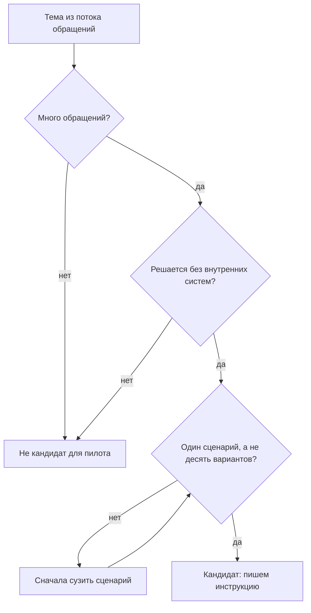
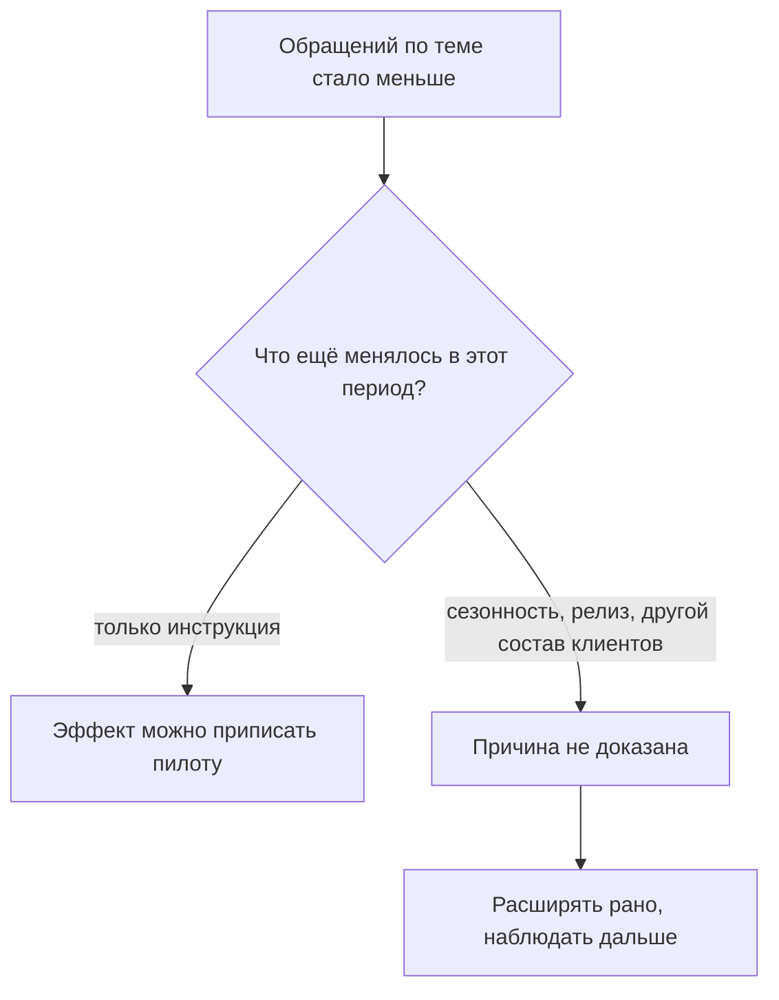
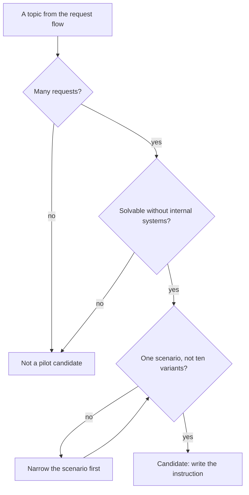
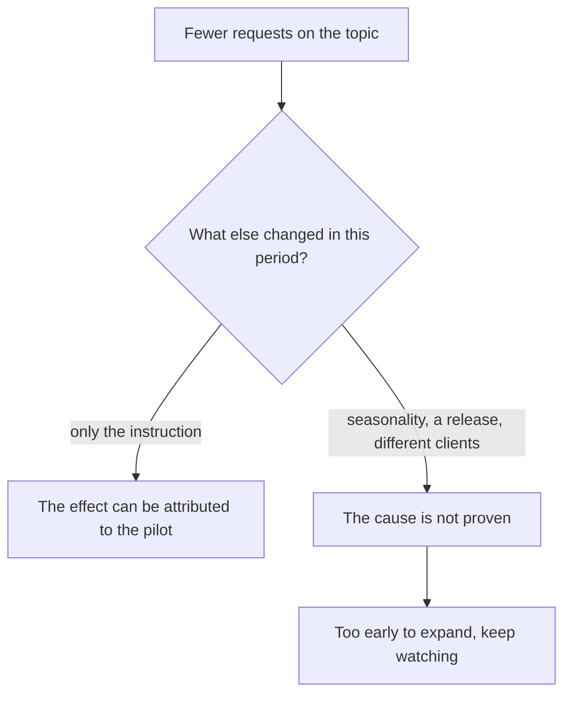
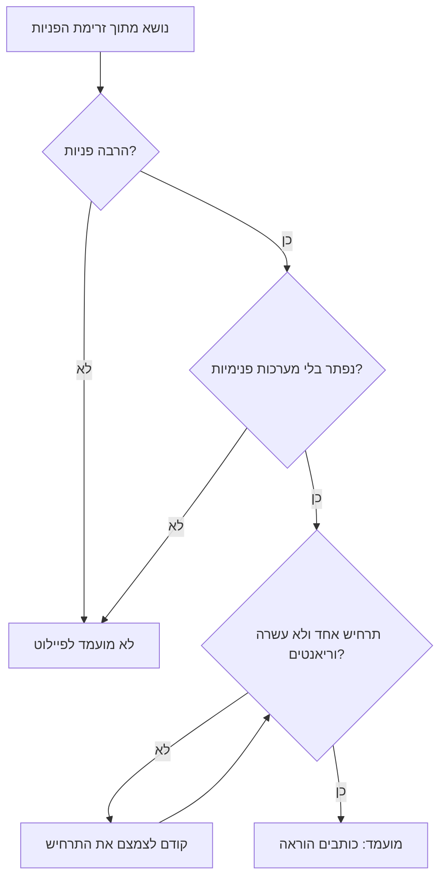
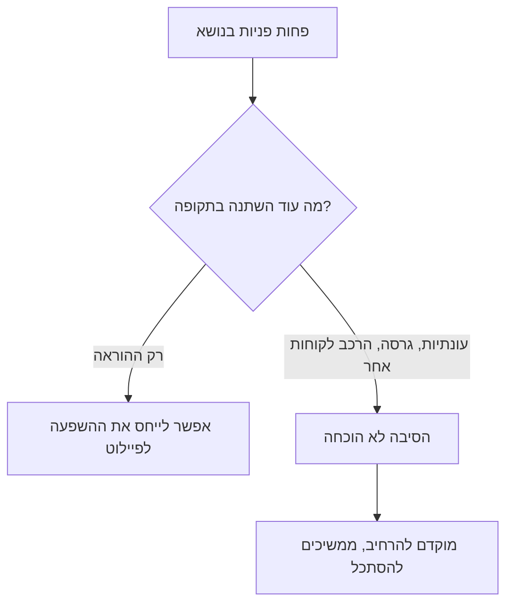

<!-- lang:ru -->

## Введение

Однажды я собрал портал самообслуживания: аккуратные статьи, красивый поиск, ссылка в письмах. Через квартал обращений меньше не стало. Формально портал работал; фактически им пользовались те же три инженера, которые и без него знали, что делать.

С тех пор я смотрю на самообслуживание иначе. Оно не про статьи и не про портал. Оно про то, чтобы клиент смог закрыть свой вопрос без нас — и чтобы мы могли это доказать цифрами, а не ощущением «стало лучше».

В терминах ITIL 4 это Shift Left — перенос решения как можно ближе к источнику проблемы. Для поддержки это значит: сценарий, который не требует нашей экспертизы, уходит из очереди к клиенту, а экспертиза остаётся на том, что действительно требует человека. Пилот на трёх-пяти сценариях с честным измерением полезнее большого портала без метрик.

В дорожной карте года самообслуживание стоит третьим кварталом — после базы знаний и до разговора с продуктом, и это не случайный порядок.

## Почему «просто напишите инструкции» не работает

Первое, что приходит в голову: взять статьи из базы знаний и выложить для клиентов. Обычно это заканчивается ничем, и причины у этого четыре.

**Текст написан не для клиента.** Внутренняя статья отвечает на вопрос инженера: где смотреть, что проверить, как подтвердить. Клиенту нужнó другое — что нажать и как понять, что получилось. Термины вроде «уровень логирования» или «перевыпуск сертификата» понятны нам и не понятны человеку, который читает инструкцию впервые.

**Нет точки входа.** Даже хорошая инструкция бесполезна, если клиент не знает, что она есть. Клиент ищет там, где ему больно: в почте, в чате, в поисковике. Если инструкции живут на отдельном сайте, до которого надо дойти по трём ссылкам, до неё дойдут единицы.

**Нет измерения.** Снижение потока можно объяснить чем угодно: сезонностью, релизом, изменением состава клиентов. Без заранее определённого окна и метрики любой результат будет толковаться в пользу пилота.

**Инструкция без обслуживания гниёт.** Продукт меняется, шаги устаревают, и клиент, один раз не справившийся по инструкции, больше в неё не поверит.

Все четыре причины — про одно: инструкция для клиента — это отдельный продукт со своими требованиями, а не выгрузка внутренней базы.

## Выбор сценариев по данным потока

Первый шаг пилота — не написать инструкции, а выбрать, для чего их писать. Основа выбора — данные потока, а не желание или удобство.

Смотреть надо на четыре вещи, и только их сочетание даёт хорошего кандидата:

| Критерий | Вопрос к данным | Почему важно |
| --- | --- | --- |
| Объём | Сколько обращений по теме за период | На большом потоке виден эффект |
| Простота | Решается ли без доступа к внутренним системам | Клиент не сможет сделать шаг за нас |
| Повторяемость | Один сценарий или множество вариантов | Инструкция должна покрывать большинство случаев |
| Риск ошибки | Что будет, если клиент сделает не так | Цена неверного шага должна быть нулевой |

Сценарий, который проходит все четыре фильтра, — кандидат. Сценарий, который прошёл три, но требует административных прав или действий на нашей стороне, — не кандидат, каким бы массовым он ни был: его место в другом механизме.

Как выглядит отбор:

<!-- вилка: ваши сценарии-кандидаты — какие темы попали в топ по объёму и почему выбрали именно их. -->

Обычно в топ попадают самые скучные вещи: восстановление доступа, проверка статуса заявки, типовые настройки, забытые пароли. Это нормально: самообслуживание начинается не с интересного, а с частого.

## Формат инструкции для клиента

Инструкция для клиента отличается от статьи базы знаний не глубиной, а адресатом. Собрать её нужно так.

- **Заголовок — словами клиента.** Не «Ошибка авторизации в ЛК», а «Не открывается личный кабинет после смены пароля». Так его найдёт поиск и так его узнает человек.
- **Без диагноза.** Клиенту не нужно знать, почему это происходит; причина — наша забота. Если без объяснения шаг кажется бессмысленным, добавляется одна фраза, а не абзац.
- **Один шаг — одно действие.** Нумерованный список, где каждый пункт можно выполнить, не возвращаясь назад.
- **Проверка результата.** После шагов — как убедиться, что получилось.
- **Что делать, если не помогло.** Прямой маршрут в поддержку и список того, что приложить к обращению. Это самое важное поле: инструкция, после которой человек остаётся один, хуже отсутствия инструкции.
- **Короткий путь до неё.** Ссылка из письма, из формы заявки, из чата — оттуда, где клиент уже находится.

Отдельно — версия. Если в продукте несколько версий или редакций, инструкция должна говорить, для какой. Иначе первое же расхождение обнулит доверие.

## Сигналы полезности

Пилот без измерения превращается в спор о вкусах. Поэтому метрики определяются заранее: что считаем, за какое окно, с чем сравниваем.

Сигналов четыре, и они разной силы:

1. **Обращения по теме.** Их число до и после — самый прямой сигнал, но и самый шумный.
2. **Использование.** Открытия инструкции, переходы по ссылкам, отметки «помогло» или «не помогло» внутри страницы.
3. **Повторные обращения после инструкции.** Если клиент прочитал и всё равно пришёл — инструкция не сработала, и это ценнее любого роста открытий.
4. **Качество общения.** Не выросли ли обращения «я тут всё сломал по вашей инструкции» — плата за неудачные шаги.

Главная осторожность при интерпретации: снижение потока — признак, а не доказательство. За то же окно могли случиться сезонный спад, релиз, изменивший поведение, или приход другой группы клиентов. Поэтому в отчёте о пилоте фиксируются не только цифры, но и то, что ещё менялось в этот период.

Как проверяется вывод об эффекте:

<!-- вилка: измерение до и после — какая метрика, за какое окно, что ещё менялось в этот период. -->

Если эффект есть, но объясняется не инструкцией, это тоже полезный результат: он значит, что настоящая причина потока была в другом месте, и теперь её видно.

## Критерии продолжения пилота

Расширять пилот или свернуть — решение, которое лучше принять заранее, до того как появятся цифры и захочется их защищать.

Я формулирую четыре условия, при которых пилот расширяется:

- **Эффект измерен и устойчив.** Снижение по теме держится не одну неделю, а хотя бы два сопоставимых периода.
- **Клиенты не стали злее.** Обращения «сделал по инструкции, стало хуже» не выросли, а общая оценка качества не упала.
- **Знание не потеряно.** Статья в базе знаний обновлена и отражает то же, что инструкция: иначе мы разошлись с собой в двух источниках.
- **Поддержание посильно.** У кого-то есть часы на обновление инструкций при каждом изменении продукта. Если нет — расширять рано.

Если хотя бы одно условие не выполнено, пилот не расширяется, но и не обязательно закрывается: чаще всего он остаётся на текущих сценариях и доводится до ума. Расширять раньше, чем отлажен первый цикл обновления, — самый частый способ получить мёртвый портал.

<!-- вилка: критерии, по которым вы решали расширять или сворачивать пилот, и что в итоге сделали. -->

И последнее. Shift Left не отменяет поддержку и не сокращает её ценность — он переносит её туда, где она нужна. Клиент, который сам восстановил доступ, приходит к нам с вопросом, на который мы действительно можем ответить лучше него. Именно это и есть цель пилота.

<!-- lang:en -->

## Introduction

At one point I built a self-service portal: tidy articles, a pretty search, a link in the emails. A quarter later there were no fewer requests. Formally the portal worked; in practice it was used by the same three engineers who knew what to do without it anyway.

Since then I look at self-service differently. It is not about articles and not about a portal. It is about the client being able to close their question without us — and about us being able to prove that with numbers rather than with a feeling that things got better.

In ITIL 4 terms this is shift left — moving the resolution as close to the source of the problem as possible. For support that means a scenario that does not need our expertise moves out of the queue to the client, while expertise stays on what genuinely needs a human. A pilot on three to five scenarios with honest measurement is more useful than a large portal without metrics.

In the yearly roadmap self-service sits in the third quarter — after the knowledge base and before the conversation with product, and that order is not accidental.

## Why "just write instructions" does not work

The first idea is always to take articles from the knowledge base and publish them for clients. It usually ends in nothing, and there are four reasons why.

**The text is not written for the client.** An internal article answers the engineer's question: where to look, what to check, how to confirm. The client needs something else — what to click and how to tell that it worked. Terms like "logging level" or "certificate reissue" are clear to us and obscure to someone reading the instruction for the first time.

**There is no entry point.** Even a good instruction is useless if the client does not know it exists. Clients search where it hurts: in email, in chat, in a search engine. If the instructions live on a separate site that takes three links to reach, very few will reach it.

**There is no measurement.** A drop in flow can be explained by anything: seasonality, a release, a change in the client base. Without a window and a metric defined in advance, any result will be read in favour of the pilot.

**An unmaintained instruction rots.** The product changes, the steps go stale, and a client who failed once following an instruction will not trust it again.

All four reasons are about one thing: an instruction for clients is a separate product with its own requirements, not an export of the internal base.

## Choosing scenarios from the flow data

The first step of the pilot is not writing instructions but choosing what to write them for. The basis for the choice is flow data, not desire or convenience.

You look at four things, and only their combination produces a good candidate:

| Criterion | The question to the data | Why it matters |
| --- | --- | --- |
| Volume | How many requests on the topic in the period | The effect is visible on a large flow |
| Simplicity | Is it solvable without access to internal systems | The client cannot take a step for us |
| Repeatability | One scenario or a multitude of variants | The instruction must cover the majority of cases |
| Risk of error | What happens if the client does it wrong | The cost of a wrong step must be zero |

A scenario that passes all four filters is a candidate. A scenario that passed three but needs admin rights or actions on our side is not a candidate, however massive it is: it belongs to a different mechanism.

What the selection looks like:

<!-- вилка: ваши сценарии-кандидаты — какие темы попали в топ по объёму и почему выбрали именно их. -->

Usually the top is occupied by the dullest things: restoring access, checking a ticket status, routine settings, forgotten passwords. That is normal: self-service starts with the frequent, not with the interesting.

## The instruction format for clients

An instruction for clients differs from a knowledge base article not in depth but in addressee. It has to be put together like this.

- **The title in the client's words.** Not "Authorisation error in the portal" but "The portal won't open after a password change". That is how search finds it and how a person recognises it.
- **No diagnosis.** The client does not need to know why this happens; the cause is our business. If a step seems pointless without an explanation, add one sentence, not a paragraph.
- **One step, one action.** A numbered list where every item can be done without going back.
- **A check of the result.** After the steps — how to make sure it worked.
- **What to do if it did not help.** A direct route into support and a list of what to attach to the request. This is the most important field: an instruction that leaves a person alone is worse than no instruction.
- **A short path to it.** A link from the email, from the request form, from the chat — from where the client already is.

Separately, the version. If the product has several versions or editions, the instruction has to say which one it is for. Otherwise the first discrepancy will wipe out trust.

## Signals of usefulness

A pilot without measurement turns into an argument about taste. So the metrics are defined in advance: what is counted, over which window, against what.

There are four signals, and they differ in strength:

1. **Requests on the topic.** Their number before and after is the most direct signal, and the noisiest.
2. **Usage.** Instruction opens, link clicks, "helped" or "did not help" marks inside the page.
3. **Repeat requests after the instruction.** If the client read it and still came, the instruction did not work — and that is worth more than any growth in opens.
4. **Quality of the conversation.** Whether "I broke everything following your instruction" requests grew — the price of unsuccessful steps.

The main caution in interpretation: a drop in flow is a sign, not proof. The same window might contain a seasonal dip, a release that changed behaviour, or a different group of clients arriving. So the pilot report records not only the numbers but also what else changed during the period.

<!-- вилка: измерение до и после — какая метрика, за какое окно, что ещё менялось в этот период. -->

How the conclusion about the effect is checked:

If there is an effect but the instruction does not explain it, that is a useful result too: it means the real cause of the flow was elsewhere, and now you can see it.

## Criteria for continuing the pilot

Whether to expand the pilot or wind it down is a decision better taken in advance, before the numbers appear and you want to defend them.

I state four conditions under which the pilot expands:

- **The effect is measured and stable.** The drop on the topic holds not for one week but for at least two comparable periods.
- **Clients did not get angrier.** "Followed the instruction, made it worse" requests did not grow, and the overall quality score did not fall.
- **Knowledge is not lost.** The knowledge base article is updated and says the same as the instruction: otherwise we have diverged from ourselves in two sources.
- **Maintenance is affordable.** Somebody has hours to update instructions on every product change. If nobody has those hours, it is too early to expand.

If even one condition fails, the pilot does not expand — but it does not necessarily close either: most often it stays on the current scenarios and gets refined. Expanding before the first update cycle is tuned is the most common way to end up with a dead portal.

<!-- вилка: критерии, по которым вы решали расширять или сворачивать пилот, и что в итоге сделали. -->

And one last thing. Shift left does not cancel support or reduce its value — it moves support to where it is needed. A client who restored access on their own comes to us with a question we genuinely can answer better than they can. That is exactly the point of the pilot.

<!-- lang:he -->

## מבוא

בשלב מסוים בניתי פורטל שירות עצמי: מאמרים מסודרים, חיפוש נעים, קישור במכתבים. כעבור רבעון הפניות לא התמעטו. פורמלית הפורטל עבד; בפועל השתמשו בו אותם שלושה מוקדנים שידעו מה לעשות גם בלעדיו.

מאז אני מסתכל על שירות עצמי אחרת. זה לא עניין של מאמרים ולא של פורטל. זה עניין של כך שהלקוח יוכל לסגור את השאלה שלו בלעדינו — ושל כך שנוכל להוכיח את זה במספרים ולא בתחושה ש"נהיה יותר טוב".

במונחי ITIL 4 זה Shift Left — קירוב הפתרון ככל האפשר למקור הבעיה. בתמיכה זה אומר שתרחיש שלא דורש את המומחיות שלנו יוצא מהתור אל הלקוח, והמומחיות נשארת במה שבאמת דורש אדם. פיילוט על שלושה עד חמישה תרחישים עם מדידה ישרה מועיל יותר מפורטל גדול בלי מדדים.

במפת הדרכים של השנה שירות עצמי נמצא ברבעון השלישי — אחרי בסיס הידע ולפני השיחה עם המוצר, וזה לא סדר מקרי.

## למה "פשוט לכתוב הוראות" לא עובד

הדבר הראשון שעולה בדעתנו הוא לקחת מאמרים מבסיס הידע ולפרסם אותם ללקוחות. בדרך כלל זה נגמר בכלום, ויש לכך ארבע סיבות.

**הטקסט לא נכתב בשביל הלקוח.** מאמר פנימי עונה על השאלה של המוקדן: איפה להסתכל, מה לבדוק, איך לאשר. הלקוח צריך משהו אחר — על מה ללחוץ ואיך להבין שזה הצליח. מונחים כמו "רמת לוגים" או "הנפקת תעודה מחדש" ברורים לנו ולא ברורים למי שקורא את ההוראה בפעם הראשונה.

**אין נקודת כניסה.** גם הוראה טובה חסרת תועלת אם הלקוח לא יודע שהיא קיימת. הלקוח מחפש במקום שכואב לו: במייל, בצ'אט, במנוע חיפוש. אם ההוראות יושבות באתר נפרד שאליו מגיעים דרך שלושה קישורים, יגיעו אליו מעטים.

**אין מדידה.** ירידה בזרימה אפשר להסביר בכל דבר: עונתיות, גרסה חדשה, שינוי בהרכב הלקוחות. בלי חלון ומדד שנקבעו מראש, כל תוצאה תפורש לטובת הפיילוט.

**הוראה בלי תחזוקה נרקבת.** המוצר משתנה, הצעדים מתיישנים, ולקוח שלא הסתדר פעם אחת לפי ההוראה לא יאמין בה שוב.

כל ארבע הסיבות הן על דבר אחד: הוראה ללקוח היא מוצר נפרד עם דרישות משלו, לא ייצוא של הבסיס הפנימי.

## בחירת תרחישים לפי נתוני הזרימה

הצעד הראשון של הפיילוט הוא לא לכתוב הוראות אלא לבחור בשביל מה לכתוב אותן. הבסיס לבחירה הוא נתוני הזרימה, לא רצון ולא נוחות.

מסתכלים על ארבעה דברים, ורק השילוב שלהם נותן מועמד טוב:

| קריטריון | השאלה לנתונים | למה זה חשוב |
| --- | --- | --- |
| היקף | כמה פניות בנושא בתקופה | על זרימה גדולה רואים השפעה |
| פשטות | אפשר לפתור בלי גישה למערכות פנימיות | הלקוח לא יוכל לעשות צעד במקומנו |
| חזרתיות | תרחיש אחד או מגוון גרסאות | ההוראה חייבת לכסות את רוב המקרים |
| סיכון טעות | מה יקרה אם הלקוח יעשה לא נכון | מחיר צעד שגוי צריך להיות אפס |

תרחיש שעובר את כל ארבעת המסננים הוא מועמד. תרחיש שעבר שלושה אבל דורש הרשאות ניהול או פעולות בצד שלנו — אינו מועמד, גם אם הוא המוני מאוד: מקומו במנגנון אחר.

כך נראה המיון:

<!-- вилка: ваши сценарии-кандидаты — какие темы попали в топ по объёму и почему выбрали именно их. -->

בדרך כלל בראש הרשימה נמצאים הדברים המשעממים ביותר: שחזור גישה, בדיקת סטטוס פנייה, הגדרות שגרתיות, סיסמאות שנשכחו. זה נורמלי: שירות עצמי מתחיל בתכוף ולא במעניין.

## פורמט ההוראה ללקוח

הוראה ללקוח נבדלת ממאמר בבסיס הידע לא בעומק אלא בנמען. היא צריכה להיבנות כך.

- **כותרת במילים של הלקוח.** לא "שגיאת הזדהות באזור האישי" אלא "האזור האישי לא נפתח אחרי החלפת סיסמה". כך החיפוש ימצא אותה וכך האדם יזהה אותה.
- **בלי אבחון.** ללקוח אין צורך לדעת למה זה קורה; הסיבה היא העסק שלנו. אם בלי הסבר הצעד נראה חסר טעם, מוסיפים משפט אחד ולא פסקה.
- **צעד אחד — פעולה אחת.** רשימה ממוספרת שבה אפשר לבצע כל סעיף בלי לחזור אחורה.
- **בדיקת התוצאה.** אחרי הצעדים — איך לוודא שזה הצליח.
- **מה לעשות אם לא עזר.** מסלול ישיר לתמיכה ורשימת מה לצרף לפנייה. זה השדה החשוב ביותר: הוראה שאחריה האדם נשאר לבד גרועה מאין הוראה.
- **מסלול קצר אליה.** קישור מהמייל, מטופס הפנייה, מהצ'אט — ממקום שבו הלקוח כבר נמצא.

בנפרד — הגרסה. אם במוצר כמה גרסאות או מהדורות, ההוראה חייבת לומר לאיזו מהן היא מיועדת. אחרת הפער הראשון ימחק את האמון.

## אותות של תועלת

פיילוט בלי מדידה הופך לוויכוח על טעם. לכן המדדים נקבעים מראש: מה סופרים, על איזה חלון, לעומת מה.

ארבעה אותות, והם בעלי עוצמה שונה:

1. **פניות בנושא.** מספרן לפני ואחרי — האות הישיר ביותר, וגם הרועש ביותר.
2. **שימוש.** פתיחות של ההוראה, מעברים בקישורים, סימונים של "עזר" או "לא עזר" בתוך העמוד.
3. **פניות חוזרות אחרי ההוראה.** אם הלקוח קרא ובכל זאת הגיע — ההוראה לא עבדה, וזה שווה יותר מכל גידול בפתיחות.
4. **איכות השיחה.** האם לא גדלו הפניות מסוג "שברתי הכל לפי ההוראה שלכם" — כלומר המחיר של צעדים לא מוצלחים.

הזהירות העיקרית בפרשנות: ירידה בזרימה היא סימן ולא הוכחה. באותו חלון יכולות להיות ירידה עונתית, גרסה ששינתה התנהגות, או קבוצת לקוחות אחרת שהגיעה. לכן בדוח הפיילוט נרשמים לא רק המספרים אלא גם מה עוד השתנה בתקופה.

<!-- вилка: измерение до и после — какая метрика, за какое окно, что ещё менялось в этот период. -->

כך בודקים את המסקנה על ההשפעה:

אם יש השפעה אבל היא לא מוסברת על ידי ההוראה, גם זה תוצאה מועילה: היא אומרת שהסיבה האמיתית של הזרימה היתה במקום אחר, ועכשיו רואים אותה.

## קריטריונים להמשך הפיילוט

להרחיב את הפיילוט או לסגור אותו — החלטה שטוב לקבל מראש, לפני שמופיעים המספרים ומתחשק להגן עליהם.

אני מנסח ארבעה תנאים שבהם הפיילוט מתרחב:

- **ההשפעה נמדדה ויציבה.** הירידה בנושא מחזיקה לא שבוע אחד אלא לפחות שתי תקופות בנות השוואה.
- **הלקוחות לא נעשו כועסים יותר.** הפניות מסוג "עשיתי לפי ההוראה והחמרתי את המצב" לא גדלו, והערכה הכללית של האיכות לא ירדה.
- **הידע לא אבד.** המאמר בבסיס הידע עודכן ואומר אותו דבר כמו ההוראה: אחרת סתרנו את עצמנו בשני מקורות.
- **התחזוקה בהישג יד.** למישהו יש שעות לעדכן הוראות בכל שינוי במוצר. אם אין שעות כאלה, מוקדם להרחיב.

אם לפחות תנאי אחד לא מתקיים, הפיילוט לא מתרחב — אבל גם לא בהכרח נסגר: לרוב הוא נשאר על התרחישים הנוכחיים ומלוטשׁ. להתרחב לפני שמחזור העדכון הראשון מכוון זו הדרך הנפוצה ביותר לקבל פורטל מת.

<!-- вилка: критерии, по которым вы решали расширять или сворачивать пилот, и что в итоге сделали. -->

והדבר האחרון. Shift Left לא מבטל את התמיכה ולא מקטין את הערך שלה — הוא מעביר אותה למקום שבו היא נדרשת. לקוח ששחזר גישה בעצמו מגיע אלינו עם שאלה שאנחנו באמת יכולים לענות עליה טוב יותר ממנו. בדיוק זאת המטרה של הפיילוט.
