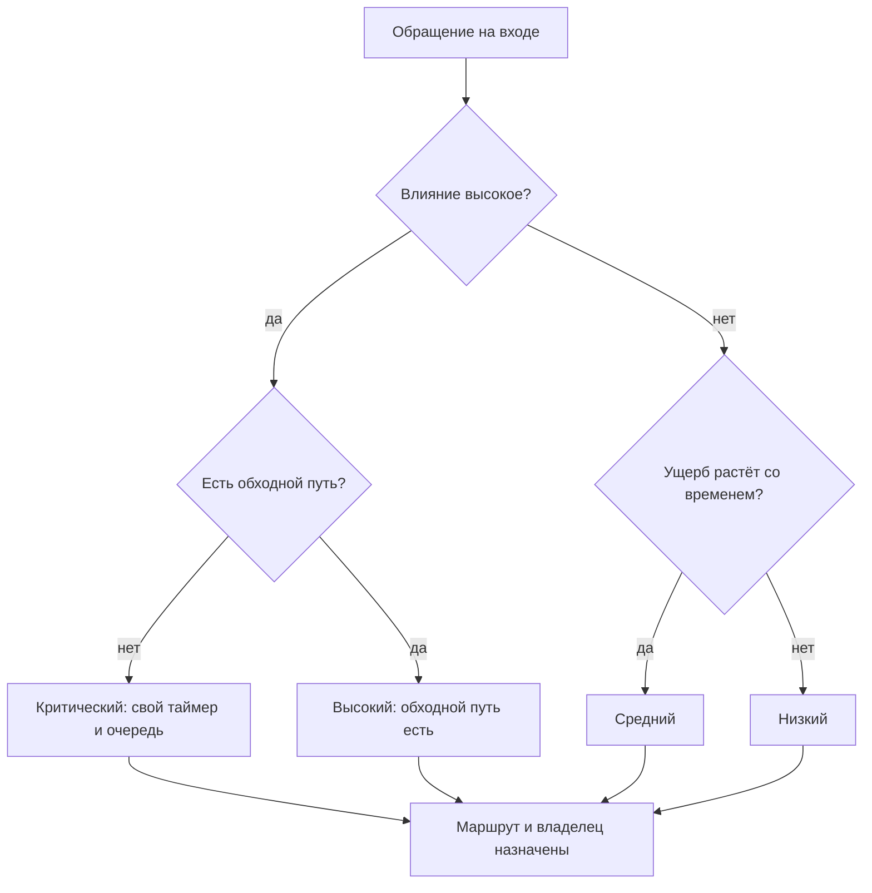
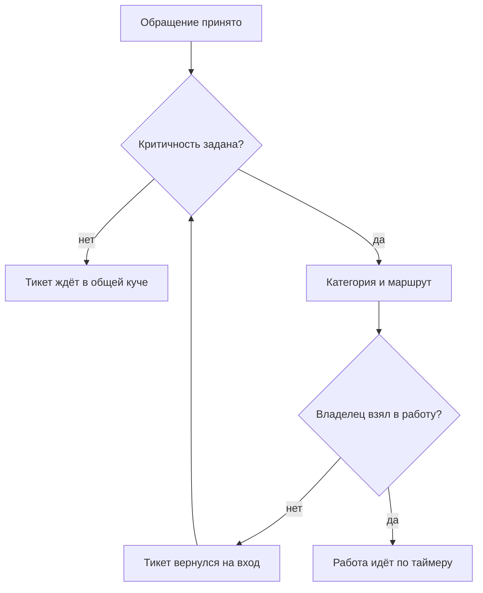
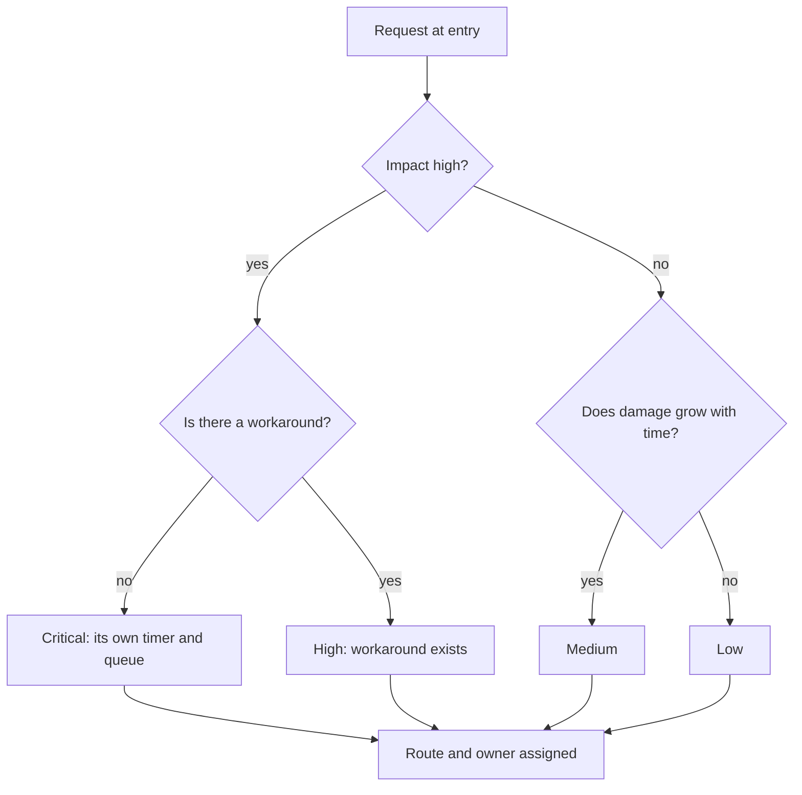
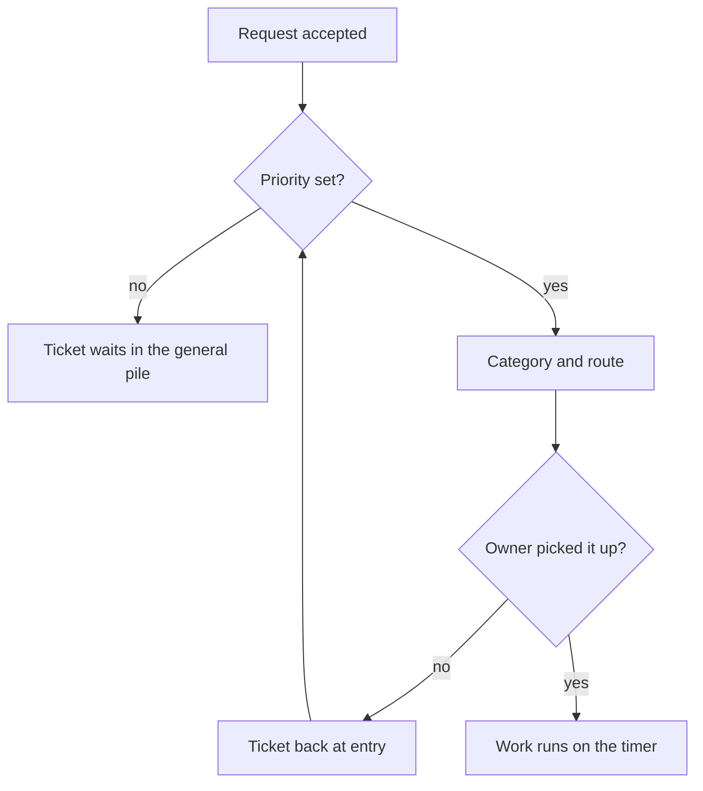
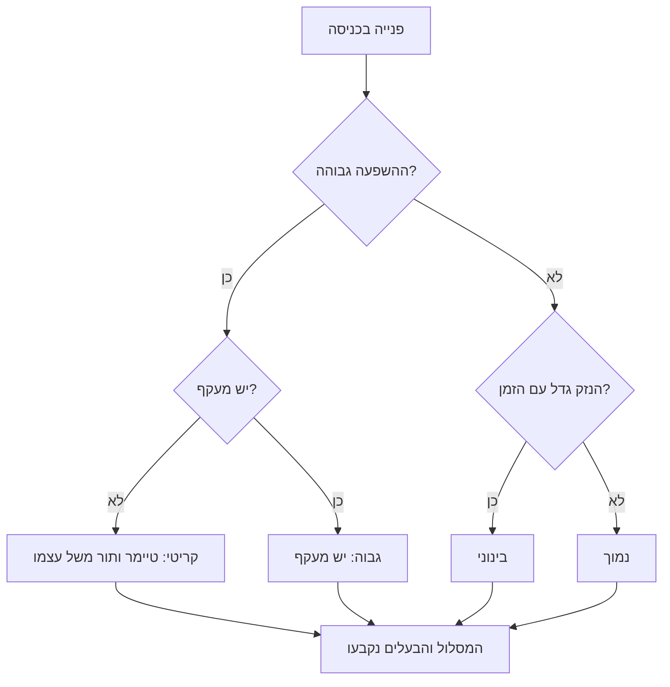
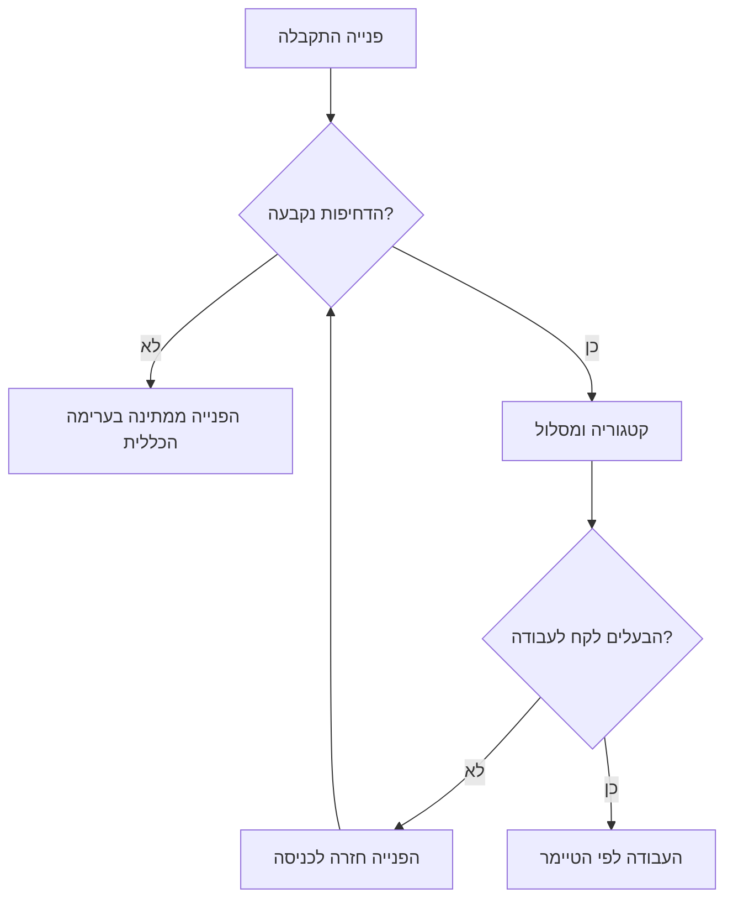

<!-- lang:ru -->

## Введение

Триаж — это три решения, которые принимаются в момент первого касания обращения: насколько это критично, что это за обращение и кому оно идёт. Три решения, на которые уходит несколько минут, и от них зависит всё остальное время жизни заявки.

В первые месяцы на позиции лида я триажем не занимался. Точнее, занимался, но не называл так: открывал тикет, читал, думал «это к Саше», перекладывал — а приоритет оставлял тот, что был при создании. То есть никакой. Через месяц выяснилось, что очередь живёт своей жизнью: там перемешаны инциденты, вопросы по документации и запросы на доработку, тикеты на интеграцию висят рядом с просьбой поменять подпись в письме, а самое критичное всплывает не потому, что оно критичное, а потому, что клиент позвонил.

В предыдущей статье серии — «Карта сервиса и Точка А: диагностика первого месяца» — речь шла о том, чтобы увидеть маршруты и замерить реакцию. Эта статья о том, что превращает несколько маршрутов в управляемый поток: точка входа, где обращения получают критичность, категорию и владельца.

Тезис простой: триаж — единственный вход в сервис, и порядок решений внутри него не произвольный. Сначала критичность, потом классификация. Кто переставляет эти два шага местами, тот получает аккуратную аналитику по вчерашним пожарам.

## Что происходит без триажа

Без триажа поток управляется не правилами, а громкостью. Кто громче написал, тот и в очереди первый; кто умеет звонить напрямую — вообще вне очереди.

Так выглядит типовой набор симптомов:

- **Всё срочное.** Приоритет ставит автор обращения, и для него его вопрос всегда самый важный. В очереди оказываются одни «высокие», и различить их невозможно.
- **Тяжёлые заявки перегружены лишним.** Третья линия получает всё подряд, включая вопросы, на которые есть ответ в документации. Разработка тонет в поддержке, поддержка ждёт разработку, сроки не двигаются ни с одной стороны.
- **Критичное тонет в общем потоке.** Инцидент, который затрагивает всех клиентов, лежит в одной куче с косметическими правками: у них одинаковый приоритет и общий порядок разбора.
- **Нет данных.** Из потока нельзя ответить на вопрос, сколько было инцидентов, сколько запросов на изменение и где реально болит. Категории не заполнены или заполнены «прочее».
- **Возвраты не видны.** Заявка прошла три линии, вернулась и была переоткрыта — никто не считает, что это и есть сигнал. Подробнее об этом — в статье «Ни одного тихого нарушения SLA: еженедельный контроль очереди».
- **Лид снова диспетчер.** Пока маршрутизацией занимается самый доступный человек, сервис держится на нём одном — ровно та роль, от которой мы отказывались в статье [«Границы ответственности»](/ru/blog/support-lead-boundaries/).

<!-- вилка: пример недели без триажа — что именно происходило с очередью и чем это закончилось. -->

Каждый из этих симптомов по отдельности кажется мелочью. Вместе они дают одно: сервис, в котором нельзя ни планировать, ни обещать.

## Сначала критичность, потом классификация

Порядок двух шагов — не педантизм, а следствие того, что каждый из них запускает.

**Критичность запускает таймер и ставит в очередь.** Как только обращение создано, время пошло. Если через час выясняется, что это авария, а не вопрос, таймер уже час как идёт, а тикет час как стоит не в той очереди. Поэтому критичность ставится первой и ставится по тому, что видно на входе.

**Классификация выбирает маршрут и питает аналитику.** Категория отвечает на вопрос, кому идти и что потом считать. Её можно уточнить: инженер, разобравшийся в проблеме, почти всегда уточняет категорию, и это нормально.

Разница в цене ошибки объясняет порядок. Ошибка в критичности стоит сорванного срока и потерянного клиента, потому что она определяет, когда мы обязаны ответить. Ошибка в категории стоит строчки в отчёте, которую можно исправить при закрытии. Первое решение исправляется дорого, второе — почти бесплатно. Значит, первым делается то, что дорого.

Есть и практическая причина. Критичность оценивается по влиянию: сколько людей затронуто и есть ли обходной путь. Это видно из текста обращения и из ответов на два вопроса. Категория требует понимания причины, а причина при первом касании часто неизвестна. Ставить классификацию первой — значит гадать о причине, пока клиент ждёт ответа на следствие.

Три правила, которые я держу в голове при каждом первом касании:

1. **Критичность ставится по влиянию, а не по тону.** Клиент, который пишет спокойно, может сообщать о полном отказе сервиса. Клиент, который пишет капсом, может просить поменять логотип.
2. **Критичность можно повысить без разбора, понизить — только с объяснением.** Асимметрия защищает от оптимизма: повышение всегда безопасно, понижение требует записать, почему решили, что не страшно.
3. **Пустая критичность — не «средняя по умолчанию».** Поле, которое можно не заполнять, не заполняется никогда. Если значение не выбрано, триаж не завершён.

## Матрица критичности и таймеры

Основа для решения — матрица из двух измерений: влияние и срочность. Влияние — сколько людей и функций затронуто, есть ли обходной путь. Срочность — растёт ли ущерб со временем или можно подождать до планового окна. Такой способ назначения приоритета описан в ITIL 4 (набор практик управления ИТ-услугами), и он хорош тем, что не требует обсуждать каждый случай заново.

Так выглядит развилка, которую проходит каждое обращение на входе:

Матрица сводит спор о приоритете к двум вопросам, на которые можно ответить за минуту, не зная причины проблемы. Дальше каждая ячейка получает таймеры: первый ответ, следующее обновление и срок эскалации.

| Уровень | Что означает | Что фиксирует таймер |
| --- | --- | --- |
| Критический | Сервис не работает для многих, обходного пути нет | Первый ответ и момент эскалации в L3 |
| Высокий | Затронуто много людей, но обходной путь существует | Первый ответ и срок решения |
| Средний | Затронут один клиент или одна функция, ущерб умеренный | Первый ответ в рабочие часы |
| Низкий | Вопрос или косметика, работа идёт по плану | Ответ в порядке очереди |

Цифры в таймерах — предмет договорённости, а не творчества лида. Цель вроде «первый ответ за 30 минут» на критическом уровне означает, что кто-то в это время обязан быть на месте, а L3 обязан ответить по своей части за сопоставимое время. Таймер, который держится только на первой линии, — это обещание, которое первая линия не может выполнить в одиночку.

<!-- вилка: своя матрица и таймеры по уровням, согласованные с L3. -->

## Маршрутизация тикета

После критичности и категории у обращения должен появиться владелец. Маршрут — это не только «кому», но и три вещи сразу: кто ведёт, что от него ждут и к какому моменту.

Что входит в маршрут:

- **зона** — линия, продукт или система, к которой относится обращение;
- **компетенция** — человек или группа, у которых есть право и знание решить этот класс задач;
- **ожидание** — что должен увидеть клиент и когда, включая случай «приняли, разбираемся, обновим к такому-то времени»;
- **следующий шаг при срыве** — кому уходит тикет, если владелец не уложился.

Работает приём, который сначала кажется бюрократией: маршрут фиксируется одной строкой в тикете. Не длинным описанием, а фразой «зона — интеграция с порталом, что проверили — логи и доступы, ждём — ответ разработки, срок — по таймеру высокого уровня». Такая строка стоит минуту на входе и снимает половину повторных вопросов внутри команды.

Отдельно про линии. Триаж не решает, кто прав, он решает, кто первый. Если инженер первой линии может закрыть тикет сам — он закрывает; если нет — передаёт с пакетом, а не с текстом «посмотри». Маршрут без пакета — это не передача работы, а её перекладывание: тикет вернётся с вопросами, и время уйдёт на них, а не на решение.

## Где триаж ломается

Триаж — самое хрупкое место сервиса, потому что он делается быстро и на входе, где меньше всего информации. Типичные поломки видны прямо в трекере.

- **Пустая критичность.** Поле есть, значение не выбрано. Лечится не уговорами, а запретом: тикет без критичности не считается принятым в работу.
- **«Срочное» по умолчанию.** Если приоритет выбирается первым пунктом списка или одним кликом, через месяц всё будет высоким. Помогает объяснение в интерфейсе: что именно означает каждый уровень, на примерах.
- **Возвраты между линиями.** Тикет сходил во вторую линию, вернулся, ушёл в третью. Это не нормальный ход работы, а признак плохого маршрута или пустого пакета.
- **Триажит самый свободный.** Обычно это новичок, который не знает признаков аварии. Триаж — не самая простая задача в поддержке, а одна из самых ответственных: ошибка здесь стоит дороже всего.
- **Триаж вне таймера.** Время, потраченное на разбор входящих, не входит ни в один отчёт. Тогда сервис выглядит быстрым на бумаге и медленным для клиента.
- **Триаж на одном человеке.** Пока решения принимает один инженер или тем более лид, поток останавливается вместе с его отпуском.

Триаж не делает сервис быстрым сам по себе. Он делает его предсказуемым: у каждого обращения есть приоритет, владелец и срок, о котором знают все участники. Предсказуемость — то, что позволяет потом обещать клиенту сроки и не краснеть. Как только это работает, возникает следующий вопрос: кто следит за тем, чтобы сроки не истекали тихо. Об этом — в статье «Ни одного тихого нарушения SLA: еженедельный контроль очереди».

<!-- lang:en -->

## Introduction

Triage is three decisions taken at the moment of first touch: how critical this is, what kind of request it is, and who gets it. Three decisions that take a few minutes, and the rest of the ticket's life depends on them.

In my first months as a lead I didn't do triage. Or rather I did, without calling it that: open the ticket, read it, think "that's one for Sasha", hand it over — and leave the priority exactly as it was at creation. Which was none. A month later the queue had a life of its own: incidents, documentation questions, and change requests were mixed together, integration work sat next to a request to change an email signature, and the most critical item surfaced not because it was critical but because the customer called.

The previous article in the series — "Service map and point A: diagnosing the first month" — was about seeing the routes and measuring the response. This one is about what turns several routes into a managed flow: an entry point where requests get a priority, a category, and an owner.

The thesis is simple: triage is the only entry into the service, and the order of decisions inside it isn't arbitrary. Priority first, classification second. Swap those two steps and you get tidy analytics about yesterday's fires.

## What happens without triage

Without triage the flow is governed not by rules but by volume. Whoever writes loudest is first in the queue; whoever knows how to call directly is outside the queue entirely.

The usual set of symptoms:

- **Everything is urgent.** The requester sets the priority, and to them their question is always the most important. The queue fills with "high" items that can't be told apart.
- **The top line drowns in the wrong work.** The third line gets everything, including questions already answered in the documentation. Development drowns in support, support waits on development, and deadlines move on neither side.
- **Critical work sinks into the general flow.** An incident affecting every customer sits in the same pile as cosmetic fixes: same priority, same order of review.
- **There's no data.** The flow can't answer how many incidents there were, how many change requests, and where it actually hurts. Categories are empty or filled with "other".
- **Returns are invisible.** A ticket went through three lines, came back, and was reopened — nobody counts that as a signal. More on this in "Not one silent SLA breach: weekly queue control".
- **The lead is a dispatcher again.** While routing is done by the most available person, the service hinges on them alone — exactly the role we walked away from in ["Ownership boundaries"](/en/blog/support-lead-boundaries/).

<!-- вилка: пример недели без триажа — что именно происходило с очередью и чем это закончилось. -->

Each of these symptoms looks minor on its own. Together they produce one thing: a service where you can neither plan nor promise.

## Priority first, classification second

The order of the two steps isn't pedantry — it follows from what each one starts.

**Priority starts the timer and places the ticket in a queue.** The clock starts the moment the request is created. If an hour later it turns out to be an outage and not a question, the timer has been running for an hour and the ticket has spent that hour in the wrong queue. So priority comes first, and it's set from what's visible at entry.

**Classification picks the route and feeds the analytics.** The category answers where the ticket goes and what gets counted later. It can be refined: an engineer who digs into the problem almost always refines the category, and that's fine.

The difference in the cost of error explains the order. A priority mistake costs a missed deadline and a lost customer, because priority decides when we are obliged to answer. A category mistake costs a line in a report that can be fixed at closure. The first decision is expensive to correct, the second nearly free. So the expensive one goes first.

There's a practical reason too. Priority is judged by impact: how many people are affected and whether there's a workaround. That's visible in the request text and in the answers to two questions. A category requires understanding the cause, and at first touch the cause is usually unknown. Putting classification first means guessing at the cause while the customer waits for an answer about the symptom.

Three rules I keep in mind at every first touch:

1. **Priority comes from impact, not from tone.** A calm customer may be reporting a total outage. A customer writing in capitals may want a logo changed.
2. **Priority can be raised without justification, lowered only with one.** The asymmetry guards against optimism: raising is always safe, lowering requires writing down why you decided it wasn't serious.
3. **An empty priority is not "medium by default".** A field you can skip is never filled in. If no value is chosen, triage isn't finished.

## The priority matrix and timers

The basis for the decision is a matrix of two dimensions: impact and urgency. Impact — how many people and functions are affected, and whether there's a workaround. Urgency — does the damage grow with time, or can it wait for a planned window. ITIL 4 (a set of practices for managing IT services) describes priority this way, and its strength is that it doesn't require re-arguing every case.

This is the fork every request passes at entry:

The matrix reduces an argument about priority to two questions you can answer in a minute without knowing the cause. Each cell then gets timers: first reply, next update, and escalation deadline.

| Level | What it means | What the timer fixes |
| --- | --- | --- |
| Critical | The service is down for many, with no workaround | First reply and the moment of escalation to L3 |
| High | Many people affected, but a workaround exists | First reply and resolution deadline |
| Medium | One customer or one function affected, moderate damage | First reply within business hours |
| Low | A question or cosmetics, work proceeds as planned | Reply in queue order |

The numbers in the timers are a matter of agreement, not of the lead's imagination. A target like "first reply within 30 minutes" at the critical level means someone must be at their desk during that time, and L3 must answer its part within a comparable window. A timer that rests on the first line alone is a promise the first line cannot keep by itself.

<!-- вилка: своя матрица и таймеры по уровням, согласованные с L3. -->

## Routing the ticket

After priority and category, the request needs an owner. A route isn't just "to whom" — it's three things at once: who drives it, what's expected of them, and by when.

What a route contains:

- **zone** — the line, product, or system the request belongs to;
- **competence** — the person or group with both the right and the knowledge to solve this class of problem;
- **expectation** — what the customer should see and when, including the case "received, looking into it, we'll update you by such a time";
- **next step on failure** — where the ticket goes if the owner misses.

One practice that looks like bureaucracy at first works well: record the route in a single line on the ticket. Not a long description but a sentence like "zone — portal integration, checked — logs and access, waiting on — development answer, deadline — high-level timer". That line costs a minute at entry and removes half the follow-up questions inside the team.

A word on lines. Triage doesn't decide who is right, it decides who goes first. If a first-line engineer can close the ticket, they close it; if not, they hand it over with a package, not with the words "take a look". A route without a package isn't handing over work, it's dropping it: the ticket comes back with questions, and the time goes to those instead of the solution.

## Where triage breaks

Triage is the most fragile part of the service, because it's done fast and at the entry point where information is thinnest. The typical failures are visible right in the tracker.

- **Empty priority.** The field exists, no value is chosen. The cure isn't persuasion but a rule: a ticket without priority isn't accepted into work.
- **"Urgent" by default.** If the priority is the first item in a list or one click away, in a month everything will be high. What helps is an explanation in the interface: what each level means, with examples.
- **Returns between lines.** The ticket went to the second line, came back, went to the third. That's not normal work, it's a sign of a bad route or an empty package.
- **The most available person triages.** Usually a newcomer who doesn't recognise the signs of an outage. Triage isn't the easiest job in support, it's one of the most responsible: a mistake here costs the most.
- **Triage outside the timer.** Time spent sorting incoming requests isn't in any report. So the service looks fast on paper and slow to the customer.
- **Triage on one person.** While one engineer — or worse, the lead — makes the decisions, the flow stops when their vacation starts.

Triage doesn't make a service fast by itself. It makes it predictable: every request has a priority, an owner, and a deadline everyone involved knows. Predictability is what later lets you promise customers dates without blushing. Once that works, the next question appears: who watches that deadlines don't expire quietly. That's "Not one silent SLA breach: weekly queue control".

<!-- lang:he -->

## מבוא

מיון הוא שלוש החלטות שמתקבלות ברגע המגע הראשון עם הפנייה: כמה זה דחוף, איזו פנייה זאת ולמי היא הולכת. שלוש החלטות שלוקחות כמה דקות, וכל שאר חיי הפנייה תלויים בהן.

בחודשים הראשונים בתפקיד מנהל תמיכה לא עסקתי במיון. ליתר דיוק, עסקתי בלי לקרוא לזה כך: פתחתי את הפנייה, קראתי, חשבתי "זה של סשה", העברתי — והשארתי את הדחיפות כפי שהייתה ביצירה. כלומר, אין. כעבור חודש התברר שהתור חי חיים משל עצמו: תקלות, שאלות על התיעוד ובקשות שינוי מעורבות יחד, פניות אינטגרציה תלויות ליד בקשה להחליף חתימה במכתב, והדבר הקריטי צף לא מפני שהוא קריטי אלא מפני שהלקוח התקשר.

המאמר הקודם בסדרה — "מפת השירות ונקודת המוצא: אבחון החודש הראשון" — עסק בלראות את המסלולים ולמדוד את התגובה. המאמר הזה עוסק במה שהופך כמה מסלולים לזרימה מנוהלת: נקודת כניסה שבה פניות מקבלות דחיפות, קטגוריה ובעלים.

הטענה פשוטה: מיון הוא הכניסה היחידה לשירות, וסדר ההחלטות בתוכו אינו מקרי. קודם דחיפות, אחר כך סיווג. מי שמחליף את שני הצעדים האלה מקבל אנליטיקה מסודרת של השריפות של אתמול.

## מה קורה בלי מיון

בלי מיון הזרימה מנוהלת לא בכללים אלא ברמת הקול. מי שכתב בקול רם יותר ראשון בתור; מי שיודע להתקשר ישירות נמצא מחוץ לתור לגמרי.

כך נראה סט התסמינים השגרתי:

- **הכל דחוף.** את הדחיפות קובע מחבר הפנייה, ולגביו השאלה שלו תמיד החשובה ביותר. בתור מגיעות רק פניות "גבוהות", ואי אפשר להבדיל ביניהן.
- **הקו השלישי מוצף בדברים מיותרים.** הוא מקבל הכל, כולל שאלות שיש עליהן תשובה בתיעוד. הפיתוח טובע בתמיכה, התמיכה ממתינה לפיתוח, והמועדים לא זזים באף צד.
- **הקריטי שוקע בזרימה הכללית.** תקלה שנוגעת בכל הלקוחות שוכבת באותה ערימה עם תיקוני קוסמטיקה: אותה עדיפות ואותו סדר טיפול.
- **אין נתונים.** אי אפשר להשיב מתוך הזרימה כמה היו תקלות, כמה בקשות שינוי ואיפה באמת כואב. הקטגוריות ריקות או מלאות ב"אחר".
- **חזרות לא נראות.** פנייה עברה שלושה קווים, חזרה ונפתחה שוב — ואף אחד לא סופר שזה סימן. על כך בהרחבה במאמר "בלי הפרת SLA שקטה: בקרת תור שבועית".
- **מנהל התמיכה שוב מנתב.** כל עוד הניתוב נעשה על ידי האדם הזמין ביותר, השירות נשען עליו לבדו — בדיוק התפקיד שממנו פרשנו במאמר ["גבולות אחריות"](/he/blog/support-lead-boundaries/).

<!-- вилка: пример недели без триажа — что именно происходило с очередью и чем это закончилось. -->

כל תסמין בפני עצמו נראה זוטר. יחד הם נותנים דבר אחד: שירות שאי אפשר לתכנן בו ואי אפשר להבטיח בו.

## קודם דחיפות, אחר כך סיווג

סדר שני הצעדים אינו קפדנות אלא תוצאה של מה שכל אחד מהם מפעיל.

**הדחיפות מפעילה את הטיימר ומציבה בתור.** ברגע שהפנייה נוצרה — הזמן רץ. אם כעבור שעה מתברר שזו תקלה ולא שאלה, הטיימר רץ כבר שעה והפנייה כבר שעה בתור הלא נכון. לכן הדחיפות נקבעת ראשונה, ולפי מה שנראה בכניסה.

**הסיווג בוחר את המסלול ומזין את האנליטיקה.** הקטגוריה עונה לאן הולכים ומה ייספר אחר כך. אפשר לדייק אותה: מוקדן שהעמיק בבעיה כמעט תמיד מדייק את הקטגוריה, וזה תקין.

ההבדל במחיר הטעות מסביר את הסדר. טעות בדחיפות עולה במועד שהוחמץ ובלקוח שאבד, כי היא קובעת מתי אנחנו חייבים לענות. טעות בקטגוריה עולה בשורה בדוח, שאפשר לתקן בסגירה. את ההחלטה הראשונה יקר לתקן, את השנייה — כמעט בחינם. ולכן מה שיקר נעשה ראשון.

יש גם סיבה מעשית. דחיפות מוערכת לפי ההשפעה: כמה אנשים נפגעו והאם יש מעקף. זה נראה מטקסט הפנייה ומהתשובות לשתי שאלות. קטגוריה דורשת הבנה של הסיבה, והסיבה במגע הראשון לעתים קרובות אינה ידועה. לקבוע סיווג ראשון פירושו לנחש את הסיבה בזמן שהלקוח ממתין לתשובה על התוצאה.

שלושה כללים שאני מחזיק בראש בכל מגע ראשון:

1. **הדחיפות נקבעת לפי השפעה, לא לפי טון.** לקוח שכותב בשקט עשוי לדווח על השבתה מלאה. לקוח שכותב באותיות גדולות עשוי לבקש להחליף לוגו.
2. **אפשר להעלות דחיפות בלי נימוק, להוריד — רק עם נימוק.** האסימטריה מגנה מפני אופטימיות: העלאה תמיד בטוחה, הורדה מחייבת לרשום למה החלטנו שזה לא נורא.
3. **דחיפות ריקה אינה "בינונית כברירת מחדל".** שדה שאפשר לא למלא — לא ימולא לעולם. אם לא נבחר ערך, המיון לא הושלם.

## מטריצת הדחיפות והטיימרים

הבסיס להחלטה — מטריצה של שני ממדים: השפעה ודחיפות. השפעה — כמה אנשים ופונקציות נפגעו והאם יש מעקף. דחיפות — האם הנזק גדל עם הזמן או שאפשר לחכות לחלון מתוכנן. שיטה כזאת לקביעת עדיפות מתוארת ב-ITIL 4 (סט שיטות לניהול שירותי IT), והיתרון שלה בכך שאין צורך לדון בכל מקרה מחדש.

כך נראית ההסתעפות שכל פנייה עוברת בכניסה:

המטריצה מצמצמת ויכוח על עדיפות לשתי שאלות שאפשר לענות עליהן בדקה בלי לדעת את הסיבה. מכאן לכל תא יש טיימרים: תגובה ראשונה, עדכון הבא ומועד הסלמה.

| רמה | מה היא אומרת | מה הטיימר קובע |
| --- | --- | --- |
| קריטי | השירות לא עובד לרבים, אין מעקף | תגובה ראשונה ורגע ההסלמה ל-L3 |
| גבוה | נפגעו רבים, אבל קיים מעקף | תגובה ראשונה ומועד פתרון |
| בינוני | נפגע לקוח אחד או פונקציה אחת, נזק מתון | תגובה ראשונה בשעות העבודה |
| נמוך | שאלה או קוסמטיקה, העבודה לפי התוכנית | תגובה לפי סדר התור |

המספרים בטיימרים הם עניין של הסכמה, לא של יצירתיות של מנהל התמיכה. יעד כמו "תגובה ראשונה בתוך 30 דקות" ברמה קריטית אומר שמישהו חייב להיות במקום בזמן הזה, ו-L3 חייב לענות על חלקו בזמן דומה. טיימר שנשען רק על הקו הראשון הוא הבטחה שהקו הראשון לא יכול לקיים לבדו.

<!-- вилка: своя матрица и таймеры по уровням, согласованные с L3. -->

## ניתוב הפנייה

אחרי הדחיפות והקטגוריה צריך להיות לפנייה בעלים. מסלול הוא לא רק "למי" אלא שלושה דברים בבת אחת: מי מוביל, מה מצפים ממנו ובאיזה מועד.

מה נכנס למסלול:

- **אזור** — הקו, המוצר או המערכת שהפנייה שייכת להם;
- **כשר** — האדם או הקבוצה שיש להם גם הסמכות וגם הידע לפתור סוג כזה של משימות;
- **ציפייה** — מה אמור הלקוח לראות ומתי, כולל המקרה "קיבלנו, בודקים, נעדכן עד שעה כזאת";
- **הצעד הבא בכשל** — לאן הפנייה עוברת אם הבעלים לא עמד בזמן.

עובדת שיטה שנראית בהתחלה כבירוקרטיה: המסלול נרשם בשורה אחת בפנייה. לא תיאור ארוך אלא משפט כמו "אזור — אינטגרציה עם הפורטל, מה נבדק — לוגים והרשאות, ממתינים — לתשובת הפיתוח, מועד — לפי טיימר ברמה גבוהה". שורה כזאת עולה דקה בכניסה ומסירה חצי מהשאלות החוזרות בתוך הצוות.

בנפרד על הקווים. המיון לא מחליט מי צודק, הוא מחליט מי ראשון. אם מוקדן בקו הראשון יכול לסגור את הפנייה לבד — הוא סוגר; אם לא — הוא מעביר עם חבילה, ולא עם הטקסט "תסתכל". מסלול בלי חבילה אינו העברת עבודה אלא גלגול אחריות: הפנייה תחזור עם שאלות, והזמן ילך עליהן ולא על הפתרון.

## איפה המיון נשבר

המיון הוא המקום השביר ביותר בשירות, מפני שהוא נעשה מהר ובכניסה, היכן שהמידע המועט ביותר. התקלות השגרתיות נראות ישר במערכת.

- **דחיפות ריקה.** השדה קיים, הערך לא נבחר. זה נרפא לא בשכנוע אלא באיסור: פנייה בלי דחיפות אינה נחשבת כמתקבלת לעבודה.
- **"דחוף" כברירת מחדל.** אם העדיפות היא הפריט הראשון ברשימה או בקליק אחד — כעבור חודש הכל יהיה גבוה. עוזר הסבר בממשק: מה בדיוק משמעות כל רמה, עם דוגמאות.
- **חזרות בין הקווים.** הפנייה הייתה בקו השני, חזרה, ועברה לשלישי. זה לא מהלך עבודה תקין אלא סימן למסלול גרוע או לחבילה ריקה.
- **הפנוי ביותר עוסק במיון.** בדרך כלל מדובר בחדש שלא מזהה סימני תקלה. המיון אינו המשימה הקלה בתמיכה אלא אחת מהאחראיות ביותר: טעות כאן עולה הכי יקר.
- **מיון מחוץ לטיימר.** הזמן שנשקע על מיון הפניות הנכנסות לא נכנס לשום דוח. ואז השירות נראה מהיר על הנייר ואיטי בעיני הלקוח.
- **מיון על אדם אחד.** כל עוד ההחלטות מתקבלות על ידי מוקדן אחד, ובוודאי על ידי מנהל התמיכה, הזרימה נעצרת יחד עם החופשה שלו.

המיון לא עושה את השירות למהיר בעצמו. הוא עושה אותו לצפוי: לכל פנייה יש עדיפות, בעלים ומועד שכל המשתתפים יודעים עליו. צפיות היא מה שמאפשר אחר כך להבטיח ללקוחות מועדים ולא להתבייש. ברגע שזה עובד עולה השאלה הבאה: מי עוקב אחרי זה שהמועדים לא יפוגו בשקט. על כך במאמר "בלי הפרת SLA שקטה: בקרת תור שבועית".
