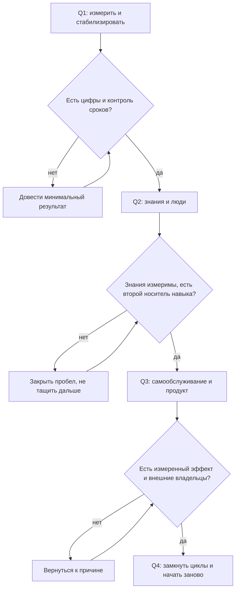
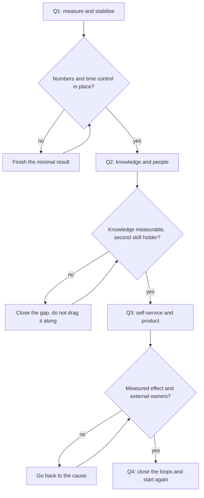
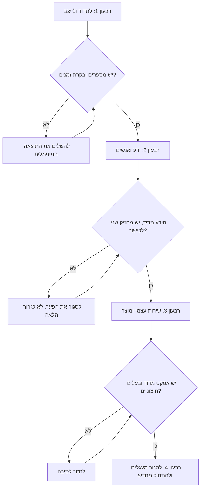

<!-- lang:ru -->

## Введение

В первый год на позиции лида поддержки я составил план из девятнадцати инициатив. Через три месяца не осталось ни одной: часть сгорела в операционке, часть потеряла смысл после первых данных, часть я просто забыл. Сервис при этом не стал хуже — он просто не изменился.

В предыдущей статье серии — «Baseline раньше целей» — речь шла о точке А и калибровке целей с руководством. Эта статья о следующем шаге: как из согласованных целей собирается календарь, в котором хватит места и на операционную работу, и на изменения.

Главная мысль, к которой я пришёл через несколько таких лет: дорожная карта — это не список желаний, а последовательность. Ценность в ней не в том, что в неё входит, а в том, в каком порядке это происходит и что нельзя начать, пока не закончено предыдущее.

## Почему планы из двадцати инициатив не выживают

Инициативы редко проваливаются по отдельности. Они проваливаются вместе, и причины у этого общие.

- **Всё меняется одновременно.** Триаж, база знаний, метрики, найм и Shift Left запускаются в одном месяце — и ни одно из изменений не получает внимания, нужного для запуска.
- **У изменений нет критерия «готово».** «Внедрить KCS» звучит как задача, но не отвечает на вопрос, когда работу можно считать сделанной. Незакрытая задача живёт годами и переходит из квартала в квартал, занимая место в повестке.
- **Изменения конкурируют с операционкой.** Очередь не спрашивает, есть ли у вас квартал изменений. Первая же неделя инцидентов съедает время, отведённое на процессы, и дальше план живёт только в презентации.
- **Команда перестаёт верить в инициативы.** Пятая попытка «начать вести базу знаний» воспринимается как шум, который надо пережить. После этого даже хорошая инициатива требует отдельных усилий на восстановление доверия.
- **Нет видимого движения.** Год заканчивается, а в сервисе ничего не поменялось: заявки те же, сроки те же, и объяснить, чем занимался лид, можно только списком проведённых встреч.

Девятнадцать инициатив проигрывают не потому, что они плохие. Они проигрывают без порядка: у каждой по отдельности есть смысл, у набора — нет.

## Четыре квартала года

Работающий каркас года для лида поддержки — четыре квартала, у каждого своя задача и свой тип результата. Не потому, что такой календарь красивый, а потому, что каждый следующий блок опирается на артефакты предыдущего.

### Первый квартал: измерить и стабилизировать

Задача квартала — перестать управлять вслепую и снять самые тяжёлые операционные пожары.

- **Месяц 1: карта сервиса и точка А.** Выгрузка из трекера, описание потока, узкое место.
- **Месяц 2: цели и калибровка.** Проверяемые результаты года, согласованные с руководством письменно.
- **Месяц 3: первый контур стабильности.** Триаж при первом касании, контроль сроков, маршрут эскалаций. Не «внедрено полностью», а «работает и не висит на лиде».

Критерий готовности квартала: у сервиса есть цифры, у цифр есть определения, у нарушений сроков есть регулярный контроль, и вы можете уйти в отпуск на две недели без обвала очереди.

### Второй квартал: знания и люди

Задача — превратить знания в актив и снять одноточечные зависимости в команде.

- База знаний по KCS (Knowledge-Centered Service — подход, в котором статья пишется в момент решения, а не после) и шаблон статьи с владельцем.
- Записи по повторяющимся проблемам: от потока тикетов к списку с владельцами и статусами.
- Регулярные 1:1, оценка по наблюдаемым фактам, матрица компетенций.

Критерий готовности: доля решений со ссылкой на статью измерима и растёт, повторяющиеся проблемы перенесены из потока в реестр, у каждого критичного навыка есть второй носитель.

### Третий квартал: самообслуживание и продукт

Задача — вынести часть потока из поддержки и начать говорить с продуктом на языке данных.

- Пилот Shift Left (перенос решения к пользователю через самообслуживание) с честным измерением: сколько обращений не дошло до поддержки.
- Матрица взаимодействий: кто принимает решения по каким вопросам — с продуктом, разработкой, эксплуатацией.
- Карточки проблем для продукта с данными, статусом и владельцем на той стороне.

Критерий готовности: работает хотя бы один канал самообслуживания с измеренным эффектом; у каждой проблемы, которую нельзя решить внутри поддержки, есть карточка и внешний владелец; в общем статусе появляются данные, а не «много обращений».

### Четвёртый квартал: замкнуть циклы

Задача — сделать так, чтобы работа следующего года начиналась не с чистого листа.

- Паспорта метрик: что измеряем, зачем, какое действие следует из значения.
- Статусы руководству в регулярном формате и запросы решений вместо просьб о сочувствии.
- Blameless-разборы инцидентов и аудит живучести: что сломается, когда вас не будет.
- Годовой отчёт и новый baseline — уже не с нуля, а с историей.

Критерий готовности: у каждой метрики есть владелец и действие, у каждого инцидента — разбор без имён и хотя бы одно изменение в системе, следующий год начинается с плана, а не с диагностики.

Как связаны кварталы:

<!-- вилка: свои вехи по месяцам — что именно сделано в каждом квартале и какой результат это дало. -->

## Правило последовательности

Правило, которое я формулирую одной строкой: следующий квартал не начинается, пока у предыдущего нет результата. Оно неприятное — именно оно заставляет отказываться от интересного в пользу нужного.

За ним стоят четыре конкретные зависимости:

1. **Без точки А нет метрик KCS.** Доля решений со ссылкой на статью — бессмысленное число, если неизвестно, сколько решений вообще и какие из них должны были идти через базу.
2. **Без базы знаний нет Shift Left.** Самообслуживание без проверенных статей перекладывает на пользователя поиск по мусору. Первый же такой опыт закрывает канал надолго.
3. **Без Shift Left нет разговора с продуктом.** Пока весь поток уходит в поддержку, у вас нет аргумента для продукта: вы говорите о боли, а не о масштабе.
4. **Без метрик нет годового отчёта.** Отчёт из ощущений и красивых схем не переживает первого уточняющего вопроса.

Что делать, если квартал провален — общая рекомендация одна: не тащить следующий блок. Соблазн понятен — год идёт, надо догонять. Но каждая часть дорожной карты опирается на предыдущую, и незакрытый пробел превращает следующую инициативу в декорацию. Лучше потратить начало следующего квартала на минимальный результат предыдущего — маленький, но настоящий: одна статья базы знаний с владельцем, один контроль сроков, одна измеренная веха.

## Ритм и буферы

Дорожная карта умирает не от плохих идей, а от нехватки времени на их выполнение. Поэтому в календаре должны быть зарезервированы три вещи.

- **Время лида на изменения.** Правило 40 %: не меньше двух дней в неделю на то, что не горит сейчас. Если неделя целиком уходит на очередь, квартальные вехи не случатся никогда.
- **Буфер на инциденты.** Планировать квартал без запаса — значит закладывать провал в план. Я держу в каждом месяце неделю, которую заранее считаю потерянной.
- **Точка ревизии.** Раз в квартал — час на пересборку плана: что сделано, что переносится, что отменяется. Отменять важнее, чем переносить: список из девятнадцати пунктов начинается именно с неспособности вычеркнуть.

<!-- вилка: ваш ритм — сколько времени в неделю уходит на изменения, как выглядит квартальная ревизия. -->

## Оглавление серии

Этот текст — четвёртая статья серии «Стратегия управления поддержкой», и он же служит оглавлением: статьи выходят блоками, порядок отражает логику зависимостей.

**Стратегическая рамка года**

- [Пять результатов работы лида поддержки](/ru/blog/support-lead-five-results/)
- [Границы ответственности: что лид делает сам, делегирует и от чего отказывается](/ru/blog/support-lead-boundaries/)
- Baseline раньше целей: почему годовые планы проваливаются на старте
- Год лида по кварталам: дорожная карта на 12 месяцев — эта статья

**Стабилизация сервиса**

- Карта сервиса и Точка А: диагностика первого месяца
- Триаж при первом касании: категория, критичность, маршрут
- Ни одного тихого нарушения SLA: еженедельный контроль очереди
- Эскалация в L3: пакет, OLA и владелец клиента

**Знания как система**

- KCS в рабочем потоке: статья пишется в момент решения
- Шаблон статьи базы знаний и владелец КБ
- Повторяющиеся проблемы: от потока тикетов к записям с владельцем
- Самообслуживание как Shift Left: пилот с честным измерением

**Команда: люди и развитие**

- Ритм руководителя: правило 40 %
- 1:1, которые не превращаются в отчёт и аттестацию
- Оценка по наблюдаемым фактам: QA-выборка и шесть критериев
- Матрица компетенций: закрываем одноточечные риски
- Мощность вместо героизма: расчёт потребности в инженерах

**Внешний контур**

- Матрица взаимодействий: кто решает и по каким вопросам
- Статус руководству: письмо на страницу и часовой обзор
- Просить решения, а не сочувствия: эскалация и запрос ресурсов
- Blameless-разбор инцидента: хронология без имён
- Карточка проблемы для продукта, которую не закрыть без статуса

**Метрики и замыкание года**

- Метрика без действия — это картинка: паспорт метрики
- Аудит живучести: что сломается, когда вас не будет
- Девять ошибок лида поддержки — и годовой отчёт

Статьи выходят раз в двое-трое суток, поэтому ссылки в тексте появляются по мере публикации. Все вышедшие статьи серии собираются под меткой [team-leadership](/ru/tags/team-leadership/), а список выше остаётся планом серии целиком.

## Что остаётся от такого года

Дорожная карта на двенадцать месяцев не гарантирует, что всё получится. Она гарантирует другое: к концу года вы сможете показать, что изменилось и почему, а не вспоминать, чем занимались. Четыре квартала — это не строгая методология, а способ не менять всё сразу и не бросать начатое.

Если из всего текста нужна одна фраза — возьмите эту: сначала цифры, потом знания, потом самообслуживание, потом внешний контур. Всё остальное — детали исполнения, которые можно менять под свой сервис.

<!-- lang:en -->

## Introduction

In my first year as a support lead I wrote a plan of nineteen initiatives. Three months later none of them remained: some burned up in day-to-day operations, some lost their point after the first data, some I simply forgot. The service did not get worse — it just did not change.

The previous article of the series — "Baseline before goals" — was about point A and calibrating goals with management. This one is about the next step: how agreed goals become a calendar with room both for operations and for change.

The main idea I arrived at after several such years: a roadmap is not a wish list but a sequence. Its value lies not in what it contains but in the order things happen and in what cannot start before the previous step is finished.

## Why plans of twenty initiatives don't survive

Initiatives rarely fail one by one. They fail together, and the reasons are shared.

- **Everything changes at once.** Triage, the knowledge base, metrics, hiring and shift left launch in the same month — and none of the changes gets the attention a launch requires.
- **The changes have no definition of done.** "Implement KCS" sounds like a task but does not answer when the work can be called finished. An unclosed task lives for years, moves from quarter to quarter and occupies a place on the agenda.
- **Change competes with operations.** The queue does not ask whether you have a quarter of change ahead. The first week of incidents eats the time set aside for processes, and from then on the plan lives only in the presentation.
- **The team stops believing in initiatives.** The fifth attempt to "finally start the knowledge base" is perceived as noise to be endured. After that even a good initiative needs extra effort to restore trust.
- **There is no visible movement.** The year ends and nothing in the service has changed: the same tickets, the same times, and the only way to explain what the lead did is a list of meetings held.

Nineteen initiatives lose not because they are bad. They lose without an order: each one makes sense on its own, the set does not.

## Four quarters of the year

A workable skeleton for a support lead's year is four quarters, each with its own task and its own type of result. Not because such a calendar is pretty, but because every next block rests on the artefacts of the previous one.

### First quarter: measure and stabilise

The quarter's task is to stop managing blind and to put out the heaviest operational fires.

- **Month 1: service map and point A.** An export from the tracker, a description of the flow, the bottleneck.
- **Month 2: goals and calibration.** Verifiable results for the year, agreed with management in writing.
- **Month 3: the first stability loop.** First-touch triage, time control, an escalation route. Not "fully implemented", but "works and does not hang on the lead".

Definition of done for the quarter: the service has numbers, the numbers have definitions, breaches of deadlines have regular control, and you can go on a two-week vacation without the queue collapsing.

### Second quarter: knowledge and people

Break down single points of failure — in knowledge and in the team.

- A knowledge base built on KCS (Knowledge-Centered Service — an approach where the article is written at the moment of solving, not after) and an article template with an owner.
- Records for recurring problems: from the ticket stream to a list with owners and statuses.
- Regular one-on-ones, assessment by observable facts, a competency matrix.

Definition of done: the share of resolutions with a reference to an article is measurable and growing, recurring problems have moved from the stream into a register, and every critical skill has a second holder.

### Third quarter: self-service and product

Move part of the flow out of support and start talking to product in the language of data.

- A shift left pilot (moving the solution closer to the user through self-service) with honest measurement: how many requests never reached support.
- An interaction matrix: who decides on which questions — product, engineering, operations.
- Problem cards for product with data, status and an owner on that side.

Definition of done: at least one self-service channel works with a measured effect; every problem that cannot be solved inside support has a card and an external owner; the general status carries data instead of "a lot of requests".

### Fourth quarter: close the loops

Make sure next year starts from a position of knowledge, not from a blank page.

- Metric passports: what we measure, why, and which action follows from a value.
- Regular management status and requests for decisions instead of requests for sympathy.
- Blameless incident reviews and a resilience audit: what breaks when you are not there.
- An annual report and a new baseline — with history behind it, not from scratch.

Definition of done: every metric has an owner and an action, every incident has a review without names and at least one change in the system, and the next year starts with a plan rather than with diagnostics.

How the quarters connect:

<!-- вилка: свои вехи по месяцам — что именно сделано в каждом квартале и какой результат это дало. -->

## The sequence rule

One line I keep coming back to: the next quarter does not start until the previous one has a result. It is an uncomfortable rule — it is exactly what makes you give up something interesting in favour of something needed.

Four concrete dependencies stand behind it:

1. **No point A, no KCS metrics.** The share of resolutions with a reference to an article is a meaningless number if you don't know how many resolutions there are at all and which of them should have gone through the base.
2. **No knowledge base, no shift left.** Self-service without verified articles makes the user search through rubbish. The first such experience closes the channel for a long time.
3. **No shift left, no conversation with product.** While the whole flow lands in support, you have no argument for product: you speak of pain, not of scale.
4. **No metrics, no annual report.** A report built from feelings and pretty diagrams does not survive the first clarifying question.

What to do when a quarter fails — the advice is the same: do not drag the next block along. The temptation is understandable — the year is running, you have to catch up. But every part of the roadmap rests on the previous one, and an unclosed gap turns the next initiative into decoration. Spend the beginning of the next quarter on the minimal result of the previous one — small but real: one knowledge base article with an owner, one time-control routine, one measured milestone.

## Rhythm and buffers

A roadmap dies not from bad ideas but from a lack of time to carry them out. So three things must be reserved in the calendar.

- **The lead's time for change.** The 40 % rule: at least two days a week for what is not on fire right now. If the whole week goes to the queue, quarterly milestones will never happen.
- **A buffer for incidents.** Planning a quarter with no reserve means building failure into the plan. I keep a week in every month that I consider lost in advance.
- **A review point.** Once a quarter — an hour to rebuild the plan: what is done, what moves, what is cancelled. Cancelling matters more than deferring: a list of nineteen items starts precisely with the inability to strike one out.

<!-- вилка: ваш ритм — сколько времени в неделю уходит на изменения, как выглядит квартальная ревизия. -->

## Series contents

This text is the fourth article of the "Support management strategy" series, and it also serves as its table of contents: the articles come out in blocks, and the order reflects the logic of dependencies.

**The strategic frame of the year**

- [The five results of a support lead](/en/blog/support-lead-five-results/)
- [Ownership boundaries: what a support lead decides, delegates, and walks away from](/en/blog/support-lead-boundaries/)
- Baseline before goals: why annual plans collapse at the start
- A support lead's year by quarters: a twelve-month roadmap — this article

**Stabilising the service**

- Service map and point A: diagnosing the first month
- Triage at first touch: category, severity, route
- Not one silent SLA breach: weekly queue control
- Escalation to L3: the package, the OLA and the client owner

**Knowledge as a system**

- KCS in the workflow: the article is written at the moment of solving
- A knowledge base article template and its owner
- Recurring problems: from the ticket stream to records with an owner
- Self-service as shift left: a pilot with honest measurement

**The team: people and growth**

- The manager's rhythm: the 40 % rule
- One-on-ones that don't turn into a report and an appraisal
- Assessment by observable facts: a QA sample and six criteria
- The competency matrix: closing single points of failure
- Capacity instead of heroism: calculating the need for engineers

**The outer contour**

- The interaction matrix: who decides and on which questions
- Status for management: a one-page letter and an hourly review
- Ask for decisions, not sympathy: escalation and the resource request
- A blameless incident review: a timeline without names
- A problem card for product that won't close without a status

**Metrics and closing the year**

- A metric without an action is a picture: the metric passport
- Resilience audit: what breaks when you are gone
- Nine mistakes of a support lead — and the annual report

The articles come out every two or three days, so links appear in the text as they publish. Every published article of the series is collected under the [team-leadership](/en/tags/team-leadership/) tag, while the list above stays the full plan of the series.

## What such a year leaves behind

A twelve-month roadmap does not guarantee that everything will work out. It guarantees something else: by the end of the year you can show what changed and why, instead of trying to recall what you were busy with. Four quarters are not a strict methodology but a way not to change everything at once and not to abandon what was started.

If you need a single sentence out of this text, take this one: numbers first, then knowledge, then self-service, then the outer contour. Everything else is implementation detail you can adapt to your service.

<!-- lang:he -->

## מבוא

בשנה הראשונה שלי כמנהל תמיכה בניתי תוכנית של תשע־עשרה יוזמות. כעבור שלושה חודשים לא נשארה אף אחת: חלקן נשרפו בעבודה השוטפת, חלקן איבדו משמעות אחרי הנתונים הראשונים, וחלקן פשוט שכחתי. השירות לא נהיה גרוע יותר — הוא פשוט לא השתנה.

המאמר הקודם בסדרה — "בסיס לפני מטרות" — עסק בנקודת המוצא ובכיול המטרות עם ההנהלה. המאמר הזה עוסק בצעד הבא: איך מהמטרות המוסכמות נבנה לוח שנה שיש בו מקום גם לעבודה השוטפת וגם לשינויים.

הרעיון המרכזי שאליו הגעתי אחרי כמה שנים כאלה: מפת דרכים היא לא רשימת משאלות אלא רצף. הערך שלה לא במה שנכנס אליה אלא בסדר שבו הדברים קורים ובמה שאסור להתחיל לפני שהקודם נגמר.

## למה תוכניות של עשרים יוזמות לא שורדות

יוזמות כמעט לא נופלות אחת־אחת. הן נופלות יחד, והסיבות משותפות.

- **הכל משתנה בבת אחת.** מיון, בסיס ידע, מדדים, גיוס ו-Shift Left יוצאים לדרך באותו חודש — ואף אחד מהשינויים לא מקבל את תשומת הלב שנדרשת להשקה.
- **לשינויים אין הגדרה של "גמור".** "להטמיע KCS" נשמע כמו משימה אבל לא עונה מתי אפשר לקרוא לעבודה גמורה. משימה לא סגורה חיה שנים, עוברת מרבעון לרבעון ותופסת מקום בסדר היום.
- **שינויים מתחרים בעבודה השוטפת.** התור לא שואל אם יש לכם רבעון של שינויים. השבוע הראשון של תקלות אוכל את הזמן שהוקצה לתהליכים, ומכאן והלאה התוכנית חיה רק במצגת.
- **הצוות מפסיק להאמין ביוזמות.** הניסיון החמישי "סוף סוף להתחיל את בסיס הידע" נתפש כרעש שצריך לעבור. אחרי זה גם יוזמה טובה דורשת מאמץ נוסף להשבת האמון.
- **אין תנועה נראית לעין.** השנה נגמרת ובדומה: אותן פניות, אותם זמנים, ואת מה שעשה מנהל התמיכה אפשר להסביר רק ברשימת פגישות.

תשע־עשרה יוזמות מפסידות לא מפני שהן גרועות. הן מפסידות בלי סדר: לכל אחת בנפרד יש היגיון, לכלל אין.

## ארבעה רבעונים בשנה

שלד עובד לשנה של מנהל תמיכה הוא ארבעה רבעונים, שלכל אחד משימה משלו וסוג תוצאה משלו. לא מפני שלוח שנה כזה יפה, אלא מפני שכל בלוק נשען על התוצרים של זה שלפניו.

### הרבעון הראשון: למדוד ולייצב

משימת הרבעון — להפסיק לנהל בעיוורון ולכבות את השריפות התפעוליות הכבדות.

- **חודש 1: מפת השירות ונקודת המוצא.** דיווח מהמערכת, תיאור הזרימה, הצוואר.
- **חודש 2: מטרות וכיול.** תוצאות ניתנות לבדיקה לשנה, מוסכמות עם ההנהלה בכתב.
- **חודש 3: קו הייצוב הראשון.** מיון במגע ראשון, בקרת זמנים, מסלול הסלמות. לא "הוטמע במלואו" אלא "עובד ולא תלוי במנהל התמיכה".

תנאי סגירה לרבעון: לשירות יש מספרים, למספרים יש הגדרות, להפרות זמנים יש בקרה קבועה, ואתם יכולים לצאת לחופשה של שבועיים בלי שהתור יקרוס.

### הרבעון השני: ידע ואנשים

המשימה — להפוך ידע לנכס ולפרק תלות בנקודה בודדת — בידע ובצוות.

- בסיס ידע לפי KCS (Knowledge-Centered Service — גישה שבה המאמר נכתב ברגע הפתרון ולא אחריו) ותבנית מאמר עם בעלים.
- רשומות לתקלות חוזרות: מזרימת הפניות לרשימה עם בעלים וסטטוסים.
- שיחות 1:1 קבועות, הערכה לפי עובדות נצפות, מטריצת יכולות.

תנאי סגירה: חלק הפתרונות עם הפניה למאמר מדיד ועולה, תקלות חוזרות עברו מהזרימה למרשם, ולכל כישור קריטי יש מחזיק שני.

### הרבעון השלישי: שירות עצמי ומוצר

להוציא חלק מהזרימה מהתמיכה ולהתחיל לדבר עם המוצר בשפת הנתונים.

- פיילוט Shift Left (קירוב הפתרון למשתמש דרך שירות עצמי) עם מדידה ישרה: כמה פניות לא הגיעו לתמיכה.
- מטריצת אינטראקציות: מי מחליט באילו שאלות — מוצר, פיתוח, תפעול.
- כרטיסי בעיה למוצר עם נתונים, סטטוס ובעלים בצד השני.

תנאי סגירה: ערוץ שירות עצמי אחד לפחות עובד עם אפקט מדוד; לכל בעיה שאי אפשר לפתור בתוך התמיכה יש כרטיס ובעלים חיצוני; בסטטוס הכללי יש נתונים ולא "הרבה פניות".

### הרבעון הרביעי: לסגור מעגלים

לדאוג שהשנה הבאה תתחיל מידיעה ולא מדף חלק.

- דרכוני מדדים: מה מודדים, למה, ואיזו פעולה נובעת מערך.
- סטטוס קבוע להנהלה ובקשות החלטה במקום בקשות אמפתיה.
- ניתוחי תקלות blameless וביקורת חוסן: מה יישבר כשלא תהיו.
- דוח שנתי ובסיס חדש — עם היסטוריה מאחוריו, לא מאפס.

תנאי סגירה: לכל מדד יש בעלים ופעולה, לכל תקלה ניתוח בלי שמות ולפחות שינוי אחד במערכת, והשנה הבאה מתחילה בתוכנית ולא באבחון.

איך הרבעונים מתחברים:

<!-- вилка: свои вехи по месяцам — что именно сделано в каждом квартале и какой результат это дало. -->

## כלל הרצף

כלל שאני חוזר אליו בשורה אחת: הרבעון הבא לא מתחיל עד שלרשבון הקודם יש תוצאה. הוא לא נוח — בדיוק הוא מכריח לוותר על משהו מעניין לטובת משהו נחוץ.

מאחוריו ארבע תלויות קונקרטיות:

1. **בלי נקודת מוצא אין מדדי KCS.** חלק הפתרונות עם הפניה למאמר הוא מספר חסר משמעות אם לא ידוע כמה פתרונות יש בכלל ואילו מהם היו אמורים לעבור דרך הבסיס.
2. **בלי בסיס ידע אין Shift Left.** שירות עצמי בלי מאמרים מאומתים מעביר למשתמש חיפוש בזבל. החוויה הראשונה כזאת סוגרת את הערוץ לזמן ארוך.
3. **בלי Shift Left אין שיחה עם המוצר.** כל עוד כל הזרימה נופלת על התמיכה, אין לכם טיעון למוצר: אתם מדברים על כאב ולא על קנה מידה.
4. **בלי מדדים אין דוח שנתי.** דוח מתחושות ומתרשימים יפים לא שורד את שאלת ההבהרה הראשונה.

מה עושים כשהרבעון נכשל — ההמלצה אחת: לא לגרור את הבלוק הבא. הפיתוי מובן — השנה מתקדמת, צריך להדביק. אבל כל חלק במפת הדרכים נשען על הקודם, ופער לא סגור הופך את היוזמה הבאה לקישוט. עדיף להשקיע את תחילת הרבעון הבא בתוצאה המינימלית של הקודם — קטנה אבל אמיתית: מאמר אחד בבסיס הידע עם בעלים, בקרת זמנים אחת, אבן דרך אחת מדודה.

## קצב וחוצצים

מפת דרכים מתה לא מרעיונות גרועים אלא ממחסור בזמן לבצע אותם. לכן בלוח השנה צריכים להיות שמורים שלושה דברים.

- **הזמן של מנהל התמיכה לשינויים.** כלל 40 %: לפחות יומיים בשבוע למה שלא בוער עכשיו. אם כל השבוע הולך לתור, אבני הדרך הרבעוניות לא יקרו לעולם.
- **חוצץ לתקלות.** לתכנן רבעון בלי רזרבה זה לבנות כישלון לתוך התוכנית. אני משאיר בכל חודש שבוע שאני מראש מחשיב כאבוד.
- **נקודת בחינה.** פעם ברבעון — שעה לבנייה מחדש של התוכנית: מה נעשה, מה נדחה, מה מבוטל. לבטל חשוב יותר מאשר לדחות: רשימה של תשע־עשרה סעיפים מתחילה בדיוק מחוסר היכולת למחוק.

<!-- вилка: ваш ритм — сколько времени в неделю уходит на изменения, как выглядит квартальная ревизия. -->

## תוכן הסדרה

הטקסט הזה הוא המאמר הרביעי בסדרה "אסטרטגיית ניהול תמיכה", והוא משמש גם תוכן עניינים: המאמרים יוצאים בבלוקים, והסדר משקף את היגיון התלויות.

**המסגרת האסטרטגית של השנה**

- [חמשת התוצרים של מנהל תמיכה](/he/blog/support-lead-five-results/)
- [גבולות אחריות: מה מנהל התמיכה מחליט בעצמו, מה הוא מאציל וממה הוא פורש](/he/blog/support-lead-boundaries/)
- בסיס לפני מטרות: למה תוכניות שנתיות קורסות כבר בהתחלה
- שנה של מנהל תמיכה לפי רבעונים: מפת דרכים לשנים עשר חודש — המאמר הזה

**ייצוב השירות**

- מפת השירות ונקודת המוצא: אבחון החודש הראשון
- מיון במגע ראשון: קטגוריה, דחיפות, מסלול
- אף הפרת SLA שקטה: בקרת תור שבועית
- הסלמה ל-L3: החבילה, ה-OLA ובעל הלקוח

**הידע כמערכת**

- KCS בזרימת העבודה: המאמר נכתב ברגע הפתרון
- תבנית מאמר בבסיס הידע ובעל הבסיס
- תקלות חוזרות: מזרימת הפניות לרשומות עם בעלים
- שירות עצמי כ-Shift Left: פיילוט עם מדידה ישרה

**הצוות: אנשים והתפתחות**

- הקצב של המנהל: כלל 40 %
- שיחות 1:1 שלא הופכות לדוח ולהערכה
- הערכה לפי עובדות נצפות: מדגם QA ושישה קריטריונים
- מטריצת יכולות: סוגרים סיכוני נקודה בודדת
- כושר נשיאה במקום גבורה: חישוב הצורך במהנדסים

**המעגל החיצוני**

- מטריצת אינטראקציות: מי מחליט ובאילו שאלות
- סטטוס להנהלה: מכתב בעמוד אחד וסקירה של שעה
- לבקש החלטות ולא אמפתיה: הסלמה ובקשת משאבים
- ניתוח תקלה blameless: כרונולוגיה בלי שמות
- כרטיס בעיה למוצר שאי אפשר לסגור בלי סטטוס

**מדדים וסגירת השנה**

- מדד בלי פעולה הוא תמונה: דרכון המדד
- ביקורת חוסן: מה יישבר כשלא תהיו
- תשע טעויות של מנהל תמיכה — והדוח השנתי

המאמרים יוצאים כל יומיים-שלושה, ולכן הקישורים בטקסט מופיעים עם הפרסום. כל המאמרים שיצאו לאור נאספים תחת התגית [team-leadership](/he/tags/team-leadership/), והרשימה למעלה נשארת התוכנית המלאה של הסדרה.

## מה נשאר משנה כזאת

מפת דרכים לשנים עשר חודש לא מבטיחה שהכל יצליח. היא מבטיחה משהו אחר: בסוף השנה תוכלו להראות מה השתנה ולמה, במקום להיזכר במה הייתם עסוקים. ארבעה רבעונים הם לא מתודולוגיה נוקשה אלא דרך לא לשנות הכל בבת אחת ולא לנטוש את מה שהתחלתם.

אם צריך משפט אחד מכל הטקסט — קחו את זה: קודם מספרים, אחר כך ידע, אחר כך שירות עצמי, אחר כך המעגל החיצוני. כל השאר הוא פרטי ביצוע שאפשר להתאים לשירות שלכם.
