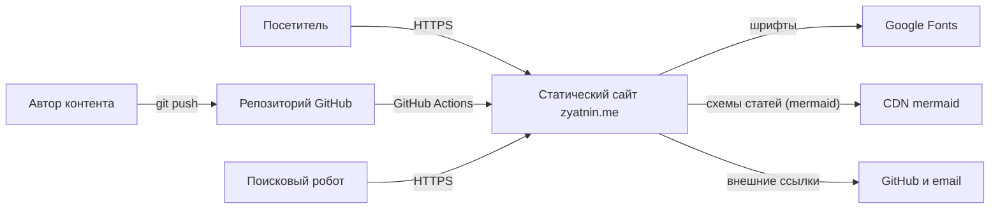

# Спецификация требований к программному обеспечению (SRS) — zyatnin.me

| Параметр | Значение |
| --- | --- |
| Версия документа | 1.0 |
| Дата | 2026-10-27 |
| Статус | Действующая |
| Продукт | Персональный сайт-портфолио и блог `zyatnin.me` |
| Владелец продукта | Max Zia |
| Репозиторий | `github.com/maxiller/zyatnin.me` |
| Связанный документ | [Анализ проекта](analysis.md) |

## Содержание

- [1. Общие сведения](#1-общие-сведения)
- [2. Общее описание](#2-общее-описание)
- [3. Требования к системе](#3-требования-к-системе)
- [4. Критерии приёмки и верификация](#4-критерии-приёмки-и-верификация)
- [5. Приоритеты и план развития](#5-приоритеты-и-план-развития)
- [6. Риски и открытые вопросы](#6-риски-и-открытые-вопросы)
- [7. Приложения](#7-приложения)

## 1. Общие сведения

### 1.1 Назначение документа

Настоящий документ определяет требования к персональному сайту-портфолио `zyatnin.me` и является основным заданием на разработку. Он описывает назначение продукта, целевую аудиторию, функциональные и нефункциональные требования, модель данных, интерфейсы, критерии приёмки и порядок развития.

Документ предназначен для использования при планировании, реализации, код-ревью, тестировании и приёмке изменений. Любое изменение поведения сайта должно быть проверено на соответствие требованиям этого документа.

### 1.2 Область применения

В область действия входят:

- статический сайт-портфолио с главной страницей и блогом;
- три языковые версии: русская, английская и иврит;
- поддержка светлой и тёмной тем;
- адаптивная вёрстка для мобильных и настольных устройств;
- генерация HTML на этапе сборки;
- публикация на GitHub Pages по домену `zyatnin.me`;
- контент, хранящийся в репозитории в виде Markdown-файлов и JSON-данных.

В область действия не входят:

- серверная часть, API и база данных;
- регистрация, аутентификация и личные кабинеты;
- электронная коммерция;
- комментарии, поиск и CMS на текущем этапе;
- мобильные приложения;
- хранение персональных данных посетителей.

### 1.3 Аудитория и сценарии чтения

| Аудитория | Что использует | Как читать документ |
| --- | --- | --- |
| Владелец продукта | Разделы 2, 5, 6 | Проверять состав функций, приоритеты и открытые вопросы |
| Автор контента | Разделы 3.2.7, 3.4, 7.1, 7.3 | Использовать схему front matter и правила добавления статей |
| Разработчик | Разделы 3, 4, 7 | Реализовывать требования и проверять критерии приёмки |
| Ревьюер и тестировщик | Разделы 3.3, 4 | Проверять соответствие и фиксировать дефекты |
| Дизайнер | Разделы 2.4, 3.2.5, 3.3, 3.5 | Учитывать дизайн-токены, адаптивность и доступность |

### 1.4 Определения и сокращения

| Термин | Определение |
| --- | --- |
| SRS | Software Requirements Specification, спецификация требований к программному обеспечению |
| SSG | Static Site Generator, генератор статических сайтов |
| Eleventy | Используемый SSG версии 3 |
| Nunjucks | Шаблонизатор, используемый Eleventy |
| Front matter | Блок метаданных в начале Markdown-файла между разделителями `---` |
| Коллекция | Набор шаблонов Eleventy, доступный в шаблонах как массив |
| Passthrough | Копирование файлов в выходной каталог без обработки |
| i18n | Интернационализация, поддержка нескольких языков |
| RTL | Right-to-left, письмо справа налево, используется для иврита |
| Топик | Тематическая категория статьи, ключи `t1`–`t6` |
| Языковая версия | Одна из версий сайта: `ru`, `en`, `he` |
| Пост | Отдельная статья блога в каталоге `src/{lang}/posts` |
| Проект | Карточка проекта на главной странице из массива `projects_data` |
| AC | Acceptance Criteria, критерий приёмки |
| FR | Functional Requirement, функциональное требование |
| NFR | Non-Functional Requirement, нефункциональное требование |
| DR | Data Requirement, требование к данным |
| IR | Interface Requirement, требование к интерфейсу |
| WCAG | Web Content Accessibility Guidelines |
| LCP | Largest Contentful Paint, метрика загрузки |
| CLS | Cumulative Layout Shift, метрика стабильности вёрстки |
| INP | Interaction to Next Paint, метрика отзывчивости |
| MoSCoW | Приоритизация Must, Should, Could, Won't |
| DoD | Definition of Done, определение готовности |

### 1.5 Ссылки и источники

| Источник | Назначение |
| --- | --- |
| [Анализ проекта](analysis.md) | Фактическое состояние, дефекты и метрики |
| [Схема front matter](#71-схема-front-matter) | Обязательные и опциональные поля статьи |
| [Ключи i18n](#72-ключи-i18n) | Состав JSON-данных локализации |
| [Карта маршрутов](#73-карта-маршрутов) | Публичные URL сайта |
| `package.json` | Скрипты сборки и зависимости |
| `.eleventy.js` | Конфигурация Eleventy, фильтры, коллекции |
| `.github/workflows/deploy.yml` | Конвейер сборки и публикации |
| [IEEE 29148](https://standards.ieee.org/ieee/29148/6937/) | Источник структуры SRS |
| [WCAG 2.1](https://www.w3.org/TR/WCAG21/) | Критерии доступности |
| [Eleventy Documentation](https://www.11ty.dev/docs/) | Поведение SSG |

### 1.6 Обзор документа

Раздел 2 описывает продукт, аудиторию, среду и ограничения. Раздел 3 содержит полный набор требований с идентификаторами. Раздел 4 определяет способы верификации, сценарии приёмки и матрицу трассировки. Раздел 5 задаёт приоритеты и дорожную карту. Раздел 6 фиксирует риски и открытые вопросы. Раздел 7 содержит прикладные схемы и Definition of Done.

Статус требования отражает состояние на дату анализа:

- **Реализовано** — поведение существует и подтверждено сборкой или чтением кода;
- **Частично** — поведение существует, но имеет дефект или неполный охват;
- **Не реализовано** — требование является заданием на разработку.

## 2. Общее описание

### 2.1 Контекст продукта

`zyatnin.me` — статический сайт, который выполняет роль личной витрины инженера и площадки для технических статей. Продукт не имеет серверной логики: весь HTML генерируется заранее, а браузер получает готовые файлы с GitHub Pages.



Ключевые внешние зависимости:

- GitHub как хостинг исходников и CI;
- GitHub Pages как хостинг статики;
- Google Fonts как источник шрифтов Inter и JetBrains Mono;
- CDN mermaid как библиотека отрисовки схем в статьях (подключается лениво, только на страницах со схемами);
- внешние ссылки на GitHub и почтовый адрес.

### 2.2 Ключевые функции

| Функция | Описание | Текущий статус |
| --- | --- | --- |
| Мультиязычный сайт | Три языковые версии с отдельными URL | Реализовано |
| Главная страница | Hero, обо мне, проекты, последние статьи | Реализовано |
| Блог | Индекс статей с группировкой по темам | Реализовано |
| Страница статьи | Полный текст, тема, дата, время чтения | Частично |
| Переключение языка | Переход на ту же страницу другого языка | Реализовано |
| Виды сайта | «Лидер поддержки» — светлая офисная схема; «Разработчик» — тёмная схема в стиле IDE; раздельный контент | Реализовано |
| Адаптивная навигация | Гамбургер и мобильное меню | Не реализовано |
| SEO-метаданные | Title, description, Open Graph, og:image, hreflang, JSON-LD | Реализовано |
| RTL | Корректное отображение иврита | Реализовано |
| Автоматический деплой | Сборка и публикация при push в `main` | Реализовано |
| Служебные страницы | 404, sitemap, robots, Atom-ленты (язык × вид) | Реализовано |

### 2.3 Классы пользователей

| Класс | Описание | Основные потребности |
| --- | --- | --- |
| Посетитель | Потенциальный работодатель, коллега или читатель | Быстро понять специализацию, читать статьи, удобная навигация с телефона |
| Автор контента | Владелец сайта | Добавлять статьи на трёх языках без изменения кода |
| Мейнтейнер | Разработчик, поддерживающий сайт | Понятная архитектура, воспроизводимая сборка, автоматические проверки |
| Поисковый робот | Внешний краулер | Уникальные заголовки и описания, canonical, hreflang, sitemap |
| Ассистивные технологии | Скринридеры, клавиатурная навигация | Семантика, контраст, фокус, ARIA-подписи |

### 2.4 Среда эксплуатации

| Компонент | Требование |
| --- | --- |
| Браузеры | Последние две версии Chrome, Firefox, Safari и Edge |
| Мобильные браузеры | iOS Safari 15 и новее, Chrome Android |
| Минимальная ширина viewport | 320 пикселей |
| Протокол | HTTPS |
| Хостинг | GitHub Pages, статические файлы |
| Домен | `zyatnin.me` через `CNAME` |
| Сборка | Node.js 22 LTS, npm, Linux-раннер GitHub Actions |
| Шрифты | Google Fonts с `display=swap` |
| Хранение состояния | localStorage: выбранные язык и вид; cookies отсутствуют |
| Сеть | Сайт должен оставаться читаемым при недоступности Google Fonts |

### 2.5 Ограничения проектирования

| ID | Ограничение |
| --- | --- |
| CON-01 | Только статическая генерация: серверный код и API запрещены |
| CON-02 | Хостинг GitHub Pages: нет управления HTTP-заголовками, серверными редиректами и произвольной серверной логикой |
| CON-03 | Генератор Eleventy 3 и шаблонизатор Nunjucks |
| CON-04 | Ровно три языка: `ru`, `en`, `he`; добавление нового языка требует архитектурного решения |
| CON-05 | Контент хранится в репозитории и версионируется через Git |
| CON-06 | Сайт публикуется в корень домена, без `pathPrefix` |
| CON-07 | Секреты и приватные ключи не должны попадать в репозиторий или сборку |
| CON-08 | Все страницы должны работать без JavaScript в части чтения контента |
| CON-09 | Сторонние трекеры и cookies не используются без отдельного решения |
| CON-10 | Внешние шрифты загружаются с Google Fonts; self-hosting не обязателен на текущем этапе |

### 2.6 Допущения и зависимости

| ID | Допущение |
| --- | --- |
| ASM-01 | Владелец вручную поддерживает переводы всех статей |
| ASM-02 | На текущий момент каждая статья существует на всех трёх языках |
| ASM-03 | Домен и DNS настроены на GitHub Pages |
| ASM-04 | GitHub Actions доступны и включены для репозитория |
| ASM-05 | Google Fonts доступны посетителям; при сбое используются системные шрифты |
| ASM-06 | Контент не содержит конфиденциальных данных |
| ASM-07 | Комментарии, поиск и аналитика не требуются до отдельного решения |
| ASM-08 | Node.js 22 LTS доступен на CI и рекомендуется локально |
| ASM-09 | Единственный мейнтейнер выполняет роль автора, разработчика и релиз-менеджера |

## 3. Требования к системе

### 3.1 Архитектурные требования

| ID | Требование | Приоритет | Статус |
| --- | --- | --- | --- |
| AR-01 | Сайт должен собираться генератором Eleventy в каталог `_site` | Must | Реализовано |
| AR-02 | Исходники должны быть разделены на контент, шаблоны, данные и ресурсы | Must | Реализовано |
| AR-03 | Каждый язык должен иметь изолированный каталог `src/{lang}` | Must | Реализовано |
| AR-04 | Строки интерфейса должны поставляться из JSON-файлов через directory data | Must | Реализовано |
| AR-05 | Для каждого языка должна существовать коллекция статей, отсортированная по дате по убыванию | Must | Реализовано |
| AR-06 | Ресурсы `src/assets` и файл `CNAME` должны копироваться в сборку без обработки | Must | Реализовано |
| AR-07 | Публикация должна выполняться через GitHub Actions на GitHub Pages | Must | Реализовано |
| AR-08 | Повторяющиеся вычисления должны быть вынесены в фильтры Eleventy | Should | Реализовано |
| AR-09 | Контент и представление должны быть разделены: тексты статей не должны требовать правки шаблонов | Should | Частично |
| AR-10 | Дизайн-токены должны быть централизованы в CSS custom properties | Should | Реализовано |
| AR-11 | Клиентский JavaScript должен быть прогрессивным улучшением и не блокировать чтение | Must | Реализовано |
| AR-12 | Архитектура не должна требовать серверного рантайма | Must | Реализовано |

### 3.2 Функциональные требования

Обозначения приоритетов: **Must** — без требования релиз невозможен; **Should** — важное требование; **Could** — желательное улучшение.

#### 3.2.1 Локализация и маршрутизация

| ID | Требование | Приоритет | Статус |
| --- | --- | --- | --- |
| FR-01 | Запрос `/` должен определять язык браузера (с приоритетом ручного выбора, сохранённого в localStorage) и перенаправлять на `/ru/` или `/he/`; при отсутствии совпадения и без JavaScript — на `/en/` (умолчание — английский) | Must | Реализовано |
| FR-02 | Каждая страница должна иметь языковой префикс `/ru/`, `/en/` или `/he/` | Must | Реализовано |
| FR-03 | Переключатель языка должен вести на ту же страницу другого языка с сохранением пути | Must | Частично |
| FR-04 | Каждая страница должна содержать `link rel="alternate"` для всех трёх языков | Must | Реализовано |
| FR-05 | Каждая страница должна содержать `hreflang="x-default"` | Should | Реализовано |
| FR-06 | Корневой элемент `html` должен содержать корректные `lang` и `dir` | Must | Реализовано |
| FR-07 | При отсутствии перевода переключатель не должен вести на несуществующую страницу | Should | Не реализовано |
| FR-08 | URL статьи должен быть стабильным и иметь вид `/{lang}/blog/{slug}/` | Must | Реализовано |
| FR-09 | Язык контента должен совпадать с языковым каталогом | Must | Реализовано |

**Критерии приёмки для раздела:**

- При открытии `/` браузер оказывается на языковой версии, соответствующей локали браузера (умолчание — английская); ручной выбор языка сохраняется и имеет приоритет.
- Переход с `/ru/blog/container-image-consistency/` на английскую версию открывает `/en/blog/container-image-consistency/`.
- В HTML каждой страницы присутствуют `lang`, `dir` и три `hreflang`.
- Для иврита `dir="rtl"`, для русского и английского `dir="ltr"`.

#### 3.2.2 Главная страница

| ID | Требование | Приоритет | Статус |
| --- | --- | --- | --- |
| FR-10 | Главная должна содержать hero-блок с именем, специализацией и описанием | Must | Реализовано |
| FR-11 | Главная должна содержать секцию «Обо мне» с биографией, навыками и интересами | Must | Реализовано |
| FR-12 | Главная должна содержать секцию проектов из коллекции проектов текущего языка и текущего вида (раздел 3.2.9) | Must | Реализовано |
| FR-13 | Главная должна показывать три последние статьи текущего языка и текущего вида | Must | Реализовано |
| FR-14 | Главная должна содержать CTA-ссылки на проекты и блог | Should | Реализовано |
| FR-15 | Терминальный блок должен имитировать командную строку без блокировки контента; размещается на главной вида «Разработчик» | Could | Реализовано |
| FR-16 | Секции должны появляться при прокрутке с анимацией, отключаемой при `prefers-reduced-motion` | Should | Реализовано |
| FR-17 | Секции `#about` и `#projects` должны быть доступны по якорным ссылкам | Must | Реализовано |
| FR-18 | Контент должен быть видимым без JavaScript; анимации — только прогрессивное улучшение | Must | Реализовано |
| FR-19 | Hero вида «Лидер» должен содержать карточку-сводку профиля (роль, компания, отрасли, масштаб) из i18n | Should | Реализовано |

**Критерии приёмки для раздела:**

- На каждой языковой главной отображаются имя, специализация, биография, интересы и карточки проектов текущего языка.
- В блоке последних статей ровно три карточки, отсортированные по дате по убыванию.
- При отключённом JavaScript весь текстовый контент остаётся видимым.
- При `prefers-reduced-motion: reduce` анимации не должны проигрываться.

#### 3.2.3 Индекс блога

| ID | Требование | Приоритет | Статус |
| --- | --- | --- | --- |
| FR-20 | Индекс должен показывать все статьи текущего языка и текущего вида | Must | Реализовано |
| FR-21 | Статьи должны группироваться по топикам с локализованными заголовками | Must | Реализовано |
| FR-22 | Внутри группы статьи должны сортироваться по дате по убыванию | Must | Реализовано |
| FR-23 | Карточка статьи должна содержать топик, заголовок, краткое описание, дату и ссылку | Must | Частично |
| FR-24 | Пустые тематические группы не должны отображаться | Must | Реализовано |
| FR-25 | Даты в карточках должны отображаться в формате ISO-недели `YYYY-Www` и никогда не быть пустыми | Must | Реализовано |
| FR-26 | Добавление нового топика не должно требовать изменения шаблона | Should | Не реализовано |
| FR-27 | При отсутствии статей (в том числе в пустом виде) должен отображаться понятный пустой экран | Should | Реализовано |
| FR-28 | При большом числе статей должна поддерживаться пагинация | Could | Не реализовано |
| FR-29 | Должен быть доступен поиск по статьям текущего языка | Could | Не реализовано |

**Критерии приёмки для раздела:**

- Индекс содержит все статьи языка; количество карточек совпадает с количеством файлов в `posts`.
- Порядок внутри группы соответствует убыванию даты.
- Для каждой карточки дата непустая и имеет вид `YYYY-Www` (например, `2026-W14`); страница статьи сохраняет локализованный формат даты.
- Группа без статей отсутствует в HTML.

#### 3.2.4 Страница статьи

| ID | Требование | Приоритет | Статус |
| --- | --- | --- | --- |
| FR-30 | Статья должна открываться по URL `/{lang}/blog/{slug}/` | Must | Реализовано |
| FR-31 | Заголовок страницы должен содержать заголовок статьи и имя автора | Must | Реализовано |
| FR-32 | В шапке статьи должны отображаться топик, дата и время чтения | Must | Частично |
| FR-33 | Дата должна форматироваться по правилам языка и не быть пустой | Must | Реализовано |
| FR-34 | Время чтения должно рассчитываться по объёму текста | Should | Реализовано |
| FR-35 | Мета-описание статьи должно формироваться из `excerpt` | Must | Реализовано |
| FR-36 | Ссылка «Назад к блогу» должна вести на индекс текущего языка | Must | Реализовано |
| FR-37 | Блоки кода должны иметь горизонтальную прокрутку и различимое оформление | Should | Реализовано |
| FR-38 | Блок похожих статей должен показывать статьи той же темы | Could | Не реализовано |
| FR-39 | Статья должна поддерживать поля `updated` и `draft` | Could | Не реализовано |
| FR-116 | Статья может содержать mermaid-блоки; на страницах с такими блоками лениво подключается библиотека mermaid с CDN, и блоки отрисовываются как схемы. Фон схемы прозрачен (виден фон страницы); тема строится из дизайн-токенов активного вида, узлы окрашиваются семантически из токенов вида: зелёный — позитив, красный — негатив, голубой — нейтральное (классы `good`/`bad`/`neutral` внедряются загрузчиком); без JavaScript блок остаётся читаемым исходником схемы | Should | Реализовано |

**Критерии приёмки для раздела:**

- Для каждой статьи существуют страницы во всех трёх языках.
- В шапке статьи дата отображается в формате, принятом для языка, и не пуста.
- Мета-описание статьи совпадает с `excerpt` или его нормализованной версией.
- Время чтения является целым числом минут и не равно нулю для непустой статьи.

#### 3.2.5 Навигация, вид и мобильное меню

| ID | Требование | Приоритет | Статус |
| --- | --- | --- | --- |
| FR-40 | Шапка должна быть закреплена сверху и содержать логотип, навигацию, переключатель языка, переключатель вида и кнопку мобильного меню | Must | Реализовано |
| FR-41 | На ширине до 768 пикселей основная навигация должна скрываться и заменяться гамбургером | Must | Реализовано |
| FR-42 | Гамбургер должен открывать и закрывать мобильное меню | Must | Реализовано |
| FR-43 | Мобильное меню должно закрываться по клику на ссылку и по клавише Escape | Should | Реализовано |
| FR-44 | Каждый вид имеет фиксированную цветовую схему: «Лидер» — светлая офисная, «Разработчик» — тёмная консольная; отдельной кнопки темы нет (см. 3.2.10) | Must | Реализовано |
| FR-45 | Переключатель вида должен сохранять выбор в localStorage; корневой редирект `/` учитывает сохранённый вид | Should | Реализовано |
| FR-46 | Переключатель вида должен вести на ту же страницу другого вида, а при её отсутствии — на индекс блога или главную другого вида, не создавая 404 | Should | Реализовано |
| FR-47 | Вид должен определять подключаемый stylesheet: `style.css` для «Лидера» и `dev.css` для «Разработчика» | Must | Реализовано |
| FR-48 | Должен присутствовать skip-link к основному содержимому | Must | Реализовано |
| FR-49 | Текущая страница должна быть обозначена для ассистивных технологий | Should | Не реализовано |
| FR-50 | Подвал должен содержать имя, ссылку на GitHub, email и копирайт | Must | Реализовано |
| FR-51 | ARIA-подписи интерактивных элементов должны быть локализованы | Should | Реализовано |

**Критерии приёмки для раздела:**

- На ширине 375 пикселей нажатие на гамбургер делает меню видимым, повторное нажатие скрывает его.
- `aria-expanded` соответствует видимому состоянию меню.
- После перезагрузки сохраняются выбранные язык и вид (localStorage).
- Переключатель вида не ведёт на несуществующие страницы.
- Клавиатурная навигация позволяет достичь всех ссылок и кнопок, фокус видим.
- Skip-link появляется при фокусе и переводит к `#main`.

#### 3.2.6 SEO и метаданные

| ID | Требование | Приоритет | Статус |
| --- | --- | --- | --- |
| FR-60 | Каждая страница должна иметь уникальный `title` по шаблону «Заголовок — имя владельца на языке страницы» | Must | Реализовано |
| FR-61 | Каждая страница должна иметь уникальное мета-описание | Must | Реализовано |
| FR-62 | Каждая страница должна содержать Open Graph `og:title`, `og:description`, `og:type`, `og:url` | Should | Реализовано |
| FR-63 | Каждая страница должна содержать `og:image` (файл `assets/og-image.png`, 1200×630) и `twitter:card` | Should | Реализовано |
| FR-64 | Каждая страница должна содержать `link rel="canonical"` | Must | Реализовано |
| FR-65 | Значения `hreflang` должны соответствовать языку целевого URL и не содержать неверных кодов | Must | Реализовано |
| FR-66 | Сайт должен генерировать `sitemap.xml` со всеми индексируемыми URL обоих видов и трёх языков; `noindex`-страницы (заглушки, корневой редирект, 404) в sitemap не попадают | Should | Реализовано |
| FR-67 | Сайт должен генерировать `robots.txt` со ссылкой на sitemap | Should | Реализовано |
| FR-68 | Сайт должен содержать страницу `404.html` с навигацией по разделам обоих видов и трёх языков, `noindex` и без зависимости от CSS сайта | Should | Реализовано |
| FR-69 | Статьи должны содержать структурированные данные `Article` в JSON-LD (заголовок, описание, даты, автор, язык, URL) | Could | Реализовано |
| FR-70 | Служебный редирект `/index.html` должен содержать `lang` и не участвовать в индексации | Should | Реализовано |
| FR-71 | Сайт должен генерировать Atom-ленты статей для каждой пары «язык × вид»: `/{lang}/feed.xml` и `/{lang}/dev/feed.xml` | Could | Реализовано |
| FR-117 | SEO-артефакты (`sitemap.xml`, `robots.txt`, Atom-ленты, JSON-LD, метаданные) должны генерироваться при каждой сборке из того же источника, что и страницы, и автоматически отражать текущий контент обоих видов и всех языков; сборка должна падать, если артефакты расходятся с фактическими страницами (`scripts/check-seo.js`) | Must | Реализовано |

**Критерии приёмки для раздела:**

- Для любых двух разных страниц `title` и `description` различаются.
- Для каждой страницы canonical указывает на её собственный URL.
- `hreflang` содержит корректные коды трёх языков и `x-default`.
- `sitemap.xml` содержит все индексируемые страницы обоих видов и трёх языков и не содержит `noindex`-страниц.
- Каждая индексируемая страница несёт `og:image` и `twitter:card`; изображение доступно по указанному адресу.
- Каждая статья (обоих видов) содержит валидный блок JSON-LD `Article` с `datePublished`, автором и языком.
- Для каждой пары «язык × вид» существует Atom-лента с записями этого вида; ленты объявлены в `<head>` через `link rel="alternate"`.
- Запрос несуществующего URL возвращает страницу 404 с ссылками на разделы обоих видов и трёх языков.
- `npm run build` завершается ошибкой, если SEO-артефакты расходятся с собранными страницами (FR-117).

#### 3.2.7 Контент-модель

| ID | Требование | Приоритет | Статус |
| --- | --- | --- | --- |
| FR-80 | Статья должна содержать обязательные поля front matter, определённые в разделе 7.1, включая `view` | Must | Реализовано |
| FR-81 | Значение `topic` должно принадлежать множеству `t1`–`t6` | Must | Реализовано |
| FR-82 | `slug` должен быть уникальным в пределах языка и совпадать между языками | Must | Реализовано |
| FR-83 | `excerpt` должен быть непустым и содержать от 40 до 200 символов | Should | Реализовано |
| FR-84 | Должна существовать автоматическая проверка совпадения набора ключей i18n | Must | Не реализовано |
| FR-85 | Должна существовать автоматическая проверка наличия переводов для каждой статьи | Should | Не реализовано |
| FR-86 | Контент статьи должен быть представлен в Markdown; HTML допускается только при необходимости | Should | Частично |
| FR-87 | Контент проектов должен храниться в файлах `src/{lang}/projects/*.md`; не менее трёх проектов на язык | Should | Реализовано |
| FR-88 | Новый топик должен добавляться в JSON и шаблон без дублирования логики | Could | Не реализовано |
| FR-89 | Статья должна поддерживать черновик, исключаемый из сборки | Could | Не реализовано |

**Критерии приёмки для раздела:**

- Скрипт проверки i18n завершается с ошибкой при расхождении ключей.
- `npm run build` падает при отсутствии обязательного поля front matter.
- Все URL статей уникальны.
- Все значения `topic` входят в допустимое множество.

#### 3.2.8 Сборка и развёртывание

| ID | Требование | Приоритет | Статус |
| --- | --- | --- | --- |
| FR-90 | `npm run build` должен собирать сайт в `_site` | Must | Реализовано |
| FR-91 | `npm run start` и `npm run dev` должны запускать локальный сервер на порту 5000 | Must | Реализовано |
| FR-92 | Сборка должна запускаться при push в `main` | Must | Реализовано |
| FR-93 | Сборка должна поддерживать ручной запуск `workflow_dispatch` | Should | Реализовано |
| FR-94 | Публикация должна выполняться только после успешной сборки | Must | Реализовано |
| FR-95 | `CNAME` должен попадать в корень сборки | Must | Реализовано |
| FR-96 | Зависимости должны устанавливаться воспроизводимо через lock-файл и `npm ci` | Must | Не реализовано |
| FR-97 | Версия Node должна быть явно зафиксирована для CI и локальной разработки | Should | Частично |
| FR-98 | Сборка должна завершаться с ненулевым кодом при ошибке шаблонов или данных | Must | Реализовано |
| FR-99 | В репозитории должны быть скрипты проверки ссылок и качества | Could | Не реализовано |

**Критерии приёмки для раздела:**

- Чистый клон с `npm ci` собирает идентичный набор страниц.
- Push в `main` приводит к успешному деплою или к остановке на этапе сборки.
- В `_site` присутствуют `CNAME`, `assets/style.css` и `assets/app.js`.
- `npm run build` возвращает код 0 при корректных данных.

#### 3.2.9 Страницы проектов

| ID | Требование | Приоритет | Статус |
| --- | --- | --- | --- |
| FR-100 | Проект должен открываться по URL `/{lang}/projects/{slug}/` | Must | Реализовано |
| FR-101 | Карточка проекта на главной должна быть ссылкой на страницу проекта | Must | Реализовано |
| FR-102 | Данные карточки и страницы проекта (имя, описание, иконка, теги) должны браться из front matter проекта; дублирование в i18n JSON не допускается | Must | Реализовано |
| FR-103 | Страница проекта должна содержать иконку, имя, теги, описание и буллеты `points` при их наличии | Should | Реализовано |
| FR-104 | Ссылка «Назад к проектам» должна вести на секцию проектов главной текущего языка | Must | Реализовано |
| FR-105 | Порядок карточек на главной определяется полем `order` front matter | Must | Реализовано |
| FR-106 | `slug` проекта должен быть уникальным в пределах языка и совпадать между языками | Must | Реализовано |
| FR-107 | Карточка проекта должна отображать настраиваемый статус из front matter со значениями `done` и `in_progress`; индикатор — текстовый бейдж с локализованной подписью; при отсутствии `status` бейдж не выводится | Should | Реализовано |

**Критерии приёмки для раздела:**

- Для каждого проекта существуют страницы во всех трёх языках, и карточка каждой языковой версии ведёт на страницу того же языка.
- Все ссылки из раздела «Статьи по теме» указывают на существующие страницы блога.
- Метатег `description` страницы проекта формируется из `excerpt` front matter.

#### 3.2.10 Виды сайта и раздельный контент

| ID | Требование | Приоритет | Статус |
| --- | --- | --- | --- |
| FR-110 | Сайт имеет два вида: «Лидер поддержки» с маршрутами `/{lang}/…` и «Разработчик» с маршрутами `/{lang}/dev/…`; для каждого языка и вида существуют главная страница и индекс блога | Must | Реализовано |
| FR-111 | Вид записи задаётся полем `view` front matter (`leader` или `dev`); статья или проект относится только к виду, для которого у неё есть контент | Must | Реализовано |
| FR-112 | Записи без контента для выбранного вида не выводятся на главной, в индексе блога и в дереве файлов вида | Must | Реализовано |
| FR-113 | Контент видов независим: одна запись может существовать в обоих видах с разными текстами в виде отдельных файлов со своими `permalink` и `layout` | Should | Реализовано |
| FR-114 | Статьи, перемещённые из «Лидера» в «Разработчика», отдают на старых URL `/{lang}/blog/{slug}/` редирект-заглушки (`meta refresh`, `noindex`, canonical на новый адрес) | Should | Реализовано |
| FR-115 | В виде «Разработчик» раздел проектов и ссылки на него скрываются, если проектов этого вида нет | Should | Реализовано |

**Критерии приёмки для раздела:**

- Суммарное число статей языка равно сумме статей видов «Лидер» и «Разработчик»; пересечений нет.
- Страница `/{lang}/blog/{slug}/` существует только для статей вида «Лидер», страница `/{lang}/dev/blog/{slug}/` — только для вида «Разработчик».
- Старые URL перемещённых статей возвращают HTML-заглушку с `meta http-equiv="refresh"` и `robots noindex`.
- На главной вида «Разработчик» без проектов секция проектов и CTA на неё отсутствуют.

### 3.3 Нефункциональные требования

Текущее соответствие этим требованиям и выявленные отклонения зафиксированы в разделе [Нефункциональная оценка](analysis.md#11-нефункциональная-оценка). Часть требований, особенно по доступности и SEO, на момент анализа не выполняется.

| ID | Категория | Требование | Измеримый критерий | Приоритет |
| --- | --- | --- | --- | --- |
| NFR-01 | Производительность | LCP на мобильном профиле | Не более 2,5 с на эмуляции 4G | Must |
| NFR-02 | Производительность | Стабильность вёрстки | CLS не более 0,1 | Must |
| NFR-03 | Производительность | Отзывчивость | INP не более 200 мс | Should |
| NFR-04 | Производительность | Размер ресурсов | CSS не более 30 КБ, JS не более 10 КБ без сжатия | Should |
| NFR-05 | Производительность | Время сборки | Не более 30 с на CI | Should |
| NFR-06 | Доступность | Уровень соответствия | WCAG 2.1 AA | Must |
| NFR-07 | Доступность | Контраст обычного текста | Не менее 4,5:1 | Must |
| NFR-08 | Доступность | Контраст крупного текста и элементов | Не менее 3:1 | Must |
| NFR-09 | Доступность | Клавиатурная навигация | Все интерактивные элементы достижимы с клавиатуры, фокус видим | Must |
| NFR-10 | Доступность | Семантика | Наличие `header`, `nav`, `main`, `footer`, одного `h1` на страницу | Must |
| NFR-11 | Доступность | Анимации | При `prefers-reduced-motion: reduce` анимации отключаются | Should |
| NFR-12 | Доступность | Локализация ARIA | Подписи кнопок и меню на языке страницы | Should |
| NFR-13 | SEO | Уникальность метаданных | Уникальные `title` и `description` на каждой странице | Must |
| NFR-14 | SEO | Индексируемость | Canonical, hreflang, sitemap, robots | Must |
| NFR-15 | SEO | Валидность разметки | Отсутствие ошибок в HTML-валидаторе | Should |
| NFR-16 | Безопасность | Секреты | В репозитории и сборке отсутствуют секреты | Must |
| NFR-17 | Безопасность | Внешние ссылки | `target="_blank"` сопровождается `rel="noopener"` | Must |
| NFR-18 | Безопасность | CI | Минимальные `permissions`, Actions закреплены по SHA | Should |
| NFR-19 | Безопасность | CSP | Политика содержимого, совместимая с GitHub Pages и инлайн-редиректом | Could |
| NFR-20 | Приватность | Трекеры | Отсутствие сторонних трекеров и cookies | Must |
| NFR-21 | Приватность | Внешние ресурсы | Политика использования внешних ресурсов (Google Fonts, CDN mermaid) документирована | Should |
| NFR-22 | Совместимость | Браузеры | Последние две версии основных браузеров, iOS Safari 15+ | Must |
| NFR-23 | Совместимость | Отсутствие JavaScript | Контент читается без JavaScript | Must |
| NFR-24 | Локализация | Паритет языков | Все ключи i18n присутствуют во всех JSON | Must |
| NFR-25 | Локализация | RTL | Иврит отображается справа налево, стрелки и отступы зеркальны | Must |
| NFR-26 | Сопровождаемость | Документация | SRS и анализ проекта актуальны | Must |
| NFR-27 | Сопровождаемость | Линтеры и форматирование | ESLint, Stylelint, Prettier настроены | Should |
| NFR-28 | Сопровождаемость | Тесты | Есть проверки фильтров, сборки и ссылок | Should |
| NFR-29 | Надёжность | Воспроизводимость | Сборка из lock-файла детерминирована | Must |
| NFR-30 | Надёжность | Битые ссылки | Нет внутренних ссылок на несуществующие страницы | Must |
| NFR-31 | Наблюдаемость | Логи CI | Ошибки сборки видны в GitHub Actions | Must |
| NFR-32 | Наблюдаемость | Аналитика | Privacy-friendly аналитика при отдельном решении | Could |
| NFR-33 | Портимость | Node.js | Зафиксирован Node 22 LTS в `engines` | Should |
| NFR-34 | Контент | Добавление статьи | Новая статья на трёх языках добавляется без правки кода | Must |
| NFR-35 | Контент | Время добавления | Не более 15 минут на статью при готовом тексте | Could |
| NFR-36 | Правовое | Копирайт | Год и владелец прав отображаются корректно | Should |
| NFR-37 | Правовое | Лицензия | Лицензия репозитория определена | Could |

### 3.4 Требования к данным

| ID | Требование |
| --- | --- |
| DR-01 | Front matter статьи обязателен и содержит `layout`, `title`, `excerpt`, `date`, `topic`, `view`, `slug`, `permalink` |
| DR-02 | Опциональные поля статьи: `description`, `updated`, `draft`, `cover`, `tags` |
| DR-03 | `layout` статьи равен `layouts/post.njk` для вида «Лидер» и `layouts/dev/post.njk` для вида «Разработчик» |
| DR-04 | `date` задаётся в формате ISO 8601 `YYYY-MM-DD` и обрабатывается как дата, а не как строка |
| DR-05 | `topic` принимает одно из значений `t1`, `t2`, `t3`, `t4`, `t5`, `t6` |
| DR-06 | `slug` соответствует шаблону `[a-z0-9-]+`, уникален в языке и одинаков во всех языках |
| DR-07 | `permalink` соответствует шаблону `/{lang}/blog/{slug}/` для вида «Лидер» и `/{lang}/dev/blog/{slug}/` для вида «Разработчик» |
| DR-08 | `excerpt` — открытый текст без HTML, от 40 до 200 символов |
| DR-09 | Языковой JSON содержит ключи `lang`, `dir`, `nav`, `views`, `hero`, `about`, `projects`, `blog`, `footer`, `skip_link`, `a11y`, `topics`, `dev` |
| DR-10 | `lang` совпадает с кодом языка, `dir` равен `ltr` или `rtl` |
| DR-11 | `topics` содержит ровно ключи `t1`–`t6`, совпадающие со значениями `topic` в статьях |
| DR-12 | Front matter проекта содержит `layout`, `title`, `excerpt`, `view`, `order`, `icon`, `tags`, `slug`, `permalink` и необязательные `points` и `status` (`done` или `in_progress`); `tags` и `points` — массивы строк |
| DR-13 | Контент статьи не содержит персональных данных, кроме публично разрешённых контактов |
| DR-14 | `CNAME` содержит ровно `zyatnin.me` |
| DR-15 | Все публичные URL уникальны; дубликаты `permalink` недопустимы |
| DR-16 | Язык текста статьи соответствует каталогу, в котором находится файл |
| DR-17 | Языконезависимые данные сайта (домен, контакты, год копирайта, список технологий `skills`) задаются в `src/_data/site.json` и не дублируются в шаблонах; имя владельца локализуется через i18n-ключ `name` |

### 3.5 Требования к интерфейсам

| ID | Интерфейс | Требование |
| --- | --- | --- |
| IR-01 | HTTP | Публичные маршруты соответствуют разделу 7.3; ответы отдаются по HTTPS |
| IR-02 | HTML | Каждая страница содержит `header`, `nav`, `main id="main"`, `footer`; один `h1` |
| IR-03 | CSS | Дизайн-токены задаются в `:root` каждого вида: `style.css` (светлая офисная схема «Лидера») и `dev.css` (тёмная консольная схема «Разработчика»); брейкпоинты «Лидера» — 768 и 480 пикселей, «Разработчика» — 880, 720 и 480 |
| IR-04 | CSS | Селекторы состояний должны совпадать с классами, которые добавляет JavaScript |
| IR-05 | JavaScript | `app.js` управляет мобильным меню и анимациями появления и сохраняет выбранные вид и язык; не обязателен для чтения контента |
| IR-06 | CLI | Скрипты `build`, `build:ghpages`, `start`, `dev` сохраняют текущее назначение |
| IR-07 | CI | Workflow `deploy.yml` собирает и публикует сайт; при ошибке сборки деплой не выполняется |
| IR-08 | Внешние ссылки | GitHub открывается в новой вкладке с `rel="noopener"`; email использует `mailto:` |
| IR-09 | Шрифты | Inter и JetBrains Mono подключаются с `display=swap`; при недоступности используются системные шрифты |
| IR-10 | Файловая система | Структура каталогов соответствует разделу 5 анализа проекта |

## 4. Критерии приёмки и верификация

### 4.1 Метод верификации

| Метод | Что проверяет | Инструмент |
| --- | --- | --- |
| Сборка | Отсутствие ошибок шаблонов и данных | `npm run build` |
| Анализ HTML | Метаданные, даты, ссылки, hreflang | Поиск по `_site` |
| Ручная проверка | Меню, темы, переключение языка, RTL | Браузер, DevTools |
| Автоматическая доступность | Контраст, семантика, ARIA | axe, Lighthouse |
| Проверка ссылок | Внутренние и внешние ссылки | Link checker |
| Проверка данных | Паритет ключей i18n, уникальность URL | Скрипт валидации |
| Ревью кода | Соответствие архитектуре и контрактам | Pull request |

Минимальный набор проверок перед слиянием:

1. `npm ci && npm run build` завершаются успешно.
2. В собранном HTML нет пустых дат.
3. Мобильное меню открывается и закрывается.
4. `title` и `description` уникальны для каждой страницы.
5. Нет внутренних ссылок на несуществующие URL.
6. Контраст ключевых пар соответствует NFR-07 и NFR-08.

### 4.2 Критерии приёмки по сценариям

| ID | Сценарий | Критерий приёмки | Требования |
| --- | --- | --- | --- |
| AC-01 | Открытие корня сайта | Запрос `/` перенаправляет на языковую версию по локали браузера (`ru`/`he`), иначе — на `/en/`; при сохранённом выборе вида — на главную этого вида; без JavaScript на странице есть видимые ссылки продолжения, включая ссылки на вид «Разработчик» | FR-01, FR-45 |
| AC-02 | Переключение языка | С `/ru/blog/{slug}/` переход на EN открывает `/en/blog/{slug}/` | FR-03, FR-08 |
| AC-03 | Отсутствующий перевод | Переключатель не ведёт на 404; показывается недоступное состояние или fallback | FR-07 |
| AC-04 | Главная страница | Отображаются hero, about, карточки проектов текущего языка и три последние статьи языка | FR-10–FR-14 |
| AC-05 | Индекс блога | Все статьи языка сгруппированы по темам и отсортированы по дате | FR-20–FR-24 |
| AC-06 | Страница статьи | Отображаются топик, заголовок, непустая локализованная дата, время чтения и текст | FR-30–FR-34 |
| AC-07 | Мобильное меню | На ширине 375 px гамбургер открывает и закрывает меню; ссылка и Escape закрывают его | FR-41–FR-43 |
| AC-08 | Виды сайта | «Лидер» — светлая офисная схема, «Разработчик» — тёмная схема в стиле IDE; переключатель сохраняет путь и не ведёт на 404; выбор вида сохраняется | FR-44–FR-47, FR-110 |
| AC-09 | SEO-метаданные | Уникальные `title` и `description`, canonical, три hreflang и `x-default` | FR-60–FR-65 |
| AC-10 | Добавление статьи | Три Markdown-файла с корректным front matter появляются в блоге без правки кода | FR-80–FR-83, NFR-34 |
| AC-11 | Добавление топика | Новый топик появляется в JSON, шаблоне и группе без дублирования логики | FR-26, FR-88 |
| AC-12 | Сборка и деплой | Push в `main` запускает CI; ошибка сборки блокирует деплой | FR-92–FR-98 |
| AC-13 | Доступность | Клавиатурная навигация, видимый фокус, skip-link, контраст AA | NFR-06–NFR-12 |
| AC-14 | RTL | Ивритская версия имеет `dir="rtl"`, зеркальные стрелки и корректные отступы | NFR-25 |
| AC-15 | Служебные файлы | `404.html`, `sitemap.xml` и `robots.txt` доступны и корректны | FR-66–FR-68 |
| AC-16 | Целостность данных | Все URL уникальны, все `topic` допустимы, ключи i18n совпадают | DR-05, DR-15, FR-84 |
| AC-17 | Страница проекта | Карточки проектов ведут на страницы `/{lang}/projects/{slug}/`; на странице есть иконка, имя, теги и связанные статьи | FR-100–FR-106 |
| AC-18 | Раздельный контент видов | Статьи с `view: leader` видны только в виде «Лидер», с `view: dev` — только в «Разработчике»; старые URL перемещённых статей отдают редирект-заглушки; пустой вид показывает понятный пустой экран | FR-111–FR-115 |
| AC-19 | SEO-артефакты и контент | `sitemap.xml` содержит все индексируемые страницы обоих видов и трёх языков (без `noindex`-страниц); `robots.txt` ссылается на sitemap; для каждой пары «язык × вид» есть Atom-лента; статьи обоих видов несут валидный JSON-LD; `npm run build` падает при расхождении артефактов с контентом | FR-63, FR-66–FR-71, FR-117 |

### 4.3 Матрица трассировки

| Группа требований | Критерии приёмки | Реализация | Верификация |
| --- | --- | --- | --- |
| FR-01–FR-09 | AC-01, AC-02, AC-03 | `src/index.njk`, `src/{lang}/index.md`, `base.njk` | Сборка, ручная проверка |
| FR-10–FR-18 | AC-04 | `layouts/home.njk`, `_data/i18n/*.json`, `app.js` | Ручная проверка, HTML |
| FR-20–FR-29 | AC-05, AC-11 | `layouts/blog-index.njk`, `.eleventy.js` | Сборка, HTML |
| FR-30–FR-39, FR-116 | AC-06 | `layouts/post.njk`, `.eleventy.js` | Сборка, HTML |
| FR-40–FR-51 | AC-07, AC-08, AC-13 | `layouts/base.njk`, `assets/app.js`, `assets/style.css` | Браузер, axe |
| FR-60–FR-71 | AC-09, AC-15 | `layouts/base.njk`, `src/index.njk` | HTML, Lighthouse |
| FR-80–FR-86, FR-88, FR-89 | AC-10, AC-11, AC-16 | `src/{lang}/posts/*.md`, `_data/i18n/*.json` | Скрипт валидации |
| FR-87, FR-100–FR-107 | AC-17 | `layouts/project.njk`, `layouts/home.njk`, `src/{lang}/projects/*.md` | Сборка, HTML |
| FR-44–FR-47, FR-110–FR-115 | AC-08, AC-18 | `layouts/dev/*`, `layouts/*.njk`, `.eleventy.js`, `assets/dev.css`, `src/redirects.njk` | Сборка, HTML, ручная проверка |
| FR-63, FR-66–FR-71, FR-117 | AC-19 | `src/sitemap.njk`, `src/robots.txt.njk`, `src/404.njk`, `src/feed.njk`, `src/_data/feeds.js`, `scripts/check-seo.js`, `layouts/*/post.njk`, `assets/og-image.png` | Сборка (`check-seo`), HTML, XML-валидация |
| FR-90–FR-99 | AC-12 | `package.json`, `.github/workflows/deploy.yml` | GitHub Actions |
| NFR-01–NFR-05 | AC-06, AC-12 | `assets/style.css`, `assets/app.js`, сборка | Lighthouse, замеры |
| NFR-06–NFR-12 | AC-13 | `assets/style.css`, `layouts/base.njk`, `app.js` | axe, ручная проверка |
| NFR-13–NFR-15 | AC-09, AC-15 | `layouts/base.njk`, служебные шаблоны | HTML-валидатор |
| NFR-16–NFR-21 | AC-12 | `.github/workflows/deploy.yml`, шаблоны | Ревью, аудит |
| NFR-22–NFR-25 | AC-13, AC-14 | `assets/style.css`, `layouts/base.njk` | Браузеры, ручная проверка |
| NFR-26–NFR-37 | AC-10, AC-12 | `docs/`, `package.json`, репозиторий | Ревью |

## 5. Приоритеты и план развития

### 5.1 Приоритеты MoSCoW

| Приоритет | Состав |
| --- | --- |
| Must | FR-01–FR-04, FR-06, FR-08–FR-14, FR-17, FR-18, FR-20–FR-25, FR-30–FR-33, FR-35, FR-36, FR-40–FR-42, FR-44, FR-48, FR-50, FR-60, FR-61, FR-64, FR-80–FR-82, FR-84, FR-90–FR-92, FR-94–FR-96, FR-98, FR-110–FR-112, FR-117; NFR-01, NFR-02, NFR-06–NFR-10, NFR-13, NFR-14, NFR-16, NFR-20, NFR-22–NFR-26, NFR-29–NFR-31, NFR-34 |
| Should | FR-05, FR-07, FR-15, FR-16, FR-19, FR-26, FR-27, FR-34, FR-37, FR-43, FR-45, FR-46, FR-47, FR-49, FR-51, FR-62, FR-63, FR-65–FR-68, FR-70, FR-83, FR-85–FR-87, FR-93, FR-97, FR-113–FR-115; NFR-03–NFR-05, NFR-11, NFR-12, NFR-15, NFR-17, NFR-18, NFR-21, NFR-27, NFR-28, NFR-33, NFR-36 |
| Could | FR-28, FR-29, FR-38, FR-39, FR-69, FR-71, FR-88, FR-89, FR-99; NFR-19, NFR-32, NFR-35, NFR-37 |
| Won't сейчас | Комментарии, CMS, поиск, личный кабинет, серверный API, мобильные приложения, электронная коммерция |

### 5.2 Дорожная карта

#### Этап P0: стабилизация

Цель: устранить дефекты, влияющие на доверие к контенту и мобильную навигацию.

| Задача | Требования | Критерий выхода |
| --- | --- | --- |
| Исправить форматирование дат | FR-25, FR-33, DR-04 | В HTML нет пустых дат, формат локализован |
| Исправить мобильное меню | FR-42, FR-43, IR-04 | Меню открывается и закрывается на 375 px |
| Мета-описание из `excerpt` | FR-35, FR-61 | У каждой статьи уникальное описание |
| Повысить контраст | NFR-07, NFR-08 | Все ключевые пары проходят AA |
| Согласовать классы тегов и ссылок | IR-03, IR-04 | Теги и «Читать далее» оформлены |
| Сделать анимации прогрессивным улучшением | FR-18, NFR-23 | Контент видим при отключённом JavaScript |

Статус: этап выполнен 2026-10-27 в рамках редизайна (история изменений 1.1).

#### Этап P1: надёжность и SEO

| Задача | Требования | Критерий выхода |
| --- | --- | --- |
| Закоммитить lock-файл и перейти на `npm ci` | FR-96, NFR-29 | Сборка воспроизводима |
| Canonical и `x-default` | FR-05, FR-64, FR-65 | Присутствуют на всех страницах |
| Sitemap, robots, 404 | FR-66–FR-68 | Файлы доступны и корректны |
| Валидация i18n и front matter | FR-84, FR-85, DR-09 | Скрипт проверки в CI |
| Локализация ARIA и сохранение вида | FR-45, FR-46, FR-51, NFR-12 | Поведение соответствует AC-08 |
| Зафиксировать Node и `engines` | FR-97, NFR-33 | Версии совпадают локально и в CI |

Статус: подмножество «Canonical и `x-default`» и «Сохранение темы и локализация ARIA» выполнено 2026-10-27 (история изменений 1.1); lock-файл, sitemap/robots/404 и валидация i18n остаются.

#### Этап P2: качество и развитие

| Задача | Требования | Критерий выхода |
| --- | --- | --- |
| Линтеры, форматирование, тесты | NFR-27, NFR-28 | Проверки запускаются в CI |
| OG-изображение, Twitter Card, JSON-LD | FR-63, FR-69 | Валидные метаданные |
| Похожие статьи, RSS | FR-38, FR-71 | Блок и лента работают |
| Dependabot и закрепление Actions | NFR-18 | Нет плавающих версий |
| Lighthouse CI | NFR-01–NFR-05, NFR-06 | Пороговые значения в CI |

#### Этап P3: по запросу

| Задача | Требования | Критерий выхода |
| --- | --- | --- |
| Поиск и страницы топиков | FR-26, FR-28, FR-29, FR-88 | Навигация по темам |
| CMS и редакционный процесс | NFR-34 | Автор не редактирует код |
| Privacy-friendly аналитика | NFR-32 | Метрики без cookies |
| Комментарии | — | Отдельное архитектурное решение |

## 6. Риски и открытые вопросы

### 6.1 Риски

| ID | Риск | Вероятность | Влияние | Митигация |
| --- | --- | --- | --- | --- |
| R-01 | Расхождение переводов и ключей i18n | Высокая | Высокое | FR-84, FR-85, скрипт проверки в CI |
| R-02 | Регрессия форматирования дат | Высокая | Высокое | FR-25, FR-33, тесты фильтров |
| R-03 | Поломка мобильной навигации | Средняя | Высокое | FR-42, AC-07, e2e-проверка |
| R-04 | Невоспроизводимая сборка | Средняя | Высокое | FR-96, NFR-29 |
| R-05 | Ограничения GitHub Pages | Средняя | Среднее | Контроль размера, отсутствие серверной логики |
| R-06 | Недоступность Google Fonts | Низкая | Среднее | NFR-21, системные fallback |
| R-07 | Уязвимость цепочки поставок | Средняя | Среднее | NFR-18, lock-файл, Dependabot |
| R-08 | Единственный мейнтейнер | Высокая | Высокое | Документация, автоматизация, DoD |
| R-09 | Ухудшение доступности | Средняя | Среднее | NFR-06–NFR-12, axe и Lighthouse CI |
| R-10 | Отсутствие обратной связи | Высокая | Низкое | NFR-32 при необходимости |
| R-11 | Некорректные метаданные статей | Высокая | Среднее | FR-61, FR-84, проверка HTML |
| R-12 | Рост числа статей без пагинации | Низкая | Низкое | FR-28 |
| R-13 | Контент скрыт при отключённом JavaScript | Средняя | Высокое | FR-18, NFR-23 |

### 6.2 Открытые вопросы

| ID | Вопрос | Влияние | Решение до |
| --- | --- | --- | --- |
| OQ-01 | Нужна ли RSS/Atom-лента? | FR-71, P2 | Этап P2 |
| OQ-02 | Нужна ли аналитика и какая? | NFR-32 | Этап P3 |
| OQ-03 | Нужны ли комментарии? | Архитектура | Этап P3 |
| OQ-04 | Нужны ли поиск и страницы тегов? | FR-26, FR-28, FR-29 | Этап P3 |
| OQ-05 | Оставить Google Fonts или перенести шрифты на self-hosting? | NFR-21, производительность | Этап P2 |
| OQ-06 | Нужен ли `www`-поддомен и редирект на основной домен? | SEO | Этап P1 |
| OQ-07 | Какая лицензия у репозитория? | NFR-37 | Этап P1 |
| OQ-08 | Нужна ли CSP при наличии инлайн-редиректа? | NFR-19 | Этап P2 |
| OQ-09 | Поддерживать ли черновики и дату обновления? | FR-39, FR-89 | Этап P2 |
| OQ-10 | Нужны ли обложки статей и OG-изображения? | FR-63 | Этап P2 |
| OQ-11 | Должны ли все статьи обязательно существовать на трёх языках? | FR-07, FR-85 | Этап P1 |
| OQ-12 | Нужен ли отдельный домен для английской версии? | Маршрутизация | Не планируется |
| OQ-13 | Чем наполнить вид «Разработчик» по проектам (сейчас раздел пуст и скрывается)? | FR-115 | По мере появления материалов |

## 7. Приложения

### 7.1 Схема front matter

```yaml
---
layout: layouts/post.njk
view: dev
title: "Заголовок статьи"
excerpt: "Краткое описание для карточки и метаданных"
date: 2026-03-05
topic: t1
slug: container-image-consistency
permalink: /ru/dev/blog/container-image-consistency/
---
```

| Поле | Обязательность | Тип | Правило |
| --- | --- | --- | --- |
| `layout` | Обязательно | строка | `layouts/post.njk` («Лидер») или `layouts/dev/post.njk` («Разработчик») |
| `view` | Обязательно | строка | `leader` или `dev`; запись видна только в этом виде (FR-111) |
| `title` | Обязательно | строка | Непустое, уникальное в языке |
| `excerpt` | Обязательно | строка | 40–200 символов, без HTML |
| `date` | Обязательно | дата | ISO 8601, обрабатывается как `Date` |
| `topic` | Обязательно | строка | `t1`–`t6` |
| `slug` | Обязательно | строка | `[a-z0-9-]+`, одинаков во всех языках |
| `permalink` | Обязательно | строка | `/{lang}/blog/{slug}/` («Лидер») или `/{lang}/dev/blog/{slug}/` («Разработчик») |
| `description` | Опционально | строка | Переопределяет мета-описание |
| `updated` | Опционально | дата | Дата обновления |
| `draft` | Опционально | boolean | Исключает статью из сборки |
| `cover` | Опционально | строка | Путь к обложке |
| `tags` | Опционально | массив | Дополнительные метки |

Раздельный контент видов (FR-113): если одна логическая запись нужна в обоих видах, для неё создаются два файла с одинаковым `slug`, но разными `view`, `permalink`, `layout` и текстами. Если контента для вида нет — файл не создаётся, и запись в этом виде не выводится (FR-112).

Схема front matter проекта (`src/{lang}/projects/*.md`):

```yaml
---
layout: layouts/project.njk
view: leader
title: "jira-alert-daemon"
excerpt: "Краткое описание для карточки и метаданных"
order: 1
status: done
icon: "🔔"
tags: [Python, Podman]
slug: jira-alert-daemon
permalink: /ru/projects/jira-alert-daemon/
---
```

| Поле | Обязательность | Тип | Правило |
| --- | --- | --- | --- |
| `layout` | Обязательно | строка | `layouts/project.njk` («Лидер») или `layouts/dev/project.njk` («Разработчик») |
| `view` | Обязательно | строка | `leader` или `dev`; запись видна только в этом виде (FR-111) |
| `title` | Обязательно | строка | Имя проекта, уникальное в языке |
| `excerpt` | Обязательно | строка | Непустой, без HTML; используется в карточке и мета-описании |
| `order` | Обязательно | число | Позиция карточки на главной, уникальна в языке |
| `icon` | Обязательно | строка | Эмодзи для страницы проекта |
| `tags` | Обязательно | массив | Технологии или атрибуты проекта |
| `points` | Опционально | массив | Ключевые результаты проекта; выводится списком в карточке и на странице |
| `status` | Опционально | строка | `done` или `in_progress`; при отсутствии значения бейдж статуса не выводится |
| `slug` | Обязательно | строка | `[a-z0-9-]+`, одинаков во всех языках |
| `permalink` | Обязательно | строка | `/{lang}/projects/{slug}/` («Лидер») или `/{lang}/dev/projects/{slug}/` («Разработчик») |

### 7.2 Ключи i18n

```text
lang
dir
name
nav.about
nav.projects
nav.blog
views.leader
views.leader_full
views.dev
views.aria_switch
views.aria_to_leader
views.aria_to_dev
hero.greeting
hero.title
hero.desc
hero.cta_projects
hero.cta_blog
hero.terminal_1
hero.terminal_2
hero.terminal_3
hero.terminal_4
hero.facts[]
hero.facts_caption
about.label
about.title
about.bio
about.skills_label
about.interests_label
about.interests[]
projects.label
projects.title
blog.label
blog.title
blog.subtitle
blog.empty
blog.back
blog.read_more
blog.min_read
blog.highlights_title
blog.highlights_label
footer.rights
skip_link
a11y.navigation
a11y.menu_open
a11y.menu_close
dev.hero.greeting
dev.hero.title
dev.hero.desc
dev.hero.cta_projects
dev.hero.cta_blog
dev.about.label
dev.about.title
dev.about.bio
dev.about.skills_label
dev.about.interests_label
dev.about.interests[]
dev.blog.subtitle
projects.back
projects.read_more
projects.status.done
projects.status.in_progress
topics.t1
topics.t2
topics.t3
topics.t4
topics.t5
topics.t6
```

Правила:

- Набор ключей должен быть идентичен в `ru.json`, `en.json` и `he.json`.
- `topics` должен содержать ровно шесть ключей.
- Контент проектов хранится в `src/{lang}/projects/*.md`; не менее трёх проектов на язык (см. раздел 7.1).
- Значения `nav`, `views`, `hero`, `about`, `projects`, `blog`, `footer` и `dev` обязательны и непусты.
- Список технологий для обеих витрин берётся из `site.json` (`skills[]`, DR-17).

### 7.3 Карта маршрутов

| Маршрут | Источник | Тип | Статус |
| --- | --- | --- | --- |
| `/` | `src/index.njk` | Определение локали; редирект на `/ru/`, `/he/`, `/en/` с учётом сохранённого вида | Реализовано |
| `/ru/` | `src/ru/index.md` | Главная вида «Лидер» | Реализовано |
| `/en/` | `src/en/index.md` | Главная вида «Лидер» | Реализовано |
| `/he/` | `src/he/index.md` | Главная вида «Лидер» | Реализовано |
| `/ru/dev/` | `src/ru/dev/index.njk` | Главная вида «Разработчик» | Реализовано |
| `/en/dev/` | `src/en/dev/index.njk` | Главная вида «Разработчик» | Реализовано |
| `/he/dev/` | `src/he/dev/index.njk` | Главная вида «Разработчик» | Реализовано |
| `/ru/blog/` | `src/ru/blog/index.md` | Индекс блога вида «Лидер» | Реализовано |
| `/en/blog/` | `src/en/blog/index.md` | Индекс блога вида «Лидер» | Реализовано |
| `/he/blog/` | `src/he/blog/index.md` | Индекс блога вида «Лидер» | Реализовано |
| `/ru/dev/blog/` | `src/ru/dev/blog/index.md` | Индекс блога вида «Разработчик» | Реализовано |
| `/en/dev/blog/` | `src/en/dev/blog/index.md` | Индекс блога вида «Разработчик» | Реализовано |
| `/he/dev/blog/` | `src/he/dev/blog/index.md` | Индекс блога вида «Разработчик» | Реализовано |
| `/{lang}/blog/{slug}/` | `src/{lang}/posts/{slug}.md` (view: leader) | Статья вида «Лидер» | Реализовано |
| `/{lang}/dev/blog/{slug}/` | `src/{lang}/posts/{slug}.md` (view: dev) | Статья вида «Разработчик» | Реализовано |
| `/{lang}/blog/{slug}/` (перемещённые статьи) | `src/redirects.njk` + `src/_data/redirects.js` | Редирект-заглушка на `/{lang}/dev/blog/{slug}/` | Реализовано |
| `/{lang}/projects/{slug}/` | `src/{lang}/projects/{slug}.md` | Страница проекта | Реализовано |
| `/assets/style.css` | `src/assets/style.css` | Ресурс (вид «Лидер») | Реализовано |
| `/assets/dev.css` | `src/assets/dev.css` | Ресурс (вид «Разработчик») | Реализовано |
| `/assets/app.js` | `src/assets/app.js` | Ресурс | Реализовано |
| `/CNAME` | `CNAME` | Служебный файл | Реализовано |
| `/404.html` | `src/404.njk` | Страница ошибки (все виды и языки) | Реализовано |
| `/sitemap.xml` | `src/sitemap.njk` | Карта сайта (оба вида) | Реализовано |
| `/robots.txt` | `src/robots.txt.njk` | Правила обхода | Реализовано |
| `/{lang}/feed.xml` | `src/feed.njk` + `src/_data/feeds.js` | Atom-лента вида «Лидер» | Реализовано |
| `/{lang}/dev/feed.xml` | `src/feed.njk` + `src/_data/feeds.js` | Atom-лента вида «Разработчик» | Реализовано |
| `/assets/og-image.png` | `src/assets/og-image.png` | OG-изображение 1200×630 | Реализовано |

### 7.4 Definition of Done

Изменение считается готовым, если выполнены все пункты:

- [ ] Требование имеет идентификатор в SRS и не противоречит другим требованиям.
- [ ] Критерии приёмки из раздела 4 выполнены.
- [ ] `npm run build` завершается без ошибок.
- [ ] В собранном HTML нет пустых дат, битых ссылок и неотрендеренных шаблонов.
- [ ] `npm run build` проходит SEO-самопроверку (`scripts/check-seo.js`): sitemap, robots, ленты, JSON-LD и метаданные соответствуют текущему контенту обоих видов и языков (FR-117).
- [ ] `title` и `description` уникальны для новых страниц.
- [ ] Мобильное меню, темы и переключение языка проверены вручную.
- [ ] Контраст и клавиатурная навигация проверены.
- [ ] Паритет ключей i18n сохранён во всех трёх языках.
- [ ] RTL-версия проверена.
- [ ] Документация и схемы обновлены при изменении модели данных.
- [ ] Для дефекта указана причина и добавлена защита от регрессии.
- [ ] Изменение прошло код-ревью.

### 7.5 История изменений

| Версия | Дата | Изменение |
| --- | --- | --- |
| 1.0 | 2026-10-27 | Первая версия SRS на основе анализа фактического состояния проекта |
| 1.1 | 2026-10-27 | Редизайн визитки («Support Desk», SVG-графика): FR-01 изменён на автоопределение локали с умолчанием `/en/`; добавлены ключи `a11y.*`; реализованы FR-05, FR-16, FR-18, FR-25, FR-33, FR-35, FR-42–FR-43, FR-46–FR-47, FR-51, FR-64, FR-70; общие данные (имя, домен, контакты) вынесены в `src/_data/site.json` (DR-17) |
| 1.2 | 2026-10-28 | Страницы проектов по аналогии с блогом: добавлен раздел 3.2.9 (FR-100–FR-106) и AC-17; контент проектов перенесён из `projects_data` в файлы `src/{lang}/projects/*.md` (FR-87, DR-09, DR-12 изменены); добавлены ключи `projects.back`, `projects.read_more`; карта маршрутов дополнена `/{lang}/projects/{slug}/` |
| 1.3 | 2026-10-28 | Переписан контент главной: «Обо мне» переориентировано на построение команд клиентского успеха, hero объединён с новым позиционированием («создание служб поддержки для бизнеса любого масштаба»), из терминала hero убраны отсылки к jira-alert-daemon; проекты заменены тремя клиентскими (оператор связи в США, нефтяной сектор в РФ, крупный банк) с необязательным полем `points` в front matter; FR-87 и AC-04 приведены к новой модели, в 7.1 добавлено поле `points` |
| 1.4 | 2026-10-28 | Даты в карточках блога (главная и индекс) переведены на формат ISO-недели `YYYY-Www` через новый фильтр `dateWeek` (расчёт в UTC); FR-25 и критерии приёмки 3.2.3 обновлены; страница статьи сохраняет локализованный формат (FR-33) |
| 1.5 | 2026-10-28 | Добавлен топик `t6` «Клиентский успех» (FR-81, DR-05, DR-11, ключи i18n 7.2, `blog-index.njk`); написаны четыре статьи на трёх языках: `project-based-hiring`, `email-only-response-sla`, `podman-vs-docker`, `ai-agents-in-support`; из ивритских статей удалён унаследованный HTML-фрагмент с пустыми карточками и ссылками `blog-N.html` |
| 1.6 | 2026-10-28 | Статус проекта в карточках сделан настраиваемым: зелёный SVG-индикатор заменён на эмодзи по полю `status` front matter (`done` → ✅, `in_progress` → 🚧) с локализованными подписями `projects.status.*`; добавлены FR-107, поле в DR-12 и в схеме 7.1 |
| 1.7 | 2026-10-28 | Редизайн в два вида сайта по требованию владельца. Добавлен раздел 3.2.10 (FR-110–FR-115) и AC-18: вид «Лидер поддержки» (`/{lang}/…`, светлая офисная схема, `style.css`) и вид «Разработчик» (`/{lang}/dev/…`, тёмная консольная схема в стиле IDE, `dev.css`); раздельный контент по полю `view` front matter (DR-01, DR-03, DR-07, DR-12, схема 7.1, ключи i18n 7.2); 12 технических статей (3 языка) перемещены в вид «Разработчика» с редирект-заглушками на старых URL (FR-114, `src/redirects.njk`); переключатель вида в шапке и в статус-баре IDE с фолбэком без 404 (FR-45–FR-46, фильтр `switchViewUrl`); корневой редирект учитывает сохранённый вид (FR-45, AC-01); FR-44–FR-47 переписаны с темы на вид, FR-107 переведён с эмодзи на текстовый бейдж, FR-15 перенесён в вид «Разработчика», добавлены FR-19 и FR-115, FR-27 реализован; hero «Лидера» дополнен карточкой-сводкой профиля, список технологий вынесен в `site.json` (DR-17); исправлена валидность HTML статей: устранены переносы абзацев внутри блоков кода и лишние отступы исходников; имя владельца локализовано через i18n-ключ `name` («Макс Зятнин» / Max Zia), `site.json` хранит только языконезависимые данные (DR-09, DR-17, FR-60, схема 7.2) |
| 1.8 | 2026-10-28 | Статьи поддерживают mermaid-схемы: блоки ```` ```mermaid ```` отрисовываются библиотекой mermaid с CDN (ленивая загрузка только на страницах со схемами; без JavaScript блок остаётся читаемым исходником). Добавлен FR-116, обновлены NFR-21, контекстная диаграмма §2.1 и матрица трассировки |
| 1.9 | 2026-10-29 | Тема mermaid-схем строится из дизайн-токенов активного вида (тема `base` + `themeVariables` из CSS-переменных страницы): фон схемы прозрачен, узлы окрашены семантически (зелёный — позитив, красный — негатив, голубой — нейтральное) через классы `good`/`bad`/`neutral`, внедряемые загрузчиком из токенов вида; ветки mindmap — зелёные (позитивные результаты); проверен контраст узлов и линий в обоих видах; уточнён FR-116; статья серии SP-01 «Пять результатов работы лида поддержки» подготовлена на трёх языках (ru/en/he) с тремя схемами в каждой |
| 1.10 | 2026-10-30 | Создана SEO-инфраструктура с учётом видов и языков: `sitemap.xml` из коллекций Eleventy (все индексируемые страницы обоих видов и трёх языков, без `noindex`-заглушек), `robots.txt` со ссылкой на sitemap, `404.html` с навигацией по разделам всех видов и языков, Atom-ленты для каждой пары «язык × вид» (`/{lang}/feed.xml`, `/{lang}/dev/feed.xml`), JSON-LD `Article` на статьях обоих видов, `og:image` (1200×630) и `twitter:card` на всех страницах; добавлено требование FR-117 (SEO-артефакты генерируются из того же источника, что и страницы, и сборка падает при расхождении — `scripts/check-seo.js` в `npm run build`), AC-19, пункт DoD и правило ведения документации; FR-61, FR-63, FR-66–FR-69, FR-71 переведены в «Реализовано»; карта маршрутов 7.3 дополнена |
