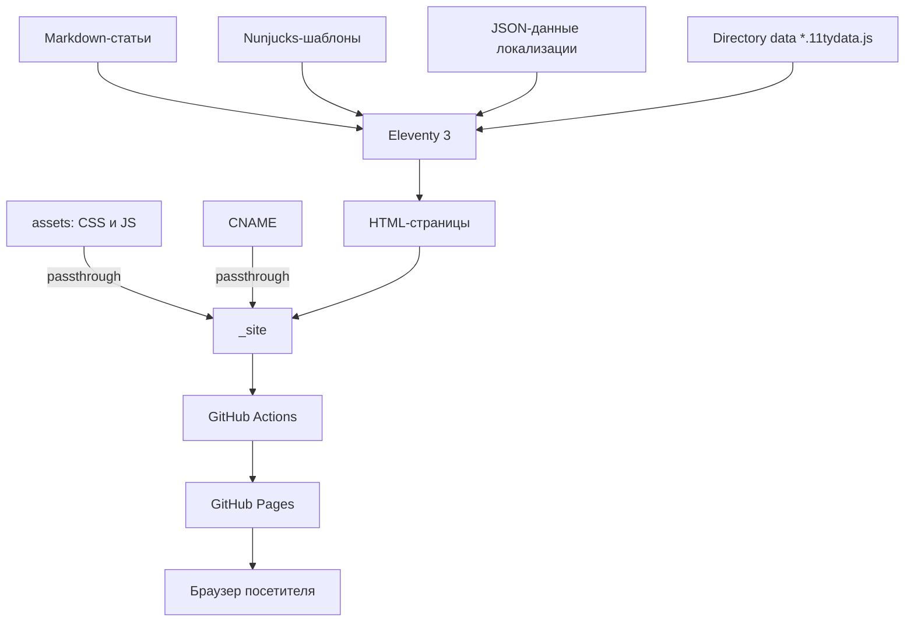
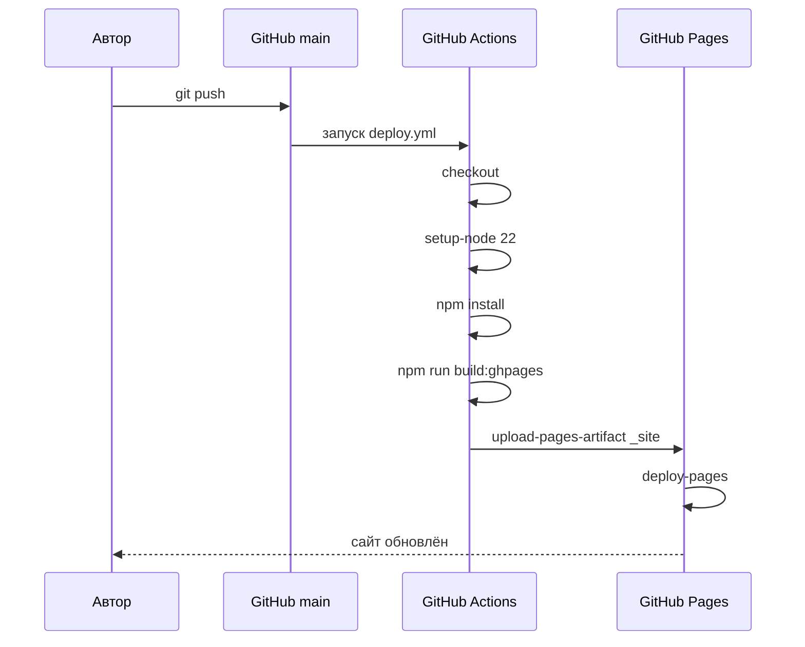

# Анализ проекта zyatnin.me

## 1. Назначение и метод анализа

Документ фиксирует фактическое состояние проекта `zyatnin.me` на момент анализа и служит исходной точкой для дальнейшей разработки. Анализ выполнен по исходному коду репозитория, конфигурации сборки, шаблонам, данным локализации и результатам реальной сборки. Все выводы, помеченные как дефект, подтверждены либо чтением исходников, либо собранным HTML в каталоге `_site`.

Метод анализа:

1. Инвентаризация файлов, маршрутов и зависимостей.
2. Чтение конфигурации Eleventy, шаблонов, JSON-данных и стилей.
3. Сборка проекта командой `npm run build` и проверка сгенерированного HTML.
4. Сопоставление фактического поведения с ожидаемым для портфолио и блога.
5. Оценка нефункциональных характеристик и рисков.

Требования, вытекающие из анализа, формализованы в [SRS](SRS.md).

## 2. Краткое резюме

`zyatnin.me` — статический персональный сайт-портфолио с блогом на трёх языках (русский, английский, иврит). Сайт собирается генератором Eleventy 3 из Markdown- и Nunjucks-шаблонов, не имеет серверной части и публикуется на GitHub Pages по пользовательскому домену `zyatnin.me`.

Сильные стороны:

- Простая и прозрачная архитектура без лишних зависимостей.
- Полноценная трёхъязычная модель с корректной разметкой `lang` и `dir`, включая RTL для иврита.
- Продуманная визуальная система на CSS-переменных с тёмной и светлой темами.
- Адаптивная вёрстка с брейкпоинтами 768 и 480 пикселей.
- Безопасная модель распространения: статический хостинг, отсутствие секретов и трекеров.
- Автоматический деплой через GitHub Actions.

Критические проблемы:

- Даты публикаций отображаются пустыми или в неверном формате.
- Мобильное меню не открывается из-за рассинхронизации имени CSS-класса.
- Мета-описание статей игнорирует поле `excerpt` и подставляет общий текст сайта.
- Часть CSS-классов в шаблонах не имеет определений, а часть определений не используется.
- Контраст акцентного цвета на светлом фоне ниже требований WCAG AA.
- Контент главной и индекса блога скрыт при отключённом JavaScript.

## 3. Идентификация проекта

| Параметр | Значение |
| --- | --- |
| Назначение | Персональное портфолио и технический блог |
| Владелец | Max Zia |
| Домен | `https://zyatnin.me` |
| Репозиторий | `github.com/maxiller/zyatnin.me` |
| Основная ветка | `main` |
| Хостинг | GitHub Pages |
| Тип приложения | Статический сайт, SSG |
| Языки интерфейса | `ru`, `en`, `he` |
| Лицензия | В репозитории не указана |
| CI/CD | GitHub Actions |

## 4. Технологический стек

| Слой | Технология | Фактическая версия | Источник |
| --- | --- | --- | --- |
| Генератор сайта | Eleventy | 3.1.7 (объявлено `^3.1.2`) | `package.json`, `npm ls` |
| Markdown | markdown-it | 14.3.3 (объявлено `^14.1.0`) | `package.json`, `npm ls` |
| Шаблонизатор | Nunjucks | Встроен в Eleventy | `.eleventy.js` |
| Локализация | EleventyI18nPlugin + JSON | Встроен в Eleventy | `.eleventy.js` |
| Стили | Чистый CSS, custom properties | 22 542 байта | `src/assets/style.css` |
| Клиентский JS | Чистый JavaScript, IIFE | 2 285 байт | `src/assets/app.js` |
| Шрифты | Google Fonts: Inter, JetBrains Mono | Внешний CDN | `src/_includes/layouts/base.njk` |
| CI | GitHub Actions | `actions/*@v4`, `@v3` | `.github/workflows/deploy.yml` |
| Runtime сборки | Node.js | 22 в CI | `.github/workflows/deploy.yml` |

Серверная часть, база данных, фреймворк и сборщик ресурсов отсутствуют. Это осознанное ограничение, соответствующее задаче статического портфолио.

## 5. Структура репозитория

```text
zyatnin.me/
├── .eleventy.js                 # конфигурация Eleventy, фильтры, коллекции
├── .github/workflows/deploy.yml # сборка и деплой на GitHub Pages
├── .gitignore                   # _site/ и package-lock.json игнорируются
├── CNAME                        # zyatnin.me
├── README.md                    # краткое описание
├── package.json                 # скрипты и зависимости
├── docs/                        # документация проекта
└── src/
    ├── index.njk                # редирект / → /ru/
    ├── _data/i18n/
    │   ├── ru.json              # строки и данные проектов (ru)
    │   ├── en.json              # строки и данные проектов (en)
    │   └── he.json              # строки и данные проектов (he)
    ├── _includes/layouts/
    │   ├── base.njk             # общий каркас, SEO, шапка, подвал
    │   ├── home.njk             # главная страница
    │   ├── blog-index.njk       # индекс блога
    │   ├── post.njk             # страница статьи
    │   └── project.njk          # страница проекта
    ├── assets/
    │   ├── app.js               # тема, меню, анимации
    │   └── style.css            # дизайн-система и адаптивность
    ├── ru/
    │   ├── ru.11tydata.js       # i18n-данные для русского сегмента
    │   ├── index.md             # /ru/
    │   ├── blog/index.md        # /ru/blog/
    │   ├── posts/*.md           # 12 статей
    │   └── projects/*.md        # 3 клиентских проекта
    ├── en/
    │   ├── en.11tydata.js
    │   ├── index.md             # /en/
    │   ├── blog/index.md        # /en/blog/
    │   ├── posts/*.md           # 12 статей
    │   └── projects/*.md        # 3 клиентских проекта
    └── he/
        ├── he.11tydata.js
        ├── index.md             # /he/
        ├── blog/index.md        # /he/blog/
        ├── posts/*.md           # 12 статей
        └── projects/*.md        # 3 клиентских проекта
```

## 6. Архитектура сборки и рантайма



Ключевые архитектурные решения:

- **Мультиязычность через структуру каталогов.** Каждый язык имеет собственный каталог `src/{lang}`. Файл `{lang}.11tydata.js` подмешивает соответствующий JSON в переменную `i18n` для всех страниц внутри каталога.
- **Отдельные коллекции для каждого языка.** В `.eleventy.js` создаются коллекции `posts_ru`, `posts_en`, `posts_he`, отсортированные по дате по убыванию.
- **Единый каркас.** Все страницы используют `layouts/base.njk`, который задаёт `lang`, `dir`, метаданные, шапку, подвал и подключает ресурсы.
- **Статическая маршрутизация через `permalink`.** Каждая статья явно задаёт URL вида `/{lang}/blog/{slug}/`.
- **Пасстхру-копирование.** Каталог `src/assets` и файл `CNAME` копируются в корень сборки без обработки.
- **CSS-переменные как дизайн-токены.** Светлая и тёмная темы реализованы через `:root` и `[data-theme="dark"]`.

## 7. Модель контента и локализация

```mermaid
flowchart LR
    LANG["Каталог языка"] --> DD["Directory data: i18n JSON"]
    LANG --> POSTS["posts/*.md"]
    DD --> LAYOUT["Шаблоны layouts"]
    POSTS --> COLL["Коллекция posts_{lang}"]
    COLL --> LAYOUT
    LAYOUT --> PAGE["HTML-страница"]
    DD --> PAGE
```

### 7.1 Front matter статьи

Обязательные поля, фактически используемые шаблонами:

| Поле | Тип | Назначение |
| --- | --- | --- |
| `layout` | строка | Всегда `layouts/post.njk` |
| `title` | строка | Заголовок статьи |
| `excerpt` | строка | Краткое описание в карточке |
| `date` | дата | Сортировка и отображение |
| `topic` | строка | Один из `t1`–`t5` |
| `slug` | строка | Идентификатор статьи, шаблонами не используется |
| `permalink` | строка | Явный URL статьи |

Поле `description` в статьях отсутствует, хотя `base.njk` пытается его использовать для мета-описания. Это приводит к подстановке общего описания сайта на всех страницах статей.

### 7.2 Топики

| Ключ | Русское название | Количество статей (ru) |
| --- | --- | --- |
| `t1` | Контейнеризация и Podman | 4 |
| `t2` | Автоматизация на Python | 3 |
| `t3` | Linux и системное администрирование | 2 |
| `t4` | DevOps и CI/CD | 2 |
| `t5` | Сети и инфраструктура | 2 |
| `t6` | Клиентский успех | 3 |

Группировка в `blog-index.njk` жёстко перечисляет шесть топиков. Добавление седьмого топика потребует правки шаблона и всех трёх JSON-файлов.

### 7.3 Данные проектов

Контент проектов хранится в файлах `src/{lang}/projects/*.md` — по аналогии со статьями. Обязательные поля front matter: `layout`, `title`, `excerpt`, `order`, `icon`, `tags`, `slug`, `permalink`; необязательные поля: `points` выводится списком в карточке и на странице проекта, `status` (`done`/`in_progress`) — эмодзи-индикатор статуса в карточке с локализованной подписью. Карточки на главной рендерятся из коллекции `projects_{lang}`, а не из языкового JSON, поэтому имя, описание и теги проекта существуют в одном экземпляре на язык. Схема front matter — в [SRS, раздел 7.1](SRS.md#71-схема-front-matter).

## 8. Поток сборки и развёртывания



Скрипты `package.json`:

| Скрипт | Команда | Назначение |
| --- | --- | --- |
| `build` | `eleventy` | Сборка в `_site` |
| `build:ghpages` | `eleventy` | Идентичен `build` |
| `start` | `eleventy --serve --port=5000` | Локальный сервер |
| `dev` | `eleventy --serve --port=5000` | Идентичен `start` |

Фактическая проверка: `npm install` установил 114 пакетов, `npm run build` собрал 43 страницы за 0,23 секунды. Сборка проходит без ошибок.

## 9. Реализованные функции (as-built)

| Функция | Состояние | Комментарий |
| --- | --- | --- |
| Редирект `/` → `/ru/` | Реализовано | `meta refresh` + JavaScript |
| Три языковые версии | Реализовано | `ru`, `en`, `he` |
| Переключатель языка | Реализовано | Замена префикса в URL |
| `hreflang` | Реализовано | Три альтернативы без `x-default` |
| Главная: hero, about, projects, latest posts | Реализовано | Проекты — из front matter `src/{lang}/projects/*.md` (три клиентских проекта), карточки ведут на страницы проектов |
| Блог: индекс с группировкой по топикам | Реализовано | Пять групп |
| Статья: заголовок, топик, дата, время чтения | Частично | Дата не отображается |
| Тёмная и светлая темы | Реализовано | Автоопределение и кнопка |
| Мобильное меню | Не работает | Несовпадение CSS-класса |
| Анимация появления секций | Реализовано | `IntersectionObserver` |
| Анимация терминала | Реализовано | Поочерёдное появление строк |
| Адаптивность | Реализовано | 768 и 480 px |
| RTL для иврита | Реализовано | Правила `[dir="rtl"]` |
| Skip-link | Реализовано | Доступность |
| SEO: title, description, OG, hreflang | Частично | Нет canonical, sitemap, robots, OG-изображения |
| 404 | Не реализовано | Файл отсутствует |
| RSS/Atom | Не реализовано | — |
| Аналитика | Не реализовано | Осознанно или нет — неизвестно |
| Тесты, линтеры | Не реализовано | — |

## 10. Качество реализации и выявленные дефекты

> **Обновление 2026-10-27.** В рамках редизайна визитки устранены дефекты Q-01…Q-06, Q-11, Q-12, Q-13, Q-16 и Q-17: даты статей форматируются через `Intl.DateTimeFormat` по языку страницы, мобильное меню открывается (классы синхронизированы), все классы шаблонов определены в CSS, палитра проверена на контраст AA (все текстовые пары ≥ 4,5:1), тема сохраняется и синхронизируется с системой без вспышки, ARIA-подписи локализованы, редирект корня определяет локаль браузера (умолчание — английский), содержимое видимо без JavaScript. Таблица ниже сохраняет состояние на момент первоначального анализа.
>
> **Обновление 2026-10-28.** Даты в карточках блога (главная и индекс) отображаются в формате ISO-недели `YYYY-Www` через фильтр `dateWeek` в `.eleventy.js` (расчёт в UTC, чтобы дата не смещалась между неделями); страница статьи сохраняет локализованный формат `dateDisplay`. Контент главной переписан под построение служб поддержки: три клиентских проекта с буллетами `points`, карточки ведут на страницы проектов `/{lang}/projects/{slug}/`. Добавлен топик `t6` «Клиентский успех» и четыре статьи на трёх языках; из ивритских статей удалён унаследованный HTML-фрагмент с пустыми карточками и ссылками `blog-N.html`.

### 10.1 Сводная таблица

| ID | Дефект | Серьёзность | Подтверждение |
| --- | --- | --- | --- |
| Q-01 | Даты статей пустые или в формате `Sun Mar 15` | Критическая | Собранный HTML |
| Q-02 | Мобильное меню не открывается | Критическая | `style.css` и `app.js` |
| Q-03 | Мета-описание статей не использует `excerpt` | Высокая | Собранный HTML |
| Q-04 | Классы `.tag`, `.tag--small` не определены | Средняя | `home.njk`, `style.css` |
| Q-05 | Класс `.blog-card__read` не стилизован | Низкая | `blog-index.njk`, `style.css` |
| Q-06 | Контраст акцентного цвета ниже WCAG AA | Высокая | Расчёт контраста |
| Q-07 | Нет canonical, sitemap, robots, 404, OG-изображения | Средняя | Собранный HTML |
| Q-08 | Нет проверки паритета ключей i18n | Высокая | Три JSON-файла |
| Q-09 | Нет lock-файла, CI использует `npm install` | Высокая | `.gitignore`, `deploy.yml` |
| Q-10 | Нет тестов, линтеров и проверки ссылок | Средняя | Репозиторий |
| Q-11 | Мёртвые CSS-классы и неиспользуемые стили | Низкая | `style.css` |
| Q-12 | Тема не сохраняется, возможна вспышка светлой темы | Средняя | `app.js` |
| Q-13 | ARIA-подписи кнопок не локализованы | Средняя | `base.njk`, `app.js` |
| Q-14 | HTML внутри Markdown-статей | Средняя | `src/*/posts/*.md` |
| Q-15 | Поле `slug` не используется шаблонами | Низкая | Поиск по репозиторию |
| Q-16 | `index.njk` без `lang` и canonical | Низкая | `src/index.njk` |
| Q-17 | Контент с классом `.fade-in` невидим без JavaScript | Высокая | `style.css`, `app.js` |

### 10.2 Q-01: даты публикаций

Фильтр `dateDisplay` в `.eleventy.js`:

```js
eleventyConfig.addFilter("dateDisplay", (dateStr) => {
  if (!dateStr) return "";
  return String(dateStr).split('T')[0].substring(0, 10);
});
```

YAML-дата `2026-03-05` разбирается как объект `Date`. Проверка через `gray-matter` подтверждает: `typeof date === "object"`, `date instanceof Date === true`. При преобразовании `Date` в строку получается `"Thu Mar 05 2026 00:00:00 GMT+0000..."`. Дальнейшее поведение зависит от дня недели:

| Дата | Результат фильтра |
| --- | --- |
| `2026-03-05` (четверг) | пустая строка |
| `2026-03-15` (воскресенье) | `Sun Mar 15` |
| `2026-02-15` (воскресенье) | `Sun Feb 15` |
| `2026-01-28` (среда) | `Wed Jan 28` |
| `2026-03-10` (вторник) | пустая строка |

В собранной статье: `article__meta"> · 2 мин. чтения`. В индексе блога часть карточек содержит `Sun Mar 15`, часть — пустой `<span></span>`. Сортировка при этом работает корректно, потому что выполняется по объектам `Date`.

Причина: фильтр рассчитан на строку ISO 8601, а получает объект `Date`. Исправление должно нормализовать дату и форматировать её с учётом языка (`Intl.DateTimeFormat`).

### 10.3 Q-02: мобильное меню

CSS определяет открытое состояние как `.mobile-menu.open` (`style.css`, строка 361). JavaScript добавляет и удаляет класс `mobile-menu--open` (`app.js`, строки 32 и 38). В результате при нажатии на гамбургер атрибут `aria-expanded` меняется, но меню остаётся `display: none`. На экранах до 768 пикселей навигация по секциям главной страницы недоступна.

### 10.4 Q-03: мета-описание статей

`base.njk` использует переменную `description`:

```njk
<meta name="description" content="{{ description }}Max Zia — IT Engineer...">
```

Статьи задают `excerpt`, а не `description`. В результате все страницы статей получают одинаковое общее описание. Это ухудшает сниппеты в поиске и социальные превью.

### 10.5 Q-04 и Q-05: рассинхронизация классов

| Класс в шаблоне | Определение в CSS | Следствие |
| --- | --- | --- |
| `tag`, `tag--small` | отсутствует | Теги навыков и проектов не оформлены |
| `blog-card__read` | стилизован `blog-card__read-more` | Ссылка «Читать далее» без акцента и стрелки |
| `section--alt` | отсутствует | Альтернативный фон секции не применяется |
| `section__cta` | отсутствует | Отступы CTA не заданы |
| `about__bio`, `about__sidebar` | отсутствуют | Сетка работает, но колонки не настроены |
| `header--scrolled` | определён | Класс никогда не добавляется |
| `tech-tag` | определён | Не используется |
| `about__stats`, `stat-card` | определены | Не используются в текущих шаблонах |

### 10.6 Q-06: контрастность

Расчёт по формуле WCAG для относительной яркости:

| Пара | Контраст | Норма 4.5:1 | Вывод |
| --- | --- | --- | --- |
| `--accent` `#0ea5e9` на `--bg` `#f5f4f0` | 2.52 | Нет | Не проходит даже 3:1 |
| `--accent` на белой карточке | 2.77 | Нет | Не проходит |
| `--accent-hover` `#0284c7` на `--bg` | 3.72 | Нет | Не проходит для обычного текста |
| `--text-secondary` `#4a4b5e` на `--bg` | 7.76 | Да | Проходит |
| `--text-muted` `#7a7b8e` на `--bg` | 3.78 | Нет | Не проходит |
| `--accent` `#38bdf8` на тёмном фоне | 7.90 | Да | Проходит |
| `--text-secondary` `#a8a8bc` на тёмном фоне | 7.25 | Да | Проходит |
| `--text-muted` `#6e6e82` на тёмном фоне | 3.40 | Нет | Не проходит |

Акцентный цвет используется для ссылок, меток топиков, кнопок и мелкого текста. На светлой теме это систематическое нарушение WCAG AA. Отдельно требует проверки белый текст на акцентной кнопке: `#ffffff` на `#0ea5e9` даёт около 3.0:1.

### 10.7 Q-07: SEO и служебные файлы

В сборке отсутствуют:

- `rel="canonical"`;
- `sitemap.xml`;
- `robots.txt`;
- `404.html`;
- `og:image` и `twitter:card`;
- структурированные данные JSON-LD;
- `x-default` в `hreflang`.

`og:url` и `hreflang` реализованы. Для статей `hreflang` формируется корректно заменой языкового сегмента.

### 10.8 Q-08: паритет локализации

Три JSON-файла (`ru.json`, `en.json`, `he.json`) поддерживаются вручную. На момент анализа паритет соблюдён: по 38 ключей в каждом файле и по 12 статей в каждом языке, длина `excerpt` составляет от 42 до 111 символов. Однако автоматической проверки нет: любое добавление ключа только в один файл приведёт к пустому тексту в соответствующем языке без ошибки сборки. Аналогично нет проверки, что у каждой статьи есть переводы во всех трёх каталогах.

### 10.9 Q-09: воспроизводимость сборки

`package-lock.json` находится в `.gitignore`, CI выполняет `npm install`, а не `npm ci`. Диапазоны версий `^3.1.2` и `^14.1.0` допускают обновление минорных версий. Сборка не воспроизводима побайтово и подвержена риску неожиданных изменений зависимостей.

### 10.10 Q-10: отсутствие контроля качества

В проекте нет:

- unit-, интеграционных или e2e-тестов;
- ESLint, Stylelint, Prettier;
- проверки внутренних ссылок;
- HTML-валидации;
- Lighthouse CI или аналогичной проверки.

### 10.11 Q-17: зависимость отображения от JavaScript

Стили задают скрытие элементов с классом `.fade-in`:

```css
.fade-in {
  opacity: 0;
  transform: translateY(20px);
}
```

Класс видимости добавляет только `app.js` через `IntersectionObserver`. Если JavaScript отключён, заблокирован или `IntersectionObserver` недоступен, секции главной страницы, карточки проектов и карточки статей блога остаются с `opacity: 0`, то есть невидимыми. Это противоречит принципу прогрессивного улучшения и ухудшает доступность и индексацию.

Исправление: по умолчанию контент должен быть видимым, а анимация должна включаться только при наличии JavaScript (например, через класс `js` на `html`) и отключаться при `prefers-reduced-motion`.

## 11. Нефункциональная оценка

| Характеристика | Оценка | Комментарий |
| --- | --- | --- |
| Производительность | Хорошая | CSS 22,5 КБ, JS 2,3 КБ, нет изображений, 43 страницы за 0,23 с |
| Доступность | Требует доработки | Skip-link и семантика есть, контраст и ARIA неполные |
| SEO | Средняя | Базовые метаданные есть, canonical и sitemap отсутствуют |
| Безопасность | Хорошая | Нет бэкенда и секретов, но нет CSP и lock-файла |
| Приватность | Хорошая | Нет трекеров и cookies; внешние шрифты Google |
| Сопровождаемость | Средняя | Простая структура, но нет тестов и документации до этого анализа |
| Совместимость | Хорошая | Современные браузеры; требуется явно указать `engines` |
| Надёжность | Средняя | Сборка проходит, но есть функциональные дефекты |
| Локализация | Средняя | Три языка и RTL, но нет валидации паритета |
| Масштабируемость контента | Средняя | Добавление статьи требует трёх файлов и ручной синхронизации |

## 12. Риски

| Риск | Вероятность | Влияние | Митигация |
| --- | --- | --- | --- |
| Расхождение переводов | Высокая | Высокое | Скрипт проверки ключей и наличия переводов |
| Регрессия дат и форматирования | Высокая | Высокое | Тесты фильтров и снимки HTML |
| Поломка мобильной навигации | Уже реализовалась | Высокое | Единый контракт классов и e2e-проверка |
| Невоспроизводимая сборка | Средняя | Высокое | Коммит lock-файла и `npm ci` |
| Ограничения GitHub Pages | Средняя | Среднее | Проверять размер и маршруты; при росте — другой хостинг |
| Недоступность Google Fonts | Низкая | Среднее | Self-hosting или `font-display` + системные fallback |
| Уязвимость цепочки поставок | Средняя | Среднее | Закрепление Actions по SHA, Dependabot, lock-файл |
| Единственный мейнтейнер | Высокая | Высокое | Документация, автоматизация, Definition of Done |
| Ухудшение доступности | Средняя | Среднее | Автоматические проверки контраста и Lighthouse CI |
| Скрытие контента без JavaScript | Средняя | Высокое | Прогрессивное улучшение и проверка с отключённым JS |
| Отсутствие аналитики | Высокая | Низкое | При необходимости — privacy-friendly аналитика |

## 13. Рекомендации по приоритетам

### P0 — исправить немедленно

1. Исправить `dateDisplay`: корректно обрабатывать `Date` и форматировать дату по языку.
2. Привести класс мобильного меню к единому имени.
3. Использовать `description or excerpt` для мета-описания статей.
4. Повысить контраст акцентного цвета и `--text-muted` до WCAG AA.
5. Добавить недостающие стили `.tag` и `.tag--small`, согласовать `blog-card__read`.
6. Сделать анимации прогрессивным улучшением, чтобы контент был видим без JavaScript.

### P1 — ближайший релиз

1. Закоммитить `package-lock.json`, перейти на `npm ci`.
2. Добавить `canonical`, `sitemap.xml`, `robots.txt`, `404.html`.
3. Добавить скрипт проверки паритета ключей i18n и наличия переводов.
4. Сохранять выбор темы и слушать изменение системной темы.
5. Локализовать ARIA-подписи.
6. Указать `engines.node` и выровнять версию Node в CI и локально.

### P2 — развитие

1. Добавить ESLint, Stylelint, Prettier и проверку ссылок.
2. Добавить `og:image`, JSON-LD и RSS.
3. Реализовать блок похожих статей.
4. Настроить Dependabot и закрепить Actions по SHA.
5. Добавить Lighthouse CI.

### P3 — по запросу

1. Поиск по блогу.
2. Страницы топиков и тегов.
3. CMS или админка.
4. Аналитика и комментарии.

## 14. Метрики проекта

| Метрика | Значение |
| --- | --- |
| Всего файлов в `src` | 78 |
| Статей | 48 (16 × 3 языка) |
| Страниц проектов | 9 (3 × 3 языка) |
| Языков | 3 |
| Топиков | 6 |
| Проектов на главной | 3 |
| Ключей i18n на язык | 38 |
| Диапазон длины `excerpt` | 42–111 символов |
| Сгенерированных HTML-страниц | 64 |
| Размер CSS | 22 542 байта |
| Размер JS | 2 285 байт |
| Размер сборки `_site` | 776 КБ |
| Время сборки | 0,23 с |
| Установленных пакетов | 114 |
| Среднее число `<h2>` в статье | 8,3 |

## 15. Ограничения анализа

- Анализ не включал проверку в реальных браузерах и на мобильных устройствах; выводы о поведении меню основаны на сопоставлении CSS и JS.
- Не проводилась проверка DNS, TLS и настроек GitHub Pages.
- Не оценивалась фактическая посещаемость и SEO-позиции из-за отсутствия аналитики.
- Не проверялась юридическая сторона использования шрифтов и контента.
- Оценка контраста выполнена для значений дизайн-токенов, а не для всех возможных комбинаций прозрачности и наложения.
- Локальная версия Node (26.9.0) отличается от версии в CI (22); сборка проверена локально.

## 16. Выводы

Проект находится в хорошем состоянии для статического портфолио: архитектура простая, сборка быстрая, локализация и RTL реализованы осознанно. При этом обнаружены дефекты, которые напрямую влияют на доверие к контенту и удобство мобильных посетителей: пустые даты, неработающее мобильное меню и нерелевантные мета-описания. Их следует устранить до добавления новых функций.

Обновление 2026-10-27: дефекты этапа P0 устранены в рамках редизайна (см. раздел 10), остаются Q-07 (частично — добавлены canonical и `x-default`), Q-08–Q-10, Q-14 и Q-15.

Обновление 2026-10-28: сайт переработан в два вида по требованию владельца — «Лидер поддержки» (`/{lang}/…`, светлая офисная схема, `style.css`) и «Разработчик» (`/{lang}/dev/…`, тёмная консольная схема в стиле IDE, новый `dev.css`). Кнопка темы и тёмная тема «Лидера» удалены (FR-44–FR-47 переписаны, SRS 1.7): цветовая схема закреплена за видом. Контент разделён по полю `view` front matter; записи без контента для выбранного вида не выводятся. 12 технических статей (3 языка) перемещены в вид «Разработчика» со сменой URL; на старых адресах сгенерированы редирект-заглушки. Заодно исправлен унаследованный дефект вёрстки статей: глубокие отступы и пустые строки внутри HTML-блоков кода приводили к разрыву `<pre>` и некорректной вложенности тегов — исходники приведены к markdown-корректному виду, собранный HTML всех страниц структурно валиден. Таблицы метрик выше сохраняют состояние на момент первоначального анализа; актуальные значения: 106 HTML-страниц (64 прежних + 6 страниц вида + 36 заглушек), два CSS-файла.

Обновление 2026-10-30: создана SEO-инфраструктура: `sitemap.xml` и `robots.txt` генерируются при сборке из коллекций Eleventy (все индексируемые страницы обоих видов и трёх языков; `noindex`-заглушки, корневой редирект и 404 в sitemap не попадают), добавлены `404.html` с навигацией по всем разделам, Atom-ленты для каждой пары «язык × вид» (`/{lang}/feed.xml`, `/{lang}/dev/feed.xml`), JSON-LD `Article` на статьях обоих видов, `og:image` 1200×630 и `twitter:card`. Требование FR-117 закрепляет правило «SEO обновляется вместе с контентом»: артефакты строятся из того же источника, что и страницы, а `npm run build` падает при расхождении (`scripts/check-seo.js` проверяет sitemap, robots, ленты, JSON-LD, уникальность `title`/`description`, `og:image` и все внутренние ссылки).

Дальнейшая разработка должна опираться на формализованные требования в [SRS](SRS.md), особенно на разделы [функциональных требований](SRS.md#32-функциональные-требования), [нефункциональных требований](SRS.md#33-нефункциональные-требования) и [критериев приёмки](SRS.md#4-критерии-приёмки-и-верификация).
