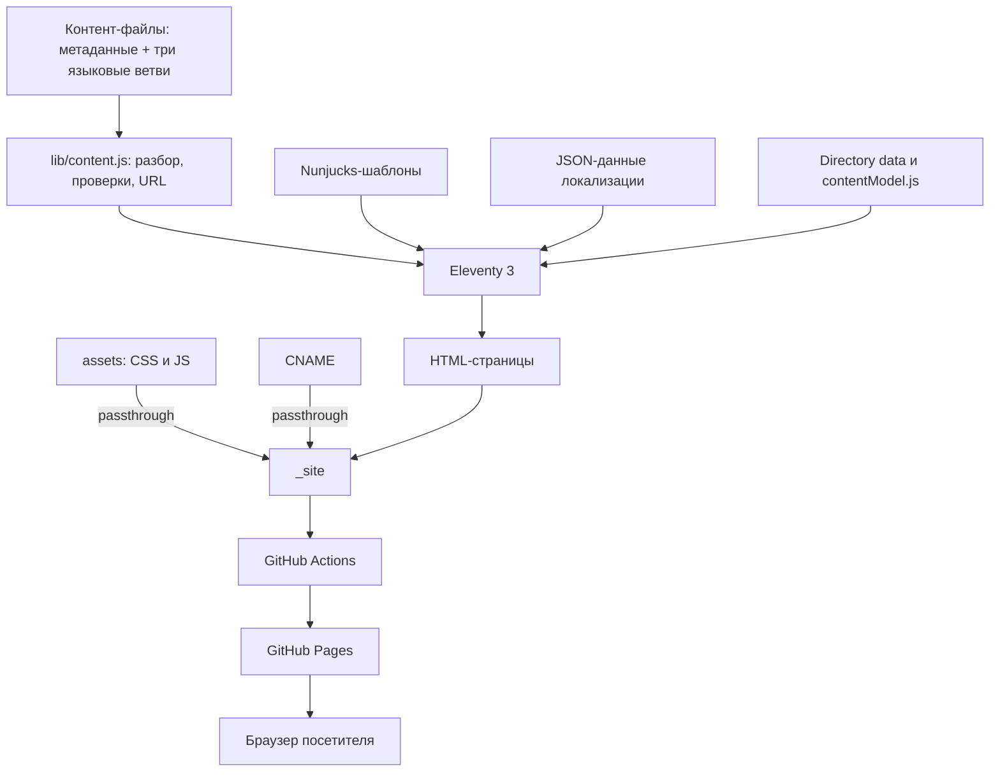
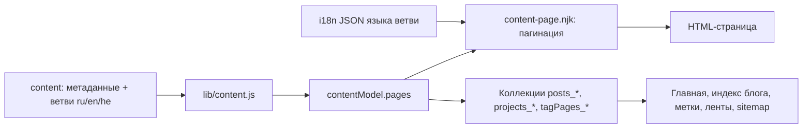
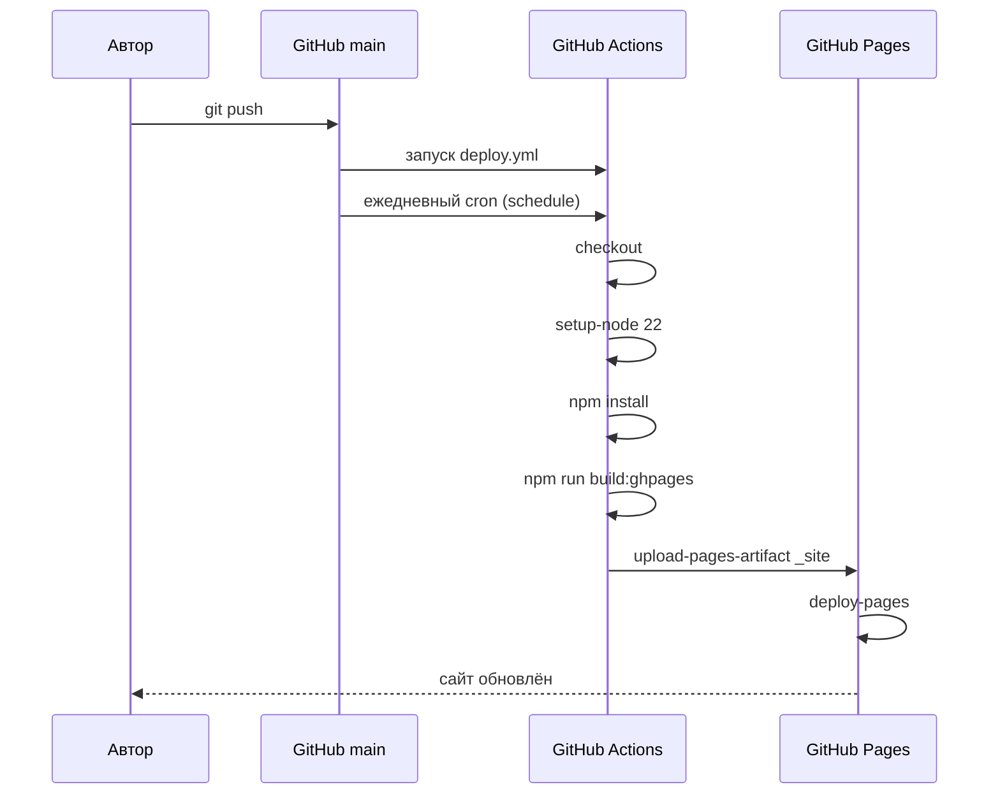

# Анализ проекта zyatnin.me

## 1. Назначение и метод анализа

Документ фиксирует фактическое состояние проекта `zyatnin.me` на момент анализа и служит исходной точкой для дальнейшей разработки. Анализ выполнен по исходному коду репозитория, конфигурации сборки, шаблонам, данным локализации и результатам реальной сборки. Все выводы, помеченные как дефект, подтверждены либо чтением исходников, либо собранным HTML в каталоге `_site`.

Метод анализа:

1. Инвентаризация файлов, маршрутов и зависимостей.
2. Чтение конфигурации Eleventy, шаблонов, JSON-данных и стилей.
3. Сборка проекта командой `npm run build` и проверка сгенерированного HTML.
4. Сопоставление фактического поведения с ожидаемым для портфолио и блога.
5. Оценка нефункциональных характеристик и рисков.

Требования, вытекающие из анализа, формализованы в [SRS](SRS.md).

## 2. Краткое резюме

`zyatnin.me` — статический персональный сайт-портфолио с блогом на трёх языках (русский, английский, иврит). Сайт собирается генератором Eleventy 3 из Markdown- и Nunjucks-шаблонов, не имеет серверной части и публикуется на GitHub Pages по пользовательскому домену `zyatnin.me`.

Сильные стороны:

- Простая и прозрачная архитектура без лишних зависимостей.
- Полноценная трёхъязычная модель с корректной разметкой `lang` и `dir`, включая RTL для иврита.
- Продуманная визуальная система на CSS-переменных с тёмной и светлой темами.
- Адаптивная вёрстка с брейкпоинтами 768 и 480 пикселей.
- Безопасная модель распространения: статический хостинг, отсутствие секретов и трекеров.
- Автоматический деплой через GitHub Actions.

Критические проблемы:

- Даты публикаций отображаются пустыми или в неверном формате.
- Мобильное меню не открывается из-за рассинхронизации имени CSS-класса.
- Мета-описание статей игнорирует поле `excerpt` и подставляет общий текст сайта.
- Часть CSS-классов в шаблонах не имеет определений, а часть определений не используется.
- Контраст акцентного цвета на светлом фоне ниже требований WCAG AA.
- Контент главной и индекса блога скрыт при отключённом JavaScript.

## 3. Идентификация проекта

| Параметр | Значение |
| --- | --- |
| Назначение | Персональное портфолио и технический блог |
| Владелец | Max Zia |
| Домен | `https://zyatnin.me` |
| Репозиторий | `github.com/maxiller/zyatnin.me` |
| Основная ветка | `main` |
| Хостинг | GitHub Pages |
| Тип приложения | Статический сайт, SSG |
| Языки интерфейса | `ru`, `en`, `he` |
| Лицензия | В репозитории не указана |
| CI/CD | GitHub Actions |

## 4. Технологический стек

| Слой | Технология | Фактическая версия | Источник |
| --- | --- | --- | --- |
| Генератор сайта | Eleventy | 3.1.7 (объявлено `^3.1.2`) | `package.json`, `npm ls` |
| Markdown | markdown-it | 14.3.3 (объявлено `^14.1.0`) | `package.json`, `npm ls` |
| Шаблонизатор | Nunjucks | Встроен в Eleventy | `.eleventy.js` |
| Локализация | EleventyI18nPlugin + JSON | Встроен в Eleventy | `.eleventy.js` |
| Стили | Чистый CSS, custom properties | 22 542 байта | `src/assets/style.css` |
| Клиентский JS | Чистый JavaScript, IIFE | 2 285 байт | `src/assets/app.js` |
| Шрифты | Google Fonts: Inter, JetBrains Mono | Внешний CDN | `src/_includes/layouts/base.njk` |
| CI | GitHub Actions | `actions/*@v4`, `@v3` | `.github/workflows/deploy.yml` |
| Runtime сборки | Node.js | 22 в CI | `.github/workflows/deploy.yml` |

Серверная часть, база данных, фреймворк и сборщик ресурсов отсутствуют. Это осознанное ограничение, соответствующее задаче статического портфолио.

## 5. Структура репозитория

```text
zyatnin.me/
├── .eleventy.js                 # конфигурация Eleventy, фильтры, коллекции
├── .github/workflows/deploy.yml # сборка и деплой на GitHub Pages
├── .gitignore                   # _site/ и package-lock.json игнорируются
├── content/
│   ├── posts/*.md               # 54 статьи: метаданные + три языковые ветви
│   └── projects/*.md            # 3 проекта в том же формате
├── lib/
│   ├── content.js               # модель контента: разбор, проверки, URL, публикация
│   ├── markdown.js              # общий markdown-it для шаблонов и контента
│   └── published.js             # правило публикации по дате
├── CNAME                        # zyatnin.me
├── README.md                    # краткое описание
├── package.json                 # скрипты и зависимости
├── docs/                        # документация проекта
└── src/
    ├── index.njk                # редирект / → /ru/
    ├── content-page.njk         # страница контента: пагинация по contentModel.pages
    ├── content-page.11tydata.js # данные страницы из выбранной языковой ветви
    ├── sitemap.njk, feed.njk, robots.txt.njk, redirects.njk, 404.njk
    ├── _data/
    │   ├── contentModel.js      # модель контента как глобальные данные Eleventy
    │   ├── feeds.js             # шесть Atom-лент (язык × вид)
    │   ├── redirects.js         # заглушки на старых URL перемещённых статей
    │   ├── site.json            # языконезависимые данные сайта
    │   └── i18n/{ru,en,he}.json # строки интерфейса по ветвям вида
    ├── _includes/layouts/       # base, home, blog-index, post, project, tag-index и dev/*
    ├── assets/                  # app.js, style.css, dev.css, og-image.png
    └── ru/, en/, he/            # главные, индексы блога, страницы меток, {lang}.11tydata.js
```

## 6. Архитектура сборки и рантайма



Ключевые архитектурные решения:

- **Одна страница — один файл.** Метаданные страницы пишутся во front matter один раз, переводимые сущности — в кусте `translations` и в трёх разделах тела с маркерами `<!-- lang:xx -->`. Из одного файла генерируются страницы всех трёх языков, поэтому общее поле (статус проекта, метки, дата публикации) нельзя рассинхронизировать между языками.
- **Модель контента в одном модуле.** `lib/content.js` разбирает файлы, проверяет их (неизвестные поля, отсутствие или дубль языковой ветви, `slug` ≠ имя файла, словарь меток, длина `excerpt`, дубли `order`), применяет правило публикации из `lib/published.js` и выводит URL каждой страницы. Ошибка останавливает сборку до Eleventy (через `scripts/check-content.js`).
- **Страницы генерируются, а не лежат файлами.** `src/content-page.njk` пагинирует по `contentModel.pages` (`src/_data/contentModel.js`), а `src/content-page.11tydata.js` раскладывает выбранную языковую ветвь в обычные данные страницы — макеты (`layouts/post.njk`, `layouts/project.njk` и их dev-версии) не знают, что страница собрана из контент-файла.
- **Мультиязычность через структуру каталогов шаблонов.** Языковые главные, индексы блога и страницы меток лежат в `src/{lang}`; файл `{lang}.11tydata.js` подмешивает соответствующий JSON в переменную `i18n` для страниц этого каталога; сгенерированные страницы получают `i18n` своей ветви из `content-page.11tydata.js`.
- **Отдельные коллекции для каждого языка.** `posts_{lang}`, `projects_{lang}` и `tagPages_{lang}_{view}` собираются из модели и отдают шаблонам тот же набор полей, что раньше отдавали файлы-страницы.
- **Единый каркас.** Все страницы используют `layouts/base.njk` (вид «Лидер») или `layouts/dev/base.njk` (вид «Инженер»), которые задают `lang`, `dir`, метаданные, шапку, подвал и подключают ресурсы.
- **Маршрутизация без полей в контенте.** URL страницы выводится из `view` и `slug`; полей `permalink` и `layout` в контент-файлах нет, поэтому URL не может разойтись с содержимым.
- **Пасстхру-копирование.** Каталог `src/assets` и файл `CNAME` копируются в корень сборки без обработки.
- **CSS-переменные как дизайн-токены.** Светлая и тёмная темы закреплены за видами и реализованы через `:root` в `style.css` и `dev.css`.

## 7. Модель контента и локализация



### 7.1 Контент-файл страницы

Страница существует в одном экземпляре — файле `content/posts/<slug>.md` или `content/projects/<slug>.md`. Front matter содержит только метаданные, одинаковые для всех языков:

| Поле | Тип | Назначение |
| --- | --- | --- |
| `slug` | строка | Имя файла; вместе с `view` задаёт URL |
| `view` | строка | `leader` или `dev` — вид, в котором видна страница; задаёт также макет |
| `date` | дата | Только пост: сортировка, отображение и дата публикации; будущая дата — отложенная публикация |
| `tags` | массив | Только пост: от одной до трёх меток из словаря `tags.names`; ключи общие для всех языков и ведут на страницы меток `/{lang}/tags/{tag}/` и `/{lang}/dev/tags/{tag}/` |
| `order`, `icon`, `status` | число, строка, строка | Только проект: позиция карточки, эмодзи, статус `done`/`in_progress` |
| `draft`, `updated` | boolean, дата | Необязательные: черновик и дата обновления |

Переводимые сущности лежат в кусте `translations.ru` / `.en` / `.he` (для поста — `title`, `excerpt`, необязательные `description`, `cover`; для проекта — `title`, `excerpt`, `tags`, необязательные `points`), а тело страницы — три раздела Markdown, открывающихся маркерами `<!-- lang:ru -->`, `<!-- lang:en -->`, `<!-- lang:he -->`. Полная схема с примерами — в [SRS, раздел 7.1](SRS.md#71-контент-файл-страницы).

> **Обновление 2026-11-12.** До 1.18 страница существовала тремя файлами (`src/{lang}/posts/<slug>.md`), и общее поле приходилось править трижды: статус проекта, метки и дату публикации держали в трёх копиях, между которыми не было автоматической сверки. Теперь 162 файла статей и 9 файлов проектов сведены к 54 и 3 файлам, а поля `layout` и `permalink` из контента удалены — они выводятся из `view` и `slug`. Проверку модели выполняет `lib/content.js`, страницы генерирует `src/content-page.njk`.

### 7.2 Метки

Категории-топики удалены: тематику статьи выражают метки в поле `tags` метаданных (от одной до трёх), поэтому они одинаковы во всех трёх языках статьи по построению, а не по договорённости. Подписи меток лежат в `tags.names` языковых JSON и переведены на все три языка; ключи — латиница вида `[a-z0-9-]+`. Для каждой тройки «язык × вид × встреченная метка» при сборке генерируется страница метки со списком статей (`lib/content.js`, коллекции `tagPages_{lang}_{view}`), поэтому метка всегда кликабельна и не ведёт на несуществующий адрес. Сборка падает, если у статьи не 1–3 метки или ключа нет в словаре.

### 7.3 Данные проектов

Контент проектов хранится в `content/projects/*.md` в том же формате, что и статьи. Метаданные: `slug`, `view`, `order`, `icon`, необязательный `status` (`done`/`in_progress`). Переводимые поля каждой ветви: `title`, `excerpt`, `tags` (отображаемые подписи технологий, а не ключи словаря меток) и необязательный `points` — ключевые результаты, которые выводятся списком в карточке и на странице. Карточки на главной рендерятся из коллекции `projects_{lang}` и сортируются по `order`, поэтому имя, описание и теги проекта существуют в одном экземпляре на страницу, а не на язык. Схема — в [SRS, раздел 7.1](SRS.md#71-контент-файл-страницы).

## 8. Поток сборки и развёртывания



Скрипты `package.json`:

| Скрипт | Команда | Назначение |
| --- | --- | --- |
| `build` | `check-content.js && clean.js && eleventy && check-seo.js` | Сборка в чистый `_site` с проверками |
| `build:ghpages` | то же | Используется в CI |
| `clean` | `node scripts/clean.js` | Удаляет `_site` |
| `start` | `eleventy --serve --port=5000` | Локальный сервер (предпросмотр; пишет `[preview]`) |
| `dev` | `eleventy --serve --port=5000` | Идентичен `start` |

> **Обновление 2026-11-12.** Сборка начинается с очистки `_site` (`scripts/clean.js`, SRS FR-90): Eleventy не удаляет файлы, которых больше нет в сборке, а предпросмотр (`--serve`) пишет в тот же каталог отложенные статьи и черновики. До этого любой `npm start` оставлял в `_site` 66 лишних страниц, и следующий `npm run build` падал на самопроверке SEO. Отдельно режим предпросмотра теперь называет себя строкой `[preview]` в логе (FR-91).

> **Обновление 2026-11-09.** В потоке появились два новых шага: сайт пересобирается также по расписанию (`schedule: cron: 0 3 * * *` в `deploy.yml`, SRS FR-124) — без этого отложенные статьи не появились бы никогда, а в самой сборке директива `eleventyComputed` из `src/{lang}/posts/posts.11tydata.js` решает, что из `src/{lang}/posts/*.md` писать в `_site` и что отдавать в коллекции (FR-123). Запуск через `--serve` и переменная `INCLUDE_FUTURE=1` обходят шлюз для предпросмотра; с 1.18 шлюз живёт в `lib/content.js` и срабатывает при чтении контент-файла.

Фактическая проверка: `npm install` установил 114 пакетов, `npm run build` собирает 232 файла (224 HTML-страницы) за 0,42 секунды вместе с тремя проверками. Сборка проходит без ошибок.

## 9. Реализованные функции (as-built)

| Функция | Состояние | Комментарий |
| --- | --- | --- |
| Редирект `/` → `/ru/` | Реализовано | `meta refresh` + JavaScript |
| Три языковые версии | Реализовано | `ru`, `en`, `he` |
| Переключатель языка | Реализовано | Замена префикса в URL |
| `hreflang` | Реализовано | Три альтернативы без `x-default` |
| Главная: hero, about, projects, latest posts | Реализовано | Проекты — из front matter `src/{lang}/projects/*.md` (три клиентских проекта), карточки ведут на страницы проектов |
| Блог: индекс единым списком по дате | Реализовано | Без группировки; над списком панель меток |
| Отложенная публикация и черновики | Реализовано | Статья с будущей `date` и `draft: true` не собираются (`lib/published.js`) |
| Статья: заголовок, метки, дата, время чтения | Реализовано | Метки — ссылки на страницы меток |
| Тёмная и светлая темы | Реализовано | Автоопределение и кнопка |
| Мобильное меню | Не работает | Несовпадение CSS-класса |
| Анимация появления секций | Реализовано | `IntersectionObserver` |
| Анимация терминала | Реализовано | Поочерёдное появление строк |
| Адаптивность | Реализовано | 768 и 480 px |
| RTL для иврита | Реализовано | Правила `[dir="rtl"]` |
| Skip-link | Реализовано | Доступность |
| SEO: title, description, OG, hreflang | Частично | Нет canonical, sitemap, robots, OG-изображения |
| 404 | Не реализовано | Файл отсутствует |
| RSS/Atom | Не реализовано | — |
| Аналитика | Не реализовано | Осознанно или нет — неизвестно |
| Тесты, линтеры | Не реализовано | — |

## 10. Качество реализации и выявленные дефекты

> **Обновление 2026-10-27.** В рамках редизайна визитки устранены дефекты Q-01…Q-06, Q-11, Q-12, Q-13, Q-16 и Q-17: даты статей форматируются через `Intl.DateTimeFormat` по языку страницы, мобильное меню открывается (классы синхронизированы), все классы шаблонов определены в CSS, палитра проверена на контраст AA (все текстовые пары ≥ 4,5:1), тема сохраняется и синхронизируется с системой без вспышки, ARIA-подписи локализованы, редирект корня определяет локаль браузера (умолчание — английский), содержимое видимо без JavaScript. Таблица ниже сохраняет состояние на момент первоначального анализа.
>
> **Обновление 2026-10-28.** Даты в карточках блога (главная и индекс) отображаются в формате ISO-недели `YYYY-Www` через фильтр `dateWeek` в `.eleventy.js` (расчёт в UTC, чтобы дата не смещалась между неделями); страница статьи сохраняет локализованный формат `dateDisplay`. Контент главной переписан под построение служб поддержки: три клиентских проекта с буллетами `points`, карточки ведут на страницы проектов `/{lang}/projects/{slug}/`. Добавлен топик `t6` «Клиентский успех» и четыре статьи на трёх языках; из ивритских статей удалён унаследованный HTML-фрагмент с пустыми карточками и ссылками `blog-N.html`.

### 10.1 Сводная таблица

| ID | Дефект | Серьёзность | Подтверждение |
| --- | --- | --- | --- |
| Q-01 | Даты статей пустые или в формате `Sun Mar 15` | Критическая | Собранный HTML |
| Q-02 | Мобильное меню не открывается | Критическая | `style.css` и `app.js` |
| Q-03 | Мета-описание статей не использует `excerpt` | Высокая | Собранный HTML |
| Q-04 | Классы `.tag`, `.tag--small` не определены | Средняя | `home.njk`, `style.css` |
| Q-05 | Класс `.blog-card__read` не стилизован | Низкая | `blog-index.njk`, `style.css` |
| Q-06 | Контраст акцентного цвета ниже WCAG AA | Высокая | Расчёт контраста |
| Q-07 | Нет canonical, sitemap, robots, 404, OG-изображения | Средняя | Собранный HTML |
| Q-08 | Нет проверки паритета ключей i18n | Высокая | Три JSON-файла |
| Q-09 | Нет lock-файла, CI использует `npm install` | Высокая | `.gitignore`, `deploy.yml` |
| Q-10 | Нет тестов, линтеров и проверки ссылок | Средняя | Репозиторий |
| Q-11 | Мёртвые CSS-классы и неиспользуемые стили | Низкая | `style.css` |
| Q-12 | Тема не сохраняется, возможна вспышка светлой темы | Средняя | `app.js` |
| Q-13 | ARIA-подписи кнопок не локализованы | Средняя | `base.njk`, `app.js` |
| Q-14 | HTML внутри Markdown-статей | Средняя | `src/*/posts/*.md` |
| Q-15 | Поле `slug` не используется шаблонами | Низкая | Поиск по репозиторию |
| Q-16 | `index.njk` без `lang` и canonical | Низкая | `src/index.njk` |
| Q-17 | Контент с классом `.fade-in` невидим без JavaScript | Высокая | `style.css`, `app.js` |

### 10.2 Q-01: даты публикаций

Фильтр `dateDisplay` в `.eleventy.js`:

```js
eleventyConfig.addFilter("dateDisplay", (dateStr) => {
  if (!dateStr) return "";
  return String(dateStr).split('T')[0].substring(0, 10);
});
```

YAML-дата `2026-03-05` разбирается как объект `Date`. Проверка через `gray-matter` подтверждает: `typeof date === "object"`, `date instanceof Date === true`. При преобразовании `Date` в строку получается `"Thu Mar 05 2026 00:00:00 GMT+0000..."`. Дальнейшее поведение зависит от дня недели:

| Дата | Результат фильтра |
| --- | --- |
| `2026-03-05` (четверг) | пустая строка |
| `2026-03-15` (воскресенье) | `Sun Mar 15` |
| `2026-02-15` (воскресенье) | `Sun Feb 15` |
| `2026-01-28` (среда) | `Wed Jan 28` |
| `2026-03-10` (вторник) | пустая строка |

В собранной статье: `article__meta"> · 2 мин. чтения`. В индексе блога часть карточек содержит `Sun Mar 15`, часть — пустой `<span></span>`. Сортировка при этом работает корректно, потому что выполняется по объектам `Date`.

Причина: фильтр рассчитан на строку ISO 8601, а получает объект `Date`. Исправление должно нормализовать дату и форматировать её с учётом языка (`Intl.DateTimeFormat`).

### 10.3 Q-02: мобильное меню

CSS определяет открытое состояние как `.mobile-menu.open` (`style.css`, строка 361). JavaScript добавляет и удаляет класс `mobile-menu--open` (`app.js`, строки 32 и 38). В результате при нажатии на гамбургер атрибут `aria-expanded` меняется, но меню остаётся `display: none`. На экранах до 768 пикселей навигация по секциям главной страницы недоступна.

### 10.4 Q-03: мета-описание статей

`base.njk` использует переменную `description`:

```njk
<meta name="description" content="{{ description }}Max Zia — IT Engineer...">
```

Статьи задают `excerpt`, а не `description`. В результате все страницы статей получают одинаковое общее описание. Это ухудшает сниппеты в поиске и социальные превью.

### 10.5 Q-04 и Q-05: рассинхронизация классов

| Класс в шаблоне | Определение в CSS | Следствие |
| --- | --- | --- |
| `tag`, `tag--small` | отсутствует | Теги навыков и проектов не оформлены |
| `blog-card__read` | стилизован `blog-card__read-more` | Ссылка «Читать далее» без акцента и стрелки |
| `section--alt` | отсутствует | Альтернативный фон секции не применяется |
| `section__cta` | отсутствует | Отступы CTA не заданы |
| `about__bio`, `about__sidebar` | отсутствуют | Сетка работает, но колонки не настроены |
| `header--scrolled` | определён | Класс никогда не добавляется |
| `tech-tag` | определён | Не используется |
| `about__stats`, `stat-card` | определены | Не используются в текущих шаблонах |

### 10.6 Q-06: контрастность

Расчёт по формуле WCAG для относительной яркости:

| Пара | Контраст | Норма 4.5:1 | Вывод |
| --- | --- | --- | --- |
| `--accent` `#0ea5e9` на `--bg` `#f5f4f0` | 2.52 | Нет | Не проходит даже 3:1 |
| `--accent` на белой карточке | 2.77 | Нет | Не проходит |
| `--accent-hover` `#0284c7` на `--bg` | 3.72 | Нет | Не проходит для обычного текста |
| `--text-secondary` `#4a4b5e` на `--bg` | 7.76 | Да | Проходит |
| `--text-muted` `#7a7b8e` на `--bg` | 3.78 | Нет | Не проходит |
| `--accent` `#38bdf8` на тёмном фоне | 7.90 | Да | Проходит |
| `--text-secondary` `#a8a8bc` на тёмном фоне | 7.25 | Да | Проходит |
| `--text-muted` `#6e6e82` на тёмном фоне | 3.40 | Нет | Не проходит |

Акцентный цвет используется для ссылок, меток, кнопок и мелкого текста. На светлой теме это систематическое нарушение WCAG AA. Отдельно требует проверки белый текст на акцентной кнопке: `#ffffff` на `#0ea5e9` даёт около 3.0:1.

### 10.7 Q-07: SEO и служебные файлы

В сборке отсутствуют:

- `rel="canonical"`;
- `sitemap.xml`;
- `robots.txt`;
- `404.html`;
- `og:image` и `twitter:card`;
- структурированные данные JSON-LD;
- `x-default` в `hreflang`.

`og:url` и `hreflang` реализованы. Для статей `hreflang` формируется корректно заменой языкового сегмента.

### 10.8 Q-08: паритет локализации

Три JSON-файла (`ru.json`, `en.json`, `he.json`) поддерживаются вручную. На момент анализа паритет соблюдён: по 38 ключей в каждом файле и по 12 статей в каждом языке, длина `excerpt` составляет от 42 до 111 символов. Однако автоматической проверки нет: любое добавление ключа только в один файл приведёт к пустому тексту в соответствующем языке без ошибки сборки. Аналогично нет проверки, что у каждой статьи есть переводы во всех трёх каталогах.

### 10.9 Q-09: воспроизводимость сборки

`package-lock.json` находится в `.gitignore`, CI выполняет `npm install`, а не `npm ci`. Диапазоны версий `^3.1.2` и `^14.1.0` допускают обновление минорных версий. Сборка не воспроизводима побайтово и подвержена риску неожиданных изменений зависимостей.

### 10.10 Q-10: отсутствие контроля качества

В проекте нет:

- unit-, интеграционных или e2e-тестов;
- ESLint, Stylelint, Prettier;
- проверки внутренних ссылок;
- HTML-валидации;
- Lighthouse CI или аналогичной проверки.

### 10.11 Q-17: зависимость отображения от JavaScript

Стили задают скрытие элементов с классом `.fade-in`:

```css
.fade-in {
  opacity: 0;
  transform: translateY(20px);
}
```

Класс видимости добавляет только `app.js` через `IntersectionObserver`. Если JavaScript отключён, заблокирован или `IntersectionObserver` недоступен, секции главной страницы, карточки проектов и карточки статей блога остаются с `opacity: 0`, то есть невидимыми. Это противоречит принципу прогрессивного улучшения и ухудшает доступность и индексацию.

Исправление: по умолчанию контент должен быть видимым, а анимация должна включаться только при наличии JavaScript (например, через класс `js` на `html`) и отключаться при `prefers-reduced-motion`.

## 11. Нефункциональная оценка

| Характеристика | Оценка | Комментарий |
| --- | --- | --- |
| Производительность | Хорошая | CSS 22,5 КБ, JS 2,3 КБ, нет изображений, 43 страницы за 0,23 с |
| Доступность | Требует доработки | Skip-link и семантика есть, контраст и ARIA неполные |
| SEO | Средняя | Базовые метаданные есть, canonical и sitemap отсутствуют |
| Безопасность | Хорошая | Нет бэкенда и секретов, но нет CSP и lock-файла |
| Приватность | Хорошая | Нет трекеров и cookies; внешние шрифты Google |
| Сопровождаемость | Средняя | Простая структура, но нет тестов и документации до этого анализа |
| Совместимость | Хорошая | Современные браузеры; требуется явно указать `engines` |
| Надёжность | Средняя | Сборка проходит, но есть функциональные дефекты |
| Локализация | Средняя | Три языка и RTL, но нет валидации паритета |
| Масштабируемость контента | Средняя | Добавление статьи требует трёх файлов и ручной синхронизации |

## 12. Риски

| Риск | Вероятность | Влияние | Митигация |
| --- | --- | --- | --- |
| Расхождение переводов | Высокая | Высокое | Скрипт проверки ключей и наличия переводов |
| Регрессия дат и форматирования | Высокая | Высокое | Тесты фильтров и снимки HTML |
| Поломка мобильной навигации | Уже реализовалась | Высокое | Единый контракт классов и e2e-проверка |
| Невоспроизводимая сборка | Средняя | Высокое | Коммит lock-файла и `npm ci` |
| Ограничения GitHub Pages | Средняя | Среднее | Проверять размер и маршруты; при росте — другой хостинг |
| Недоступность Google Fonts | Низкая | Среднее | Self-hosting или `font-display` + системные fallback |
| Уязвимость цепочки поставок | Средняя | Среднее | Закрепление Actions по SHA, Dependabot, lock-файл |
| Единственный мейнтейнер | Высокая | Высокое | Документация, автоматизация, Definition of Done |
| Ухудшение доступности | Средняя | Среднее | Автоматические проверки контраста и Lighthouse CI |
| Скрытие контента без JavaScript | Средняя | Высокое | Прогрессивное улучшение и проверка с отключённым JS |
| Отсутствие аналитики | Высокая | Низкое | При необходимости — privacy-friendly аналитика |

## 13. Рекомендации по приоритетам

### P0 — исправить немедленно

1. Исправить `dateDisplay`: корректно обрабатывать `Date` и форматировать дату по языку.
2. Привести класс мобильного меню к единому имени.
3. Использовать `description or excerpt` для мета-описания статей.
4. Повысить контраст акцентного цвета и `--text-muted` до WCAG AA.
5. Добавить недостающие стили `.tag` и `.tag--small`, согласовать `blog-card__read`.
6. Сделать анимации прогрессивным улучшением, чтобы контент был видим без JavaScript.

### P1 — ближайший релиз

1. Закоммитить `package-lock.json`, перейти на `npm ci`.
2. Добавить `canonical`, `sitemap.xml`, `robots.txt`, `404.html`.
3. Добавить скрипт проверки паритета ключей i18n и наличия переводов.
4. Сохранять выбор темы и слушать изменение системной темы.
5. Локализовать ARIA-подписи.
6. Указать `engines.node` и выровнять версию Node в CI и локально.

### P2 — развитие

1. Добавить ESLint, Stylelint, Prettier и проверку ссылок.
2. Добавить `og:image`, JSON-LD и RSS.
3. Реализовать блок похожих статей.
4. Настроить Dependabot и закрепить Actions по SHA.
5. Добавить Lighthouse CI.

### P3 — по запросу

1. Поиск по блогу.
2. CMS или админка.
3. Аналитика и комментарии.

## 14. Метрики проекта

| Метрика | Значение |
| --- | --- |
| Всего файлов в `src` | 56 |
| Контент-файлов | 57 (54 статьи + 3 проекта) |
| Статей | 32 опубликовано из 54 (остальные — отложенные); 96 страниц (32 × 3 языка) |
| Страниц проектов | 9 (3 × 3 языка) |
| Языков | 3 |
| Меток в словаре | 22 |
| Проектов на главной | 3 |
| Ключей i18n на язык | 88 (корень + ветви `leader` и `dev`) |
| Диапазон длины `excerpt` | 42–180 символов |
| Сгенерированных HTML-страниц | 224 |
| Размер CSS | 22 542 байта |
| Размер JS | 2 285 байт |
| Размер сборки `_site` | 3,8 МБ |
| Время сборки | 0,43 с (Eleventy), около 1 с с проверками |
| Установленных пакетов | 114 |
| Среднее число `<h2>` в статье | 8,3 |

## 15. Ограничения анализа

- Анализ не включал проверку в реальных браузерах и на мобильных устройствах; выводы о поведении меню основаны на сопоставлении CSS и JS.
- Не проводилась проверка DNS, TLS и настроек GitHub Pages.
- Не оценивалась фактическая посещаемость и SEO-позиции из-за отсутствия аналитики.
- Не проверялась юридическая сторона использования шрифтов и контента.
- Оценка контраста выполнена для значений дизайн-токенов, а не для всех возможных комбинаций прозрачности и наложения.
- Локальная версия Node (26.9.0) отличается от версии в CI (22); сборка проверена локально.

## 16. Выводы

Проект находится в хорошем состоянии для статического портфолио: архитектура простая, сборка быстрая, локализация и RTL реализованы осознанно. При этом обнаружены дефекты, которые напрямую влияют на доверие к контенту и удобство мобильных посетителей: пустые даты, неработающее мобильное меню и нерелевантные мета-описания. Их следует устранить до добавления новых функций.

Обновление 2026-10-27: дефекты этапа P0 устранены в рамках редизайна (см. раздел 10), остаются Q-07 (частично — добавлены canonical и `x-default`), Q-08–Q-10, Q-14 и Q-15.

Обновление 2026-10-28: сайт переработан в два вида по требованию владельца — «Лидер поддержки» (`/{lang}/…`, светлая офисная схема, `style.css`) и «Инженер» (`/{lang}/dev/…`, тёмная консольная схема в стиле IDE, новый `dev.css`). Вид до 1.15 назывался «Разработчик»; в SRS 1.15 переименован в «Инженер». Кнопка темы и тёмная тема «Лидера» удалены (FR-44–FR-47 переписаны, SRS 1.7): цветовая схема закреплена за видом. Контент разделён по полю `view` front matter; записи без контента для выбранного вида не выводятся. 12 технических статей (3 языка) перемещены в вид «Инженера» со сменой URL; на старых адресах сгенерированы редирект-заглушки. Заодно исправлен унаследованный дефект вёрстки статей: глубокие отступы и пустые строки внутри HTML-блоков кода приводили к разрыву `<pre>` и некорректной вложенности тегов — исходники приведены к markdown-корректному виду, собранный HTML всех страниц структурно валиден. Таблицы метрик выше сохраняют состояние на момент первоначального анализа; актуальные значения: 106 HTML-страниц (64 прежних + 6 страниц вида + 36 заглушек), два CSS-файла.

Обновление 2026-10-30: создана SEO-инфраструктура: `sitemap.xml` и `robots.txt` генерируются при сборке из коллекций Eleventy (все индексируемые страницы обоих видов и трёх языков; `noindex`-заглушки, корневой редирект и 404 в sitemap не попадают), добавлены `404.html` с навигацией по всем разделам, Atom-ленты для каждой пары «язык × вид» (`/{lang}/feed.xml`, `/{lang}/dev/feed.xml`), JSON-LD `Article` на статьях обоих видов, `og:image` 1200×630 и `twitter:card`. Требование FR-117 закрепляет правило «SEO обновляется вместе с контентом»: артефакты строятся из того же источника, что и страницы, а `npm run build` падает при расхождении (`scripts/check-seo.js` проверяет sitemap, robots, ленты, JSON-LD, уникальность `title`/`description`, `og:image` и все внутренние ссылки).

Обновление 2026-11-07: тематические категории (топики `t1`–`t6`) удалены как дублирующие метки — тематику статьи выражают 1–3 метки из словаря `tags.names`, они выводятся в шапке статьи и панелью в индексе блога и ведут на страницы меток `/{lang}/tags/{tag}/` (вид «Лидер») и `/{lang}/dev/tags/{tag}/` (вид «Инженер»), которые собираются из коллекций `tagPages_{lang}_{view}`. Ключи i18n разделены по ветвям: общее — в корне, строки видов — в `leader` и `dev` с одинаковым набором групп (`hero`, `about`, `blog`, `tags`), поэтому шаблон вида читает только свою ветвь и корень. В сборку добавлен шаг `scripts/check-content.js` (FR-122): паритет ключей i18n, существование используемых строк, дисциплина ветвей и синтаксическая целостность CSS. Актуальные значения: 218 HTML-страниц, из них 69 страниц меток, 38 noindex (заглушки и служебные), 6 Atom-лент, 88 ключей i18n на язык.

Дальнейшая разработка должна опираться на формализованные требования в [SRS](SRS.md), особенно на разделы [функциональных требований](SRS.md#32-функциональные-требования), [нефункциональных требований](SRS.md#33-нефункциональные-требования) и [критериев приёмки](SRS.md#4-критерии-приёмки-и-верификация).

Обновление 2026-11-12: модель контента переведена на «одна страница — один файл» (SRS 1.18). Метаданные страницы (`slug`, `view`, `date`, `tags`, `order`, `status`, `icon`) живут в одном контент-файле `content/{posts,projects}/<slug>.md`, переводимые сущности — в кусте `translations` с тремя ветвями и в трёх разделах тела. 162 файла статей и 9 файлов проектов сведены к 54 и 3; поля `layout` и `permalink` из контента удалены (выводятся из `view` и `slug`). Сборка вывода при этом не изменилась: все 224 страницы, 186 URL sitemap и 6 лент собираются из того же контента, что и раньше, а единственное отличие — на 12 ивритских страницах в теле статьи исчезла лишняя пустая строка, и у страниц проектов больше нет `lastmod` в sitemap (собственной даты у проекта нет).
