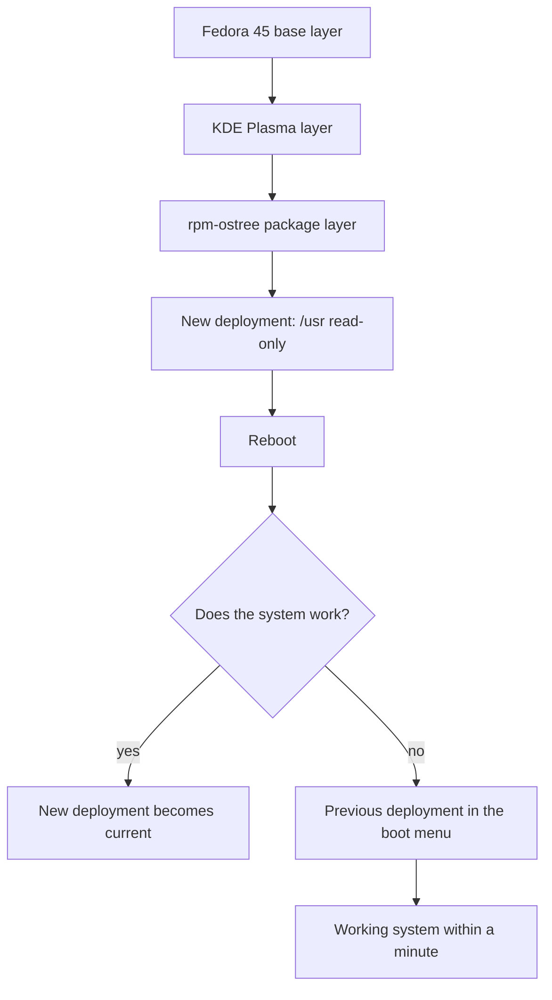
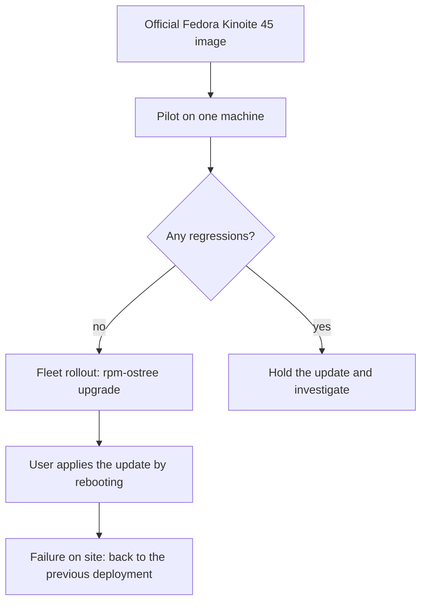

## Introduction

I moved my work laptop to Fedora Kinoite 45 — the atomic edition of Fedora with KDE Plasma. The reason is neither the desktop nor Flatpak. The reason is the update model: the system is not installed as a set of packages patched one by one on a live machine, but as a complete image assembled from layers. That model has a consequence I value more than any setting: a backup plan stops being a procedure you must remember to perform. It becomes a property of the system.

## How an atomic release works

An atomic system is built as an image. At the bottom is the Fedora base layer, on top of it the desktop layer, and above that the layer of extra packages you added yourself. The layers are assembled on a server, signed, and delivered to the machine as a whole. Inside the image `/usr` is read-only: nothing rewrites system files one by one on a running system.

Every update is a new deployment: a full set of layers, its own boot entry and its own directory under `/ostree/deploy`. The previous deployment stays on disk until it is removed or pinned. The bootloader chooses between them, not the package manager.

This is the path from layers to a running system:



The mutable directories — `/etc` and `/var` — are shared by all deployments. Configuration, service state and home directories survive the switch. That is why going back to the previous version returns the system without erasing your work.

The main difference from the familiar scheme is where the changes happen. On a classic distribution an update is hundreds of operations on a live system: each package is installed separately, and between the first and the last one the machine is in an unknown state. In the atomic model everything about the system happens on the build server: a tree is mounted there, layers are applied, and one signed image comes out. The machine receives the result, not the process.

A side benefit is verifiability. The signature and the build ID answer the question of where the system came from, and a read-only `/usr` makes it hard to quietly replace a binary or drop a library into a system path. It is not a substitute for antivirus and not protection against root, but it noticeably reduces silent drift.

## Room for error

This is where the payoff starts. A user who always has a previous system version makes mistakes more calmly — and, more importantly, makes them more often and more usefully: tries, rolls back, tries differently.

A driver broke after a kernel update? Reboot, pick the previous entry in the boot menu, keep working. The new Plasma does not appeal to you, or a widget stopped launching? Same. You installed an experimental package as a layer and hit a conflict? `rpm-ostree uninstall` restores the previous set of layers, and if the problem came with an update, `rpm-ostree rollback` switches to the previous deployment.

The everyday commands look like this:

```bash
rpm-ostree status                     # current and previous deployments
sudo rpm-ostree upgrade               # download and stage a new one
sudo rpm-ostree rollback              # return to the previous one
sudo rpm-ostree deploy 45.20261028.0  # a specific version
sudo rpm-ostree pin 0                 # pin a known-good deployment
```

Pinning is an underrated detail. Before a risky experiment, one `pin` is enough: garbage collection will not reclaim the working deployment, and you can return to it weeks later.

The difference from a classic distribution shows up in concrete situations:

| Situation | Classic distribution | Atomic release |
| --- | --- | --- |
| Failure after an update | Diagnosis, chroot, snapshot or reinstall | Pick the previous boot entry |
| Interrupted update | Half-applied package state | There is no half-applied state |
| Package experiment | Rollback via the transaction log | Remove the layer or revert the deployment |
| Time to recover | An hour to an evening | One reboot |

A side effect I did not expect: I stopped postponing updates for “later, when there is time to deal with it”. An update is no longer an event with risk but a routine operation with a known rollback cost. The usual pattern is the opposite: a fresh system is a potential problem, so it gets pushed away. Here the potential problem is bounded by one reboot, so there is no reason to postpone it.

One caveat, without which the article would be dishonest: an atomic release protects the system, not your data. `/home` is an ordinary filesystem, and atomicity will not stop an `rm -rf` inside it. Your home directory, git repositories and notes need a separate backup. Atomicity removes the “OS broke” risk, not the “files are gone” risk.

## What an administrator gets

For someone running a fleet, the benefit is not the elegance of the idea but fewer incident classes.

1. **One version everywhere.** The version is a single number, not “everyone is on something different because someone updated in March”. The answer to “what version are you on?” is `rpm-ostree status`, and it goes straight into the ticket.
2. **First-line support without root.** “Pick the previous entry in the boot menu” works for any user: no sudo, no remote access, no site visit. That removes the most expensive class of tickets — “the laptop does not boot after an update”.
3. **No half-updated state.** Packages are not installed one by one into a live system: either the new deployment as a whole or the old one. The “update was interrupted halfway” class of incidents disappears by construction.
4. **Predictable investigation.** The version, the set of layers and the deployment history are known. The “it worked before the update and not after” baseline comes from one command instead of log archaeology.
5. **Controlled update pace.** A new image can be downloaded and not applied; it can be tested on a pilot machine, and a specific build can be brought back with `rpm-ostree deploy` rather than “whatever latest turns out to be”.
6. **Less configuration drift.** `/usr` is immutable, and system changes are explicit — a package layer or an edit in `/etc`. “Someone installed something six months ago” shows up in `rpm-ostree status` instead of surfacing during the next major upgrade.

This is what a fleet rollout looks like:



The approach has a cost, and it is better to know it in advance. Every added layer has to be rebuilt on every base update, and layer conflicts are real work rather than a rare case. Third-party drivers and DKMS modules need testing on every version. Flatpak updates separately and is not part of the image. Command names and flags may change from release to release — the model is what lasts, not the syntax. If you need corporate settings inside `/usr`, you get your own image build and a separate pipeline; if not, the official image plus managed layers is enough. And most importantly: decide on the model before the fleet has drifted apart, not after.

## Conclusion

An atomic release does not make a system failure-proof. It makes failure cheap. The previous version is already on disk and boots from a menu entry — so any update, any experiment and any configuration mistake costs one reboot. The user gets room to err without consequences, the administrator gets a predictable fleet and a first line of support that needs no root. That is why, in my list of backup plans, the atomic release sits first rather than last.
