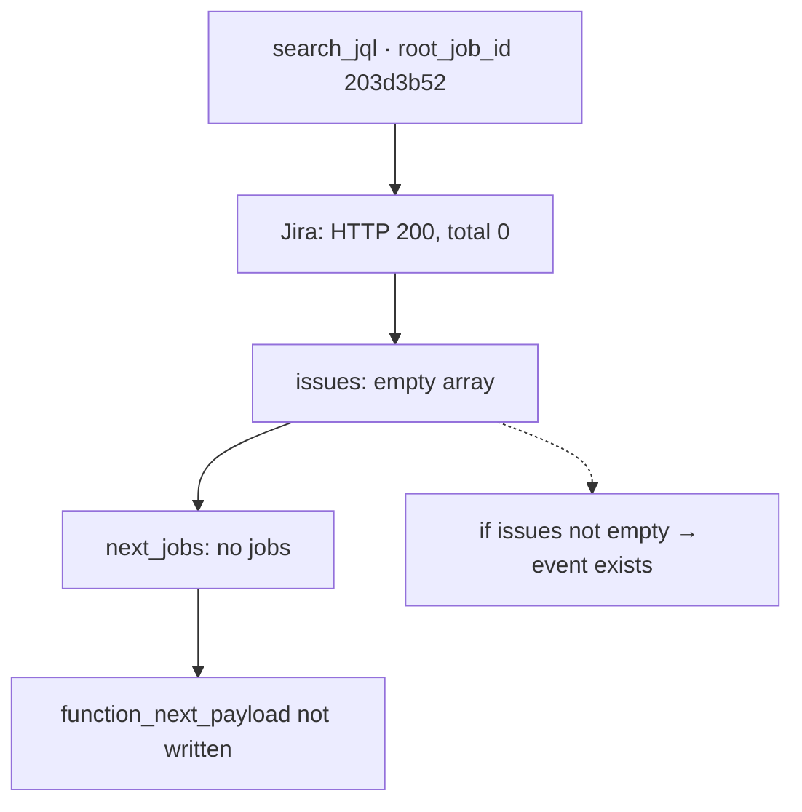

## The symptom

The feature is in production. Green tests: seven hundred and forty-seven. The contract is bumped, the documentation updated. I enable TRACE on a live instance, run a request — and the worker log has not a single `function_next_payload`.

The first thought of any engineer at that moment: "the code did not make it into the container".

How to enable TRACE: the log level is read from the instance config, not from the code (principle II for a reason). I switch it to `TRACE`, restart the pod, send the bot the usual command with a JQL query and wait for a record in `journalctl`. No record.

## Step 1: is the code even in the container?

I go inside `localhost/worker:dev` and look at the helper file — it is there. I run a probe manually, emitting an event from the REPL — the record is in the log, the format is right.

Conclusion: the code works, emission works, the logger is configured. The problem is not the build.

## Step 2: reconstructing the cascade

Next — look not at the code but at the data. I take the `root_job_id` from one request's logs and look at every job in the cascade:

- the `search_jql` job — exactly one;
- child jobs — zero;
- `function_next_payload` events — zero.

Three zeros. That is already suspicious: there is a cascade but no children. The function ran but produced nothing.

## Step 3: what did Jira answer?

I look at the Jira response to the JQL query in the same log. It looks like this:

```text
event: jira_search_result
  status: 200
  total: 0
  issues: []
```

HTTP 200, no error, simply zero tasks. The `59251` filter everything runs on turned out to be empty. So the function honestly returned `next_jobs: []`, and per requirement FR-007 (empty list — no event) there should have been no event.

Here is the whole picture:



## Evidence

| Level | What is visible | What it means |
| --- | --- | --- |
| Container | helper present, probe writes | the code is fresh |
| Cascade | 1 job, 0 children | the function ran |
| Jira | `HTTP 200, total: 0` | there is no data |
| Spec | FR-007: empty list — no record | behaviour matches the requirement |

## Not a bug but empty data

This is the nastiest class of production defects: every system works correctly, yet the result looks like a failure. The spec was right, the code was right, the logger was right — there was no data for the event.

I will formulate the lesson as a rule: "silence in the log" is not the same as "the code is broken". First ask whether there was anything to log at all. In my experience, in two cases out of three at this stage it turns out there was nothing to write an event from.

One more detail that saved time: an event always has a predecessor. You look at the external API response first, then at the jobs built from it, and only then at the emission. Had I started with the emission code, I would have checked more than three files instead of one line in the Jira log.

The second lesson is about process: I had a test for the empty result (that seventh test from post 8), but in production I forgot about it. The spec remembered; I did not.

## About log security

In this TRACE log, next to the useful line, there are two more things: an `Authorization: Bearer …` header with a Jira token, and the full payload of tasks with keys and descriptions from a real production board. TRACE mode, which gets switched on for ten minutes during an investigation, shows exactly that.

Hence a rule I added to my culture after this feature: raw TRACE logs are never published anywhere — not to a blog, not to an issue tracker. In this series everything is paraphrased and all job identifiers and keys are fictional.

The investigation is closed, there is no defect. But a question remained that will turn the next part into an architecture change: if a function can produce no jobs — should it stay silent at all?

Back then the answer seemed obvious. It turned out not to be.

---

[← Post 9: `/speckit.analyze`](/en/dev/blog/sdd-09-analyze-findings/) · [Post 11: emission moves into the functions →](/en/dev/blog/sdd-11-emission-moves-to-functions/)
