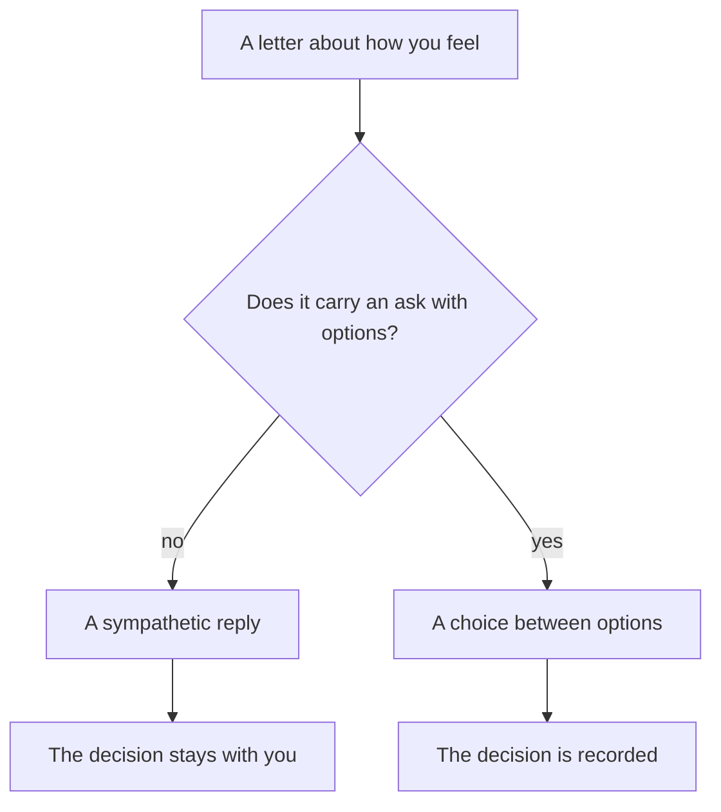
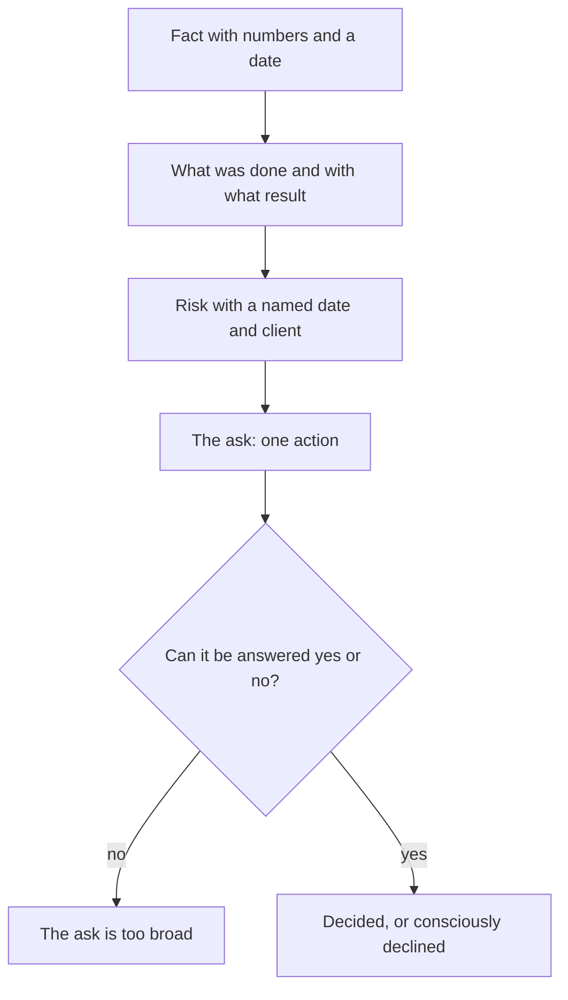

## Introduction

One of my first letters upward was written in a state that felt entirely justified: three weeks without a day off, two incidents in a row, two engineers sick, all of it against promised dates. The letter was long, emotional and honest. The answer was one line: "Hang in there, we believe in you."

Sympathy is a polite form of refusal. Not because the manager is callous, but because there was no ask in that letter that could have been answered any other way: no option, no cost, no date. It was about my state, and decisions are made about the state of the service - related things, but not the same.

Since then I write upward using two templates. **Escalation** - when a problem leaves the service's scope and needs intervention from the other side: fact, what was done, risk, ask. **A resource request** - when hours are short: data, consequence, a request with options. The subject differs, the logic is the same: turn an experience into a problem statement that has an answer.

## Why "we need help" doesn't lead to a decision

At first glance asking for help is the most harmless form of communication. In practice it breaks on three things.

First, it contains nothing to argue about. The manager can't answer "we need help" - only ask what kind and how much. That is, they get the job of formulating the problem instead of you.

Second, it contains no choice. The decision collapses into "help or not help", and people mostly choose the second when the price of the first isn't named.

Third, it inevitably reads as an admission of helplessness - because that's how it is written. Hence "hang in there": it is easier to sympathise with someone in a bad state than to dig into details you don't know.

Here is how that chain runs:

Emotional letters help too sometimes - if you say honestly that this is an emotion, not an ask. But as an exception and in plain words: "I need support, not a decision; I'll have the formulation by Friday."

## The escalation template

Escalation means handing a problem to those with more authority, not to those with luckier titles. Four blocks.

**Fact.** What happened, when it started, who is affected, which numbers confirm it. No judgements, no adjectives: "since this date the share of unanswered tickets has been growing", not "the situation is absolutely terrible".

**What was done.** Which attempts were made and what they showed. This block is what separates escalation from offloading responsibility: it shows the problem wasn't dumped upward but taken to the point where authority is needed.

**Risk.** What happens if nobody intervenes, tied to something far more concrete: which client, which date, which target. Risk without a consequence is a mood, and moods don't get discussed.

**The ask.** A specific action required from the recipient: a decision, access, a letter, a resource, a priority. Phrased so that it can be answered yes or no.

How the blocks add up to action:

A separate rule: one escalation, one question. If the letter carries three asks, the answer will be a discussion of the most convenient one, and the rest quietly disappear.

Two more short rules. The recipient should be the person with authority, not the nearest one in the org chart: a letter to a manager who doesn't own the question guarantees another forwarding round and costs trust on both sides. And second: escalate before the date expires. An escalation after a breach reads not as risk management but as explaining a failure, and what gets discussed is the culprit rather than the decision.

## The resource request template

This template is closely tied to the capacity calculation: without it, the request turns into "give me a person". Three parts.

**Data.** Figures for a period: volume, timings, the shortfall of hours and the assumptions they rest on. Assumptions are stated explicitly so they can be challenged.

**Consequence.** What stops being met without changes and by which date. What matters here is speaking in terms of commitments rather than feelings: not "the team won't hold up" but "by this date this target stops being met".

**A request with options.** Never one option but at least two: add hours, reduce volume, change the target in writing. Having options turns the ask into a choice - even when management picks the one you weren't counting on.

Formally, a request is one page plus an appendix. The page carries three blocks and the date by which an answer is needed; the appendix carries the calculation and the exports for whoever will verify it. Mixing the levels is a mistake: the manager needs the conclusion, the analyst needs the source data, and these are different documents.

There is an unpleasant part too: a resource request sometimes ends in a refusal. That's a normal outcome, provided the refusal is conscious and recorded together with the consequence: then the next discussion doesn't start from zero, and the letter isn't spent on a reminder.

## Bad and good on one case

The clearest way to show the difference is to take one situation and write it twice. What follows is not text to copy but a comparison of form: two versions of the same event.

In the bad version the letter opens with background and emotion, then goes through everything that happened, and ends with something like "we need to do something about it". The reader gets three pages of context and not a single action.

In the good version the same situation is described differently: one line of fact with a date, a paragraph on what has been done, one line of risk with a concrete consequence, one explicit ask with the date the answer is needed. It is a third of the length.

What doesn't change: the picture of the problem and its seriousness. The bad letter isn't exaggerated and the good one isn't softened. Only one thing changes - now the reader has something to answer.

<!-- вилка: свои два письма — один и тот же кейс до и после перехода на шаблон. -->

## What not to write

The list is short, but I have met each mistake dozens of times - in other people's letters and in my own.

- **Accusations.** "Engineering ignored us again" is an emotion, not a fact; replace it with dates and attempts to reach them.
- **Details without a conclusion.** A full chronology without a verdict makes the manager do your work: pick the main thing out of thirty lines.
- **Asks without options.** "We need more people" with no alternatives puts the manager before a yes/no choice, and that choice almost always ends in no.
- **False urgency.** If every letter is marked urgent, in a month none of them is.
- **A hidden ultimatum.** "Otherwise we'll be forced to…" with no concrete option is pressure, and it is read instantly.
- **An ask to the wrong person.** Escalating to a manager who doesn't own the question spends the trust of both sides.

And one rule for yourself: before sending, read the letter and answer what decision you would make with two minutes to spare. If the answer doesn't form, the letter isn't ready.

Templates don't make a request softer and don't guarantee agreement. They do something else: they turn a conversation about fatigue into a conversation about priorities and resources - and that conversation can end in a decision, even a negative one.
