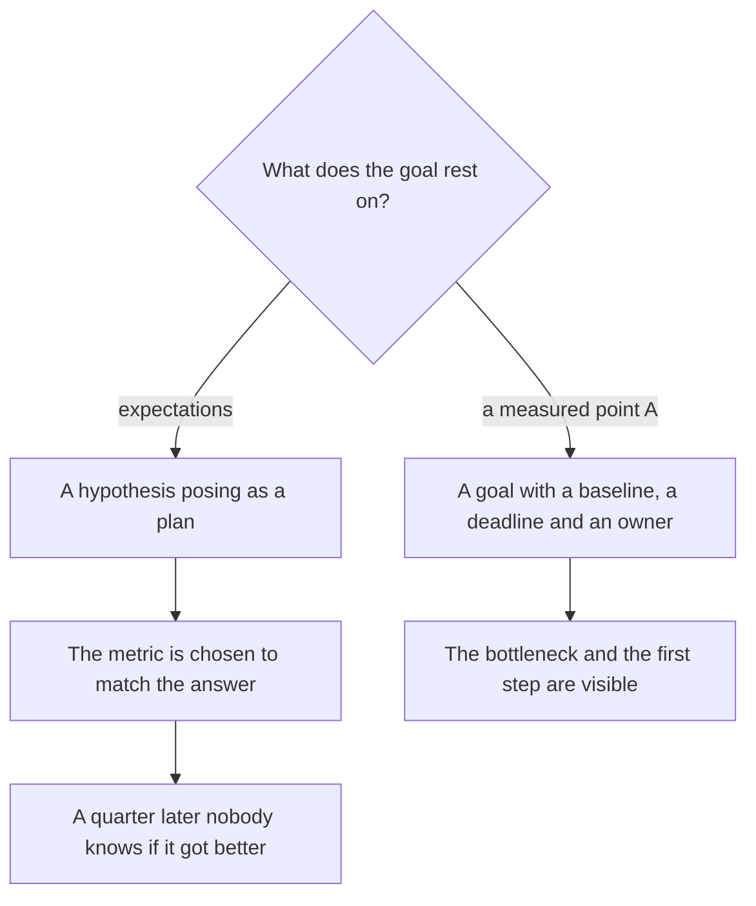
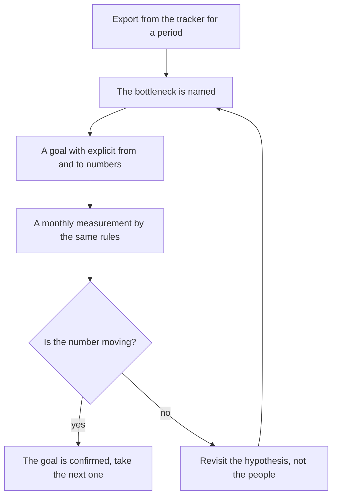

## Introduction

On my first day as a support lead I had two documents: the list of management's expectations and the certainty that I knew how to meet them. A month later it turned out that half of those expectations were measured by something other than what I had in mind, and the other half were not measured at all. The numbers I quoted in meetings were not the state of the service but the sum of other people's impressions.

The previous article of the series — ["Ownership boundaries"](/en/blog/support-lead-boundaries/) — was about freeing the lead's time from other people's decisions. This one is about the next step: what to do with that freed time in the first weeks so the year does not turn into a set of loud promises.

The point is simple and uncomfortable: a goal set before the measurement is a hypothesis pretending to be a plan. It sounds right, management likes it, and it has no chance of working, because nobody knows which point it is counted from.

## Goals on day one are the standard mistake

Leads rarely invent goals on day one. They arrive ready-made: from the manager's expectations, from the job description, from last year's plan, from the previous company's experience. "First response within 30 minutes", "halve the resolution time", "raise customer satisfaction" — all of it sounds like a task, yet it is a wish.

Why such goals don't survive the first month:

- **They have no starting point.** "Halve the resolution time" contains no "from", only a "to". A quarter later you cannot say whether things got better — there is nothing to compare against.
- **They describe the wrong object.** Resolution time averaged over all tickets includes the ones hanging for months while the client answers. The metric moves not when the team works but when the client deigns to reply.
- **The measuring stick is picked afterwards.** First the goal, then the metric that will "confirm" it. That is how reports appear where everything is fine, and the feeling that the service lives a life the numbers don't show.
- **The first failure kills trust in the plan.** The number didn't move in a month — and the conclusion drawn is not "we don't know what we are counting" but "the plan doesn't work, the lead can't cope".
- **The team sees no connection.** An engineer reads the "goal of the year" and cannot tell what changes in their shift. A goal that never becomes a daily action lives only in the presentation.

The annual plan I work by calls this the first standard mistake of a lead: a goal before the measurement. The logic is simple — measuring is frightening, because the fact may be worse than the expectations. So the goal comes first: it creates a feeling of control. Except the control is imaginary.

Here is the fork:

Next — what exactly a measured point A changes.

## What point A changes

A baseline is the measured state of the service on entry: how many tickets arrive, of what kind, how much time passes before the first response and before resolution, what share of resolutions comes back, where the flow stalls. Not an estimate, not a feeling of "we seem to be coping", but a count of events from the tracker.

An example that makes the difference obvious. A goal of "first response in 30 minutes" against a fact of "the first response arrives in three days" is not a goal — it is a different service with a different headcount and a different queue. Between the fact and the goal lies not motivation but work: first-touch triage, duty shifts, flow distribution, an escalation policy. A goal set without that gap is chosen by fantasy rather than by work, and a month later it turns out you moved the wrong thing.

Three functions of the baseline matter more than the number itself:

1. **Scale.** It is almost always different from what it seems. The load is unevenly distributed, part of the flow is not incidents but questions and change requests, and they must be handled differently.
2. **The bottleneck.** There are usually five hypotheses about what is in the way. The fact names one — and that saves a quarter.
3. **Verifiability.** A goal with point A sounds different: not "speed up the response" but "first response from three days to eight hours by the end of Q2". It can be checked, challenged and split into steps.

<!-- вилка: 3–4 фактических значения точки А — MTTA, доля реопенов, доля решений по базе знаний, просроченные заявки. -->

How the loop around point A closes:

## A baseline from the tracker in the first month

The first month is the only time you have the right not to know the numbers. After that the right expires, and every "it seems to us" costs trust. So the export is done at once and in full, even if you will work through it gradually.

What to pull first:

| Indicator | What it shows | Why it belongs in point A |
| --- | --- | --- |
| Volume and structure of the flow | Tickets per week by category: incident, question, change request | Scale and the right queue |
| Priority | Distribution across priorities and the share of critical ones | Where the real risk is and where the noise |
| Time to first response | From ticket creation to the first substantive answer | Response discipline rather than busyness |
| Time to resolution | From creation to closure — split into time in work and time waiting | The team's work separately from the client's waiting |
| Reopens and returns | Share of tickets opened again | Quality of the resolution rather than speed of closing |
| Share resolved from the knowledge base | Tickets closed with a reference to an article | Maturity of knowledge and the potential for self-service |
| Escalation rate | Handovers to L2 and L3 | Where the route breaks and competences are missing |
| Backlog age | Tickets pending longer than the norm | Silent breaches invisible in reports |
| Load per engineer | Distribution of tickets and time | Capacity and single points of failure |

A few rules without which the export turns into a set of incomparable numbers:

- **One period, one source.** Every indicator is counted over the same window from the same tracker. Data from chat, from email and from memory is not part of a baseline.
- **Definitions are written down.** "First response" is what exactly: a template acknowledgement or a substantive answer? Until the definition is fixed, the number can be read any way you like.
- **Count events, not current statuses.** A ticket closed today was created a month ago; a report on current statuses will not show that.
- **Time in work and time waiting — separately.** Otherwise the client or, conversely, the team automatically becomes guilty of the delays.
- **No manual edits.** The moment the first number is "corrected so it doesn't look so bad", the whole baseline stops being an argument.
- **History beats a month.** If the tracker holds a quarter or a year, take those: seasonality in support only shows on a long window. If there is little data, say so — "a three-week sample".

<!-- вилка: свои выгрузки — какие поля, за какой период, где хранится таблица. -->

It is worth counting separately what the tracker does not have. Usually that is the cost of manual operations, the time spent switching between systems, and the work that leaves no ticket: incident discussions in chat, consultations with colleagues, mentoring. The baseline will not show these numbers, yet they are exactly what explains why an engineer is "busy but tickets don't get closed".

## Calibration with management

The second month is the time for the conversation, and it is better prepared as a project defence than as a report on work done. The input is the export; the output is agreed goals with "from" and "to" numbers.

The conversation has four steps:

1. **Fact.** Show point A without varnish and without excuses: this many tickets, these times, these reopens.
2. **Bottleneck.** Name one or two causes backed by data, not by a feeling.
3. **Vector.** Propose what will change if specific steps are taken, and which annual goals that yields.
4. **Ask.** If the vector needs a resource — a person, a tool, a management decision — it is named plainly and in the same conversation.

Rules I derived from my own mistakes in that conversation:

- **Come with an export, not with a mood.** "The team is overloaded" gets discussed; "there are tickets older than the norm in the queue, here they are" gets decided.
- **Every goal has four attributes:** "from", "to", a deadline and an owner. A goal without an owner is a wish, not a goal.
- **A goal that needs a resource contains the resource request.** Promising a faster response without changing the headcount is a way to explain a failure a quarter later.
- **Milestones instead of annual promises.** "By the end of Q1 — first response within a day, by the end of Q2 — eight hours" is easier to discuss and more honestly checked than a single number for the year.
- **The agreement is written down, with a review date.** Otherwise in six months there will be a new version of the conversation and new expectations.
- **The baseline is not an excuse.** As soon as the numbers start being used to explain why we are slow, the conversation loses its point. They exist to show movement.

A separate trap is the manager who insists on a goal unreachable with the current resource. Arguing about the wording is useless: the argument is about the future, while the evidence lies in the present. Something else works — accept the direction and break it into milestones with conditions: "by this date we reach this number with this resource; without the resource the milestone moves by so much". The goal stays ambitious, and you are not the person who promised and failed.

<!-- вилка: ваш разговор о целях — что было на входе, какие цели согласовали, какой ресурс запросили. -->

## What should remain after the first two months

A short checklist that shows the start worked:

- the tracker export exists and is updated by one rule;
- every indicator has a written definition, and the meaning of a number is no longer a debate;
- the bottleneck is named and backed by data rather than by authority;
- the annual goals are stated as verifiable results with "from" and "to" numbers;
- every goal has a deadline, an owner and, where needed, a resource request;
- the agreement with management is written down and has a review date.

Point A is not bureaucracy and not distrust of the team. It is a way to stop arguing about what is happening and start arguing about what to do. The next step is to turn the agreed goals into a twelve-month roadmap: four quarters where each rests on the result of the previous one. That is the next article of the series.
