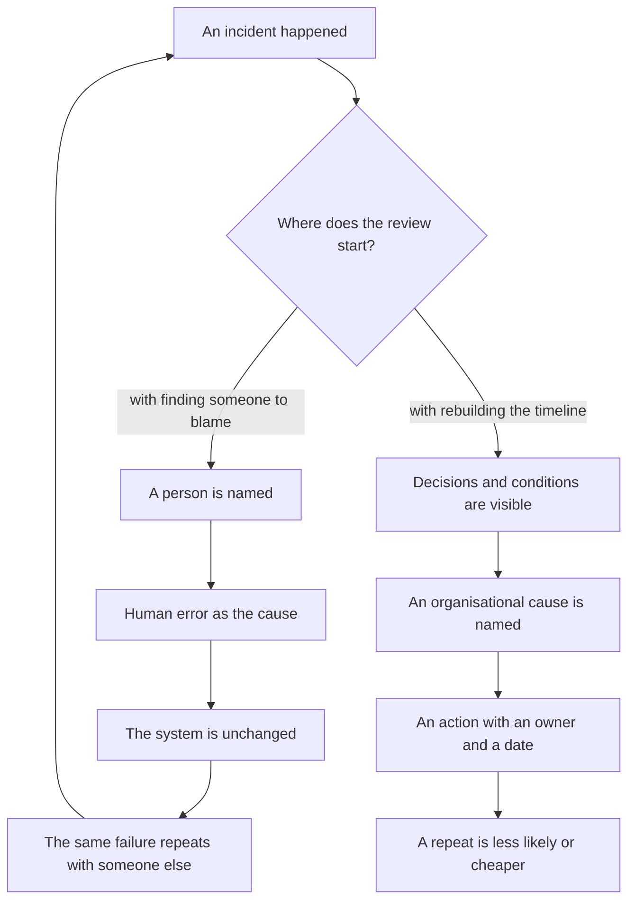
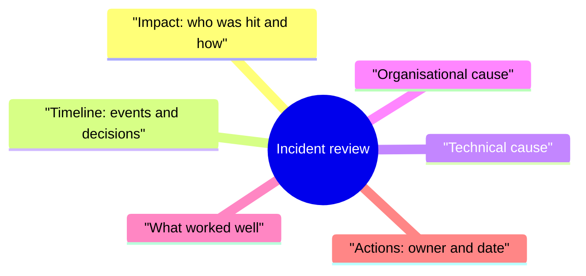

## Introduction

An incident review is the rare moment when a team gets permission to talk about mistakes out loud. The rest of the time a mistake costs a client's trust, and people remember that. So a review that opens with "who did this" delivers something predictable: next time the problem is discovered later, when it can no longer be hidden.

I have run enough of these meetings to have settled on a rule for myself: a review discusses decisions and the conditions they were made in, not people. That kind of review is called blameless. Its goal is the organisational cause: a missing procedure, an ambiguous signal in monitoring, a lack of access rights, a check skipped before a change.

It matters not to confuse this with irresponsibility. "Without names" applies to the past, not to the future: every action after the review has an owner and a date. What follows is why finding someone to blame does not prevent a repeat, what a review consists of, how to write a timeline without names, and what happens to the actions after the meeting.

This article continues the outer contour of the series: in "A support lead's year by quarters" the reviews sit in the fourth quarter, as a way to close the loop rather than as a reporting ritual.

## Why finding someone to blame does not prevent a repeat

The guilty party is almost always found, and almost always it is not the person who set the conditions: the on-call engineer did not build the monitoring that showed green, and did not write the procedure. They were simply the last link in a chain where the decision looked correct.

What happens next if the review stops at a surname:

- **The culprit is named, and the question closes.** From there the discussion is about a person's behaviour, not the system around them. The meeting ends with a sense of order and without a single change to the procedure or the monitoring.
- **"Human error" explains nothing.** It is not a cause but the place where the cause surfaced. The substantive question is why the decision looked correct at the moment it was taken, and why the system did not catch it before the client did.
- **People start defending themselves instead of telling the story.** A participant forgets to mention that they saw a warning in the chat, because it sounds like an admission of guilt. Rebuilding the picture afterwards costs more than running the review honestly.
- **The system stays as it was.** The action "have a word with them" changes neither the signal in monitoring nor the order of the queue. A month later the same thing happens to a different on-call engineer.
- **The next incident arrives late.** The team learns that it pays to stay quiet about a failure until the last moment. A delay appears between the problem and its admission, which nobody measures and everybody feels.

The loop closes like this:

The left branch feels better: it has an ending and a culprit. The right one is slower to start — you have to assemble a timeline and admit that part of the blame lies with the processes you built yourself. But only the right one changes what a repeat depends on.

## The structure of a review

Structure protects the meeting from being hijacked: without it the most interesting thing gets discussed — the technical cause — while the impact and the organisational conditions stay out of frame.

The minimum contents of a review:

The fields, substantively:

- **Impact.** Who was hit, which channels, what was unavailable and how long it lasted. The field comes first not out of politeness: without it the review turns into a seminar about a rare cause while the damage goes unspoken.
- **Timeline.** Events and decisions by system clocks: tickets, monitoring, the on-call chat, change history. Not from memory — memory smooths the picture to fit the ending it already knows.
- **Technical cause.** The chain of "what broke — why that led to a failure". It answers "how", not "who", and it is found faster than any other field.
- **Organisational cause.** Why the system allowed a change without a check, why the signal never reached monitoring, why the first line did not see the scale. This field is what sets the actions that prevent a repeat.
- **What worked well.** A mandatory field, otherwise the review turns into punishment. What shortened recovery, which agreement held. Successful decisions are worth repeating no less than failed ones are worth fixing.
- **Actions.** A list with types, owners and dates — a separate conversation at the end of the article.

Two rules. The review happens in the first working days, while the timeline is still assembled from logs rather than from legends. It is run by someone who did not take part in the recovery — otherwise the conversation slides into a retelling of their own actions.

## A timeline without names

The main technique of a blameless review is roles instead of surnames. Instead of "the engineer did not check the certificate expiry date", the timeline says "the on-call engineer did not receive a notification about the certificate expiring".

The difference is not cosmetic. A surname glues an evaluation onto the event: reading it, participants discuss whether the person is attentive, not what they saw on the screen. A role leaves room for the question about conditions — the only one that can be answered with an action.

Three reasons why a role is more precise than a name:

1. **The timeline becomes verifiable.** A role is checked against the shift schedule and the logs; a name drags along memories of the person rather than of the event.
2. **People stop editing themselves.** While a surname is in the record, a participant thinks about wording rather than about facts.
3. **The organisational cause shows up earlier.** If the same step repeats across different people, the question "who is to blame" loses its point, and the question "what do these conditions have in common" becomes obvious.

I keep the record format to four elements: the moment, the event, what the participant knew, and which decision was taken. What works is not the form but the discipline of filling it in:

- **The moment — by system clocks.** "In the morning" and "right after lunch" cannot be reconstructed or checked.
- **The event — a fact, without evaluation.** "The gateway returned a handshake error", not "the gateway was behaving strangely".
- **What was known — the key element.** A decision is judged together with the information the person had at that moment, not with what appeared by the time of the review.
- **The decision — with the options that were visible.** It helps to record not only what was done but what looked like an alternative.

A separate note on edits. An agreed timeline is not rewritten: clarifications are added as a separate line with a note. Contradictions between participants stay in the text: two different memories are a fact about a process where information was not shared, not a reason to work out which of the two is right.

<!-- вилка: фрагмент своей хронологии — 3–5 строк «роль — событие — известное — решение» из реального разбора. -->

## A worked example

Below is a typical scenario whose technical cause is boring and whose organisational cause is not.

**Impact.** Clients write to support that they are not getting replies to their emails; the other channels work. From the outside the service is silent, even though tickets are being created in the tracker as usual.

**Timeline.** A scheduled change on the gateway is applied according to the procedure; the on-call engineer sees a green status; during the shift identical complaints arrive and each is handled separately; a second-line engineer notices that the complaint times coincide with the change window.

**Technical cause.** An intermediate certificate with an expired date had been left in the certificate chain; some mail servers reject a handshake like that.

**Organisational cause.** The scheduled change had no criterion "the channel accepts mail after the change"; monitoring had no check of the business function, only of port availability; the first line had no signal of scale on a single channel, so identical tickets went through as different ones.

**What worked well.** The second-line engineer matched the complaint times with the change window, and the search got shorter; the on-call engineer kept the incoming messages, so the impact could be described precisely.

**Actions.** A synthetic check of mail acceptance after changes — owner in operations; a triage rule "identical tickets on one channel are merged into one incident" — owner in support; a check of the certificate chain in the change procedure — owner in infrastructure.

A review like that takes less than an hour, and most of the time goes not to the technical cause but to the conversation about why three teams had no shared picture.

<!-- вилка: свой инцидент — влияние, хронология в три строки, организационная причина, что сработало. -->

## The fate of actions

The most common problem with a review is not the quality of the conclusions but the fact that the decisions do not get carried out. The reasons are usually the same, and almost all of them are manageable.

- **The owner is a person, not a team.** "The team should sort out monitoring" has no owner, and therefore no date. "This check is done by the operations engineer, due by such and such a date" has both.
- **The deadline is a date, not a quarter.** "Next quarter" sounds like a commitment but is not one.
- **The action lives in the shared tracker.** A separate document about incidents is read once — at that same review. An action in the ordinary task queue gets priority and visibility.
- **There are few actions.** Five to seven lines per review is the limit, beyond which part of them will not be done.
- **An action has a type.** Remove the cause, detect faster, recover faster, reduce impact — four different jobs, and they are rarely solved at the same time. Sometimes it is cheaper not to prevent a failure but to shorten the time it is detected.
- **The status is checked at the next review.** The first minutes of every meeting go to previous actions: done, in progress, overdue. An overdue action is discussed as an organisational cause — the date was unrealistic or priority was never given — not as a question of discipline.

<!-- вилка: как вы ведёте действия после разборов — где они лежат, как проверяется статус, что было с первым разбором. -->

A review without names does not make a team softer — it makes it faster: people arrive with facts instead of a defensive version of events, and the organisational cause is found at the first meeting rather than at the third. A timeline without names is not politeness but a tool: it lets you discuss the conditions that produced the error, and change exactly those.

Next in the series — "A problem card for product that won't close without a status": what to do with the causes that cannot be fixed inside support.
