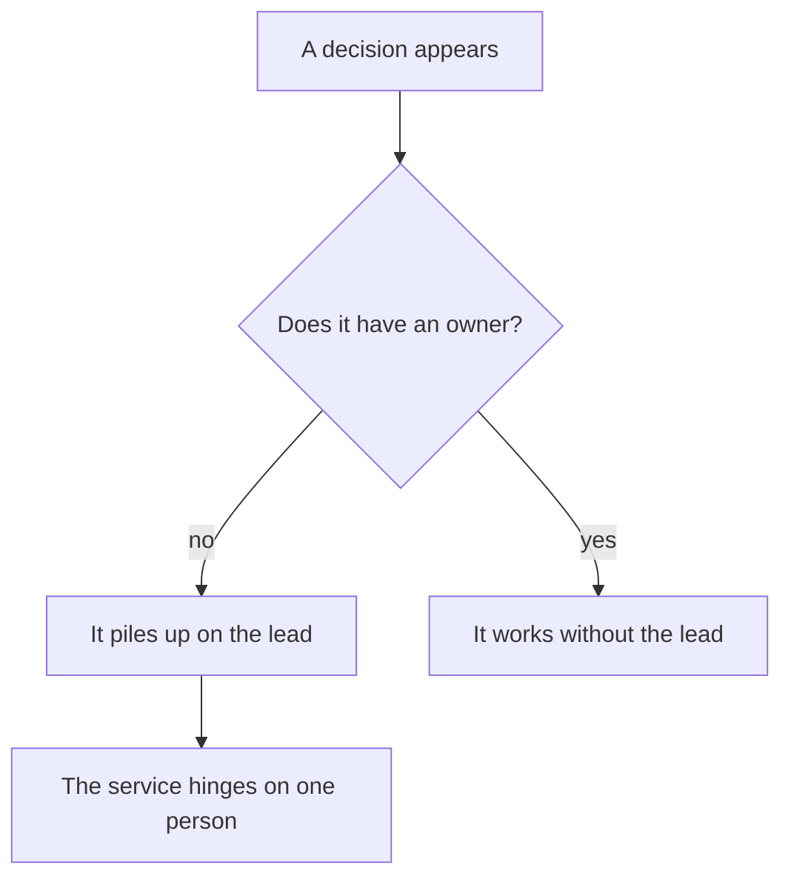
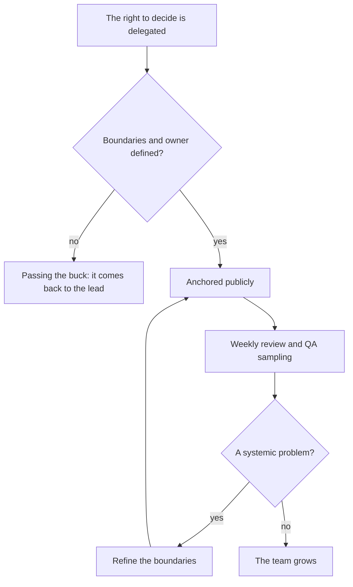

## Introduction

The first weeks in a support lead role I remember as a single picture: a day eaten by other people's decisions. An engineer comes to align on a priority, a developer wants to know who will tell the client about a delay, a manager asks why a ticket is stuck. By evening, the work the lead exists for didn't get done.

The problem isn't workaholism or a lack of time. The role has no fixed boundaries. A lead without boundaries turns into the single dispatcher: everything goes through them, nothing moves without them, and any sick day or vacation stops the service. In the previous article of the series — ["The five results of a support lead"](/en/blog/support-lead-five-results/) — I broke down what separates a lead from a dispatcher. Here it's the mechanism that protects that distinction: three lists from the annual plan I work by. What I decide myself, what I delegate, and what I walk away from.

First, the mechanics without the lists. Decisions with no owner drift to the most available person — and in support that's the lead.

Next — how to get from "piles up on the lead" to "works without the lead": notice the symptoms, build the three lists, and turn them into an agreement with management.

## Symptoms of blurred boundaries

Blurred boundaries don't announce themselves — they show up in the everyday. Check yourself against a short list:

- **Escalation by default.** Every non-standard ticket sooner or later lands on the lead — not because the engineer can't solve it, but because "that's how it's done". The trigger isn't difficulty but uncertainty: "I don't know whose decision this is."
- **The lead is the mandatory approver.** A client promise, a deadline change, system access, a process update — everything needs your sign-off. While you're on vacation, these operations simply don't happen.
- **Decisions live in chats and in the air.** A week later nobody remembers who decided to hand the ticket to engineering; disputes restart from zero, and the arbiter is you again.
- **The day goes to tactics.** Unblocking stuck tickets and answering "what do we do about this?" eats the day; nothing is left for processes, quality, or people. Formally you "get everything done" — you just don't do your job.
- **The team won't decide small things without you.** An engineer could close the ticket but still asks — because they once took heat for being proactive. That's how learned helplessness is bred — the very thing that gets blamed later.

<!-- вилка: 2–3 симптома из собственной практики — что именно съедало день до введения списков. -->

Behind these symptoms is the same mechanics. And the flip side matters: boundaries aren't a fence but a trust contract. An engineer owns decisions only where they know where their rights end and who backs them up. The clearer the boundaries, the more decisions the team takes — and the fewer of your signatures the service needs.

## The "decide myself" list

The first list — decisions that stay with the lead. The selection principle: decisions whose error cost is high, or that set the rules for everyone.

- **Contested priority.** When engineers disagree on severity, the lead decides: reaction timers and queue order depend on it.
- **Client promises beyond the process.** Compensation, deadline changes, SLA exceptions — obligations absent from the contract or the process.
- **Team composition and project allocation.** Who works which line, who joins a project, who is on duty.
- **Rules of the game.** Processes, queue priorities, quality criteria: whoever owns the result changes them.
- **Escalation upward.** When a problem leaves the service's scope for management level, how and when to raise it stays with the lead.

A useful test for each item: "can I explain why an engineer can't make this decision?" If the explanation boils down to "I'm used to it", the item moves to the "delegate" list. A size guideline: the "decide myself" list fits in a line or two. If it's longer than ten items, you've confused leadership with control — and brought back every symptom above.

<!-- вилка: ваш список «решаю сам» — 3–5 пунктов из практики. -->

## The "delegate" list

The second list — what goes to the team. The main mistake is confusing delegating a task with delegating the right to decide. "Sort out the ticket" is a task: the engineer works on it but brings the decision back to you. Delegation sounds different: "the ticket is yours. You pick the route and tell the client what's next. I keep only the priority." The difference between the two phrasings is the entire difference between a dispatcher and a lead.

What goes into the "delegate" list:

- ticket handling within the process — including non-standard ones, when the error cost is moderate;
- client communication in routine situations: statuses, in-SLA reschedules, clarifications;
- shifts and flow distribution within a shift;
- onboarding of new engineers;
- preparation of regular statuses and reports.

Every delegated decision needs two things: **boundaries** (what the engineer decides alone, when to escalate, and to whom) and an **owner** (a specific person, not "the team"). Delegation without boundaries isn't delegation but passing the buck: the decision comes back to you anyway, later and with corrupted context. The working cycle of delegation:

One more rule that's easy to miss: the right to decide is anchored publicly. If you agreed with an engineer one-on-one, within a week the queue is back on you — the rest weren't told. "For these questions you now go to Anya, not to me" must be said at the general review and be visible in the process docs.

Then comes the usually forgotten part: delegation doesn't end at the handover. Every delegated block needs checkpoints: a few delegated decisions in the weekly review, plus QA sampling of decision quality regardless of who made them. A systemic problem in the sample isn't a reason to take the decision back; it's a reason to refine the boundaries — most likely they were phrased vaguely. And hold yourself against walking it back: every retraction teaches the team that boundaries are decoration.

<!-- вилка: что вы делегировали за последний месяц и как объявили это команде. -->

## The "walk away" list

The third list is the hardest: to walk away means to consciously leave a role that gave a sense of control. The annual plan names two such roles, familiar to every lead:

- **The single dispatcher.** Tickets are routed by triage and the matrix, not by me. While routing is my personal function, the service hinges on one person and triage never matures.
- **The mandatory approver.** Routine operations have a process instead of my signature. If an operation is routine, it must run without me; if it isn't, it belongs in the "decide myself" list.

A third, less obvious role: **the deepest expert on every product**. If the deepest expertise in the team is you, your vacation is an incident and your departure is a catastrophe. The lead's job is to have critical expertise in at least two people — separate work with the competency matrix, deserving its own article in the series.

Why the "walk away" list is the hardest: quitting a role doesn't look like an achievement. The agreement "I no longer approve in-SLA reschedules" looks from the outside like "the lead got lazy". What helps here is one thought: you don't lose control — you move it from your head into the system. Processes, triage, the interaction matrix, decision owners — control that doesn't depend on how you feel or what your calendar looks like.

Telling the team is a critical step, and it should be done in plain words: exactly what you stop doing, from what date, what to do in contested cases, and who covers the transition. Silent quitting (just stopped replying) reads as resentment or a whim. Plan the transition just as honestly: the first weeks aren't the time to prove firmness — if an engineer is stuck, solve it together once and discuss it in the review. And agree on the way back: which events legitimately return the function to you (two engineers leaving in a row, a failed pickup norm) and how that gets recorded.

<!-- вилка: формулировка сообщения команде — что вы перестаёте делать, с какой даты, куда идти в спорных случаях. -->

## The agreement with management

The three lists work when they exist not in your head but in a document that is visible and agreed with management. That's not bureaucracy — it's three concrete benefits.

First, management knows which decisions to expect from you and which from the team — there's a document that says so.

Second, delegation gets protection: when an engineer decides within their boundaries, that's not unauthorized action but executing the agreement. Without the document, any mistake in a delegated decision reads as "should have checked with the lead" — and the "delegate" list quietly dies.

Third, walking away from roles stops being "the lead got lazy": "I'm no longer the dispatcher or the approver" becomes a recorded strategy with an explanation of where those functions now live.

The form is simpler than it seems: a page of text or a three-column table. Plus a quarterly revision, and it should be substantive: which items moved between lists (delegated items that held up mean you can drop the next role), where boundaries proved blurry, which decisions became routine and deserve a process instead of your sign-off. A revision without movements means the lists exist only on paper.

It's worth understanding where this sits in the year: boundaries aren't everyday optimization — they're part of the strategic frame, needed before you measure the baseline and negotiate goals. You can't build an annual roadmap while half your time goes to other people's decisions — the measurements will lie and the goals will bend to the chaos. That's the next article in the series.

And the last thing: boundaries aren't about doing less. They're about concentrating the lead's value where nobody else can create it — rules of the game, contested priorities, growing people, the contract with management. Everything else is someone's chance to grow, which you take away by deciding for others.