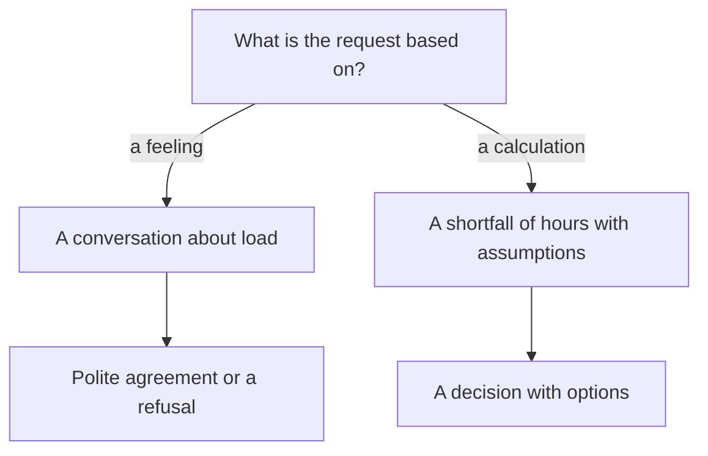
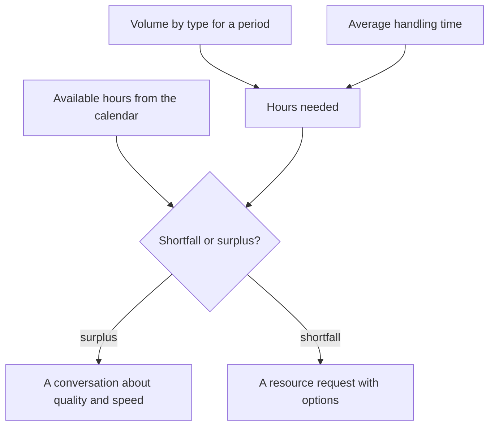

## Introduction

My first request for another engineer was written in a tone I thought was persuasive: the team is overloaded, people are at their limit, we need one more. The answer from my manager was polite and devastating: "Bring me the numbers." There were no numbers. There were three stories about a hard week and the resentment of someone who was genuinely trying.

A year later I brought the same request in a different shape: one page, a few figures, two explicit assumptions, three options. The conversation took fifteen minutes and ended with a decision. What changed was not the manager and not the budget. The format changed: overload turned into a shortfall of hours that could be checked, challenged and closed.

The point of this article is simple: headcount is a capacity formula, not a feeling of overload. The formula has three parts: the volume of work, the average time per unit, and the hours available. Until it is calculated, every hiring conversation is a negotiation about trust in the lead rather than about resources. Trust is a poor foundation for a staffing plan.

The calculation starts from a measured point A. Without an export from the tracker the formula is assembled from the same feelings, only in a spreadsheet. I went through point A in "Baseline before goals"; here we assume it exists.

## Why "we're overloaded" doesn't work

The sentence "we're overloaded" is honest, and that is exactly why it is hard to argue with. The problem is not honesty. The problem is that no action follows from it.

- **It doesn't separate the causes.** Overload comes from volume, from the mix of the flow, from waiting on the client, from switching costs between systems, from half a shift going to approvals. Each is fixed differently: hiring, triage, automation, a process change. "Overloaded" doesn't say which of the five it is.
- **It has no scale.** It sounds identical for a team of three and a team of ten: every team has hard weeks, and the manager cannot tell routine from anomaly.
- **It can't be checked or challenged.** With a feeling you can only agree or disagree - that is, believe or not believe. There is nothing to verify, so the conversation slides towards personalities.
- **It carries no options.** The ask sounds like "give me a person", and the decision collapses into a binary yes or no. A refusal after such an ask looks like abandoning the problem rather than choosing a priority.
- **It wears out with repetition.** The same sentence every month becomes background, and background doesn't get discussed.
- **It costs the lead something.** One refusal of "we're overloaded" teaches you not to ask, and then the team carries the load in silence until people start leaving.

There is a second side to it: a manager who agrees to "overloaded" without numbers is buying themselves a problem. A month later there is a new person and the queue hasn't shrunk, because the cause was never headcount. After two rounds like that, trust in requests drops on both sides.

So I build the request not as a complaint but as a fork with verifiable branches:

Next, how the calculation that makes the conversation short actually works.

## The capacity formula

On one line it looks almost insultingly simple: the hours needed equal the volume of work multiplied by the average time per unit. The hours available come from the calendar. The gap between the two is the shortfall you take to management.

Mistakes are almost never in the arithmetic. They are in the inputs, so the inputs are what needs breaking down.

- **Volume.** Counted from tracker events over one fixed period, split by type: incident, question, change request. Email, chat and "there were also some calls" don't count - otherwise the number can't be reproduced. The window has to be long: a month shows you a random week, a quarter shows seasonality.
- **Average time.** This is handling time, not ticket lifetime. Waiting for the client, waiting for a release and waiting for an approval are counted separately: the team spends no hours on them, yet the tracker lumps them into the total. Handling includes communication, re-checking and switching between systems - the parts that never show up on the ticket.
- **Available hours.** Not "we have this many people on staff" but a calendar: who is on vacation, who is training, who is on a project, who is on duty. That gets its own section below, because this is where the calculation usually collapses.
- **Units.** Everything in engineer-hours for the same week. As soon as one part is in hours and another in tickets, the formula stops adding up and the argument comes back.

A useful robustness check: recalculate without the heaviest week of the period. If the shortfall disappears, this isn't capacity but a peak - peaks are covered with a buffer and sequencing, not with hiring. If the shortfall remains, it is a structural shortage of hours, and it will not dissolve on its own.

Worth saying plainly what the formula does not give you. It doesn't produce a headcount accurate to the person: the result depends on assumptions, and the average handling time is itself a moving figure. It gives you an order of magnitude and, more importantly, it shows which assumptions deserve a challenge. If the manager disagrees with the number, we now have something to discuss: which of the three parts they read differently, and why.

How the formula turns into a decision:

## The availability calendar

Available hours are the most underrated part of the formula. Multiplying headcount by forty hours a week is easy, but the resulting number has nothing to do with the work: part of those hours is already sold in advance.

What gets subtracted from the nominal figure:

- vacations and sick leave - not "as it happens" but by the plan for a year ahead;
- training, mentoring and onboarding new engineers;
- project commitments: rollouts, migrations, one-off integrations;
- duty shifts, when they take a person out of the queue rather than sitting on top of it;
- recurring meetings and reviews;
- switching costs between tickets and systems.

The last item is usually the most contested, and rightly so: it isn't visible in the tracker and every service estimates it its own way. I don't take the coefficient out of thin air - I derive it by reconciling the hours the calendar offered with the tickets actually closed. That loss share sits next to the calculation as an explicit assumption. You can argue with it, but you can't pretend the losses aren't there.

Seasonality deserves its own note. The vacation peak is known in January, yet the July overload looks like a surprise every year. A twelve-month availability calendar is the only way to see the dip in advance and either move initiatives, bring in temporary capacity, or honestly warn about the dates.

<!-- вилка: свой календарь доступности — как считаются отпуска, проектные обязательства и потери на переключение, какой коэффициент потерь получился по сверке. -->

## Targets inside the calculation

The internal targets are the part that is easy to forget, because they aren't about volume but about the shape of the service.

A target like "pick up within fifteen minutes during working hours" is not a wish, it is reserved hours. Someone has to drop the current ticket at any moment and take a new one; that means they can't be put on a long task, and their capacity in the queue is below nominal. Reaction timers work the same way: the stricter the target, the more hours go not into work but into readiness to work.

Two conclusions follow, and both change the hiring conversation.

The first: a target and capacity are connected quantities, and one of them has to move. If the hours are short, there are exactly two options - add hours or change the target. Promising to keep the target without the hours is delivered through heroism by specific people, and heroism is not a resource: it doesn't scale and it ends in burnout.

The second: the calculation shows which targets are the most expensive. Sometimes it turns out that a strict reaction timer on every ticket type costs more than the rest of the service combined - and narrowing the target to critical categories frees hours with no hiring and no loss of quality where quality is actually needed.

<!-- вилка: ваши нормативы — подхват, таймеры реакции — и сколько часов они стоят по расчёту; какие нормативы пересматривались. -->

## Requesting resources with data

A request that works has three parts: data, consequence, options.

**Data.** One page: volume by type, average time, available hours, the shortfall with its period and sources. Assumptions are listed separately so they can be challenged one by one rather than wholesale.

**Consequence.** What happens if nothing changes: which targets stop being met, which tickets go overdue, which initiatives stall. Not "it will be bad" but "by this date this target stops being met". This is the most uncomfortable part, and it is the one most often skipped: without a consequence the request reads as a favour, not as a choice.

**Options.** A request without alternatives is an ultimatum, however politely it is written. There are usually three, and they rarely exclude each other:

1. **Add hours.** Hiring, contractors, temporary reinforcement for a peak.
2. **Reduce the volume.** Self-service, the knowledge base, cutting the flow that should never reach engineers.
3. **Change the target.** Deliberately and in writing, with an explanation of what stops being met.

I frame the conversation with management as a choice between those three, not as a plea for the first. Sometimes they pick the second, and that's a normal outcome: a resource request and a hiring request are different things. There is only one bad ending - "let's keep it as it is" with no change to the target: the decision then exists, but nobody owns its consequences.

And the last thing that makes a request work: a review date. "We come back to this in a quarter and see whether the shortfall moved" is part of the decision, not a courtesy. Without it the conversation ends in a yes or a no, and six months later it restarts from zero with the same emotions.

<!-- вилка: свой расчёт и пример запроса — что было на входе, какие варианты предложены, что выбрало руководство. -->

The capacity formula doesn't make a lead stronger and doesn't remove difficult conversations. It does something else: it turns load into a subject of management. While the shortfall of hours is uncounted, the only tool available is team heroism, and that runs out. The next article in the series is about agreeing with neighbouring teams so that part of this volume never reaches support at all: interactions without a matrix rest on personal deals and memory.
