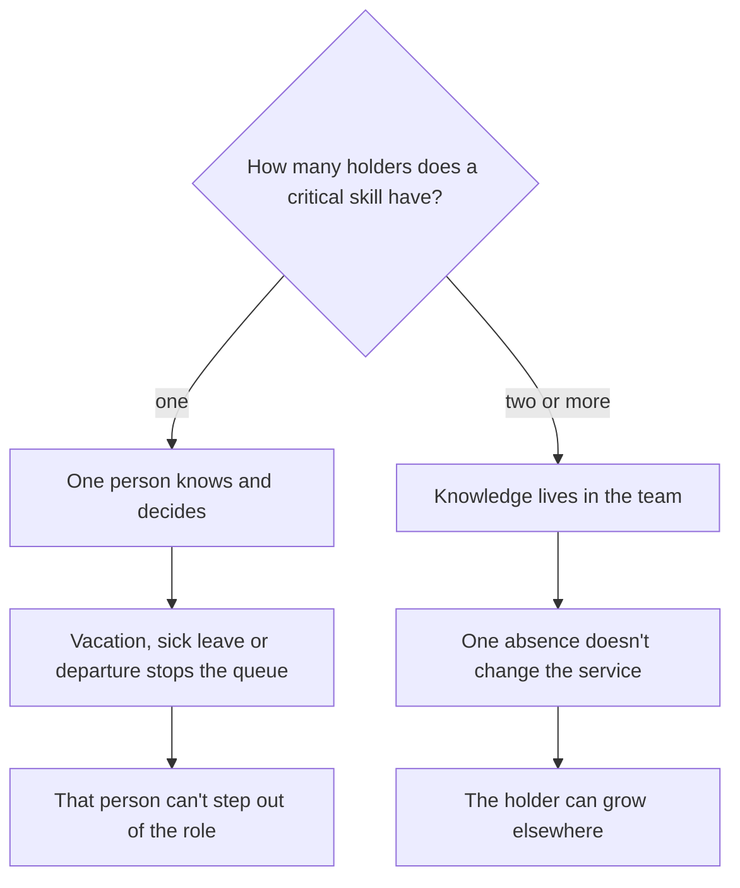
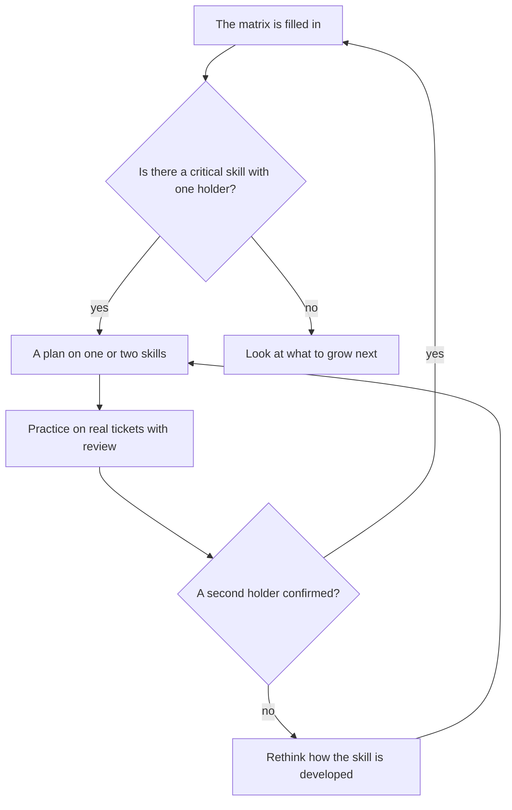

## Introduction

It first happened at the worst possible moment: the only person who knew how one of the products worked went on vacation. Twenty minutes later it turned out nobody on the team could reproduce the problem or explain to a client what was going on, and the queue stalled not from load but from the absence of one person.

Since then I treat knowledge not as a team's common property but as a property of specific people: every skill has its holders, and if there is only one holder, we're talking not about competency but about a dependency. The competency matrix — a simple skills × people × levels table — makes that dependency visible before it happens.

The claim is short: single-point risk is almost free to detect and the most expensive to live through. The article is about how the matrix is built, what standard I hold, and how a development plan comes out of it rather than a report for show.

## Single-point risk

Single-point risk is a situation where a skill critical to the service exists in exactly one copy. While that person is working, everything looks fine: they're fast, they know their worth, and they're the only one people bring hard tickets to.

It breaks the same way every time; only the trigger differs: vacation, sick leave, parental leave, resignation, a move to another team. And the risk has two sets of consequences: for the service and for the person.

The service gets a queue without an owner and clients with nobody to explain the situation. The person gets a role they can't leave: they can't take a normal vacation because everything collapses without them, their projects always hinge on them, and the next promotion is discussed with the caveat that there's nobody to replace them.

The fork looks like this:

<!-- вилка: свои точки риска — навыки, которые держатся на одном человеке. -->

Worth naming what doesn't count as risk. A rare skill needed once a year and handled through an external vendor or engineering can safely live in a single copy: keeping a second full expert in it costs more than waiting occasionally.

## The matrix: skills × people × levels

The matrix is a table with two axes: skills down the rows, people across the columns, the level of mastery in the cells. Without levels the matrix turns into a checklist, so a scale is needed — but a simple one, usually four steps.

| Level | What it means | What can be handed over |
| --- | --- | --- |
| 1 | Knows the theory, needs support | Simple tickets by the book, under review |
| 2 | Handles routine work alone | Routine flow and duty shifts |
| 3 | Solves the non-standard and explains it to others | Hard tickets and mentoring |
| 4 | Owns the domain and sets the rules | Developing the skill in the team and decisions about it |

Skills for the matrix come from the work, not from a job description: the products support works with, the kinds of problems — telling bugs from configuration questions — and the tools: the tracker, logs, the test environment. And separately the people-facing skills: written communication and incident review. A list of thirty skills gets filled in a week and forgotten in a month; the workable size is one where somebody could actually lose each skill.

How not to turn filling it in into bureaucracy:

- **Set a level by willingness to hand over work, not by self-assessment.** The question isn't "how good are you" but "can I give this person that ticket without checking it".
- **Fill it in together.** The engineer gives their estimate, the lead gives theirs, and only the divergence gets discussed.
- **Don't mix it with performance review.** The matrix is about capabilities, not about whether someone worked well this quarter.
- **Don't conclude from a single cell.** A level in a cell is a hypothesis tested by real work, QA sampling included.

<!-- вилка: фрагмент своей матрицы — 4–6 навыков и 3–4 человека. -->

What's most valuable isn't the table itself but the conversation you have while filling it in: nearly every time a skill turns up where the lead was sure there were two holders, while in fact one of them had never handled such a ticket.

## The "level 3+ in two people" standard

The standard I hold: every critical skill should have no fewer than two people at level 3 or higher. Not two people in general, but two who can solve the non-standard without your involvement.

Why two, and why the third level:

- **Two holders is the minimum for absence.** One on vacation, one present — the service doesn't change.
- **The third level is the line of independence.** Levels 1 and 2 are useful but won't cover an incident: they require review, which requires a third person.
- **Two holders also check the knowledge.** Someone who is the only expert never looks wrong in the team's eyes: there's nobody to correct them. A second holder creates mutual review.

The consequence of the standard is unpleasant: it demands time from the strongest people. A second holder appears not when the first one explains, but when the second one solves several hard tickets alone while the first reviews. That's not video training, it's supervised work, and it has to be planned in the load rather than in words.

## Development plans on one or two skills

An individual development plan (IDP) is a short form for one person: which skills we're growing, what the person will do, and how and when we'll check the result. It falls out of the matrix by itself if you stay limited.

The first limit: one or two skills. A seven-item plan never gets executed, because the engineer still has eight hours of tickets a day. Two skills are realistic, because they can actually get attention.

The second limit: every skill has a way to verify it. Not "learn the product" but "close three hard product tickets alone and present one at the general review" — that way development is checked by the same work rather than by self-report.

The third limit: a timeframe and roles. An IDP involves three people: the engineer, a mentor — usually one of the skill's holders — and the lead, who is responsible for the engineer having the time and the right kind of tickets. Without the third, the plan stays a wish.

The link between matrix and development closes into a cycle:

<!-- вилка: пример ИПР из своей практики — навык, шаг, способ проверки. -->

## Reviewing the matrix

The matrix ages fast: people learn new products and forget old ones, the team changes, priorities shift. So it gets reviewed quarterly — not rewritten from scratch but compared: where a second holder appeared, where a new hole opened, where the standard is met on paper but not in life.

The review is worth tying to hiring. If the matrix shows a second holder is needed for a rare skill and nobody in the company has it, the task moves from development into hiring or outside help. And the other way round: sometimes a hole is closed not by a person but by a rule — with a good procedure, a second holder may not be needed.

One last thing. The matrix isn't a document about people. It's about the service's ability to work without a specific person — and that changes the tone of the conversation: an engineer isn't "weak" at a level-1 skill, it just isn't their direction yet; and a level-4 professional doesn't owe everyone teaching time — but if they're the only one, the risk comes from them regardless of how good they are.
