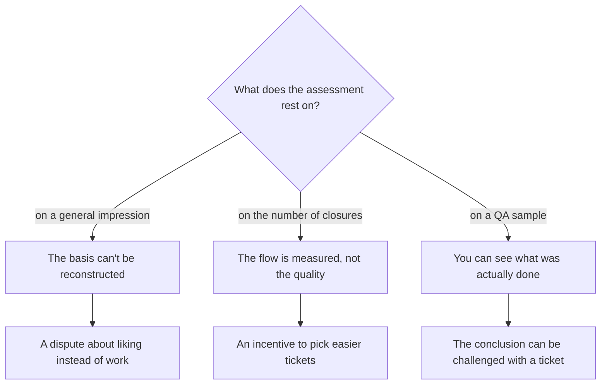
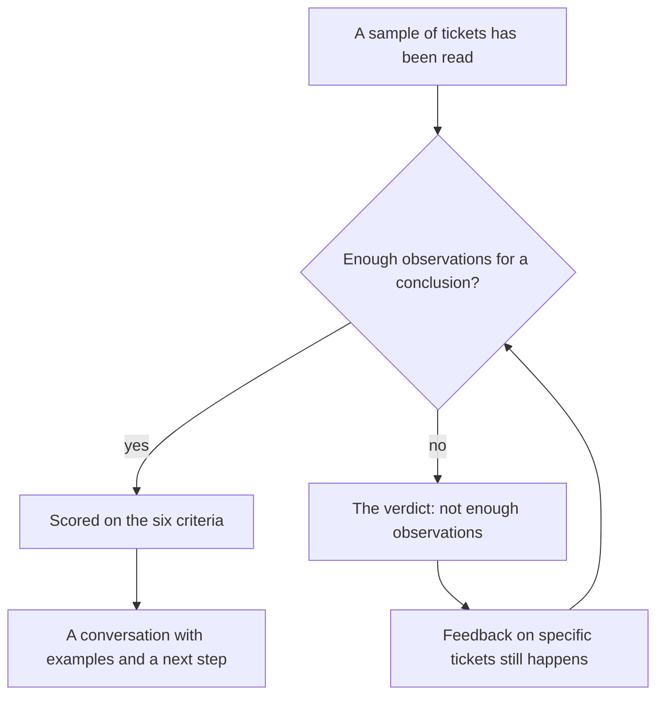

## Introduction

The first assessments I gave as a lead were based on impressions, and I was embarrassed by it. The impression was built from the last ten conversations, from whoever complained loudest about difficulty, from the tickets that happened to land in front of me. Formally it was fact-based — I did read tickets. In reality the facts were selected by memory rather than by a sample, and everyone on the team knew it.

The claim I now treat as mandatory: an engineer is assessed by observable facts from a QA sample, not by the number of closures and not by a general feeling. The sample isn't bureaucracy, it's a way to make the conversation about quality repeatable: the same criteria, the same order, and a conclusion you can challenge with a specific ticket.

This article covers four parts of that construction: why the familiar methods don't work, how the sample is built, what the six-criteria checklist is, and when the honest verdict is "not enough observations".

## Why eyeballing and closure counts don't work

Closure count looks like a metric because it's in the tracker and it's always fresh. But it measures the flow, not the person.

- **The flow isn't distributed evenly.** Someone took quick routine tickets this period, someone took the heavy ones with reproduction and back-and-forth. At equal quality their numbers will differ — and not in the second person's favour.
- **A closure is an event, not a quality.** A ticket can be closed with a formal answer, and the counter will score it the same as real work.
- **Judging by the counter creates an incentive.** People start picking easier tickets and closing them faster — that is, doing exactly what will later require apologies to clients.
- **An impression can't be reproduced.** A month later neither you nor the engineer can reconstruct why the conclusion was what it was. And a conversation you can't reconstruct sounds like "it seems to me".

The fork looks like this: an assessment can rest on one of three foundations, and only the third survives scrutiny.

Next: how the third branch is built.

## QA sampling

A sample is several closed tickets per period, read end to end: the client conversation, the internal comments, the status history, and the final resolution. Not just the reply to the client — the history, because that's where you see the stalls, the extra iterations, and whether the next step was ever named.

Rules without which a sample turns into a witch hunt:

- **Random with coverage.** Tickets are picked by a grid, not by "the ones I find interesting": different engineers, different categories, different severities. Otherwise the sample fills up with arguments with clients.
- **In batches, not one by one.** No conclusion is drawn from a single ticket. The review happens in a batch, and a recurring pattern is only visible in one.
- **The same criteria every time.** If the criteria shift to fit the case, there's nothing to compare.
- **Not only the lead reads.** A second reader is the cheapest guarantee that the assessment doesn't reflect your relationship with the engineer.
- **Fact first, conversation second.** The conclusion is formulated before the meeting, not during it.

<!-- вилка: свой размер выборки и правила отбора — сколько заявок, откуда, кто ещё читает. -->

What matters is that the sample isn't an error hunt. Its job is to see what the work looks like, not to catch someone. If the task is framed as "find a reason to lower the score", people learn that faster than you finish the first quarter.

## The six-criteria checklist

Every ticket read is scored on six criteria using a 0/1/2 scale. The scale is deliberately coarse: 0 — not done, or done in a way that would need redoing; 1 — done with caveats; 2 — done in a way that makes the ticket a good example. Five points out of ten create an illusion of precision and a dispute about units rather than about work.

| Criterion | What is observed in the ticket | What "2" means |
| --- | --- | --- |
| Understanding the problem | Reproduction, clarifications, a statement of the essence | The client confirmed the problem was understood correctly |
| Completeness of the solution | The cause was removed, not just the symptom | The ticket didn't come back and shouldn't |
| Communication | Clarity, the next step, time expectations | The client needed no follow-up "what now" |
| Following the process | Category, severity, deadlines, routing | The process helped rather than got in the way |
| Working with knowledge | A link to an article, a contribution to the knowledge base | The solution is recorded so someone else can reuse it |
| Handover and escalation | A context package, an owner, what's already checked | The next person had nothing to re-ask |

A note on the knowledge criterion: it isn't about how many articles someone wrote. KCS (Knowledge-Centered Service — an approach where the article is written while the problem is being solved, not afterwards) shows up in a sample differently: is there a link in the ticket that lets the next person solve the same problem faster.

Why six and not twenty: each criterion has to be visible in the ticket with your own eyes, without extra surveys. Twenty criteria produce a beautiful table and no assessment at all — nobody holds twenty requirements in their head, so any detailed scoring collapses into the two or three criteria that seem important this month.

<!-- вилка: сверьте формулировки шести критериев со §6.2 годового плана — здесь они даны в рабочем виде. -->

One more thing: the scores don't add up to a single "quality number". The sum of six criteria hides the profile: an engineer with excellent communication and weak solutions doesn't become "average" — their strengths and gaps are in different places, and each needs different work.

## The "not enough observations" verdict

The most useful part of the construction is the permission not to conclude. Sometimes the sample is simply small: the person was on vacation, joined recently, spent the period on duty with uniform tickets. Deriving an assessment from that material means inventing it.

That isn't a gap in the process, it's a regular outcome of it. It reads like this:

Three rules that keep the verdict honest.

- **It doesn't replace feedback.** Even with too few observations, a specific ticket can be reviewed: what went well, what you'd redo.
- **It must not become a habit.** If it hangs over the same person for a third sample in a row, the problem isn't the sample, it's how the flow is distributed.
- **A conclusion is never drawn from closure counts.** Absent observations can't be replaced by a tracker number — that is exactly what we were escaping.

## The conversation about the assessment

An assessment doesn't exist to be given, it exists so that something changes afterwards. So the conversation follows the same criteria as the sample and starts with self-assessment.

The order that works for me:

1. **Self-assessment on the same six criteria.** The person reads their own tickets and scores them.
2. **Reconciling the gaps.** What gets discussed isn't the scores but the cases where the scores diverged sharply.
3. **One or two tickets as an example, not a verdict.** The example should be recognisable, not humiliating.
4. **One next step.** Not a list of seven items, but one change in the work before the next sample.

<!-- вилка: обезличенный пример разговора — что было в выборке, что разошлось и чем закончилось. -->

It's worth agreeing separately that assessment by observable facts isn't an appraisal. It's a development tool and a conversation about quality: if an engineer first hears about their weak spots at the moment a number is expected for the annual salary review, the sample isn't to blame — the blame is that nobody used it all year.
