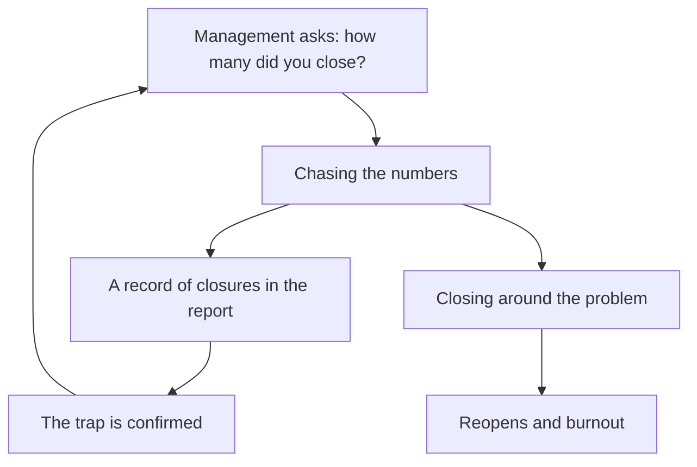
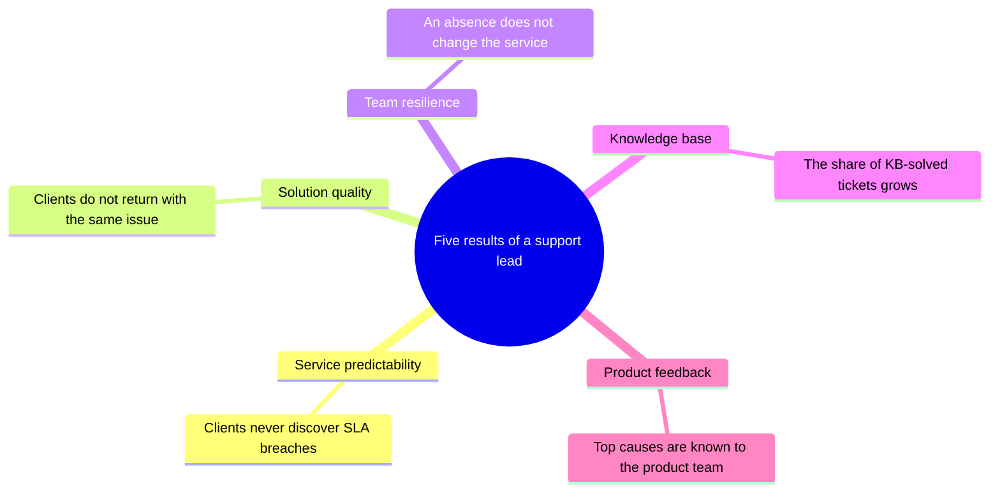
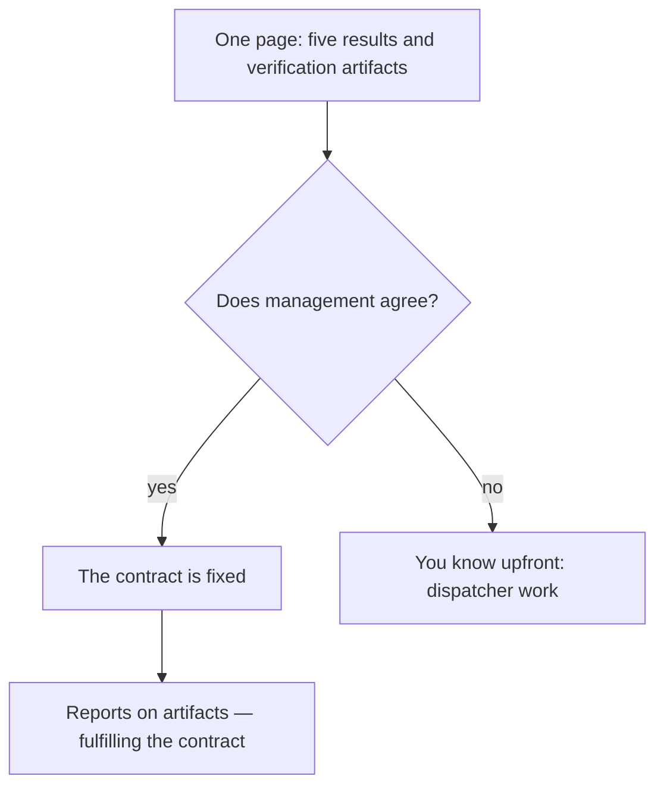

## Introduction

This is the first article in a series about running support as a managed service. The series follows the logic of a support lead's year: first the strategic frame — what actually counts as a result — then operational processes, knowledge, the team, the external circuit, and metrics.

When I ask support leads how their work is measured, I most often hear the same list: number of closed tickets, average response time, queue size. These are convenient numbers — visible in the tracker every minute, adding up to a feeling that "the system works." But they are numbers of activity, not of result.

A support lead's work is measured not by how many tickets passed through the service, but by what changed in the service because of that work. I have formulated five such results for myself: service predictability, solution quality, team resilience, the knowledge base, and feedback into the product. Each can be verified — not with a perfect textbook metric, but with a concrete artifact that either exists or does not.

If you cannot name five results of your work, you are working as a dispatcher. A dispatcher is needed too, but their price is set by the number of tickets processed. A lead should cost more — and this article is about exactly what makes the difference.

## The "did more — means good" trap

The most insidious trap in our profession looks like this: the quarter closes with a record number of closed tickets, the team works at its limit, the report looks magnificent. A month later you discover that the share of reopened tickets has grown, clients are increasingly irritated, and engineers are burning out — because "close at any cost" means closing around the problem: without finding the cause, without writing to the knowledge base, without an honest conversation with the client.

Sound familiar? And it has a systemic cause: when the only understandable metric is "did more," the team optimizes exactly that. Everything that does not fit into this metric — quality, knowledge, problem prevention — becomes "invisible" and is sacrificed by default.

Worse still, the trap sustains itself. The closure record makes it into the report, management is pleased, the lead receives confirmation that everything is being done right — and next quarter the team chases the numbers again. Fixing the consequences — reopens, repeat contacts, burnout — falls to the same lead, but without resources: the time was spent racing toward the number. There is only one way to break the circle: agree on different results before the numbers become the goal.

Here is how that circle closes:

Note that nobody chooses this trap deliberately. It arises on its own — out of reporting that is easy to collect, out of management's question "how many did you close this week?", out of the habit of measuring what is easy to measure. The antidote is one: decide in advance which results the service actually needs, and agree on how they will be verified. Those are the five results that follow.

## The five results of a support lead

An overview of the five results — each with its own direction of work and observable sign:

### 1. Service predictability

Predictability means the client, the engineer, and management all know what will happen to a ticket and when. A critical ticket gets a response timer; an escalation to L3 goes out with a clear package and an agreed deadline; an SLA breach is not something that "happens" — it is predicted in advance, and the client is warned before the deadline expires.

The difference between a service that has a regulation and a predictable service shows at the very first failure. In the first case, the regulation exists but lives in a document: a ticket with a burning deadline sits in the general queue, escalation is replaced by a message "we passed it to the relevant team," and the client is the first to learn about the breach. In the second, the regulation is built into the work: criticality is assigned at first touch, deadlines are visible in the queue every day, and breach risk is a reason to act, not to hope.

The sign by which the result is visible: clients never discover SLA breaches. If you learn about a missed deadline from an angry email rather than from your own weekly queue review, there is no predictability yet — only a regulation on paper.

### 2. Solution quality

A ticket is closed with a solution, not with "cannot reproduce" or "try rebooting." The engineer understands the cause, records it, and tells the client what exactly was done and why it will not happen again.

It is important not to confuse closing with solving. A closure is an event in the tracker; a solution is the client's state: the problem is gone, the client understands what happened, and knows what to do if similar symptoms reappear. The two are often confused because they look identical in the tracker, and the first is far easier to measure. But client trust is earned by the second: a person who described the same problem twice and twice received "try again" will not write to support a third time — they will write to their own management.

The sign: clients do not return with the same problem. Formally — a low share of reopens; in practice — a QA sample where an engineer confirms across several tickets: the cause was found, the solution is complete, the reply to the client is clear.

### 3. Team resilience

The service survives a vacation, an illness, or the departure of a key person without degradation. Knowledge is distributed: a critical skill exists in at least two people, and any incoming ticket is picked up within 15 minutes — not because "a hero is on duty," but because that is the norm, verified by calculation.

Single-point risk is the cheapest to detect and the most expensive when it fires. While the carrier of critical knowledge is present, everything works and the problem seems invented. Then they leave — on vacation, to another company, into burnout — and what nobody was taught leaves with them: how the integration is configured, why the queue fails, where to look for a strange error. The service does not fall instantly; it rots slowly for months while the knowledge is restored by trial and error.

The sign: one person's absence changes neither the speed nor the quality of the service. If your only integrations specialist goes on vacation and the integrations queue stalls — there is no resilience, there is a single point of failure with a first and last name.

### 4. The knowledge base

Solutions accumulate and get reused. An engineer who meets a familiar problem searches the base rather than colleagues' memories; finding an inaccuracy, they fix the article. The base grows at the moment of solving, not "sometime in free time."

That last caveat matters more than it seems. "We'll write the article when things calm down" is a promise that is never kept: the calm never comes, and the context of the solution — symptoms, versions, pitfalls — fades from memory within days. An article written a month later is reconstructed from memory and loses the most valuable part — the details that make it applicable. So the only working moment for the knowledge base is the ticket resolution itself: found it in the base — used it; did not find it — wrote it while the problem is still in your head.

The sign: the share of tickets solved from the knowledge base grows. And a second, less obvious one: new engineers reach working speed faster — they do not need years to absorb experience from a mentor sitting nearby.

### 5. Feedback into the product

Support is the only team that knows clients' real problems at scale and with context. But a list of "everything is bad" is ignored by the product team — justifiably: without scale ("how many clients"), cost ("how many support hours"), a workaround, and a concrete proposal, it is not data, it is a mood. Feedback works when recurring problems turn into cards with data: how many clients are affected, how many support hours are consumed, what workaround exists, what we propose. And each card acquires a status — accepted, postponed, declined.

Without this loop, support is doomed to serve the same problems forever, spending a growing share of the team on them. With it, every systemic problem gets a chance to leave the flow for good: fixed in the product or covered by a workaround and an instruction.

The sign: the top causes of the quarter are known to the product team, and some of them are fixed or covered. Support stops being the sufferer and becomes a source of data that development relies on.

## How to verify each result

Verifiability is the key property of all five. Not a perfect metric, but an artifact that answers one question monthly: did it get better or worse?

| Result | Verification artifact |
| --- | --- |
| Predictability | Weekly queue control by risk filters; an SLA breach log with causes — every breach is explained, not "burned away" |
| Solution quality | A QA sample of tickets against a checklist; the reopen share as a rough signal, not as an engineer's rating |
| Team resilience | A competency matrix: critical skill at level 3+ in at least two people; a resilience audit — "what breaks when I am gone" |
| Knowledge base | The share of tickets solved from the KB; the share of articles updated in the quarter |
| Feedback | Problem cards with product statuses; a quarterly report of top causes |

Note that none of these artifacts requires perfect data or expensive systems. The breach log is entries in the tracker; the QA sample is an hour a week on a few tickets; a problem card is a one-page document. Verifiability is achieved by discipline, not infrastructure.

The second practical question is who verifies and how often. Once a month is enough: less often, and the results drown in noise; more often, and the check becomes ritual for its own sake. The lead should be the one verifying: this is not an audit from above but their own management instrument. And one strict prohibition: artifacts must not turn into reporting. As soon as the "result → artifact" table starts being filled "for management," it dies — people fill it to avoid questions, and it stops showing the truth. These artifacts are the lead's working instruments; management sees conclusions, not raw tables.

Conversely: if there is no artifact, there is no result. Not "poorly measured" — there is none. You cannot manage what you cannot verify; it is more honest to admit "we do not do this yet" than to report a result that does not exist.

## The five results as a contract with management

The most important purpose of this list is not self-analysis but agreement. The five results are my contract with management: here is what I promise to produce, here is how each result is verified, and here are the artifacts by which you will see it at the end of the year.

This conversation is worth having in the first months, before targets are calibrated into metrics. Otherwise the "did more" trap returns — this time as a KPI set by someone else. In practice it looks like this: you arrive with a single page — five results, each with its sign and verification artifact — and ask: "Do you agree that in a year the service should differ in exactly these ways?" The agreement is fixed, and you gain legitimacy: monthly reports on predictability and knowledge are no longer "a substitute for numbers" but the fulfillment of the contract.

Both branches of that conversation:

Management that has agreed to the five results stops asking "how many did you close" and starts asking "what became more predictable" and "which problems went into the product." If there is no agreement, that too is a valuable signal: you know in advance how your work will be judged, and you can consciously decide whether you are ready to work as a dispatcher.

The second consequence: these same five results become the frame of the year. Service stabilization is predictability. Knowledge and self-service are the knowledge base. Assessment and development of the team are resilience and quality. Incident reviews and problem cards are feedback into the product. The next article in the series is about boundaries of responsibility: what a lead does personally, what they delegate, and what they give up consciously.