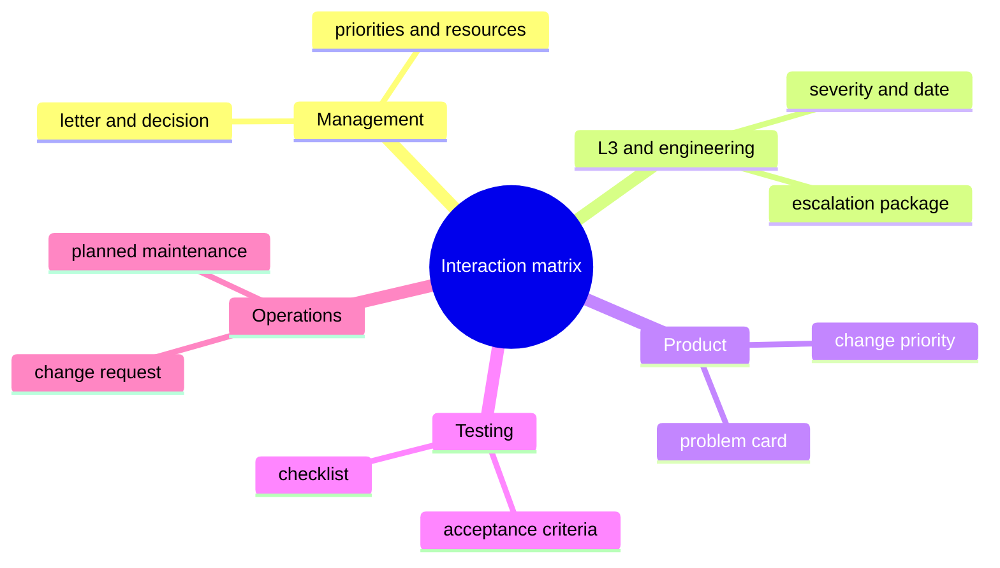
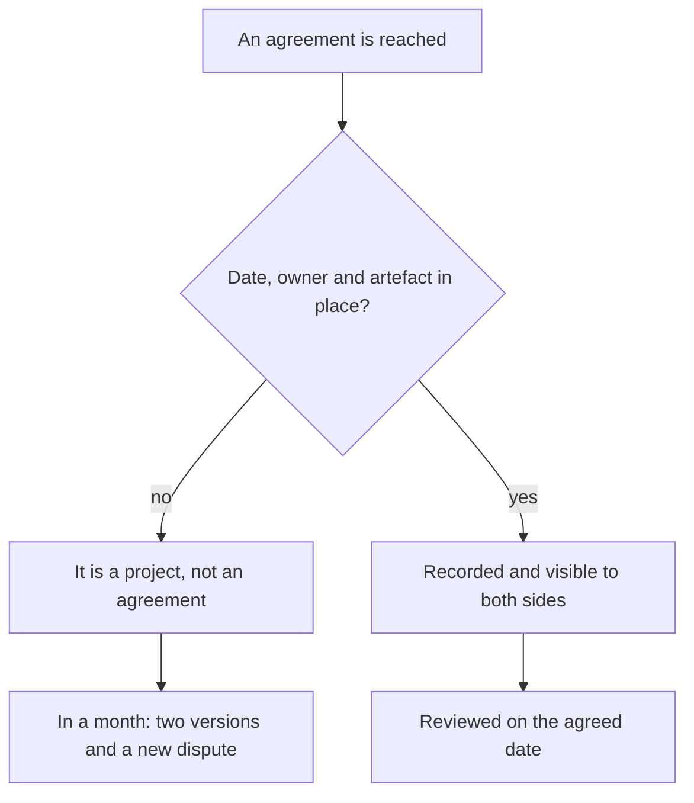

## Introduction

Most of my time went not to tickets but to sorting out relations with neighbouring teams. Engineering waited for support to reproduce a bug, support waited for engineering to fix it, product waited for everyone to estimate dates, management waited for me to explain why it was all stuck. Each side was right in its own way and nobody was to blame.

The cause isn't people, it's an assumption everyone makes silently: that neighbouring teams can read minds. That it's obvious who decides on a release delay, where a ticket goes when no bug is found, whose answer the client is waiting for. None of it is obvious. The moment the assumption meets reality, a polite fight starts over who owes what to whom.

The interaction matrix is the table that replaces mind-reading: who decides on which questions, through which channel it happens, and what artefact is left behind. The agreement-as-a-project rule completes it: every agreement needs a date, an owner and an artefact - otherwise it simply doesn't exist.

Both tools belong to the outer contour of the annual plan I described in ["A support lead's year by quarters"](/en/blog/support-lead-year-roadmap/). Here it's the mechanics: how the matrix is built and how it pulls a specific conversation out of the mud.

## Typical friction

Friction with neighbours is rarely unique. Over a couple of years I collected four recurring stories - one per important contour.

**With management - expectations against resources.** Management sets a goal that grows out of clients' well-meant wishes, while support knows what that goal costs in hours. The friction isn't that the goal is bad; it's that the cost gets discussed after the promise. The result: the lead either explains a failure or carries it on heroism.

**With L3 and engineering - who holds the ball.** A ticket goes to the third line, comes back as "cannot reproduce", goes back with logs, returns asking for a video. With three or four handovers it looks like normal bustle. With dozens, something else changes: the ticket ages, the client gets angry, and formally nobody misses a deadline, because the timer doesn't run while the ticket is being handed over.

**With product - the language of pain and the language of scale.** Support arrives with stories about specific clients, product answers with quarterly priorities. Both are right and both leave dissatisfied: support has no argument beyond the emotional one, product has no picture of how many such stories there really are.

**With testing and operations - the boundary of responsibility for quality.** Who verifies the workaround, who owns the fact that the request flow grew after a release, who tells clients about planned maintenance. In normal mode it doesn't matter; in an incident it is critical, and an incident is too late to sort it out.

<!-- вилка: 2–3 своих примера трений — с кем, из-за чего, чем заканчивалось. -->

All four stories share one element: the question "who decides" has no answer written down before the conflict. Next, how that answer gets recorded.

## The interaction matrix

The matrix is built on four columns: contour, questions, decision owner, channel and artefact. There are as many rows as there are contours with a regular exchange with the service.

For my service it looks like this:

| Contour | Questions it decides | Decision owner | Channel and artefact |
| --- | --- | --- | --- |
| Management | Priorities for the year, resources, exceptions to the rules | The manager | A one-page letter and the decision in it |
| L3 and engineering | Severity, the cause of a defect, the fix date | The technical lead of the contour | Escalation package in the tracker |
| Product | Priority of a change, inclusion in a release | The product owner | A problem card with data |
| Testing | Acceptance criteria, regressions | The test lead | An acceptance checklist |
| Operations | Planned maintenance, access, environments | The operations duty engineer | A change request |

What matters in the table isn't the list of contours but two things that are usually missing everywhere: **the owner's name** and **the artefact**. Without a name, "the team level" decides nothing, and within a week the question is back with the support lead - the most interested party. Without an artefact, the decision lives in a chat until the first retelling.

Channel and artefact are not the same thing, and confusing them is expensive. The channel is where the conversation happens: email, tracker, meeting. The artefact is what remains after it: a record, a document, a clause in the process. A conversation in the right channel without an artefact is as useless as a document nobody knows about: two weeks later the tracker will refer to "we discussed it" with no trace of the discussion.

In shape the matrix resembles RACI (a responsibility matrix: who performs, who is accountable, who is consulted, who is informed), but its job is narrower. RACI allocates roles inside one project; the interaction matrix answers a question a project never asks: where the boundary between two different services runs, and who holds the decision at the seam.

What the matrix looks like as an overview:

Filling the matrix in alone is a bad idea. For each row I sit down with the owner on that side and ask three questions: which decisions in this contour do you make without me, what do you need from support to make them fast, and what artefact will be left behind. The first two questions give content, the third gives a trace that later shows the agreement exists rather than merely having been voiced.

<!-- вилка: своя матрица — контуры, владельцы, артефакты; что оказалось сюрпризом при заполнении. -->

## The agreement-as-a-project rule

Agreements fall apart not because they are broken on purpose but because they stay a project: "we agreed that tickets with these symptoms go straight to engineering". Agreed where? When? Who exactly? Until when? Without answers, in a month everyone remembers their own version, and both versions are in good faith.

The rule goes like this: an agreement has a date, an owner and an artefact - otherwise it doesn't exist. Not because bureaucracy is desirable, but because without the three elements it can't be checked, revised or ended.

- **A date.** An agreement isn't a law for the ages but a working hypothesis for a period. A review date removes the fear of agreeing: in a quarter you can change your mind without accusations.
- **An owner.** A person, not a team. Not "engineering decides severity" but "this engineer confirms severity; in their absence, their deputy".
- **An artefact.** A link to a tracker record, a knowledge base page, a clause in the process, an email template. The artefact is the place where the agreement lives without us.

How the rule works in practice:

<!-- вилка: пример провала без артефакта — что договорились, как рассыпалось, что изменили. -->

A note on the review. The date in the calendar is not a formality: it is what turns an agreement from a promise into a manageable object. The review has three questions: is it working, what has changed since, do we continue or change it. Without that ritual, agreements live for years after they stopped being true and get in the way of agreeing anew.

## Don't promise on behalf of other teams

The most expensive skill in this contour is learning not to promise on behalf of a third party. The client asks: "When will it be fixed?" The support lead has two bad answers and one good one.

The first bad one is to name a date you invented. Two weeks later the priority has changed, and support is the one to blame, though it was only being polite. The second bad one is "I don't know, that's not us": formally honest, for the client it is a refusal to own your own service.

The good answer has three parts: what is known for certain, who owns the question on the other side, when the next update comes. "The defect is confirmed, the fix is with team X, the owner is such-and-such; the next update is on Wednesday, even if there is no news." It is still a promise, but a promise about your own communication, not about someone else's deadline.

There is a second half to the skill - not promising internally either. When an engineer tells the client "we'll have it done", while the decision depends on three teams, the promise collapses the same day. The same formula helps here, only shorter: what is known, who owns it, when the update.

With the matrix, that skill becomes technical rather than a matter of character. If the matrix row says a specific engineer on the other side confirms severity, the answer to the client no longer needs improvisation: I take the row and speak from it. Without the matrix the same answer gets assembled afresh each time and depends on how well the day happens to go.

## Rolling it out without one more document

The main risk for the matrix is becoming the fifth document in a folder nobody opens. I have seen it more than once: a beautiful table, presented at a general meeting, and a month later nobody remembers where it lives.

What keeps it alive:

- **It sits where the work is.** A link to a matrix row goes into the escalation template, the problem card, the letter to management. Then the matrix is read at the moment it is needed, not at a separate training session.
- **It is short.** Five to seven rows that are used beat thirty that describe an ideal world.
- **It is revised in the same meetings where decisions are made.** Once a quarter - ten minutes at the general review: which rows are outdated, where the owner changed, which agreement expired.
- **It starts with one row.** The approach that works best is to pick the one contour where friction costs most and fill in only that. The second contour adds itself once the first starts saving time.

Nobody needs to be taught the matrix separately, and that is the main sign it is alive. If an engineer opens the escalation template and sees fields taken from the matrix, they learn it in two weeks without a course. If the matrix needs its own course, the table describes a world where nobody works.

What the matrix doesn't solve. It won't replace trust and won't spare people from having to talk. It removes the worst kind of conversation - the one that first works out who was even supposed to decide. What remains is a conversation about substance, and it is usually short.

And the last thing worth keeping in mind: the matrix is not about distributing blame but about distributing decisions. A row saying "owner: product" does not mean "product answers for this and we wash our hands": support still answers for the quality of the answer to the client, while product answers for the priority. Once that distinction gets lost, the matrix turns into a way to bounce tickets and loses trust faster than it manages to take root.

<!-- вилка: как матрица живёт у вас — где лежит, как часто пересматривается, что изменилось после внедрения. -->
