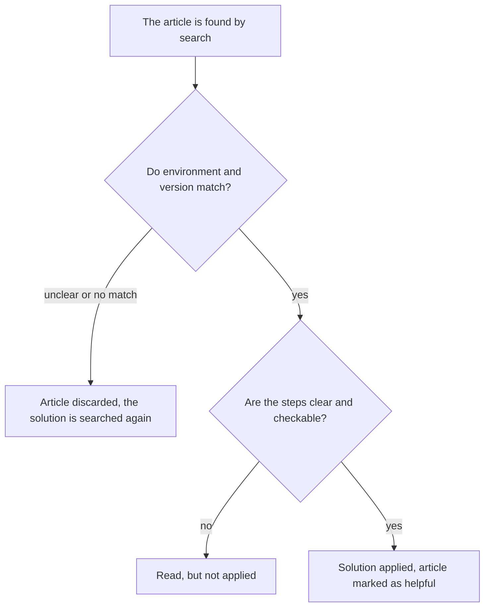
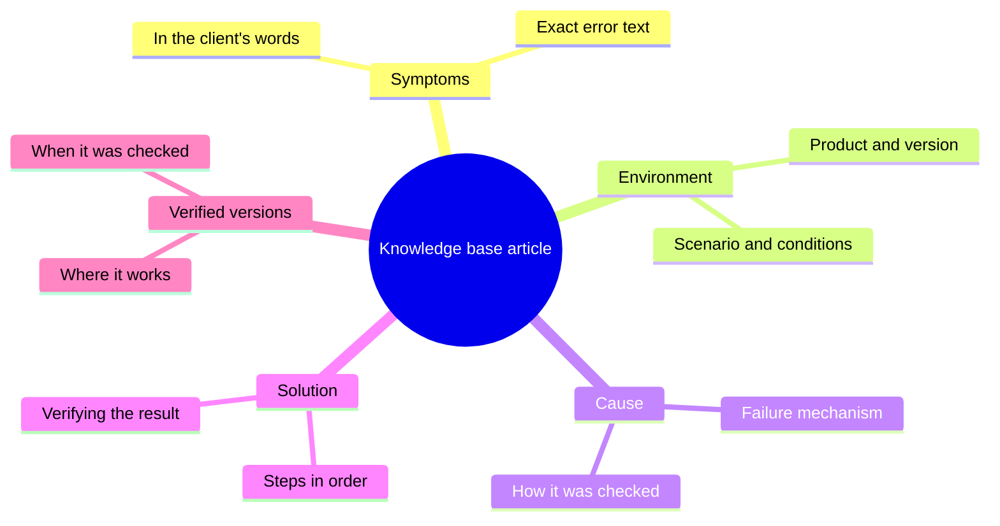

## Introduction

When I proposed tidying up the knowledge base, the first reaction was predictable: "I can't write". People who explain complicated things to clients in plain words every day were sure that an article is literature, and literature is not their job.

Six months later the same people were writing articles in ten minutes and did not treat it as a separate task. What changed was not their attitude to text — the format changed. Instead of a blank page there was a template: five blocks, each with its own question. Once you know that the first block is the symptoms in the client's words and the last one is the versions the fix was verified on, there is nothing left to invent — you only have to recall what happened.

The article "KCS in the workflow: the article is written at the moment of solving" was about making the article appear inside the ticket. This one is about what has to be in it so that a draft from a ticket can be reused by someone else a month later.

## Why free-form articles are not reused

Free form looks democratic: write as you think, substance is what matters. In practice it has three systemic defects, and none of them is cured by asking people to write better.

**Search does not find it.** Search works on words, and the words in free text belong to the author. An engineer searches for "can't open the customer portal", the article is called "Authorisation issue after the update", and inside it is a story about tokens. No matches, empty results, and the person goes to the chat.

**There is nothing to check the structure against.** The reader cannot quickly answer their own questions: is this about my version? Is this about my scenario? Where do I verify that it helped? They read everything in a row or nothing at all — and either way they do not trust the result.

**The versions are unverified.** Free text does not force anyone to state what the fix was verified on. The article lives for years; the product changes; the reader applies the instruction to a different version, gets a different result, and concludes that the base lies.

All three defects are about one thing: the reader cannot decide whether the article applies to their case. Here is their path through a free-form article:

Every block of the template below closes one turn of this fork. That is why the template is not bureaucracy but a way to reduce the number of "not applied" exits.

## The KB article template

The template I arrived at has five blocks. It is deliberately short: the more fields there are, the lower the chance they get filled in inside a ticket.

Now block by block — what to write there and what usually gets written instead.

| Block | The question it answers | The typical filling mistake |
| --- | --- | --- |
| Symptoms | What the client sees and what words they use for it | Retelling in system terms instead of user phrases |
| Environment | Under which conditions it reproduces | "Everyone" or a missing product version |
| Cause | Why it happens | The name of the error instead of the mechanism |
| Solution | What to do, step by step | One paragraph instead of a sequence with a check |
| Verified versions | Where the solution actually works | "Current" with no date and no version list |

A few rules I add to the template:

- **Symptoms in the client's words.** Not "authorisation error" but what the person would type into search: "after changing the password the customer portal rejects me".
- **Environment — only what matters.** Listing everything is pointless; you need the two or three parameters that change the outcome.
- **Cause — a mechanism, not a label.** "An expired certificate on the proxy" explains why this particular fix worked and lets the reader recognise the same cause behind a different symptom.
- **Solution — as steps, with a check.** The last step always answers the question "how do I know it worked".
- **Versions — mandatory.** Without them an article that never ages exists only in dreams.

<!-- вилка: ваши обязательные поля шаблона — что вы добавили к пяти блокам под свой продукт. -->

## A worked example

A template is easy to accept in words and hard to apply. So in training I show not an empty template but one article taken apart completely: where the symptom sounds like the client's phrase, where the environment is narrowed to the parameters that actually mattered, where the cause is explained as a mechanism, and at the end the versions the fix was verified on.

What a good example makes visible:

- **Symptom and cause are different things.** In the example they do not coincide, and that is exactly why the article is found by the client's words rather than by the name of the technology.
- **The solution explains, not just prescribes.** The reader understands why a step is needed; if the step did not work, they can guess where to look next.
- **The result check is separate from the step.** "Restart the service" is a step; "make sure the connection error is gone from the log" is a check.
- **The limits of applicability are named.** The example shows in which case the solution will not help and what to do then.

<!-- вилка: обезличенный реальный пример статьи КБ целиком по шаблону — одна статья из вашей базы, приведённая целиком. -->

For the dissection it is worth taking not the most complex article but the one the team references most often. It is the one everybody reads in a hurry, it is the one where a format mistake costs the most — and it is the one where you can see why the blocks people usually skip matter.

The example is also useful because it removes the main fear: an article written to the template takes less time than free text. There is no composition to invent and no words to pick — you have to answer five questions whose answers the author already has.

## A KB owner without a separate headcount

The template solves the problem of structure but not the problem of time. Articles age, get duplicated, lose relevance, and somebody has to notice. In "KCS in the workflow" this is the role of the knowledge base owner; here is what it means in practice, without a separate position on the staff list.

The knowledge base owner is an engineer with dedicated hours per week and a mandate to change other people's articles. The work consists of four recurring actions:

1. **Review by signals.** Not "reread everything" but looking at what happened to the base over the period: which articles were opened, which were marked unhelpful, where duplicates appeared, what stopped being opened at all.
2. **Merging and cleaning.** Two articles about the same thing are worse than one: the reader picks the wrong one. Duplicates get merged, the obsolete goes to the archive.
3. **Edits handed back to authors.** The owner does not rewrite everything personally; they return a specific remark to the author: "the article about the VPN is missing the client version, please add it".
4. **Structure.** Categories, titles, cross-references — the things that make search work and that are invisible in any single ticket.

The key constraint: the owner cannot have more than one or two other duties besides the line. If they are simultaneously the head of the base and the head of escalations, the base gets handled on a leftover basis — that is, never.

<!-- вилка: частота ревизии и её формат — раз в неделю или раз в две, по какому списку, сколько времени занимает. -->

And the last thing I understood about the owner: the role only works together with the lead. The owner sees the problems but does not always have the authority to change the process — for instance, to require the team to mark articles as helpful. Those decisions stay with the lead, which is one more reason to keep the base review on a regular rhythm rather than in firefighting mode.

The template, the example and the owner are the three things that turn drafts from tickets into a base people use. The next step is to deal with what repeats most often in the base: recurring problems and records with an owner.
