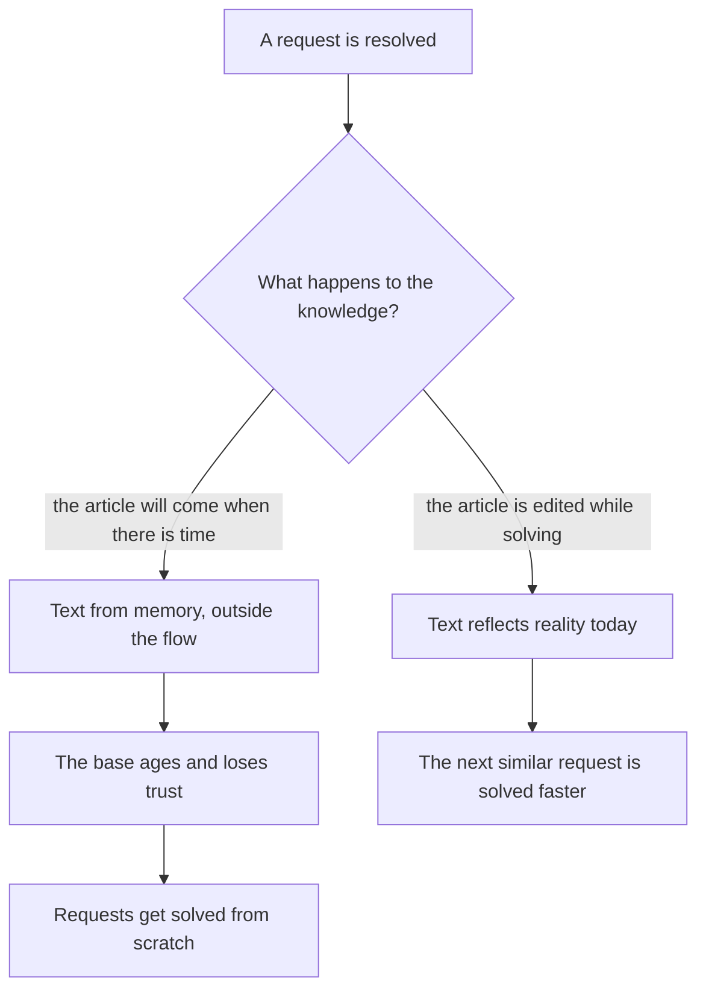
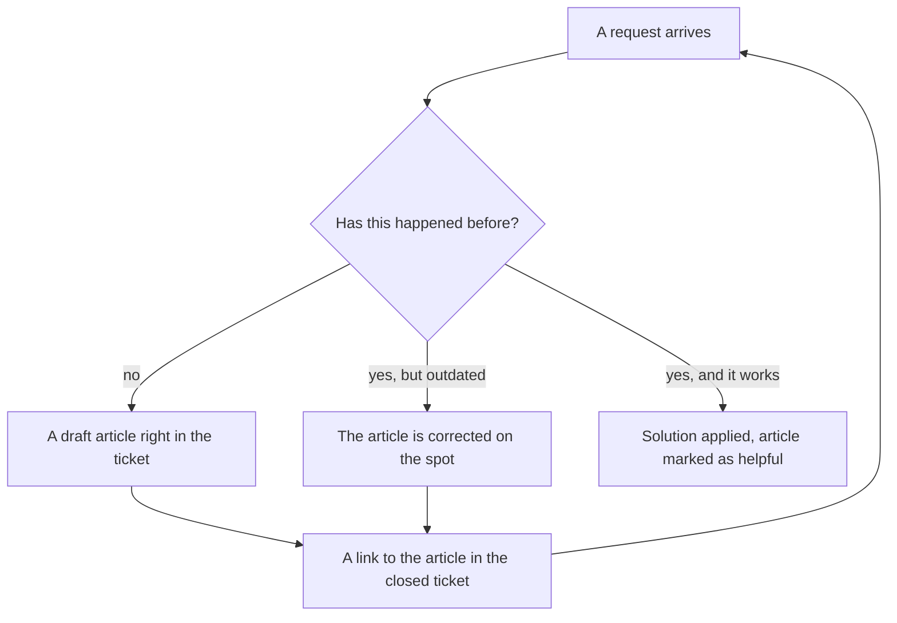

## Introduction

"I'll finish the knowledge base article once I clear the queue" is a sentence I said for my entire first year as a support lead. The queue never cleared, the article never got finished, and the knowledge base stayed in the state the previous team had left it in: a few dozen articles from the past, some about product versions that no longer existed, some about questions nobody asks.

Back then I thought it was a matter of discipline: engineers don't like writing, so remind them, set a deadline, ask politely. A year later I understood that the knowledge base had been organised outside the work. Documenting stood next to ticket resolution as a separate task for later, and so it always lost to the queue. The moment I stopped making a separate task out of knowledge, the base started changing without any reminders.

That is how KCS works (Knowledge-Centered Service — an approach in which the knowledge base grows as a by-product of resolving requests rather than as a separate article-writing project): knowledge is created, used and improved in the same flow where tickets get closed. It is not a tool and not a policy but a way of organising the work.

In the yearly roadmap knowledge sits in the second quarter, and not earlier: until you have numbers about the flow, you cannot know which articles are needed at all. This article is about the mechanics of that quarter. The earlier steps of the block are about stabilising the service: triage at first touch, deadline control, escalation to L3.

## A base as an archive and a base as a tool

The two models of accumulating knowledge look alike in a report and diverge in daily work.

**The base as an archive.** Knowledge gets documented when there is time: in a quiet week, before an audit, at management's request. It is written by those who like writing or who find it hard to refuse. The article is composed from memory, after the ticket is closed, and describes not what happened but what the author remembers about what happened. The purpose of such a base is the fact of its existence: "we have a knowledge base, here is the link".

**The base as a tool.** The article is a working object used inside the ticket. It is opened before solving, its steps are checked, it is corrected when it does not match reality. The author is not "the one who can write" but the one who has just solved the problem and knows exactly what helped.

The difference shows in a single question an engineer asks when picking up a new request: "where do I look to see whether this happened before?" If the answer is "ask Ben" or "scroll the chat", the base works as an archive no matter how many articles it holds. If the answer is "search the base", it works as a tool even when there are few articles in it.

What happens to an archive next is predictable. First the articles go stale silently: the product changed, the article did not. Then the team stops believing them: one search returned something irrelevant, a second returned something outdated, a third time the engineer went straight to the chat. Then nobody writes new articles, because writing into a dump makes no sense. A year later the base exists only for the report, and people open it to tick a box.

The fork in its pure form looks like this:

Next — what exactly "while solving" means at the level of a single ticket.

## The Solve Loop inside the ticket

In KCS the working cycle of a request is called the Solve Loop. It consists of four actions, and all four happen inside one ticket rather than after it.

1. **Search.** The first action on a request is a search in the base, not an analysis from scratch. Not for the report, but so that what is already solved is not solved twice.
2. **Use.** The solution found is applied. If the article helped, that is recorded in the article or the ticket: without the record nobody learns that it works.
3. **Create or fix.** If nothing suitable was found, a draft is created. If something was found but is outdated, the existing article is corrected. Both actions take minutes, not hours: it is a draft, not a publication.
4. **Link.** The closed ticket keeps a link to the article that was used or created. The link is not bookkeeping but a way to find the article from the history of requests.

My first version of this cycle was different, and it did not work: I demanded a complete article at the end of every ticket. What came back was either nothing or two pages nobody opened. The requirement "good from the start" kills the mechanism itself: a person who has just worked through a problem is ready to record the gist but not ready to edit it.

So the working version includes three permissions I grant the team explicitly:

- **A draft does not have to be pretty.** A link, the steps, what helped — that is enough. Format and structure are polished by the knowledge base owner, more on that below.
- **The author does not have to generalise.** An article written for one specific request is already useful because it exists; generalisation is separate work, and it is not done by the person closing the ticket.
- **Editing someone else's article is allowed and expected.** Any engineer has the right to edit, not only the author. An article without editors quickly turns into a museum piece.

How the cycle closes inside the flow of requests:

The last arrow in this diagram matters most. The next request starts with a search, and the quality of that search depends on what was left behind by the previous one.

<!-- вилка: как устроен Solve Loop в вашем трекере — где инженер ищет статью, где создаёт черновик, как отмечает, что статья помогла. -->

## The Evolve Loop and the KB owner

KCS has a second cycle — the Evolve Loop, the cycle of the base's development. If the Solve Loop answers "how knowledge gets into the base", the Evolve Loop answers "what happens to the base next". Articles age, get duplicated, accumulate contradictions; the category structure stops matching what clients actually ask about. Without the second cycle the first runs into a void: the more actively the team writes, the faster the dump grows.

The Evolve Loop rests on usage signals, not on opinions about quality. The signals are simple: how many times an article was opened, how many times it was marked helpful, how many tickets were closed with a link to it, what people write in comments, and whether clients come back with the same problem after the article was applied.

The life cycle of an article in such a system looks like this:

| State | How to recognise it | What to do about it |
| --- | --- | --- |
| Draft | Created in a ticket, reviewed by nobody | Use it, extend it, mark it as helpful |
| Working | Opened, helps, produces closures | Watch product versions and update it |
| Outdated | "Did not help" marks, repeat requests | Rewrite it or remove it from search |
| Archive | The scenario or the product is gone | Remove it from results, keep it as history |

Someone has to own this cycle. In my practice it is a role rather than a separate headcount: the knowledge base owner is an engineer with dedicated hours per week and a mandate to change other people's articles. What they do: work through "did not help" marks, merge duplicates, clean out the obsolete, make sure article titles are understandable, and hand back to authors the edits those authors did not get to.

A role without hours does not work. "Deal with the base when you have time" is exactly the wording the archive in the first section grew out of. The hours have to sit in the calendar and be protected from the queue — just like the lead's time for change in the article "The manager's rhythm: the 40 % rule".

<!-- вилка: ритм владельца КБ — сколько часов в неделю, какие сигналы смотрит, что чинит первым. -->

## Why quotas kill the base

The most popular answer to "the base is not growing" is a quota: this many articles per month per engineer. I tried that one too.

A quota measures volume, not usefulness. The moment volume becomes the criterion, the team starts producing volume — not out of malice, but because that is how any indicator works. What appears in the base under a quota:

- **Articles about what is easy to describe.** A simple request becomes an article, a complex one does not, even though the complex one repeats more often.
- **Duplicates and variants.** Everyone writes their own version of the same instruction, because searching and extending takes longer than creating from scratch.
- **Ticket copies.** The request text and the answer moved into an article, with no generalisation and no environment described.
- **A search that stops working.** The more nearly identical articles there are, the worse the results, the less trust in the base — and the faster the team goes back to the chat.
- **Pencil-whipping.** The final stage: a link to an article is put in the ticket to meet the indicator, while the article was never opened.

A quota is easy to replace with measures of contribution that cannot be met formally:

- the share of requests resolved using an article;
- the number of edits to existing articles — a correction counts as work, not as a side effect;
- the share of articles marked helpful at least once in the period;
- the number of repeat requests on the article's topic after it was applied.

If a quota is still needed as a temporary accelerator, it is better set on edits and tagging than on new texts. An edit requires the article to be opened and read — and that is already working with the base as a tool.

## The share of resolutions from the KB

The main measure of a base's health is the share of resolutions from the KB: the ratio of tickets closed using an article to all closed tickets. It shows not the authors' activity but the real role of knowledge in the flow.

Like any metric, this one lives or dies by its definition. "Closed with a link to an article" is not the same as "closed from an article". In the first case attaching a link is enough; in the second the article has to have actually produced the solution. So the definition fixes two things: what counts as use, and how it is confirmed — by a helpfulness mark, a field in the ticket, or a sample review. Without that the metric measures discipline in filling a field, not the maturity of knowledge.

Second, what to compare against. The absolute value of the share says nothing on its own: a service with a large flow of routine questions and a service with individual incidents are not comparable. Meaning appears in the quarter-on-quarter movement and in combination with the other indicators of point A — time to resolution, the share of repeat requests, the escalation rate. That is covered in detail in "Baseline before goals".

<!-- вилка: динамика доли решений по КБ за квартал — значение на старте, текущее значение, что повлияло. -->

Third, who looks at the number and what they do about it. A metric without an action stays a picture. In my rhythm it is reviewed once a month together with the Evolve Loop signals, and the review always produces one result: what exactly changes in the base next month — the topic, the format, the structure, or nothing at all, because the number is where it should be.

KCS does not end at launch. It is a flow in which an article is not the output of a project but the working trace of a solution. The next step of the block is to turn drafts into articles that can be reused: a knowledge base article template and the role of its owner.
