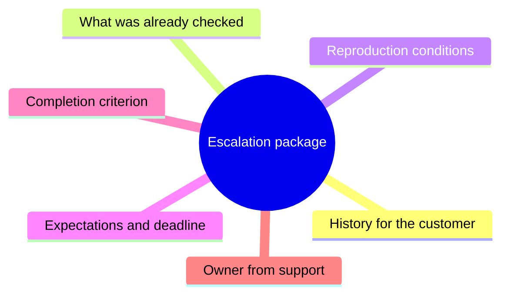
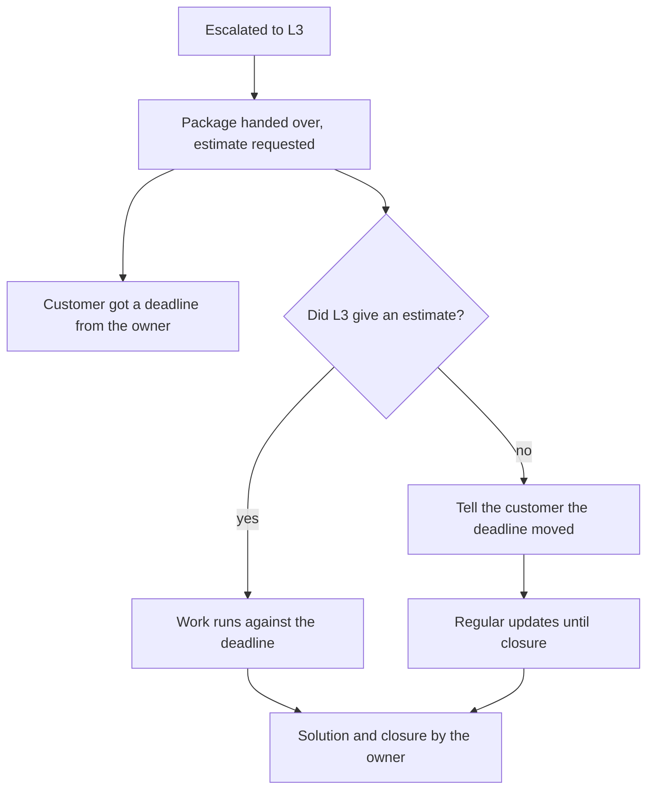

## Introduction

My first escalations felt like relief. The ticket went to the third line, and the tension went with it: now it's not my problem. A day later it turned out the problem was still mine — the customer was writing to me, the developer was asking for clarifications, and the ticket came back with "and what have you already checked?". There was more work than before the escalation.

The cause wasn't development replying slowly, or the customer hurrying things along. The cause was that I handed over the ticket without a package and without an agreement, while treating accountability for the customer as transferred with it. Neither had actually happened.

The previous article in the series — "Not one silent SLA breach: weekly queue control" — was about deadline control and warning before breaches. Escalation is the next step of the same loop: what to do when the deadline is at risk precisely because of a dependency on another team.

The thesis: escalation hands over work with a package and an agreement about time, but not accountability for the customer. Separating those two things is what makes a support line manageable.

## The escalation package

A package is the set of facts without which the third line can't start. Its purpose isn't bureaucracy but saving one round of correspondence: without a package the developer returns the ticket with clarifying questions, and the first day goes not to the solution but to collecting context support had from the beginning.

What the package contains:

- **History.** What's happening from the customer's point of view: what they did, what they expected, what they got.
- **What's already been checked.** Verbatim: which steps, in which environment, with what result. "Rebooted" and "rebooted the service on the test bench, the error reproduced" are different facts.
- **Reproduction conditions.** Version, environment, time, steps. If it doesn't reproduce, say so — that's information too.
- **The customer's expectations.** Not just "it should work": the deadline promised to them and what they will do if there's no solution.
- **The completion criterion.** What has to happen for the ticket to count as solved from support's point of view.
- **The owner on the support side.** A name, not "the team".

Here is the package as a list of parts rather than as the text of an email:

The package is written once and then only extended — that's its strength. It also becomes the basis for replying to the customer: almost the whole text is already inside.

It's worth saying what the package isn't, too. It isn't a forwarded customer email: a forwarded message carries emotion but not checks. It isn't a link to a chat thread: nobody reads a chat a week later. And it isn't a list of hypotheses — hypotheses are attached separately and marked as hypotheses, otherwise the third line starts testing someone else's guesses instead of doing its own job. The package answers "what is known for certain", and that's exactly what makes it useful to both sides: development doesn't spend time assembling context, and support doesn't answer the same questions twice.

<!-- вилка: свой шаблон пакета эскалации — какие поля обязательны и где он живёт. -->

## The OLA with development

The package solves half the problem: the third line gets everything it needs. The other half is time. That's where the ITIL 4 concept of an OLA comes in (Operational Level Agreement — an internal service commitment between teams, as opposed to an SLA with a customer).

An OLA differs from an SLA only in the party: the promise is made to a neighbouring team rather than to the customer. The mechanics are the same: what exactly we promise, how it is measured, and what happens when it's broken.

An OLA with development usually covers three things:

1. **First response time.** Not resolution — a response: "got it, looking" already removes the uncertainty and lets you tell the customer something definite.
2. **Time to an estimate.** When the third line will say whether the problem makes this release or not. The estimate matters most: without it you can't give the customer a new date.
3. **What happens on refusal.** If L3 doesn't take the task — who says so, by when, and where the task goes next.

An OLA is easiest to establish not with negotiation but with a number: come to development with the actual first response time from last month and ask which value they're ready to hold. An agreement the executor names themselves outlives one handed down from above.

Protecting the OLA takes two habits. First, measure: the same first response time on escalations, visible to both sides. Second, look at it together regularly, instead of recalling the agreement the moment it breaks. A systematic OLA breach isn't grounds for a fight inside one ticket; it's a fact for a conversation about resources at management level. That's why an OLA is sometimes described as an agreement that protects the support team rather than the customer.

<!-- вилка: фактическое время первого ответа L3 и что было сделано с нарушениями. -->

## The customer owner rule

The most important rule of escalation is short: accountability for the customer is not transferred. The third line becomes the owner of the technical task — but not the customer's counterpart and not the one promising deadlines.

A few practical consequences.

- **The customer always knows who is talking to them.** Not "development" but a specific person from support running the dialogue.
- **Status arrives at the same frequency as before the escalation.** While waiting on the third line, the customer must not fall into a vacuum: silence after the word "escalated" reads as "forgotten".
- **The deadline is promised by whoever can renegotiate it.** If the support lead names a date based on development's estimate, then when the estimate changes the customer hears it first, not the other way round.
- **A returned ticket doesn't reset anything automatically.** If the task comes back unsolved, support doesn't start from a blank page: the work the third line already did stays part of the history.

There's an opposite mistake too — overprotection: support retells every move of the developer, including technical detail the customer doesn't need. The customer owner rule isn't about volume but accountability: the customer gets a clear answer, not a stream of details, and gets it from one person.

How this looks in practice:

## The escalation checklist

The most common mistake after an escalation is "handed it to L3 and forgot". The antidote is a short checklist applied to every ticket that left for another team.

1. **The package is complete.** History, checks already done, conditions, expectations, completion criterion, owner.
2. **The OLA is applied.** First response time and estimate deadline are stated, not implied.
3. **The customer knows the deadline and the owner.** One person runs the dialogue and updates the status.
4. **There's a checkpoint.** A date by which L3 must answer; if it isn't in the task list, it doesn't exist anywhere.
5. **The ticket isn't ownerless.** It has two owners: a technical one in L3 and a customer one in support, and both are named.
6. **The way back is defined.** How the escalation ends if L3 refuses or misses: who is told and what happens next.

A checklist works only while it has an external effect: for example, a ticket without a checkpoint lands in the weekly risk review. Without that, the rules remain intentions and escalations remain a hope that the problem sorts itself out.

<!-- вилка: сколько сейчас тикетов в эскалации и сколько из них без контрольной точки. -->

The most valuable thing this discipline gives you isn't the third line's speed — it's the ability to answer the customer honestly at any moment. While escalation means handing over work with a package and an agreement, support stops being an intermediary and becomes what it should be: the owner of the customer.
