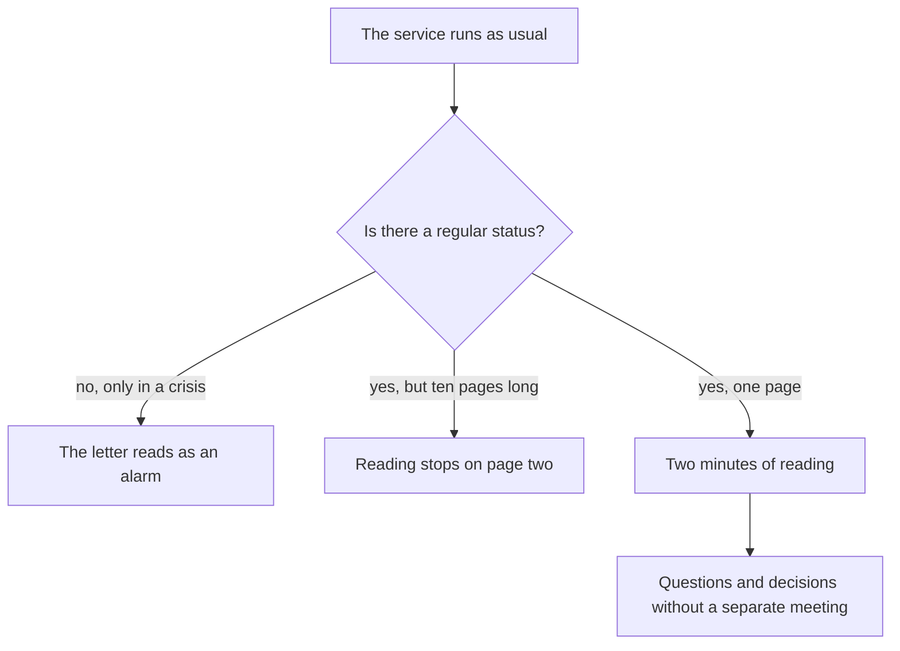

## Introduction

In my first year I ran the support status the way I thought was right: once a month I assembled a big thirty-slide deck covering everything - metrics, charts, reviews, plans. The deck was good. Nobody read it, including me a week after presenting it.

One day my manager said something I still remember: "I can't read reports longer than a page. If you need more, it means you haven't decided what matters." Harsh and accurate. A status report is not proof of work done; it is a decision-making tool, and a tool has a format.

Since then my transparency loop has consisted of two things: a weekly one-page letter and a monthly hour-long review. The first keeps management informed without consuming their time - it reads in two minutes. The second gives room for the conversation that doesn't fit into a letter. The other reports and dashboards didn't disappear, but they stopped being how I talk to management.

This text is about the mechanics: what goes into the letter, what the review hour is made of, and how a status changes decisions instead of merely informing.

## Silence and the ten-page report

Communication with management has two degenerate modes, and both look like work.

**Silence.** While everything is fine, the lead doesn't write: why bother anyone when there's no reason. The first message appears when something is already on fire, and it reads as "we have a catastrophe". After two or three letters like that, the default mode sets in: bad news is expected from this lead, and every message is read with tension. Silence feels neutral, but it builds exactly one scenario - "the lead writes when things are bad".

**The ten-page report.** The other extreme: the lead writes a lot, in detail and regularly, dumps everything the tracker holds and adds commentary. Formally that's full transparency. In practice the manager stops reading on page two - first diagonally, then not at all. And if you ask them outside the report, they can't name a single figure: volume displaced substance.

Both modes share one property: neither leads to a decision. In the first case decisions happen without you and without data; in the second the data exists but nobody has seen it.

There is a third, subtler variant: the status exists, it is regular and even short, but it is assembled from whatever is easy to count. Then week after week the letter looks healthy while the queue grows - because what grows is the slowest tickets, not the most visible ones.

It helps to hold one simple thought: a status is not for reporting, it is so management can make the right decision at the right moment - without needing a separate meeting. Here is what that looks like in practice:

## A one-page letter: seven points

The letter follows the same template every week. Consistency matters more than the content of any single letter: when the structure doesn't change, within a month the manager remembers where the answer to their question lives and stops reading the preamble.

Seven points, each answering its own question:

1. **Summary.** One or two lines: a normal week or something beyond it. Answers "do I need to read all of this".
2. **Volume.** How much came in, by category. Answers "what is the flow doing".
3. **Timings.** How many tickets are outside the target, which categories are affected. Answers "where does it hurt now".
4. **Incidents.** What happened, how it ended, what we change. No names to blame - facts and a decision only.
5. **Queue and ageing tickets.** Tickets that grow old and don't close on their own. Answers "what has piled up".
6. **Initiatives.** Where we are against the stated plan: what is done, what slipped and why.
7. **Asks.** Specifically: which decisions or resources are needed from management this week, with the date they're needed by.

The seventh point is the most important and the one most often dropped. A letter without asks reads like a weather report: interesting, but nothing to do. A letter with asks turns into a working tool.

Two rules without which the template fails. First, the page format: no more than one page, no attachments, no "see the dashboard" when the important part is in the dashboard. Whatever didn't fit goes to the monthly review, not into the next letter. Second, the same date: the letter goes out on the same day every week so nobody has to wait for it.

<!-- вилка: свой шаблон письма — точные формулировки семи пунктов, куда и когда отправляется, кто читатели. -->

## The hourly monthly review

A letter is good for state, bad for conversation. Once a month you need an hour where the people who make decisions are in the room and there is room to discuss what two minutes of reading can't hold.

The agenda of that hour is always the same:

- **Five minutes - the metric picture.** Not a recount of the numbers from the letters, but the month's movement and one conclusion from it.
- **Fifteen minutes - SLA breaches.** Not a summary but two or three reviews: what exactly happened, which systemic element produced it, which change follows.
- **Fifteen minutes - initiatives.** Status for each: done, in progress, stalled. For "stalled" - a cause and a decision, not a description.
- **Fifteen minutes - risks.** What hasn't happened yet but will if nothing changes: capacity, key people, dependencies on third teams.
- **Ten minutes - decisions and assignments.** Owners and dates get recorded; everything else goes into the minutes.

Two conditions without which the hour becomes yet another report. First, the review includes people who can decide, not only people who want to listen. Second, every item ends in a conclusion - either a decision or a deliberate "we decided not to", recorded in the minutes. A review without decisions is worse than none: it takes an hour and creates a feeling that everything is under control.

<!-- вилка: своя повестка обзора — кто участвует, где ведётся протокол, что изменилось после первых обзоров. -->

## How a status changes decisions

The most common mistake with statuses is believing the goal is to inform. Informing is a side effect. The goal is for management to look at the service with the same eyes you do, and decide on the same data.

That's visible in whether decisions change. If in a quarter not one management decision rested on your letters and reviews, the status exists separately from management: it gets read, nodded at, and life goes on.

What makes a status work:

- **Numbers with actions.** Every metric in the review has a consequence: if the value is this, we do that. A metric without a consequence turns the review into chart-reading.
- **Bad news first.** In a letter where everything is fine, a bad line at the end reads as an accident. Bad news in the first paragraph gives the manager time to react - and earns trust in the rest of the text.
- **One subject needs a decision.** Every letter and every review carries exactly one thing that needs an answer from management. If there are ten asks, none will be answered.
- **History.** Letters add up to a chronology: you can see when a problem appeared and what was done. Six months later that is the only way not to start the conversation over.

A technical detail that saves the hour too: the review is prepared in advance and sent out before the meeting. If participants see the numbers for the first time in the room, the first twenty minutes go to reading rather than talking. The letter and the review are not two independent rituals but one loop: weekly letters add up to a monthly picture, and decisions from the review come back in later letters as done or slipped items.

<!-- вилка: пример, когда статус изменил решение руководства — что было в письме, какое решение принято, к какому сроку. -->

A status is not bureaucracy and not proof of being busy. It is a way to make sure management learns about a problem before it becomes an incident, and that decisions are made while they are still cheap. The next article in the series is about asking for those decisions: escalation and resource requests by a template, not by emotion.
