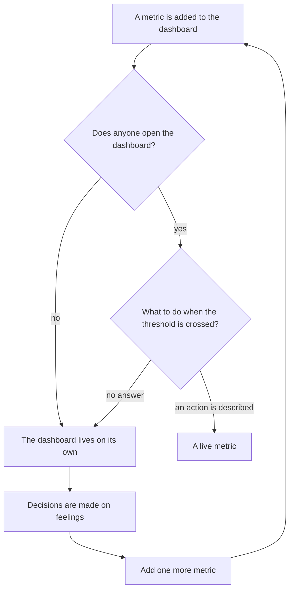
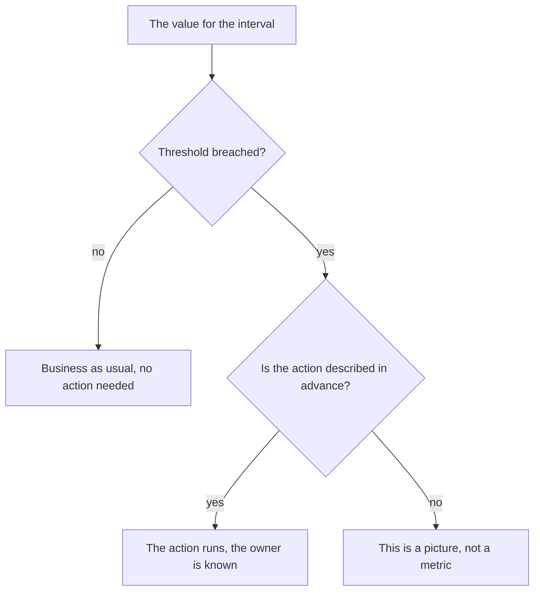
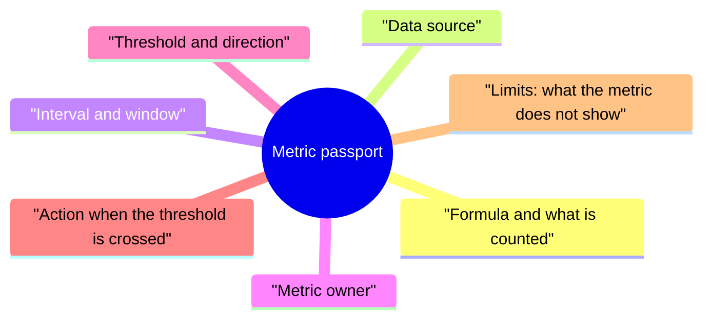

## Introduction

Every support team has a dashboard, and almost every one of them changes no decisions. The numbers update, the charts live their own life, and the conversation at the stand-up still runs in terms of "we seem to be coping" and "it seems to have got worse". The metric is present; the decisions are not.

I arrived at a simple criterion that cuts off most useless measurements: a metric must have an action that follows when it crosses the threshold. If there is no answer to the question "what do we do when the value goes past the line", then it is not a metric but an illustration: it describes the past and does not affect the future.

This article is about why dashboards die, what the criterion of a live metric looks like, what goes into the passport, and which three metrics are worth starting with so as not to drown. It continues the line started in ["Baseline before goals"](/en/blog/support-lead-baseline-first/): there the subject was where the numbers come from and how they become goals; here it is how numbers become actions.

## The museum of metrics

The first dashboard I inherited was beautiful and useless. Its metrics appeared one at a time: someone in management was curious how many tickets arrive at night, someone else about what share of clients write again. Every wish was fulfilled, and a year later there were so many charts on the screen that reading them had become impossible.

A museum of metrics is recognised by signs that have nothing to do with the quality of the numbers themselves:

- **Nobody opens the dashboard.** Except when a screenshot is needed for a report.
- **The value is not discussed.** Asked "why did it drop", people answer "seasonality", and that is where the conversation ends.
- **Not one decision has changed.** Neither queue priority, nor headcount, nor procedure — nothing depended on these numbers.
- **The collection grows.** Every quarter brings a new metric while the old one stays: removing is scarier than adding.

The mechanics of degeneration are simple: a metric is added to answer someone's question, but nobody agrees on what to do with the answer. After a few cycles the dashboard stops being a tool and becomes an archive.

A separate trap is deletion. Removing a metric is psychologically harder than adding one: it feels as if without it we will go blind. In fact it is the ten charts that blind you: while everyone looks at them, nobody looks at any of them.

There is only one way out of the loop — not to clean up the dashboard but to agree on actions. What follows is what that agreement looks like.

## The criterion of a live metric

One question separates a tool from a picture: what happens on Monday if the number went past the threshold during the week? The answer must be concrete: someone does something by a certain date. If there is no answer, the metric is not working — however much effort went into collecting it.

Three consequences follow from this criterion, and I check them on any new metric.

**A metric has an owner.** Not "the team keeps an eye on it" but a person who looks at the value and starts the action. Without an owner a metric lives until the first vacation.

**A metric has a threshold, not just a chart.** A threshold is the line past which the team has agreed to act. It can be rough: what matters is not the exact number but that crossing the line means a specific conversation rather than a fresh debate about whether the number is good.

**A metric has limits of interpretation.** Any metric fails to show something, and that is recorded separately. Otherwise in a month it will be used for conclusions it does not support — and trust in it dies along with the first such conclusion.

How this looks in practice:

There is also a reverse test, which I like best: a metric should be inconvenient to someone. If the value is always within norm and never requires a conversation, it checks nothing but its own health.

## The metric passport, field by field

A passport is a page per metric recording everything without which it cannot be read the same way by different people. The form is boring, but it is exactly what removes the main source of disputes: different people count different things under one name.

The fields, substantively:

- **Formula.** What is in the numerator, what in the denominator, what is excluded from the calculation. Boring details like "count by events, not by current statuses" or "ignore tickets closed at the client's request" decide more than the metric itself.
- **Data source.** A specific system and an export rule. One period, one source: data from the tracker, the chat and memory is not mixed.
- **Interval and window.** How often we look and over what period we count. Weekly control over a quarterly window is a working combination: it removes the noise of individual weeks.
- **Owner.** The person responsible for the value and for the action. They have the right to come to the lead with a problem about this metric.
- **Threshold and direction.** What counts as normal and which drift is a signal. Direction matters more than the absolute value: a slow growth of the repeat-contact share matters more than the figure today.
- **Action.** What exactly is done when the threshold is crossed: who, what and by when. If the action cannot be formulated, the metric is superfluous, and that is a reason not to create it.
- **Limits.** What the metric does not show and which conclusions it is unfit for.

A useful rule when filling it in: the passport is written by the person who will act on the metric, not by the one who collects it. An analyst can compute anything, but if the value has no consumer, the passport turns into a document for the document's sake.

And one more thing, about revision. The passport is not carved in stone: formulas and thresholds are refined as data accumulates, but every change is recorded with a date and a reason. Without that, a year later the values cannot be compared: the number is the same but it is counted differently, and every conclusion about movement becomes arguable.

<!-- вилка: пример одного своего паспорта целиком — формула, источник, окно, владелец, порог, действие. -->

## The metric set of the series

A single metric speaks only about itself, and only a set covers the questions support exists for: are we answering fast, are we solving well, is knowledge growing, is the team burning out.

| Metric | What it shows | What it does not show |
| --- | --- | --- |
| Time to first response (FRT) | How fast the client gets a substantive answer | Does not distinguish a real answer from a template one, unless the definition is fixed |
| MTTA — mean time to acknowledge a ticket | How fast the on-call shift reacts | Hides the distribution: the average can be within norm while individual shifts fail |
| MTTR by outcomes — mean time to resolve | How long the problem lives for the client | Blends the team's work with the client's waiting, unless those times are separated |
| FCR — the share of resolutions at first contact | How often one touch is enough | Grows with aggressive closing and falls with honest classification |
| CSAT with coverage | How the client rates the resolution | Cannot be interpreted without coverage: mostly the extreme cases answer |
| Share of repeat contacts | The quality of the resolution, not the speed of closing | Depends on whether a contact on the same topic counts as a repeat |
| Share of resolutions linked to a knowledge base article | The maturity of knowledge and the potential for self-service | Does not show whether the article helped: an engineer could link it and still explain everything |
| Team eNPS | How willing people are to recommend working here | About people, not clients; measured rarely and unfit for weekly control |

A few rules about the set as a whole, without which the table turns into that very museum.

**There must be fewer metrics than actions.** If a dashboard has ten numbers, two or three of them are usually live. The rest are worth removing — not because they are bad but because the team's attention is limited.

**MTTA and MTTR are counted separately by criticality and by outcomes.** A single average across all tickets blends minutes and weeks and says nothing.

**CSAT cannot be read without coverage.** Satisfaction without the share of respondents is a rating from those who happened to be in the mood to answer.

**The share of resolutions linked to a knowledge base article is misleading without context.** It grows when articles exist and falls when classification becomes more honest.

**eNPS is measured rarely and does not become weekly control.** Its job is to see the dynamics over a quarter, not to catch fluctuations.

<!-- вилка: какие метрики у вас на дашборде сейчас, какие из них действительно живые и какие данные есть в трекере. -->

## Starting with three metrics

The temptation when rebuilding a dashboard is to collect everything at once. That path leads to the same museum, only faster: nobody fills in ten passports in a month, not even the author of the idea. A slow start looks less convincing in a presentation, but a quarter later three live metrics do more for management than the entire previous dashboard.

A working start is three metrics, one per question:

1. **Speed.** Time to first response or MTTA — something the team can change by its own actions this very week.
2. **Quality.** The share of repeat contacts or FCR — what keeps speed from being chased at the client's expense.
3. **Knowledge or people.** The share of resolutions linked to a knowledge base article or eNPS — what shows whether the system is growing rather than only its throughput.

The rollout order I consider workable:

- choose three metrics and write three passports: briefly, a page each;
- measure point A by the same rules we will count by later;
- agree on thresholds with the team rather than handing them down: a threshold nobody believes in starts no actions;
- check the main thing a month later: was there at least one decision taken on these numbers? If not, the metric is dead — either its threshold is wrong or its owner is;
- add a fourth metric only after the three have lived through a quarter.

<!-- вилка: свои паспорта трёх–пяти метрик и текущие значения — что стало действием в первый квартал. -->

A live metric changes not the report but the behaviour: someone opens the value, sees the threshold crossed, and does what is written in the passport. Everything else is graphics that make a report look like management.

The next article of the series — "Resilience audit: what breaks when you are gone" — is about which of these mechanisms will survive your vacation and which hold on habit alone.
