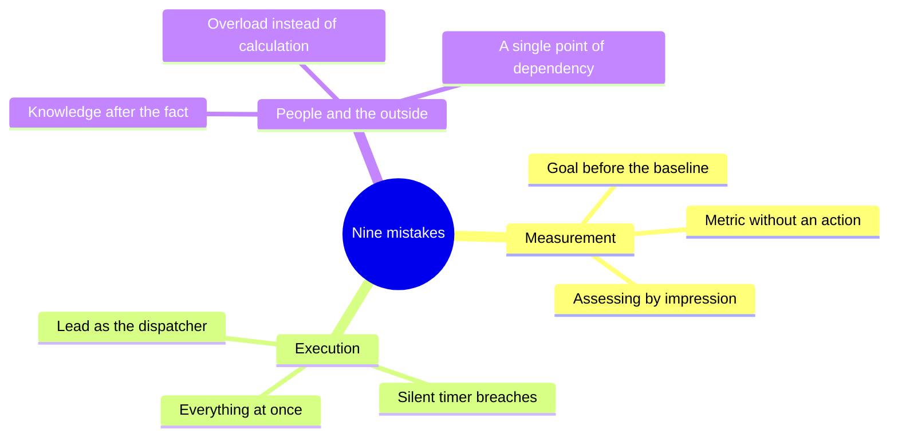
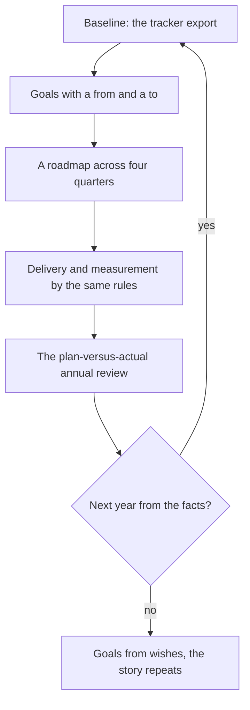
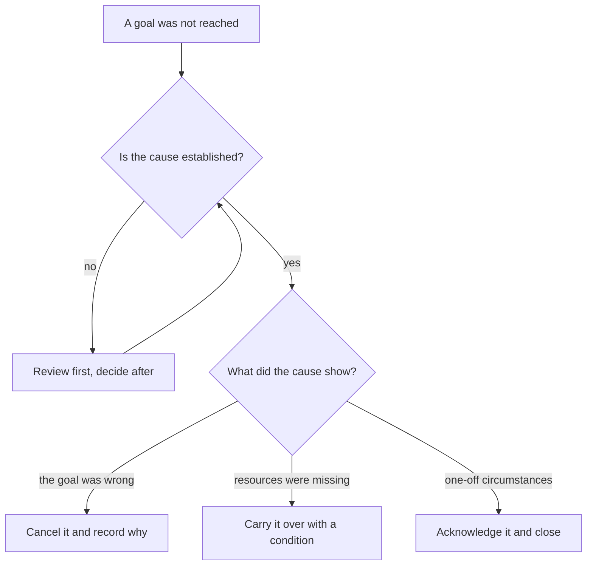

## Introduction

A support lead's year ends twice. First the last quarter closes, then the report does. And while the quarter is more or less clear, the report is the one moment in the year when you have to answer honestly the question you kept postponing: how much of what was promised actually happened.

Over several years and across several services I've built my own list of mistakes I made myself — some of them repeatedly. In the annual plan I work by, it comes down to nine statements, and each has an antidote: a specific artefact or rule that closes that mistake. All nine share a logic: in the moment the mistake looks like a reasonable action — set a goal, take everything on yourself, launch a lot at once — and the bill arrives a quarter later.

This article closes the series, so it has two jobs. First, to present the nine mistakes so that any of them can be recognized in your own week. Second, to carry the year through to the report: what a plan-versus-actual review looks like, how next year's plan comes out of it, and what to do with what didn't happen.

## Nine mistakes and their antidotes

One caveat: this isn't a list of other people's sins. I've made every one of these mistakes and still return to some of them — usually after the service changes scale or composition. The three-column format is simple: how the mistake is phrased, how it looks in practice, and what cures it.

| Mistake | How it looks in practice | Antidote |
| --- | --- | --- |
| A goal before a measurement | The annual plan opens with "raise satisfaction", and there is no baseline | First a tracker export, then a goal with "from", "to", a deadline and an owner |
| The lead as the only dispatcher | Every non-standard ticket reaches the lead, and their vacation stops routing | Three boundary lists, triage at first touch, a routing matrix instead of a personal function |
| Everything at once | A dozen initiatives in one quarter, none of them finished | The sequence rule: the next quarter only after the previous one has a result |
| A metric without an action | A dashboard nobody opens and numbers nothing follows from | A metric passport: formula, source, threshold, action; no action, no metric |
| Silent timer breaches | Overdue tickets surface at a review a month later | A weekly queue check and an alert on the timer, not on memory |
| Knowledge after the fact | The knowledge base article is written "when there's time" and never is | KCS: the article is created at the moment of resolution, the base has an owner and a template |
| Assessing by impression | One-on-ones hear "they try hard" and "great job", and nobody has criteria | QA sampling and quality criteria, observable facts instead of feelings |
| Overload instead of calculation | Every stand-up says "we're overloaded" and there's not one formula | A capacity calculation and a resource request backed by data, with alternatives |
| A single point of dependency | One person's vacation is an incident, their departure a catastrophe | A pickup norm, a second holder of every skill, a resilience audit |

<!-- вилка: сверьте формулировки с §9 годового плана и добавьте 1–2 ошибки, которые встречались именно у вас. -->

Look closely and the nine mistakes fall into three families, each closed by its own kind of work.

Measurement is about not knowing where we count from. Execution is about taking on too much and keeping the routes in our own head. People and the outside world is about the service resting on heroism and on the absence of a conversation with those beyond support. Within each family the antidotes are interchangeable in spirit: the export turns into the metric passport, the passport into the capacity calculation, the calculation into a resource request.

One more shared feature: an antidote is a habit, not an action. A tracker export done once isn't a baseline, it's curiosity. Boundary lists written once aren't boundaries, they're a document that went stale in a month. The mistakes come back every time the service changes scale, and the habit is what keeps them outside the door.

<!-- вилка: какие из девяти ошибок вы совершали и что помогло конкретно вам. -->

## The plan-versus-actual annual review

I understand the annual report not as a presentation of achievements but as a reconciliation. For every result of the year it shows four things: what was planned, what the facts showed, what explains the gap, and what follows from it for next year. Without the fourth item, the report becomes a historical document.

The report's structure mirrors the year's: first the base frame (results, boundaries, baseline, roadmap), then stabilization, knowledge, people, the outside world, metrics. Each theme gets a short block, not a narrative of the process. The rules without which a reconciliation stops being one:

- **The same definitions.** A number in the report is counted by the same definition as at the baseline. If the definition changed during the year, that gets its own line rather than staying unsaid.
- **Numbers from the tracker, not from memory.** A report assembled from memories of hard months always tells a more dramatic story than what happened.
- **A gap is explained by the system, not by people.** "We lacked capacity", "the goal was set before the measurement", "the initiative had no definition of done" are explanations you can work with. "The team didn't deliver" is not.
- **What didn't happen is in the report.** A report without failures reads as a report where they were hidden, and it devalues everything else in it.
- **Every conclusion has a destination.** A change lands in the plan, in a process, in a resource request, or in dropping a goal — otherwise it stays a mood.

<!-- вилка: ваши результаты года — 3–5 показателей с планом и фактом и объяснением расхождения. -->

A report assembled in one evening at the end of December almost always comes out either triumphant or panicky, depending on what the last month looked like. So I assemble it in pieces across the year: each quarterly review adds its block, and in December all that's left is to merge them and write the conclusions. The side benefit matters more: a quarterly reconciliation shows the gap while you can still do something about it, not after.

## Next year's plan built from facts

The main rule for moving from report to plan: the next year starts not from wishes but from a new fact. The fact at the end of December is the baseline for January, and whatever was a goal last year becomes a starting point this year. That's exactly why the series opens with the baseline: without a measured starting point, every following year begins from zero and with the same promises.

The loop looks like this:

In practice this looks more modest than it sounds. Next year's plan holds no more than four or five results, each with an owner, a deadline, and a way to verify it. Everything that didn't make it lives on a "not now" list — and that's fine: a plan of four items carried to the end changes a service more than a plan of nineteen where not one closed.

<!-- вилка: что вошло в ваш план следующего года и от какого факта вы отсчитывались. -->

## What to do with what didn't happen

The hardest section of the report is the one listing what wasn't done. The temptation is clear: rephrase it so it looks delivered, carry it into next year without explanation, or simply drop it. All three guarantee that in a year the list will be longer.

There are three honest outcomes for what didn't happen, and each needs an owner for the decision.

The rules here:

1. **Tell "we didn't do it" from "it didn't work".** Didn't do it — no time, no resources, no priority. Didn't work — we did it and the metric didn't move. The treatment differs, and the two must not be confused.
2. **Don't rewrite history.** The goal is phrased in the report exactly as it was in the plan, even if today it looks naive. Otherwise in a year there's nothing to compare against.
3. **Every unfulfilled item gets a decision, not a status.** "In progress" isn't a decision. Cancel, carry over with a condition, admit it was wrong — those are decisions.
4. **Carrying over without a condition is cancelling.** If an item moved to next year, it has a new deadline and a new condition; without them it moved not into the plan but into a habit.

And the last rule of this section: the review of what didn't happen is held without names. The moment a specific person appears in the explanation, the discussion stops being about the system: everyone else starts defending themselves, and the causes that actually mattered disappear from the conversation. "We lacked capacity", "there was no definition of done", "the route rested on one person" are formulations you can keep working with. Names do not belong in such a review in any form — including your own.

<!-- вилка: 2–3 пункта своего года, которые не сбылись, — что именно решили с каждым. -->

## Series finale

The "Support management strategy" series was written as a system rather than a set of tips: every article rests on the previous one and is verified not on its own but together with its neighbours. Here it is in full, in publishing order.

**The year's strategic frame**

- [The five results of a support lead](/en/blog/support-lead-five-results/) — 2026-03-31
- [Ownership boundaries](/en/blog/support-lead-boundaries/) — 2026-06-07
- Baseline before goals — 2026-11-10
- The lead's year by quarters — 2026-11-13

**Stabilizing the service**

- The service map and Point A — 2026-11-15
- Triage at first touch — 2026-11-18
- Not one silent SLA breach — 2026-11-21
- L3 escalation — 2026-11-24

**Knowledge as a system**

- KCS in the workflow — 2026-11-26
- The knowledge base article template and its owner — 2026-11-29
- Recurring problems — 2026-12-02
- Self-service as Shift Left — 2026-12-05

**The team: people and growth**

- The manager's rhythm: the 40 percent rule — 2026-12-07
- One-on-ones that don't turn into a report — 2026-12-10
- Assessing by observable facts — 2026-12-13
- The competency matrix — 2026-12-15
- Capacity instead of heroism — 2026-12-18

**The outside world**

- The interaction matrix — 2026-12-21
- Status for management — 2026-12-24
- Asking for decisions, not sympathy — 2026-12-26
- The blameless incident review — 2026-12-29
- The problem card for product — 2026-12-31

**Metrics and closing the year**

- A metric without an action — 2027-01-04
- The resilience audit — 2027-01-06
- Nine mistakes of a support lead — this article

Thank you for reading to the end: a lead's year is built not from methods but from habits, and the nine mistakes are not a verdict but a list of what belongs in the plan. If you have a mistake that isn't in the table, write to me — I'll be glad to extend the list and discuss it in the next series.
